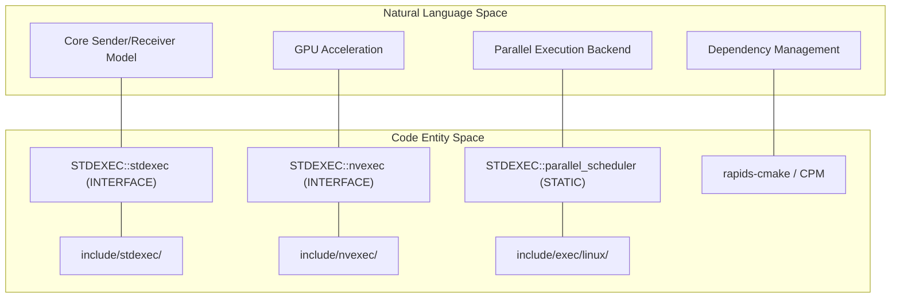
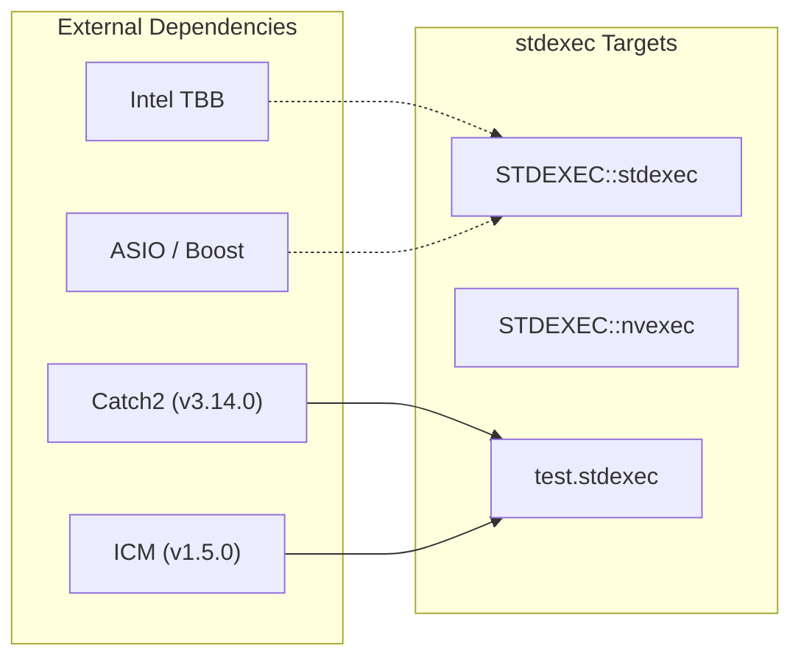

<!-- source: DeepWiki mcp.deepwiki.com · repo NVIDIA/stdexec · page 8 Building and Integration · fetched 2026-10-26 -->

# Building and Integration

<details>
<summary>Relevant source files</summary>

The following files were used as context for generating this wiki page:

- [.github/workflows/ci.cpu.yml](.github/workflows/ci.cpu.yml)
- [.github/workflows/ci.gpu.yml](.github/workflows/ci.gpu.yml)
- [.github/workflows/test-windows.ps1](.github/workflows/test-windows.ps1)
- [CMakeLists.txt](CMakeLists.txt)
- [README.md](README.md)
- [examples/CMakeLists.txt](examples/CMakeLists.txt)
- [examples/benchmark/fibonacci.cpp](examples/benchmark/fibonacci.cpp)
- [examples/io_uring.cpp](examples/io_uring.cpp)
- [examples/nvexec/CMakeLists.txt](examples/nvexec/CMakeLists.txt)
- [include/nvexec/stream/continues_on.cuh](include/nvexec/stream/continues_on.cuh)
- [test/CMakeLists.txt](test/CMakeLists.txt)
- [test/nvexec/CMakeLists.txt](test/nvexec/CMakeLists.txt)
- [test/nvexec/continues_on.cpp](test/nvexec/continues_on.cpp)
- [test/nvexec/when_all_fail.cpp](test/nvexec/when_all_fail.cpp)

</details>


This document covers the build system architecture and integration methods for `stdexec`. It explains how the project is built using CMake, what build targets are available, how dependencies are managed, and how to integrate `stdexec` into downstream projects.

For details, see:
- [CMake Build Configuration](#8.1) for configuration options and library targets.
- [Compiler Support and Requirements](#8.2) for supported compilers and C++20 requirements.
- [Optional Features and Dependencies](#8.3) for CUDA, TBB, and platform-specific flags.
- [Testing and CI/CD Pipeline](#8.4) for test infrastructure and GitHub Actions.

## Build System Overview

`stdexec` uses CMake (minimum version 3.25.0) as its build system [CMakeLists.txt:1](), with `rapids-cmake` providing advanced dependency management through CPM (CMake Package Manager) [CMakeLists.txt:27-36](). The build supports multiple execution domains: the core `stdexec` library for CPU execution, `nvexec` for GPU execution, and specialized contexts for parallel execution.

**Code Architecture to Build Targets:**

**Sources:** [CMakeLists.txt:175-212](), [CMakeLists.txt:28-36](), [CMakeLists.txt:411-421]()

## Project Structure

The repository is organized into a hierarchy with separate directories for headers, tests, and examples:

| Directory | Purpose | Primary Target |
|-----------|---------|----------------|
| `include/stdexec/` | Core P2300 implementation | `STDEXEC::stdexec` |
| `include/exec/` | Extensions (e.g., `async_scope`, `task`) | `STDEXEC::stdexec` |
| `include/nvexec/` | GPU execution (CUDA/NVHPC) | `STDEXEC::nvexec` |
| `test/` | Catch2 unit tests | `test.stdexec` |
| `examples/` | Usage tutorials and benchmarks | `example.*` |

**Sources:** [CMakeLists.txt:175-193](), [test/CMakeLists.txt:112-121](), [examples/CMakeLists.txt:33-45]()

## Core Build Targets

### stdexec (Interface Library)
The primary target `STDEXEC::stdexec` is a header-only interface library [CMakeLists.txt:175-176](). It encapsulates necessary compiler flags for C++20 and threading [test/CMakeLists.txt:90-101](). It includes both the standard `stdexec` headers and the `exec` extensions [CMakeLists.txt:177-186]().

### nvexec (GPU Execution)
Enabled via `STDEXEC_ENABLE_CUDA`, this target provides GPU-accelerated schedulers [test/CMakeLists.txt:164-166](). It requires a CUDA-capable compiler like `nvc++` or `clang` [examples/nvexec/CMakeLists.txt:31-33](). For details, see [Optional Features and Dependencies](#8.3).

### parallel_scheduler
An optional target `STDEXEC::parallel_scheduler` provides a parallel execution backend [test/CMakeLists.txt:122-135]().

**Sources:** [CMakeLists.txt:175-193](), [test/CMakeLists.txt:122-135](), [examples/nvexec/CMakeLists.txt:122-126]()

## Dependency Management

`stdexec` uses `rapids-cpm` to manage third-party libraries [CMakeLists.txt:102-103](). This ensures that dependencies are fetched automatically during the CMake configure step.

**Dependency Relationships:**

**Sources:** [CMakeLists.txt:105-131](), [examples/CMakeLists.txt:108-116](), [test/CMakeLists.txt:107-110]()

## Integration Methods

### CMake Subdirectory (Recommended)
Add the `stdexec` directory to your project and link the target. This handles all transitive dependencies and compiler requirements.
```cmake
add_subdirectory(path/to/stdexec)
target_link_libraries(my_app PRIVATE STDEXEC::stdexec)
```

### CMake Package Manager (CPM)
You can use CPM to fetch `stdexec` directly from GitHub [README.md:94-101]().
```cmake
CPMAddPackage(
  NAME stdexec
  GITHUB_REPOSITORY NVIDIA/stdexec
  GIT_TAG main
)
target_link_libraries(my_app PRIVATE STDEXEC::stdexec)
```

**Sources:** [README.md:89-114](), [README.md:129-146]()

## Testing and CI/CD

The project includes a comprehensive test suite using Catch2 [CMakeLists.txt:105-119](). Tests are automatically discovered via `catch_discover_tests` [test/CMakeLists.txt:154-160](). The CI pipeline validates the build across multiple compilers and platforms [README.md:70-80]().

**CI Workflow Overview:**
- **CPU CI:** Validates core logic and sanitizers (ASAN/TSAN) using Clang and GCC [.github/workflows/ci.cpu.yml:22-43]().
- **GPU CI:** Validates `nvexec` on NVIDIA hardware using `nvc++` and `clang` [.github/workflows/ci.gpu.yml:22-27]().
- **Build Failure Tests:** Uses `ICM` to ensure that invalid code patterns result in expected compile-time errors [test/CMakeLists.txt:170-184]().

For details, see [Testing and CI/CD Pipeline](#8.4).

**Sources:** [test/CMakeLists.txt:148-185](), [.github/workflows/ci.cpu.yml:109-129](), [.github/workflows/ci.gpu.yml:98-116]()

---

