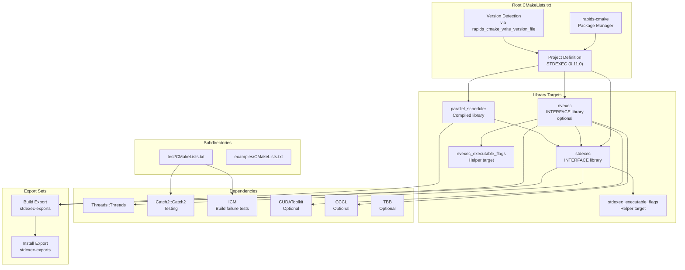
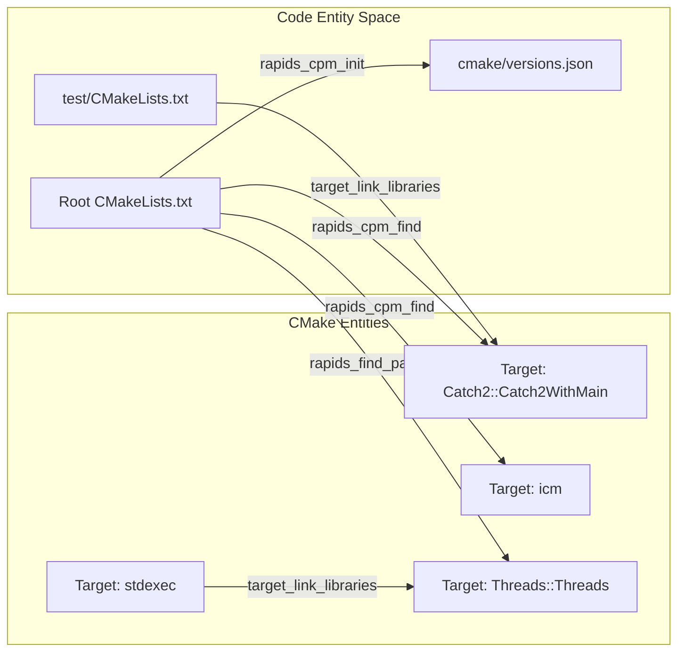

<!-- source: DeepWiki mcp.deepwiki.com · repo NVIDIA/stdexec · page 8.1 CMake Build Configuration · fetched 2026-10-26 -->

# CMake Build Configuration

<details>
<summary>Relevant source files</summary>

The following files were used as context for generating this wiki page:

- [.gitignore](.gitignore)
- [CMakeLists.txt](CMakeLists.txt)
- [conanfile.py](conanfile.py)
- [examples/CMakeLists.txt](examples/CMakeLists.txt)
- [examples/benchmark/fibonacci.cpp](examples/benchmark/fibonacci.cpp)
- [examples/io_uring.cpp](examples/io_uring.cpp)
- [examples/nvexec/CMakeLists.txt](examples/nvexec/CMakeLists.txt)
- [include/nvexec/stream/continues_on.cuh](include/nvexec/stream/continues_on.cuh)
- [sanitizer-ignorelist.txt](sanitizer-ignorelist.txt)
- [test/CMakeLists.txt](test/CMakeLists.txt)
- [test/nvexec/CMakeLists.txt](test/nvexec/CMakeLists.txt)
- [test/nvexec/continues_on.cpp](test/nvexec/continues_on.cpp)
- [test/nvexec/when_all_fail.cpp](test/nvexec/when_all_fail.cpp)
- [test/test_main.cpp](test/test_main.cpp)
- [test_package/CMakeLists.txt](test_package/CMakeLists.txt)
- [test_package/conanfile.py](test_package/conanfile.py)
- [test_package/test.cpp](test_package/test.cpp)

</details>


## Purpose and Scope

This document describes the CMake build system for the `stdexec` repository, including library targets, configuration options, compiler settings, and dependency management. For information about compiler requirements and supported platforms, see [8.2 Compiler Support and Requirements](). For details on enabling optional features, see [8.3 Optional Features and Dependencies]().

The build system uses [rapids-cmake](https://github.com/rapidsai/rapids-cmake) for package management and supports building for CPU-only (stdexec core), GPU execution (nvexec), and various optional scheduler backends (TBB, Taskflow, ASIO).

## Build System Architecture



**Diagram: CMake Build System Structure**

Sources: [CMakeLists.txt:1-153](), [CMakeLists.txt:175-420]()

## Library Targets

### stdexec (Core Library)

The `stdexec` target is an `INTERFACE` library providing the core P2300 execution model implementation.

**Target Definition:**
```cmake
add_library(stdexec INTERFACE)
target_compile_features(stdexec INTERFACE cxx_std_20)
add_library(STDEXEC::stdexec ALIAS stdexec)
```
[CMakeLists.txt:175-176](), [CMakeLists.txt:202-203]()

**Header File Sets:**
- `headers`: Core `stdexec` and `exec` headers from `include/stdexec/*.hpp` and `include/exec/*.hpp` [CMakeLists.txt:177-186]().
- `version_config`: Generated version header `stdexec_version_config.hpp` [CMakeLists.txt:188-193]().

**Key Properties:**
- **C++20 Requirement**: Enforced via `cxx_std_20` [CMakeLists.txt:202]().
- **Threading**: Links with `Threads::Threads` [CMakeLists.txt:199]().
- **Namespace**: Configurable via `STDEXEC_NAMESPACE` [CMakeLists.txt:227-230]().

Sources: [CMakeLists.txt:175-230]()

### nvexec (GPU Library)

The `nvexec` target provides GPU execution support when `STDEXEC_ENABLE_CUDA` is enabled [CMakeLists.txt:291]().

**Compiler-Specific Handling:**

| Compiler | Language | Configuration |
|----------|----------|---------------|
| **NVHPC** | `CXX` | Uses `-stdpar` and native GPU support [CMakeLists.txt:349-352](). |
| **Clang/GCC** | `CUDA` | Requires `CUDAToolkit` and `CCCL` [CMakeLists.txt:381-391](). |

For non-NVHPC compilers, the build system enables the `CUDA` language and links with `CUDA::cudart` [CMakeLists.txt:362-385]().

Sources: [CMakeLists.txt:291-391]()

### parallel_scheduler (Compiled Library)

The `parallel_scheduler` target (formerly `system_context`) is a compiled library providing multi-threaded execution contexts [CMakeLists.txt:416-427]().

**Target Definition:**
```cmake
add_library(parallel_scheduler ${PARALLEL_SCHEDULER_SOURCES})
target_compile_features(parallel_scheduler PUBLIC cxx_std_20)
add_library(STDEXEC::parallel_scheduler ALIAS parallel_scheduler)
target_link_libraries(parallel_scheduler PUBLIC stdexec)
```
[CMakeLists.txt:416-427]()

Sources: [CMakeLists.txt:416-427]()

### Helper Targets

Two `INTERFACE` targets provide common compiler flags for executables:

1.  **stdexec_executable_flags**: Provides warning levels (`-Wall`, `-Wextra`), template backtrace limits, and diagnostic suppressions for CPU targets [CMakeLists.txt:240-280]().
2.  **nvexec_executable_flags**: Provides GPU-specific flags, including memory management settings for NVHPC (`-gpu=mem:separate` or `-gpu=nomanaged`) [CMakeLists.txt:298-310]().

Sources: [CMakeLists.txt:240-310]()

## Configuration Options

### Build Control Options

| Option | Default | Description |
|--------|---------|-------------|
| `STDEXEC_BUILD_TESTS` | `ON` (if main project) | Build the test suite [CMakeLists.txt:84](). |
| `STDEXEC_BUILD_EXAMPLES` | `ON` (if main project) | Build example executables [CMakeLists.txt:458](). |
| `STDEXEC_INSTALL` | `ON` (if main project) | Generate the install target [CMakeLists.txt:86](). |
| `STDEXEC_BUILD_RELACY_TESTS` | `ON` (if GCC 12+) | Build Relacy race-detection tests [CMakeLists.txt:170](). |

Sources: [CMakeLists.txt:79-170](), [CMakeLists.txt:458]()

### Feature Flags

- **STDEXEC_ENABLE_CUDA**: Enables `nvexec` and GPU support [CMakeLists.txt:291]().
- **STDEXEC_ENABLE_TBB**: Enables Intel TBB scheduler integration [examples/CMakeLists.txt:91]().
- **STDEXEC_ENABLE_TASKFLOW**: Enables Taskflow scheduler integration [examples/CMakeLists.txt:108]().
- **STDEXEC_ENABLE_ASIO**: Enables ASIO scheduler integration [examples/CMakeLists.txt:116]().

Sources: [CMakeLists.txt:291](), [examples/CMakeLists.txt:91-122]()

## Dependency Management

The build system uses `rapids-cmake` to manage external dependencies via CPM [CMakeLists.txt:103]().

### Package Association Diagram



**Diagram: Dependency Association**

Sources: [CMakeLists.txt:103-153](), [test/CMakeLists.txt:114-120]()

## Testing Infrastructure

Tests are organized into multiple executables:
- **test.stdexec**: Core library tests [test/CMakeLists.txt:112]().
- **test.nvexec**: GPU-specific tests (requires `STDEXEC_ENABLE_CUDA`) [test/nvexec/CMakeLists.txt:49]().
- **test.parallel_scheduler_replacement**: Tests for the parallel scheduler implementation [test/CMakeLists.txt:123]().

The build system also supports **Build Failure Testing** via `icm_add_build_failure_test`. These tests ensure that invalid code (e.g., incorrect sender/receiver connections) fails to compile with expected error messages [test/CMakeLists.txt:170-185]().

Sources: [test/CMakeLists.txt:112-185](), [test/nvexec/CMakeLists.txt:49-59]()

---

