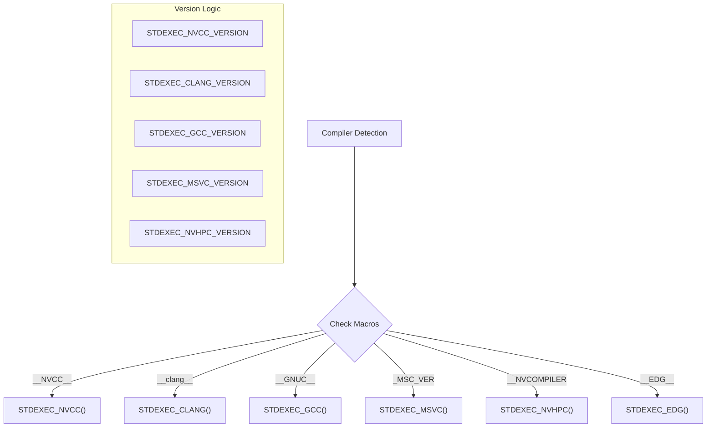
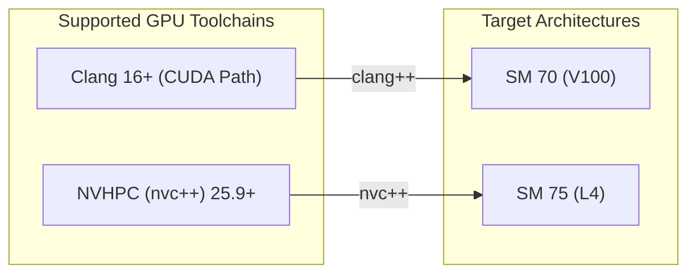

<!-- source: DeepWiki mcp.deepwiki.com · repo NVIDIA/stdexec · page 8.2 Compiler Support and Requirements · fetched 2026-10-26 -->

# Compiler Support and Requirements

Relevant source files

The following files were used as context for generating this wiki page:

- [.devcontainer/gcc11-cuda12.9/devcontainer.json](.devcontainer/gcc11-cuda12.9/devcontainer.json)
- [.devcontainer/gcc12-cuda12.9/devcontainer.json](.devcontainer/gcc12-cuda12.9/devcontainer.json)
- [.devcontainer/gcc13-cuda12.9/devcontainer.json](.devcontainer/gcc13-cuda12.9/devcontainer.json)
- [.devcontainer/gcc14-cuda12.9/devcontainer.json](.devcontainer/gcc14-cuda12.9/devcontainer.json)
- [.devcontainer/gcc15-cuda12.9/devcontainer.json](.devcontainer/gcc15-cuda12.9/devcontainer.json)
- [.devcontainer/llvm16-cuda12.9/devcontainer.json](.devcontainer/llvm16-cuda12.9/devcontainer.json)
- [.devcontainer/llvm22-cuda12.0/devcontainer.json](.devcontainer/llvm22-cuda12.0/devcontainer.json)
- [.devcontainer/llvm22-cuda12.9/devcontainer.json](.devcontainer/llvm22-cuda12.9/devcontainer.json)
- [.devcontainer/llvm22-cuda13.2/devcontainer.json](.devcontainer/llvm22-cuda13.2/devcontainer.json)
- [.devcontainer/nvhpc26.1/devcontainer.json](.devcontainer/nvhpc26.1/devcontainer.json)
- [.github/workflows/ci.cpu.yml](.github/workflows/ci.cpu.yml)
- [.github/workflows/ci.gpu.yml](.github/workflows/ci.gpu.yml)
- [.github/workflows/test-windows.ps1](.github/workflows/test-windows.ps1)
- [README.md](README.md)
- [include/exec/on.hpp](include/exec/on.hpp)
- [include/stdexec/__detail/__config.hpp](include/stdexec/__detail/__config.hpp)
- [include/stdexec/__detail/__preprocessor.hpp](include/stdexec/__detail/__preprocessor.hpp)
- [include/stdexec/concepts.hpp](include/stdexec/concepts.hpp)
- [include/stdexec/functional.hpp](include/stdexec/functional.hpp)

## Purpose and Scope

This page documents the compiler requirements, supported versions, and compiler-specific configurations for building `stdexec` and `nvexec`. As a reference implementation of the P2300 Senders/Receivers model, `stdexec` pushes the limits of C++20 template metaprogramming and coroutine support, necessitating specific compiler versions and configuration flags.

For information about CMake build options, see [8.1 CMake Build Configuration](). For details on how these compilers are tested, see [8.4 Testing and CI/CD Pipeline]().

---

## C++ Standard Requirements

`stdexec` requires **C++20** as the absolute minimum standard. The library makes extensive use of C++20 concepts, coroutines, and advanced template features.

| Requirement | Value | Purpose |
|-------------|-------|---------|
| Minimum C++ Standard | C++20 (`-std=c++20`) | Concepts, coroutines, `constexpr` improvements |
| Recommended Standard | C++23 (`-std=c++23`) | Improved coroutine support and standard library features |
| MSVC Conformance | `/Zc:__cplusplus` | Correct reporting of the standard version macro |
| Preprocessor | Conforming | Required for complex macro expansions in the core model |

The library includes explicit checks for these requirements in `include/stdexec/__detail/__config.hpp`:
- Verifies `__cplusplus >= 202002L` [[include/stdexec/__detail/__config.hpp:20-26]()]
- On MSVC, verifies the use of the new conforming preprocessor (`/Zc:preprocessor`) [[include/stdexec/__detail/__config.hpp:28-30]()]

**Sources:** [include/stdexec/__detail/__config.hpp:20-30]()

---

## Supported Compilers

### Compiler Version Matrix

The following table lists the minimum versions of compilers that are actively supported and validated in CI.

| Compiler | Minimum Version | CI Validated Versions | Notes |
|----------|----------------|-----------------------|-------|
| **GCC** | 12.0 | 12, 13, 14, 15 | [README.md:74](), [.github/workflows/ci.cpu.yml:30-42]() |
| **Clang** | 16.0 | 16, 22 | [README.md:75](), [.github/workflows/ci.cpu.yml:22-29]() |
| **MSVC** | 14.43 (VS 2022) | 19.43+ | [README.md:76]() |
| **Apple Clang** | 16.0 | 16+ | [README.md:77]() |
| **nvc++** | 25.9 | 26.1, 26.3 | Required for GPU support [[README.md:78]()], [[.github/workflows/ci.gpu.yml:24-27]()] |

**Note:** `stdexec` does **not** currently support NVIDIA's `nvcc` compiler [[include/stdexec/__detail/__config.hpp:83-86]()], [[README.md:83]()]. GPU support is provided exclusively through `nvc++` (NVHPC SDK) or Clang with CUDA support.

**Sources:** [README.md:72-83](), [.github/workflows/ci.cpu.yml:22-43](), [.github/workflows/ci.gpu.yml:22-27]()

---

## Compiler Identification and Macros

`stdexec` uses a robust identification system in `__config.hpp` to handle compiler-specific workarounds and optimizations. These macros can be used with or without arguments.

### Detection Logic

### Key Configuration Macros
- `STDEXEC_PRAGMA(_ARG)`: Wraps `__pragma` for MSVC or `_Pragma` for other compilers [[include/stdexec/__detail/__config.hpp:125-129]()].
- `STDEXEC_ATTRIBUTE(...)`: Utilizes `__has_attribute` and `__has_cpp_attribute` to safely apply compiler attributes [[include/stdexec/__detail/__config.hpp:139-151]()].
- `STDEXEC_CUDA_COMPILATION()`: Evaluates to 1 if compiling for CUDA (via `__CUDACC__` or `_NVHPC_CUDA`) [[include/stdexec/__detail/__config.hpp:132-136]()].
- `STDEXEC_DEPRECATE_CONCEPT(_MSG)`: Handles concept deprecation which varies by compiler support for CWG 2428 [[include/stdexec/__detail/__config.hpp:115-122]()].

**Sources:** [include/stdexec/__detail/__config.hpp:45-143]()

---

## Compiler-Specific Configurations

### MSVC (Microsoft Visual C++)
MSVC requires specific flags to ensure standard-conforming behavior for the template metaprogramming used in the library.
- **Mandatory Flags:** `/Zc:__cplusplus`, `/Zc:preprocessor` [[include/stdexec/__detail/__config.hpp:22-29]()].
- **CI Configuration:** Validated using `cl` with `/fsanitize=address /EHsc` [[.github/workflows/test-windows.ps1:3-26]()].

### NVHPC (nvc++)
The NVHPC compiler is used for the `nvexec` GPU library. 
- **Flags:** Typically uses `-stdpar=gpu` for standard parallelism support [[README.md:121-123]()].
- **Detection:** Identified via `STDEXEC_NVHPC()` macro [[include/stdexec/__detail/__config.hpp:55-58]()].

### Clang and GCC
- **Sanitizers:** CI regularly tests Clang and GCC with `-fsanitize=address` (ASAN), `-fsanitize=thread` (TSAN), and `-fsanitize=leak` (LEAK) [[.github/workflows/ci.cpu.yml:24-40]()].
- **C++23:** Both compilers are validated against the `-std=c++23` standard [[.github/workflows/ci.cpu.yml:23-42]()].
- **No-Exceptions:** Validated with `-fno-exceptions` [[.github/workflows/ci.cpu.yml:29-43]()].

---

## GPU Requirements (nvexec)

GPU support is enabled via `nvexec` and requires specific toolchains and architectures.

- **CUDA Versions:** CI validates against CUDA 12.0, 12.9, and 13.1 [[.github/workflows/ci.gpu.yml:22-27]()].
- **Architecture Support:** Tested on architectures including SM 70 (V100) and SM 75 (L4) [[.github/workflows/ci.gpu.yml:22-27]()].
- **Compilers:** GPU execution is supported via `nvc++` or `clang++` as the CUDA compiler [[.github/workflows/ci.gpu.yml:102-103]()].

**Sources:** [.github/workflows/ci.gpu.yml:22-27](), [README.md:150-156]()

---

## Standard Library Compatibility

`stdexec` is designed to be compatible with major standard library implementations (`libc++`, `libstdc++`, `msvc-stl`).

- **Namespace Aliasing:** The library uses macros like `STDEXEC_NAMESPACE_STD_BEGIN` and `STDEXEC_NAMESPACE_STD_END` to handle standard library namespace variations across `_LIBCPP_VERSION`, `__GLIBCXX__`, and `_MSVC_STL_VERSION` [[include/stdexec/__detail/__config.hpp:170-186]()].
- **Feature Detection:** Uses `<version>` or `<ciso646>` to access standard library feature-test macros [[include/stdexec/__detail/__config.hpp:34-38]()].

**Sources:** [include/stdexec/__detail/__config.hpp:34-38](), [include/stdexec/__detail/__config.hpp:170-186]()

---

