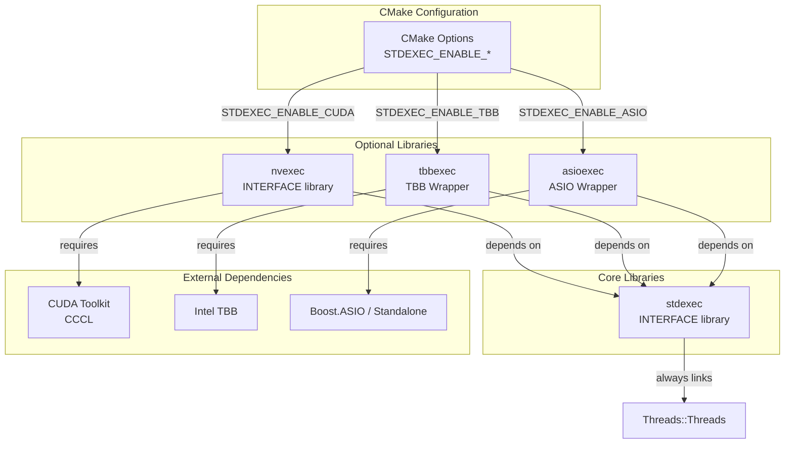
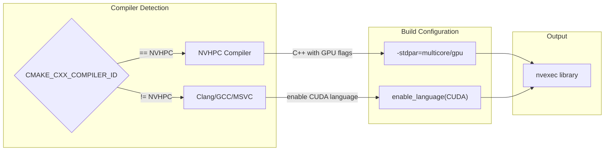
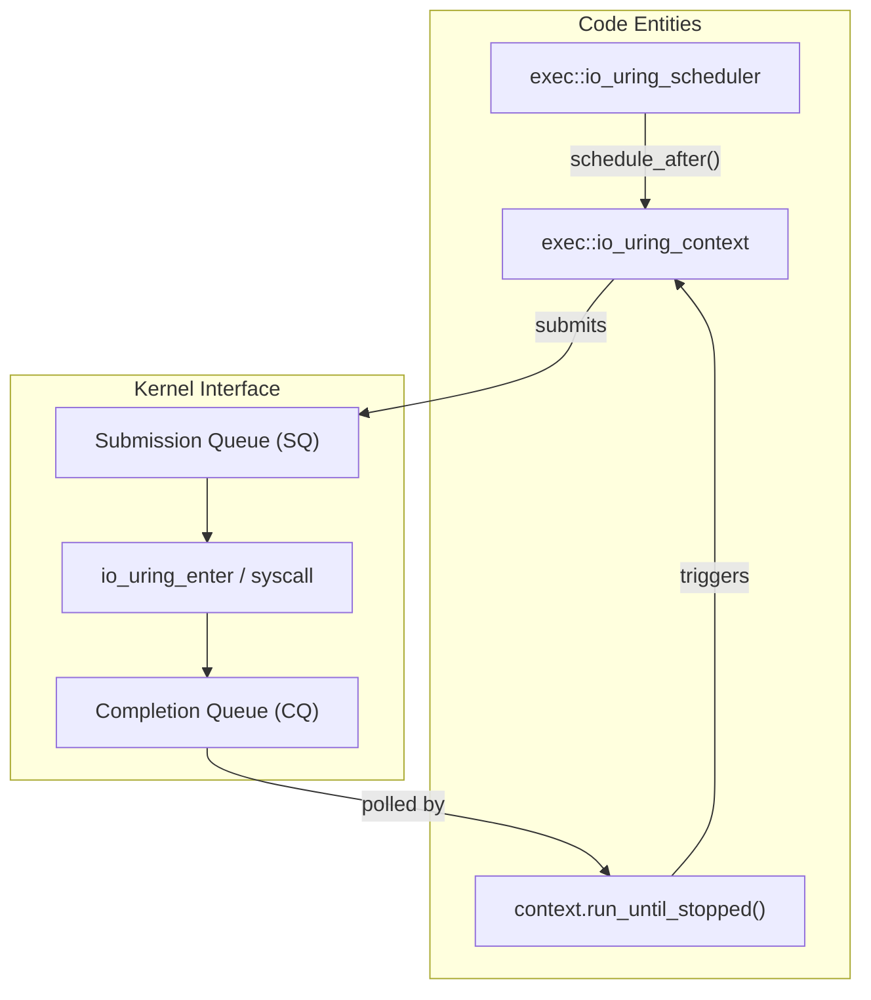

<!-- source: DeepWiki mcp.deepwiki.com · repo NVIDIA/stdexec · page 8.3 Optional Features and Dependencies · fetched 2026-10-26 -->

# Optional Features and Dependencies

Relevant source files

The following files were used as context for generating this wiki page:

- [CMakeLists.txt](CMakeLists.txt)
- [cmake/Modules/ConfigureASIO.cmake](cmake/Modules/ConfigureASIO.cmake)
- [cmake/Modules/ConfigureTBB.cmake](cmake/Modules/ConfigureTBB.cmake)
- [cmake/Modules/ConfigureTaskflow.cmake](cmake/Modules/ConfigureTaskflow.cmake)
- [cmake/import_standalone_asio.cmake](cmake/import_standalone_asio.cmake)
- [examples/CMakeLists.txt](examples/CMakeLists.txt)
- [examples/benchmark/fibonacci.cpp](examples/benchmark/fibonacci.cpp)
- [examples/benchmark/taskflow_thread_pool.cpp](examples/benchmark/taskflow_thread_pool.cpp)
- [examples/io_uring.cpp](examples/io_uring.cpp)
- [examples/nvexec/CMakeLists.txt](examples/nvexec/CMakeLists.txt)
- [include/asioexec/as_default_on.hpp](include/asioexec/as_default_on.hpp)
- [include/asioexec/completion_token.hpp](include/asioexec/completion_token.hpp)
- [include/asioexec/executor_with_default.hpp](include/asioexec/executor_with_default.hpp)
- [include/asioexec/use_sender.hpp](include/asioexec/use_sender.hpp)
- [include/nvexec/stream/continues_on.cuh](include/nvexec/stream/continues_on.cuh)
- [test/CMakeLists.txt](test/CMakeLists.txt)
- [test/exec/asio/CMakeLists.txt](test/exec/asio/CMakeLists.txt)
- [test/exec/taskflow/test_taskflow_thread_pool.cpp](test/exec/taskflow/test_taskflow_thread_pool.cpp)
- [test/nvexec/CMakeLists.txt](test/nvexec/CMakeLists.txt)
- [test/nvexec/continues_on.cpp](test/nvexec/continues_on.cpp)
- [test/nvexec/when_all_fail.cpp](test/nvexec/when_all_fail.cpp)

This page documents the optional features and external dependencies that can be enabled when building stdexec. These features are controlled through CMake configuration options and enable additional functionality such as GPU execution, third-party scheduler integrations, and platform-specific optimizations.

For information about the core build configuration and library targets, see [CMake Build Configuration](8.1). For compiler-specific requirements and supported versions, see [Compiler Support and Requirements](8.2).

## Purpose and Scope

The stdexec library provides a modular architecture where many features are optional and can be enabled or disabled at build time through CMake flags. This page covers:

- CMake options for enabling optional features (`STDEXEC_ENABLE_*` flags)
- External library dependencies and their integration points
- Platform-specific schedulers and system features (io_uring, libdispatch, Windows Thread Pool)
- Build configuration options for testing and examples
- Version requirements and compatibility considerations

## Feature Flag Overview

The following table summarizes the optional features available in stdexec:

| CMake Option | Default | Effect | Primary Target |
|-------------|---------|--------|----------------|
| `STDEXEC_ENABLE_CUDA` | OFF (ON if NVHPC) | Enables GPU execution support via nvexec | `nvexec` library |
| `STDEXEC_ENABLE_TBB` | OFF | Intel Threading Building Blocks scheduler | `tbbexec` |
| `STDEXEC_ENABLE_TASKFLOW` | OFF | Taskflow executor integration | `taskflowexec` |
| `STDEXEC_ENABLE_ASIO` | OFF | Boost or Standalone ASIO scheduler | `asioexec` |
| `STDEXEC_ENABLE_LIBDISPATCH` | Auto-detected | Grand Central Dispatch scheduler | `stdexec` |
| `STDEXEC_ENABLE_WINDOWS_THREAD_POOL` | Auto-detected | Windows Thread Pool scheduler | `stdexec` |
| `STDEXEC_ENABLE_IO_URING` | OFF | Linux io_uring I/O scheduler | `stdexec` |
| `STDEXEC_ENABLE_NUMA` | OFF | NUMA-aware thread pool affinity | `stdexec` |
| `STDEXEC_BUILD_TESTS` | ON (if top-level) | Build test suite | Test executables |
| `STDEXEC_BUILD_RELACY` | OFF | Build Relacy race detection tests | `test.relacy` |

**Diagram: Feature Flag Architecture**

Sources: [CMakeLists.txt:79-97](), [CMakeLists.txt:170-176](), [cmake/Modules/ConfigureTBB.cmake:1-24](), [cmake/Modules/ConfigureASIO.cmake:1-15]()

## GPU Execution Features

### STDEXEC_ENABLE_CUDA

Enables the `nvexec` library for GPU-accelerated execution using CUDA streams and device kernels.

**Configuration:**
- Automatically enabled when using the NVHPC compiler.
- For other compilers (Clang, GCC), it enables the CUDA language and requires the CUDA Toolkit [examples/nvexec/CMakeLists.txt:31-33]().

**Targets Created:**
- `STDEXEC::nvexec`: Interface library with GPU headers [test/nvexec/CMakeLists.txt:55-57]().
- `nvexec_executable_flags`: Compilation flags for GPU executables [examples/nvexec/CMakeLists.txt:44-46]().

**Architecture Configuration:**

Sources: [examples/nvexec/CMakeLists.txt:28-34](), [test/nvexec/CMakeLists.txt:45-47]()

## Third-Party Scheduler Integrations

### STDEXEC_ENABLE_TBB

Integrates Intel Threading Building Blocks (TBB) as a scheduler backend.

**Detection Logic:**
- If `TBB_FOUND` and the standard library is `libstdc++`, TBB is enabled automatically because `<execution>` headers pull in TBB [cmake/Modules/ConfigureTBB.cmake:13-20]().
- TBB is disabled if any sanitizers are active, as TBB does not sanitize cleanly [cmake/Modules/ConfigureTBB.cmake:26-31]().

**Targets Created:**
- `tbbexec` (Alias: `STDEXEC::tbbexec`): Wrapper providing TBB integration [cmake/Modules/ConfigureTBB.cmake:37-43]().

Sources: [cmake/Modules/ConfigureTBB.cmake:1-70](), [examples/CMakeLists.txt:91-106]()

### STDEXEC_ENABLE_ASIO

Integrates ASIO for asynchronous I/O and networking.

**Configuration:**
- `STDEXEC_ASIO_IMPLEMENTATION`: Can be set to `boost` (default) or `standalone` [cmake/Modules/ConfigureASIO.cmake:2-3]().
- Configures `asio_config.hpp` based on selection [cmake/Modules/ConfigureASIO.cmake:17-22]().

**Targets Created:**
- `asioexec` (Alias: `STDEXEC::asioexec`): Provides integration with ASIO `io_context` [cmake/Modules/ConfigureASIO.cmake:35-37]().

Sources: [cmake/Modules/ConfigureASIO.cmake:1-108](), [include/asioexec/completion_token.hpp:33-44]()

## Platform-Specific Schedulers

### io_uring (Linux)

Enables high-performance Linux asynchronous I/O via the `io_uring` subsystem.

**Implementation Details:**
- Defined in `include/exec/linux/io_uring_context.hpp`.
- The `exec::io_uring_context` manages the lifecycle of the ring and completion polling [examples/io_uring.cpp:32-37]().
- Supports timed operations via `exec::schedule_after` and `exec::schedule_at` [examples/io_uring.cpp:82-91]().

**Diagram: io_uring Data Flow**

Sources: [examples/io_uring.cpp:18-95](), [examples/CMakeLists.txt:71-75]()

## Development and Testing Options

### STDEXEC_BUILD_TESTS

Controls whether the test suite is built. It defaults to `ON` if stdexec is the main project [CMakeLists.txt:79-84]().

**Dependencies Fetched via CPM:**
- **Catch2** (v3.14.0): Main testing framework [CMakeLists.txt:106-119]().
- **ICM** (v1.5.0): Used for build-failure testing (verifying that invalid code fails to compile with expected errors) [CMakeLists.txt:122-131](), [test/CMakeLists.txt:152-176]().

### STDEXEC_BUILD_RELACY_TESTS

Enables Relacy Race Detector tests for verifying memory model correctness.
- Enabled by default only for GNU compilers ≥ version 12 [CMakeLists.txt:160-170]().
- Requires fallback atomic implementations when `std::atomic<std::shared_ptr<>>` is unavailable [CMakeLists.txt:156-159]().

Sources: [CMakeLists.txt:105-131](), [test/CMakeLists.txt:185-188]()

---

