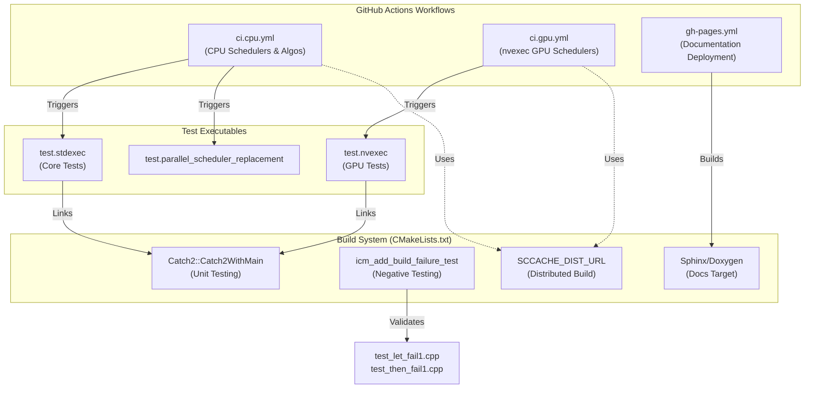
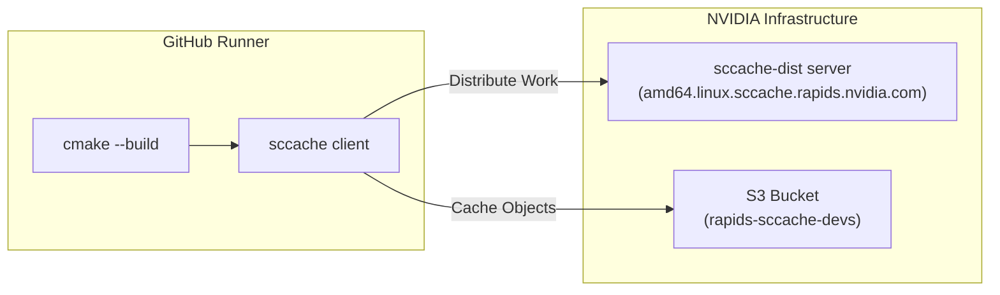

<!-- source: DeepWiki mcp.deepwiki.com · repo NVIDIA/stdexec · page 8.4 Testing and CI/CD Pipeline · fetched 2026-10-26 -->

# Testing and CI/CD Pipeline

Relevant source files

The following files were used as context for generating this wiki page:

- [.github/workflows/_test_common.sh](.github/workflows/_test_common.sh)
- [.github/workflows/ci.cpu.yml](.github/workflows/ci.cpu.yml)
- [.github/workflows/ci.gpu.yml](.github/workflows/ci.gpu.yml)
- [.github/workflows/gh-pages.yml](.github/workflows/gh-pages.yml)
- [.github/workflows/test-clang-12.sh](.github/workflows/test-clang-12.sh)
- [.github/workflows/test-clang-13.sh](.github/workflows/test-clang-13.sh)
- [.github/workflows/test-gcc-11.sh](.github/workflows/test-gcc-11.sh)
- [.github/workflows/test-sanitizer.sh](.github/workflows/test-sanitizer.sh)
- [.github/workflows/test-static-checks.sh](.github/workflows/test-static-checks.sh)
- [.github/workflows/test-windows.ps1](.github/workflows/test-windows.ps1)
- [CMakeLists.txt](CMakeLists.txt)
- [README.md](README.md)
- [docs/CMakeLists.txt](docs/CMakeLists.txt)
- [docs/Doxyfile.in](docs/Doxyfile.in)
- [docs/source/developer/index.rst](docs/source/developer/index.rst)
- [docs/source/index.rst](docs/source/index.rst)
- [docs/source/reference/index.rst](docs/source/reference/index.rst)
- [docs/source/user/index.rst](docs/source/user/index.rst)
- [examples/CMakeLists.txt](examples/CMakeLists.txt)
- [examples/benchmark/fibonacci.cpp](examples/benchmark/fibonacci.cpp)
- [examples/io_uring.cpp](examples/io_uring.cpp)
- [examples/nvexec/CMakeLists.txt](examples/nvexec/CMakeLists.txt)
- [include/nvexec/stream/continues_on.cuh](include/nvexec/stream/continues_on.cuh)
- [test/CMakeLists.txt](test/CMakeLists.txt)
- [test/nvexec/CMakeLists.txt](test/nvexec/CMakeLists.txt)
- [test/nvexec/continues_on.cpp](test/nvexec/continues_on.cpp)
- [test/nvexec/when_all_fail.cpp](test/nvexec/when_all_fail.cpp)

## Purpose and Scope

This document describes the testing infrastructure and continuous integration/continuous deployment (CI/CD) pipeline for the `stdexec` repository. It covers:

- **Test Infrastructure**: Catch2 test framework, ICM build failure testing, and test organization.
- **Sanitizer Integration**: Address Sanitizer (ASAN), Thread Sanitizer (TSAN), and Leak Sanitizer (LSAN) configurations.
- **CI/CD Workflows**: GitHub Actions workflows for CPU and GPU testing across Linux and Windows.
- **Build Acceleration**: `sccache` distributed compilation system.

For information about CMake build configuration options, see page 8.1. For compiler support details, see page 8.2.

---

## Overview

The testing and CI/CD infrastructure validates `stdexec` across multiple platforms, compilers, and build configurations through:

1.  **Unit Testing**: A Catch2-based test suite covering sender/receiver concepts, algorithms, and schedulers [test/CMakeLists.txt:25-88]().
2.  **Build Failure Testing**: ICM (Incompatible Code Matcher) validates that invalid code produces expected compilation errors [test/CMakeLists.txt:168-185]().
3.  **Sanitizer Testing**: ASAN, TSAN, and LSAN configurations detect memory errors and data races [.github/workflows/ci.cpu.yml:24-40]().
4.  **Continuous Integration**: Automated workflows test CPU and GPU functionality on every push and pull request [.github/workflows/ci.cpu.yml:3-7]().
5.  **Distributed Compilation**: `sccache` accelerates builds across CI environments [.github/workflows/ci.cpu.yml:75-82]().

### CI/CD System Architecture

The following diagram bridges the high-level CI/CD concepts to the specific workflow files and tools used in the repository.

**Diagram: CI/CD Pipeline to Code Entity Mapping**

**Sources:** [.github/workflows/ci.cpu.yml:1-15](), [.github/workflows/ci.gpu.yml:1-12](), [test/CMakeLists.txt:112-114](), [test/CMakeLists.txt:168-185](), [.github/workflows/gh-pages.yml:1-10]()

---

## Test Infrastructure

### Catch2 Framework

`stdexec` uses Catch2 version 3.14.0 as its primary unit testing framework [CMakeLists.txt:107](). It is automatically downloaded via CPM (CMake Package Manager) [CMakeLists.txt:109-118]().

The primary test entry point is `test/test_main.cpp` [test/CMakeLists.txt:26](). Test discovery is handled via `catch_discover_tests`, which integrates with CTest to allow running individual test cases [test/CMakeLists.txt:154-156]().

### Test Organization

Tests are categorized by the subsystem they validate:

| Category | Source Directory | Target Executable |
| :--- | :--- | :--- |
| **Core Concepts** | `test/stdexec/concepts/` | `test.stdexec` |
| **Algorithms** | `test/stdexec/algos/` | `test.stdexec` |
| **Schedulers** | `test/stdexec/schedulers/` | `test.stdexec` |
| **GPU (nvexec)** | `test/nvexec/` | `test.nvexec` |
| **Parallel Scheduler**| `test/stdexec/schedulers/`| `test.parallel_scheduler_replacement` |

**Sources:** [test/CMakeLists.txt:25-88](), [test/CMakeLists.txt:112](), [test/nvexec/CMakeLists.txt:17-49]()

### Build Failure Testing (ICM)

To ensure that `stdexec` concepts correctly reject invalid code at compile-time, the repository uses **ICM (Incompatible Code Matcher)** [CMakeLists.txt:122-131](). 

These tests attempt to compile source files that are expected to fail. ICM parses the source for expected error messages and validates the compiler output [test/CMakeLists.txt:168-185]().

**Sources:** [test/CMakeLists.txt:170-185](), [test/nvexec/CMakeLists.txt:67-73]()

---

## CI/CD Workflows

### CPU Pipeline (`ci.cpu.yml`)

The CPU pipeline validates `stdexec` on Linux using a matrix of compilers (GCC 12-15, Clang 16-22) [.github/workflows/ci.cpu.yml:21-43]().

**Key Features:**
- **Sanitizers**: Configurations for ASAN (Address), TSAN (Thread), and LEAK (Leak) [.github/workflows/ci.cpu.yml:24-40]().
- **C++ Standards**: Tests both C++20 and C++23 [.github/workflows/ci.cpu.yml:22-27]().
- **Parallelism**: Uses `Ninja` with `-j 512` to leverage distributed compilation [.github/workflows/ci.cpu.yml:122]().
- **No-Exceptions**: Validates builds with `-fno-exceptions` [.github/workflows/ci.cpu.yml:29]().

### GPU Pipeline (`ci.gpu.yml`)

The GPU pipeline targets NVIDIA GPUs (V100, L4) and requires the `nvc++` or `clang` compiler with CUDA support [.github/workflows/ci.gpu.yml:22-27]().

**Execution Flow:**
1.  **Environment Check**: Runs `nvidia-smi` to verify GPU health [.github/workflows/ci.gpu.yml:43]().
2.  **Build**: Compiles `test.nvexec` and various examples [.github/workflows/ci.gpu.yml:98-109]().
3.  **Example Validation**: Executes the Maxwell FDTD solver on both CPU and GPU to ensure cross-backend consistency [.github/workflows/ci.gpu.yml:119-121]().

### Windows Testing

Windows testing is performed via a PowerShell script `test-windows.ps1` that configures the project with Ninja, MSVC, and ASAN, then executes tests using CTest [.github/workflows/test-windows.ps1:22-31]().

**Sources:** [.github/workflows/ci.cpu.yml:15-43](), [.github/workflows/ci.gpu.yml:15-28](), [.github/workflows/ci.gpu.yml:119-121](), [.github/workflows/test-windows.ps1:1-32]()

---

## Build Acceleration and Sanitizers

### sccache Distributed Compilation

To handle the heavy template metaprogramming in `stdexec`, the CI pipeline utilizes `sccache` with an S3 backend and distributed compilation [.github/workflows/ci.cpu.yml:75-84]().

**Data Flow for Compilation:**

**Sources:** [.github/workflows/ci.cpu.yml:75-84](), [.github/workflows/ci.gpu.yml:63-72]()

### Sanitizer Configurations

Sanitizers are integrated directly into the CMake build via compiler flags in the CI matrix [.github/workflows/ci.cpu.yml:21-43]().

- **ASAN**: Enabled via `-fsanitize=address`. On Clang, it uses a `sanitizer-ignorelist.txt` to suppress known false positives [.github/workflows/ci.cpu.yml:26]().
- **TSAN**: Enabled via `-fsanitize=thread` to detect data races in multi-threaded schedulers [.github/workflows/ci.cpu.yml:34]().
- **LSAN**: Enabled via `-fsanitize=leak` [.github/workflows/ci.cpu.yml:40]().

**Sources:** [.github/workflows/ci.cpu.yml:26-40]()

---

