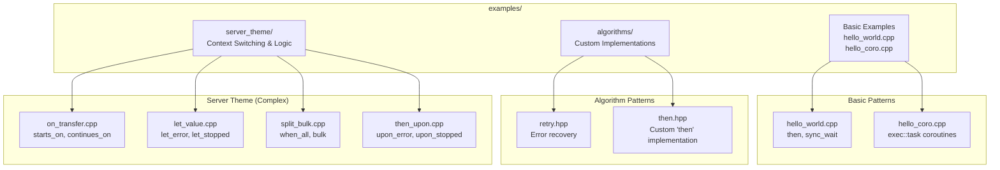
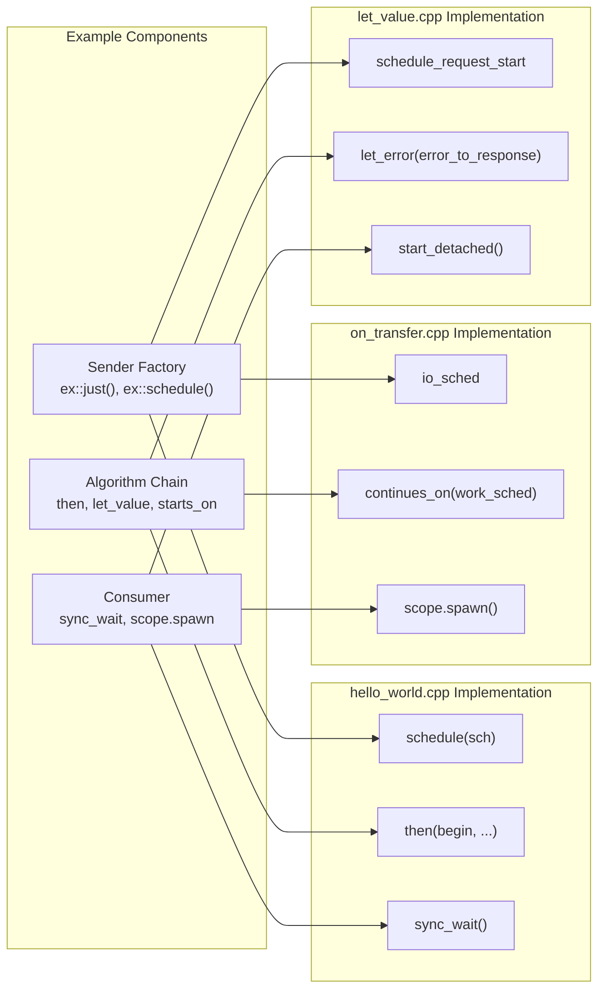
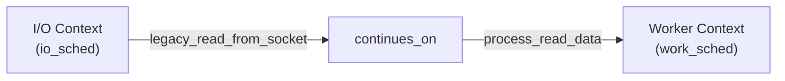

<!-- source: DeepWiki mcp.deepwiki.com · repo NVIDIA/stdexec · page 9 Examples and Tutorials · fetched 2026-10-26 -->

# Examples and Tutorials

Relevant source files

The following files were used as context for generating this wiki page:

- [.clang-format](.clang-format)
- [examples/algorithms/retry.hpp](examples/algorithms/retry.hpp)
- [examples/algorithms/then.hpp](examples/algorithms/then.hpp)
- [examples/hello_coro.cpp](examples/hello_coro.cpp)
- [examples/hello_world.cpp](examples/hello_world.cpp)
- [examples/server_theme/.gitignore](examples/server_theme/.gitignore)
- [examples/server_theme/let_value.cpp](examples/server_theme/let_value.cpp)
- [examples/server_theme/on_transfer.cpp](examples/server_theme/on_transfer.cpp)
- [examples/server_theme/split_bulk.cpp](examples/server_theme/split_bulk.cpp)
- [examples/server_theme/then_upon.cpp](examples/server_theme/then_upon.cpp)

This page provides an overview of the practical examples and tutorials included in the stdexec repository. These examples demonstrate real-world usage patterns for the sender/receiver execution model on both CPU and GPU platforms.

For foundational concepts, see [Core Execution Model](#3). For algorithm reference documentation, see [Standard Algorithms](#4). For GPU execution concepts, see [GPU Execution with nvexec](#6). For coroutine integration details, see [Coroutine Integration](#7.2).

## Purpose and Scope

The examples demonstrate:
- Basic sender composition and execution patterns using `then`, `let_value`, and `sync_wait` [examples/hello_world.cpp:27-61]()
- Coroutine integration with `exec::task` and `co_await` [examples/hello_coro.cpp:25-43]()
- Custom algorithm implementation techniques like `retry` and `then` [examples/algorithms/retry.hpp:121-162](), [examples/algorithms/then.hpp:99-103]()
- Context switching and parallel image processing patterns [examples/server_theme/on_transfer.cpp:113-121](), [examples/server_theme/split_bulk.cpp:140-184]()
- Complex error recovery and cancellation handling [examples/server_theme/then_upon.cpp:168-186](), [examples/server_theme/let_value.cpp:148-162]()

Each example is self-contained and can be studied independently, though they build progressively in complexity from simple sender chains to advanced asynchronous server-side workflows.

## Example Organization

The repository organizes examples into categories: basic CPU examples, custom algorithm patterns, and "server theme" examples demonstrating complex coordination.

**Sources:** [examples/hello_world.cpp:1-61](), [examples/hello_coro.cpp:1-60](), [examples/algorithms/retry.hpp:1-162](), [examples/server_theme/on_transfer.cpp:1-130]()

### Examples by Category

| Category | File | Demonstrates | Key Concepts |
|----------|------|--------------|--------------|
| **Basics** | `hello_world.cpp` | Simple sender chains | `schedule`, `then`, `sync_wait` [examples/hello_world.cpp:27-41]() |
| **Coroutines** | `hello_coro.cpp` | `exec::task` usage | `co_await`, `stopped_as_optional` [examples/hello_coro.cpp:33-37]() |
| **Contexts** | `server_theme/on_transfer.cpp` | Switching execution threads | `starts_on`, `continues_on` [examples/server_theme/on_transfer.cpp:113-121]() |
| **Error Handling** | `server_theme/let_value.cpp` | Mapping errors to responses | `let_error`, `let_stopped` [examples/server_theme/let_value.cpp:156-158]() |
| **Custom Algos** | `algorithms/retry.hpp` | Custom sender adaptors | `receiver_adaptor`, operation states [examples/algorithms/retry.hpp:55-119]() |

## Example Code Structure

Each example follows a consistent pattern mapping execution concepts to concrete implementations:

**Sources:** [examples/hello_world.cpp:29-40](), [examples/server_theme/on_transfer.cpp:111-124](), [examples/server_theme/let_value.cpp:148-165]()

## Key Patterns Demonstrated

### Context Migration Pattern

The `on_transfer.cpp` example demonstrates how to move work between an I/O thread pool and a worker thread pool:

**Implementation details:**
- Uses `starts_on(io_sched, ...)` to initiate work on the dedicated I/O pool [examples/server_theme/on_transfer.cpp:115]().
- Uses `continues_on(work_sched)` to transition the continuation to the worker pool for CPU-intensive tasks [examples/server_theme/on_transfer.cpp:117]().
- Work is managed by `exec::async_scope` to ensure structured cleanup [examples/server_theme/on_transfer.cpp:102, 124]().

**Sources:** [examples/server_theme/on_transfer.cpp:94-127]()

### Unified Error and Cancellation Mapping

The `server_theme/let_value.cpp` and `then_upon.cpp` examples show how to unify success, error, and stopped paths into a single result type (e.g., an HTTP response):

- **Mapping Errors**: `let_error` and `upon_error` are used to catch exceptions and transform them into error responses [examples/server_theme/let_value.cpp:156](), [examples/server_theme/then_upon.cpp:179]().
- **Mapping Cancellation**: `let_stopped` and `upon_stopped` handle the "stopped" signal to return 503-style responses [examples/server_theme/let_value.cpp:158](), [examples/server_theme/then_upon.cpp:181]().
- **Result Unification**: All paths eventually converge to `to_response` or `send_response` [examples/server_theme/then_upon.cpp:183](), [examples/server_theme/let_value.cpp:160]().

**Sources:** [examples/server_theme/let_value.cpp:112-136](), [examples/server_theme/then_upon.cpp:136-165]()

### Parallel Work Distribution

The `split_bulk.cpp` example demonstrates filling multiple threads using parallel algorithms:

- **Multi-shot Senders**: `split` allows a single input sender to be shared across multiple parallel branches (e.g., Canny, Sobel, and Prewitt detection) [examples/server_theme/split_bulk.cpp:151-153]().
- **Bulk Processing**: `bulk` is used to apply a blur filter across a vector of images in parallel [examples/server_theme/split_bulk.cpp:175-177]().

**Sources:** [examples/server_theme/split_bulk.cpp:140-184]()

## Example Navigation

For detailed walkthroughs of specific categories, see the child pages:

- **[Hello World and Basic Sender Chains](#9.1)**: Explains the fundamental `schedule`, `then`, and `sync_wait` flow in `hello_world.cpp`.
- **[Coroutine Examples](#9.2)**: Demonstrates `exec::task` usage and how to `co_await` senders in `hello_coro.cpp`.
- **[Error Handling and Resource Management](#9.3)**: Shows the `retry` algorithm and patterns for exception propagation using `let_error`.
- **[Maxwell Equation Solver (GPU)](#9.4)**: Deep dive into GPU-accelerated physics using `nvexec` and `bulk` distribution.
- **[Thread Pool and Fibonacci Benchmark](#9.5)**: Explains performance testing and runtime scheduler selection using `static_thread_pool`.

**Sources:** [examples/hello_world.cpp:1-61](), [examples/hello_coro.cpp:1-60](), [examples/algorithms/retry.hpp:1-162](), [examples/server_theme/split_bulk.cpp:1-184]()

---

