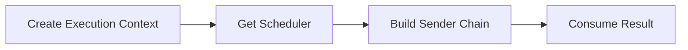
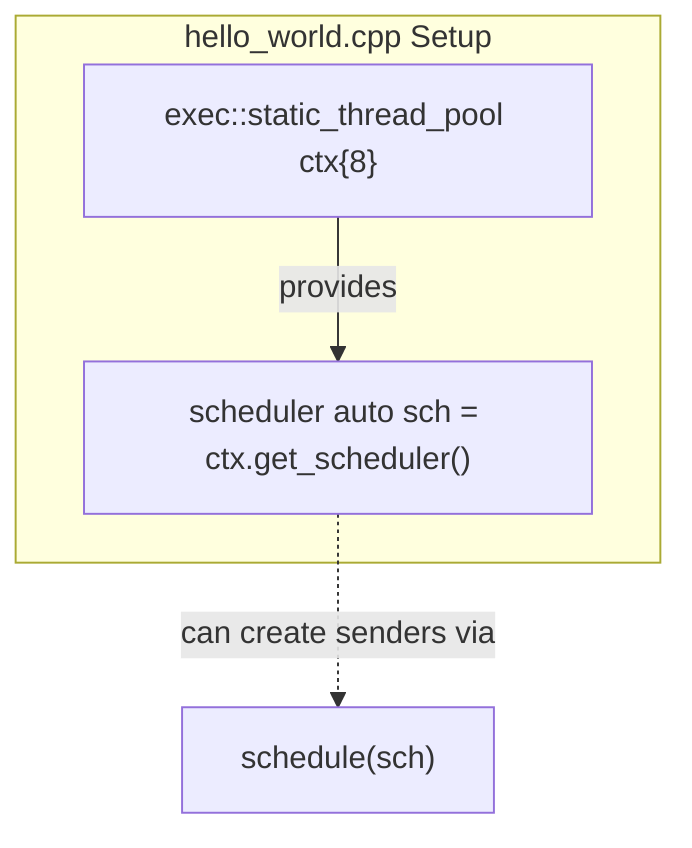
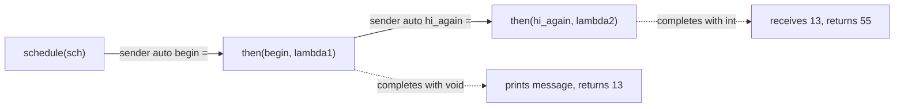
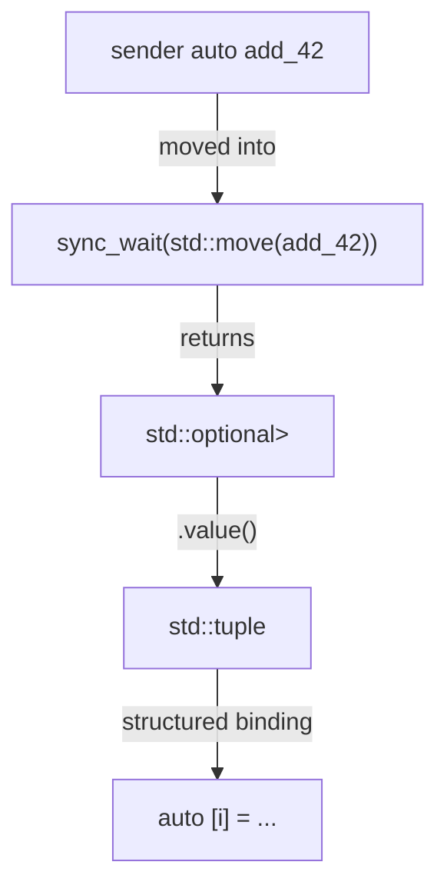
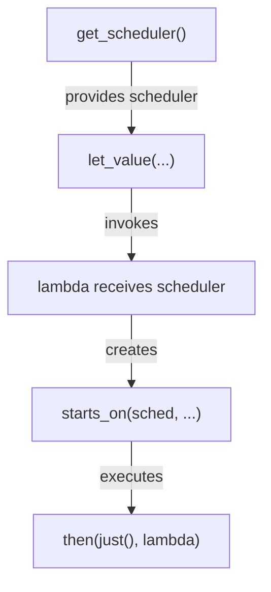
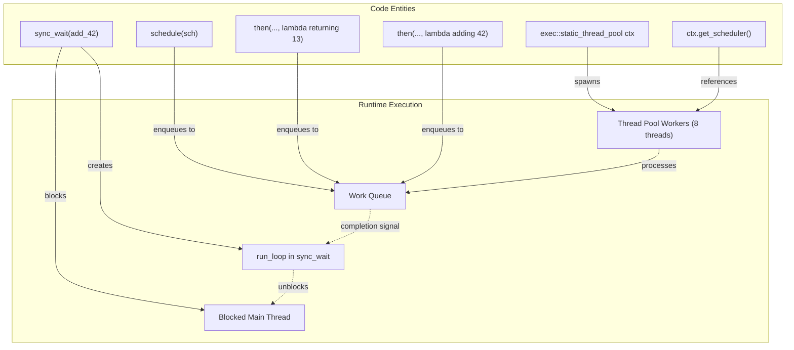

<!-- source: DeepWiki mcp.deepwiki.com · repo NVIDIA/stdexec · page 9.1 Hello World and Basic Sender Chains · fetched 2026-10-26 -->

# Hello World and Basic Sender Chains

<details>
<summary>Relevant source files</summary>

The following files were used as context for generating this wiki page:

- [.clang-format](.clang-format)
- [examples/algorithms/retry.hpp](examples/algorithms/retry.hpp)
- [examples/algorithms/then.hpp](examples/algorithms/then.hpp)
- [examples/hello_coro.cpp](examples/hello_coro.cpp)
- [examples/hello_world.cpp](examples/hello_world.cpp)
- [examples/server_theme/.gitignore](examples/server_theme/.gitignore)
- [examples/server_theme/let_value.cpp](examples/server_theme/let_value.cpp)
- [examples/server_theme/on_transfer.cpp](examples/server_theme/on_transfer.cpp)
- [examples/server_theme/split_bulk.cpp](examples/server_theme/split_bulk.cpp)
- [examples/server_theme/then_upon.cpp](examples/server_theme/then_upon.cpp)

</details>


## Purpose and Scope

This page walks through the `hello_world.cpp` example to demonstrate the fundamental patterns for building and executing sender chains in stdexec. It covers creating schedulers, composing operations with `schedule()` and `then()`, and blocking to consume results with `sync_wait()`. 

For coroutine-based examples using `exec::task` and `co_await`, see [9.2 Coroutine Examples](). For GPU execution patterns, see [9.4 Maxwell Equation Solver (GPU)](). For detailed information on individual algorithms, see [4 Standard Algorithms]().

**Sources:** [examples/hello_world.cpp:1-61]()

---

## Basic Anatomy of a Sender Program

A typical stdexec program follows this pattern:



The `hello_world.cpp` example demonstrates all four stages:

| Stage | Code Entity | Purpose |
|-------|-------------|---------|
| Create Context | `exec::static_thread_pool` | Provides worker threads for asynchronous execution |
| Get Scheduler | `ctx.get_scheduler()` | Returns a `scheduler` for creating senders |
| Build Chain | `schedule()`, `then()` | Compose asynchronous operations |
| Consume | `sync_wait()` | Block until sender completes and extract result |

**Sources:** [examples/hello_world.cpp:28-41]()

---

## Creating an Execution Context and Scheduler

The first step is establishing where work will execute:



The example creates a thread pool with 8 worker threads at [examples/hello_world.cpp:28](). The scheduler obtained from `ctx.get_scheduler()` at [examples/hello_world.cpp:29]() satisfies the `scheduler` concept, which means it can be passed to `schedule()` to create senders.

### Code Walkthrough

```cpp
// Line 28: Create thread pool with 8 workers
exec::static_thread_pool ctx{8};

// Line 29: Get scheduler for creating senders
scheduler auto sch = ctx.get_scheduler();
```

The `scheduler` concept requires a type to support the `schedule()` customization point, which returns a `sender` that completes on the scheduler's execution context.

For more information on thread pools and their configuration, see [5.1 Static Thread Pool](). For scheduler concepts and operations, see [4.7 Scheduler Operations]().

**Sources:** [examples/hello_world.cpp:28-29]()

---

## Building Sender Chains with schedule() and then()

Once a scheduler is available, sender chains are built by composing operations:



### The schedule() Factory

[examples/hello_world.cpp:31]() creates the initial sender:

```cpp
sender auto begin = schedule(sch);
```

The `schedule()` function is a sender factory that produces a sender completing with `set_value()` (no arguments) when execution reaches the scheduler's execution context. This sender represents "begin execution on this scheduler."

### The then() Adaptor

The first `then()` at [examples/hello_world.cpp:32-37]() transforms the void-valued sender into one that produces an integer:

```cpp
sender auto hi_again = then(
  begin,
  [] {
    std::cout << "Hello world! Have an int.\n";
    return 13;
  });
```

The lambda executes on one of the thread pool's worker threads. The return value (`13`) becomes the sender's completion value.

A second `then()` at [examples/hello_world.cpp:39]() chains another transformation:

```cpp
sender auto add_42 = then(hi_again, [](int arg) { return arg + 42; });
```

This lambda receives `13` as its argument and returns `55`.

### Sender Completion Signature Evolution

| Sender | Completion Signature | Description |
|--------|---------------------|-------------|
| `schedule(sch)` | `set_value_t()` | Completes with no value |
| `then(begin, lambda)` | `set_value_t(int)` | Lambda returns `int` |
| `then(hi_again, lambda)` | `set_value_t(int)` | Lambda transforms `int` to `int` |

For detailed information on completion signatures, see [3.2 Completion Signatures](). For the `then()` algorithm implementation details, see [examples/algorithms/then.hpp:59-104]().

**Sources:** [examples/hello_world.cpp:31-39](), [examples/algorithms/then.hpp:59-104]()

---

## Consuming Results with sync_wait()

Sender chains are lazy by design—they describe work but do not execute until connected to a receiver and started. The `sync_wait()` function provides a convenient way to block the current thread until a sender completes:



The consumption occurs at [examples/hello_world.cpp:40]():

```cpp
auto [i] = sync_wait(std::move(add_42)).value();
```

### sync_wait() Return Value

`sync_wait()` returns `std::optional<std::tuple<Ts...>>` where `Ts...` are the sender's completion value types:
- If the sender completes with `set_value(values...)`, the optional contains the values.
- If the sender completes with `set_error()` or `set_stopped()`, the optional is empty.

The `.value()` call extracts the tuple (throwing if empty), and structured binding unpacks the single integer.

### Internal Mechanism

`sync_wait()` creates a `run_loop` scheduler internally and blocks the calling thread while pumping the event loop. This is demonstrated at [examples/hello_world.cpp:44]():

```cpp
std::tuple<run_loop::scheduler> t = sync_wait(get_scheduler()).value();
```

Here, `get_scheduler()` is a sender query that retrieves the current scheduler from the execution environment. When executed via `sync_wait()`, it returns the internal `run_loop::scheduler`.

For more details on blocking consumers and `run_loop`, see [4.6 sync_wait and Blocking Consumers](). For the `run_loop` scheduler specifically, see [5.3 Inline and Run Loop Schedulers]().

**Sources:** [examples/hello_world.cpp:40-45]()

---

## Advanced Composition Patterns

The example demonstrates additional composition patterns:

### let_value() with Dynamic Sender Creation

[examples/hello_world.cpp:47-57]() shows `let_value()` creating a new sender based on a completion value:



The pattern:
```cpp
auto y = let_value(get_scheduler(), [](auto sched) {
  return starts_on(sched, then(just(), [] {
    std::cout << "from run_loop\n";
    return 42;
  }));
});
```

`let_value()` differs from `then()` in that its continuation function must return a sender (not a value). This enables dynamic sender graph construction based on runtime values. The returned sender is then connected and started as part of the overall chain.

### when_all() with Multiple Senders

[examples/hello_world.cpp:60]() demonstrates concurrent coordination:

```cpp
sync_wait(when_all(just(42), get_scheduler(), get_stop_token()));
```

`when_all()` accepts multiple senders and produces a sender that:
- Starts all input senders concurrently.
- Completes when all inputs complete.
- Combines all completion values into a tuple.

The completion signature here is `set_value_t(int, run_loop::scheduler, inplace_stop_token)`.

For detailed information on `let_value()` and continuation-based composition, see [4.2 let_value, let_error, and let_stopped](). For `when_all()` and concurrent operations, see [4.3 when_all and Concurrent Operations]().

**Sources:** [examples/hello_world.cpp:47-60]()

---

## Complete Execution Flow

This diagram maps the entire `hello_world.cpp` execution from code entities to runtime behavior:



The execution sequence:
1. Thread pool spawns 8 worker threads at [examples/hello_world.cpp:28]().
2. `schedule(sch)` creates a sender that will execute on the pool at [examples/hello_world.cpp:31]().
3. Each `then()` adds a continuation to the chain at [examples/hello_world.cpp:32-39]().
4. `sync_wait()` connects the chain to a receiver, starts execution, and blocks at [examples/hello_world.cpp:40]().
5. Worker threads process the enqueued work items.
6. Upon completion, `sync_wait()` unblocks and returns the result.

**Sources:** [examples/hello_world.cpp:28-41]()

---

## Key Takeaways

| Concept | Implementation | Purpose |
|---------|----------------|---------|
| Execution Context | `exec::static_thread_pool` | Provides worker threads |
| Scheduler | `ctx.get_scheduler()` | Factory for creating senders |
| Sender Factory | `schedule(sch)` | Begin execution on scheduler |
| Sender Adaptor | `then(sender, lambda)` | Transform completion values |
| Blocking Consumer | `sync_wait(sender)` | Bridge to synchronous code |
| Lazy Evaluation | Entire sender chain | No work until `sync_wait()` |

The fundamental pattern demonstrated is:
1. **Create** an execution context (thread pool, stream context, etc.).
2. **Compose** a sender graph describing the async work.
3. **Execute** by connecting to a consumer (`sync_wait()`, coroutines, etc.).

This separation of description from execution enables powerful optimizations and transformations, as explored in [3.4 Domains and Customization]().

**Sources:** [examples/hello_world.cpp:1-61]()

---

