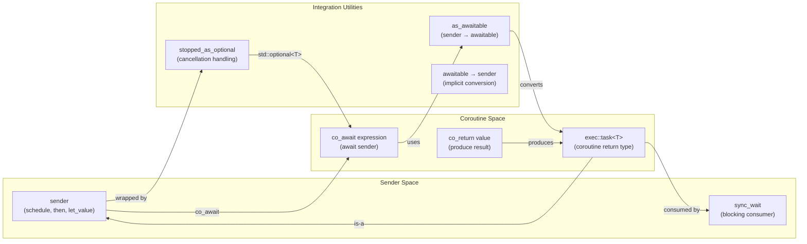
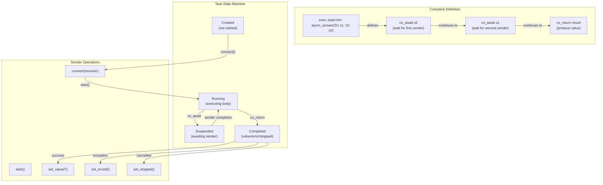
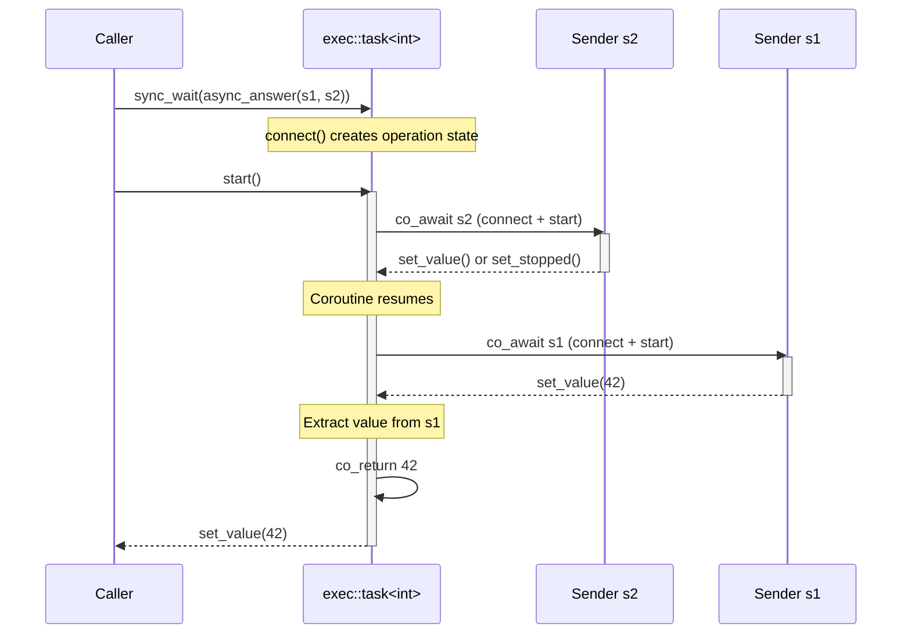
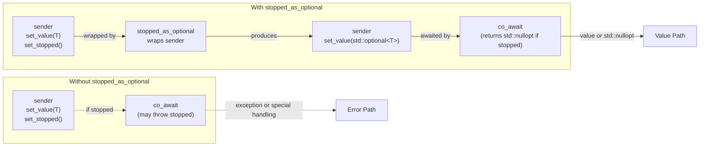
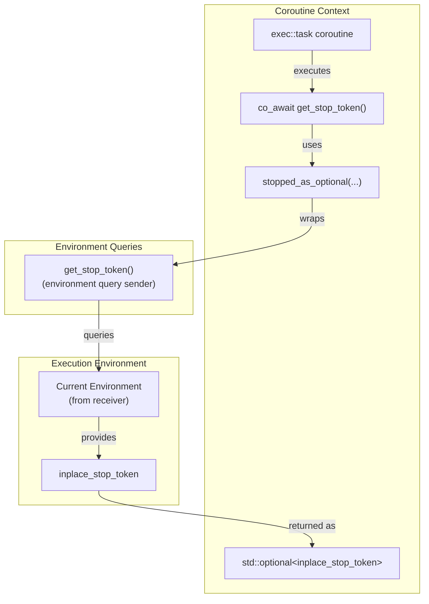
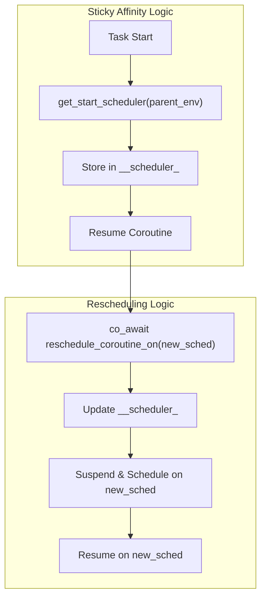
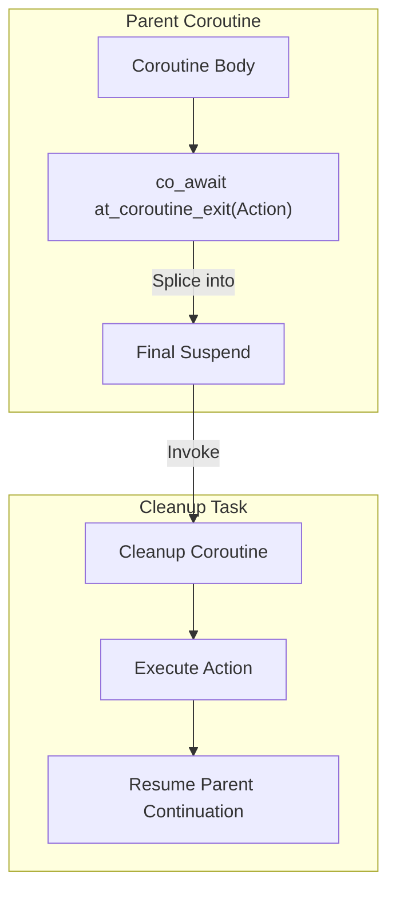
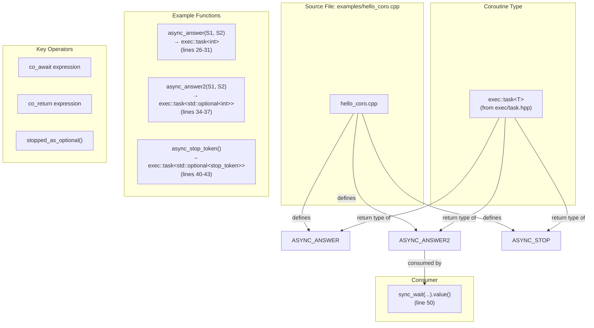

<!-- source: DeepWiki mcp.deepwiki.com · repo NVIDIA/stdexec · page 9.2 Coroutine Examples · fetched 2026-10-26 -->

# Coroutine Examples

<details>
<summary>Relevant source files</summary>

The following files were used as context for generating this wiki page:

- [.clang-format](.clang-format)
- [examples/algorithms/retry.hpp](examples/algorithms/retry.hpp)
- [examples/algorithms/then.hpp](examples/algorithms/then.hpp)
- [examples/hello_coro.cpp](examples/hello_coro.cpp)
- [examples/hello_world.cpp](examples/hello_world.cpp)
- [include/exec/at_coroutine_exit.hpp](include/exec/at_coroutine_exit.hpp)
- [include/exec/on_coro_disposition.hpp](include/exec/on_coro_disposition.hpp)
- [include/exec/task.hpp](include/exec/task.hpp)
- [include/stdexec/__detail/__as_awaitable.hpp](include/stdexec/__detail/__as_awaitable.hpp)
- [include/stdexec/__detail/__awaitable.hpp](include/stdexec/__detail/__awaitable.hpp)
- [include/stdexec/__detail/__connect_awaitable.hpp](include/stdexec/__detail/__connect_awaitable.hpp)
- [include/stdexec/__detail/__task.hpp](include/stdexec/__detail/__task.hpp)
- [include/stdexec/__detail/__with_awaitable_senders.hpp](include/stdexec/__detail/__with_awaitable_senders.hpp)
- [include/stdexec/coroutine.hpp](include/stdexec/coroutine.hpp)
- [test/exec/test_at_coroutine_exit.cpp](test/exec/test_at_coroutine_exit.cpp)
- [test/exec/test_task.cpp](test/exec/test_task.cpp)
- [test/stdexec/types/test_task.cpp](test/stdexec/types/test_task.cpp)

</details>


## Purpose and Scope

This page demonstrates practical usage of C++20 coroutines with stdexec senders using the `exec::task` coroutine type. It covers awaiting senders in coroutines, converting awaitables back to senders, handling cancellation with `stopped_as_optional`, and accessing execution context properties from within coroutine bodies.

For detailed information about the underlying coroutine integration mechanisms, see [Coroutine Integration](#7.2). For basic sender usage without coroutines, see [Hello World and Basic Sender Chains](#9.1).

---

## Overview: Bidirectional Sender-Coroutine Integration

The stdexec coroutine integration provides seamless bidirectional conversion between senders and C++20 coroutines. The `exec::task<T>` type serves as the primary coroutine type for writing asynchronous code in a synchronous style.

### Integration Flow

Title: Sender and Coroutine Integration Flow


**Key Integration Points:**
- **Senders as awaitables**: Any sender can be `co_await`ed in a coroutine.
- **Tasks as senders**: `exec::task<T>` is itself a sender and can be used in sender chains [include/exec/task.hpp:1842-1845]().
- **Type safety**: Completion signatures flow through coroutine boundaries.
- **Cancellation**: Stop tokens and cancellation propagate through coroutine contexts [include/exec/task.hpp:150-150]().

Sources: [examples/hello_coro.cpp:25-37](), [include/exec/task.hpp:142-152](), [include/stdexec/__detail/__as_awaitable.hpp:47-78]()

---

## The exec::task Coroutine Type

The `exec::task<T>` type represents an asynchronous operation that produces a value of type `T`. It is both an awaitable (can be `co_await`ed) and a sender (can be used with stdexec algorithms).

| Feature | Description |
|---------|-------------|
| **Return type** | Used as the return type of coroutines: `exec::task<int>` [examples/hello_coro.cpp:26-26]() |
| **Value production** | Use `co_return value` to produce result [examples/hello_coro.cpp:30-30]() |
| **Awaiting senders** | Can `co_await` any sender expression [examples/hello_coro.cpp:29-29]() |
| **Stop token access** | Provides access to `get_stop_token()` [include/exec/task.hpp:181-183]() |
| **Sender interface** | Can be passed to `sync_wait`, `then`, `let_value`, etc. [examples/hello_coro.cpp:50-50]() |
| **Lazy execution** | Task does not start until connected and started (like senders). |

### Task State Machine

Title: exec::task Lifecycle and Execution


Sources: [examples/hello_coro.cpp:26-31](), [include/exec/task.hpp:142-166]()

---

## Basic Task Example: Awaiting Senders

The simplest pattern involves awaiting senders sequentially to compose asynchronous operations. Each `co_await` expression suspends the coroutine until the sender completes.

### Example: Sequential Sender Composition

The `async_answer` function demonstrates awaiting multiple senders in sequence [examples/hello_coro.cpp:26-31]():

```cpp
template <sender S1, sender S2>
auto async_answer(S1 s1, S2 s2) -> stdexec::task<int>
{
  // Senders are implicitly awaitable (in this coroutine type):
  co_await static_cast<S2&&>(s2);
  co_return co_await static_cast<S1&&>(s1);
}
```

**Execution flow:**
1. Coroutine is entered but not yet executing (lazy).
2. When connected and started, first `co_await s2` suspends until `s2` completes.
3. After `s2` completes, execution resumes and evaluates `co_await s1`.
4. `s1`'s result value is obtained and returned via `co_return`.
5. The task completes with `set_value(result)`.

Title: Sequence of Awaiting Senders


Sources: [examples/hello_coro.cpp:26-31](), [include/stdexec/__detail/__connect_awaitable.hpp:75-117]()

---

## Cancellation Handling with stopped_as_optional

The `stopped_as_optional` algorithm converts a sender's stopped completion signal into an empty `std::optional`. This allows coroutines to handle cancellation gracefully without exception handling.

### Pattern: Optional Result from Stoppable Operation

When a sender may complete with `set_stopped()`, wrapping it with `stopped_as_optional` converts the completion signature from `set_value(T)` or `set_stopped()` to `set_value(std::optional<T>)` [examples/hello_coro.cpp:34-37]():

```cpp
template <sender S1, sender S2>
auto async_answer2(S1 s1, S2 s2) -> stdexec::task<std::optional<int>>
{
  co_return co_await stopped_as_optional(async_answer(s1, s2));
}
```

**Type transformations:**

| Original Sender | Completion Signatures | After stopped_as_optional | Result Type |
|----------------|----------------------|---------------------------|-------------|
| `async_answer(s1, s2)` | `set_value(int)`, `set_stopped()` | `set_value(std::optional<int>)` | `std::optional<int>` |
| `get_stop_token()` | `set_value(stop_token)`, `set_stopped()` | `set_value(std::optional<stop_token>)` | `std::optional<stop_token>` |

Title: Transformation via stopped_as_optional


Sources: [examples/hello_coro.cpp:34-37](), [include/stdexec/coroutine.hpp:82-138]()

---

## Accessing Execution Context: Stop Tokens

Coroutines can query properties of their execution environment using query senders like `get_stop_token()`. These are awaitable and produce values from the environment.

### Example: Stop Token Query

The `async_stop_token` function demonstrates querying the stop token from within a coroutine [examples/hello_coro.cpp:40-43]():

```cpp
// tasks have an associated stop token
auto async_stop_token() -> stdexec::task<std::optional<stdexec::inplace_stop_token>>
{
  co_return co_await stopped_as_optional(get_stop_token());
}
```

**Available environment queries in coroutines:**

| Query | Returns | Purpose |
|-------|---------|---------|
| `get_stop_token()` | `inplace_stop_token` | Access cancellation token for the current operation [include/exec/task.hpp:181-183]() |
| `get_start_scheduler()` | `scheduler` | Access the scheduler on which the task started [include/exec/task.hpp:174-178]() |
| `get_completion_behavior()` | `completion_behavior` | Query how the task completes (affine/inline) [include/exec/task.hpp:187-197]() |

Title: Environment Query Resolution


Sources: [examples/hello_coro.cpp:40-43](), [include/exec/task.hpp:142-203]()

---

## Scheduler Stickiness and Rescheduling

`exec::task` supports scheduler affinity, often referred to as "stickiness". By default, tasks attempt to remain on the scheduler they were started on [include/exec/task.hpp:116-120]().

### Manual Rescheduling

The `exec::reschedule_coroutine_on` utility (used in tests) allows a coroutine to explicitly transition to a different scheduler [test/exec/test_task.cpp:61-61]():

```cpp
auto test_stickiness(ex::scheduler auto scheduler1) -> exec::task<void>
{
    co_await exec::reschedule_coroutine_on(scheduler1);
    // Now execution is on scheduler1
}
```

Title: Scheduler Stickiness and Rescheduling Logic


Sources: [include/exec/task.hpp:142-166](), [test/exec/test_task.cpp:53-63]()

---

## Cleanup at Coroutine Exit

The `exec::at_coroutine_exit` utility allows registering cleanup actions that run when the coroutine scope ends, similar to a destructor but asynchronous [include/exec/at_coroutine_exit.hpp:131-185]().

### Example: Cleanup Registration

```cpp
auto my_coro() -> exec::task<void> {
    co_await exec::at_coroutine_exit([](auto& resource) -> exec::task<void> {
        co_await resource.cleanup();
    }, some_resource);
    // ... body ...
}
```

Title: at_coroutine_exit Integration


Sources: [include/exec/at_coroutine_exit.hpp:132-185]()

---

## Code Entity Mapping

Title: Mapping Coroutine Examples to Code Entities


Sources: [examples/hello_coro.cpp:25-61](), [include/exec/task.hpp:41-84]()

---

## Summary of Patterns

| Pattern | Code Example | Purpose |
|---------|-------------|---------|
| **Task definition** | `exec::task<int>` | Define coroutine return type. |
| **Await sender** | `co_await sender` | Wait for sender completion. |
| **Return value** | `co_return value` | Produce task result. |
| **Handle cancellation** | `stopped_as_optional(sender)` | Convert stopped to `std::nullopt`. |
| **Query environment** | `co_await get_stop_token()` | Access execution properties. |
| **Task as sender** | `sync_wait(task)` | Consume task as sender. |
| **Cleanup** | `at_coroutine_exit(Action)` | Run async cleanup on exit. |
| **Rescheduling** | `reschedule_coroutine_on(sch)` | Transition to a different scheduler. |

Sources: [examples/hello_coro.cpp:23-61](), [include/exec/task.hpp:142-203](), [include/exec/at_coroutine_exit.hpp:132-185](), [test/exec/test_task.cpp:53-122]()

---

