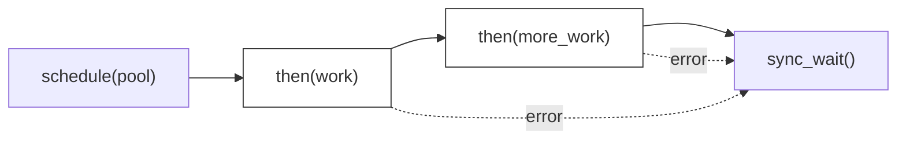
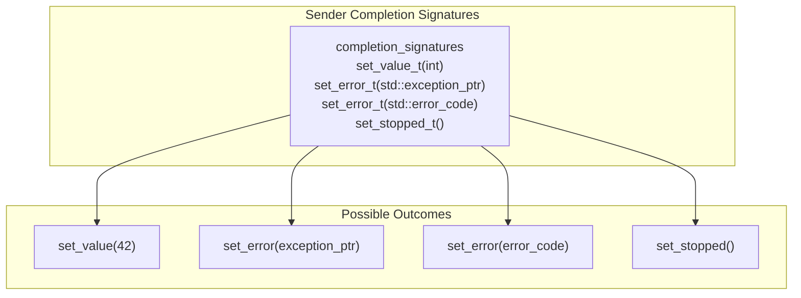
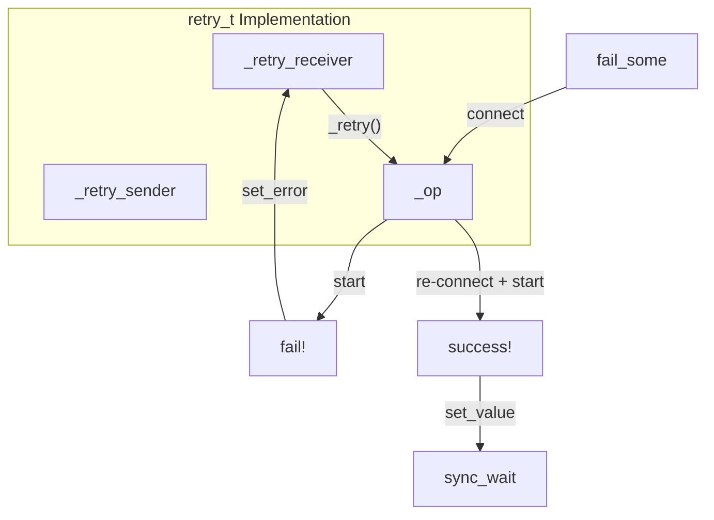
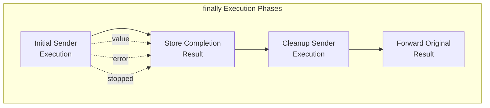
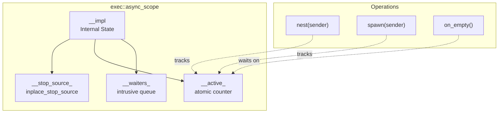
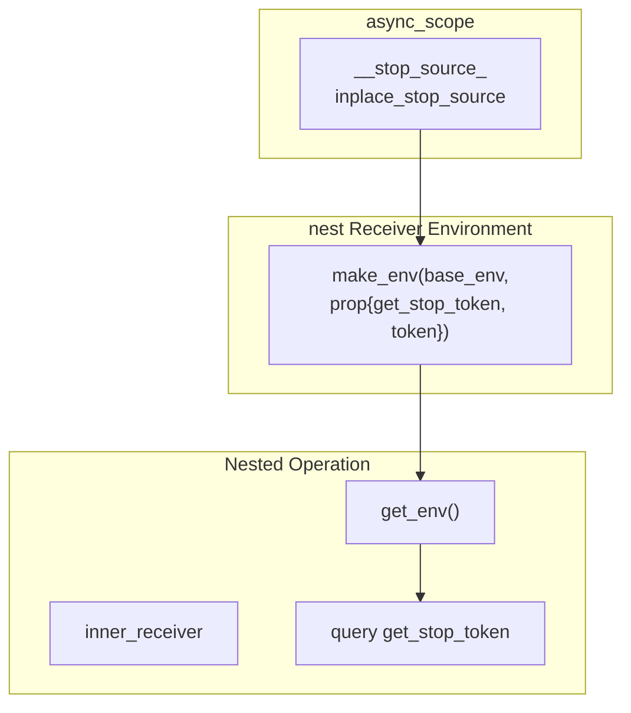
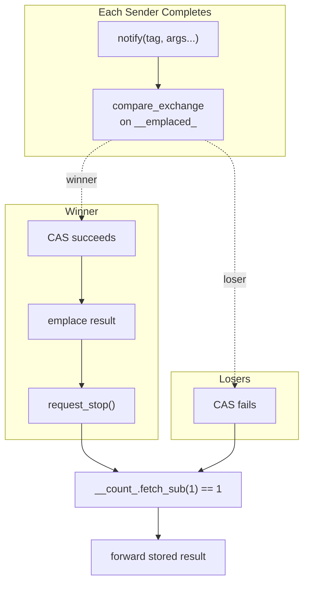

<!-- source: DeepWiki mcp.deepwiki.com · repo NVIDIA/stdexec · page 9.3 Error Handling and Resource Management · fetched 2026-10-26 -->

# Error Handling and Resource Management

Relevant source files

The following files were used as context for generating this wiki page:

- [.clang-format](.clang-format)
- [examples/algorithms/retry.hpp](examples/algorithms/retry.hpp)
- [examples/algorithms/then.hpp](examples/algorithms/then.hpp)
- [examples/hello_coro.cpp](examples/hello_coro.cpp)
- [examples/hello_world.cpp](examples/hello_world.cpp)
- [examples/retry.cpp](examples/retry.cpp)
- [include/exec/async_scope.hpp](include/exec/async_scope.hpp)
- [include/exec/env.hpp](include/exec/env.hpp)
- [include/exec/finally.hpp](include/exec/finally.hpp)
- [include/exec/materialize.hpp](include/exec/materialize.hpp)
- [include/exec/when_any.hpp](include/exec/when_any.hpp)

This page demonstrates practical patterns for error handling, resource cleanup, and structured concurrency in `stdexec`. These examples show how to propagate errors through sender chains, perform cleanup operations, manage task lifetimes, and handle cancellation.

For information about the underlying sender/receiver completion model, see [Sender and Receiver Concepts](#3.1). For information about coroutine-based error handling, see [Coroutine Examples](#9.2). For information about GPU-specific error handling, see [Maxwell Equation Solver (GPU)](#9.4).

## Overview of Error Handling Mechanisms

`stdexec` provides multiple completion channels for handling different outcomes:

| Completion Channel | Purpose | Common Uses |
|-------------------|---------|-------------|
| `set_value` | Success path | Normal operation results |
| `set_error` | Failure path | Exceptions, error codes, failures |
| `set_stopped` | Cancellation path | User cancellation, timeout, early termination |

All three channels propagate through sender chains, allowing intermediate operations to transform, intercept, or react to different outcomes.

Sources: [include/stdexec/execution.hpp:1-100](), [include/exec/async_scope.hpp:153-204]()

## Error Propagation in Sender Chains

### Basic Error Flow

Errors automatically propagate through sender chains without explicit handling. In a chain of `then` adaptors, if an intermediate function throws an exception, the `_then_receiver` catches it and calls `set_error` on the next receiver in the chain.

**Basic Error Propagation Pattern**

When any operation in the chain fails, the error bypasses subsequent operations and is delivered to the final receiver. The `set_error` completion channel carries the error through the chain. The `_then_receiver::set_value` implementation [examples/algorithms/then.hpp:42-53]() demonstrates this by wrapping the function call in a `STDEXEC_TRY/CATCH` block.

Sources: [examples/algorithms/then.hpp:42-53](), [examples/hello_coro.cpp:47-61]()

### Completion Signatures and Error Types

Each sender declares what error types it can produce through its completion signatures. For example, a sender might declare `set_error_t(std::exception_ptr)`.

Sources: [examples/algorithms/retry.hpp:131-141](), [include/exec/materialize.hpp:91-104]()

## Error Recovery and Retry Patterns

### Using upon_error and retry

The `upon_error` algorithm intercepts errors and transforms them. For repeated attempts, a `retry` pattern is often used. The `retry` algorithm works by re-connecting and re-starting a sender if it completes with an error.

**Pattern: Retry on Error**

**Retry Implementation Details**

The `retry` implementation in `examples/algorithms/retry.hpp` uses an operation state `_op` that contains a `std::optional` of the nested operation. When `_retry_receiver::set_error` is called [examples/algorithms/retry.hpp:73-77](), it invokes `_op::_retry()`, which re-emplaces the optional by calling `connect` again and then calls `start` [examples/algorithms/retry.hpp:102-113]().

Sources: [examples/algorithms/retry.hpp:50-119](), [examples/retry.cpp:25-69]()

## Resource Cleanup with finally

The `finally` algorithm (exposed in `exec/finally.hpp`) ensures that a cleanup sender is executed regardless of whether the primary sender completes with a value, an error, or a stopped signal.

### finally Operation Structure

**Two-Phase Execution Model**

The `finally` algorithm executes in two phases: first the initial sender, then the cleanup sender. The original completion result is stored temporarily while the cleanup operation runs.

Sources: [include/exec/finally.hpp:1-29]()

## Structured Concurrency with async_scope

`exec::async_scope` provides a way to manage the lifetimes of multiple asynchronous operations. It ensures that all nested or spawned operations are completed before the scope itself is considered finished.

### async_scope Core Components

**async_scope Architecture**

The scope maintains an atomic counter `__active_` [include/exec/async_scope.hpp:67]() to track outstanding work. When a task completes, it decrements this counter. If the counter reaches zero, any waiters in the `__waiters_` queue [include/exec/async_scope.hpp:68]() are notified.

Sources: [include/exec/async_scope.hpp:56-69](), [include/exec/async_scope.hpp:158-175]()

### Stop Token Propagation

Operations nested within an `async_scope` automatically receive a stop token linked to the scope's internal `inplace_stop_source`. This allows for coordinated cancellation of all work within a scope.

Sources: [include/exec/async_scope.hpp:54-55](), [include/exec/async_scope.hpp:206-209]()

## Racing Operations with when_any

The `exec::when_any` algorithm races multiple senders. The first sender to complete "wins," and its result is propagated. All other senders are then requested to stop.

### Atomic Competition Protocol

**when_any Synchronization**

The `__opstate_base` uses an atomic boolean `__emplaced_` [include/exec/when_any.hpp:110]() to ensure only one result is stored. The first sender to call `notify` performs a `compare_exchange_strong` [include/exec/when_any.hpp:122-126](). If it wins, it emplaces its result into the `__result_` variant and calls `__stop_source_.request_stop()` [include/exec/when_any.hpp:145]() to cancel the other senders.

Sources: [include/exec/when_any.hpp:77-166]()

## Materialize and Dematerialize

The `materialize` and `dematerialize` algorithms allow completion signals to be treated as values.

*   `materialize`: Converts `set_value(args...)`, `set_error(err)`, and `set_stopped()` into a `set_value(Tag, args...)` call [include/exec/materialize.hpp:37-56]().
*   `dematerialize`: Performs the inverse, taking a materialized value and calling the original completion tag [include/exec/materialize.hpp:148-153]().

This is useful for algorithms that need to process all possible completion signals through a single value-processing path (like `then` or `when_all`).

Sources: [include/exec/materialize.hpp:27-66](), [include/exec/materialize.hpp:138-174]()

## Summary of Patterns

| Pattern | Primary Algorithms | Use Case |
|---------|-------------------|----------|
| Error recovery | `upon_error`, `let_error` | Transform or recover from failure |
| Retry logic | `retry` | Repeatedly attempt a failing operation |
| Cleanup guarantee | `finally` | RAII-style cleanup for async operations |
| Structured concurrency | `async_scope` | Manage task lifetimes and cancellation |
| Racing | `when_any` | First-to-complete wins; cancel others |
| Error inspection | `materialize`/`dematerialize` | Reify completion signals as values |

Sources: [include/exec/async_scope.hpp](), [include/exec/finally.hpp](), [include/exec/when_any.hpp](), [examples/algorithms/retry.hpp](), [include/exec/materialize.hpp]()

---

