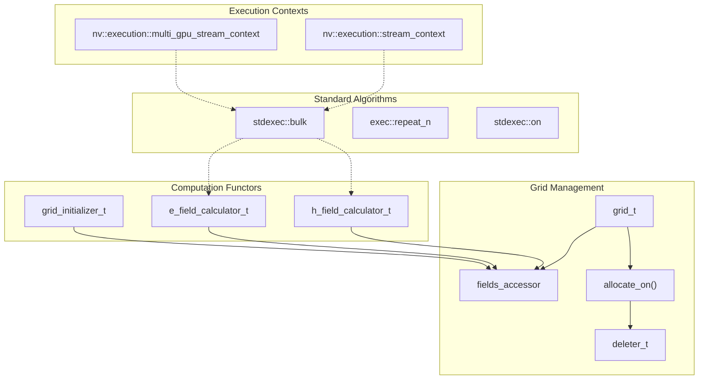
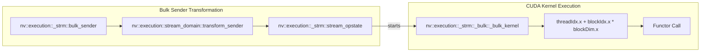

<!-- source: DeepWiki mcp.deepwiki.com · repo NVIDIA/stdexec · page 9.4 Maxwell Equation Solver (GPU) · fetched 2026-10-26 -->

# Maxwell Equation Solver (GPU)

<details>
<summary>Relevant source files</summary>

The following files were used as context for generating this wiki page:

- [.clangd](.clangd)
- [examples/nvexec/maxwell/common.cuh](examples/nvexec/maxwell/common.cuh)
- [examples/nvexec/maxwell/cpp.cuh](examples/nvexec/maxwell/cpp.cuh)
- [examples/nvexec/maxwell/cuda.cuh](examples/nvexec/maxwell/cuda.cuh)
- [examples/nvexec/maxwell/snr.cuh](examples/nvexec/maxwell/snr.cuh)
- [examples/nvexec/maxwell/std.cuh](examples/nvexec/maxwell/std.cuh)
- [examples/nvexec/maxwell/stdpar.cuh](examples/nvexec/maxwell/stdpar.cuh)
- [include/nvexec/stream/bulk.cuh](include/nvexec/stream/bulk.cuh)
- [include/nvexec/stream/common.cuh](include/nvexec/stream/common.cuh)
- [include/nvexec/stream/ensure_started.cuh](include/nvexec/stream/ensure_started.cuh)
- [include/nvexec/stream/let_xxx.cuh](include/nvexec/stream/let_xxx.cuh)
- [include/nvexec/stream/reduce.cuh](include/nvexec/stream/reduce.cuh)
- [include/nvexec/stream/schedule_from.cuh](include/nvexec/stream/schedule_from.cuh)
- [include/nvexec/stream/split.cuh](include/nvexec/stream/split.cuh)
- [include/nvexec/stream/then.cuh](include/nvexec/stream/then.cuh)
- [include/nvexec/stream/upon_error.cuh](include/nvexec/stream/upon_error.cuh)
- [include/nvexec/stream/upon_stopped.cuh](include/nvexec/stream/upon_stopped.cuh)
- [include/nvexec/stream/when_all.cuh](include/nvexec/stream/when_all.cuh)

</details>


## Purpose and Scope

This page provides a detailed technical examination of the Maxwell FDTD (Finite-Difference Time-Domain) example located in [examples/nvexec/maxwell/](), which demonstrates bulk GPU execution patterns and multi-GPU work distribution using nvexec. The example implements an iterative electromagnetic field solver on CUDA GPUs using stdexec's sender/receiver abstractions.

The implementation illustrates:
- Mapping `ex::bulk()` operations to CUDA kernel launches via stream domain transformation.
- Using `exec::repeat_n()` for iterative computation loops.
- Multi-GPU execution with peer-to-peer memory access.
- Scheduler-agnostic code that executes on both CPU and GPU contexts.

For background on nvexec GPU infrastructure, see page 6. For general bulk operation semantics, see page 4.5. For multi-GPU context details, see page 6.3.

Sources: [examples/nvexec/maxwell/common.cuh:1-20]()

## Implementation Overview

The Maxwell solver operates on a grid represented by `grid_t` [examples/nvexec/maxwell/common.cuh:113-145]() and accessed via `fields_accessor` [examples/nvexec/maxwell/common.cuh:94-111](). The grid cells are allocated using `allocate_on<float>` [examples/nvexec/maxwell/common.cuh:62-80](), which supports both host memory and CUDA managed memory (`cudaMallocManaged`).

The solver follows an iterative Leapfrog scheme:
1. Update magnetic field **H** components using the `h_field_calculator_t` functor [examples/nvexec/maxwell/common.cuh:241-260]().
2. Update electric field **E** components using the `e_field_calculator_t` functor [examples/nvexec/maxwell/common.cuh:267-272]().

The example provides multiple execution backends:
- **C++ Single-threaded**: `run_cpp` [examples/nvexec/maxwell/cpp.cuh:23-61]().
- **C++ Multi-threaded**: `run_std` using `std::thread` and `std::barrier` [examples/nvexec/maxwell/std.cuh:42-121]().
- **C++ Parallel Algorithms**: `run_stdpar` using `std::for_each` with execution policies [examples/nvexec/maxwell/stdpar.cuh:51-82]().
- **Sender/Receiver**: `run_snr` using `nvexec` and `stdexec` (detailed below).

Sources: [examples/nvexec/maxwell/common.cuh:113-272](), [examples/nvexec/maxwell/std.cuh:42-121](), [examples/nvexec/maxwell/stdpar.cuh:51-82]()

## Code Entity Architecture



**Code Entity Relationships in Maxwell Solver**

This diagram maps the relationships between the data structures defined in `common.cuh` and the execution abstractions provided by `nvexec` and `stdexec`.

Sources: [examples/nvexec/maxwell/common.cuh:42-272](), [include/nvexec/stream/bulk.cuh:114-160](), [include/nvexec/stream/common.cuh:78-79]()

## Core Components

### Grid and Field Accessor

The `grid_t` structure manages the lifecycle of the field arrays. It calculates the number of `cells` as `n * n` [examples/nvexec/maxwell/common.cuh:128]() and allocates a contiguous block of memory for all field components defined in `field_id` [examples/nvexec/maxwell/common.cuh:82-92]().

The `fields_accessor` provides a `get(field_id id)` method [examples/nvexec/maxwell/common.cuh:107-110]() that returns a pointer to the specific field component (e.g., `Ex`, `Hz`) for the entire grid.

| Field Component | ID | Description |
|:---|:---|:---|
| `er` | `field_id::er` | Relative permittivity |
| `hr` | `field_id::hr` | Relative permeability |
| `hx`, `hy` | `field_id::hx`, `field_id::hy` | Magnetic field components |
| `ez` | `field_id::ez` | Electric field component |

Sources: [examples/nvexec/maxwell/common.cuh:82-111]()

### Bulk Operations Mapping

When using `nvexec`, `stdexec::bulk` is transformed into a CUDA kernel launch. The transformation is handled by the `stream_domain` [include/nvexec/stream/common.cuh:145-164]().



**Bulk to CUDA Kernel Mapping**

In [include/nvexec/stream/bulk.cuh:42-51](), the `_bulk_kernel` computes a global thread ID (`tid`) and, if it is within the bounds of the `shape`, executes the user-provided function `fn`. The `bulk_sender` [include/nvexec/stream/bulk.cuh:115-160]() coordinates the `grid_blocks` and `block_threads` (fixed at 256) for the launch [include/nvexec/stream/bulk.cuh:79-82]().

Sources: [include/nvexec/stream/bulk.cuh:42-160](), [include/nvexec/stream/common.cuh:145-164]()

## GPU Algorithm Implementation

### nvexec::then and Launch Bounds

The `then` algorithm in `nvexec` launches a single-threaded kernel (`launch_bounds(1)`) to execute the provided function on the GPU.

- **`_then_kernel`**: Used when the function returns `void` [include/nvexec/stream/then.cuh:40-46]().
- **`_then_kernel_with_result`**: Used when the function returns a value, which is then stored in `temp_storage_` [include/nvexec/stream/then.cuh:48-54]().

This allows subsequent senders in a chain to execute host-defined logic directly on the device. The `then_sender` [include/nvexec/stream/then.cuh:135-205]() manages the connection to the `stream_opstate`.

Sources: [include/nvexec/stream/then.cuh:38-54](), [include/nvexec/stream/then.cuh:135-205]()

### Multi-GPU Distribution

The `multi_gpu_bulk` implementation in [include/nvexec/stream/bulk.cuh:162-218]() uses `even_share` to partition the `shape` across available devices.

```cpp
// From include/nvexec/stream/bulk.cuh:206-207
auto [begin, end]     = even_share(shape_, dev, opstate_.num_devices_);
auto      shape       = static_cast<int>(end - begin);
```

For each device:
1. The context switches to the target device (`cudaSetDevice`).
2. A partition-specific `_multi_bulk_kernel` is launched [include/nvexec/stream/bulk.cuh:166-175]().
3. The kernel receives `begin` and `end` offsets to process its assigned chunk of the grid.

Sources: [include/nvexec/stream/bulk.cuh:162-218](), [examples/nvexec/maxwell/std.cuh:29-40]()

### Iterative Execution with repeat_n

The solver uses a custom implementation of `repeat_n` for iterative time-stepping [examples/nvexec/maxwell/snr.cuh:71-91](). This algorithm repeatedly connects and starts an inner sender for a specified count.

- **`_repeat_n::sender`**: The sender representing the loop [examples/nvexec/maxwell/snr.cuh:199-236]().
- **`_repeat_n::opstate`**: Manages the loop state and re-triggers the `inner_opstate_` [examples/nvexec/maxwell/snr.cuh:141-196]().
- **`_repeat_n::receiver`**: Triggers the next iteration in `set_value` if `count_` is non-zero [examples/nvexec/maxwell/snr.cuh:96-138]().

Sources: [examples/nvexec/maxwell/snr.cuh:65-236]()

### Stream Synchronization and Composition

Composition of multiple GPU operations is managed through CUDA stream synchronization patterns:
- **`when_all`**: Synchronizes multiple streams using `cudaStreamSynchronize` or events [include/nvexec/stream/when_all.cuh:109-119]().
- **`split`**: Uses `cudaEventRecord` to allow multiple consumers to wait on a single producer's completion [include/nvexec/stream/split.cuh:81-87]().
- **`ensure_started`**: Eagerly starts a sender and records an event upon completion [include/nvexec/stream/ensure_started.cuh:79-87]().

Sources: [include/nvexec/stream/when_all.cuh:109-119](), [include/nvexec/stream/split.cuh:81-87](), [include/nvexec/stream/ensure_started.cuh:79-87]()

---

