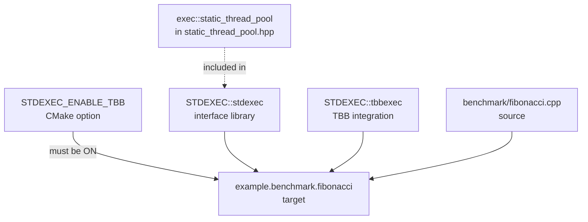
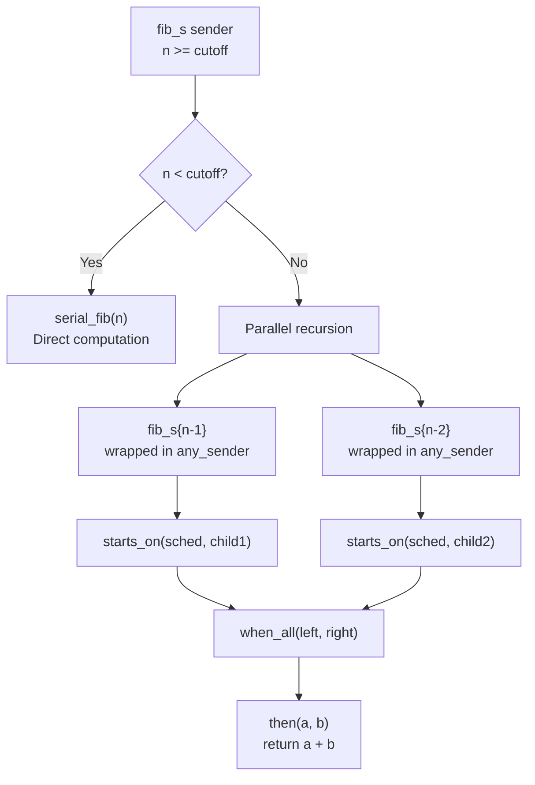
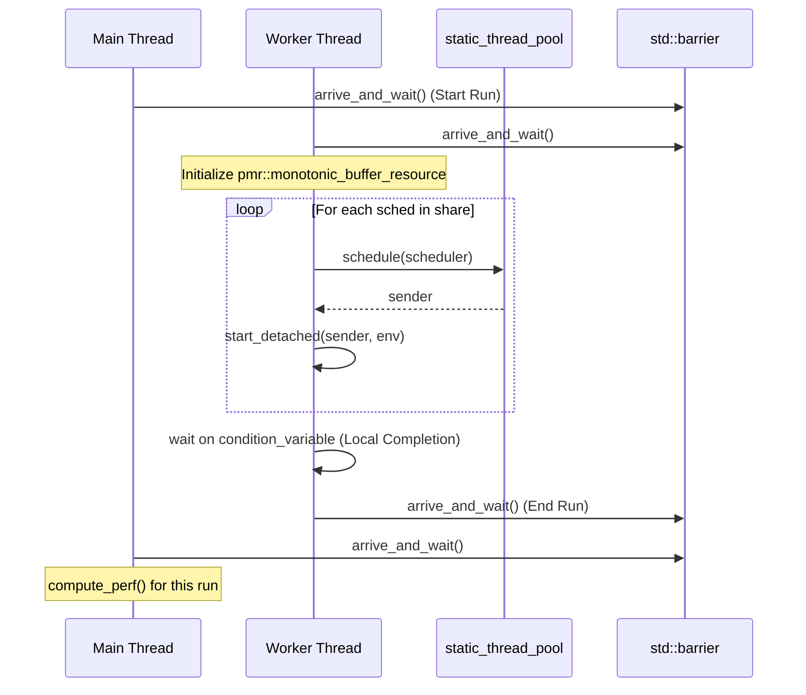

<!-- source: DeepWiki mcp.deepwiki.com · repo NVIDIA/stdexec · page 9.5 Thread Pool and Fibonacci Benchmark · fetched 2026-10-26 -->

# Thread Pool and Fibonacci Benchmark

Relevant source files

The following files were used as context for generating this wiki page:

- [.clang-tidy](.clang-tidy)
- [CMakeLists.txt](CMakeLists.txt)
- [examples/CMakeLists.txt](examples/CMakeLists.txt)
- [examples/benchmark/common.hpp](examples/benchmark/common.hpp)
- [examples/benchmark/fibonacci.cpp](examples/benchmark/fibonacci.cpp)
- [examples/benchmark/static_thread_pool.cpp](examples/benchmark/static_thread_pool.cpp)
- [examples/benchmark/static_thread_pool_bulk_enqueue.cpp](examples/benchmark/static_thread_pool_bulk_enqueue.cpp)
- [examples/benchmark/static_thread_pool_bulk_enqueue_nested.cpp](examples/benchmark/static_thread_pool_bulk_enqueue_nested.cpp)
- [examples/benchmark/static_thread_pool_nested.cpp](examples/benchmark/static_thread_pool_nested.cpp)
- [examples/benchmark/tbb_thread_pool.cpp](examples/benchmark/tbb_thread_pool.cpp)
- [examples/benchmark/tbb_thread_pool_nested.cpp](examples/benchmark/tbb_thread_pool_nested.cpp)
- [examples/io_uring.cpp](examples/io_uring.cpp)
- [examples/nvexec/CMakeLists.txt](examples/nvexec/CMakeLists.txt)
- [include/exec/static_thread_pool.hpp](include/exec/static_thread_pool.hpp)
- [include/nvexec/stream/continues_on.cuh](include/nvexec/stream/continues_on.cuh)
- [test/CMakeLists.txt](test/CMakeLists.txt)
- [test/exec/test_static_thread_pool.cpp](test/exec/test_static_thread_pool.cpp)
- [test/nvexec/CMakeLists.txt](test/nvexec/CMakeLists.txt)
- [test/nvexec/continues_on.cpp](test/nvexec/continues_on.cpp)
- [test/nvexec/when_all_fail.cpp](test/nvexec/when_all_fail.cpp)
- [test/stdexec/algos/adaptors/test_bulk.cpp](test/stdexec/algos/adaptors/test_bulk.cpp)

## Purpose and Scope

This document explains the Fibonacci benchmark and related thread pool performance examples in `stdexec`. These examples demonstrate practical usage of `exec::static_thread_pool` for recursive parallel computation and the `exec::any_sender_of` type erasure mechanism for runtime scheduler selection. The benchmark infrastructure allows for performance comparisons between different execution contexts, such as TBB and stdexec's native `static_thread_pool`, using unified sender graphs.

Key technical demonstrations include:
- **Recursive Parallelism**: Implementation of Fibonacci using recursive work splitting with `when_all`.
- **Type Erasure**: Using `any_sender_of` to decouple the algorithm implementation from the concrete scheduler type.
- **NUMA-Awareness**: Utilizing `exec::numa_policy` for optimized thread placement and memory allocation.
- **High-Throughput Scheduling**: Benchmarking `schedule_all` and `exec::iterate` for efficient bulk work distribution.

**Sources:** [examples/benchmark/common.hpp:41-112](), [examples/benchmark/fibonacci.cpp:1-106](), [examples/benchmark/static_thread_pool.cpp:1-113]()

---

## Build Configuration

The Fibonacci benchmark is conditionally compiled based on the availability of TBB. The build system defines targets that link against the core `stdexec` library and specific execution extensions.

**Diagram: Fibonacci Benchmark Dependencies**

**Sources:** [examples/CMakeLists.txt:102-106](), [include/exec/static_thread_pool.hpp:1-59]()

---

## Fibonacci Benchmark Architecture

The benchmark compares performance by executing the same recursive sender-based Fibonacci algorithm on different schedulers.

### Algorithm Implementation

The algorithm uses a cutoff to switch between parallel recursion and serial computation to manage overhead.

**Sources:** [examples/benchmark/fibonacci.cpp:30-80](), [examples/benchmark/static_thread_pool.cpp:58-90]()

### Type Erasure with any_sender_of

To allow the `fib_s` function to work with multiple scheduler types (e.g., `static_thread_pool::scheduler` and `tbbexec::tbb_thread_pool::scheduler`), the benchmark utilizes `any_sender_of`.

- `any_sender_of`: Provides a type-erased wrapper for senders that complete with specific signatures [include/exec/any_sender_of.hpp:38-38]().
- `any_receiver_ref`: A type-erased reference to a receiver used internally by the type-erasure machinery [include/exec/any_sender_of.hpp:19-20]().

This allows the benchmark to pass different schedulers into the same recursive function template or a type-erased function object.

**Sources:** [examples/benchmark/fibonacci.cpp:50-60](), [include/exec/static_thread_pool.hpp:199-200]()

---

## Benchmarking Infrastructure

The `examples/benchmark/common.hpp` file provides a reusable `my_main` template that standardizes performance measurement across different pool types.

### Performance Measurement and Statistics

The harness tracks throughput (ops/sec) and latency across a configurable number of runs (default 100), including a warmup phase.

- `compute_perf`: Calculates `ops_per_sec`, `average`, `max`, `min`, and `stddev` [examples/benchmark/common.hpp:47-101]().
- `std::barrier`: Synchronizes all benchmark threads to ensure they start and stop work simultaneously [examples/benchmark/common.hpp:135-135]().

### NUMA and Memory Management

The infrastructure is designed for high-performance CPU execution:
- `numa_policy`: Handles thread-to-node mapping and binding [examples/benchmark/common.hpp:115-116]().
- `pmr::monotonic_buffer_resource`: Used within `RunThread` loops to provide fast, thread-local allocation for operation states [examples/benchmark/static_thread_pool.cpp:48-51]().
- `numa_allocator`: Allocates the backing buffers for the monotonic resources on the correct NUMA node [examples/benchmark/common.hpp:103-112]().

**Sources:** [examples/benchmark/common.hpp:103-161](), [examples/benchmark/static_thread_pool.cpp:33-55]()

---

## Execution Context: static_thread_pool

The `exec::static_thread_pool` is the primary execution context demonstrated. It implements a work-stealing scheduler optimized for P2300 senders.

### Work Distribution Patterns

The benchmarks demonstrate three distinct ways to submit work to the pool:

1.  **Individual Schedule**: Using `stdexec::schedule(scheduler)` for fine-grained tasking [examples/benchmark/static_thread_pool.cpp:78-80]().
2.  **Bulk Enqueue**: Using `exec::schedule_all(pool, range)`, which is specialized for the pool to distribute a range of tasks efficiently [examples/benchmark/static_thread_pool_bulk_enqueue.cpp:49-51]().
3.  **Sequence Iteration**: Using `exec::iterate(range)` to create a sequence sender that the pool can process in parallel [examples/benchmark/static_thread_pool_bulk_enqueue_nested.cpp:50-51]().

### Internal Task Management

The pool uses several internal structures to manage the lifecycle of tasks:
- `task_base`: The intrusive base class for all tasks in the pool [include/exec/static_thread_pool.hpp:113-117]().
- `remote_queue`: Handles tasks submitted from threads not owned by the pool [include/exec/static_thread_pool.hpp:119-135]().
- `even_share`: A utility function that calculates `[begin, end)` ranges to split work evenly across threads [include/exec/static_thread_pool.hpp:89-105]().

**Sources:** [include/exec/static_thread_pool.hpp:62-135](), [test/exec/test_static_thread_pool.cpp:88-108]()

---

## Data Flow in Benchmark Loop

The following diagram describes the lifecycle of a single benchmark run within a `RunThread` execution.

**Sources:** [examples/benchmark/common.hpp:162-185](), [examples/benchmark/static_thread_pool.cpp:40-96]()

---

