# Page: Overview

# Overview

<details>
<summary>Relevant source files</summary>

The following files were used as context for generating this wiki page:

- [.github/workflows/ci.cpu.yml](.github/workflows/ci.cpu.yml)
- [.github/workflows/ci.gpu.yml](.github/workflows/ci.gpu.yml)
- [.github/workflows/test-windows.ps1](.github/workflows/test-windows.ps1)
- [CMakeLists.txt](CMakeLists.txt)
- [README.md](README.md)
- [examples/CMakeLists.txt](examples/CMakeLists.txt)
- [examples/benchmark/fibonacci.cpp](examples/benchmark/fibonacci.cpp)
- [examples/io_uring.cpp](examples/io_uring.cpp)
- [examples/nvexec/CMakeLists.txt](examples/nvexec/CMakeLists.txt)
- [include/nvexec/stream/continues_on.cuh](include/nvexec/stream/continues_on.cuh)
- [include/stdexec/__detail/__basic_sender.hpp](include/stdexec/__detail/__basic_sender.hpp)
- [include/stdexec/__detail/__execution_fwd.hpp](include/stdexec/__detail/__execution_fwd.hpp)
- [include/stdexec/__detail/__meta.hpp](include/stdexec/__detail/__meta.hpp)
- [include/stdexec/__detail/__sender_introspection.hpp](include/stdexec/__detail/__sender_introspection.hpp)
- [include/stdexec/execution.hpp](include/stdexec/execution.hpp)
- [test/CMakeLists.txt](test/CMakeLists.txt)
- [test/nvexec/CMakeLists.txt](test/nvexec/CMakeLists.txt)
- [test/nvexec/continues_on.cpp](test/nvexec/continues_on.cpp)
- [test/nvexec/when_all_fail.cpp](test/nvexec/when_all_fail.cpp)

</details>


This document provides an overview of the NVIDIA stdexec repository, a C++20 reference implementation of the P2300 standard proposal for asynchronous execution. The material covered includes the repository's purpose, architectural structure, core abstractions, execution backends, and advanced features.

For detailed information about building and configuring the library, see [Building and Integration](#8). For hands-on examples demonstrating usage patterns, see [Examples and Tutorials](#9).

## Purpose and Scope

The stdexec library implements the sender/receiver execution model specified in [P2300](https://wg21.link/exec), providing a unified framework for expressing asynchronous operations across CPU and GPU execution contexts. The library serves as both a reference implementation for standardization efforts and a production-ready framework for asynchronous programming in modern C++.

The repository provides:
1.  **Reference Implementation**: A complete implementation of the C++26 `std::execution` additions [README.md:3-3]().
2.  **Generic Extensions**: Non-standard generic utilities under the `::exec` namespace [README.md:68-68]().
3.  **GPU Support**: NVIDIA-specific extensions for running code on GPUs using standard C++ under the `::nvexec` namespace [README.md:66-66]().
4.  **Modern C++ Requirements**: Requires C++20 and a conforming preprocessor [README.md:80-80]().

Sources: [README.md:1-70](), [include/stdexec/__detail/__execution_fwd.hpp:1-28]()

## P2300 Sender/Receiver Model

P2300 defines an execution model based on three core concepts: **senders**, **receivers**, and **operation states**. A sender represents an asynchronous operation that will eventually complete with a value, error, or cancellation signal. A receiver is a callback interface that handles these completion signals. Connecting a sender to a receiver produces an operation state that can be started.

The execution flow follows this pattern:

Vertical Data Flow:
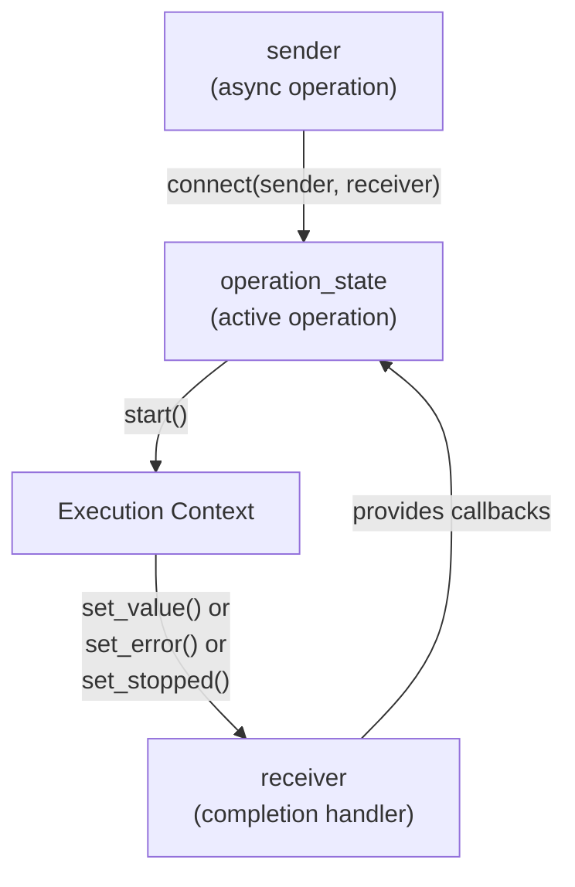

**Core Customization Point Objects (CPOs):**
- `connect`: Combines a sender with a receiver to create an `operation_state` [include/stdexec/__detail/__execution_fwd.hpp:221-221]().
- `start`: Initiates execution of an `operation_state` [include/stdexec/__detail/__execution_fwd.hpp:222-222]().
- `set_value`, `set_error`, `set_stopped`: Completion signals sent to receivers [include/stdexec/__detail/__execution_fwd.hpp:71-77]().

Sources: [include/stdexec/__detail/__execution_fwd.hpp:64-225](), [include/stdexec/execution.hpp:42-59]()

## Repository Structure

The repository implements a three-layer architecture: **stdexec** (P2300 core), **exec** (extensions and utilities), and **nvexec** (GPU acceleration).

### Three-Layer Architecture

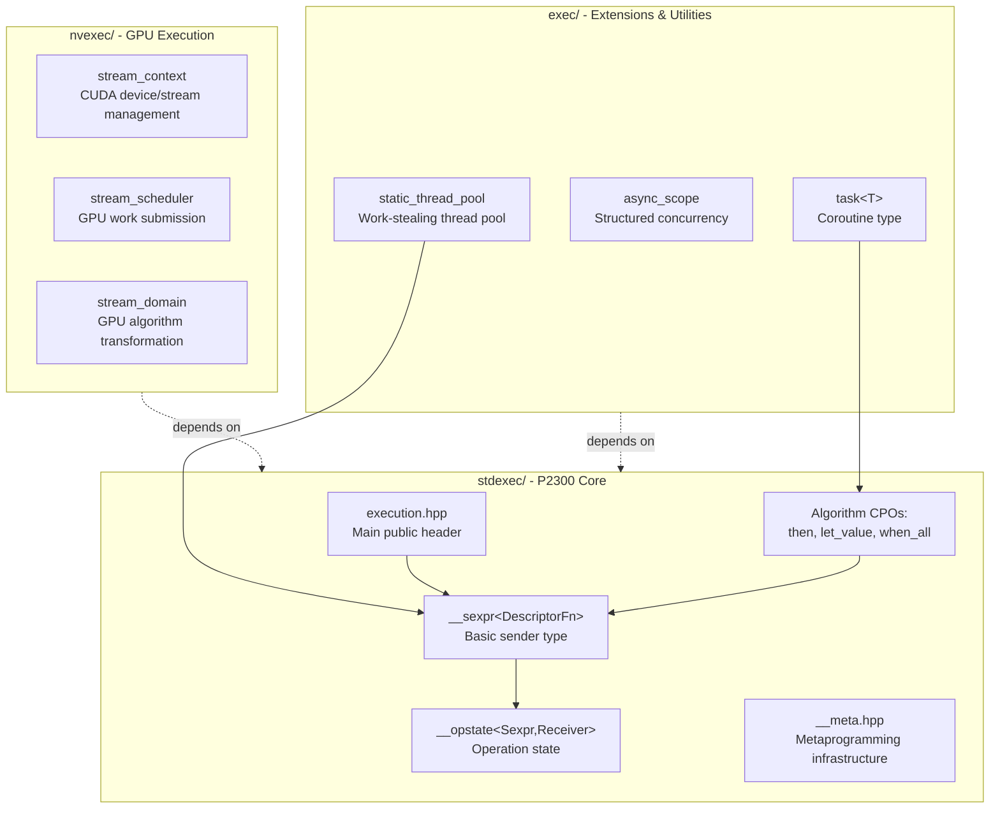

**Key Components by Layer:**

| Layer | Directory | Namespace | Purpose |
|-------|-----------|-----------|---------|
| **stdexec** | `include/stdexec/` | `::stdexec` | C++26 standard approved components [README.md:61-61](). |
| **exec** | `include/exec/` | `::exec` | Generic additions and extensions [README.md:68-68](). |
| **nvexec** | `include/nvexec/` | `::nvexec` | NVIDIA-specific GPU customizations [README.md:66-66](). |

Sources: [README.md:59-69](), [include/stdexec/execution.hpp:21-79]()

## Core Sender Implementation

The heart of stdexec is the `__sexpr` (sender expression) type defined in `__basic_sender.hpp`. All sender algorithms produce instances of `__sexpr` specialized with different tag types, data, and child senders.

### Key Implementation Types

**Sender Expression Framework (`__basic_sender.hpp`)**

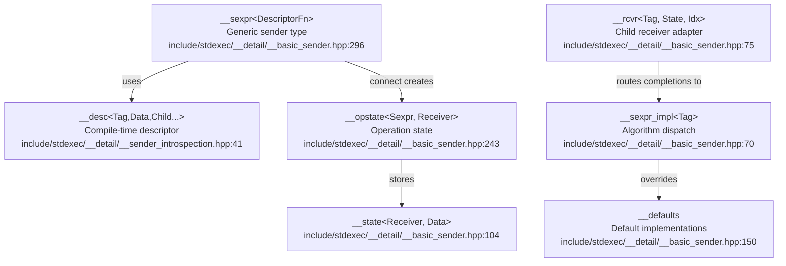

**Key classes and their roles:**

| Class Template | Line Range | Purpose |
|---------------|------------|---------|
| `__sexpr<DescriptorFn>` | [include/stdexec/__detail/__basic_sender.hpp:296-374]() | Generic sender, holds tag/data/children in tuple-like structure. |
| `__sexpr_impl<Tag>` | [include/stdexec/__detail/__basic_sender.hpp:70-70]() | Customization point for tag-specific behavior (get_state, start, complete). |
| `__opstate<Sender, Receiver>` | [include/stdexec/__detail/__basic_sender.hpp:243-271]() | Operation state holding receiver state and child operation states. |
| `__rcvr<Tag, State, Idx>` | [include/stdexec/__detail/__basic_sender.hpp:75-76]() | Child receiver that routes completions via `__sexpr_impl<Tag>::complete`. |
| `__state<Receiver, Data>` | [include/stdexec/__detail/__basic_sender.hpp:104-121]() | Stores user receiver and algorithm-specific data. |
| `__defaults` | [include/stdexec/__detail/__basic_sender.hpp:150-199]() | Default implementations for `__get_state`, `__connect`, `__start`. |

Sources: [include/stdexec/__detail/__basic_sender.hpp:1-400](), [include/stdexec/__detail/__sender_introspection.hpp:39-55]()

## Metaprogramming Infrastructure

The metaprogramming layer (`include/stdexec/__detail/__meta.hpp`) provides the foundation for type manipulation and compile-time introspection used throughout the library.

**Core Meta-Utilities:**

| Utility | Definition | Purpose |
|---------|------------|---------|
| `__t<Tp>` | [include/stdexec/__detail/__meta.hpp:36-36]() | Convenience for `typename Tp::__t`. |
| `__mconstant<Np>` | [include/stdexec/__detail/__meta.hpp:65-80]() | Compile-time integral constant wrapper. |
| `_ERROR_<What...>` | [include/stdexec/__detail/__meta.hpp:179-207]() | Type-based error propagation mechanism. |
| `__mcall<Fn, Args...>` | [include/stdexec/__detail/__meta.hpp:234-234]() | Invokes a metafunction with arguments. |
| `__ok<Arg>` | [include/stdexec/__detail/__meta.hpp:228-228]() | Concept to check if a type is not a metaprogramming error. |

Sources: [include/stdexec/__detail/__meta.hpp:1-251]()

## Execution Backends

### CPU Execution
The library provides several CPU-based execution contexts:
- **`static_thread_pool`**: A pool of worker threads for concurrent execution [examples/benchmark/static_thread_pool.cpp:59-59]().
- **`inline_scheduler`**: Executes work immediately on the current thread [include/stdexec/execution.hpp:34-34]().
- **`run_loop`**: A manual event loop for thread coordination [include/stdexec/execution.hpp:47-47]().

### GPU Execution (nvexec)
`nvexec` enables execution on NVIDIA GPUs via:
- **`stream_scheduler`**: Executes on a single GPU using CUDA streams [README.md:154-154]().
- **`multi_gpu_stream_scheduler`**: Distributes work across all visible GPUs [README.md:155-155]().

Sources: [README.md:148-158](), [include/stdexec/execution.hpp:32-61]()

## Platform Support

The library supports a wide range of compilers and platforms:
- **Compilers**: GCC 12+, Clang 16+, MSVC 14.43+, and NVC++ 25.9+ [README.md:72-78]().
- **Architecture**: Supports x86_64 and ARM64 (AMD64 and L4 GPUs used in CI) [.github/workflows/ci.gpu.yml:22-27]().
- **CI Environment**: Extensive testing on both CPU and GPU via GitHub Actions [.github/workflows/ci.cpu.yml:1-43](), [.github/workflows/ci.gpu.yml:1-28]().

Sources: [README.md:70-84](), [.github/workflows/ci.cpu.yml:22-43](), [.github/workflows/ci.gpu.yml:22-28]()

---

# Page: Getting Started

# Getting Started

<details>
<summary>Relevant source files</summary>

The following files were used as context for generating this wiki page:

- [.clang-format](.clang-format)
- [.gitignore](.gitignore)
- [conanfile.py](conanfile.py)
- [examples/algorithms/retry.hpp](examples/algorithms/retry.hpp)
- [examples/algorithms/then.hpp](examples/algorithms/then.hpp)
- [examples/hello_coro.cpp](examples/hello_coro.cpp)
- [examples/hello_world.cpp](examples/hello_world.cpp)
- [include/stdexec/__detail/__env.hpp](include/stdexec/__detail/__env.hpp)
- [include/stdexec/__detail/__just.hpp](include/stdexec/__detail/__just.hpp)
- [include/stdexec/__detail/__read_env.hpp](include/stdexec/__detail/__read_env.hpp)
- [include/stdexec/__detail/__schedulers.hpp](include/stdexec/__detail/__schedulers.hpp)
- [include/stdexec/__detail/__sync_wait.hpp](include/stdexec/__detail/__sync_wait.hpp)
- [include/stdexec/__detail/__write_env.hpp](include/stdexec/__detail/__write_env.hpp)
- [sanitizer-ignorelist.txt](sanitizer-ignorelist.txt)
- [test/test_main.cpp](test/test_main.cpp)
- [test_package/CMakeLists.txt](test_package/CMakeLists.txt)
- [test_package/conanfile.py](test_package/conanfile.py)
- [test_package/test.cpp](test_package/test.cpp)

</details>


This page provides a practical quick-start guide to building `stdexec`, writing your first sender/receiver code, and running examples. For a conceptual introduction to the execution model, see [Core Execution Model](#3).

## Prerequisites and Dependencies

`stdexec` requires C++20 support. The project supports multiple compilers across CPU and GPU execution contexts.

### Required Tooling

| Component | Minimum Version | Notes |
|-----------|----------------|-------|
| CMake | 3.25.0 | Required by [test_package/CMakeLists.txt:1]() |
| C++ Compiler | C++20 compliant | Validated by Conan in [conanfile.py:45]() |

### Supported Compilers

| Compiler | Versions | Platform | GPU Support |
|----------|----------|----------|-------------|
| GCC | 11+ | Linux | No |
| Clang | 16+ | Linux, macOS | Via CUDA toolkit |
| MSVC | 2022+ | Windows | No |
| NVHPC | 24.5+ | Linux | Yes (built-in) |

**Sources:** [conanfile.py:44-45](), [test_package/CMakeLists.txt:1-2]()

## Building stdexec

### Basic Build Process

`stdexec` can be built using standard CMake or via Conan. The core library is header-only unless the `parallel_scheduler` is enabled.

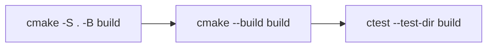

**Diagram: Standard CMake build workflow**

**Sources:** [conanfile.py:55-66](), [test_package/CMakeLists.txt:1-12]()

### Primary Targets

| Target | Type | Description | Source |
|--------|------|-------------|--------|
| `STDEXEC::stdexec` | Interface library | Core sender/receiver framework | [conanfile.py:80]() |
| `STDEXEC::parallel_scheduler` | Static library | Compiled parallel scheduler backend | [conanfile.py:81-85]() |

**Sources:** [conanfile.py:36-42](), [conanfile.py:77-86]()

## Your First Sender Chain

### Including the Library

The primary header provides the complete P2300 implementation:

```cpp
#include <stdexec/execution.hpp>
```

**Sources:** [examples/hello_world.cpp:19](), [examples/hello_coro.cpp:19]()

### Basic Sender Creation and Execution

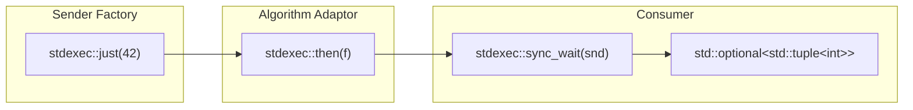

**Diagram: Data flow through a simple sender chain**

Minimal working example:

```cpp
#include <stdexec/execution.hpp>
#include <iostream>

int main() {
  using namespace stdexec;
  
  // Create a sender that completes with value 42
  auto snd = just(42)
           | then([](int x) { return x * 2; });
  
  // Block and wait for result
  auto [result] = sync_wait(snd).value();
  
  std::cout << "Result: " << result << std::endl; // Prints: Result: 84
  return 0;
}
```

**Key Components:**

| Symbol | Role | Implementation |
|--------|------|----------------|
| `stdexec::just` | Factory | Creates a sender that immediately completes with values. [include/stdexec/__detail/__just.hpp:1]() |
| `stdexec::then` | Adaptor | Transforms values using a function. [examples/algorithms/then.hpp:1]() |
| `stdexec::sync_wait` | Consumer | Blocks the current thread until the sender completes. [include/stdexec/__detail/__sync_wait.hpp:197-213]() |

**Sources:** [include/stdexec/__detail/__sync_wait.hpp:44-213](), [examples/hello_world.cpp:23-41]()

## Using Schedulers

Schedulers are handles to execution contexts. You obtain a sender from a scheduler using the `schedule` customization point.

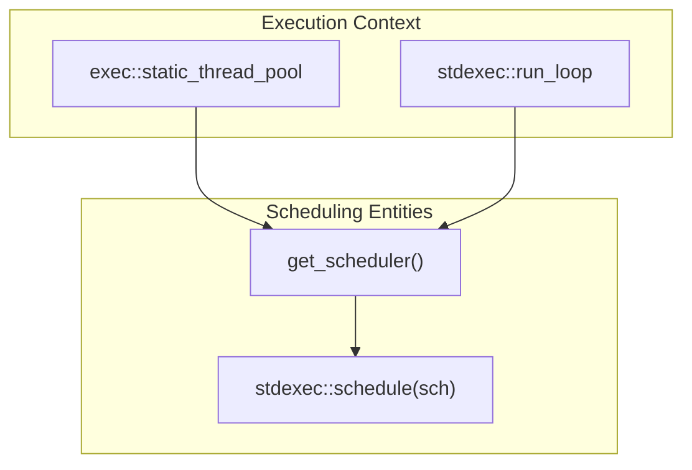

**Diagram: Obtaining and using schedulers**

Example with `static_thread_pool`:

```cpp
#include <stdexec/execution.hpp>
#include <exec/static_thread_pool.hpp>

int main() {
  exec::static_thread_pool ctx{8};
  scheduler auto sch = ctx.get_scheduler(); // [examples/hello_world.cpp:29]()
  
  sender auto snd = stdexec::schedule(sch) // [examples/hello_world.cpp:31]()
           | stdexec::then([] { return 42; });
           
  auto [res] = stdexec::sync_wait(snd).value();
}
```

**Key Scheduling Concepts:**

| Entity | Purpose | Definition |
|--------|---------|------------|
| `scheduler` | Concept for a handle to an execution context. | [include/stdexec/__detail/__schedulers.hpp:67-69]() |
| `schedule` | CPO that produces a sender from a scheduler. | [include/stdexec/__detail/__schedulers.hpp:119-164]() |
| `get_scheduler` | Query to find the current scheduler in an environment. | [include/stdexec/__detail/__sync_wait.hpp:51-56]() |

**Sources:** [include/stdexec/__detail/__schedulers.hpp:34-173](), [examples/hello_world.cpp:26-31]()

## Running Examples

The repository includes several examples demonstrating core patterns.

### Example: Hello World

The `hello_world.cpp` example shows how to bridge thread pools with `sync_wait` and how `sync_wait` itself provides a `run_loop` scheduler to its child senders.

```cpp
// examples/hello_world.cpp
exec::static_thread_pool ctx{8};
scheduler auto sch = ctx.get_scheduler();

sender auto begin = schedule(sch);
sender auto hi_again = then(begin, [] {
  std::cout << "Hello world! Have an int.\n";
  return 13;
});

auto [i] = sync_wait(std::move(hi_again)).value();
```

**Sources:** [examples/hello_world.cpp:26-41]()

### Example: Coroutines

`stdexec` integrates with C++20 coroutines. Senders are implicitly awaitable within a `stdexec::task`.

```cpp
// examples/hello_coro.cpp
template <sender S1, sender S2>
auto async_answer(S1 s1, S2 s2) -> stdexec::task<int> {
  // Senders are implicitly awaitable:
  co_await static_cast<S2&&>(s2); 
  co_return co_await static_cast<S1&&>(s1);
}
```

**Sources:** [examples/hello_coro.cpp:25-31]()

## Advanced Usage: Custom Senders

For more complex logic, you can implement the `sender` concept directly. This involves defining `completion_signatures` and a `connect` function that returns an operation state.

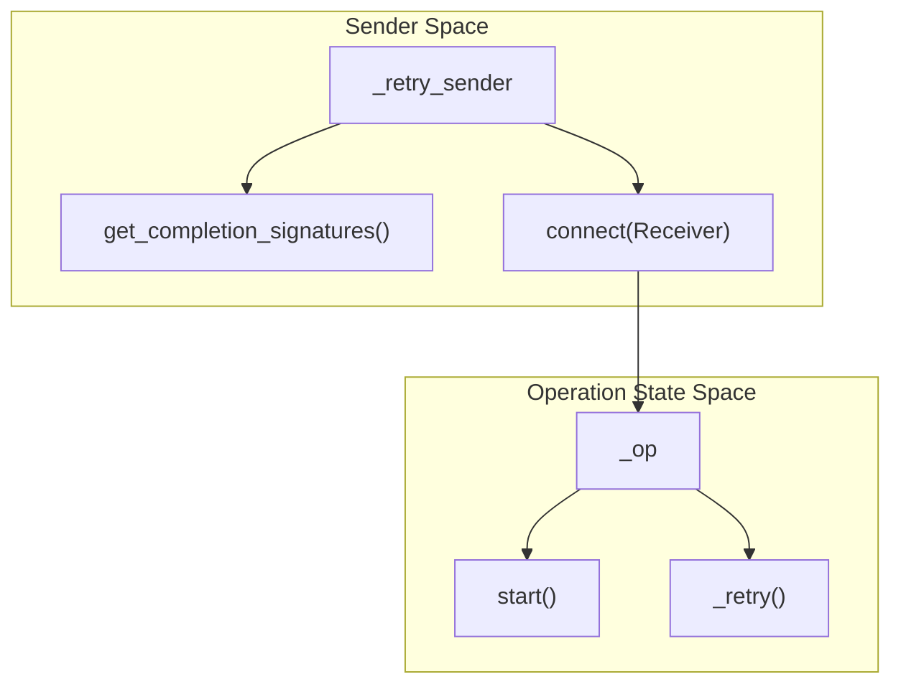

**Diagram: Custom sender implementation structure (Retry Algorithm)**

**Example from `retry` algorithm:**
- **Sender**: Defines `sender_concept` and computes signatures via `__transform_completion_signatures_t`. [examples/algorithms/retry.hpp:122-144]()
- **Connect**: Returns an `_op` (Operation State) object. [examples/algorithms/retry.hpp:146-150]()
- **Operation State**: Implements `start()` to initiate the child sender's operation state, and `_retry()` to re-connect and re-start upon error. [examples/algorithms/retry.hpp:83-119]()

**Sources:** [examples/algorithms/retry.hpp:50-162]()

---

# Page: Core Execution Model

# Core Execution Model

<details>
<summary>Relevant source files</summary>

The following files were used as context for generating this wiki page:

- [include/exec/on.hpp](include/exec/on.hpp)
- [include/stdexec/__detail/__basic_sender.hpp](include/stdexec/__detail/__basic_sender.hpp)
- [include/stdexec/__detail/__config.hpp](include/stdexec/__detail/__config.hpp)
- [include/stdexec/__detail/__execution_fwd.hpp](include/stdexec/__detail/__execution_fwd.hpp)
- [include/stdexec/__detail/__meta.hpp](include/stdexec/__detail/__meta.hpp)
- [include/stdexec/__detail/__preprocessor.hpp](include/stdexec/__detail/__preprocessor.hpp)
- [include/stdexec/__detail/__sender_introspection.hpp](include/stdexec/__detail/__sender_introspection.hpp)
- [include/stdexec/concepts.hpp](include/stdexec/concepts.hpp)
- [include/stdexec/execution.hpp](include/stdexec/execution.hpp)
- [include/stdexec/functional.hpp](include/stdexec/functional.hpp)

</details>


## Purpose and Scope

This document explains the fundamental P2300 sender/receiver execution model implemented in `stdexec`. It covers the core abstractions—senders, receivers, operation states—and their interactions through customization points like `connect` and `start`. This page provides the technical foundation for understanding how asynchronous work is represented and executed in the library.

For specific details on:
- Sender and receiver concept definitions: see [Sender and Receiver Concepts](#3.1)
- How completion signatures are computed: see [Completion Signatures](#3.2)
- Environment queries and property propagation: see [Execution Environment and Queries](#3.3)
- Algorithm customization via domains: see [Domains and Customization](#3.4)
- Metaprogramming utilities: see [Metaprogramming Infrastructure](#3.5)
- The `__sexpr` sender implementation: see [The __sexpr Sender Model](#3.6)

## The P2300 Sender/Receiver Model

The `stdexec` library implements the C++ P2300 proposal for asynchronous execution, which defines a type-safe, composable framework for representing and executing asynchronous operations. The model is built around three core abstractions that form an inseparable triple:

| Concept | Role | Key Operations |
|---------|------|----------------|
| **Sender** | Represents asynchronous work that will produce values | Queried for completion signatures, connected to receivers |
| **Receiver** | Consumes the results of async work | Receives completions via `set_value`, `set_error`, `set_stopped` |
| **Operation State** | Manages the lifetime of executing work | Started with `start()`, owns resources until completion |

The model separates **description** (senders) from **execution** (operation states) from **consumption** (receivers), enabling powerful composition patterns.

**Sources:** [include/stdexec/__detail/__execution_fwd.hpp:64-170](), [include/stdexec/__detail/__basic_sender.hpp:42-121]()

## Core Type Relationships

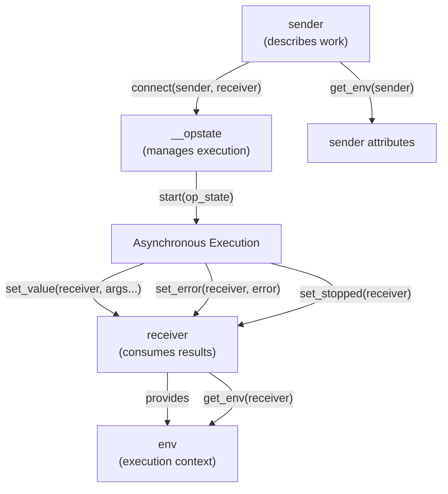

**Diagram: Core Execution Model Type Relationships**

This diagram shows how the fundamental types interact through customization points `connect`, `start`, and the completion functions `set_value`, `set_error`, and `set_stopped`.

**Sources:** [include/stdexec/__detail/__execution_fwd.hpp:104-109](), [include/stdexec/__detail/__basic_sender.hpp:132-144](), [include/stdexec/__detail/__basic_sender.hpp:179-187]()

## Completion Signals

Every asynchronous operation in `stdexec` completes through one of three mutually-exclusive channels, represented by the completion signal types:

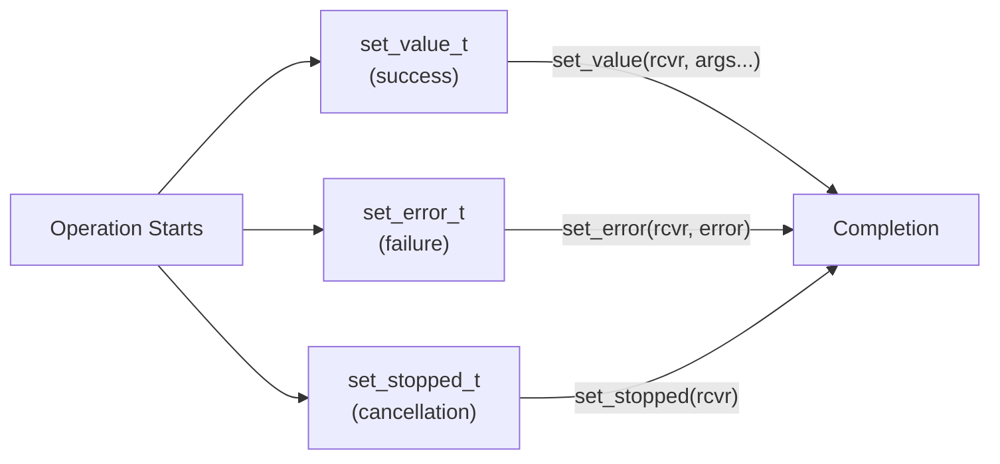

**Diagram: Three Completion Channels**

Each completion signal is a customization point object (CPO):

- **`set_value_t`**: Signals successful completion with zero or more result values. [include/stdexec/__detail/__execution_fwd.hpp:71]()
- **`set_error_t`**: Signals failure with a single error value. [include/stdexec/__detail/__execution_fwd.hpp:72]()
- **`set_stopped_t`**: Signals cancellation (no values). [include/stdexec/__detail/__execution_fwd.hpp:73]()

All completion functions are typically expected to be `noexcept` at the call site to ensure deterministic resource cleanup and consistent error handling boundaries.

**Sources:** [include/stdexec/__detail/__execution_fwd.hpp:69-77]()

## The Execution Lifecycle

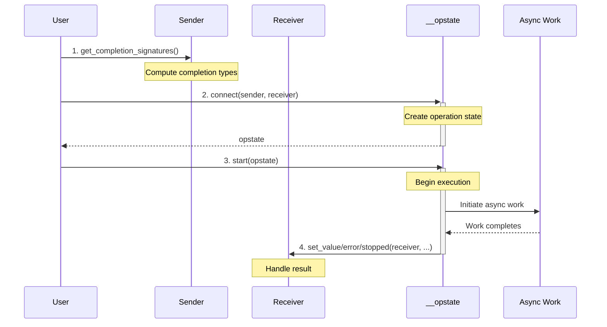

**Diagram: Execution Lifecycle Sequence**

The execution lifecycle consists of four phases:

1. **Query Phase**: Determine what completion signatures the sender will produce using `get_completion_signatures_t`. [include/stdexec/__detail/__execution_fwd.hpp:194-199]()
2. **Connection Phase**: Call `connect(sender, receiver)` to create an operation state. [include/stdexec/__detail/__execution_fwd.hpp:221]()
3. **Start Phase**: Call `start(opstate)` to begin execution. [include/stdexec/__detail/__basic_sender.hpp:195-198]()
4. **Completion Phase**: The operation eventually calls one completion function on the receiver. [include/stdexec/__detail/__execution_fwd.hpp:71-77]()

**Sources:** [include/stdexec/__detail/__basic_sender.hpp:179-198](), [include/stdexec/__detail/__execution_fwd.hpp:194-221]()

## Concepts and Type Requirements

### sender

A type models `sender` if it has a `sender_tag` (or enables via `enable_sender`) and can be connected to appropriate receivers. [include/stdexec/__detail/__execution_fwd.hpp:166-172]()

### receiver

A type models `receiver` if it is move constructible, provides an environment via `get_env`, and supports completion signals. [include/stdexec/__detail/__execution_fwd.hpp:107-111](), [include/stdexec/__detail/__execution_fwd.hpp:169]()

## Environment and Query System

Every sender and receiver has an associated **environment** that provides access to execution context information through queries. The environment is obtained via `get_env()`.

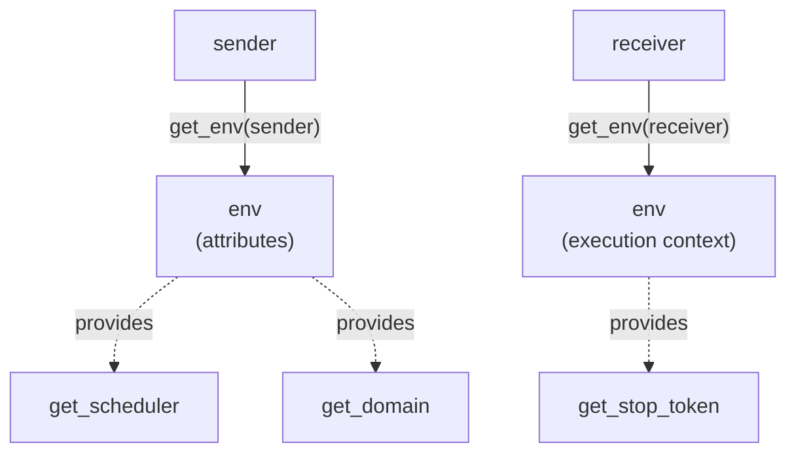

**Diagram: Environment Query System**

Key environment queries include:

- **`get_scheduler`**: Returns a scheduler for executing subsequent work. [include/stdexec/__detail/__execution_fwd.hpp:123]()
- **`get_domain`**: Returns the domain for algorithm customization. [include/stdexec/__detail/__execution_fwd.hpp:132]()
- **`get_completion_scheduler<Tag>`**: Returns the scheduler where `Tag` completion will occur. [include/stdexec/__detail/__execution_fwd.hpp:126-127]()

**Sources:** [include/stdexec/__detail/__execution_fwd.hpp:107-147]()

## Domain Customization

Domains enable **algorithm customization** by transforming senders before they are connected to receivers. This allows platform-specific implementations to replace default algorithms with optimized versions.

The `default_domain` provides standard behavior, but custom domains can intercept and transform senders. [include/stdexec/__detail/__execution_fwd.hpp:65-68]()

**Sources:** [include/stdexec/__detail/__execution_fwd.hpp:65-68](), [include/stdexec/__detail/__execution_fwd.hpp:149-153]()

## The __sexpr Sender Model

Internally, most senders in `stdexec` are represented using the `__sexpr` template. This is a generic sender representation that stores a **tag**, **data**, and **children**. [include/stdexec/__detail/__sender_introspection.hpp:34-55]()

Each sender tag type provides a `__sexpr_impl<Tag>` specialization that customizes behavior for state management, environment propagation, and completion signature computation. [include/stdexec/__detail/__basic_sender.hpp:69-70]()

**Sources:** [include/stdexec/__detail/__basic_sender.hpp:42-70](), [include/stdexec/__detail/__sender_introspection.hpp:39-55]()

## Key Files

The core execution model is implemented across several internal header files:

| File | Purpose |
|------|---------|
| `__execution_fwd.hpp` | Forward declarations and core concept tags. [include/stdexec/__detail/__execution_fwd.hpp:1-221]() |
| `__basic_sender.hpp` | Generic `__sexpr` sender and `__opstate` implementation. [include/stdexec/__detail/__basic_sender.hpp:1-198]() |
| `__meta.hpp` | Extensive metaprogramming infrastructure. [include/stdexec/__detail/__meta.hpp:1-253]() |
| `__sender_introspection.hpp` | Utilities for decomposing senders into tags and data. [include/stdexec/__detail/__sender_introspection.hpp:1-183]() |

**Sources:** [include/stdexec/execution.hpp:1-78]()

---

# Page: Sender and Receiver Concepts

# Sender and Receiver Concepts

<details>
<summary>Relevant source files</summary>

The following files were used as context for generating this wiki page:

- [include/stdexec/__detail/__concepts.hpp](include/stdexec/__detail/__concepts.hpp)
- [include/stdexec/__detail/__connect.hpp](include/stdexec/__detail/__connect.hpp)
- [include/stdexec/__detail/__diagnostics.hpp](include/stdexec/__detail/__diagnostics.hpp)
- [include/stdexec/__detail/__get_completion_signatures.hpp](include/stdexec/__detail/__get_completion_signatures.hpp)
- [include/stdexec/__detail/__operation_states.hpp](include/stdexec/__detail/__operation_states.hpp)
- [include/stdexec/__detail/__optional.hpp](include/stdexec/__detail/__optional.hpp)
- [include/stdexec/__detail/__receivers.hpp](include/stdexec/__detail/__receivers.hpp)
- [include/stdexec/__detail/__sender_concepts.hpp](include/stdexec/__detail/__sender_concepts.hpp)
- [include/stdexec/__detail/__tuple.hpp](include/stdexec/__detail/__tuple.hpp)
- [include/stdexec/__detail/__variant.hpp](include/stdexec/__detail/__variant.hpp)

</details>


## Purpose and Scope

This page defines the core sender/receiver execution model as implemented in `stdexec`. These concepts form the foundation of the library's asynchronous execution framework, establishing the vocabulary types and operations that enable composable asynchronous operations based on the P2300 proposal.

This page covers:
- The `sender`, `receiver`, and `operation_state` concepts.
- The completion signal protocol (`set_value`, `set_error`, `set_stopped`).
- The lifecycle operations (`connect` and `start`).
- Customization mechanisms for these operations.

## The Three-Concept Model

The execution model is built on three interdependent concepts that work together to represent asynchronous operations:

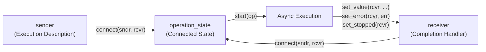

**Diagram: Core P2300 Concepts and Their Relationships**

Sources: [include/stdexec/__detail/__sender_concepts.hpp:90-117](), [include/stdexec/__detail/__receivers.hpp:89-91](), [include/stdexec/__detail/__operation_states.hpp:158-167]()

| Concept | Purpose | Key Operations |
|---------|---------|----------------|
| `sender` | Describes an asynchronous operation; lazy and by-value. | `connect()`, `get_env()` |
| `receiver` | Handles completion signals from an operation state. | `set_value()`, `set_error()`, `set_stopped()` |
| `operation_state` | An immovable object representing a connected sender-receiver pair. | `start()` |

Sources: [include/stdexec/__detail/__sender_concepts.hpp:123-127](), [include/stdexec/__detail/__receivers.hpp:195-204](), [include/stdexec/__detail/__operation_states.hpp:185-191]()

## The Receiver Concept

A `receiver` is a completion handler that receives notification when an asynchronous operation completes. Receivers must handle three completion signals representing different completion dispositions.

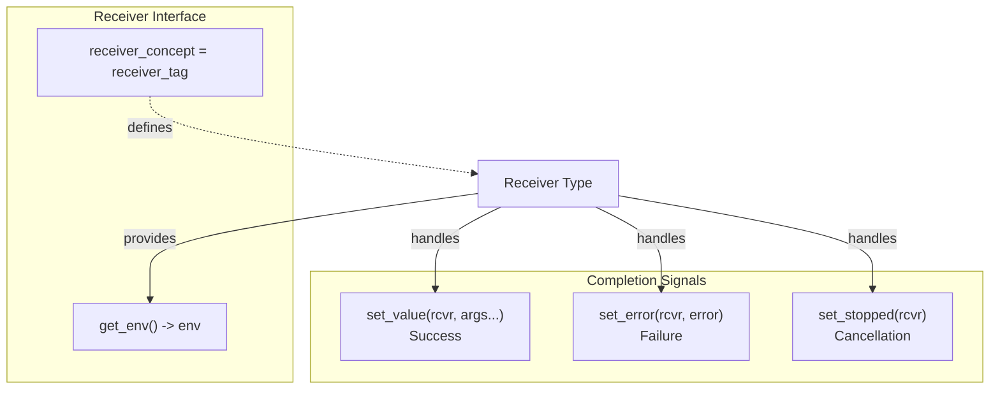

**Diagram: Receiver Concept Requirements**

Sources: [include/stdexec/__detail/__receivers.hpp:195-204](), [include/stdexec/__detail/__receivers.hpp:54-62]()

### Receiver Requirements

A type `R` models `receiver` if:
1. It is opted into the concept via a `receiver_concept` alias deriving from `receiver_tag` [include/stdexec/__detail/__receivers.hpp:196]().
2. It satisfies `__environment_provider` (provides `get_env`) [include/stdexec/__detail/__receivers.hpp:197]().
3. It is move-constructible [include/stdexec/__detail/__receivers.hpp:198]().

Sources: [include/stdexec/__detail/__receivers.hpp:195-204]()

### Completion Signal Functions

Completion signals are triggered via Customization Point Objects (CPOs):

| Function | Signature | Purpose |
|----------|-----------|---------|
| `set_value` | `void set_value(R&&, Args&&...)` | Signals successful completion with result values [include/stdexec/__detail/__receivers.hpp:91-132](). |
| `set_error` | `void set_error(R&&, E&&)` | Signals completion with an error [include/stdexec/__detail/__receivers.hpp:173-214](). |
| `set_stopped` | `void set_stopped(R&&)` | Signals cancellation [include/stdexec/__detail/__receivers.hpp:221-255](). |

**Constraints:**
- Signals must be `noexcept` [include/stdexec/__detail/__receivers.hpp:112-114]().
- Signals must return `void` [include/stdexec/__detail/__receivers.hpp:115-118]().
- A receiver must be completed with exactly one signal, exactly once [include/stdexec/__detail/__receivers.hpp:164-166]().

## The Sender Concept

A `sender` is a value type that describes an asynchronous operation. Senders are lazy—they do not start execution until `connect`-ed and `start`-ed.

### Sender Requirements

A type `S` models `sender` if:
1. It is opted into the concept via `sender_concept` alias or `enable_sender` specialization [include/stdexec/__detail/__sender_concepts.hpp:124]().
2. It provides an environment via `get_env` [include/stdexec/__detail/__sender_concepts.hpp:125]().
3. Its decayed type is move-constructible and constructible from `S` [include/stdexec/__detail/__sender_concepts.hpp:126-127]().

Sources: [include/stdexec/__detail/__sender_concepts.hpp:123-128]()

### sender_in and sender_to

- **`sender_in<S, Env>`**: A sender whose completion signatures can be computed within a specific environment `Env` [include/stdexec/__detail/__sender_concepts.hpp:169-175]().
- **`sender_to<S, R>`**: A sender that can be connected to a specific receiver `R`. This requires that the sender's completion signatures are compatible with the receiver's supported `set_*` overloads [include/stdexec/__detail/__sender_concepts.hpp:203-210]().

## The Operation State Concept

An `operation_state` is the result of `connect(sender, receiver)`. It holds the state of an in-progress operation.

### Lifecycle and Constraints

1. **Immovability**: Once constructed, an operation state must not be moved or copied [include/stdexec/__detail/__operation_states.hpp:181-183]().
2. **Start**: The `start` CPO begins execution. It must be called exactly once [include/stdexec/__detail/__operation_states.hpp:60-64]().
3. **Lifetime**: The operation state must remain alive until the receiver is notified of completion [include/stdexec/__detail/__operation_states.hpp:76-79]().

Sources: [include/stdexec/__detail/__operation_states.hpp:68-84](), [include/stdexec/__detail/__operation_states.hpp:169-177]()

## The Connect Operation

The `connect` CPO bridges a sender and a receiver. It prioritizes customization mechanisms in the following order:

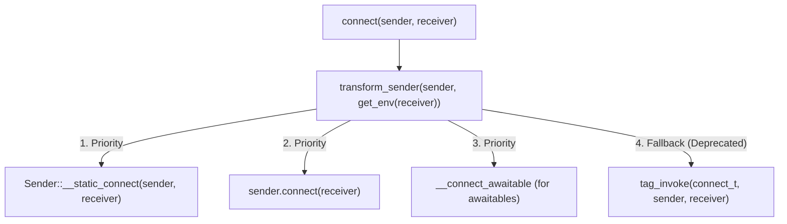

**Diagram: Connect Customization Lookup**

Sources: [include/stdexec/__detail/__connect.hpp:35-57](), [include/stdexec/__detail/__connect.hpp:147-168]()

| Mechanism | Implementation | Priority |
|-----------|----------------|----------|
| Static Member | `S::__static_connect(sndr, rcvr)` | 1 |
| Member Function | `sndr.connect(rcvr)` | 2 |
| Awaitable | Coroutine-based connection | 3 |
| `tag_invoke` | Legacy P2300 mechanism | 4 (Deprecated) |

Sources: [include/stdexec/__detail/__connect.hpp:35-57]()

## Summary of Data Flow

The following diagram bridges the natural language concepts to the specific code entities in `stdexec`:

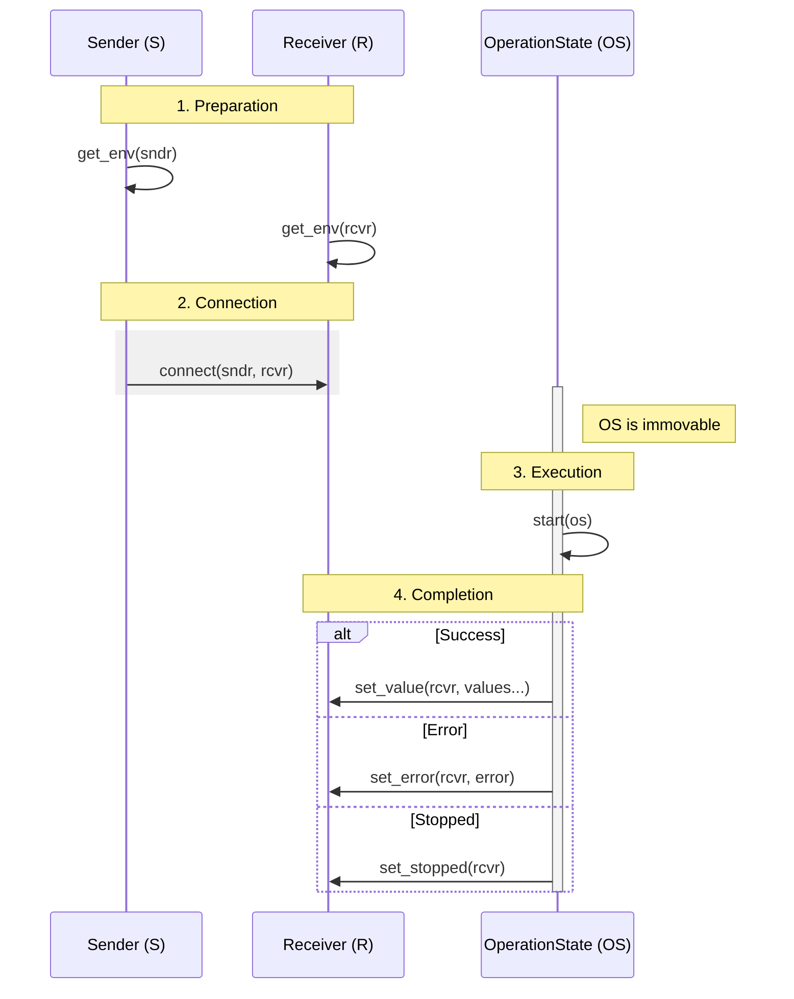

**Diagram: Sender/Receiver Interaction Lifecycle**

Sources: [include/stdexec/__detail/__operation_states.hpp:116-153](), [include/stdexec/__detail/__connect.hpp:33-58](), [include/stdexec/__detail/__receivers.hpp:91-255]()

---

# Page: Completion Signatures

# Completion Signatures

<details>
<summary>Relevant source files</summary>

The following files were used as context for generating this wiki page:

- [cmake/RAPIDS.cmake](cmake/RAPIDS.cmake)
- [include/exec/completion_signatures.hpp](include/exec/completion_signatures.hpp)
- [include/stdexec/__detail/__affine.hpp](include/stdexec/__detail/__affine.hpp)
- [include/stdexec/__detail/__completion_behavior.hpp](include/stdexec/__detail/__completion_behavior.hpp)
- [include/stdexec/__detail/__completion_signatures.hpp](include/stdexec/__detail/__completion_signatures.hpp)
- [include/stdexec/__detail/__continues_on.hpp](include/stdexec/__detail/__continues_on.hpp)
- [include/stdexec/__detail/__deprecations.hpp](include/stdexec/__detail/__deprecations.hpp)
- [include/stdexec/__detail/__inline_scheduler.hpp](include/stdexec/__detail/__inline_scheduler.hpp)
- [include/stdexec/__detail/__queries.hpp](include/stdexec/__detail/__queries.hpp)
- [include/stdexec/__detail/__query.hpp](include/stdexec/__detail/__query.hpp)
- [include/stdexec/__detail/__senders.hpp](include/stdexec/__detail/__senders.hpp)
- [include/stdexec/__detail/__transform_completion_signatures.hpp](include/stdexec/__detail/__transform_completion_signatures.hpp)
- [test/stdexec/detail/test_completion_signatures.cpp](test/stdexec/detail/test_completion_signatures.cpp)
- [test/stdexec/detail/test_utility.cpp](test/stdexec/detail/test_utility.cpp)

</details>


## Purpose and Scope

This document explains **completion signatures** in stdexec, which describe the ways a sender can complete its asynchronous operation. Completion signatures are fundamental to type safety in the sender/receiver model, allowing the library to verify at compile time that senders and receivers are compatible.

For information about sender and receiver concepts themselves, see [Sender and Receiver Concepts (3.1)](). For information about how environments affect sender behavior, see [Execution Environment and Queries (3.3)]().

## Overview

Completion signatures are compile-time type lists that enumerate all possible completion channels a sender can invoke on its connected receiver. The `completion_signatures<Sigs...>` template class aggregates these signature types, enabling compile-time verification of sender-receiver compatibility.

A sender invokes exactly one of three completion customization point objects (CPOs) on its receiver:
- `set_value(args...)` - successful completion with result values (type signature: `set_value_t(Args...)`) [[include/stdexec/__detail/__completion_signatures.hpp:40-41]()]
- `set_error(error)` - completion with an error (type signature: `set_error_t(Error)`) [[include/stdexec/__detail/__completion_signatures.hpp:42-43]()]
- `set_stopped()` - completion due to cancellation (type signature: `set_stopped_t()`) [[include/stdexec/__detail/__completion_signatures.hpp:44-45]()]

The completion signatures are type metadata only; they describe which overloads of these CPOs the sender may invoke, but do not directly participate in the runtime completion process.

**Diagram: Completion Signatures as Type Metadata**
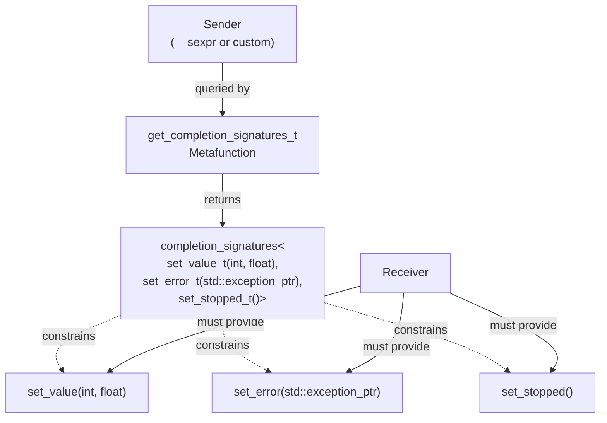

**Sources:** [[include/stdexec/__detail/__completion_signatures.hpp:32-49]()], [[include/stdexec/__detail/__transform_completion_signatures.hpp:52-57]()]

## Completion Signature Types

### The `completion_signatures` Template

The `completion_signatures<Sigs...>` class template is a tag type that aggregates completion signature types. It serves as the return type for sender signature queries.

**Diagram: completion_signatures Template Structure**
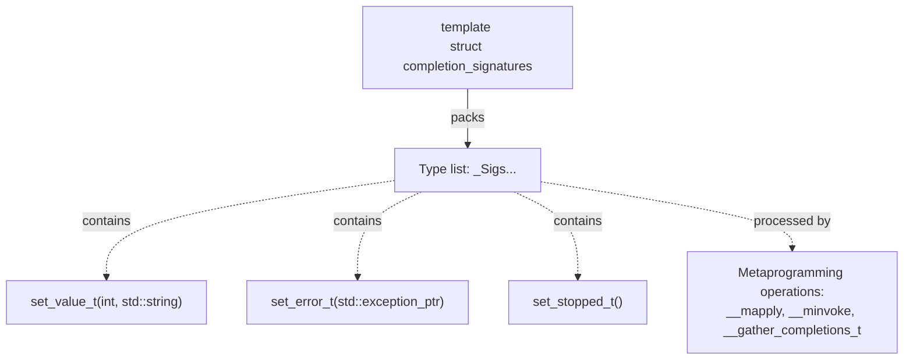

The class itself has no member functions or data; it exists purely as a compile-time container of types. Metafunctions from `__meta.hpp` operate on these type lists. The library uses a partitioning system (`__partitions`) to cache and quickly access value, error, and stopped types from these signatures [[include/stdexec/__detail/__completion_signatures.hpp:84-144]()].

**Sources:** [[include/stdexec/__detail/__completion_signatures.hpp:32-49]()], [[include/stdexec/__detail/__completion_signatures.hpp:84-144]()]

### The Three Completion Channels

Each completion signature corresponds to one of three completion channels:

| Channel | Signature Form | Purpose | Implementation Tag |
|---------|---------------|---------|--------------------|
| **Value** | `set_value_t(Args...)` | Successful completion with result values | `set_value_t` [[include/stdexec/__detail/__completion_signatures.hpp:41]()] |
| **Error** | `set_error_t(Error)` | Completion with an error | `set_error_t` [[include/stdexec/__detail/__completion_signatures.hpp:43]()] |
| **Stopped** | `set_stopped_t()` | Completion due to cancellation | `set_stopped_t` [[include/stdexec/__detail/__completion_signatures.hpp:45]()] |

A sender can have:
- Zero or more value completion signatures (different success paths).
- Zero or more error completion signatures (different error types).
- Zero or one stopped completion signature.

**Sources:** [[include/stdexec/__detail/__completion_signatures.hpp:35-49]()], [[test/stdexec/detail/test_completion_signatures.cpp:33-52]()]

## Computing Completion Signatures

### The Query Process

The library queries completion signatures through `get_completion_signatures_t`. This orchestrates the query by examining the sender's capabilities.

**Diagram: Completion Signature Query Process (Code-Level)**
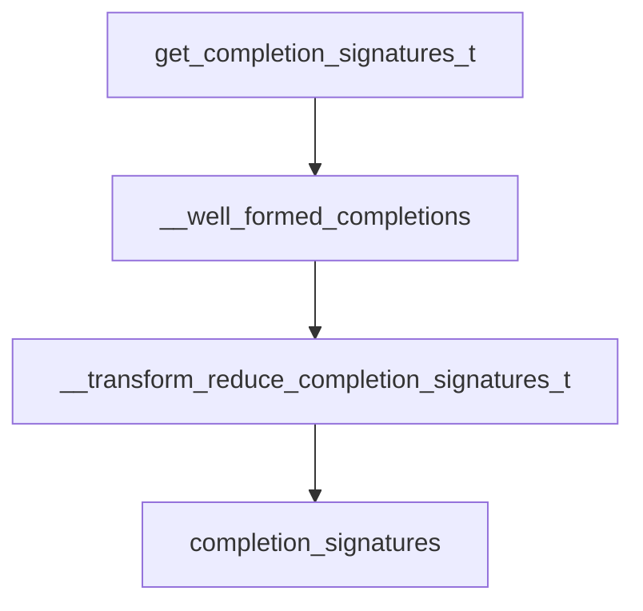

The system supports multiple discovery and transformation mechanisms, including the ability to return error types when constexpr exceptions are not available [[include/stdexec/__detail/__transform_completion_signatures.hpp:35-49]()].

**Sources:** [[include/stdexec/__detail/__transform_completion_signatures.hpp:31-58]()], [[include/stdexec/__detail/__transform_completion_signatures.hpp:146-169]()]

### Environment-Dependent Signatures

Environment-dependent senders require the execution environment to compute their completion signatures. The library uses concepts like `sender_in` to verify that a sender can produce valid signatures within a specific environment [[include/stdexec/__detail/__senders.hpp:51-57]()].

**Sources:** [[include/stdexec/__detail/__senders.hpp:47-60]()]

## Transforming Completion Signatures

### The `__transform_completion_signatures_t` Metafunction

Stdexec provides powerful utilities to transform signatures, often used by adaptors like `continues_on` to modify the output of a child sender.

**Diagram: transform_completion_signatures Template Parameters**
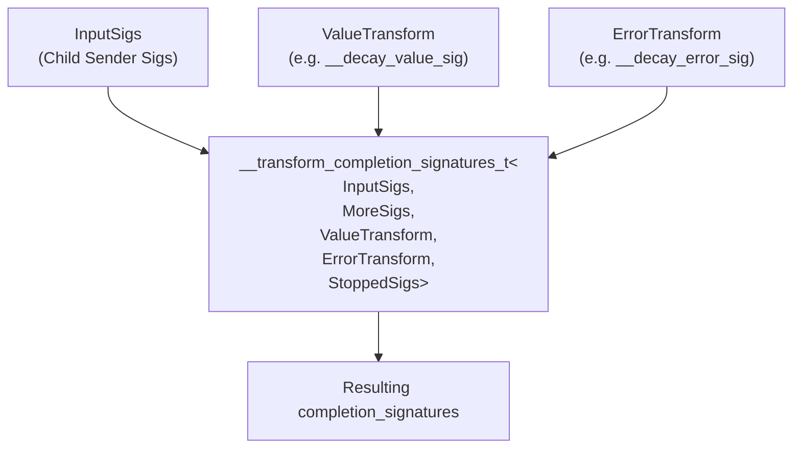

The implementation in `__transform_completion_signatures.hpp` allows:
- `_ValueTransform`: A template that takes value types and returns a new set of signatures (defaults to `__default_set_value`).
- `_ErrorTransform`: A template that takes error types and returns a new set of signatures (defaults to `__default_set_error`).
- `_StoppedSigs`: A replacement for the stopped channel (defaults to `completion_signatures<set_stopped_t()>`).

**Sources:** [[include/stdexec/__detail/__transform_completion_signatures.hpp:156-169]()], [[include/stdexec/__detail/__continues_on.hpp:41-63]()]

### Normalization

The library performs "normalization" on signatures, which involves stripping rvalue-references from types to simplify signature matching (e.g., `set_value_t(int &&)` becomes `set_value_t(int)`).

**Sources:** [[include/stdexec/__detail/__completion_signatures.hpp:50-78]()]

## Completion Behavior

Senders can also describe their completion behavior (whether they complete synchronously or asynchronously) using `__get_completion_behavior_t`. This is a query that returns a value from the `__completion_behavior::__behavior` enum:
- `__asynchronous`: Completes on a potentially different context.
- `__asynchronous_affine`: Completes on the same context that started it, but asynchronously.
- `__inline_completion`: Completes synchronously before `start()` returns.

**Sources:** [[include/stdexec/__detail/__completion_behavior.hpp:35-82]()], [[include/stdexec/__detail/__inline_scheduler.hpp:28-36]()]

## Type Checking with `sender_of`

The `sender_of` concept verifies that a sender completes with a specific signature in a given environment.

```cpp
template <class _Sender, class _SetSig, class... _Env>
concept sender_of =
  sender_in<_Sender, _Env...>
  && __same_as<__mlist<_SetSig>,
               __gather_completions_t<__signature_tag_t<_SetSig>,
                                      __completion_signatures_of_t<_Sender, _Env...>,
                                      __mcompose<__qq<__mlist>, __qf<__signature_tag_t<_SetSig>>>,
                                      __mconcat<__qq<__mlist>>>>;
```

This ensures that the sender provides exactly the expected overload for a specific tag (like `set_value_t`).

**Sources:** [[include/stdexec/__detail/__senders.hpp:50-57]()]

## Diagnostic Utilities

The library includes `make_completion_signatures` in the `experimental::execution` namespace, which provides a `consteval` helper for users to construct signature types manually while ensuring they are unique and normalized [[include/exec/completion_signatures.hpp:26-77]()].

**Sources:** [[include/exec/completion_signatures.hpp:27-44]()], [[include/exec/completion_signatures.hpp:71-77]()]

---

# Page: Execution Environment and Queries

# Execution Environment and Queries

<details>
<summary>Relevant source files</summary>

The following files were used as context for generating this wiki page:

- [include/stdexec/__detail/__any.hpp](include/stdexec/__detail/__any.hpp)
- [include/stdexec/__detail/__env.hpp](include/stdexec/__detail/__env.hpp)
- [include/stdexec/__detail/__just.hpp](include/stdexec/__detail/__just.hpp)
- [include/stdexec/__detail/__read_env.hpp](include/stdexec/__detail/__read_env.hpp)
- [include/stdexec/__detail/__schedulers.hpp](include/stdexec/__detail/__schedulers.hpp)
- [include/stdexec/__detail/__sync_wait.hpp](include/stdexec/__detail/__sync_wait.hpp)
- [include/stdexec/__detail/__utility.hpp](include/stdexec/__detail/__utility.hpp)
- [include/stdexec/__detail/__write_env.hpp](include/stdexec/__detail/__write_env.hpp)
- [include/stdexec/stop_token.hpp](include/stdexec/stop_token.hpp)
- [test/stdexec/detail/test_any.cpp](test/stdexec/detail/test_any.cpp)

</details>


## Purpose and Scope

This document describes the execution environment system and query mechanism in `stdexec`. Environments are queryable objects that provide contextual information to senders and receivers, enabling them to adapt their behavior based on execution context. The query system is the primary mechanism for accessing schedulers, stop tokens, allocators, and other execution properties.

For information about how environments interact with domain-based algorithm customization, see [Domains and Customization](3.4). For details on how queries relate to completion signatures, see [Completion Signatures](3.2).

## Environment Fundamentals

### The Environment Concept

An **environment** is a queryable object that provides answers to queries about the execution context. Environments flow from receivers through operation states to child senders, allowing execution properties to propagate through sender graphs.

The `queryable` concept is defined as any destructible type:

[include/stdexec/__detail/__query.hpp:30-31]()

### The `env` Type

The `env<>` type (also available as `env<Props...>`) is the fundamental environment type. It can be empty or composed of multiple property objects:

[include/stdexec/__detail/__execution_fwd.hpp:101-102]()

### The `get_env` Query

`get_env` is the fundamental query that retrieves an environment from an environment provider (typically a receiver or sender):

[include/stdexec/__detail/__execution_fwd.hpp:105-106]()

The alias `env_of_t` is used to retrieve the type of environment returned by `get_env`:

[include/stdexec/__detail/__execution_fwd.hpp:108-109]()

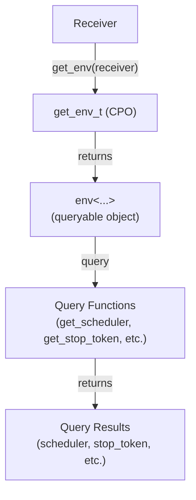

**Sources:** [include/stdexec/__detail/__execution_fwd.hpp:101-111](), [include/stdexec/__detail/__query.hpp:30-31]()

## Query Mechanism

### Query Customization

Queries are customized via member functions on the environment type. The modern customization point is the `.query()` member function:

[include/stdexec/__detail/__query.hpp:76-86]()

The internal `__query` template implements the dispatch logic, checking for the `.query()` member before falling back to `tag_invoke`:

[include/stdexec/__detail/__query.hpp:56-101]()

### Query Types and Their Properties

```mermaid
graph LR
    subgraph "Query Categories"
        Standard["Standard Queries<br/>get_scheduler<br/>get_stop_token<br/>get_allocator"]
        Completion["Completion Queries<br/>get_completion_scheduler<br/>get_completion_domain"]
        Domain["Domain Queries<br/>get_domain"]
    end
    
    subgraph "Query Properties"
        Forwarding["forwarding_query_t<br/>(propagate through adapters)"]
        NonForwarding["Non-Forwarding Queries<br/>(specific to context)"]
    end
    
    Standard --> Forwarding
    Completion --> Forwarding
    Domain --> Forwarding
```

**Sources:** [include/stdexec/__detail/__execution_fwd.hpp:119-145](), [include/stdexec/__detail/__query.hpp:127-145]()

### Forwarding Queries

A **forwarding query** is one that should be propagated through sender adaptors. The `forwarding_query_t` query determines if a given query should forward. Queries that derive from `forwarding_query_t` or implement a `query(forwarding_query_t)` member returning `true` are considered forwarding:

[include/stdexec/__detail/__query.hpp:127-137]()

**Sources:** [include/stdexec/__detail/__query.hpp:127-145]()

## Standard Queries

### Scheduler Queries

| Query | Purpose | File Pointer |
|-------|---------|--------------|
| `get_scheduler` | Retrieves the scheduler associated with the environment | [include/stdexec/__detail/__execution_fwd.hpp:137]() |
| `get_start_scheduler` | Retrieves the scheduler used to start the sender | [include/stdexec/__detail/__execution_fwd.hpp:138]() |
| `get_delegation_scheduler` | Retrieves a scheduler for delegating work | [include/stdexec/__detail/__execution_fwd.hpp:139]() |

### Stop Token Query

`get_stop_token` retrieves the stop token for cancellation:

[include/stdexec/__detail/__execution_fwd.hpp:105-106]() (defined via `__stok::__get_stop_token_t` in [include/stdexec/stop_token.hpp:105-106]())

Common stop token types include:
- `never_stop_token`: A token that never requests stop. [include/stdexec/__detail/__stop_token.hpp:33-34]()
- `inplace_stop_token`: An efficient in-place stop token. [include/stdexec/stop_token.hpp:154-155]()

### Other Standard Queries

| Query | Purpose | File Pointer |
|-------|---------|--------------|
| `get_forward_progress_guarantee` | Indicates progress guarantee (concurrent/parallel/weakly_parallel) | [include/stdexec/__detail/__execution_fwd.hpp:136]() |
| `__execute_may_block_caller` | Indicates if execution may block the caller | [include/stdexec/__detail/__execution_fwd.hpp:135]() |

**Sources:** [include/stdexec/__detail/__execution_fwd.hpp:112-145](), [include/stdexec/stop_token.hpp:105-208]()

## Completion Queries

Completion queries determine properties about where and how a sender will complete.

### `get_completion_scheduler`

Retrieves the scheduler on which a sender will complete for a given completion channel (e.g., `set_value_t`, `set_error_t`):

[include/stdexec/__detail/__execution_fwd.hpp:125, 141]()

### `get_completion_domain`

Determines the domain on which a sender will complete:

[include/stdexec/__detail/__execution_fwd.hpp:127, 143]()

The resolution of completion domains often involves checking the scheduler's domain or the attributes of the sender:

[include/stdexec/__detail/__execution_fwd.hpp:147-151]()

```mermaid
graph TD
    Start["get_completion_domain<Tag>(attrs, env...)"]
    HasDomain{"attrs has<br/>completion_domain?"}
    IsVoid{"Tag == void?"}
    HasSchSv{"Tag == void &<br/>has completion_domain<br/>for set_value?"}
    HasSch{"Has completion_scheduler<br/>for Tag?"}
    
    ReturnAttrDomain["Return attrs.completion_domain"]
    ReturnSchDomain["Return scheduler.completion_domain"]
    ReturnDefault["Return default_domain"]
    
    Start --> HasDomain
    HasDomain -->|Yes| ReturnAttrDomain
    HasDomain -->|No| IsVoid
    IsVoid -->|Yes| HasSchSv
    IsVoid -->|No| HasSch
    HasSch -->|Yes| ReturnSchDomain
    HasSch -->|No| ReturnDefault
```

**Sources:** [include/stdexec/__detail/__execution_fwd.hpp:124-151](), [include/stdexec/__detail/__domain.hpp:63-91]()

## Domain Queries

### `get_domain`

The `get_domain` query determines the domain for sender transformation. It is often resolved from the environment:

[include/stdexec/__detail/__execution_fwd.hpp:130, 144]()

The alias `__domain_of_t` extracts the domain from an environment:

[include/stdexec/__detail/__execution_fwd.hpp:179-180]()

**Sources:** [include/stdexec/__detail/__execution_fwd.hpp:130-180](), [include/stdexec/__detail/__domain.hpp:63-91]()

## Environment Propagation and Manipulation

### `prop` and `cprop`

Properties are the building blocks of environments. `prop` stores a query/value pair:

[include/stdexec/__detail/__env.hpp:177-188]()

`cprop` is a constant property that returns a static value:

[include/stdexec/__detail/__env.hpp:43-51]()

### Joining Environments

Multiple environments can be joined using `__join`. If the first environment is empty (`env<>`), the second is forwarded. Otherwise, they are wrapped in a new `env` structure:

[include/stdexec/__detail/__env.hpp:104-122]()

### Forwarding Environments

The `__fwd` wrapper is used to create an environment that only responds to forwarding queries:

[include/stdexec/__detail/__env.hpp:53-70]()

### Root Environments

A "root environment" is one that can answer the `__root_t` query. This is used to identify the base of an environment chain:

[include/stdexec/__detail/__env.hpp:129-145]()

**Sources:** [include/stdexec/__detail/__env.hpp:41-205](), [include/stdexec/__detail/__execution_fwd.hpp:88-102]()

## Read and Write Operations

### `read_env`

`read_env(query)` is a sender factory that retrieves a value from the receiver's environment at execution time. It is the primitive behind `get_scheduler()`, `get_stop_token()`, etc.

[include/stdexec/__detail/__read_env.hpp:152-173]()

The implementation uses an operation state that calls the query on the receiver's environment during `start()`:

[include/stdexec/__detail/__read_env.hpp:48-63]()

### `write_env`

`write_env(sender, env)` (or `sender | write_env(env)`) is a sender adaptor that augments or overrides the environment seen by a child sender.

[include/stdexec/__detail/__write_env.hpp:76-90]()

It works by joining the user-provided properties with the environment of the receiver connected to the `write_env` sender:

[include/stdexec/__detail/__write_env.hpp:42-46]()

```mermaid
graph LR
    subgraph "Code Entity Space"
        WriteEnv["write_env_t"]
        ReadEnv["read_env_t"]
        Prop["prop<Query, Value>"]
        Join["__join_fn"]
    end

    subgraph "Natural Language Space"
        Inject["Inject Properties"]
        Retrieve["Retrieve Properties"]
        Shadow["Shadowing/Merging"]
    end

    WriteEnv --- Inject
    ReadEnv --- Retrieve
    Prop --- Inject
    Join --- Shadow
    
    WriteEnv -->|"uses"| Join
    Join -->|"combines"| Prop
```

**Sources:** [include/stdexec/__detail/__read_env.hpp:152-173](), [include/stdexec/__detail/__write_env.hpp:32-150]()

## Practical Usage

### Environment in `sync_wait`

`sync_wait` provides a specific environment to the sender it executes, which includes a `run_loop` scheduler for delegation:

[include/stdexec/__detail/__sync_wait.hpp:49-65]()

### Implementation Example

The `__read_env_impl` demonstrates how a sender interacts with completion signatures based on the environment:

[include/stdexec/__detail/__read_env.hpp:105-130]()

**Sources:** [include/stdexec/__detail/__sync_wait.hpp:49-65](), [include/stdexec/__detail/__read_env.hpp:98-149]()

## Summary

The execution environment and query system provides:

- **Environments**: Queryable objects (`env<...>`) carrying execution context.
- **Standard queries**: Mechanisms to retrieve schedulers, stop tokens, and progress guarantees.
- **Completion queries**: Information about where and how a sender will finish its work.
- **Propagation**: Rules for how queries flow through sender adaptors (forwarding vs. non-forwarding).
- **Manipulation**: Utilities like `prop`, `write_env`, and `read_env` to build and modify context.

**Sources:** [include/stdexec/__detail/__execution_fwd.hpp:88-187](), [include/stdexec/__detail/__query.hpp:28-145](), [include/stdexec/__detail/__env.hpp:39-205](), [include/stdexec/stop_token.hpp:105-208](), [include/stdexec/__detail/__read_env.hpp:152-173](), [include/stdexec/__detail/__write_env.hpp:76-145]()

---

# Page: Domains and Customization

# Domains and Customization

<details>
<summary>Relevant source files</summary>

The following files were used as context for generating this wiki page:

- [include/exec/completion_signatures.hpp](include/exec/completion_signatures.hpp)
- [include/stdexec/__detail/__completion_signatures.hpp](include/stdexec/__detail/__completion_signatures.hpp)
- [include/stdexec/__detail/__continues_on.hpp](include/stdexec/__detail/__continues_on.hpp)
- [include/stdexec/__detail/__domain.hpp](include/stdexec/__detail/__domain.hpp)
- [include/stdexec/__detail/__senders.hpp](include/stdexec/__detail/__senders.hpp)
- [include/stdexec/__detail/__stop_token.hpp](include/stdexec/__detail/__stop_token.hpp)
- [include/stdexec/__detail/__transform_completion_signatures.hpp](include/stdexec/__detail/__transform_completion_signatures.hpp)
- [include/stdexec/__detail/__transform_sender.hpp](include/stdexec/__detail/__transform_sender.hpp)
- [include/stdexec/__detail/__type_traits.hpp](include/stdexec/__detail/__type_traits.hpp)
- [test/stdexec/concepts/test_concepts_stop_tokens.cpp](test/stdexec/concepts/test_concepts_stop_tokens.cpp)

</details>


## Purpose and Scope

This document describes the domain customization system in stdexec, which enables platform-specific and context-specific optimization of sender algorithms. Domains provide a type-safe mechanism for algorithm libraries to customize how senders are transformed and executed in different contexts (e.g., CPU thread pools vs GPU streams).

For information about the basic sender/receiver concepts, see [3.1](). For details on how completion signatures interact with domains, see [3.2](). For environment queries that domains use, see [3.3](). For the `__sexpr` sender model that domains customize, see [3.6]().

## Domain System Architecture

The domain system consists of three main components: domain types, customization points, and query mechanisms that coordinate sender transformation based on execution context.

**Domain System Components**

```mermaid
graph TB
    subgraph "Domain Types [include/stdexec/__detail/__domain.hpp]"
        DEFAULT["default_domain"]
        INDET["indeterminate_domain&lt;Domains...&gt;"]
        CUSTOM["Custom Domains<br/>(e.g., stream_domain)"]
    end
    
    subgraph "Customization Points [include/stdexec/__detail/__domain.hpp]"
        TRANSFORM["transform_sender<br/>(OpTag, Sender, Env)"]
        APPLY["apply_sender<br/>(Tag, Args...)"]
    end
    
    subgraph "Domain Queries [include/stdexec/__detail/__execution_fwd.hpp]"
        GET_DOMAIN["get_domain(env)"]
        GET_COMP_DOM["get_completion_domain&lt;Tag&gt;(attrs)"]
        COMMON_DOM["__common_domain_t&lt;Domains...&gt;"]
    end
    
    subgraph "Sender Customization [include/stdexec/__detail/__transform_sender.hpp]"
        SEXPR_IMPL["__sexpr_impl&lt;Tag&gt;"]
        TAG_TRANSFORM["Tag::transform_sender"]
        TAG_APPLY["Tag::apply_sender"]
    end
    
    GET_DOMAIN --> TRANSFORM
    GET_COMP_DOM --> TRANSFORM
    TRANSFORM --> DEFAULT
    TRANSFORM --> INDET
    TRANSFORM --> CUSTOM
    
    DEFAULT --> TAG_TRANSFORM
    CUSTOM --> TAG_TRANSFORM
    
    TRANSFORM -.customizes.-> SEXPR_IMPL
    TAG_TRANSFORM -.implements.-> SEXPR_IMPL
    
    APPLY --> TAG_APPLY
```

Sources: [include/stdexec/__detail/__domain.hpp:63-91](), [include/stdexec/__detail/__domain.hpp:103-131](), [include/stdexec/__detail/__execution_fwd.hpp:142-145](), [include/stdexec/__detail/__transform_sender.hpp:163-167]()

## Core Domain Types

### default_domain

The `default_domain` is the standard domain used when no specific domain customization is required [include/stdexec/__detail/__execution_fwd.hpp:63](). It delegates transformation to the sender's tag type, enabling per-algorithm customization [include/stdexec/__detail/__domain.hpp:63-91]().

| Member Function | Purpose | Delegation |
|----------------|---------|------------|
| `transform_sender(_OpTag, _Sender, _Env)` | Transform sender for operation | Calls `tag_of_t<_Sender>::transform_sender` if available, otherwise returns sender unchanged [include/stdexec/__detail/__domain.hpp:65-81]() |
| `apply_sender(_Tag, _Args...)` | Apply sender factory | Calls `_Tag::apply_sender` if available [include/stdexec/__detail/__domain.hpp:83-90]() |

**Key Characteristics:**
- Acts as a transparent wrapper around tag-based customization [include/stdexec/__detail/__domain.hpp:63-91]().
- Returns sender unchanged when no tag customization exists [include/stdexec/__detail/__domain.hpp:75-81]().
- Used as the default when no domain is specified in environment.

Sources: [include/stdexec/__detail/__domain.hpp:63-91]()

### indeterminate_domain

The `indeterminate_domain<_Domains...>` represents a set of domains that must all behave identically for a given transformation [include/stdexec/__detail/__domain.hpp:103-131](). It ensures type safety when multiple execution contexts are involved.

**Behavior:**
- When `sizeof...(_Domains) == 1`: collapses to that single domain [include/stdexec/__detail/__domain.hpp:135-138]().
- When `sizeof...(_Domains) > 1`: verifies all domains are `__default_domain_like` for the operation [include/stdexec/__detail/__domain.hpp:121-130]().
- Static assertion failure if domains have conflicting customizations [include/stdexec/__detail/__domain.hpp:127-128]().

```mermaid
graph LR
    MULTI_DOM["indeterminate_domain&lt;D1, D2, D3&gt;"]
    CHECK["__default_domain_like check [include/stdexec/__detail/__domain.hpp:98]"]
    PASS["All domains behave like default_domain"]
    FAIL["static_assert failure:<br/>'cannot pick an algorithm customization'"]
    
    MULTI_DOM --> CHECK
    CHECK -->|"all true"| PASS
    CHECK -->|"any false"| FAIL
    
    PASS --> DEFAULT_BEHAVIOR["Delegates to tag_of_t&lt;Sender&gt;::transform_sender"]
```

Sources: [include/stdexec/__detail/__domain.hpp:103-131](), [include/stdexec/__detail/__domain.hpp:133-148]()

### Custom Domains

Custom domains (such as `stream_domain` in nvexec) override `transform_sender` to provide platform-specific implementations of algorithms [include/stdexec/__detail/__domain.hpp:33-45]().

**Example Domain Pattern:**
```cpp
struct my_domain {
  template <class _OpTag, class _Sender, class _Env>
  auto transform_sender(_OpTag, _Sender&& __sndr, const _Env& __env) const {
    // Return custom sender implementation
  }
};
```

Sources: [include/stdexec/__detail/__domain.hpp:33-45]()

## Customization Mechanisms

### transform_sender

The `transform_sender` customization point is invoked at key moments in the sender lifecycle to enable domain-specific transformations [include/stdexec/__detail/__transform_sender.hpp:114-160]().

**Invocation Points:**
- **During `connect`**: `connect(__sndr, __rcvr)` transforms sender based on receiver's environment domain [include/stdexec/__detail/__transform_sender.hpp:133-137]().
- **Explicit transformation**: Via the `transform_sender` CPO [include/stdexec/__detail/__transform_sender.hpp:160]().

**Transformation Flow**

```mermaid
graph TB
    START["connect(sender, receiver)"]
    GET_ENV["get_env(receiver)"]
    GET_DOM["get_domain(env)"]
    TRANSFORM["domain.transform_sender(OpTag, sender, env)"]
    
    subgraph "Domain Dispatch [include/stdexec/__detail/__domain.hpp]"
        CHECK_CUSTOM["Has domain.transform_sender?"]
        CUSTOM_IMPL["Use domain customization"]
        CHECK_TAG["Has tag_of_t&lt;Sender&gt;::transform_sender?"]
        TAG_IMPL["Use tag customization"]
        NO_CUSTOM["Return sender unchanged"]
    end
    
    CONNECT_NEW["Connect transformed sender"]
    
    START --> GET_ENV
    GET_ENV --> GET_DOM
    GET_DOM --> TRANSFORM
    
    TRANSFORM --> CHECK_CUSTOM
    CHECK_CUSTOM -->|"yes"| CUSTOM_IMPL
    CHECK_CUSTOM -->|"no (default_domain)"| CHECK_TAG
    CHECK_TAG -->|"yes"| TAG_IMPL
    CHECK_TAG -->|"no"| NO_CUSTOM
    
    CUSTOM_IMPL --> CONNECT_NEW
    TAG_IMPL --> CONNECT_NEW
    NO_CUSTOM --> CONNECT_NEW
```

**Type Signature:**
```cpp
template <class _Domain, class _OpTag, class _Sender, class _Env>
concept __has_transform_sender = requires(_Domain __tag, _Sender&& __sndr, const _Env& __env) {
  __tag.transform_sender(_OpTag(), static_cast<_Sender&&>(__sender), __env...);
};
```

Sources: [include/stdexec/__detail/__domain.hpp:33-38](), [include/stdexec/__detail/__transform_sender.hpp:114-160]()

### apply_sender

The `apply_sender` customization point enables domain-specific sender factories [include/stdexec/__detail/__transform_sender.hpp:170-188]().

**Purpose:**
- Customize creation of senders (factories like `just`, `schedule`, etc.).
- Allow domains to intercept sender construction via `_Tag::apply_sender` [include/stdexec/__detail/__domain.hpp:83-90]().

Sources: [include/stdexec/__detail/__domain.hpp:53-59](), [include/stdexec/__detail/__domain.hpp:83-90](), [include/stdexec/__detail/__transform_sender.hpp:170-188]()

## Domain Queries

### get_domain

The `get_domain` query retrieves the domain from an environment [include/stdexec/__detail/__execution_fwd.hpp:144](). It is the primary query for determining transformation context.

**Query Resolution Order:**
1. Query environment's `.query(get_domain_t)` member [include/stdexec/__detail/__execution_fwd.hpp:179-180]().
2. Return `default_domain{}` if no domain is specified.

Sources: [include/stdexec/__detail/__execution_fwd.hpp:142-145](), [include/stdexec/__detail/__execution_fwd.hpp:179-180]()

### get_completion_domain

The `get_completion_domain<_Tag>` query retrieves the domain on which a sender will complete [include/stdexec/__detail/__execution_fwd.hpp:143]().

**Resolution Algorithm**

```mermaid
graph TB
    START["get_completion_domain&lt;Tag&gt;(attrs, env)"]
    
    HAS_DIRECT["attrs has completion_domain?"]
    RETURN_DIRECT["Return that domain"]
    
    HAS_SCHED["attrs has completion_scheduler&lt;Tag&gt;?"]
    QUERY_SCHED["Query scheduler's domain"]
    RETURN_SCHED["Return scheduler's domain"]
    
    COMPLETES_INLINE["Sender completes inline?"]
    QUERY_ENV["get_domain(env)"]
    RETURN_ENV["Return env domain"]
    
    WITH_ENV["Called with env?"]
    RETURN_DEFAULT["Return default_domain"]
    RETURN_VOID["Return void (no domain)"]
    
    START --> HAS_DIRECT
    HAS_DIRECT -->|"yes"| RETURN_DIRECT
    HAS_DIRECT -->|"no"| HAS_SCHED
    
    HAS_SCHED -->|"yes"| QUERY_SCHED
    QUERY_SCHED --> RETURN_SCHED
    
    HAS_SCHED -->|"no"| COMPLETES_INLINE
    COMPLETES_INLINE -->|"yes"| QUERY_ENV
    QUERY_ENV --> RETURN_ENV
    
    COMPLETES_INLINE -->|"no"| WITH_ENV
    WITH_ENV -->|"yes"| RETURN_DEFAULT
    WITH_ENV -->|"no"| RETURN_VOID
```

Sources: [include/stdexec/__detail/__execution_fwd.hpp:127](), [include/stdexec/__detail/__execution_fwd.hpp:143](), [include/stdexec/__detail/__execution_fwd.hpp:147-151]()

### __common_domain_t

The `__common_domain_t<_Domains...>` metafunction computes the common domain among multiple domains [include/stdexec/__detail/__domain.hpp:151-172]().

**Algorithm:**
1. If domains are common-type compatible, return `std::common_type_t<_Domains...>` [include/stdexec/__detail/__domain.hpp:154-157]().
2. If all domains are convertible to `default_domain`, return `default_domain` [include/stdexec/__detail/__domain.hpp:160-163]().
3. Otherwise, return `__make_domain_t<_Domains...>` which might result in `indeterminate_domain<_Domains...>` [include/stdexec/__detail/__domain.hpp:149-150](), [include/stdexec/__detail/__domain.hpp:166-167]().

Sources: [include/stdexec/__detail/__domain.hpp:151-172]()

## Domain Selection During Connection

When `connect(__sndr, __rcvr)` is called, the domain selection process determines which domain's customizations apply. This involves identifying the "completing domain" of the sender and the "starting domain" of the environment [include/stdexec/__detail/__transform_sender.hpp:130-137]().

**Connection Domain Resolution**

```mermaid
graph TB
    CONNECT_START["connect(sender, receiver)"]
    
    subgraph "Domain Query Phase"
        GET_RCVR_ENV["env = get_env(receiver)"]
        GET_STARTING_DOM["starting_domain = get_domain(env)"]
        GET_SNDR_ATTRS["attrs = get_env(sender)"]
        GET_COMPLETING_DOM["completing_domain =<br/>get_completion_domain&lt;set_value_t&gt;(attrs, env)"]
    end
    
    subgraph "Transformation Phase [include/stdexec/__detail/__transform_sender.hpp]"
        TRANSFORM_CALL["domain.transform_sender(connect_t(), sender, env)"]
        TRANSFORMED["new_sender"]
    end
    
    subgraph "Connection Phase"
        ACTUAL_CONNECT["Connect transformed sender"]
        CREATE_OPSTATE["Create operation_state"]
    end
    
    CONNECT_START --> GET_RCVR_ENV
    GET_RCVR_ENV --> GET_STARTING_DOM
    GET_STARTING_DOM --> GET_SNDR_ATTRS
    GET_SNDR_ATTRS --> GET_COMPLETING_DOM
    
    GET_COMPLETING_DOM --> TRANSFORM_CALL
    TRANSFORM_CALL --> TRANSFORMED
    TRANSFORMED --> ACTUAL_CONNECT
    ACTUAL_CONNECT --> CREATE_OPSTATE
```

Sources: [include/stdexec/__detail/__transform_sender.hpp:130-137](), [include/stdexec/__detail/__execution_fwd.hpp:147-151]()

## Completion Behavior Customization

Domains and algorithms can query the completion behavior of a sender using `__get_completion_behavior` [include/stdexec/__detail/__completion_behavior.hpp:33-133]().

| Behavior Constant | Value | Description |
|-------------------|-------|-------------|
| `__asynchronous` | `__async_ \| __not_affine_` | Completes asynchronously on potentially different context [include/stdexec/__detail/__completion_behavior.hpp:50](). |
| `__asynchronous_affine` | `__async_` | Completes asynchronously on the same context [include/stdexec/__detail/__completion_behavior.hpp:54](). |
| `__inline_completion` | `__inline_` | Completes synchronously before `start()` returns [include/stdexec/__detail/__completion_behavior.hpp:58](). |
| `__unknown` | `__not_affine_ \| __async_ \| __inline_` | Completion behavior is unknown [include/stdexec/__detail/__completion_behavior.hpp:61](). |

Sources: [include/stdexec/__detail/__completion_behavior.hpp:33-133]()

## Summary

The domain customization system provides:

1. **Type-safe algorithm customization** via `transform_sender` [include/stdexec/__detail/__domain.hpp:33-38]().
2. **Per-context optimization** through domain queries and scheduler integration [include/stdexec/__detail/__execution_fwd.hpp:142-145]().
3. **Conflict detection** via `indeterminate_domain` and compile-time checks [include/stdexec/__detail/__domain.hpp:127-128]().
4. **Flexible extension** through domain specialization and tag-based dispatch [include/stdexec/__detail/__domain.hpp:65-73]().

**Key Entities:**
- `default_domain`: Standard delegation to tag customization [include/stdexec/__detail/__domain.hpp:63]().
- `indeterminate_domain<>`: Multi-domain consistency checker [include/stdexec/__detail/__domain.hpp:103]().
- `transform_sender`: Main customization entry point [include/stdexec/__detail/__transform_sender.hpp:160]().
- `get_domain`: Environment domain query [include/stdexec/__detail/__execution_fwd.hpp:144]().
- `get_completion_domain`: Sender completion domain query [include/stdexec/__detail/__execution_fwd.hpp:143]().

Sources: [include/stdexec/__detail/__domain.hpp:1-172](), [include/stdexec/__detail/__transform_sender.hpp:1-160](), [include/stdexec/__detail/__completion_behavior.hpp:1-133]()

---

# Page: Metaprogramming Infrastructure

# Metaprogramming Infrastructure

<details>
<summary>Relevant source files</summary>

The following files were used as context for generating this wiki page:

- [include/exec/on.hpp](include/exec/on.hpp)
- [include/stdexec/__detail/__basic_sender.hpp](include/stdexec/__detail/__basic_sender.hpp)
- [include/stdexec/__detail/__config.hpp](include/stdexec/__detail/__config.hpp)
- [include/stdexec/__detail/__execution_fwd.hpp](include/stdexec/__detail/__execution_fwd.hpp)
- [include/stdexec/__detail/__meta.hpp](include/stdexec/__detail/__meta.hpp)
- [include/stdexec/__detail/__preprocessor.hpp](include/stdexec/__detail/__preprocessor.hpp)
- [include/stdexec/__detail/__sender_introspection.hpp](include/stdexec/__detail/__sender_introspection.hpp)
- [include/stdexec/concepts.hpp](include/stdexec/concepts.hpp)
- [include/stdexec/execution.hpp](include/stdexec/execution.hpp)
- [include/stdexec/functional.hpp](include/stdexec/functional.hpp)

</details>


This page documents the compile-time metaprogramming utilities that power stdexec's type manipulation, error handling, and introspection capabilities. These utilities are fundamental building blocks used throughout the codebase for computing completion signatures, transforming sender graphs, and implementing the domain customization system.

---

## Purpose and Design Philosophy

The metaprogramming infrastructure provides a functional-style metaprogramming framework with the following goals:

- **Error Propagation**: Meta-errors (type computation failures) propagate automatically like exceptions, avoiding deep diagnostic spew. [include/stdexec/__detail/__meta.hpp:174-207]()
- **Composability**: Metafunctions compose predictably using standard patterns like `__mcall` and `__minvoke`. [include/stdexec/__detail/__meta.hpp:233-240]()
- **Performance**: Minimize template instantiation depth and compilation time using compiler builtins where available (e.g., `__make_integer_seq`, `__type_pack_element`). [include/stdexec/__detail/__meta.hpp:118-135]()
- **Portability**: Work around compiler-specific limitations for MSVC, EDG (NVHPC), GCC, and Clang. [include/stdexec/__detail/__meta.hpp:47-53]()
- **Diagnostics**: Support pretty-printing of types and compile-time error throwing for user-friendly messages. [include/stdexec/__detail/__meta.hpp:174-180](), [include/stdexec/__detail/__execution_fwd.hpp:201-218]()

The design follows a consistent pattern where metafunctions are types with a nested `__f` template alias that performs the computation. [include/stdexec/__detail/__meta.hpp:233-234]()

**Sources:** [include/stdexec/__detail/__meta.hpp:1-50](), [include/stdexec/__detail/__config.hpp:49-82]()

---

## Core Type Manipulation Pattern

### The `__t` Extraction Convention

The `__t` type alias serves as a standard "result type" extraction mechanism:

```cpp
template <class _Tp>
using __t = _Tp::__t;
```
[include/stdexec/__detail/__meta.hpp:35-36]()

Types that participate in metaprogramming computations expose their result via a nested `__t` typedef. This pattern appears throughout stdexec's type computations, including in `_ERROR_` types and various metafunction results. [include/stdexec/__detail/__meta.hpp:181-181]()

### Metafunction Representation

Metafunctions are represented as types with a nested `__f` template alias. This allows metafunctions to be passed as template parameters and invoked uniformly using `__mcall` or `__minvoke`.

```cpp
template <class _Fn, class... _Args>
using __mcall = _Fn::template __f<_Args...>;
```
[include/stdexec/__detail/__meta.hpp:233-234]()

**Sources:** [include/stdexec/__detail/__meta.hpp:33-43](), [include/stdexec/__detail/__meta.hpp:233-250]()

---

## Error Propagation System

### The `_ERROR_` Type

The `_ERROR_` template is the foundation of meta-error propagation. When a type computation fails, an `_ERROR_` specialization is returned instead of a hard compiler error. It provides "poison" aliases to stop further computation.

```cpp
template <class... _What>
struct _ERROR_ {
  using __t           = _ERROR_;
  using __partitioned = _ERROR_;
  template <class, class>
  using __value_types = _ERROR_;
  // ... other completion signature aliases ...
};
```
[include/stdexec/__detail/__meta.hpp:179-198]()

### Error Detection Concepts

The system uses `__ok_t` and the `__ok` concept to distinguish between successful type computations and exceptions.

```cpp
template <class _Arg>
concept __ok = STDEXEC_IS_SAME(__ok_t<_Arg>, __msuccess);

template <class _Arg>
concept __merror = !STDEXEC_IS_SAME(__ok_t<_Arg>, __msuccess);
```
[include/stdexec/__detail/__meta.hpp:227-231]()

### Error Short-Circuiting

The infrastructure implements error short-circuiting. If any input type to a meta-operation is an `_ERROR_` type (detected via `__mfind_error`), the operation returns that error immediately. [include/stdexec/__detail/__meta.hpp:224-225]()

**Meta-Error Propagation Flow**

```mermaid
graph TB
    Input["Input Types: _Ts..."]
    Check{"__mfind_error?"}
    Compute["Perform Meta-Computation"]
    FindError["Extract First Error via __ok_t"]
    Result["Result Type"]
    Error["_ERROR_&lt;What...&gt;"]
    
    Input --> Check
    Check -- "No Error Found" --> Compute
    Check -- "Error Found" --> FindError
    Compute --> Result
    FindError --> Error
```

**Sources:** [include/stdexec/__detail/__meta.hpp:172-231]()

---

## Meta-Invocation Mechanism

### `__minvoke` and `__mcall`

These are the primary metafunction invocation utilities. `__mcall` is a direct invocation, while `__minvoke` typically handles error checking and short-circuiting.

| Utility | Definition | Purpose |
|---------|------------|---------|
| `__mcall` | `_Fn::template __f<_Args...>` | Direct invocation of a metafunction object. [include/stdexec/__detail/__meta.hpp:233-234]() |
| `__mcall_q` | `_Fn<_Args...>` | Direct invocation of a template alias ("quoted"). [include/stdexec/__detail/__meta.hpp:242-243]() |
| `__mcall1` | `_Fn::template __f<_Arg>` | Optimized unary invocation. [include/stdexec/__detail/__meta.hpp:236-237]() |

### Quoting: `__q` and `__qq`

To pass a template alias as a metafunction object, it must be "quoted":

```cpp
template <template <class...> class _Fn>
struct __q {
  template <class... _Args>
  using __f = __mcall_q<_Fn, _Args...>;
};
```
[include/stdexec/__detail/__meta.hpp:322-325]()

The `__qq` variant is used for internal list manipulation where the arguments are known to be safe or when using `__minvoke`. [include/stdexec/__detail/__meta.hpp:327-330]()

**Sources:** [include/stdexec/__detail/__meta.hpp:233-250](), [include/stdexec/__detail/__meta.hpp:322-335]()

---

## Pack and Index Utilities

### Index Sequence Generation: `__make_indices`

Platform-specific index sequence generation optimized for compilation speed. It uses `__integer_pack` on Clang/GCC and `__make_integer_seq` on MSVC. [include/stdexec/__detail/__meta.hpp:115-135]()

```cpp
template <class... _Ts>
using __indices_for = __make_indices<sizeof...(_Ts)>;
```
[include/stdexec/__detail/__meta.hpp:159-160]()

### Pack Indexing: `__m_at`

Extracts the Nth type from a pack. It uses C++26 pack indexing when available, or `__type_pack_element` builtins. [include/stdexec/__detail/__meta.hpp:878-900]()

```cpp
template <std::size_t _Np, class... _Ts>
using __m_at_c = /* compiler-specific-access */;
```
[include/stdexec/__detail/__meta.hpp:899-900]()

**Sources:** [include/stdexec/__detail/__meta.hpp:96-160](), [include/stdexec/__detail/__meta.hpp:878-900]()

---

## Special Containers: Tuple and Variant

### `__tuple`

A highly optimized, empty-base-optimized (EBO) tuple implementation used internally to store sender data and operation state children. [include/stdexec/__detail/__tuple.hpp:46-61]()

- Supports manual CV-ref propagation via `__apply`. [include/stdexec/__detail/__tuple.hpp:68-75]()
- Uses specialized templates for small sizes to improve compile times. [include/stdexec/__detail/__tuple.hpp:81-220]()

### `__std_variant` and `__nullable_std_variant`

The library provides aliases for standard variants that interact with the metaprogramming error system. [include/stdexec/__detail/__execution_fwd.hpp:51-59]()

```cpp
template <class... _Ts>
using __std_variant = __minvoke_if_c<sizeof...(_Ts) == 0,
                                     __mconst<__detail::__not_a_variant>,
                                     __mtransform<__q1<__decay_t>, __munique<__qq<std::variant>>>,
                                     _Ts...>;
```
[include/stdexec/__detail/__execution_fwd.hpp:51-55]()

**Sources:** [include/stdexec/__detail/__tuple.hpp:42-220](), [include/stdexec/__detail/__execution_fwd.hpp:43-63]()

---

## Sender Introspection and Descriptors

The metaprogramming infrastructure provides the mechanism for "S-expressions" (sender expressions). A sender is described by a `__desc` type which captures its structure. [include/stdexec/__detail/__sender_introspection.hpp:40-41]()

**Natural Language to Code Entity Mapping**

```mermaid
classDiagram
    class SenderStructure {
        +Tag: _Tag
        +Data: _Data
        +Children: _Child...
    }
    class __desc {
        +using __tag
        +using __data
        +using __children
        +using __indices
    }
    SenderStructure --|> __desc : represented_by
    __desc --|> __sexpr_impl : informs
    __sexpr_impl --|> basic_sender : implements
```

```cpp
template <class _Tag, class _Data, class... _Child>
struct __desc {
  using __tag      = _Tag;
  using __data     = _Data;
  using __indices  = __make_indices<sizeof...(_Child)>;
  using __children = __mlist<_Child...>;
};
```
[include/stdexec/__detail/__sender_introspection.hpp:40-55]()

This descriptor is used by `basic_sender` (aliased as `__sexpr`) to provide uniform introspection. [include/stdexec/__detail/__basic_sender.hpp:41-65]()

**Sources:** [include/stdexec/__detail/__sender_introspection.hpp:31-55](), [include/stdexec/__detail/__basic_sender.hpp:41-70]()

---

# Page: The __sexpr Sender Model

# The __sexpr Sender Model

<details>
<summary>Relevant source files</summary>

The following files were used as context for generating this wiki page:

- [include/stdexec/__detail/__basic_sender.hpp](include/stdexec/__detail/__basic_sender.hpp)
- [include/stdexec/__detail/__execution_fwd.hpp](include/stdexec/__detail/__execution_fwd.hpp)
- [include/stdexec/__detail/__meta.hpp](include/stdexec/__detail/__meta.hpp)
- [include/stdexec/__detail/__receiver_ref.hpp](include/stdexec/__detail/__receiver_ref.hpp)
- [include/stdexec/__detail/__sender_adaptor_closure.hpp](include/stdexec/__detail/__sender_adaptor_closure.hpp)
- [include/stdexec/__detail/__sender_introspection.hpp](include/stdexec/__detail/__sender_introspection.hpp)
- [include/stdexec/__detail/__submit.hpp](include/stdexec/__detail/__submit.hpp)
- [include/stdexec/execution.hpp](include/stdexec/execution.hpp)

</details>


## Purpose and Scope

This page documents the `__sexpr` implementation, which is stdexec's internal representation of senders. The `__sexpr` template and its associated machinery provide the foundation for P2300's _`basic-sender`_ concept, enabling efficient sender composition and customization through the `__sexpr_impl` pattern.

For information about:
- Sender and receiver concepts and their requirements, see [Sender and Receiver Concepts (3.1)]()
- How domains customize sender behavior at a high level, see [Domains and Customization (3.4)]()
- The metaprogramming utilities used by `__sexpr`, see [Metaprogramming Infrastructure (3.5)]()

---

## Overview of the __sexpr Architecture

The `__sexpr` template is the core internal sender representation in stdexec. Every sender algorithm constructs an `__sexpr` specialization that encodes:

1. **Tag**: Identifies the algorithm type (e.g., `then_t`, `let_value_t`). [include/stdexec/__detail/__sender_introspection.hpp:43-43]()
2. **Data**: Algorithm-specific state (e.g., callable objects, values). [include/stdexec/__detail/__sender_introspection.hpp:44-44]()
3. **Children**: Zero or more child senders. [include/stdexec/__detail/__sender_introspection.hpp:46-46]()

This structure enables compile-time introspection of sender graphs, algorithm-specific customization via `__sexpr_impl`, and efficient operation state construction.

**Key Types and Their Roles**

| Type | Purpose |
|------|---------|
| `__sexpr<_Descriptor>` | Main sender template, stores tag + data + children. [include/stdexec/__detail/__basic_sender.hpp:292-293]() |
| `__sexpr_impl<_Tag>` | Customization point for algorithm-specific behavior. [include/stdexec/__detail/__basic_sender.hpp:70-70]() |
| `__opstate<_Sexpr, _Receiver>` | Operation state holding receiver, data, and child operations. [include/stdexec/__detail/__basic_sender.hpp:241-241]() |
| `__rcvr<_Tag, _State, _Idx>` | Receiver wrapper for forwarding completion signals to parent. [include/stdexec/__detail/__basic_sender.hpp:203-204]() |
| `__defaults` | Default implementations for `__sexpr_impl` members. [include/stdexec/__detail/__basic_sender.hpp:150-150]() |
| `__make_sexpr<_Tag>` | Factory function for constructing senders. [include/stdexec/__detail/__basic_sender.hpp:385-385]() |

Sources: [include/stdexec/__detail/__basic_sender.hpp:37-398](), [include/stdexec/__detail/__sender_introspection.hpp:39-55]()

---

## The __sexpr Template Structure

### Type Definition and Storage Layout

The `__sexpr` template is defined as a specialization on a descriptor function. It inherits from a tuple containing the tag, data, and children.

**__sexpr Structure Diagram**

```mermaid
graph TB
    sexpr["STDEXEC::__sexpr&lt;DescriptorFn&gt;"]
    tuple["STDEXEC::__tuple&lt;_Tag, _Data, _Child...&gt;"]
    tag["Field 0: _Tag<br/>Algorithm identifier"]
    data["Field 1: _Data<br/>Algorithm-specific data"]
    children["Fields 2+: _Child...<br/>Child senders"]
    
    sexpr -->|"inherits from"| tuple
    tuple --> tag
    tuple --> data
    tuple --> children
    
    methods["Member Functions"]
    get_env["get_env()<br/>Query sender attributes"]
    connect["connect(Receiver)<br/>Build operation state"]
    get_comp_sigs["get_completion_signatures()<br/>Type computation"]
    
    sexpr --> methods
    methods --> get_env
    methods --> connect
    methods --> get_comp_sigs
```

Sources: [include/stdexec/__detail/__basic_sender.hpp:292-366](), [include/stdexec/__detail/__sender_introspection.hpp:34-36]()

### Member Functions

The `__sexpr` template provides three primary member functions:

1. **`get_env()`**: Returns sender attributes by delegating to `__sexpr_impl<_Tag>::get_attrs`. [include/stdexec/__detail/__basic_sender.hpp:298-301]()
2. **`connect(_Receiver)`**: Creates an `__opstate` by calling `__sexpr_impl<_Tag>::connect`. [include/stdexec/__detail/__basic_sender.hpp:304-311]()
3. **`get_completion_signatures<_Self, _Env...>()`**: Static function computing completion signatures via `__sexpr_impl<_Tag>::get_completion_signatures`. [include/stdexec/__detail/__basic_sender.hpp:313-347]()

Sources: [include/stdexec/__detail/__basic_sender.hpp:298-347]()

---

## Descriptor System

### Descriptor Encoding

The descriptor system encodes a sender's structure in its type. Each `__sexpr` specialization is parameterized by a descriptor function that returns a `__desc` type.

**Descriptor Creation Flow**

```mermaid
graph LR
    macro["STDEXEC_SEXPR_DESCRIPTOR<br/>(Tag, Data, Child)"]
    descriptor_fn["STDEXEC::__descriptor_fn_v<br/>__desc&lt;Tag, Data, Child&gt;&gt;"]
    descriptor["STDEXEC::__desc&lt;_Tag, _Data, _Child...&gt;"]
    sexpr["STDEXEC::__sexpr&lt;descriptor_fn&gt;"]
    
    macro --> descriptor_fn
    descriptor_fn -->|"returns"| descriptor
    descriptor_fn -->|"used to parameterize"| sexpr
```

Sources: [include/stdexec/__detail/__basic_sender.hpp:44-66](), [include/stdexec/__detail/__sender_introspection.hpp:39-55]()

### __basic_sender vs __sexpr

The `__basic_sender` template is a wrapper used for diagnostics and to provide a stable name in compiler errors. It remangles its children to keep names manageable. [include/stdexec/__detail/__basic_sender.hpp:390-396]()

Sources: [include/stdexec/__detail/__basic_sender.hpp:277-282](), [include/stdexec/__detail/__basic_sender.hpp:390-396]()

---

## __sexpr_impl Customization Pattern

### Customization Point Structure

Each algorithm tag specializes `__sexpr_impl<_Tag>` to customize sender behavior. If a member is not provided, it defaults to the behavior in `__defaults`. [include/stdexec/__detail/__basic_sender.hpp:150-201]()

**__sexpr_impl Customization Points**

| Member | Purpose | Default Behavior |
|--------|---------|------------------|
| `get_attrs` | Compute sender attributes | Forward child's environment if single child. [include/stdexec/__detail/__basic_sender.hpp:152-163]() |
| `get_state` | Construct operation state data | Store data and receiver in `__state`. [include/stdexec/__detail/__basic_sender.hpp:165-172]() |
| `get_env` | Provide environment to child receivers | Forward parent receiver's environment. [include/stdexec/__detail/__basic_sender.hpp:174-179]() |
| `connect` | Build operation state | Construct `__opstate`. [include/stdexec/__detail/__basic_sender.hpp:181-189]() |
| `start` | Begin execution | Start all child operations. [include/stdexec/__detail/__basic_sender.hpp:195-200]() |

Sources: [include/stdexec/__detail/__basic_sender.hpp:134-200]()

### Customization Example Flow

```mermaid
graph TB
    tag["Algorithm Tag<br/>(e.g., then_t)"]
    impl["STDEXEC::__sexpr_impl&lt;then_t&gt;<br/>Specialization"]
    defaults["STDEXEC::__detail::__defaults<br/>Base class"]
    
    tag --> impl
    impl -->|"inherits from"| defaults
    
    custom["Customized Members"]
    get_comp_sigs["get_completion_signatures<br/>(must override)"]
    complete["complete<br/>(optional override)"]
    start["start<br/>(uses default)"]
    
    impl --> custom
    custom --> get_comp_sigs
    custom --> complete
    custom --> start
    
    sexpr["STDEXEC::__sexpr instantiation"]
    calls["Calls __sexpr_impl methods<br/>during connect/start/complete"]
    
    sexpr --> calls
    calls --> impl
```

Sources: [include/stdexec/__detail/__basic_sender.hpp:271-272]()

---

## Operation State and Receiver Lifecycle

### __opstate Structure

When `connect()` is called on a sender, an `__opstate` is constructed. It holds the algorithm state (created via `get_state`) and the child operation states. [include/stdexec/__detail/__basic_sender.hpp:241-269]()

**Operation State Construction**

```mermaid
graph LR
    sender["STDEXEC::__sexpr&lt;Descriptor&gt;<br/>(tag, data, children...)"]
    receiver["Receiver"]
    connect["connect() called"]
    
    sender --> connect
    receiver --> connect
    
    get_state["STDEXEC::__sexpr_impl::get_state<br/>Creates __state"]
    connect_children["Connect each child<br/>to __rcvr&lt;Tag, State, Idx&gt;"]
    
    connect --> get_state
    connect --> connect_children
    
    opstate["STDEXEC::__opstate<br/>(__state, child_ops...)"]
    
    get_state --> opstate
    connect_children --> opstate
```

Sources: [include/stdexec/__detail/__basic_sender.hpp:241-269]()

### __rcvr: Child Receiver Wrapper

Each child sender is connected to an `__rcvr` receiver that forwards completions back to the parent operation by calling `__sexpr_impl<_Tag>::complete`. [include/stdexec/__detail/__basic_sender.hpp:203-239]()

**Receiver Connection Pattern**

```mermaid
graph TB
    parent["Parent STDEXEC::__opstate<br/>(__state, child_ops)"]
    state["STDEXEC::__detail::__state&lt;Receiver, Data&gt;"]
    parent --> state
    
    child0["Child 0 Operation"]
    child1["Child 1 Operation"]
    
    parent --> child0
    parent --> child1
    
    rcvr0["STDEXEC::__rcvr&lt;Tag, State, 0&gt;"]
    rcvr1["STDEXEC::__rcvr&lt;Tag, State, 1&gt;"]
    
    child0 -->|"completes to"| rcvr0
    child1 -->|"completes to"| rcvr1
    
    complete["STDEXEC::__sexpr_impl::complete<br/>(index, state, signal, args)"]
    
    rcvr0 --> complete
    rcvr1 --> complete
    
    complete -->|"forwards to"| state
```

Sources: [include/stdexec/__detail/__basic_sender.hpp:203-239](), [include/stdexec/__detail/__basic_sender.hpp:104-121]()

---

## Complete Lifecycle Example

**From Sender Creation to Completion**

```mermaid
sequenceDiagram
    participant User
    participant make_sexpr as "STDEXEC::__make_sexpr&lt;Tag&gt;"
    participant sexpr as "STDEXEC::__sexpr"
    participant sexpr_impl as "STDEXEC::__sexpr_impl&lt;Tag&gt;"
    participant opstate as "STDEXEC::__opstate"
    participant rcvr as "STDEXEC::__rcvr"
    
    User->>make_sexpr: Create sender<br/>(data, children)
    make_sexpr->>sexpr: Construct __sexpr<br/>(Tag, Data, Children)
    
    User->>sexpr: connect(Receiver)
    sexpr->>sexpr_impl: get_state(sender, receiver)
    sexpr_impl-->>sexpr: __state(receiver, data)
    sexpr->>rcvr: Create __rcvr for each child
    sexpr->>opstate: Construct __opstate<br/>(state, child_ops)
    
    User->>opstate: start()
    opstate->>sexpr_impl: start(child_ops, state)
    sexpr_impl->>opstate: Start each child_op
    
    Note over rcvr: Child completes
    rcvr->>sexpr_impl: complete(index, state, signal, args)
    sexpr_impl->>opstate: Process completion
    opstate->>User: Forward to parent receiver
```

Sources: [include/stdexec/__detail/__basic_sender.hpp:165-172](), [include/stdexec/__detail/__basic_sender.hpp:181-189](), [include/stdexec/__detail/__basic_sender.hpp:195-200]()

---

## Summary

The `__sexpr` sender model provides stdexec's internal representation mechanism:

1. **Uniform Structure**: All senders are `__sexpr` specializations storing (tag, data, children). [include/stdexec/__detail/__basic_sender.hpp:292-293]()
2. **Algorithm Customization**: `__sexpr_impl<_Tag>` allows per-algorithm behavior customization. [include/stdexec/__detail/__basic_sender.hpp:70-70]()
3. **Type-Safe Composition**: Descriptor system encodes structure in type system. [include/stdexec/__detail/__sender_introspection.hpp:39-55]()
4. **Efficient Execution**: Operation states are constructed on-demand with minimal overhead. [include/stdexec/__detail/__basic_sender.hpp:241-269]()
5. **Receiver Propagation**: `__rcvr` wrappers route child completions through parent operations. [include/stdexec/__detail/__basic_sender.hpp:203-239]()

Sources: [include/stdexec/__detail/__basic_sender.hpp:1-401](), [include/stdexec/__detail/__sender_introspection.hpp:1-155]()

---

# Page: Standard Algorithms

# Standard Algorithms

<details>
<summary>Relevant source files</summary>

The following files were used as context for generating this wiki page:

- [include/stdexec/__detail/__bulk.hpp](include/stdexec/__detail/__bulk.hpp)
- [include/stdexec/__detail/__let.hpp](include/stdexec/__detail/__let.hpp)
- [include/stdexec/__detail/__schedule_from.hpp](include/stdexec/__detail/__schedule_from.hpp)
- [include/stdexec/__detail/__then.hpp](include/stdexec/__detail/__then.hpp)
- [include/stdexec/__detail/__transfer_just.hpp](include/stdexec/__detail/__transfer_just.hpp)
- [include/stdexec/__detail/__upon_error.hpp](include/stdexec/__detail/__upon_error.hpp)
- [include/stdexec/__detail/__upon_stopped.hpp](include/stdexec/__detail/__upon_stopped.hpp)
- [include/stdexec/__detail/__when_all.hpp](include/stdexec/__detail/__when_all.hpp)

</details>


## Purpose and Scope

This page provides an overview of the standard algorithms available in `stdexec`. Standard algorithms are the core vocabulary for composing asynchronous operations. They are functions and Customization Point Objects (CPOs) that create, transform, and consume senders to build execution graphs.

For detailed information about specific algorithm families, see:
- Factories and basic transformations: [Factories and Basic Adaptors](#4.1)
- Continuation-based composition: [let_value, let_error, and let_stopped](#4.2)
- Parallel composition: [when_all and Concurrent Operations](#4.3)
- Eager execution and sharing: [split, ensure_started, and Sharing](#4.4)
- Parallel iteration: [bulk Operations](#4.5)
- Blocking execution: [sync_wait and Blocking Consumers](#4.6)
- Scheduler integration: [Scheduler Operations](#4.7)

For information about the underlying execution model that these algorithms operate on, see [Core Execution Model](#3).

## Algorithm Classification

Standard algorithms in `stdexec` are organized into functional categories based on their role in composing asynchronous operations.

### Algorithm Taxonomy by Category

```mermaid
graph TB
    subgraph "Factory Algorithms"
        JUST["just<br/>just_error<br/>just_stopped"]
        READ["read_env<br/>get_scheduler<br/>get_stop_token"]
        SCHEDULE["schedule"]
    end
    
    subgraph "Adaptor Algorithms"
        THEN["then<br/>upon_error<br/>upon_stopped"]
        LET["let_value<br/>let_error<br/>let_stopped"]
        WRITE["write_env"]
    end
    
    subgraph "Concurrent Composition"
        WHEN_ALL["when_all<br/>when_all_with_variant"]
        TRANSFER_WHEN_ALL["transfer_when_all"]
    end
    
    subgraph "Execution Control"
        SPLIT["split"]
        ENSURE["ensure_started"]
        BULK["bulk<br/>bulk_chunked<br/>bulk_unchunked"]
        ON["starts_on<br/>continues_on<br/>transfer"]
    end
    
    subgraph "Consumer Algorithms"
        SYNC_WAIT["sync_wait<br/>sync_wait_with_variant"]
    end
    
    JUST -.creates.-> SENDER[Sender]
    READ -.creates.-> SENDER
    SCHEDULE -.creates.-> SENDER
    
    SENDER -.transforms to.-> THEN
    SENDER -.transforms to.-> LET
    SENDER -.transforms to.-> WRITE
    
    SENDER -.combines.-> WHEN_ALL
    SENDER -.combines.-> TRANSFER_WHEN_ALL
    
    SENDER -.modifies execution.-> SPLIT
    SENDER -.modifies execution.-> ENSURE
    SENDER -.modifies execution.-> BULK
    SENDER -.modifies execution.-> ON
    
    SENDER -.consumed by.-> SYNC_WAIT
    
    style SENDER stroke-width:2px
```

**Sources:** [include/stdexec/__detail/__when_all.hpp:48-71](), [include/stdexec/__detail/__let.hpp:43-47](), [include/stdexec/__detail/__then.hpp:101-118](), [include/stdexec/__detail/__bulk.hpp:37-39](), [include/stdexec/__detail/__upon_error.hpp:99-118](), [include/stdexec/__detail/__upon_stopped.hpp:71-89]()

## Core Algorithm Implementations

The following table maps algorithm names to their implementation characteristics:

| Algorithm | CPO Type | Implementation File | Completion Behavior | Domain Customizable |
|-----------|----------|---------------------|---------------------|---------------------|
| `just` | `just_t` | `__just.hpp` | Inline | Yes |
| `then` | `then_t` | `__then.hpp` | Passthrough/Throw | Yes |
| `let_value` | `let_value_t` | `__let.hpp` | Computed | Yes |
| `when_all` | `when_all_t` | `__when_all.hpp` | Coordination | Yes |
| `bulk` | `bulk_t` | `__bulk.hpp` | Iterative | Yes |
| `upon_error`| `upon_error_t`| `__upon_error.hpp` | Recovery | Yes |
| `upon_stopped`| `upon_stopped_t`| `__upon_stopped.hpp` | Recovery | Yes |
| `schedule_from`| `schedule_from_t`| `__schedule_from.hpp`| Transfer | Yes |

**Sources:** [include/stdexec/__detail/__then.hpp:180-186](), [include/stdexec/__detail/__when_all.hpp:157-170](), [include/stdexec/__detail/__bulk.hpp:179-192](), [include/stdexec/__detail/__upon_error.hpp:180-182](), [include/stdexec/__detail/__upon_stopped.hpp:150-167](), [include/stdexec/__detail/__schedule_from.hpp:32-41]()

## Sender Expression Model

All standard algorithms (except consumers) are implemented using the `__sexpr` (sender expression) framework. This provides a uniform structure for algorithm implementation and domain customization.

### Algorithm Implementation Pattern

```mermaid
graph LR
    subgraph "User Code"
        USER_CALL["then(sndr, fn)"]
    end
    
    subgraph "CPO Layer"
        CPO["then_t::operator()"]
    end
    
    subgraph "Sender Construction"
        MAKE_SEXPR["__make_sexpr<then_t>"]
        BASIC_SENDER["__basic_sender"]
    end
    
    subgraph "Customization Layer"
        SEXPR_IMPL["__sexpr_impl<then_t>"]
        GET_ATTRS["__get_attrs"]
        GET_COMPLETIONS["__get_completion_signatures"]
        COMPLETE["__complete"]
    end
    
    USER_CALL --> CPO
    CPO --> MAKE_SEXPR
    MAKE_SEXPR --> BASIC_SENDER
    BASIC_SENDER -.queries.-> SEXPR_IMPL
    SEXPR_IMPL --> GET_ATTRS
    SEXPR_IMPL --> GET_COMPLETIONS
    SEXPR_IMPL --> COMPLETE
    
    style BASIC_SENDER stroke-width:2px
    style SEXPR_IMPL stroke-width:2px
```

**Sources:** [include/stdexec/__detail/__then.hpp:37-97](), [include/stdexec/__detail/__upon_error.hpp:37-95](), [include/stdexec/__detail/__upon_stopped.hpp:35-67]()

## Algorithm Composition Flow

Standard algorithms compose by wrapping child senders in new sender expressions. For complex continuations like `let_value`, this involves managing multiple operation states.

### Composition Example: `let_*`

The `let_value`, `let_error`, and `let_stopped` family of algorithms use an operation state base that coordinates between a primary sender and a secondary sender produced by a user-provided function.

```mermaid
graph TB
    subgraph "Predecessor Execution"
        CHILD["Predecessor Sender"]
        FIRST_RCVR["Intermediate Receiver"]
    end
    
    subgraph "let_* Operation State"
        OPSTATE["__opstate_base"]
        ENV2["__env2_t"]
    end
    
    subgraph "Successor Execution"
        RESULT_SENDER["Secondary Sender<br/>from fun(args...)"]
        SECOND_RCVR["__rcvr_env"]
    end
    
    CHILD -->|connect| FIRST_RCVR
    FIRST_RCVR -->|stores args| OPSTATE
    OPSTATE -->|invokes fun| RESULT_SENDER
    RESULT_SENDER -->|connect| SECOND_RCVR
    SECOND_RCVR -->|forwards| FINAL_RCVR[Final Receiver]
    
    style OPSTATE stroke-width:2px
```

**Sources:** [include/stdexec/__detail/__let.hpp:157-174](), [include/stdexec/__detail/__let.hpp:55-86]()

## Completion Signature Computation

Standard algorithms compute their completion signatures based on their child senders and transformation functions. This enables compile-time verification of sender graphs.

### Signature Computation for `then`

The `then` algorithm computes its completion signatures by:
1. **Transforming child signatures**: It takes the child sender's signatures [include/stdexec/__detail/__then.hpp:72-74]().
2. **Value Transformation**: For `set_value_t(Args...)`, it calculates the return type of the function `Fun(Args...)` [include/stdexec/__detail/__then.hpp:52]().
3. **Error Handling**: If the function `Fun` can throw, it adds `set_error_t(std::exception_ptr)` to the signatures [include/stdexec/__detail/__then.hpp:56-57]().

**Sources:** [include/stdexec/__detail/__then.hpp:45-65](), [include/stdexec/__detail/__then.hpp:67-76]()

## Operation State Management

Standard algorithms create operation states that manage the lifecycle of asynchronous operations. These states coordinate between child senders, intermediate storage, and final receivers.

### Operation State Components

| Component | Purpose | Implementation Example |
|-----------|---------|------------------------|
| **Receiver** | Holds the downstream receiver | `__rcvr_` in `__opstate_base` [include/stdexec/__detail/__let.hpp:169]() |
| **Function** | Stores the transformation logic | `__fn_` in `__opstate_base` [include/stdexec/__detail/__let.hpp:170]() |
| **Environment** | Secondary environment for result | `__env2_` in `__opstate_base` [include/stdexec/__detail/__let.hpp:172]() |

**Sources:** [include/stdexec/__detail/__let.hpp:157-174]()

## Concurrent Coordination

The `when_all` algorithm serves as the primary parallel composition primitive.

### `when_all` Characteristics
- **Single value-completion requirement**: Each input must have exactly one `set_value_t` signature [include/stdexec/__detail/__when_all.hpp:78-83]().
- **Concurrency**: Inputs are started concurrently in a fold expression [include/stdexec/__detail/__when_all.hpp:110-118]().
- **Error/Stop Semantics**: The first child to produce an error or stop wins; it triggers a stop request for remaining children via an internal `inplace_stop_source` [include/stdexec/__detail/__when_all.hpp:120-130]().

**Sources:** [include/stdexec/__detail/__when_all.hpp:48-63](), [include/stdexec/__detail/__when_all.hpp:157-181]()

## Sender Adaptor Closure

Algorithms support the pipe operator (`|`) via `__closure`.

**Pattern:**
- Calling an adaptor with only the transformation arguments (e.g., `then(fn)`) returns a closure object [include/stdexec/__detail/__then.hpp:198-202]().
- The pipe operator `sndr | closure` is equivalent to `closure(sndr)`.

**Sources:** [include/stdexec/__detail/__then.hpp:196-203](), [include/stdexec/__detail/__bulk.hpp:198-204](), [include/stdexec/__detail/__upon_error.hpp:198-204]()

---

# Page: Factories and Basic Adaptors

# Factories and Basic Adaptors

<details>
<summary>Relevant source files</summary>

The following files were used as context for generating this wiki page:

- [include/stdexec/__detail/__bulk.hpp](include/stdexec/__detail/__bulk.hpp)
- [include/stdexec/__detail/__env.hpp](include/stdexec/__detail/__env.hpp)
- [include/stdexec/__detail/__into_variant.hpp](include/stdexec/__detail/__into_variant.hpp)
- [include/stdexec/__detail/__just.hpp](include/stdexec/__detail/__just.hpp)
- [include/stdexec/__detail/__read_env.hpp](include/stdexec/__detail/__read_env.hpp)
- [include/stdexec/__detail/__schedulers.hpp](include/stdexec/__detail/__schedulers.hpp)
- [include/stdexec/__detail/__stopped_as_error.hpp](include/stdexec/__detail/__stopped_as_error.hpp)
- [include/stdexec/__detail/__stopped_as_optional.hpp](include/stdexec/__detail/__stopped_as_optional.hpp)
- [include/stdexec/__detail/__sync_wait.hpp](include/stdexec/__detail/__sync_wait.hpp)
- [include/stdexec/__detail/__then.hpp](include/stdexec/__detail/__then.hpp)
- [include/stdexec/__detail/__upon_error.hpp](include/stdexec/__detail/__upon_error.hpp)
- [include/stdexec/__detail/__upon_stopped.hpp](include/stdexec/__detail/__upon_stopped.hpp)
- [include/stdexec/__detail/__write_env.hpp](include/stdexec/__detail/__write_env.hpp)
- [test/stdexec/algos/adaptors/test_upon_error.cpp](test/stdexec/algos/adaptors/test_upon_error.cpp)

</details>


## Overview

This page documents the fundamental sender factories and basic transformation adaptors in `stdexec`. These are the simplest building blocks for creating and transforming senders:

- **Factory senders** create senders from values or queries: `just`, `just_error`, `just_stopped`, `read_env`, and `schedule`.
- **Basic adaptors** perform simple transformations: `then`, `upon_error`, `upon_stopped`, `write_env`, `bulk`, and `into_variant`.

For more complex composition patterns like `let_value`, see [Section 4.2](). For concurrent operations like `when_all`, see [Section 4.3](). For blocking operations like `sync_wait`, see [Section 4.6]().

---

## Factory Senders

Factory senders are the starting point for sender chains. They create senders that immediately complete with a specific value, error, or stopped signal, or that query the execution environment.

### just, just_error, just_stopped

#### Purpose

These factories create senders that complete immediately with a known result:

- **`just(values...)`** - Creates a sender that completes successfully with `set_value(values...)` [include/stdexec/__detail/__just.hpp:148-168]().
- **`just_error(error)`** - Creates a sender that completes with an error via `set_error(error)` [include/stdexec/__detail/__just.hpp:170-205]().
- **`just_stopped()`** - Creates a sender that completes with cancellation via `set_stopped()` [include/stdexec/__detail/__just.hpp:207-226]().

```mermaid
graph LR
    subgraph "Factory Senders"
        just["just_t"]
        just_error["just_error_t"]
        just_stopped["just_stopped_t"]
    end
    
    subgraph "Completion Signals"
        set_value["set_value(Ts...)"]
        set_error["set_error(E)"]
        set_stopped["set_stopped()"]
    end
    
    just --> set_value
    just_error --> set_error
    just_stopped --> set_stopped
    
    subgraph "Implementation Components"
        attrs["__attrs<SetTag>"]
        opstate["__opstate<SetTag, Tuple, Receiver>"]
        impl["__impl<JustTag>"]
    end
    
    just -.uses.-> attrs
    just -.uses.-> opstate
    just -.uses.-> impl
```
Sources: [include/stdexec/__detail/__just.hpp:36-168]()

#### Structure and Implementation

**Type Hierarchy:**

| Component | Purpose | Location |
|-----------|---------|----------|
| `just_t`, `just_error_t`, `just_stopped_t` | User-facing factory types | [include/stdexec/__detail/__just.hpp:148-226]() |
| `__attrs<_SetTag>` | Attribute holder, provides completion behavior | [include/stdexec/__detail/__just.hpp:39-45]() |
| `__opstate<_SetTag, _Tuple, _Receiver>` | Operation state implementation | [include/stdexec/__detail/__just.hpp:47-57]() |
| `__impl<_JustTag>` | Sender expression implementation | [include/stdexec/__detail/__just.hpp:59-85]() |

**Key Implementation Details:**
The factories store their values in a `__tuple` and apply them directly to the completion function when started via `__apply` [include/stdexec/__detail/__just.hpp:50-53]().

**Completion Behavior:**
All three factories declare `__inline_completion` behavior, meaning they complete synchronously before `start()` returns [include/stdexec/__detail/__just.hpp:41-44]().

---

### read_env

#### Purpose

`read_env(query)` creates a sender that queries the receiver's execution environment and sends the result as a value [include/stdexec/__detail/__read_env.hpp:161-182]().

```mermaid
graph TB
    subgraph "read_env Sender"
        read_env_t["read_env_t"]
        query["Query Object<br/>(get_scheduler_t, etc)"]
    end
    
    subgraph "Execution Flow"
        connect["connect(receiver)"]
        get_env["get_env(receiver)"]
        invoke["Query(env)"]
        set_value["set_value(result)"]
        set_error["set_error(exception_ptr)"]
    end
    
    read_env_t --> connect
    connect --> get_env
    get_env --> invoke
    invoke --> set_value
    invoke -.throws.-> set_error
```
Sources: [include/stdexec/__detail/__read_env.hpp:41-159]()

#### Implementation Components
- **`__opstate`**: Evaluates the query against the receiver's environment during `start()` and delivers the result via `set_value` [include/stdexec/__detail/__read_env.hpp:45-78]().
- **`__read_env_impl`**: Defines the `__sexpr` logic, including `__get_completion_signatures` which computes the result type from the actual environment at connect time [include/stdexec/__detail/__read_env.hpp:98-149]().

---

### schedule

#### Purpose
`schedule(scheduler)` is the canonical way to begin a sender pipeline on a specific execution context [include/stdexec/__detail/__schedulers.hpp:46-59]().

**Implementation:**
The `schedule` CPO is an instance of `schedule_t` [include/stdexec/__detail/__schedulers.hpp:173](). It primarily looks for a `.schedule()` member function on the scheduler object [include/stdexec/__detail/__schedulers.hpp:134-144]().

Sources: [include/stdexec/__detail/__schedulers.hpp:36-173]()

---

## Basic Transformation Adaptors

### then, upon_error, upon_stopped

#### Purpose
These adaptors map completion signals through a function:
- **`then`**: Maps the value channel [include/stdexec/__detail/__then.hpp:101-118]().
- **`upon_error`**: Maps the error channel into the value channel (error recovery) [include/stdexec/__detail/__upon_error.hpp:99-118]().
- **`upon_stopped`**: Maps the stopped channel into the value channel (cancellation recovery) [include/stdexec/__detail/__upon_stopped.hpp:71-89]().

```mermaid
graph TB
    subgraph "Natural Language Space"
        S1["'Transform the result'"]
        S2["'Recover from error'"]
        S3["'Recover from stop'"]
    end

    subgraph "Code Entity Space"
        then_t["then_t"]
        upon_error_t["upon_error_t"]
        upon_stopped_t["upon_stopped_t"]
        sexpr["__make_sexpr"]
        sexpr_impl["__sexpr_impl"]
    end

    S1 --> then_t
    S2 --> upon_error_t
    S3 --> upon_stopped_t
    then_t --> sexpr
    upon_error_t --> sexpr
    upon_stopped_t --> sexpr
    sexpr -.specialized by.-> sexpr_impl
```
Sources: [include/stdexec/__detail/__then.hpp:180-186](), [include/stdexec/__detail/__upon_error.hpp:180-182](), [include/stdexec/__detail/__upon_stopped.hpp:150-151]()

**Implementation Details:**
- **`__complete`**: Each adaptor defines a `__complete` function that intercepts specific completion tags. For example, `__then_impl::__complete` intercepts `set_value_t` and applies the transformation function [include/stdexec/__detail/__then.hpp:77-96]().
- **Signature Transformation**: They use `__transform_completion_signatures` to compute the new signatures, adding `set_error_t(std::exception_ptr)` if the transformation function is not `noexcept` [include/stdexec/__detail/__then.hpp:46-75](), [include/stdexec/__detail/__upon_error.hpp:45-76]().

---

### bulk

#### Purpose
`bulk(sender, shape, function)` executes a function for every index in the range `[0, shape)` [include/stdexec/__detail/__bulk.hpp:178-193]().

**Implementation Traits:**
The `__bulk_traits` specialization determines how the function is "curried" with indices depending on the algorithm variant (`bulk`, `bulk_chunked`, `bulk_unchunked`) [include/stdexec/__detail/__bulk.hpp:124-159]().

Sources: [include/stdexec/__detail/__bulk.hpp:38-203]()

---

### into_variant

#### Purpose
`into_variant(sender)` collapses multiple value-completion signatures into a single `std::variant<std::tuple<Vs...>>` value completion [include/stdexec/__detail/__into_variant.hpp:112-125]().

**Implementation Details:**
- **`__variant_t`**: Metaprogramming utility to compute the `std::variant` type from completion signatures [include/stdexec/__detail/__into_variant.hpp:45-48]().
- **`__complete`**: Wraps arguments into the computed variant and delivers them via `set_value` [include/stdexec/__detail/__into_variant.hpp:76-101]().

Sources: [include/stdexec/__detail/__into_variant.hpp:39-109]()

---

## Environment Adaptors

### write_env

#### Purpose
`write_env(sender, env)` augments the environment seen by a predecessor sender [include/stdexec/__detail/__write_env.hpp:76-90]().

**Key logic:**
- **`__get_env`**: Joins the local environment data with the receiver's environment using `__env::__join` [include/stdexec/__detail/__write_env.hpp:42-46]().
- **`__get_completion_signatures`**: Computes signatures by invoking the child's signature computation with the joined environment [include/stdexec/__detail/__write_env.hpp:48-55]().

Sources: [include/stdexec/__detail/__write_env.hpp:32-74](), [include/stdexec/__detail/__env.hpp:96-125]()

---

# Page: let_value, let_error, and let_stopped

# let_value, let_error, and let_stopped

<details>
<summary>Relevant source files</summary>

The following files were used as context for generating this wiki page:

- [include/stdexec/__detail/__let.hpp](include/stdexec/__detail/__let.hpp)
- [include/stdexec/__detail/__schedule_from.hpp](include/stdexec/__detail/__schedule_from.hpp)
- [include/stdexec/__detail/__transfer_just.hpp](include/stdexec/__detail/__transfer_just.hpp)
- [include/stdexec/__detail/__when_all.hpp](include/stdexec/__detail/__when_all.hpp)
- [test/exec/sequence/test_ignore_all_values.cpp](test/exec/sequence/test_ignore_all_values.cpp)
- [test/exec/test_type_async_scope.cpp](test/exec/test_type_async_scope.cpp)
- [test/exec/test_when_any.cpp](test/exec/test_when_any.cpp)
- [test/stdexec/algos/adaptors/test_let_stopped.cpp](test/stdexec/algos/adaptors/test_let_stopped.cpp)
- [test/stdexec/algos/adaptors/test_let_value.cpp](test/stdexec/algos/adaptors/test_let_value.cpp)
- [test/stdexec/algos/adaptors/test_stopped_as_error.cpp](test/stdexec/algos/adaptors/test_stopped_as_error.cpp)
- [test/stdexec/algos/factories/test_just.cpp](test/stdexec/algos/factories/test_just.cpp)
- [test/stdexec/algos/factories/test_transfer_just.cpp](test/stdexec/algos/factories/test_transfer_just.cpp)
- [test/stdexec/concepts/test_concepts_receiver.cpp](test/stdexec/concepts/test_concepts_receiver.cpp)
- [test/stdexec/cpos/test_cpo_receiver.cpp](test/stdexec/cpos/test_cpo_receiver.cpp)

</details>


## Purpose and Scope

This page documents the `let_value`, `let_error`, and `let_stopped` sender adaptors. These algorithms enable **dynamic sender creation based on the results of a predecessor sender**. Unlike basic adaptors like `then` (see section 4.1) which transform values within a single completion channel, the `let_*` family allows a callable to return a new sender that is subsequently connected and started. This enables complex asynchronous workflows, conditional branching, and continuation-based composition where the next step of work depends on runtime values.

For concurrent operations with multiple senders, see `when_all` (section 4.3). For sender sharing, see `split` (section 4.4).

## Overview

The `let_*` family provides three channel-specific variants defined in the `STDEXEC` namespace:

| Adaptor | Completion Channel | Purpose |
|---------|-------------------|---------|
| `let_value` | `set_value` | Create a new sender based on values from successful completion. |
| `let_error` | `set_error` | Create a new sender based on error values for recovery or transformation. |
| `let_stopped` | `set_stopped` | Create a new sender when the predecessor is stopped (cancelled). |

### Key Characteristics

*   **Dynamic Sender Construction**: The function argument to `let_*` is invoked with the predecessor's results and **must return a sender** [[include/stdexec/__detail/__let.hpp:88-89]]().
*   **Continuation-Based Composition**: The returned sender is connected to the downstream receiver and started automatically, effectively "splicing" a new asynchronous operation into the chain [[include/stdexec/__detail/__let.hpp:124-131]]().
*   **Lifetime Management**: The `let_*` operation state manages the lifetime of both the predecessor operation state and the dynamically created child sender's operation state [[include/stdexec/__detail/__let.hpp:157-173]]().

Sources: [[include/stdexec/__detail/__let.hpp:42-47]](), [[include/stdexec/__detail/__let.hpp:157-173]]()

## Conceptual Mapping: Natural Language to Code Entities

The following diagram bridges the conceptual execution flow to the internal C++ entities used in the implementation.

```mermaid
graph TB
    subgraph "Natural Language Space"
        P1["Predecessor completes"]
        P2["Invoke Logic"]
        P3["Execute Next Work"]
    end

    subgraph "Code Entity Space (stdexec)"
        S1["__child_of<_Sexpr>"]
        S2["_Fun (Callable)"]
        S3["__submit_datum_for"]
        S4["__opstate_base"]
        S5["__rcvr_env"]
    end

    P1 --- S1
    P2 --- S2
    P2 --- S3
    P3 --- S4
    P3 --- S5

    S1 -->|"signals completion to"| S4
    S4 -->|"calls"| S2
    S2 -->|"returns"| NextSender["New Sender"]
    NextSender -->|"connects to"| S5
```

Sources: [[include/stdexec/__detail/__let.hpp:56-86]](), [[include/stdexec/__detail/__let.hpp:124-131]](), [[include/stdexec/__detail/__let.hpp:157-173]]()

## let_value

### Semantics
`let_value(sender, fn)` creates a sender that:
1.  Starts the predecessor `sender`.
2.  When the predecessor completes with `set_value(args...)`, it invokes `fn(args...)` [[include/stdexec/__detail/__let.hpp:182-184]]().
3.  The result of `fn` (a new sender) is connected to the downstream receiver and started [[include/stdexec/__detail/__let.hpp:129-130]]().
4.  If the predecessor completes with `set_error` or `set_stopped`, these are forwarded directly to the downstream receiver.

### Example: Transforming Values into New Async Work
```cpp
auto snd = ex::just(13) 
         | ex::let_value([](int& x) { 
             return ex::just(x + 4); // Returns a new sender
           });
```
Sources: [[test/stdexec/algos/adaptors/test_let_value.cpp:88-91]](), [[include/stdexec/__detail/__let.hpp:182-184]]()

## let_error

### Semantics
`let_error(sender, fn)` is used for asynchronous error recovery. It invokes `fn(error)` only if the predecessor completes via `set_error`.
1.  If the predecessor succeeds (`set_value`), the results are forwarded downstream.
2.  If the predecessor fails, `fn` returns a recovery sender that can either produce a value (annihilating the error) or produce a different error.

### Example: Error to Value Conversion
```cpp
auto snd = ex::just_error(std::exception_ptr{})
         | ex::let_error([](std::exception_ptr) { 
             return ex::just(); // Recover with a void value
           });
```
Sources: [[include/stdexec/__detail/__let.hpp:182-184]](), [[test/stdexec/algos/adaptors/test_let_value.cpp:175-181]]()

## let_stopped

### Semantics
`let_stopped(sender, fn)` handles cancellation. It invokes `fn()` (taking no arguments) only if the predecessor completes via `set_stopped`.
1.  This allows "annihilating" a stop signal by returning a sender that completes with a value.
2.  If the predecessor completes with `set_value` or `set_error`, those are forwarded.

Sources: [[include/stdexec/__detail/__let.hpp:182-184]](), [[test/stdexec/algos/adaptors/test_let_value.cpp:183-188]]()

## Implementation Detail: The Operation State

The `let_*` algorithms are implemented using a common base class `__opstate_base` that manages the transition between the predecessor and the successor sender.

### Data Flow Diagram

The diagram below shows how the operation state (`__op_state`) coordinates the transition from the predecessor sender to the dynamically created successor.

```mermaid
sequenceDiagram
    participant PredOp as "Predecessor OpState"
    participant LetOp as "__opstate_base"
    participant Fn as "_Fun (Callable)"
    participant SuccOp as "Successor OpState"
    participant Rcvr as "Downstream Receiver"

    PredOp->>LetOp: set_value(args...)
    Note over LetOp: Predecessor finished
    LetOp->>Fn: invoke(args...)
    Fn-->>LetOp: return SuccessorSender
    LetOp->>SuccOp: connect(SuccessorSender, __rcvr_env)
    LetOp->>SuccOp: start()
    SuccOp->>Rcvr: set_value/error/stopped(...)
```

### Key Implementation Entities
*   **`__rcvr_env`**: A wrapper receiver that merges the environment of the downstream receiver with the environment required by the `let` algorithm [[include/stdexec/__detail/__let.hpp:56-86]]().
*   **`__opstate_base`**: An immovable class that stores the callable `_Fun` and the secondary environment `_Env2`. It provides the `__start_next` virtual function to transition execution [[include/stdexec/__detail/__let.hpp:157-177]]().
*   **`__has_nothrow_completions_t`**: A metaprogramming utility to determine if the transition to the successor sender can throw, influencing whether `set_error(std::exception_ptr)` must be added to completion signatures [[include/stdexec/__detail/__let.hpp:148-154]]().

Sources: [[include/stdexec/__detail/__let.hpp:56-86]](), [[include/stdexec/__detail/__let.hpp:157-177]](), [[include/stdexec/__detail/__let.hpp:148-154]]()

## Completion Signatures and Environments

The `let_*` adaptors must calculate their completion signatures by inspecting the signatures of the predecessor and the potential senders returned by the callable.

*   **Environment Joining**: The downstream receiver's environment is joined with a secondary environment (`__env2_t`) using `__env::__join` [[include/stdexec/__detail/__let.hpp:50-53]]().
*   **Signature Transformation**: The algorithm uses `__try_completion_signatures_of_t` to speculatively compute the signatures of the sender returned by the callable [[include/stdexec/__detail/__let.hpp:96-101]]().
*   **Error Handling**: If the callable or the connection process can throw, the implementation checks for `__nothrow_decay_copyable` and `__nothrow_connectable` to determine the error channel signatures [[include/stdexec/__detail/__let.hpp:143-145]]().

Sources: [[include/stdexec/__detail/__let.hpp:50-53]](), [[include/stdexec/__detail/__let.hpp:96-101]](), [[include/stdexec/__detail/__let.hpp:143-145]]()

---

# Page: when_all and Concurrent Operations

# when_all and Concurrent Operations

<details>
<summary>Relevant source files</summary>

The following files were used as context for generating this wiki page:

- [include/stdexec/__detail/__let.hpp](include/stdexec/__detail/__let.hpp)
- [include/stdexec/__detail/__schedule_from.hpp](include/stdexec/__detail/__schedule_from.hpp)
- [include/stdexec/__detail/__transfer_just.hpp](include/stdexec/__detail/__transfer_just.hpp)
- [include/stdexec/__detail/__when_all.hpp](include/stdexec/__detail/__when_all.hpp)
- [test/stdexec/algos/adaptors/test_transfer_when_all.cpp](test/stdexec/algos/adaptors/test_transfer_when_all.cpp)
- [test/stdexec/algos/adaptors/test_when_all.cpp](test/stdexec/algos/adaptors/test_when_all.cpp)
- [test/stdexec/algos/consumers/test_sync_wait.cpp](test/stdexec/algos/consumers/test_sync_wait.cpp)
- [test/stdexec/concepts/test_awaitables.cpp](test/stdexec/concepts/test_awaitables.cpp)
- [test/stdexec/concepts/test_concepts_sender.cpp](test/stdexec/concepts/test_concepts_sender.cpp)

</details>


## Purpose and Scope

This page documents the `when_all` family of algorithms in `stdexec` for concurrent composition of senders. These algorithms enable multiple asynchronous operations to execute simultaneously and coordinate their completion:

- **`when_all`**: Waits for all input senders to complete successfully, returning their results as a concatenated set of values. [include/stdexec/__detail/__when_all.hpp:48-75]()
- **`when_all_with_variant`**: Variant version that wraps each sender's results in a `std::variant`, enabling support for senders with multiple completion signatures. [include/stdexec/__detail/__when_all.hpp:154-154]()
- **`transfer_when_all`**: Combines `when_all` with a scheduler transfer (CPO `continues_on`). [include/stdexec/__detail/__when_all.hpp:155-155]()
- **`transfer_when_all_with_variant`**: Combines variant wrapping with scheduler transfer. [include/stdexec/__detail/__when_all.hpp:528-528]()

For algorithms that enable sharing sender execution across multiple consumers, see [split, ensure_started, and Sharing](4.4).

---

## Conceptual Overview

The `when_all` family coordinates multiple senders executing concurrently, waiting for all to complete before forwarding results.

Title: when_all Concurrent Coordination
```mermaid
graph TB
    subgraph "when_all Execution Flow"
        S1["Sender 1<br/>set_value(int)"]
        S2["Sender 2<br/>set_value(string)"]
        S3["Sender 3<br/>set_value(double)"]
        
        OP["when_all Operation<br/>__sexpr_impl&lt;when_all_t&gt;"]
        
        STATE["__state struct<br/>• __rcvr_<br/>• __count_<br/>• __stop_source_<br/>• __state_<br/>• __errors_<br/>• __values_<br/>• __on_stop_"]
        
        OUT["set_value(int, string, double)"]
    end
    
    S1 --> OP
    S2 --> OP
    S3 --> OP
    OP --> STATE
    STATE --> OUT
```

The operation state coordinates all child senders using atomic state tracking and a shared stop source. Results are collected in a tuple of optionals, and the final receiver is invoked only when all children complete.

Sources: [include/stdexec/__detail/__when_all.hpp:202-253](), [include/stdexec/__detail/__when_all.hpp:333-335]()

---

## when_all: Wait for All Operations

### Overview

The `when_all` algorithm (defined by `when_all_t` at [include/stdexec/__detail/__when_all.hpp:157-185]()) combines multiple senders into a single sender. If any sender completes with an error or stopped signal, the operation requests cancellation of all other children and forwards that completion to the output receiver.

**Key Characteristics:**
- **Concurrency**: Inputs are not sequenced relative to each other; all are started in a fold expression before `start` returns. [include/stdexec/__detail/__when_all.hpp:110-118]()
- **Aggregation**: Aggregates all value results by concatenating them: `set_value(V1..., V2..., ..., Vn...)`. [include/stdexec/__detail/__when_all.hpp:98-99]()
- **Cancellation**: Uses an internal `inplace_stop_source` to coordinate cancellation across all children. [include/stdexec/__detail/__when_all.hpp:60-62]()

Sources: [include/stdexec/__detail/__when_all.hpp:48-158](), [include/stdexec/__detail/__when_all.hpp:333-453]()

### Completion Signatures

The completion signatures transform according to `__when_all::__completions`:

Title: when_all Completion Signature Transformation via __completions
```mermaid
graph TB
    subgraph "Input Senders"
        S1["Sender1<br/>set_value(int, float)"]
        S2["Sender2<br/>set_value(string)<br/>set_error(E1)"]
        S3["Sender3<br/>set_value(double)<br/>set_stopped()"]
    end
    
    subgraph "Signature Computation"
        COMP["__completions metafunction"]
        
        VAL["__set_values_sig_t<br/>set_value(int, float, string, double)"]
        ERR["Error signatures<br/>set_error(decay_t(E1))<br/>+ exception_ptr if needed"]
        STOP["set_stopped()"]
    end
    
    subgraph "Result"
        OUT["completion_signatures&lt;...&gt;<br/>set_value_t(int, float, string, double),<br/>set_error_t(decay_t(E1)),<br/>set_error_t(exception_ptr),<br/>set_stopped_t()"]
    end
    
    S1 --> COMP
    S2 --> COMP
    S3 --> COMP
    
    COMP --> VAL
    COMP --> ERR
    COMP --> STOP
    
    VAL --> OUT
    ERR --> OUT
    STOP --> OUT
```

1. **Value Signatures**: Each sender must complete with exactly one `set_value` signature (enforced by `__max1_sender` [include/stdexec/__detail/__when_all.hpp:159-161]()).
2. **Error Signatures**: Collects all `set_error_t` signatures, plus `set_error_t(std::exception_ptr)` if any decay-copy of value results may throw. [include/stdexec/__detail/__when_all.hpp:100-101](), [include/stdexec/__detail/__when_all.hpp:123-132]()

Sources: [include/stdexec/__detail/__when_all.hpp:92-136](), [include/stdexec/__detail/__when_all.hpp:159-161]()

### Implementation Architecture

The core operation state is the `__state` struct [include/stdexec/__detail/__when_all.hpp:202-253]():

| Member | Type | Purpose |
|--------|------|---------|
| `__rcvr_` | `_Receiver` | Output receiver to complete when all children finish |
| `__count_` | `atomic<size_t>` | Completion counter initialized to child count |
| `__stop_source_` | `inplace_stop_source` | Issues stop requests to all children |
| `__state_` | `atomic<__state_t>` | Tracks state: `__started`, `__error`, or `__stopped` |
| `__errors_` | `_ErrorsVariant` | Stores the first error received |
| `__values_` | `_ValuesTuple` | Tuple of `optional<tuple<Vs...>>` for child results |

**Coordination Protocol:**

1. **Start**: Calls `start()` on all child operations. Registers a stop callback `__on_stop_` to propagate external stop requests from the receiver's stop token to the internal `__stop_source_`. [include/stdexec/__detail/__when_all.hpp:372-383]()
2. **Child Completion**: 
   - **set_value**: Stores results in `__values_`. [include/stdexec/__detail/__when_all.hpp:433-447]()
   - **set_error**: Transitions `__state_` to `__error`, stores the error if it's the first failure, and calls `__stop_source_.request_stop()`. [include/stdexec/__detail/__when_all.hpp:385-411]()
3. **Arrival**: The last child to complete (decrementing `__count_` to 0) calls `__complete()` to deliver the final result to the downstream receiver. [include/stdexec/__detail/__when_all.hpp:208-212]()

Sources: [include/stdexec/__detail/__when_all.hpp:202-253](), [include/stdexec/__detail/__when_all.hpp:372-452]()

---

## when_all_with_variant: Variant Result Wrapping

`when_all_with_variant` (defined by `when_all_with_variant_t` at [include/stdexec/__detail/__when_all.hpp:455-488]()) wraps each child sender's results in an `into_variant` adaptor before combining them. This lifts the "single value-completion" restriction of standard `when_all`. [include/stdexec/__detail/__when_all.hpp:81-83]()

**Transformation:**
`when_all_with_variant(s1, s2)` $\rightarrow$ `when_all(into_variant(s1), into_variant(s2))`

Title: when_all_with_variant Transformation
```mermaid
graph LR
    IN["when_all_with_variant(s1, s2)"]
    TRANS["transform_sender<br/>when_all_with_variant_t::transform_sender"]
    MK_FN["__mk_transform_fn"]
    OUT["when_all(<br/>into_variant(s1),<br/>into_variant(s2)<br/>)"]
    
    IN --> TRANS
    TRANS --> MK_FN
    MK_FN --> OUT
```

Sources: [include/stdexec/__detail/__when_all.hpp:455-488](), [include/stdexec/__detail/__when_all.hpp:81-83]()

---

## transfer_when_all: Combined Transfer and Coordination

`transfer_when_all` (defined by `transfer_when_all_t` at [include/stdexec/__detail/__when_all.hpp:490-526]()) coordinates multiple senders and then transfers the concatenated results to a specified scheduler.

**Transformation:**
`transfer_when_all(sch, s1, s2)` $\rightarrow$ `continues_on(when_all(s1, s2), sch)`

The transformation is handled by `transform_sender` [include/stdexec/__detail/__when_all.hpp:498-510]():
```cpp
// include/stdexec/__detail/__when_all.hpp:503-508
return __apply(
  [&]<class _Data, class... _Child>(__ignore, _Data&& __data, _Child&&... __child) {
    return continues_on(when_all(static_cast<_Child&&>(__child)...),
                        static_cast<_Data&&>(__data));
  },
  static_cast<_Sender&&>(__sndr));
```

Sources: [include/stdexec/__detail/__when_all.hpp:490-526](), [include/stdexec/__detail/__when_all.hpp:83-106]()

---

## transfer_when_all_with_variant

`transfer_when_all_with_variant` (defined at [include/stdexec/__detail/__when_all.hpp:528-567]()) combines variant wrapping with scheduler transfer.

**Transformation Chain:**
1. `transfer_when_all_with_variant(sch, s1, s2)`
2. `transfer_when_all(sch, into_variant(s1), into_variant(s2))` [include/stdexec/__detail/__when_all.hpp:543-550]()
3. `continues_on(when_all(into_variant(s1), into_variant(s2)), sch)`

Sources: [include/stdexec/__detail/__when_all.hpp:528-567](), [include/stdexec/__detail/__when_all.hpp:108-131]()

---

## Stop Token Coordination

The `when_all` operation provides a coordinated stop token to all children via `__mk_env` [include/stdexec/__detail/__when_all.hpp:148-152]().

Title: when_all Stop Token Coordination
```mermaid
graph TB
    EXT["External Stop Token<br/>get_stop_token(get_env(__rcvr_))"]
    STATE["__state"]
    STOP_SRC["__stop_source_<br/>inplace_stop_source"]
    CB["__on_stop_<br/>__forward_stop_request"]
    ENV1["Child 1 Env<br/>prop{get_stop_token, token}"]
    ENV2["Child 2 Env"]
    
    EXT --> CB
    CB --> STOP_SRC
    STOP_SRC --> ENV1
    STOP_SRC --> ENV2
    
    ERROR["Child Error/Stopped"]
    ERROR --> STOP_SRC
```

Each child receives a stop token from the internal `inplace_stop_source`. This source is triggered if:
1. The external stop token is signaled. [include/stdexec/__detail/__when_all.hpp:180-200]()
2. Any child completes with an error. [include/stdexec/__detail/__when_all.hpp:392-392]()
3. Any child completes with a stopped signal. [include/stdexec/__detail/__when_all.hpp:426-427]()

Sources: [include/stdexec/__detail/__when_all.hpp:148-152](), [include/stdexec/__detail/__when_all.hpp:180-200](), [include/stdexec/__detail/__when_all.hpp:392-392]()

---

## Performance and Exception Safety

### Exception Safety
When storing value completions, `when_all` catches exceptions during the `decay-copy` of arguments and transitions the operation to the error path with `std::exception_ptr`. [include/stdexec/__detail/__when_all.hpp:107-108](), [include/stdexec/__detail/__when_all.hpp:440-445]()

### Attribute Queries
`when_all` aggregates the `completion_behavior` of its children using `completion_behavior::weakest` [include/stdexec/__detail/__when_all.hpp:283-288](). If any child is asynchronous, the combined `when_all` operation reflects that behavior.

Sources: [include/stdexec/__detail/__when_all.hpp:440-445](), [include/stdexec/__detail/__when_all.hpp:283-288]()

---

# Page: split, ensure_started, and Sharing

# split, ensure_started, and Sharing

<details>
<summary>Relevant source files</summary>

The following files were used as context for generating this wiki page:

- [docs/eelis_link_filter.pl](docs/eelis_link_filter.pl)
- [include/stdexec/__detail/__associate.hpp](include/stdexec/__detail/__associate.hpp)
- [include/stdexec/__detail/__counting_scopes.hpp](include/stdexec/__detail/__counting_scopes.hpp)
- [include/stdexec/__detail/__spawn.hpp](include/stdexec/__detail/__spawn.hpp)
- [include/stdexec/__detail/__spawn_common.hpp](include/stdexec/__detail/__spawn_common.hpp)
- [include/stdexec/__detail/__spawn_future.hpp](include/stdexec/__detail/__spawn_future.hpp)
- [include/stdexec/__detail/__stop_when.hpp](include/stdexec/__detail/__stop_when.hpp)
- [test/stdexec/algos/adaptors/test_spawn_future.cpp](test/stdexec/algos/adaptors/test_spawn_future.cpp)
- [test/stdexec/algos/adaptors/test_stop_when.cpp](test/stdexec/algos/adaptors/test_stop_when.cpp)
- [test/stdexec/algos/consumers/test_spawn.cpp](test/stdexec/algos/consumers/test_spawn.cpp)
- [test/test_common/scope_helpers.hpp](test/test_common/scope_helpers.hpp)

</details>


## Purpose and Scope

This page documents the `split` and `ensure_started` algorithms, alongside the related concepts of `spawn`, `spawn_future`, and `associate`. These utilities enable sharing the results of a sender among multiple receivers or managing the execution lifecycle of senders independently of the current call stack. These algorithms solve the problem of broadcasting a single asynchronous operation's result to multiple consumers or detaching work into a managed scope.

## Overview

Sharing and detaching execution in `stdexec` involves different strategies for timing and resource management:

- **`split`**: Creates a multicast sender that can be connected to multiple receivers. Execution is lazy; it starts when `start()` is called on the first connected operation state.
- **`ensure_started`**: Eagerly starts execution immediately and returns a sender that can be connected to multiple receivers to observe the result.
- **`spawn` / `spawn_future`**: Detaches a sender's execution into a "scope". `spawn` is a fire-and-forget consumer, while `spawn_future` returns a sender (the "future") to eventually retrieve the result.
- **`associate`**: Binds a sender to a `scope_token`, ensuring that the sender's lifetime and execution are tied to a specific resource scope.

| Feature | `split` | `ensure_started` | `spawn` | `spawn_future` |
|---------|---------|------------------|---------|----------------|
| Execution timing | Lazy (on first `start()`) | Eager (immediately) | Eager | Eager |
| Result retrieval | Multiple receivers | Multiple receivers | None (Fire-and-forget) | Single "future" sender |
| Requires scheduler | No | Yes | Optional (via Env) | Optional (via Env) |
| Allocation | Internal shared state | Internal shared state | Dynamic (per-spawn) | Dynamic (per-spawn) |

Sources: [include/stdexec/__detail/__spawn.hpp:127-148](), [include/stdexec/__detail/__spawn_future.hpp:244-266]()

## Detached Execution: spawn and spawn_future

The `spawn` family of functions allows work to be kicked off eagerly. These functions are particularly sensitive to the execution environment, specifically the allocator.

### Allocator and Environment Selection
Both `spawn` and `spawn_future` use a common mechanism to determine which allocator and environment to use for the internal state via `__spawn_common`:
1. **Allocator Selection**: If `get_allocator(env)` is well-formed, it is used. Otherwise, it checks the sender's attributes. If both fail, it defaults to `std::allocator<void>{}`. [include/stdexec/__detail/__spawn_common.hpp:36-61]()
2. **Environment Selection**: `__choose_senv` selects the environment to inject into the spawned work. If an allocator was pulled from the sender's attributes, it joins that allocator into the environment using `prop(get_allocator, alloc)`. [include/stdexec/__detail/__spawn_common.hpp:65-92]()

### spawn Implementation
`spawn` connects the sender to an internal `__spawn_receiver` and immediately calls `start()` on the operation state. The `__spawn_state` is dynamically allocated and destroys itself upon completion via `__do_complete`. [include/stdexec/__detail/__spawn.hpp:80-124]()

```mermaid
graph TD
    subgraph "spawn(Sender, Token, Env)"
        SNDR["_Sender"]
        TKN["_Token (scope_token)"]
        ENV["_Env"]
        ALLOC["__choose_alloc_fn"]
        STATE["__spawn_state"]
        OP["connect_result_t"]
        
        ENV --> ALLOC
        SNDR --> ALLOC
        ALLOC -->|"allocates"| STATE
        STATE -->|"connects"| OP
        OP -->|"wraps"| SNDR
        STATE -->|"calls"| START["start(__op_)"]
    end
```
Sources: [include/stdexec/__detail/__spawn.hpp:42-124](), [include/stdexec/__detail/__spawn_common.hpp:36-95]()

### spawn_future Implementation
`spawn_future` returns a sender that, when connected, registers a callback to receive the result of the eagerly started work. It stores results in a `__results_storage` (a variant of decayed tuples). [include/stdexec/__detail/__spawn_future.hpp:125-153]()

```mermaid
graph LR
    SF["spawn_future"] -->|"eagerly starts"| WORK["__spawn_future_state"]
    SF -->|"returns"| FUT["__spawn_future_sender"]
    FUT -->|"connect"| R["_Receiver"]
    WORK -->|"completes into"| VAR["__variant_t"]
    VAR -->|"signals"| R
    TKN["__future_stop_callback"] -->|"cancels"| WORK
```
Sources: [include/stdexec/__detail/__spawn_future.hpp:51-84](), [include/stdexec/__detail/__spawn_future.hpp:157-200](), [include/stdexec/__detail/__spawn_future.hpp:268-300]()

## Scopes and Association

The `associate` adaptor and `counting_scopes` provide structured concurrency primitives. They ensure that work does not outlive its intended context.

### associate
`associate` binds a sender to a `scope_token`. The `__associate_data` structure wraps the sender using `token.wrap(sndr)` and manages the association lifecycle. If `try_associate()` fails, the sender is not started. [include/stdexec/__detail/__associate.hpp:47-96]()

### stop_when
The `__stop_when` adaptor fuses a specific stop token into a sender's environment. This ensures the sender responds to both the receiver's stop token and the one provided to the algorithm. [include/stdexec/__detail/__stop_when.hpp:197-201]()

```mermaid
graph TD
    SW["__stop_when_t"]
    FT["__fused_token"]
    RT["Receiver Stop Token"]
    ST["__stop_when_t::Token"]
    CB["callback_type"]
    
    SW --> FT
    FT -->|"joins"| RT
    FT -->|"joins"| ST
    CB -->|"notifies"| SNDR["Child Sender"]
```
Sources: [include/stdexec/__detail/__stop_when.hpp:85-155](), [include/stdexec/__detail/__stop_when.hpp:184-192]()

## Implementation Architecture

### Future Completion Signatures
`spawn_future` computes its completion signatures using `__future_completions_t`. It determines if the stop callback construction is `nothrow` and if all possible completions are decay-copyable without throwing. [include/stdexec/__detail/__spawn_future.hpp:86-119]()

| Completion Type | Logic |
|-----------------|-------|
| `set_value_t` | Results are decay-copied into a tuple via `__decayed_signature_t`. |
| `set_error_t` | `std::exception_ptr` is added if result storage might throw. |
| `set_stopped_t` | Always present in `spawn_future` results. |

Sources: [include/stdexec/__detail/__spawn_future.hpp:42-48](), [include/stdexec/__detail/__spawn_future.hpp:181-200]()

### Joining Scopes
`__scope_join_t` (used in counting scopes) requires a scheduler in the environment to complete. It connects to a `schedule` sender to transition execution before delivering the final completion signal. [include/stdexec/__detail/__counting_scopes.hpp:85-114]()

## Comparison and Selection Guide

### When to Use split
Use `split` when you have a lazy sender and want to share its result among multiple consumers that will call `start()` themselves.

### When to Use ensure_started
Use `ensure_started` when you want to begin work immediately but still want to use the sender/receiver pattern to distribute the result to multiple parties later.

### When to Use spawn / spawn_future
- Use `spawn` for "fire-and-forget" tasks that must run to completion independently. [include/stdexec/__detail/__spawn.hpp:130-145]()
- Use `spawn_future` when you need to start work eagerly but eventually need to observe the result via a returned sender. [include/stdexec/__detail/__spawn_future.hpp:244-250]()

### When to Use associate
Use `associate` when you need to ensure a sender's lifetime is strictly managed by a `scope_token`. [include/stdexec/__detail/__associate.hpp:44-46]()

## Summary of Entities

| Entity | Role | File |
|--------|------|------|
| `spawn_t` | Fire-and-forget consumer | [include/stdexec/__detail/__spawn.hpp:192]() |
| `__spawn_future_state_base` | Shared state for futures | [include/stdexec/__detail/__spawn_future.hpp:126]() |
| `__stop_when_t` | Stop token fuser | [include/stdexec/__detail/__stop_when.hpp:52]() |
| `associate_t` | Scope binder | [include/stdexec/__detail/__associate.hpp:150]() |
| `__choose_alloc_fn` | Logic for spawn allocators | [include/stdexec/__detail/__spawn_common.hpp:36]() |
| `__join_state_base` | Intrusive list node for scope joins | [include/stdexec/__detail/__counting_scopes.hpp:52]() |

Sources: [include/stdexec/__detail/__spawn.hpp:40-125](), [include/stdexec/__detail/__spawn_future.hpp:51-211](), [include/stdexec/__detail/__stop_when.hpp:38-192](), [include/stdexec/__detail/__associate.hpp:45-168](), [include/stdexec/__detail/__spawn_common.hpp:34-95]()

---

# Page: bulk Operations

# bulk Operations

<details>
<summary>Relevant source files</summary>

The following files were used as context for generating this wiki page:

- [include/stdexec/__detail/__bulk.hpp](include/stdexec/__detail/__bulk.hpp)
- [include/stdexec/__detail/__then.hpp](include/stdexec/__detail/__then.hpp)
- [include/stdexec/__detail/__upon_error.hpp](include/stdexec/__detail/__upon_error.hpp)
- [include/stdexec/__detail/__upon_stopped.hpp](include/stdexec/__detail/__upon_stopped.hpp)
- [test/stdexec/algos/adaptors/test_then.cpp](test/stdexec/algos/adaptors/test_then.cpp)
- [test/stdexec/algos/factories/test_read.cpp](test/stdexec/algos/factories/test_read.cpp)
- [test/test_common/receivers.hpp](test/test_common/receivers.hpp)
- [test/test_common/schedulers.hpp](test/test_common/schedulers.hpp)
- [test/test_common/senders.hpp](test/test_common/senders.hpp)
- [test/test_common/type_helpers.hpp](test/test_common/type_helpers.hpp)

</details>


This page documents the `bulk`, `bulk_chunked`, and `bulk_unchunked` sender algorithms that enable data-parallel execution of a function across multiple iterations. These algorithms apply a user-provided function to a range of indices while forwarding values from a predecessor sender.

For information about CPU thread pool execution that can parallelize bulk operations, see [Static Thread Pool](#5.1). For GPU execution of bulk operations, see [Stream Domain and Sender Adaptors](#6.2).

## Overview

The bulk family of algorithms transforms a sender by invoking a user-provided function multiple times across a shape (typically an integer count). Unlike traditional loops, bulk operations express parallelizable work that execution contexts can optimize, such as distributing iterations across threads or GPU blocks.

**Key Concepts:**
- **Shape**: An integral value specifying the number of iterations (0 to shape-1) [[include/stdexec/__detail/__bulk.hpp:183-184]]().
- **Execution Policy**: Objects like `std::execution::par` that hint at parallelization strategy [[include/stdexec/__detail/__bulk.hpp:44-106]]().
- **Bulk Function**: User code executed for each iteration, receiving indices and predecessor values [[include/stdexec/__detail/__bulk.hpp:108-116]]().
- **Value Forwarding**: Values from the predecessor sender are passed to each invocation by reference [[include/stdexec/__detail/__bulk.hpp:160-161]]().

Sources: [[include/stdexec/__detail/__bulk.hpp:37-116]]()

## Three Variants

The library provides three distinct tags for bulk iteration patterns, each with specific function signature requirements defined in `__bulk_traits`.

| Algorithm | Tag Type | Function Signature | Use Case |
|-----------|----------|-------------------|----------|
| `bulk` | `bulk_t` | `fn(Shape index, T&... values)` | Default parallel iteration [[include/stdexec/__detail/__bulk.hpp:126-134]]() |
| `bulk_chunked` | `bulk_chunked_t` | `fn(Shape begin, Shape end, T&... values)` | Processing contiguous ranges of indices [[include/stdexec/__detail/__bulk.hpp:137-147]]() |
| `bulk_unchunked` | `bulk_unchunked_t` | `fn(Shape index, T&... values)` | Iteration without chunking optimizations [[include/stdexec/__detail/__bulk.hpp:150-158]]() |

### Code Entity Relationship Diagram

```mermaid
graph TD
    subgraph "Algorithm Tags"
        B["bulk_t"]
        BC["bulk_chunked_t"]
        BU["bulk_unchunked_t"]
    end

    subgraph "Implementation Logic"
        G["__generic_bulk_t"]
        D["__bulk::__data"]
        PW["__bulk::__policy_wrapper"]
    end

    B --- G
    BC --- G
    BU --- G
    
    G -->|"creates"| S["__make_sexpr"]
    S -->|"stores"| D
    D --> PW
    D -->|"Shape"| SH["_Shape"]
    D -->|"Function"| F["_Fun"]
```
Sources: [[include/stdexec/__detail/__bulk.hpp:37-203]]()

## Function Signatures

### bulk_t

```cpp
template<sender _Sender, typename _Policy, __std::integral _Shape, __std::copy_constructible _Fun>
  requires is_execution_policy_v<std::remove_cvref_t<_Policy>>
constexpr auto operator()(_Sender&& __sndr, _Policy&& __pol, _Shape __shape, _Fun __fun) const;
```

**Parameters:**
- `sndr`: Input sender providing values.
- `policy`: Execution policy (e.g., `std::execution::par`).
- `shape`: Number of iterations to execute.
- `fun`: Callable with signature `void(Shape index, T&... values)` where `T...` are the value types from `sndr`.

**Behavior:** Invokes `fun(i, values...)` for each `i` in `[0, shape)`, where `values...` are forwarded from the predecessor sender.

Sources: [[include/stdexec/__detail/__bulk.hpp:178-192]]()

### bulk_chunked_t

The `bulk_chunked` variant is designed for execution contexts that can group iterations. Its trait curries the function with two shape parameters representing the `[begin, end)` range [[include/stdexec/__detail/__bulk.hpp:137-147]]().

### bulk_unchunked_t

The `bulk_unchunked` variant signals to the execution context that the user function should be called for individual indices without grouping into chunks [[include/stdexec/__detail/__bulk.hpp:150-158]]().

## Execution Policies

The bulk algorithms accept policy objects to hint at parallelization intent. The `__policy_wrapper` provides a uniform interface for both standard and non-standard policies.

| Policy Type | Internal Wrapper | Semantics |
|-------------|------------------|-----------|
| `sequenced_policy` | `__policy_wrapper<sequenced_policy>` | Execute iterations sequentially [[include/stdexec/__detail/__bulk.hpp:61-70]]() |
| `parallel_policy` | `__policy_wrapper<parallel_policy>` | Allow parallel execution across threads [[include/stdexec/__detail/__bulk.hpp:73-82]]() |
| `parallel_unsequenced_policy` | `__policy_wrapper<parallel_unsequenced_policy>` | Allow parallel and vectorized execution [[include/stdexec/__detail/__bulk.hpp:85-94]]() |
| `unsequenced_policy` | `__policy_wrapper<unsequenced_policy>` | Allow vectorized execution [[include/stdexec/__detail/__bulk.hpp:97-106]]() |

Sources: [[include/stdexec/__detail/__bulk.hpp:44-106]]()

## Value Forwarding and Completion Signatures

Bulk operations propagate values from the input sender to the output receiver while allowing the user function to interact with them.

```mermaid
graph LR
    Input["Sender&lt;T...&gt;"]
    Bulk["bulk(policy, n, fn)"]
    Output["Sender&lt;T...&gt;"]
    
    Input -->|"set_value(args...)"| Bulk
    Bulk -->|"fn(i, args&...)"| Processing["Internal Iteration"]
    Processing -->|"set_value(args...)"| Output
    
    Bulk -.->|"If fn throws"| ErrorPath["set_error(exception_ptr)"]
    ErrorPath -.-> Output
```

**Completion Signature Rules:**
1. **Value Channel**: The output sender has the same value completion signatures as the input sender [[include/stdexec/__detail/__bulk.hpp:173-176]]().
2. **Error Channel**: Includes all error signatures from the input sender. If the bulk function `_Fun` is not `noexcept`, `std::exception_ptr` is added to the signatures via `__with_error_invoke_t` [[include/stdexec/__detail/__bulk.hpp:164-171]]().
3. **Stopped Channel**: Preserved from input sender.

The bulk function receives values **by reference** (`__decay_ref`), allowing in-place modification of forwarded values [[include/stdexec/__detail/__bulk.hpp:160-161]]().

Sources: [[include/stdexec/__detail/__bulk.hpp:160-176]]()

## Comparison with then Adaptor

While `then` adapts a single completion, `bulk` iterates over a shape. Both are implemented using the `__sexpr` model.

| Feature | `then` | `bulk` |
|---------|--------|--------|
| **File** | `__then.hpp` | `__bulk.hpp` |
| **Logic** | Invokes function once per `set_value` [[include/stdexec/__detail/__then.hpp:83-88]]() | Invokes function `shape` times [[include/stdexec/__detail/__bulk.hpp:188-192]]() |
| **Value Passing** | By value/rvalue [[include/stdexec/__detail/__then.hpp:85-87]]() | By reference [[include/stdexec/__detail/__bulk.hpp:160-161]]() |
| **Implementation** | `__then_impl` [[include/stdexec/__detail/__then.hpp:37]]() | `__generic_bulk_t` [[include/stdexec/__detail/__bulk.hpp:180]]() |

Sources: [[include/stdexec/__detail/__then.hpp:37-97]](), [[include/stdexec/__detail/__bulk.hpp:160-192]]()

## Exception Handling

The library provides static introspection to determine if the bulk function can throw. If it is not `noexcept`, the operation state must handle potential exceptions.

- **Signature Computation**: `__with_error_invoke_t` uses `__bulk_traits` to check if the curried function is nothrow invocable [[include/stdexec/__detail/__bulk.hpp:123-171]]().
- **Error Propagation**: If an exception occurs during the bulk iteration, it is typically captured and passed to the receiver via `set_error(std::exception_ptr)` [[include/stdexec/__detail/__bulk.hpp:170-171]]().

Sources: [[include/stdexec/__detail/__bulk.hpp:123-171]]()

---

# Page: sync_wait and Blocking Consumers

# sync_wait and Blocking Consumers

<details>
<summary>Relevant source files</summary>

The following files were used as context for generating this wiki page:

- [include/stdexec/__detail/__env.hpp](include/stdexec/__detail/__env.hpp)
- [include/stdexec/__detail/__just.hpp](include/stdexec/__detail/__just.hpp)
- [include/stdexec/__detail/__read_env.hpp](include/stdexec/__detail/__read_env.hpp)
- [include/stdexec/__detail/__run_loop.hpp](include/stdexec/__detail/__run_loop.hpp)
- [include/stdexec/__detail/__schedulers.hpp](include/stdexec/__detail/__schedulers.hpp)
- [include/stdexec/__detail/__sync_wait.hpp](include/stdexec/__detail/__sync_wait.hpp)
- [include/stdexec/__detail/__write_env.hpp](include/stdexec/__detail/__write_env.hpp)
- [test/stdexec/algos/adaptors/test_transfer_when_all.cpp](test/stdexec/algos/adaptors/test_transfer_when_all.cpp)
- [test/stdexec/algos/adaptors/test_when_all.cpp](test/stdexec/algos/adaptors/test_when_all.cpp)
- [test/stdexec/algos/consumers/test_sync_wait.cpp](test/stdexec/algos/consumers/test_sync_wait.cpp)
- [test/stdexec/concepts/test_awaitables.cpp](test/stdexec/concepts/test_awaitables.cpp)
- [test/stdexec/concepts/test_concepts_sender.cpp](test/stdexec/concepts/test_concepts_sender.cpp)

</details>


## Purpose and Scope

This page documents `sync_wait` and related blocking consumer utilities that convert asynchronous senders into synchronous results by blocking the calling thread until completion. These utilities serve as the primary bridge between asynchronous execution contexts and synchronous code, enabling integration with traditional function call chains and main program logic.

For information about the non-blocking `run_loop` scheduler that powers `sync_wait` internally, see [Inline and Run Loop Schedulers](#5.3). For coroutine integration as an alternative to blocking, see [Coroutine Integration](#7.2).

## Overview

`sync_wait` is a blocking consumer that connects a sender, starts its operation, and blocks the current thread until the operation completes. It is defined in [include/stdexec/__detail/__sync_wait.hpp:197-218]() as the `sync_wait_t` customization point object.

The fundamental operation:
- Takes a sender as input.
- Blocks the calling thread using an internal `run_loop` [include/stdexec/__detail/__sync_wait.hpp:201-203]().
- Returns `std::optional<std::tuple<Values...>>` on successful completion [include/stdexec/__detail/__sync_wait.hpp:204-205]().
- Returns empty `std::optional` on cancellation [include/stdexec/__detail/__sync_wait.hpp:126-129]().
- Throws exceptions on error completion [include/stdexec/__detail/__sync_wait.hpp:107-124]().

**Key characteristics:**
- **Blocking**: The calling thread is blocked until completion using an internal `run_loop` [include/stdexec/__detail/__sync_wait.hpp:84]().
- **Bridge**: Converts async senders to sync results [include/stdexec/__detail/__sync_wait.hpp:200-201]().
- **Run loop**: Internally drives a `run_loop` to execute the sender and any work delegated to it [include/stdexec/__detail/__run_loop.hpp:52-64]().
- **Delegation**: Supports forward progress delegation via `get_delegation_scheduler()` [include/stdexec/__detail/__sync_wait.hpp:51-56]().

Sources: [include/stdexec/__detail/__sync_wait.hpp:44-218](), [include/stdexec/__detail/__run_loop.hpp:38-64]()

## Architecture

### Core Components

```mermaid
graph TD
    API["sync_wait_t::operator()"]
    Domain["Domain Dispatch"]
    ApplySender["__apply_sender"]
    State["__state<br/>exception_ptr<br/>run_loop"]
    Receiver["__receiver&lt;Values...&gt;<br/>set_value/error/stopped"]
    OpState["connect_result_t"]
    RunLoop["run_loop::run()"]
    Result["optional&lt;tuple&lt;Values...&gt;&gt;"]
    
    API --> Domain
    Domain --> ApplySender
    ApplySender --> State
    State --> Receiver
    State --> OpState
    Receiver --> State
    OpState --> Receiver
    ApplySender --> RunLoop
    RunLoop --> Result
    
    Receiver -.completes.-> RunLoop
    State -.stores exception.-> Result
```

**sync_wait Architecture**

The `sync_wait` implementation consists of several coordinated components. The `__state` object [include/stdexec/__detail/__sync_wait.hpp:81-85]() acts as the anchor for the lifetime of the operation, containing the exception pointer and the `run_loop`.

Sources: [include/stdexec/__detail/__sync_wait.hpp:44-138](), [include/stdexec/__detail/__run_loop.hpp:40-64]()

### Execution Flow

```mermaid
sequenceDiagram
    participant Caller
    participant sync_wait_t
    participant __state
    participant run_loop
    participant Sender
    participant __receiver
    
    Caller->>sync_wait_t: sync_wait(sender)
    sync_wait_t->>__state: create {__eptr_, __loop_}
    sync_wait_t->>__receiver: create {__state_, __values_}
    sync_wait_t->>Sender: connect(sender, receiver)
    Sender-->>sync_wait_t: operation_state
    sync_wait_t->>Sender: start(op)
    sync_wait_t->>run_loop: run() [BLOCKS]
    
    Note over run_loop: Thread blocked<br/>waiting for tasks
    
    Sender->>__receiver: set_value(values...)
    __receiver->>__state: store values in optional
    __receiver->>run_loop: finish()
    
    run_loop-->>sync_wait_t: [unblocks]
    sync_wait_t->>sync_wait_t: check __eptr_
    sync_wait_t-->>Caller: optional<tuple<values...>>
```

**sync_wait Execution Sequence**

The sequence shows how `sync_wait` blocks the calling thread while the sender executes, and how completion signals unblock the thread via `run_loop::finish()` [include/stdexec/__detail/__run_loop.hpp:67-87]().

Sources: [include/stdexec/__detail/__sync_wait.hpp:81-138](), [include/stdexec/__detail/__run_loop.hpp:52-87]()

## Implementation Details

### The __state Structure

The `__state` struct [include/stdexec/__detail/__sync_wait.hpp:81-85]() maintains:

```cpp
struct __state {
  std::exception_ptr __eptr_;   // Captures errors
  run_loop           __loop_;   // Drives execution
};
```

This state is created locally within the internal implementation and outlives the entire async operation.

### The __receiver Template

The `__receiver` template [include/stdexec/__detail/__sync_wait.hpp:87-138]() implements:

| Function | Behavior |
|----------|----------|
| `set_value(args...)` | Stores args in `optional<tuple<Values...>>`, calls `__state_->__loop_.finish()` [include/stdexec/__detail/__sync_wait.hpp:93-105]() |
| `set_error(err)` | Converts error to `exception_ptr`, stores it in `__state_->__eptr_`, calls `__loop_.finish()` [include/stdexec/__detail/__sync_wait.hpp:107-124]() |
| `set_stopped()` | Leaves optional empty, calls `__state_->__loop_.finish()` [include/stdexec/__detail/__sync_wait.hpp:126-129]() |
| `get_env()` | Returns `__env{&__state_->__loop_}` [include/stdexec/__detail/__sync_wait.hpp:131-135]() |

The receiver's `set_error` implementation [include/stdexec/__detail/__sync_wait.hpp:107-124]() handles:
- `std::exception_ptr`: stored directly.
- `std::error_code`: wrapped in `std::system_error`.
- Other types: wrapped with `std::make_exception_ptr`.

Sources: [include/stdexec/__detail/__sync_wait.hpp:87-138](), [include/stdexec/__detail/__sync_wait.hpp:81-85]()

### The sync_wait Environment

The `__env` struct [include/stdexec/__detail/__sync_wait.hpp:49-65]() provides queries to the sender:

```cpp
struct __env {
  run_loop* __loop_ = nullptr;
  
  // Returns a scheduler for the internal run_loop
  constexpr auto query(get_scheduler_t) const noexcept -> run_loop::scheduler;
  constexpr auto query(get_start_scheduler_t) const noexcept -> run_loop::scheduler;
  constexpr auto query(get_delegation_scheduler_t) const noexcept -> run_loop::scheduler;
  constexpr auto query(__root_t) const noexcept -> bool; // Returns true
};
```

This environment enables senders to query for a scheduler to schedule additional work back onto the thread that is currently blocked in `sync_wait` [include/stdexec/__detail/__sync_wait.hpp:51-56]().

Sources: [include/stdexec/__detail/__sync_wait.hpp:49-65]()

## Return Types and Completion Handling

### Successful Completion

On successful completion, `sync_wait` returns `std::optional<std::tuple<Values...>>` where `Values...` are the value types sent by the sender. The return type is computed using `__sync_wait_result_t` [include/stdexec/__detail/__sync_wait.hpp:74-75]():

```cpp
template <class _CvSender>
using __sync_wait_result_t = __result_t<_CvSender, __qq<std::tuple>>;
```

This metaprogramming utility extracts the value types from the sender's completion signatures while applying `std::decay` to them [include/stdexec/__detail/__sync_wait.hpp:68-72]().

Sources: [include/stdexec/__detail/__sync_wait.hpp:68-75]()

### Cancellation

On `set_stopped()` completion, `sync_wait` returns an empty `std::optional` [include/stdexec/__detail/__sync_wait.hpp:126-129](). This allows checking for cancellation in the calling code [test/stdexec/algos/consumers/test_sync_wait.cpp:130-135]().

### Error Completion

On `set_error(err)` completion, `sync_wait` stores the error as a `std::exception_ptr` and rethrows it after the `run_loop` completes [include/stdexec/__detail/__sync_wait.hpp:107-124]().

Sources: [include/stdexec/__detail/__sync_wait.hpp:107-124](), [test/stdexec/algos/consumers/test_sync_wait.cpp:58-86]()

## sync_wait_with_variant

### Purpose

`sync_wait_with_variant` [include/stdexec/__detail/__sync_wait.hpp:240-264]() handles senders that can complete successfully in multiple ways (e.g., different types or different numbers of values). While `sync_wait` requires exactly one value completion signature [include/stdexec/__detail/__sync_wait.hpp:187-190](), `sync_wait_with_variant` wraps all possible value signatures in a `std::variant`.

### Constraints

| Function | Value Signatures | Return Type |
|----------|------------------|-------------|
| `sync_wait` | Exactly 1 | `optional<tuple<Values...>>` |
| `sync_wait_with_variant` | 0 or more | `optional<variant<tuple<Vs1...>, tuple<Vs2...>, ...>>` |

Attempting to use `sync_wait` with a multi-signature sender produces a compile-time error [include/stdexec/__detail/__sync_wait.hpp:182-190]().

Sources: [include/stdexec/__detail/__sync_wait.hpp:182-190](), [include/stdexec/__detail/__sync_wait.hpp:240-264]()

### Implementation Strategy

`sync_wait_with_variant` transforms the sender by applying `into_variant` before calling the core `sync_wait` logic [include/stdexec/__detail/__sync_wait.hpp:258-262]():

```cpp
if (auto __opt_values = sync_wait_t()(into_variant(static_cast<_CvSender&&>(__sndr)))) {
  return std::move(std::get<0>(*__opt_values));
}
```

Sources: [include/stdexec/__detail/__sync_wait.hpp:258-262]()

## Domain Customization

`sync_wait` supports domain-specific customization through `apply_sender`. The dispatch logic checks if the sender's completion domain provides a customization for `sync_wait_t`.

This allows specialized domains (like those for GPU streams) to synchronize with their specific hardware contexts appropriately, often by inserting stream synchronization primitives before blocking the CPU thread.

Sources: [include/stdexec/__detail/__sync_wait.hpp:24-31](), [include/stdexec/__detail/__domain.hpp:1-50]()

## Compile-Time Validation

### Signature Checking

`sync_wait` validates that the sender can complete successfully exactly once. It uses `__single_value_variant_sender_t` to verify that the sender does not have multiple successful completion paths [include/stdexec/__detail/__sync_wait.hpp:187-190]().

### Connectability Checking

The function validates that the sender satisfies the `sender` concept and can be connected to the internal blocking receiver [include/stdexec/__detail/__sync_wait.hpp:144-150]().

Sources: [include/stdexec/__detail/__sync_wait.hpp:182-190](), [include/stdexec/__detail/__sync_wait.hpp:144-150]()

## Limitations and Best Practices

- **Avoid Nesting**: Calling `sync_wait` inside an asynchronous task executing on a thread pool can lead to thread exhaustion and deadlocks [test/stdexec/algos/consumers/test_sync_wait.cpp:181-212]().
- **Library Boundaries**: Libraries should generally return senders and let the final consumer decide when to block using `sync_wait`.
- **Environment**: `sync_wait` provides a `run_loop` scheduler in its environment [include/stdexec/__detail/__sync_wait.hpp:51-56](). Senders can use this to ensure continuations run on the thread that is waiting, avoiding unnecessary context switches.

Sources: [include/stdexec/__detail/__sync_wait.hpp:49-65](), [include/stdexec/__detail/__run_loop.hpp:52-64]()

---

# Page: Scheduler Operations

# Scheduler Operations

<details>
<summary>Relevant source files</summary>

The following files were used as context for generating this wiki page:

- [include/exec/completion_signatures.hpp](include/exec/completion_signatures.hpp)
- [include/exec/libdispatch_queue.hpp](include/exec/libdispatch_queue.hpp)
- [include/exec/system_context.hpp](include/exec/system_context.hpp)
- [include/stdexec/__detail/__completion_signatures.hpp](include/stdexec/__detail/__completion_signatures.hpp)
- [include/stdexec/__detail/__continues_on.hpp](include/stdexec/__detail/__continues_on.hpp)
- [include/stdexec/__detail/__on.hpp](include/stdexec/__detail/__on.hpp)
- [include/stdexec/__detail/__senders.hpp](include/stdexec/__detail/__senders.hpp)
- [include/stdexec/__detail/__starts_on.hpp](include/stdexec/__detail/__starts_on.hpp)
- [include/stdexec/__detail/__transform_completion_signatures.hpp](include/stdexec/__detail/__transform_completion_signatures.hpp)
- [test/exec/sequence/test_any_sequence_of.cpp](test/exec/sequence/test_any_sequence_of.cpp)
- [test/stdexec/algos/adaptors/test_continues_on.cpp](test/stdexec/algos/adaptors/test_continues_on.cpp)
- [test/stdexec/algos/adaptors/test_on.cpp](test/stdexec/algos/adaptors/test_on.cpp)
- [test/stdexec/algos/adaptors/test_starts_on.cpp](test/stdexec/algos/adaptors/test_starts_on.cpp)
- [test/stdexec/concepts/test_concept_scheduler.cpp](test/stdexec/concepts/test_concept_scheduler.cpp)
- [test/stdexec/cpos/test_cpo_connect.cpp](test/stdexec/cpos/test_cpo_connect.cpp)
- [test/stdexec/cpos/test_cpo_schedule.cpp](test/stdexec/cpos/test_cpo_schedule.cpp)
- [test/stdexec/queries/test_get_forward_progress_guarantee.cpp](test/stdexec/queries/test_get_forward_progress_guarantee.cpp)

</details>


## Purpose and Scope

This page documents the standard sender algorithms that work with schedulers to control where work executes. These operations enable transitioning execution between different execution contexts (e.g., thread pools, GPU streams, event loops).

The primary operations covered are:
- `schedule` - creates a sender that completes on a scheduler's execution context.
- `starts_on` - ensures a sender chain begins execution on a specific scheduler.
- `continues_on` - transitions execution to a different scheduler after a sender completes.
- `on` - executes a sender on a specific scheduler and then transitions back to the previous scheduler.

Sources: [include/stdexec/__detail/__execution_fwd.hpp:1-50](), [include/stdexec/__detail/__schedulers.hpp:1-100]()

---

## Scheduler and Schedule Operation

### The Scheduler Concept

A scheduler is an object that can create senders representing work to be executed on an associated execution context. The `scheduler` concept requires a `schedule` operation and equality comparison.

```mermaid
graph LR
    subgraph "Natural Language Space"
        S["Scheduler"]
        SO["Schedule Action"]
        EC["Execution Resource"]
    end

    subgraph "Code Entity Space"
        S_C["scheduler concept"]
        SO_C["schedule() CPO"]
        EC_C["static_thread_pool / libdispatch_queue"]
    end

    S --- S_C
    SO --- SO_C
    EC --- EC_C

    S_C -->|"produces"| SO_C
    SO_C -->|"completes on"| EC_C
```

**Diagram: Mapping scheduler concepts to code entities**

Sources: [include/stdexec/__detail/__schedulers.hpp:75-82](), [include/stdexec/__detail/__execution_fwd.hpp:202-210](), [test/stdexec/concepts/test_concept_scheduler.cpp:40-85]()

### The `schedule` Customization Point

The `schedule` operation is a customization point object (CPO). It returns a sender that, when started, transitions the execution to the scheduler's context.

| Component | Entity Name | Location |
|-----------|------|----------|
| CPO Type | `schedule_t` | [include/stdexec/__detail/__execution_fwd.hpp:202]() |
| Concept | `scheduler` | [include/stdexec/__detail/__schedulers.hpp:75-82]() |
| Implementation | Member `schedule()` | [test/stdexec/concepts/test_concept_scheduler.cpp:65-68]() |

The sender returned by `schedule` has a completion signature of `set_value_t()` [include/exec/libdispatch_queue.hpp:123-124]().

Sources: [include/stdexec/__detail/__schedulers.hpp:30-85](), [include/exec/libdispatch_queue.hpp:157-160]()

---

## Context Transition Operations

### `starts_on` - Initial Scheduler Assignment

The `starts_on` algorithm takes a scheduler and a sender, and returns a sender that runs the input sender on the specified scheduler. Unlike most adaptors, it does not have a pipe form [include/stdexec/__detail/__starts_on.hpp:120-124]().

| Component | Current Name | Location |
|-----------|--------------|----------|
| Implementation | `__starts_on` | [include/stdexec/__detail/__starts_on.hpp:36-105]() |
| Attribute Query | `__starts_on::__attrs` | [include/stdexec/__detail/__starts_on.hpp:38-104]() |
| Completion Query | `get_completion_scheduler` | [include/stdexec/__detail/__starts_on.hpp:71-80]() |

`starts_on` is semantically equivalent to `schedule(sch) | let_value([sndr]{ return sndr; })` [include/stdexec/__detail/__starts_on.hpp:135-141]().

Sources: [include/stdexec/__detail/__starts_on.hpp:108-186]()

### `continues_on` - Mid-Chain Scheduler Transition

The `continues_on` operation transitions execution to a different scheduler *after* a predecessor sender completes.

```mermaid
graph TB
    subgraph "continues_on Execution Flow"
        RCV1["Receiver 1 (Predecessor)"]
        STORE["__state_base::__data_ (Storage)"]
        SCHED["schedule(TargetScheduler)"]
        RCV2["__receiver2 (Internal)"]
        FINAL["Final Receiver"]

        RCV1 -->|"set_value(args...)"| STORE
        STORE --> SCHED
        SCHED -->|"start"| RCV2
        RCV2 -->|"__complete()"| FINAL
    end
```

**Diagram: Internal data flow of continues_on showing result buffering**

The `continues_on` implementation uses a `__state_base` to hold the output receiver and a `__storage_t` to buffer the results of the predecessor sender while the transition to the target scheduler occurs [include/stdexec/__detail/__continues_on.hpp:65-72]().

Sources: [include/stdexec/__detail/__continues_on.hpp:41-124](), [test/stdexec/algos/adaptors/test_continues_on.cpp:120-134]()

---

## The `on` Adaptor

The `on` adaptor provides scoped execution. It starts a sender on a new scheduler and ensures that the final completion happens on the "original" scheduler found in the environment.

| Feature | Description | Code Pointer |
|---------|-------------|--------------|
| Root Default | Defaults to `inline_scheduler` if no scheduler in env | [include/stdexec/__detail/__on.hpp:52-53]() |
| Transformation | Combines `starts_on` and `continues_on` | [include/stdexec/__detail/__on.hpp:73-75]() |
| Attribute Wrapper | `__on::__attrs` | [include/stdexec/__detail/__on.hpp:117-151]() |

If the current environment does not have a scheduler and it is not a root environment, `on` will fail to compile with `_CANNOT_RESTORE_EXECUTION_CONTEXT_AFTER_ON_` [include/stdexec/__detail/__on.hpp:43-58]().

Sources: [include/stdexec/__detail/__on.hpp:41-95](), [test/stdexec/algos/adaptors/test_on.cpp:42-63]()

---

## Completion Signatures and Transformation

Scheduler operations frequently involve transforming completion signatures, such as adding `set_error_t(std::exception_ptr)` if a scheduling operation might fail.

| Meta-function | Purpose | Location |
|---------------|---------|----------|
| `__transform_completion_signatures_t` | Core signature transformation engine | [include/stdexec/__detail/__transform_completion_signatures.hpp:161-167]() |
| `__decay_value_sig` | Normalizes value types for context transfer | [include/stdexec/__detail/__continues_on.hpp:43-44]() |
| `__completions_t` | Computes signatures for `continues_on` | [include/stdexec/__detail/__continues_on.hpp:61-63]() |

Sources: [include/stdexec/__detail/__transform_completion_signatures.hpp:95-167](), [include/stdexec/__detail/__continues_on.hpp:43-63]()

---

# Page: CPU Execution Contexts

# CPU Execution Contexts

<details>
<summary>Relevant source files</summary>

The following files were used as context for generating this wiki page:

- [.clang-tidy](.clang-tidy)
- [include/exec/libdispatch_queue.hpp](include/exec/libdispatch_queue.hpp)
- [include/exec/static_thread_pool.hpp](include/exec/static_thread_pool.hpp)
- [include/exec/system_context.hpp](include/exec/system_context.hpp)
- [include/stdexec/__detail/__on.hpp](include/stdexec/__detail/__on.hpp)
- [include/stdexec/__detail/__starts_on.hpp](include/stdexec/__detail/__starts_on.hpp)
- [test/exec/test_static_thread_pool.cpp](test/exec/test_static_thread_pool.cpp)
- [test/stdexec/algos/adaptors/test_bulk.cpp](test/stdexec/algos/adaptors/test_bulk.cpp)

</details>


## Purpose and Scope

CPU execution contexts provide schedulers that execute asynchronous work on CPU threads. A scheduler in the P2300 model is an execution resource that can create senders representing work to be executed in a particular execution context. This page provides an overview of all CPU-based schedulers available in the `stdexec` repository and explains how they integrate with the sender/receiver model.

For detailed documentation of specific schedulers:
- **Static thread pool implementation**: see [Static Thread Pool](#5.1) for `exec::static_thread_pool`, work-stealing, and NUMA awareness.
- **Platform-specific schedulers**: see [System Context and Platform Schedulers](#5.2) for `system_context`, GCD, and Windows thread pool support.
- **Simple schedulers**: see [Inline and Run Loop Schedulers](#5.3) for `inline_scheduler` and `run_loop`.
- **External library integration**: see [Third-Party Scheduler Integrations](#5.4) for TBB, Taskflow, and ASIO.

For GPU execution contexts, see [GPU Execution with nvexec](#6).

Sources: [include/exec/static_thread_pool.hpp:1-17](), [include/exec/system_context.hpp:1-15]()

## The Scheduler Concept

A scheduler satisfies the `scheduler` concept and provides a `schedule()` customization point that returns a sender. When that sender is connected to a receiver and started, the receiver's completion signals will be called on an execution agent associated with the scheduler.

### Bridge from Concept to Code: Scheduler Interface
The following diagram maps the abstract P2300 scheduler concepts to the specific code entities used in `stdexec`.

```mermaid
graph TB
    subgraph "Natural Language Space"
        CONCEPT["Scheduler Concept"]
        WORK["Asynchronous Work"]
        CONTEXT["Execution Context"]
    end

    subgraph "Code Entity Space"
        SCHED_CPO["stdexec::schedule"]
        SND_ATTR["stdexec::get_completion_scheduler"]
        FPG_QUERY["stdexec::get_forward_progress_guarantee"]
        DOM_QUERY["stdexec::get_domain"]
    end

    CONCEPT --- SCHED_CPO
    WORK --- SND_ATTR
    CONTEXT --- FPG_QUERY
    CONTEXT --- DOM_QUERY

    SCHED_CPO -->|"returns"| SENDER["sender_tag"]
    FPG_QUERY -->|"returns"| FPG_ENUM["forward_progress_guarantee"]
```

**Key Scheduler Queries and CPOs:**

| Component | Code Entity | Description |
|-----------|------|-------------|
| **Scheduling** | `stdexec::schedule` | CPO that returns a sender completing on the scheduler's context. [include/stdexec/__detail/__schedulers.hpp:115-125]() |
| **Domain** | `stdexec::get_domain` | Returns the domain (e.g., `default_domain`) for algorithm customization. [include/stdexec/__detail/__domain.hpp:25-35]() |
| **Progress** | `get_forward_progress_guarantee` | Returns `concurrent`, `parallel`, or `weakly_parallel`. [include/exec/libdispatch_queue.hpp:179-183]() |
| **Introspection** | `get_completion_scheduler` | Query to find which scheduler a sender will complete on. [include/stdexec/__detail/__starts_on.hpp:71-81]() |

Sources: [include/stdexec/__detail/__schedulers.hpp:115-125](), [include/exec/libdispatch_queue.hpp:179-183](), [include/stdexec/__detail/__starts_on.hpp:71-81]()

## Available CPU Schedulers

The `stdexec` ecosystem provides multiple CPU schedulers for different use cases, ranging from high-performance work-stealing pools to platform-specific integrations.

**Scheduler Comparison:**

| Scheduler | Type Name | Use Case | Implementation Details |
|-----------|-----------|----------|------------------------|
| **Static Pool** | `exec::static_thread_pool` | General-purpose CPU work | BWOS LIFO queues, NUMA-aware. [include/exec/static_thread_pool.hpp:197-210]() |
| **Parallel** | `stdexec::parallel_scheduler` | System-wide parallel backend | Bridges to `parallel_scheduler_backend`. [include/stdexec/__detail/__parallel_scheduler.hpp:78-85]() |
| **Task** | `stdexec::task_scheduler` | Type-erased scheduling | Wraps backends like `__any_task_scheduler_backend`. |
| **Run Loop** | `stdexec::run_loop` | Event loops, `sync_wait` | Intrusive task queue for manual polling. |
| **Inline** | `stdexec::inline_scheduler` | Testing, recursion | Executes work immediately on the current thread. |
| **Libdispatch** | `exec::libdispatch_scheduler` | macOS/iOS integration | Wraps Apple's `dispatch_queue_t`. [include/exec/libdispatch_queue.hpp:88-186]() |

Sources: [include/exec/static_thread_pool.hpp:197-210](), [include/stdexec/__detail/__parallel_scheduler.hpp:78-85](), [include/exec/libdispatch_queue.hpp:88-186]()

## Domain-Based Customization

Schedulers advertise a domain that enables platform-specific optimizations for standard algorithms. For example, `static_thread_pool::scheduler` uses its own domain to customize `bulk` operations, ensuring work is distributed efficiently across the pool's threads.

```mermaid
graph LR
    SENDER["Generic bulk() Sender"]
    DOMAIN_QUERY["get_completion_domain"]
    POOL_DOMAIN["exec::_pool_::domain"]
    TRANSFORM["transform_sender()"]
    OPTIMIZED["exec::_pool_::_bulk_sender"]
    
    SENDER -->|"queries"| DOMAIN_QUERY
    DOMAIN_QUERY -->|"returns"| POOL_DOMAIN
    POOL_DOMAIN -->|"invokes"| TRANSFORM
    TRANSFORM -->|"produces"| OPTIMIZED
```

**Domain Transformation Examples:**
- **Static Thread Pool**: Overrides `bulk` to use `_bulk_sender` which utilizes `even_share` for task distribution. [include/exec/static_thread_pool.hpp:256-301]()
- **Libdispatch**: Transforms generic `bulk` into `__libdispatch::bulk_sender` to use `dispatch_apply_f`. [include/exec/libdispatch_queue.hpp:92-118]()

Sources: [include/exec/static_thread_pool.hpp:256-301](), [include/exec/libdispatch_queue.hpp:92-118]()

## Thread Pool Architecture

The `exec::static_thread_pool` is a high-performance CPU scheduler implementing a work-stealing architecture with NUMA awareness.

### Bridge from Code to System: Static Thread Pool Entities
This diagram maps the internal classes and structs to their roles in the multi-threaded execution system.

```mermaid
graph TB
    subgraph "Pool Global State"
        POOL["exec::_static_thread_pool"]
        REMOTES["exec::_pool_::remote_queue_list"]
    end
    
    subgraph "Per-Worker Thread"
        T_STATE["exec::_pool_::thread_state"]
        LIFO["exec::bwos::lifo_queue"]
        REMOTE_Q["exec::_pool_::remote_queue"]
    end
    
    subgraph "Task Representation"
        BASE["exec::_pool_::task_base"]
        EXEC_FN["execute_ pointer"]
    end
    
    POOL -->|"contains"| REMOTES
    REMOTES -->|"manages"| REMOTE_Q
    T_STATE -->|"owns"| LIFO
    REMOTE_Q -->|"receives tasks via"| ATOMIC_Q["__atomic_intrusive_queue"]
    BASE -->|"vtable entry"| EXEC_FN
```

**Work Distribution Algorithm:**
1. **Local Priority**: Threads prioritize their local `bwos::lifo_queue` for cache locality.
2. **Remote Tasks**: Threads check their `remote_queue` for tasks submitted by non-pool threads via `pop_all_reversed`. [include/exec/static_thread_pool.hpp:163-174]()
3. **Stealing**: Idle threads attempt to steal from other workers, using `xorshift` for victim selection and NUMA hints to stay local to a socket when possible.

Sources: [include/exec/static_thread_pool.hpp:113-117](), [include/exec/static_thread_pool.hpp:137-144](), [include/exec/static_thread_pool.hpp:163-174]()

## System and Parallel Schedulers

The `parallel_scheduler` provides a bridge to system-level execution resources. It uses a type-erased backend to allow different platform implementations.

- **System Context**: Provides the default global instance of the parallel scheduler via `get_parallel_scheduler()`. [include/exec/system_context.hpp:31-41]()
- **Parallel Scheduler Backend**: Defines the interface for `schedule`, `schedule_bulk_chunked`, and `schedule_bulk_unchunked`.
- **Receiver Proxy**: A type-erased interface that allows the backend to signal completion back to the `stdexec` frontend.

Sources: [include/exec/system_context.hpp:31-41](), [include/stdexec/__detail/__parallel_scheduler.hpp:78-85]()

## Bulk Operation Optimization

CPU execution contexts optimize `bulk` operations by dividing the iteration space into "even shares" across available threads.

- **even_share**: Splits `n` items into `size` chunks, distributing the remainder `n % size` across the first few ranks to ensure balanced load. [include/exec/static_thread_pool.hpp:89-105]()
- **Static Pool Bulk**: Uses `_bulk_sender` to spawn tasks that process these shares in parallel. [test/test_static_thread_pool.cpp:88-108]()

Sources: [include/exec/static_thread_pool.hpp:89-105](), [test/test_static_thread_pool.cpp:88-108]()

## Basic Usage Patterns

**Scheduling on a Thread Pool:**
```cpp
exec::static_thread_pool pool{8};
auto sched = pool.get_scheduler();

auto snd = stdexec::schedule(sched) 
         | stdexec::then([] { return 42; });
```

**Parallel Bulk Processing:**
```cpp
// Executes 100 iterations in parallel across the pool
auto bulk_snd = stdexec::bulk(stdexec::schedule(sched), 100, [](size_t i) {
    // Parallel work here
});
```

Sources: [test/stdexec/algos/adaptors/test_bulk.cpp:140-144](), [test/test_static_thread_pool.cpp:165-184]()

---

# Page: Static Thread Pool

# Static Thread Pool

<details>
<summary>Relevant source files</summary>

The following files were used as context for generating this wiki page:

- [.clang-tidy](.clang-tidy)
- [include/exec/detail/atomic_intrusive_queue.hpp](include/exec/detail/atomic_intrusive_queue.hpp)
- [include/exec/detail/bwos_lifo_queue.hpp](include/exec/detail/bwos_lifo_queue.hpp)
- [include/exec/detail/numa.hpp](include/exec/detail/numa.hpp)
- [include/exec/detail/xorshift.hpp](include/exec/detail/xorshift.hpp)
- [include/exec/static_thread_pool.hpp](include/exec/static_thread_pool.hpp)
- [include/stdexec/__detail/__any_allocator.hpp](include/stdexec/__detail/__any_allocator.hpp)
- [include/stdexec/__detail/__memory.hpp](include/stdexec/__detail/__memory.hpp)
- [test/exec/test_bwos_lifo_queue.cpp](test/exec/test_bwos_lifo_queue.cpp)
- [test/exec/test_static_thread_pool.cpp](test/exec/test_static_thread_pool.cpp)
- [test/rrd/CMakeLists.txt](test/rrd/CMakeLists.txt)
- [test/rrd/bwos_lifo_queue.cpp](test/rrd/bwos_lifo_queue.cpp)
- [test/stdexec/algos/adaptors/test_bulk.cpp](test/stdexec/algos/adaptors/test_bulk.cpp)

</details>


This page documents the `exec::static_thread_pool` implementation, a work-stealing, NUMA-aware CPU execution context that provides parallel execution of sender operations. This is the primary CPU-based scheduler for high-performance parallel workloads in stdexec.

## Purpose and Scope

The `static_thread_pool_` class provides a fixed-size thread pool with the following characteristics:

- **Work-stealing scheduler**: Idle threads steal work from busy threads to balance load using a Bounded Work-Stealing (BWOS) algorithm [include/exec/static_thread_pool.hpp:1016-1060]().
- **NUMA awareness**: Threads can be bound to specific NUMA nodes for memory locality and prioritize stealing from "near" victims [include/exec/detail/numa.hpp:159-180]().
- **Bulk optimization**: Specialized support for `bulk` algorithms that distribute work across the pool without unnecessary allocations [include/exec/static_thread_pool.hpp:1155-1380]().
- **Remote task submission**: Lock-free, per-external-thread queues for safe work submission from outside the pool [include/exec/static_thread_pool.hpp:121-137]().

Sources: [include/exec/static_thread_pool.hpp:45-165]()

## Architecture Overview

```mermaid
graph TB
    subgraph "Public API"
        POOL["static_thread_pool_"]
        SCHED["scheduler"]
        SENDER["_sender"]
    end
    
    subgraph "Thread Management"
        THREADS["threads_<br/>std::vector&lt;std::thread&gt;"]
        THREAD_STATES["threadStates_<br/>vector&lt;thread_state&gt;"]
        NUMA["numa_policy"]
    end
    
    subgraph "Work Distribution"
        REMOTE_LIST["remote_queue_list"]
        REMOTE_Q["remote_queue<br/>(per external thread)"]
        LOCAL_Q["thread_state::local_queue_<br/>bwos::lifo_queue"]
    end
    
    subgraph "Task Execution"
        TASK_BASE["task_base"]
        OPERATION["operation&lt;Receiver&gt;"]
        BULK_OP["bulk_op_state"]
    end
    
    subgraph "Work Stealing"
        VICTIMS["workstealing_victim[]"]
        NEAR["near_victims_"]
        ALL["all_victims_"]
    end
    
    POOL -->|"get_scheduler()"| SCHED
    SCHED -->|"schedule()"| SENDER
    SENDER -->|"connect()"| OPERATION
    OPERATION -.implements.-> TASK_BASE
    
    POOL --> THREADS
    POOL --> THREAD_STATES
    POOL --> NUMA
    POOL --> REMOTE_LIST
    
    REMOTE_LIST --> REMOTE_Q
    THREAD_STATES --> LOCAL_Q
    
    THREAD_STATES --> NEAR
    THREAD_STATES --> ALL
    NEAR --> VICTIMS
    ALL --> VICTIMS
    
    TASK_BASE -->|"enqueued to"| REMOTE_Q
    TASK_BASE -->|"enqueued to"| LOCAL_Q
    
    BULK_OP -.implements.-> TASK_BASE
```

**Architecture: Static Thread Pool Component Structure**

The pool consists of worker threads, each with a local `bwos::lifo_queue` [include/exec/detail/bwos_lifo_queue.hpp:89-90](). External threads use per-thread `remote_queue` instances [include/exec/static_thread_pool.hpp:121-137]() to safely submit work. Each worker maintains lists of work-stealing victims organized by NUMA proximity.

Sources: [include/exec/static_thread_pool.hpp:167-691](), [include/exec/detail/bwos_lifo_queue.hpp:89-168]()

## Core Components

### Thread Pool Initialization

The `static_thread_pool_` constructor performs the following steps:

1.  **Initialize Thread States**: Allocates `thread_state` objects for each worker [include/exec/static_thread_pool.hpp:697-700]().
2.  **NUMA Sorting**: Builds `threadIndexByNumaNode_` sorted by NUMA node affinity [include/exec/static_thread_pool.hpp:705-715]().
3.  **Victim List Creation**: Populates `near_victims_` and `all_victims_` for hierarchical stealing [include/exec/static_thread_pool.hpp:717-725]().
4.  **Worker Spawning**: Spawns worker threads executing the `run()` method [include/exec/static_thread_pool.hpp:733-737]().

Each worker thread binds itself to its assigned NUMA node via `numa_.bind_to_node()` [include/exec/static_thread_pool.hpp:753]() before entering the execution loop.

Sources: [include/exec/static_thread_pool.hpp:697-737](), [include/exec/static_thread_pool.hpp:750-762]()

### BWOS LIFO Queue

The pool uses a **Block-based Work Stealing (BWoS)** queue [include/exec/detail/bwos_lifo_queue.hpp:32-33]().

- **Owner Operations**: `push_back` and `pop_back` provide LIFO semantics for cache locality [include/exec/detail/bwos_lifo_queue.hpp:96-100]().
- **Thief Operations**: `steal_front` provides FIFO semantics to steal larger chunks of work [include/exec/detail/bwos_lifo_queue.hpp:98]().
- **Structure**: Circular array of blocks, where each block has internal `head_` and `tail_` counters [include/exec/detail/bwos_lifo_queue.hpp:151-165]().
- **ABA Prevention**: Uses a 64-bit counter encoding where the upper 32 bits track "rounds" to prevent ABA problems during block reuse [include/exec/detail/bwos_lifo_queue.hpp:35-45]().

Sources: [include/exec/detail/bwos_lifo_queue.hpp:31-65](), [include/exec/detail/bwos_lifo_queue.hpp:89-168]()

### Remote Queue System

```mermaid
graph TB
    subgraph "External Threads"
        EXT1["Thread 1<br/>(id_=tid1)"]
        EXT2["Thread 2<br/>(id_=tid2)"]
    end
    
    subgraph "remote_queue_list"
        HEAD["head_<br/>atomic&lt;remote_queue*&gt;"]
        TAIL["tail_<br/>(this_remotes_)"]
    end
    
    subgraph "Linked List"
        RQ1["remote_queue<br/>(queues_[0..N])"]
        RQ2["remote_queue<br/>(queues_[0..N])"]
    end
    
    subgraph "Worker Threads"
        W0["Worker 0"]
        W1["Worker 1"]
    end
    
    EXT1 -.gets.-> RQ1
    EXT2 -.gets.-> RQ2
    
    HEAD --> RQ1
    RQ1 -->|"next_"| RQ2
    RQ2 --> TAIL
    
    RQ1 -->|"queues_[0]"| W0
    RQ1 -->|"queues_[1]"| W1
```

**Diagram: Remote Queue Structure**

External threads use a thread-local `remote_queue` [include/exec/static_thread_pool.hpp:179-181](). Each `remote_queue` contains an array of `__atomic_intrusive_queue` instances, one for every worker thread in the pool [include/exec/static_thread_pool.hpp:133](). This minimizes contention when multiple external threads submit work to the same pool.

Sources: [include/exec/static_thread_pool.hpp:121-197]()

## Work Stealing Mechanism

Worker threads follow a hierarchical stealing strategy in `thread_state::pop()`:

1.  **Local Queue**: Attempt to pop from the thread's own `local_queue_` [include/exec/static_thread_pool.hpp:1020-1024]().
2.  **Remote Queues**: Drain tasks submitted by external threads via `remotes_.pop_all_reversed()` [include/exec/static_thread_pool.hpp:1026-1031]().
3.  **Near Stealing**: Attempt to steal from threads on the same NUMA node [include/exec/static_thread_pool.hpp:1033-1040]().
4.  **Global Stealing**: Attempt to steal from any thread in the pool [include/exec/static_thread_pool.hpp:1042-1049]().
5.  **Sleep**: If no work is found, the thread increments the `numActive_` sleep counter and waits on a condition variable [include/exec/static_thread_pool.hpp:1051-1058]().

Sources: [include/exec/static_thread_pool.hpp:1016-1060](), [include/exec/static_thread_pool.hpp:622-651]()

## Bulk Operation Support

The `static_thread_pool_::domain` customizes `bulk` and `bulk_chunked` algorithms to execute in parallel across the pool.

### Bulk Sender Transformation

When a `bulk` sender is connected in an environment where `static_thread_pool` is the scheduler, the domain transforms the sender into a `bulk_sender_t` [include/exec/static_thread_pool.hpp:312-320](). This transformation enables parallel iteration distribution.

### Work Distribution: even_share

The pool uses `even_share` to partition a range of `n` items across `size` threads [include/exec/static_thread_pool.hpp:89-105]().

```cpp
// Example: even_share(11, rank, 3)
// rank 0: [0, 4)  (4 items)
// rank 1: [4, 8)  (4 items)
// rank 2: [8, 11) (3 items)
```

Sources: [include/exec/static_thread_pool.hpp:89-105](), [include/exec/static_thread_pool.hpp:296-340]()

### Bulk Operation State

The `bulk_shared_state` [include/exec/static_thread_pool.hpp:1295-1380]() manages the lifecycle of a parallel bulk operation:
- **Task Array**: Allocates an array of `bulk_task` objects, one per worker thread [include/exec/static_thread_pool.hpp:1310]().
- **Synchronization**: Uses an atomic `active_tasks_` counter to track completion [include/exec/static_thread_pool.hpp:1301]().
- **Error Handling**: If any iteration throws, the first exception is captured in `exception_` and the operation transitions to an error state [include/exec/static_thread_pool.hpp:1303-1304]().

Sources: [include/exec/static_thread_pool.hpp:1155-1380]()

## NUMA Awareness

The pool integrates with the NUMA subsystem via the `numa_policy` interface [include/exec/detail/numa.hpp:68-71]().

| Entity | Role |
| :--- | :--- |
| `numa_policy` | Abstract interface for NUMA topology and binding [include/exec/detail/numa.hpp:33-64]() |
| `default_numa_policy` | Linux implementation using `libnuma` [include/exec/detail/numa.hpp:145-181]() |
| `no_numa_policy` | Fallback for systems without NUMA support [include/exec/detail/numa.hpp:73-97]() |
| `nodemask` | Bitmask of allowed NUMA nodes for a scheduler [include/exec/detail/numa.hpp:237-250]() |

The `static_thread_pool` allows creating constrained schedulers via `get_constrained_scheduler(nodemask)` [include/exec/static_thread_pool.hpp:472-474](). These schedulers only submit work to worker threads assigned to the allowed NUMA nodes [include/exec/static_thread_pool.hpp:812-831]().

Sources: [include/exec/detail/numa.hpp:17-190](), [include/exec/static_thread_pool.hpp:812-831]()

## Implementation Details

### Task Base and Operation States

All executable work derives from `task_base` [include/exec/static_thread_pool.hpp:115-119]():
- `next`: Pointer for intrusive queueing.
- `execute_`: Function pointer to the execution logic.

The `operation` state [include/exec/static_thread_pool.hpp:1073-1154]() for a `schedule()` sender implements `task_base` by setting `execute_` to a static function that calls `set_value(receiver)` [include/exec/static_thread_pool.hpp:1124-1130]().

### Active Thread Tracking

The pool tracks active vs. stealing threads using a single atomic `numActive_` [include/exec/static_thread_pool.hpp:656]().
- **Upper 16 bits**: Number of threads executing tasks.
- **Lower 16 bits**: Number of threads currently in the stealing loop.

This dual-counter allows the pool to efficiently decide when to wake up sleeping threads [include/exec/static_thread_pool.hpp:972-1013]().

Sources: [include/exec/static_thread_pool.hpp:115-119](), [include/exec/static_thread_pool.hpp:1073-1154](), [include/exec/static_thread_pool.hpp:972-1013]()

---

# Page: System Context and Platform Schedulers

# System Context and Platform Schedulers

<details>
<summary>Relevant source files</summary>

The following files were used as context for generating this wiki page:

- [include/exec/libdispatch_queue.hpp](include/exec/libdispatch_queue.hpp)
- [include/exec/system_context.hpp](include/exec/system_context.hpp)
- [include/stdexec/__detail/__finally.hpp](include/stdexec/__detail/__finally.hpp)
- [include/stdexec/__detail/__on.hpp](include/stdexec/__detail/__on.hpp)
- [include/stdexec/__detail/__parallel_scheduler.hpp](include/stdexec/__detail/__parallel_scheduler.hpp)
- [include/stdexec/__detail/__parallel_scheduler_backend.hpp](include/stdexec/__detail/__parallel_scheduler_backend.hpp)
- [include/stdexec/__detail/__starts_on.hpp](include/stdexec/__detail/__starts_on.hpp)
- [include/stdexec/__detail/__task_scheduler.hpp](include/stdexec/__detail/__task_scheduler.hpp)
- [include/stdexec/__detail/__typeinfo.hpp](include/stdexec/__detail/__typeinfo.hpp)
- [test/stdexec/schedulers/test_parallel_scheduler.cpp](test/stdexec/schedulers/test_parallel_scheduler.cpp)
- [test/stdexec/schedulers/test_task_scheduler.cpp](test/stdexec/schedulers/test_task_scheduler.cpp)

</details>


## Purpose and Scope

The `system_context` provides a unified platform-optimized parallel execution framework through `stdexec::get_parallel_scheduler()`. This scheduler automatically selects the best available platform-specific backend at compile-time: `libdispatch_queue` (macOS GCD), `windows_thread_pool` (Windows), or `static_thread_pool` (fallback). 

This page documents:
- **system_context**: The entry point for platform-optimized parallel execution.
- **parallel_scheduler**: The frontend scheduler type returned by `get_parallel_scheduler()`.
- **task_scheduler**: A type-erased scheduler that wraps any backend providing parallel execution capabilities.
- **Platform Backends**: Detailed implementation of `libdispatch_queue` and the replacement API.
- **Replaceability API**: Mechanisms for providing custom backend implementations via `parallel_scheduler_replacement`.

**Sources:** [include/exec/system_context.hpp:31-43](), [include/stdexec/__detail/__parallel_scheduler.hpp:81-88](), [include/stdexec/__detail/__task_scheduler.hpp:63-65](), [include/exec/libdispatch_queue.hpp:34-186]()

---

## The Parallel Scheduler Architecture

The `parallel_scheduler` is a frontend wrapper that delegates work to an implementation of `parallel_scheduler_backend`. It supports standard scheduling and optimized bulk operations through the `__parallel_scheduler_domain`.

### Implementation Details
- **Frontend Storage**: The operation states (`__system_op` and `__bulk_state`) use preallocated storage defined by macros like `STDEXEC_PARALLEL_SCHEDULER_SCHEDULE_OP_SIZE` (default 72 bytes) to avoid dynamic allocations during `connect` [include/stdexec/__detail/__parallel_scheduler.hpp:53-64]().
- **Domain Customization**: The `__parallel_scheduler_domain` overrides `transform_sender` to intercept `bulk_chunked` and `bulk_unchunked` algorithms, routing them to the backend's `schedule_bulk_chunked` or `schedule_bulk_unchunked` methods [include/stdexec/__detail/__parallel_scheduler.hpp:97-102]().

```mermaid
graph TD
    subgraph "Frontend Space (stdexec)"
        PS["parallel_scheduler"]
        PSNDR["__parallel_sender"]
        POP["__system_op&lt;Rcvr&gt;"]
        DOM["__parallel_scheduler_domain"]
    end

    subgraph "Backend Space (Platform)"
        BE["parallel_scheduler_backend"]
        RPROXY["receiver_proxy"]
        BPROXY["bulk_item_receiver_proxy"]
    end

    PS -- "creates" --> PSNDR
    PSNDR -- "connects" --> POP
    POP -- "implements" --> RPROXY
    POP -- "calls" --> BE
    BE -- "notifies" --> RPROXY
    RPROXY -- "calls" --> RCVR["Receiver::set_value()"]
    
    DOM -- "transforms bulk to" --> BE
```
**Diagram: Parallel Scheduler Frontend-to-Backend Mapping**

**Sources:** [include/stdexec/__detail/__parallel_scheduler.hpp:81-102](), [include/stdexec/__detail/__parallel_scheduler.hpp:186-190](), [include/stdexec/__detail/__parallel_scheduler_backend.hpp:50-80](), [include/stdexec/__detail/__parallel_scheduler_backend.hpp:133-134]()

---

## Task Scheduler (Type-Erased)

The `task_scheduler` provides a type-erased interface for schedulers that support parallel execution. It is constructed from any scheduler that satisfies the necessary backend requirements but is specifically designed to wrap `parallel_scheduler_backend` implementations [include/stdexec/__detail/__task_scheduler.hpp:216-220]().

- **Construction**: It can be constructed from a backend implementation but explicitly prevents construction from a `parallel_scheduler` to maintain clear separation [include/stdexec/__detail/__task_scheduler.hpp:221-225](), [test/stdexec/schedulers/test_task_scheduler.cpp:117-121]().
- **Environment**: It provides an `__unstoppable_env` option which overrides `get_stop_token` to return a `never_stop_token`, ensuring critical tasks are not cancelled [include/stdexec/__detail/__task_scheduler.hpp:119-128]().

**Sources:** [include/stdexec/__detail/__task_scheduler.hpp:63-115](), [include/stdexec/__detail/__task_scheduler.hpp:216-230](), [test/stdexec/schedulers/test_task_scheduler.cpp:41-50]()

---

## Platform Schedulers

### libdispatch (GCD) Implementation
On Apple platforms, `exec::libdispatch_queue` provides a wrapper around Grand Central Dispatch. It uses the global concurrent queue for task execution.

| Entity | Role |
|--------|------|
| `libdispatch_queue` | Management struct containing the priority and `submit()` logic using `dispatch_async_f` [include/exec/libdispatch_queue.hpp:188-204](). |
| `libdispatch_scheduler` | The scheduler implementation that produces `libdispatch_scheduler::sender` [include/exec/libdispatch_queue.hpp:88-186](). |
| `__libdispatch::task_base` | The base class for all GCD tasks, providing a virtual-like `execute` function pointer [include/exec/libdispatch_queue.hpp:40-43](). |
| `__libdispatch::operation` | The operation state created by `connect()`, inheriting from `task_base` to be compatible with GCD callbacks [include/exec/libdispatch_queue.hpp:209-224](). |

```mermaid
graph TD
    subgraph "GCD Scheduler Architecture"
        LSCHED["libdispatch_scheduler"]
        LQUEUE["libdispatch_queue"]
        LSNDR["libdispatch_scheduler::sender"]
        LOP["__libdispatch::operation&lt;Rcvr&gt;"]
        TBASE["__libdispatch::task_base"]
        GQUEUE["dispatch_get_global_queue()"]
    end

    LSCHED -- "references" --> LQUEUE
    LSCHED -- "creates" --> LSNDR
    LSNDR -- "connects to" --> LOP
    LOP -- "inherits" --> TBASE
    
    LOP -- "submitted via" --> LQUEUE
    LQUEUE -- "calls" --> GQUEUE
    GQUEUE -- "triggers" --> EXEC["task_base::execute"]
    EXEC -- "calls" --> SETVAL["set_value(receiver)"]
```
**Diagram: libdispatch (GCD) Scheduler Data Flow**

**Sources:** [include/exec/libdispatch_queue.hpp:40-43](), [include/exec/libdispatch_queue.hpp:157-160](), [include/exec/libdispatch_queue.hpp:188-204](), [include/exec/libdispatch_queue.hpp:209-224]()

---

## System Context and Replaceability

The `system_context.hpp` header is now deprecated in favor of including `<stdexec/execution.hpp>` directly, but it still provides the legacy `experimental::execution` aliases [include/exec/system_context.hpp:23-41]().

### The Replacement API
The `stdexec::parallel_scheduler_replacement` namespace defines the modern interface for backend integration.

- **receiver_proxy**: An abstract interface used by the backend to complete operations in the frontend without knowing the frontend's concrete types [include/stdexec/__detail/__parallel_scheduler_backend.hpp:50-71]().
- **parallel_scheduler_backend**: The abstract base class for all parallel execution providers. It defines virtual methods for `schedule`, `schedule_bulk_chunked`, and `schedule_bulk_unchunked` [include/stdexec/__detail/__parallel_scheduler_backend.hpp:81-134]().
- **Interface Querying**: The backend supports a `__query_interface` method to allow for future ABI-stable extensions [include/stdexec/__detail/__parallel_scheduler_backend.hpp:89-103]().

**Sources:** [include/stdexec/__detail/__parallel_scheduler_backend.hpp:46-135](), [include/exec/system_context.hpp:31-41]()

---

## Algorithm Interaction

### Starts On and Continues On
These algorithms are the primary way users interact with platform schedulers.

- `starts_on(scheduler, sender)`: A sender adaptor that ensures the work described by `sender` starts on the execution resource associated with `scheduler` [include/stdexec/__detail/__starts_on.hpp:110-118]().
- `continues_on(sender, scheduler)`: Transitions the execution context *after* the completion of the predecessor `sender` [include/stdexec/__detail/__on.hpp:73-75]().

### Bulk Customization
Both `parallel_scheduler` and `libdispatch_scheduler` use domain-specific `transform_sender` overloads to optimize `bulk` operations.

- **libdispatch**: Maps `bulk` to `dispatch_apply` via `__libdispatch::transform_bulk` [include/exec/libdispatch_queue.hpp:66-81]().
- **parallel_scheduler**: Maps `bulk` to the backend's `schedule_bulk_*` methods, supporting both chunked and unchunked execution patterns [include/stdexec/__detail/__parallel_scheduler.hpp:97-102]().

**Sources:** [include/stdexec/__detail/__starts_on.hpp:107-137](), [include/stdexec/__detail/__on.hpp:63-76](), [include/exec/libdispatch_queue.hpp:92-118]()

---

## Summary of Schedulers

| Scheduler | Header | Domain | Guarantees |
|-----------|--------|--------|------------|
| `parallel_scheduler` | `stdexec/execution.hpp` | `__parallel_scheduler_domain` | Parallel [include/stdexec/__detail/__parallel_scheduler.hpp:81-102]() |
| `task_scheduler` | `stdexec/execution.hpp` | `task_scheduler_domain` | Parallel (Type-erased) [include/stdexec/__detail/__task_scheduler.hpp:216-220]() |
| `libdispatch_scheduler` | `exec/libdispatch_queue.hpp` | `libdispatch_scheduler::domain` | Parallel [include/exec/libdispatch_queue.hpp:179-183]() |
| `inline_scheduler` | `stdexec/execution.hpp` | `default_domain` | Inline [include/stdexec/__detail/__inline_scheduler.hpp:60-65]() |

**Sources:** [include/stdexec/__detail/__parallel_scheduler.hpp:81-102](), [include/stdexec/__detail/__task_scheduler.hpp:216-220](), [include/exec/libdispatch_queue.hpp:179-183](), [include/exec/system_context.hpp:31-43]()

---

# Page: Inline and Run Loop Schedulers

# Inline and Run Loop Schedulers

<details>
<summary>Relevant source files</summary>

The following files were used as context for generating this wiki page:

- [cmake/RAPIDS.cmake](cmake/RAPIDS.cmake)
- [include/exec/inline_scheduler.hpp](include/exec/inline_scheduler.hpp)
- [include/stdexec/__detail/__affine.hpp](include/stdexec/__detail/__affine.hpp)
- [include/stdexec/__detail/__completion_behavior.hpp](include/stdexec/__detail/__completion_behavior.hpp)
- [include/stdexec/__detail/__deprecations.hpp](include/stdexec/__detail/__deprecations.hpp)
- [include/stdexec/__detail/__inline_scheduler.hpp](include/stdexec/__detail/__inline_scheduler.hpp)
- [include/stdexec/__detail/__queries.hpp](include/stdexec/__detail/__queries.hpp)
- [include/stdexec/__detail/__query.hpp](include/stdexec/__detail/__query.hpp)
- [include/stdexec/__detail/__run_loop.hpp](include/stdexec/__detail/__run_loop.hpp)

</details>


## Purpose and Scope

This page documents two fundamental CPU schedulers provided by `stdexec`: `inline_scheduler` and `run_loop`. These schedulers provide immediate and controlled execution respectively, serving as building blocks for testing, synchronous waiting, and scenarios where minimal scheduling overhead is desired.

For information about more sophisticated CPU schedulers with work-stealing and parallelism, see [Static Thread Pool](5.1) and [System Context and Platform Schedulers](5.2).

## Overview

Both `inline_scheduler` and `run_loop` provide single-threaded execution contexts:

- **`inline_scheduler`**: Executes work immediately on the calling thread without actual scheduling or thread switching. The sender completes synchronously wherever `start()` is called on the operation state. [include/stdexec/__detail/__inline_scheduler.hpp:38-53]()
- **`run_loop`**: Provides a manually-controlled event loop that queues work and executes it when `run()` is called. This enables synchronous waiting and precise control over execution timing. [include/stdexec/__detail/__run_loop.hpp:52-64]()

### Scheduler Characteristics Comparison

| Feature | `inline_scheduler` | `run_loop` |
|---------|-------------------|----------------------|
| **Execution location** | Wherever `start()` is called | On thread calling `run()` |
| **Execution timing** | Immediate (synchronous) | Deferred until `run()` |
| **Thread switching** | No | No |
| **Queuing** | No | Yes (`__atomic_intrusive_queue`) |
| **Blocking** | No | Yes (in `run()`) |
| **Primary use case** | Inline completion, testing | `sync_wait`, testing |

Sources: [include/stdexec/__detail/__inline_scheduler.hpp:38-86](), [include/stdexec/__detail/__run_loop.hpp:40-64](), [include/stdexec/__detail/__run_loop.hpp:189-192]()

## Scheduler Concepts and Queries

Both schedulers satisfy the `scheduler` concept defined in `stdexec`. The `schedule()` member function returns a sender that, when connected and started, will execute on the scheduler's execution context.

```mermaid
graph LR
    subgraph "Scheduler Concept [include/stdexec/__detail/__schedulers.hpp]"
        S["scheduler"]
        ST["schedule_t"]
        TAG["scheduler_tag"]
        
        S --> ST
        S --> TAG
    end
    
    subgraph "Implementation Entities"
        IS["STDEXEC::inline_scheduler"]
        RLS["STDEXEC::__run_loop::__basic_run_loop::scheduler"]
        
        IS -.->|"satisfies"| S
        RLS -.->|"satisfies"| S
    end
```
Sources: [include/stdexec/__detail/__inline_scheduler.hpp:75](), [include/stdexec/__detail/__run_loop.hpp:27]()

### Completion Behavior

A key distinction exists in how these schedulers report their completion behavior. The `inline_scheduler` explicitly queries as `__inline_completion`, indicating it never introduces asynchrony.

```mermaid
graph TD
    subgraph "Completion Behavior [include/stdexec/__detail/__completion_behavior.hpp]"
        CB["__completion_behavior"]
        INC["__inline_completion"]
        ASY["__asynchronous"]
        AA["__asynchronous_affine"]
    end

    subgraph "Scheduler Behavior"
        IS["inline_scheduler"] -- "returns" --> INC
        RL["run_loop"] -- "returns" --> AA
    end

    INC -.->|"query"| IS
    AA -.->|"query"| RL
```
Sources: [include/stdexec/__detail/__inline_scheduler.hpp:31-34](), [include/stdexec/__detail/__completion_behavior.hpp:41-64]()

## inline_scheduler

The `inline_scheduler` executes work synchronously on the calling thread. It is the simplest possible scheduler, with no queuing and no thread management.

### Characteristics

1. **Inline Completion**: When `start()` is called on an operation state produced by `inline_scheduler::schedule()`, the operation completes immediately before `start()` returns by calling `set_value` on the receiver. [include/stdexec/__detail/__inline_scheduler.hpp:47-50]()
2. **Scheduler Forwarding**: The `inline_scheduler` reports that it completes inline via its attributes. [include/stdexec/__detail/__inline_scheduler.hpp:28-36]()
3. **Minimal Overhead**: No dynamic allocation, no synchronization, no context switching.

### Implementation Detail
The `inline_scheduler` is defined in `include/stdexec/__detail/__inline_scheduler.hpp`. A deprecated alias exists in `include/exec/inline_scheduler.hpp` for backward compatibility.

Sources: [include/stdexec/__detail/__inline_scheduler.hpp:38-86](), [include/exec/inline_scheduler.hpp:20-29]()

## run_loop

The `run_loop` class provides a single-threaded event loop with manual control over execution. It maintains an internal queue of pending work and executes it when `run()` is explicitly called.

### Core Components and Data Flow

```mermaid
classDiagram
    class __run_loop_base {
        +void run()
        +void finish()
        +bool __execute_all()
        -__atomic_intrusive_queue __queue_
        -__std::atomic __task_count_
        -__task __noop_task
    }
    
    class __task {
        +void __execute()
        +__execute_fn_t* __execute_fn_
        +__task* __next_
    }
    
    class __opstate_t {
        +void start()
        +static void __execute_impl(__task*)
        -Receiver __rcvr_
    }
    
    __run_loop_base *-- __task : manages
    __task <|-- __opstate_t : implementation
    __opstate_t ..> __run_loop_base : pushes to __queue_
```
Sources: [include/stdexec/__detail/__run_loop.hpp:40-193]()

### Key Functions

#### `run()`
Blocks the calling thread and executes all enqueued work items. It uses an `__atomic_intrusive_queue` to wait for items and process them via `__execute_all()`. It continues until the `__finishing_` flag is set and the queue is drained. [include/stdexec/__detail/__run_loop.hpp:52-64]()

#### `finish()`
Signals the run loop to stop processing work. It increments the task count to prevent premature exit and pushes a `__noop_task` to wake the thread calling `run()`. [include/stdexec/__detail/__run_loop.hpp:67-87]()

#### `__execute_all()`
The internal mechanism that pops all tasks from the queue and executes their `__execute()` function. It decrements the `__task_count_` after processing the batch. [include/stdexec/__detail/__run_loop.hpp:158-185]()

## Affine Algorithm

The `affine` adaptor (formerly `affine_on`) ensures a sender completes on the scheduler it started on. If a sender is not already affine (like `inline_scheduler` senders are), the algorithm wraps it to ensure completion happens on the environment's start scheduler.

- **`__is_affine`**: A concept checking if a sender's completion behavior is already `__inline_completion` or `__asynchronous_affine`. [include/stdexec/__detail/__affine.hpp:50-53]()
- **Transformation**: If a sender is not affine, it is transformed using `__finally` to schedule a transition back to the starting scheduler. [include/stdexec/__detail/__affine.hpp:124-126]()

Sources: [include/stdexec/__detail/__affine.hpp:27-130](), [include/stdexec/__detail/__deprecations.hpp:56-58]()

## Integration with sync_wait

The primary use of `run_loop` within `stdexec` is in the implementation of `sync_wait()`. It provides the execution context where the calling thread blocks until the sender completes.

The `run_loop` ensures that even if a sender transitions to other threads, the final completion signal is "pulled" back to the thread that called `sync_wait` by enqueuing a completion task into the loop.

Sources: [include/stdexec/__detail/__run_loop.hpp:111-154](), [include/stdexec/__detail/__run_loop.hpp:52-64]()

---

# Page: Third-Party Scheduler Integrations

# Third-Party Scheduler Integrations

<details>
<summary>Relevant source files</summary>

The following files were used as context for generating this wiki page:

- [cmake/Modules/ConfigureASIO.cmake](cmake/Modules/ConfigureASIO.cmake)
- [cmake/Modules/ConfigureTBB.cmake](cmake/Modules/ConfigureTBB.cmake)
- [cmake/Modules/ConfigureTaskflow.cmake](cmake/Modules/ConfigureTaskflow.cmake)
- [cmake/import_standalone_asio.cmake](cmake/import_standalone_asio.cmake)
- [examples/benchmark/asio_thread_pool.cpp](examples/benchmark/asio_thread_pool.cpp)
- [examples/benchmark/taskflow_thread_pool.cpp](examples/benchmark/taskflow_thread_pool.cpp)
- [include/asioexec/as_default_on.hpp](include/asioexec/as_default_on.hpp)
- [include/asioexec/completion_token.hpp](include/asioexec/completion_token.hpp)
- [include/asioexec/executor_with_default.hpp](include/asioexec/executor_with_default.hpp)
- [include/asioexec/use_sender.hpp](include/asioexec/use_sender.hpp)
- [include/exec/asio/asio_config.hpp.in](include/exec/asio/asio_config.hpp.in)
- [include/exec/linux/io_uring_context.hpp](include/exec/linux/io_uring_context.hpp)
- [include/exec/variant_sender.hpp](include/exec/variant_sender.hpp)
- [include/execpools/asio/asio_thread_pool.hpp](include/execpools/asio/asio_thread_pool.hpp)
- [include/execpools/taskflow/taskflow_thread_pool.hpp](include/execpools/taskflow/taskflow_thread_pool.hpp)
- [include/execpools/tbb/tbb_thread_pool.hpp](include/execpools/tbb/tbb_thread_pool.hpp)
- [include/execpools/thread_pool_base.hpp](include/execpools/thread_pool_base.hpp)
- [include/tbbexec/tbb_thread_pool.hpp](include/tbbexec/tbb_thread_pool.hpp)
- [test/exec/asio/CMakeLists.txt](test/exec/asio/CMakeLists.txt)
- [test/exec/asio/test_asio_thread_pool.cpp](test/exec/asio/test_asio_thread_pool.cpp)
- [test/exec/asio/test_completion_token.cpp](test/exec/asio/test_completion_token.cpp)
- [test/exec/asio/test_use_sender.cpp](test/exec/asio/test_use_sender.cpp)
- [test/exec/taskflow/test_taskflow_thread_pool.cpp](test/exec/taskflow/test_taskflow_thread_pool.cpp)
- [test/exec/test_io_uring_context.cpp](test/exec/test_io_uring_context.cpp)
- [test/exec/test_variant_sender.cpp](test/exec/test_variant_sender.cpp)
- [test/nvexec/monotonic_buffer.cpp](test/nvexec/monotonic_buffer.cpp)
- [test/nvexec/synchronized_pool.cpp](test/nvexec/synchronized_pool.cpp)

</details>


This page documents stdexec's integration with third-party threading libraries and platform-specific execution contexts. These integrations provide alternative scheduler implementations that conform to the P2300 sender/receiver model while leveraging specialized backends like Intel TBB, Taskflow, ASIO, and Linux `io_uring`.

---

## Overview

Stdexec provides optional integrations with several third-party threading libraries and platform-specific APIs. All integrations implement the `scheduler` concept, making them interchangeable with stdexec's built-in execution contexts.

| Integration | CMake Option | Library Target | Header Path |
|------------|--------------|----------------|-------------|
| **Intel TBB** | `STDEXEC_ENABLE_TBB` | `STDEXEC::tbbexec` | `exec/tbb/tbb_thread_pool.hpp` |
| **Taskflow** | `STDEXEC_ENABLE_TASKFLOW` | `STDEXEC::taskflow_pool` | `exec/taskflow/taskflow_thread_pool.hpp` |
| **ASIO** | `STDEXEC_ENABLE_ASIO` | `STDEXEC::asioexec` | `exec/asio/asio_thread_pool.hpp` |
| **io_uring** | `STDEXEC_ENABLE_IO_URING` | Part of `stdexec` | `exec/linux/io_uring_context.hpp` |

**Sources:** [cmake/Modules/ConfigureASIO.cmake:1-108](), [include/exec/linux/io_uring_context.hpp:17-55]()

---

## Integration Architecture

Third-party schedulers integrate through the `scheduler` concept. The domain system allows these schedulers to customize sender algorithms.

### Code Entity Mapping

```mermaid
graph TB
    subgraph "stdexec Core"
        SCHED_CONCEPT["scheduler Concept<br/>schedule() → sender"]
    end
    
    subgraph "Third-Party Implementations"
        TBB["tbb_thread_pool<br/>exec::tbb::tbb_thread_pool"]
        TASKFLOW["taskflow_thread_pool<br/>exec::asio::asio_thread_pool"]
        ASIO["asio_thread_pool<br/>exec::asio::asio_thread_pool"]
        IOURING["io_uring_scheduler<br/>experimental::execution::io_uring_scheduler"]
    end
    
    TBB --> SCHED_CONCEPT
    TASKFLOW --> SCHED_CONCEPT
    ASIO --> SCHED_CONCEPT
    IOURING --> SCHED_CONCEPT
```

**Sources:** [include/tbbexec/tbb_thread_pool.hpp:29-33](), [include/execpools/asio/asio_thread_pool.hpp:31-38](), [include/exec/linux/io_uring_context.hpp:59-150]()

---

## Intel TBB Integration

The TBB integration wraps Intel's tasking library. The `exec::tbb::tbb_thread_pool` exposes TBB's task arena as a stdexec scheduler.

### Configuration and Deprecation
The library supports TBB detection via CMake modules. Note that the `tbbexec` namespace and its associated headers are deprecated in favor of `exec::tbb` [include/tbbexec/tbb_thread_pool.hpp:21-33]().

**Sources:** [include/tbbexec/tbb_thread_pool.hpp:17-34]()

---

## ASIO Integration

Stdexec supports both **Boost.Asio** and **Standalone ASIO**. This is controlled via the `STDEXEC_ASIO_IMPLEMENTATION` CMake variable, which can be set to `boost` or `standalone` [cmake/Modules/ConfigureASIO.cmake:1-15]().

### ASIO Completion Token
The integration provides `exec::asio::use_sender_t`, which allows ASIO asynchronous operations to return senders instead of using callbacks [include/exec/asio/use_sender.hpp:31-43]().

```mermaid
graph LR
    ASIO_OP["ASIO Async Op<br/>async_initiate"]
    TOKEN["use_sender_t<br/>exec::asio::use_sender"]
    SNDR["Sender<br/>stdexec::sender"]
    
    ASIO_OP -- "Passed as token" --> TOKEN
    TOKEN -- "Returns" --> SNDR
```

### Type Mapping and Cancellations
The ASIO integration maps ASIO error codes to stdexec completion signals. For instance, `std::errc::operation_canceled` or `boost::system::errc::operation_canceled` results in a `set_stopped` signal [test/exec/asio/test_use_sender.cpp:110-149](). Successful operations result in a `set_value` signal [test/exec/asio/test_use_sender.cpp:151-172]().

**Sources:** [include/asioexec/use_sender.hpp:33-43](), [include/asioexec/completion_token.hpp:33-44](), [cmake/Modules/ConfigureASIO.cmake:17-108](), [test/exec/asio/test_use_sender.cpp:41-108]()

---

## Linux io_uring Integration

The `io_uring_context` provides a high-performance asynchronous I/O and timer scheduler for Linux. It maps the kernel's submission queue (SQ) and completion queue (CQ) into the process memory using `mmap` [include/exec/linux/io_uring_context.hpp:101-132]().

### io_uring Data Flow

```mermaid
graph TD
    subgraph "User Space"
        SCHED["io_uring_scheduler"]
        TASK["__task<br/>vtable: __submit_, __complete_"]
        SQE_BUF["Submission Queue Entries<br/>__submission_queue_entries_"]
    end
    
    subgraph "Kernel Space"
        URING_ENTER["__io_uring_enter syscall"]
        SQ["Submission Queue"]
        CQ["Completion Queue"]
    end
    
    SCHED -- "connect/start" --> TASK
    TASK -- "__submit_" --> SQE_BUF
    SQE_BUF -- "__io_uring_enter" --> URING_ENTER
    URING_ENTER --> SQ
    CQ -- "Completion" --> TASK
    TASK -- "__complete_" --> RECEIVER["stdexec::receiver"]
```

### Key Components
- **`__context_base`**: Handles memory mapping of the ring buffers and initialization of the `io_uring` file descriptor via `__io_uring_setup` [include/exec/linux/io_uring_context.hpp:71-77](), [include/exec/linux/io_uring_context.hpp:110-150]().
- **`__task`**: Base class for I/O operations with a `__task_vtable` for checking readiness, submission, and completion [include/exec/linux/io_uring_context.hpp:155-181]().
- **`io_uring_scheduler`**: Satisfies the `timed_scheduler` concept, supporting `schedule_after` and `schedule_at` [test/exec/test_io_uring_context.cpp:84-115]().

**Sources:** [include/exec/linux/io_uring_context.hpp:59-195](), [test/exec/test_io_uring_context.cpp:76-134]()

---

## Variant Senders

When working with multiple third-party schedulers, `exec::variant_sender` allows for runtime selection between different sender types while maintaining a single static type for the sender chain.

### Implementation
- **`variant_sender<Senders...>`**: Wraps a `STDEXEC::__variant` of different senders [include/exec/variant_sender.hpp:60-74]().
- **`connect`**: Dispatches to the active sender's `connect` via `STDEXEC::__visit` [include/exec/variant_sender.hpp:130-141]().
- **Completion Signatures**: Automatically computes the union of all completion signatures from the wrapped senders using `__concat_completion_signatures_t` [include/exec/variant_sender.hpp:63-65]().

**Sources:** [include/exec/variant_sender.hpp:22-149](), [test/exec/test_variant_sender.cpp:40-76]()

---

# Page: GPU Execution with nvexec

# GPU Execution with nvexec

<details>
<summary>Relevant source files</summary>

The following files were used as context for generating this wiki page:

- [examples/nvexec/maxwell/snr.cuh](examples/nvexec/maxwell/snr.cuh)
- [include/nvexec/multi_gpu_context.cuh](include/nvexec/multi_gpu_context.cuh)
- [include/nvexec/stream/common.cuh](include/nvexec/stream/common.cuh)
- [include/nvexec/stream/ensure_started.cuh](include/nvexec/stream/ensure_started.cuh)
- [include/nvexec/stream/split.cuh](include/nvexec/stream/split.cuh)
- [include/nvexec/stream/when_all.cuh](include/nvexec/stream/when_all.cuh)
- [include/nvexec/stream_context.cuh](include/nvexec/stream_context.cuh)

</details>


## Purpose and Scope

The `nvexec` library extends the stdexec sender/receiver model to enable GPU-accelerated execution using NVIDIA CUDA. It provides GPU-optimized implementations of standard sender algorithms (such as `then`, `bulk`, `when_all`, `let_value`) that execute kernels on CUDA streams rather than on CPU threads.

This page introduces the fundamental architecture and components of nvexec. For detailed information on specific topics:
- Stream contexts and schedulers: see [Stream Context and Schedulers](#6.1)
- Algorithm transformations: see [Stream Domain and Sender Adaptors](#6.2)
- Multi-GPU support: see [Multi-GPU Execution](#6.3)
- Synchronization primitives: see [Stream Synchronization Patterns](#6.4)
- Memory and resource management: see [Memory Management and Stream Providers](#6.5)
- Device-side task queuing: see [Task Hub and Device-Side Queuing](#6.6)

## Architecture Overview

The nvexec library implements a domain-based customization system that intercepts standard sender algorithms and replaces them with GPU-optimized implementations. The key architectural components are:

Title: nvexec Architecture Overview
```mermaid
graph TB
    subgraph "Host-Side Sender Graph"
        StdSender["stdexec sender<br/>(then, bulk, when_all, etc.)"]
        StreamDomain["nv::execution::stream_domain"]
        Transform["_strm::transform_sender_for&lt;Tag&gt;"]
    end
    
    subgraph "GPU Execution Layer"
        StreamSender["GPU-specific sender<br/>(then_sender, bulk_sender, etc.)"]
        StreamScheduler["nv::execution::stream_scheduler"]
        Context["_strm::context<br/>(pinned_resource, managed_resource,<br/>stream_pools, task_hub)"]
    end
    
    subgraph "CUDA Runtime"
        CudaStream["cudaStream_t"]
        CudaKernel["__global__ kernels"]
        StreamProvider["_strm::stream_provider<br/>(owns cudaStream_t)"]
    end
    
    StdSender -->|"domain dispatch"| StreamDomain
    StreamDomain -->|"invokes"| Transform
    Transform -->|"creates"| StreamSender
    StreamScheduler -->|"provides"| Context
    Context -->|"manages"| StreamProvider
    StreamProvider -->|"wraps"| CudaStream
    StreamSender -->|"launches on"| CudaKernel
    CudaKernel -->|"executes on"| CudaStream
```

**Architecture: Domain-Based Algorithm Transformation**

Sources: [include/nvexec/stream/common.cuh:145-164](), [include/nvexec/stream_context.cuh:70-155]()

The transformation process follows this flow:

1. **Host sender graph creation**: User composes senders using standard algorithms (`then`, `bulk`, `when_all`).
2. **Domain identification**: When connecting to a receiver, the sender's completion scheduler is queried, which returns `stream_domain` [include/nvexec/stream/common.cuh:145-164]().
3. **Algorithm transformation**: `stream_domain::transform_sender` intercepts each algorithm and delegates to `transform_sender_for<Tag>` specializations [include/nvexec/stream/common.cuh:147-155]().
4. **GPU sender creation**: Transform functions create GPU-specific sender types (e.g., `then_sender`, `bulk_sender`, `when_all_sender`) that launch CUDA kernels [include/nvexec/stream/when_all.cuh:122-135]().

## Core Components

### stream_domain

The `stream_domain` type enables GPU-specific algorithm customization by providing `transform_sender` and `apply_sender` hooks:

Title: stream_domain Customization Hierarchy
```mermaid
graph LR
    StreamDomain["nv::execution::stream_domain"]
    TransformSenderFor["_strm::transform_sender_for&lt;Tag&gt;"]
    
    StreamDomain -->|"delegates to"| TransformSenderFor
    
    subgraph "Algorithm Specializations"
        ThenTransform["transform_sender_for&lt;then_t&gt;"]
        BulkTransform["transform_sender_for&lt;bulk_t&gt;"]
        WhenAllTransform["transform_sender_for&lt;when_all_t&gt;"]
        SchFrTransform["transform_sender_for&lt;schedule_from_t&gt;"]
    end
    
    TransformSenderFor -.specialized as.-> ThenTransform
    TransformSenderFor -.specialized as.-> BulkTransform
    TransformSenderFor -.specialized as.-> WhenAllTransform
    TransformSenderFor -.specialized as.-> SchFrTransform
```

**Diagram: stream_domain Customization Hierarchy**

Sources: [include/nvexec/stream/common.cuh:145-164](), [include/nvexec/stream/schedule_from.cuh:173-190]()

The `stream_domain` struct is defined at [include/nvexec/stream/common.cuh:145-164]() and provides two customization points:
- `transform_sender` - transforms standard algorithms for GPU execution [include/nvexec/stream/common.cuh:149-155]().
- `apply_sender` - applies algorithm-specific operations [include/nvexec/stream/common.cuh:157-163]().

### context

The `_strm::context` struct aggregates all resources needed for GPU execution:

| Member | Type | Purpose |
|--------|------|---------|
| `pinned_resource_` | `std::pmr::memory_resource*` | Host pinned memory allocator [include/nvexec/stream_context.cuh:192]() |
| `managed_resource_` | `std::pmr::memory_resource*` | CUDA managed memory allocator [include/nvexec/stream_context.cuh:193]() |
| `stream_pools_` | `stream_pools_t*` | Pool of reusable CUDA streams [include/nvexec/stream_context.cuh:194]() |
| `hub_` | `queue::task_hub*` | Device-side task queue manager [include/nvexec/stream_context.cuh:197]() |
| `priority_` | `stream_priority` | Stream priority (high/normal/low) [include/nvexec/stream/common.cuh:43-48]() |

Sources: [include/nvexec/stream_context.cuh:168-198](), [include/nvexec/stream/common.cuh:43-48]()

### stream_scheduler and stream_context

The `stream_context` owns the lifecycle of the GPU resources and provides a scheduler for work submission.

Title: Context and Scheduler Relationship
```mermaid
graph TB
    subgraph "Context Management"
        StreamCtx["nv::execution::stream_context"]
        TaskHub["_strm::queue::task_hub"]
        StreamPools["_strm::stream_pools_t"]
    end
    
    subgraph "Scheduling"
        StreamSched["nv::execution::stream_scheduler"]
        InternalCtx["_strm::context ctx_"]
    end
    
    StreamCtx -->|"owns"| TaskHub
    StreamCtx -->|"owns"| StreamPools
    StreamCtx -->|"provides"| StreamSched
    StreamSched -->|"references"| InternalCtx
    InternalCtx -->|"points to"| TaskHub
    InternalCtx -->|"points to"| StreamPools
```

**Diagram: Context and Scheduler Relationship**

Sources: [include/nvexec/stream_context.cuh:168-198]()

The `stream_context` is defined at [include/nvexec/stream_context.cuh:168-198](). It initializes the device and the `task_hub` [include/nvexec/stream_context.cuh:170-173](). The `get_scheduler()` method returns a `stream_scheduler` containing a lightweight `_strm::context` reference [include/nvexec/stream_context.cuh:175-182]().

## Multi-GPU Execution

For systems with multiple GPUs, `multi_gpu_stream_context` provides an environment for distributed execution:

- **Peer Access**: The context automatically enables peer-to-peer memory access between all detected GPUs during initialization [include/nvexec/multi_gpu_context.cuh:176-193]().
- **Multi-GPU Scheduler**: Returns a `multi_gpu_stream_scheduler` which can schedule work across the entire device pool [include/nvexec/multi_gpu_context.cuh:197-206]().
- **Work Distribution**: The `multi_gpu_stream_scheduler` produces senders that can be connected to receivers to trigger multi-device operations [include/nvexec/multi_gpu_context.cuh:45-48]().

Sources: [include/nvexec/multi_gpu_context.cuh:167-224]()

## Synchronization and Resource Management

The nvexec execution model handles the bridge between asynchronous GPU execution and host-side completion:

1. **Kernel Launch**: GPU-specific operation states launch kernels on a `cudaStream_t` [include/nvexec/stream/when_all.cuh:63-67]().
2. **Synchronization**: Algorithms like `when_all` and `split` use `cudaEvent_t` to coordinate across multiple streams [include/nvexec/stream/split.cuh:85-86](), [include/nvexec/stream/when_all.cuh:29]().
3. **Memory Management**: Uses managed memory (`cudaMallocManaged`) for shared state between host and device [include/nvexec/stream/split.cuh:133-148]().

This mechanism is central to algorithms like `split`, where a single producer stream must notify multiple consumer operation states [include/nvexec/stream/split.cuh:150-209]().

Sources: [include/nvexec/stream/split.cuh:1-122](), [include/nvexec/stream/when_all.cuh:1-120]()

## Next Steps

This overview covered the fundamental architecture of nvexec. For specific topics:

- To create and use stream contexts and schedulers, see [Stream Context and Schedulers](#6.1)
- To understand how algorithms are transformed for GPU, see [Stream Domain and Sender Adaptors](#6.2)
- To enable multi-GPU execution and peer access, see [Multi-GPU Execution](#6.3)
- To coordinate work across streams with events, see [Stream Synchronization Patterns](#6.4)
- To manage memory and CUDA resources, see [Memory Management and Stream Providers](#6.5)
- To understand the poller/producer task architecture, see [Task Hub and Device-Side Queuing](#6.6)

Sources: [include/nvexec/stream/common.cuh:1-137](), [include/nvexec/stream_context.cuh:1-201]()

---

# Page: Stream Context and Schedulers

# Stream Context and Schedulers

<details>
<summary>Relevant source files</summary>

The following files were used as context for generating this wiki page:

- [examples/nvexec/maxwell/snr.cuh](examples/nvexec/maxwell/snr.cuh)
- [include/nvexec/detail/cuda_atomic.cuh](include/nvexec/detail/cuda_atomic.cuh)
- [include/nvexec/detail/cuda_fwd.cuh](include/nvexec/detail/cuda_fwd.cuh)
- [include/nvexec/multi_gpu_context.cuh](include/nvexec/multi_gpu_context.cuh)
- [include/nvexec/stream/common.cuh](include/nvexec/stream/common.cuh)
- [include/nvexec/stream/ensure_started.cuh](include/nvexec/stream/ensure_started.cuh)
- [include/nvexec/stream/split.cuh](include/nvexec/stream/split.cuh)
- [include/nvexec/stream/when_all.cuh](include/nvexec/stream/when_all.cuh)
- [include/nvexec/stream_context.cuh](include/nvexec/stream_context.cuh)

</details>


This page documents the CUDA stream execution contexts and schedulers provided by `nvexec`. These types enable GPU execution by managing CUDA streams, memory resources, and asynchronous task queues.

**Scope**: This page covers `stream_context`, `stream_scheduler`, `multi_gpu_stream_context`, and their supporting infrastructure. For GPU-specific sender adaptors that run on these schedulers, see [Stream Domain and Sender Adaptors](6.2). For multi-GPU execution patterns, see [Multi-GPU Execution](6.3).

## Overview

The `nvexec` stream system provides two primary context types:
- **`stream_context`**: Single-GPU execution context with automatic stream pooling. [include/nvexec/stream_context.cuh:168-198]()
- **`multi_gpu_stream_context`**: Multi-GPU execution context with peer access configuration. [include/nvexec/multi_gpu_context.cuh:167-224]()

Both contexts produce schedulers that integrate with the `stdexec` sender/receiver model, allowing GPU kernels to execute as senders within a standard-compliant pipeline.

Sources: [include/nvexec/stream_context.cuh:168-198](), [include/nvexec/multi_gpu_context.cuh:167-224]()

## Stream Context Architecture

The `stream_context` is the primary entry point for single-device GPU execution. It manages the lifetime of internal resource providers and provides a factory for schedulers.

```mermaid
graph TB
    User["User Code"]
    
    subgraph "stream_context [include/nvexec/stream_context.cuh]"
        Context["stream_context"]
        Pinned["pinned_resource_<br/>resource_storage&lt;pinned_resource&gt;"]
        Managed["managed_resource_<br/>resource_storage&lt;managed_resource&gt;"]
        Pools["stream_pools_t<br/>Priority pools"]
        Hub["task_hub<br/>CPU-GPU task queue"]
    end
    
    subgraph "stream_scheduler [include/nvexec/stream_context.cuh]"
        Sched["stream_scheduler"]
        CtxState["_strm::context<br/>shared state"]
        SendFn["schedule()<br/>returns sender"]
    end
    
    subgraph "Execution Logic [include/nvexec/stream/common.cuh]"
        Sender["sender"]
        OpState["opstate&lt;Receiver&gt;"]
        Base["opstate_base&lt;Receiver&gt;"]
    end
    
    User -->|"get_scheduler()"| Context
    Context --> Pinned
    Context --> Managed
    Context --> Pools
    Context --> Hub
    
    Context -->|"returns"| Sched
    Sched --> CtxState
    CtxState -.references.-> Pinned
    CtxState -.references.-> Managed
    CtxState -.references.-> Pools
    CtxState -.references.-> Hub
    
    Sched -->|"schedule()"| SendFn
    SendFn --> Sender
    Sender -->|"connect(receiver)"| OpState
    OpState --|> Base
```

**Stream Context Component Relationships**

The `stream_context` owns the heavy resources (`pinned_resource_`, `managed_resource_`, `stream_pools_`, and `hub_`). When `get_scheduler()` is called, it bundles pointers to these resources into a `_strm::context` structure passed to the `stream_scheduler`. [include/nvexec/stream_context.cuh:175-182]()

Sources: [include/nvexec/stream_context.cuh:168-198](), [include/nvexec/stream_context.cuh:175-182]()

## _strm::context Structure

The `_strm::context` type (often referred to as `context` within the `_strm` namespace) is the central state structure shared across all stream operations:

| Field | Type | Purpose |
|-------|------|---------|
| `pinned_resource_` | `std::pmr::memory_resource*` | Allocator for host-pinned memory. [include/nvexec/stream/common.cuh:218]() |
| `managed_resource_` | `std::pmr::memory_resource*` | Allocator for CUDA managed memory. [include/nvexec/stream/common.cuh:219]() |
| `stream_pools_` | `stream_pools_t*` | Pool of reusable CUDA streams. [include/nvexec/stream/common.cuh:220]() |
| `hub_` | `queue::task_hub*` | Task queue for CPU-GPU coordination. [include/nvexec/stream/common.cuh:221]() |
| `priority_` | `stream_priority` | Stream priority: high, normal, or low. [include/nvexec/stream/common.cuh:222]() |

Sources: [include/nvexec/stream/common.cuh:215-223]()

### Stream Priority Levels

The system supports three priority levels which map to underlying CUDA stream priorities via `cudaDeviceGetStreamPriorityRange`. [include/nvexec/stream/common.cuh:177-199]()

```mermaid
graph LR
    Priority["stream_priority enum [include/nvexec/stream/common.cuh]"]
    High["high"]
    Normal["normal"]
    Low["low"]
    
    Priority --> High
    Priority --> Normal
    Priority --> Low
    
    GetRange["get_stream_priority()"]
    High -.-> GetRange
    Normal -.-> GetRange
    Low -.-> GetRange
```

Sources: [include/nvexec/stream/common.cuh:43-48](), [include/nvexec/stream/common.cuh:177-199]()

## Stream Pool Management

To avoid the overhead of frequent `cudaStreamCreate` and `cudaStreamDestroy` calls, `nvexec` implements a `stream_pool_t` that maintains a stack of reusable streams. [include/nvexec/stream/common.cuh:201-213]()

```mermaid
graph TB
    subgraph "stream_pool_t [include/nvexec/stream/common.cuh]"
        Stack["streams_<br/>std::stack&lt;cudaStream_t&gt;"]
        Mutex["mtx_<br/>std::mutex"]
        Borrow["borrow_stream()"]
        Return["return_stream()"]
    end
    
    subgraph "Allocation Logic"
        CheckStack{"Is Stack Empty?"}
        Pop["Pop from Stack"]
        Create["cudaStreamCreateWithPriority()"]
    end
    
    Borrow --> Mutex
    Mutex --> CheckStack
    CheckStack -- No --> Pop
    CheckStack -- Yes --> Create
    Pop --> Result["cudaStream_t"]
    Create --> Result
```

**Stream Pool Lifecycle**

The `stream_pools_t` object contains three `stream_pool_t` instances (one for each priority). [include/nvexec/stream/common.cuh:226-241]()

Sources: [include/nvexec/stream/common.cuh:201-213](), [include/nvexec/stream/common.cuh:226-241]()

## Task Queue System (task_hub)

The `task_hub` is a critical component for host-device synchronization. It allows device code to enqueue tasks (callbacks) that are executed by a dedicated host thread. [include/nvexec/stream_context.cuh:197]()

```mermaid
graph TB
    subgraph "Host Poller Thread [include/nvexec/detail/queue.cuh]"
        Poller["poller"]
        Loop["While not stopped"]
        Execute["current->execute_(current)"]
        Free["current->free_(current)"]
    end
    
    subgraph "task_hub [include/nvexec/detail/queue.cuh]"
        Hub["task_hub"]
        Head["head_<br/>root_task"]
        TailPtr["tail_ptr_<br/>device_ptr&lt;task_base*&gt;"]
    end
    
    subgraph "Producers (Host or Device)"
        Prod["producer"]
        Enqueue["operator()(task_base*)"]
    end
    
    Hub --> Poller
    Hub --> Head
    Hub --> TailPtr
    
    Prod --> Enqueue
    Enqueue -->|"Atomic CAS on Tail"| TailPtr
    Poller --> Loop
    Loop --> Execute
    Execute --> Free
```

**Task Queue Architecture**

- **`task_base`**: The base structure for all tasks, containing function pointers for execution and cleanup.
- **`producer`**: A lightweight handle that can be passed into CUDA kernels to enqueue tasks via atomic operations.
- **`poller`**: Spawns a `std::thread` that busy-waits on the task queue and executes tasks as they arrive.

Sources: [include/nvexec/stream_context.cuh:197](), [include/nvexec/detail/queue.cuh:32-157]()

## operation_state_base

Most `nvexec` operation states inherit from `_strm::opstate_base<Receiver>`. This base class manages the relationship between the operation and the CUDA stream it executes on.

| Function | Purpose |
|----------|---------|
| `get_stream()` | Returns the `cudaStream_t` associated with this operation. [include/nvexec/stream/common.cuh:576]() |
| `make_env()` | Constructs the execution environment for child operations, including the stream provider. [include/nvexec/stream/common.cuh:586]() |
| `propagate_completion_signal()` | Handles the transition from GPU execution back to the receiver, potentially launching a continuation kernel if the receiver is not a "stream receiver". [include/nvexec/stream/common.cuh:606-626]() |

Sources: [include/nvexec/stream/common.cuh:534-633]()

## Multi-GPU Support

The `multi_gpu_stream_context` enables work distribution across multiple devices. Upon construction, it automatically detects available GPUs and enables peer-to-peer access between them. [include/nvexec/multi_gpu_context.cuh:167-194]()

```mermaid
graph LR
    subgraph "multi_gpu_stream_context [include/nvexec/multi_gpu_context.cuh]"
        MGContext["multi_gpu_stream_context"]
        Setup["Constructor:<br/>cudaDeviceEnablePeerAccess"]
        GetSched["get_scheduler()"]
    end
    
    subgraph "multi_gpu_stream_scheduler"
        MGSched["multi_gpu_stream_scheduler"]
        NumDev["num_devices_"]
    end
    
    MGContext --> Setup
    MGContext --> GetSched
    GetSched --> MGSched
    MGSched -->|"schedule()"| Sender["multi_gpu_stream_scheduler::sender"]
```

**Multi-GPU Peer Setup**

The constructor iterates through all device pairs and calls `cudaDeviceEnablePeerAccess` if `cudaDeviceCanAccessPeer` returns true. [include/nvexec/multi_gpu_context.cuh:176-192]()

Sources: [include/nvexec/multi_gpu_context.cuh:167-224]()

## Stream Domain Customization

The `stream_domain` is the mechanism through which standard `stdexec` algorithms (like `then`, `bulk`, `let_value`) are specialized for CUDA streams. [include/nvexec/stream/common.cuh:145-164]()

```mermaid
graph TB
    subgraph "stream_domain [include/nvexec/stream/common.cuh]"
        SD["stream_domain"]
        Trans["transform_sender()"]
    end
    
    subgraph "Transform Logic"
        Match["_strm::transform_sender_for&lt;Tag&gt;"]
        CheckSched["stream_completing_sender?"]
    end
    
    SD --> Trans
    Trans --> Match
    Match --> CheckSched
```

When an algorithm is used within a `stream_domain` (e.g., following a `schedule(stream_sched)`), the domain's `transform_sender` is invoked. It checks if the sender is completing on a `gpu_stream_scheduler`. If so, it replaces the standard implementation with a stream-optimized version via `__structured_apply`. [include/nvexec/stream/common.cuh:147-155]()

Sources: [include/nvexec/stream/common.cuh:145-164]()

## Summary of Schedulers

| Scheduler | Context | Purpose |
|-----------|---------|---------|
| `stream_scheduler` | `stream_context` | Single-GPU execution via stream pooling. [include/nvexec/stream_context.cuh:70]() |
| `multi_gpu_stream_scheduler` | `multi_gpu_stream_context` | Multi-GPU execution with device-aware scheduling. [include/nvexec/multi_gpu_stream_scheduler:32]() |

Sources: [include/nvexec/stream_context.cuh:70-155](), [include/nvexec/multi_gpu_context.cuh:32-154]()

---

# Page: Stream Domain and Sender Adaptors

# Stream Domain and Sender Adaptors

<details>
<summary>Relevant source files</summary>

The following files were used as context for generating this wiki page:

- [examples/nvexec/maxwell/snr.cuh](examples/nvexec/maxwell/snr.cuh)
- [include/nvexec/stream/algorithm_base.cuh](include/nvexec/stream/algorithm_base.cuh)
- [include/nvexec/stream/bulk.cuh](include/nvexec/stream/bulk.cuh)
- [include/nvexec/stream/common.cuh](include/nvexec/stream/common.cuh)
- [include/nvexec/stream/ensure_started.cuh](include/nvexec/stream/ensure_started.cuh)
- [include/nvexec/stream/let_xxx.cuh](include/nvexec/stream/let_xxx.cuh)
- [include/nvexec/stream/reduce.cuh](include/nvexec/stream/reduce.cuh)
- [include/nvexec/stream/schedule_from.cuh](include/nvexec/stream/schedule_from.cuh)
- [include/nvexec/stream/split.cuh](include/nvexec/stream/split.cuh)
- [include/nvexec/stream/then.cuh](include/nvexec/stream/then.cuh)
- [include/nvexec/stream/upon_error.cuh](include/nvexec/stream/upon_error.cuh)
- [include/nvexec/stream/upon_stopped.cuh](include/nvexec/stream/upon_stopped.cuh)
- [include/nvexec/stream/when_all.cuh](include/nvexec/stream/when_all.cuh)

</details>


This page documents the `stream_domain` class and how `nvexec` transforms standard `stdexec` sender algorithms into GPU-optimized implementations. The `stream_domain` inherits from `stdexec::default_domain` and provides `transform_sender` and `apply_sender` customizations that dispatch to GPU-specific sender implementations when a sender's completion scheduler is a stream scheduler.

Related pages: Stream Context and Schedulers (6.1), Multi-GPU Execution (6.3), Domains and Customization (3.4).

## The stream_domain Class

The `stream_domain` struct is defined in [include/nvexec/stream/common.cuh:145-164]() and serves as the customization point for GPU execution. It provides two key customizations:

**stream_domain Structure**

```cpp
struct stream_domain
{
  template <::exec::sender_for Sender, class Tag = STDEXEC::tag_of_t<Sender>, class Env>
    requires _strm::has_stream_transform<Sender, Env>
  static auto transform_sender(STDEXEC::set_value_t, Sender&& sndr, Env const & env);

  template <class Tag, STDEXEC::sender Sender, class... Args>
    requires STDEXEC::__callable<_strm::apply_sender_for<Tag>, Sender, Args...>
  static auto apply_sender(Tag, Sender&& sndr, Args&&... args);
};
```

The domain is advertised by GPU schedulers through their `get_completion_domain` query, causing the `stdexec` framework to apply GPU transformations when constructing sender chains.

Sources: [include/nvexec/stream/common.cuh:145-164]()

## Transformation Mechanism

The `nvexec::_strm` namespace provides template specializations of `transform_sender_for<Tag>` and `apply_sender_for<Tag>` for standard algorithm tags. When a sender algorithm is used with a GPU scheduler in its environment, the `stream_domain::transform_sender` method invokes these specializations to substitute GPU implementations.

**Domain Transformation Process**

```mermaid
graph TB
    algorithm["stdexec::then(sndr, fn)"]
    domain_query["get_completion_domain<set_value_t>(get_env(sndr))"]
    
    algorithm --> domain_query
    
    check_domain{"domain == stream_domain?"}
    domain_query --> check_domain
    
    check_domain -->|Yes| transform["stream_domain::transform_sender<br/>(set_value_t, then_sender, env)"]
    check_domain -->|No| default["default_domain::transform_sender"]
    
    transform --> applicable["transform_sender_for<then_t>"]
    
    gpu_sender["then_sender<Sender, Fun>"]
    applicable --> gpu_sender
    
    connect["connect(gpu_sender, receiver)"]
    gpu_sender --> connect
    
    opstate["stream_opstate_t<Sender, receiver_t, Receiver>"]
    connect --> opstate
    
    start["start()"]
    opstate --> start
    
    kernel["_then_kernel<<<1,1,0,stream>>>(fn, args...)"]
    start --> kernel
```

The transformation is triggered when:
1. A sender's completion scheduler advertises `stream_domain` via `get_completion_domain` [include/nvexec/stream/common.cuh:96-103]().
2. The algorithm tag has a corresponding `transform_sender_for<Tag>` specialization in `nvexec::_strm` [include/nvexec/stream/common.cuh:88-89]().
3. The input sender satisfies `stream_completing_sender<Sender, Env>` [include/nvexec/stream/common.cuh:105-110]().

Sources: [include/nvexec/stream/common.cuh:145-164](), [include/nvexec/stream/common.cuh:105-110](), [include/nvexec/stream/then.cuh:207-220]()

## Core GPU Adaptors

The following sections document the primary GPU sender adaptors provided through `stream_domain` transformations. Each adaptor replaces a standard `stdexec` algorithm with a GPU-specific implementation that launches CUDA kernels.

### then_sender

The `then_sender<Sender, Fun>` struct implements `stdexec::then_t` on GPU by launching single-threaded CUDA kernels to execute transformation functions. It is created by `transform_sender_for<STDEXEC::then_t>` when the input sender is a `stream_completing_sender`.

**Kernel Selection**

| Return Type | Kernel Template | Memory Allocation |
|-------------|-----------------|-------------------|
| `void` | `_then_kernel<As...>` | None |
| Non-`void` | `_then_kernel_with_result<As..., ResultT>` | `sizeof(ResultT)` in `temp_storage_` |

**then_sender Data Flow**

```mermaid
graph TD
    then_sender["then_sender<Sender, Fun>"]
    sndr["sndr_: Sender"]
    fun["fun_: Fun"]
    
    then_sender --> sndr
    then_sender --> fun
    
    connect["connect(then_sender, receiver)"]
    then_sender --> connect
    
    stream_opstate["stream_opstate_t<Sender, receiver, Receiver>"]
    connect --> stream_opstate
    
    inner_receiver["_then::receiver<MemSize, Receiver, Fun>"]
    stream_opstate --> inner_receiver
    
    set_value["set_value(Args&&... args)"]
    inner_receiver --> set_value
    
    check_return{"invoke_result_t<Fun, Args...> == void?"}
    set_value --> check_return
    
    kernel_void["_then_kernel<Args&&...><<<1,1,0,stream>>>(fn, args...)"]
    kernel_result["_then_kernel_with_result<Args&&...><<<1,1,0,stream>>><br/>(fn, d_result, args...)"]
    
    check_return -->|Yes| kernel_void
    check_return -->|No| kernel_result
    
    peek["cudaPeekAtLastError()"]
    kernel_void --> peek
    kernel_result --> peek
    
    propagate["opstate.propagate_completion_signal<br/>(set_value/set_error)"]
    peek --> propagate
```

The `_then::receiver<MemoryAllocationSize, Receiver, Fun>::set_value()` implementation [include/nvexec/stream/then.cuh:72-110]():
1. Checks function return type at compile-time using `std::is_same_v<void, result_t>` [include/nvexec/stream/then.cuh:75]().
2. Launches `_then_kernel` (void return) or `_then_kernel_with_result` (non-void return) with `<<<1, 1, 0, stream>>>` [include/nvexec/stream/then.cuh:80, 96]().
3. Checks `cudaPeekAtLastError()` for launch errors [include/nvexec/stream/then.cuh:82, 100]().
4. Calls `opstate_.propagate_completion_signal()` with result or error [include/nvexec/stream/then.cuh:85, 103]().

Sources: [include/nvexec/stream/then.cuh:38-54](), [include/nvexec/stream/then.cuh:56-131](), [include/nvexec/stream/then.cuh:134-205](), [include/nvexec/stream/then.cuh:207-220]()

### bulk_sender and multi_gpu_bulk_sender

The `bulk_sender<Sender, Shape, Fun>` implements `stdexec::bulk_t` with parallel thread execution on GPU.

**Grid Configuration**

```cpp
constexpr int block_threads = 256;
int const grid_blocks = (static_cast<int>(shape_) + block_threads - 1) / block_threads;
_bulk_kernel<block_threads, Args&...><<<grid_blocks, block_threads, 0, stream>>>(shape_, std::move(f_), args...);
```

The kernel uses thread indexing: `tid = static_cast<int>(threadIdx.x + blockIdx.x * blockDim.x)` [include/nvexec/stream/bulk.cuh:45](), with bounds checking `if (tid < static_cast<int>(shape))` [include/nvexec/stream/bulk.cuh:47]().

**Single-GPU vs Multi-GPU**

| Sender Type | Scheduler Type | Work Distribution | Synchronization |
|-------------|----------------|-------------------|-----------------|
| `bulk_sender<Sender, Shape, Fun>` | `stream_scheduler` | Single device | Single stream |
| `multi_gpu_bulk::opstate` | `multi_gpu_stream_scheduler` | `even_share(shape_, dev, num_devices_)` | `cudaEvent_t` across devices |

**Multi-GPU Work Distribution**

```mermaid
graph TD
    shape["Shape shape"]
    receiver["multi_gpu_bulk::receiver::set_value(Args...)"]
    
    receiver --> record_baseline["cudaEventRecord(ready_to_launch_, baseline_stream)"]
    
    subgraph "Device 0"
        dev0_share["even_share(shape, 0, num_devices)"]
        dev0_wait["cudaStreamWaitEvent(streams_[0], ready_to_launch_)"]
        dev0_kernel["_multi_bulk_kernel<256, Args&...><<<...>>>"]
        dev0_record["cudaEventRecord(ready_to_complete_[0], streams_[0])"]
        
        record_baseline --> dev0_share
        dev0_share --> dev0_wait
        dev0_wait --> dev0_kernel
        dev0_kernel --> dev0_record
    end
    
    subgraph "Current Device"
        curr_share["even_share(shape, current_device, num_devices)"]
        curr_kernel["_multi_bulk_kernel<256, Args&...><<<...>>><br/>on baseline_stream"]
        
        record_baseline --> curr_share
        curr_share --> curr_kernel
    end
    
    wait_all["cudaStreamWaitEvent(baseline_stream,<br/>ready_to_complete_[dev])"]
    dev0_record --> wait_all
    curr_kernel --> wait_all
    
    propagate["opstate.propagate_completion_signal(set_value, args...)"]
    wait_all --> propagate
```

Sources: [include/nvexec/stream/bulk.cuh:40-51](), [include/nvexec/stream/bulk.cuh:53-111](), [include/nvexec/stream/bulk.cuh:114-160](), [include/nvexec/stream/bulk.cuh:164-210]()

### let_sender Family

The `let_sender` implementation launches a single-threaded kernel to invoke the function and placement-construct the result sender in memory.

**let_xxx Kernel**

```cpp
template <class... Args, class Fun, class ResultSenderT>
STDEXEC_ATTRIBUTE(launch_bounds(1))
__global__ void _let_kernel(Fun fn, ResultSenderT* result, Args... args)
{
  static_assert(trivially_copyable<Fun, Args...>);
  new (result) ResultSenderT(::cuda::std::move(fn)(static_cast<Args&&>(args)...));
}
```

The kernel placement-constructs a sender object at `result` [include/nvexec/stream/let_xxx.cuh:44](). After synchronizing the stream, the operation state connects this sender and starts the nested operation [include/nvexec/stream/let_xxx.cuh:149-150]().

Sources: [include/nvexec/stream/let_xxx.cuh:39-45]()

**let_xxx Operation State**

```mermaid
graph TD
    receiver["let_xxx::receiver<Sender, Receiver, Fun, SetTag>"]
    _complete["_complete(Tag, Args&&... args)"]
    
    receiver --> _complete
    
    check{"Tag == SetTag?"}
    _complete --> check
    
    subgraph "Matching Completion (Tag == SetTag)"
        kernel["_let_kernel<Args&&...><<<1,1,0,stream>>>"]
        sync["cudaStreamSynchronize(stream)"]
        result_sender["result_sender_t constructed in temp_storage_"]
        defer["opstate_->defer_temp_storage_destruction(result_sender)"]
        connect["opstate_->_connect_result_sender(std::move(*result_sender))"]
        start["start(op)"]
        
        kernel --> sync
        sync --> result_sender
        result_sender --> defer
        defer --> connect
        connect --> start
    end
    
    subgraph "Non-matching Completion"
        propagate["opstate_->propagate_completion_signal(Tag, args...)"]
    end
    
    check -->|Yes| kernel
    check -->|No| propagate
```

Sources: [include/nvexec/stream/let_xxx.cuh:122-187]()

### schedule_from_sender

The `schedule_from_sender<Sender>` implements `stdexec::schedule_from_t` by capturing completion values from a source sender and propagating them on a GPU stream.

**schedule_from Operation Flow**

```mermaid
graph TD
    sender["schedule_from_sender<Sender>"]
    connect["connect(sender, receiver)"]
    
    sender --> connect
    
    opstate["_schfr::opstate<Sender, Receiver>"]
    connect --> opstate
    
    storage["host_ptr_t<variant_t> storage_"]
    task["continuation_task<receiver, variant_t>* task_"]
    env["host_ptr_t<env_t> env_"]
    inner_op["inner_opstate_t inner_op_"]
    
    opstate --> storage
    opstate --> task
    opstate --> env
    opstate --> inner_op
    
    start["start()"]
    opstate --> start
    
    start_inner["start(inner_op_)"]
    start --> start_inner
    
    enqueue["stream_enqueue_receiver enqueues to task_hub"]
    start_inner --> enqueue
    
    poller["task_hub poller executes task_"]
    enqueue --> poller
    
    receiver_complete["_schfr::opstate::receiver::set_value/error/stopped"]
    poller --> receiver_complete
    
    propagate["set_value/error/stopped(rcvr_, ...)"]
    receiver_complete --> propagate
```

The `_schfr::opstate` allocates `variant_t` storage and a `continuation_task` in pinned memory [include/nvexec/stream/schedule_from.cuh:77-84]().

Sources: [include/nvexec/stream/schedule_from.cuh:34-119](), [include/nvexec/stream/schedule_from.cuh:122-171](), [include/nvexec/stream/schedule_from.cuh:173-190]()

### upon_error_sender and upon_stopped_sender

These adaptors implement recovery functions on GPU.

**upon_error Receiver Implementation**

The `_upon_error::receiver::set_error()` method [include/nvexec/stream/upon_error.cuh:79-116]():

```cpp
template <class Error>
  requires std::invocable<Fun, Error>
void set_error(Error&& error) noexcept {
  using result_t = std::invoke_result_t<Fun, Error>;
  constexpr bool does_not_return_a_value = std::is_same_v<void, result_t>;
  cudaStream_t stream = opstate_.get_stream();
  
  if constexpr (does_not_return_a_value) {
    _upon_error_kernel<Error&&><<<1, 1, 0, stream>>>(std::move(f_), static_cast<Error&&>(error));
    // propagate set_value() or set_error(cudaError_t)
  } else {
    auto* d_result = static_cast<decayed_result_t*>(opstate_.temp_storage_);
    _upon_error_kernel_with_result<Error&&><<<1, 1, 0, stream>>>(std::move(f_), d_result, static_cast<Error&&>(error));
    // propagate set_value(std::move(*d_result)) or set_error(cudaError_t)
  }
}
```

Sources: [include/nvexec/stream/upon_error.cuh:39-53](), [include/nvexec/stream/upon_error.cuh:55-131](), [include/nvexec/stream/upon_stopped.cuh:37-51](), [include/nvexec/stream/upon_stopped.cuh:53-127]()

### reduce_sender

The `reduce_sender` uses CUB (`cub::DeviceReduce::Reduce`) to perform parallel reductions on GPU.

**Reduction Implementation**

```cpp
// range is produced asynchronously, wait for it
cudaStreamSynchronize(stream);

// call CUB to get temp storage size
cub::DeviceReduce::Reduce(d_temp_storage, temp_storage_size, first, d_out, num_items, self.fun_, self.init_, stream);

// allocate temp storage
cudaMallocAsync(&d_temp_storage, temp_storage_size, stream);

// perform reduction
cub::DeviceReduce::Reduce(d_temp_storage, temp_storage_size, first, d_out, num_items, self.fun_, self.init_, stream);
```

Sources: [include/nvexec/stream/reduce.cuh:40-123](), [include/nvexec/stream/reduce.cuh:125-135]()

## Implementation Patterns

### Stream Receiver Base

GPU adaptor receivers derive from `stream_receiver_base` [include/nvexec/stream/common.cuh:251]() and declare a `static constexpr std::size_t memory_allocation_size()` member function [include/nvexec/stream/then.cuh:60]().

**Common Receiver Pattern**

```cpp
template <std::size_t MemoryAllocationSize, class Receiver, class Fun>
struct receiver : public stream_receiver_base {
  static constexpr std::size_t memory_allocation_size() noexcept {
    return MemoryAllocationSize;
  }
  
  void set_value(Args&&... args) noexcept {
    cudaStream_t stream = opstate_.get_stream();
    // launch kernel
    opstate_.propagate_completion_signal(STDEXEC::set_value, ...);
  }
};
```

Sources: [include/nvexec/stream/then.cuh:56-131](), [include/nvexec/stream/bulk.cuh:53-111](), [include/nvexec/stream/common.cuh:251]()

### Kernel Launch Patterns

GPU kernels use standard CUDA attributes:

**Kernel Attributes**

| Kernel Type | Launch Bounds | Grid Configuration | Use Case |
|-------------|---------------|-------------------|----------|
| Scalar operations | `launch_bounds(1)` | `<<<1, 1, 0, stream>>>` | `then`, `let_*`, `upon_*` |
| Parallel operations | `launch_bounds(BlockThreads)` | `<<<grid_blocks, block_threads, 0, stream>>>` | `bulk` |

Sources: [include/nvexec/stream/then.cuh:41, 49](), [include/nvexec/stream/bulk.cuh:41, 82](), [include/nvexec/stream/let_xxx.cuh:40]()

### when_all_sender

The `when_all_sender` coordinates multiple input senders on GPU. It uses `cudaEvent_t` to synchronize between different streams if the child senders execute on different streams [include/nvexec/stream/when_all.cuh:29]().

Sources: [include/nvexec/stream/when_all.cuh:122-162]()

---

# Page: Multi-GPU Execution

# Multi-GPU Execution

<details>
<summary>Relevant source files</summary>

The following files were used as context for generating this wiki page:

- [include/nvexec/multi_gpu_context.cuh](include/nvexec/multi_gpu_context.cuh)
- [include/nvexec/stream/bulk.cuh](include/nvexec/stream/bulk.cuh)
- [include/nvexec/stream/let_xxx.cuh](include/nvexec/stream/let_xxx.cuh)
- [include/nvexec/stream/reduce.cuh](include/nvexec/stream/reduce.cuh)
- [include/nvexec/stream/schedule_from.cuh](include/nvexec/stream/schedule_from.cuh)
- [include/nvexec/stream/then.cuh](include/nvexec/stream/then.cuh)
- [include/nvexec/stream/upon_error.cuh](include/nvexec/stream/upon_error.cuh)
- [include/nvexec/stream/upon_stopped.cuh](include/nvexec/stream/upon_stopped.cuh)
- [include/nvexec/stream_context.cuh](include/nvexec/stream_context.cuh)

</details>


## Purpose and Scope

This document describes nvexec's multi-GPU execution capabilities, which enable sender graphs to execute work across multiple CUDA devices. The `multi_gpu_stream_context` automatically configures peer access between GPUs and provides a scheduler that coordinates execution across devices. It leverages specialized work distribution logic, such as `even_share`, to partition parallel tasks.

For single-GPU execution, see [Stream Context and Schedulers](6.1). For details on synchronization mechanisms used in multi-GPU scenarios, see [Stream Synchronization Patterns](6.4).

## Multi-GPU Stream Context Architecture

The `multi_gpu_stream_context` class manages resources and configuration for multi-GPU execution. It extends the logic of the single-GPU `stream_context` by enumerating available devices and establishing peer access relationships.

**Architecture Diagram**

```mermaid
graph TB
    subgraph "Multi-GPU Context Initialization"
        MGPU_CTX["nv::execution::multi_gpu_stream_context"]
        GET_DEV["cudaGetDeviceCount()"]
        PEER_SETUP["Peer Access Setup Loop"]
        SCHED["nv::execution::_strm::multi_gpu_stream_scheduler"]
    end
    
    subgraph "Per-Device Resources"
        DEV0["Device 0<br/>stream_pools_<br/>pinned_resource_<br/>managed_resource_"]
        DEV1["Device 1<br/>stream_pools_<br/>pinned_resource_<br/>managed_resource_"]
        DEVN["Device N<br/>stream_pools_<br/>pinned_resource_<br/>managed_resource_"]
    end
    
    subgraph "Shared Infrastructure"
        HUB["nv::execution::_strm::queue::task_hub"]
        CONTEXT["nv::execution::_strm::context"]
    end
    
    MGPU_CTX --> GET_DEV
    GET_DEV --> PEER_SETUP
    PEER_SETUP --> DEV0
    PEER_SETUP --> DEV1
    PEER_SETUP --> DEVN
    
    MGPU_CTX --> HUB
    MGPU_CTX --> CONTEXT
    
    CONTEXT -.provides to.-> SCHED
    HUB -.provides to.-> SCHED
    
    SCHED -.schedules work on.-> DEV0
    SCHED -.schedules work on.-> DEV1
    SCHED -.schedules work on.-> DEVN
```
Sources: [include/nvexec/multi_gpu_context.cuh:167-224]()

### Context Construction and Initialization

The `multi_gpu_stream_context` constructor performs the following initialization sequence:

| Step | Operation | CUDA API / Code Entity |
|------|-----------|----------|
| 1 | Retrieve current device | `cudaGetDevice(&dev_id_)` [include/nvexec/multi_gpu_context.cuh:170-171]() |
| 2 | Enumerate all devices | `cudaGetDeviceCount(&num_devices_)` [include/nvexec/multi_gpu_context.cuh:174]() |
| 3 | Configure peer access | `cudaDeviceCanAccessPeer()`, `cudaDeviceEnablePeerAccess()` [include/nvexec/multi_gpu_context.cuh:179-191]() |
| 4 | Initialize task hub | `_strm::queue::task_hub` [include/nvexec/multi_gpu_context.cuh:172]() |
| 5 | Allocate memory resources | `resource_storage` for pinned/managed memory [include/nvexec/multi_gpu_context.cuh:218-219]() |

Sources: [include/nvexec/multi_gpu_context.cuh:169-194]()

### Peer Access Configuration

The context establishes peer-to-peer memory access between all capable device pairs. This enables direct device-to-device memory transfers and remote memory access without host involvement.

```cpp
for (int dev_id = 0; dev_id < num_devices_; dev_id++)
{
  cudaSetDevice(dev_id);
  for (int peer_id = 0; peer_id < num_devices_; peer_id++)
  {
    if (peer_id != dev_id)
    {
      int can_access{};
      cudaDeviceCanAccessPeer(&can_access, dev_id, peer_id);

      if (can_access)
      {
        cudaDeviceEnablePeerAccess(peer_id, 0);
      }
    }
  }
}
```
Sources: [include/nvexec/multi_gpu_context.cuh:176-192]()

## Multi-GPU Stream Scheduler

The `multi_gpu_stream_scheduler` coordinates execution across multiple devices. Unlike the standard `stream_scheduler`, it manages a `num_devices_` count and uses a specialized `sender` to distribute work.

**Scheduler Components**

```mermaid
graph TB
    subgraph "multi_gpu_stream_scheduler"
        SCHED_STRUCT["nv::execution::_strm::multi_gpu_stream_scheduler<br/>num_devices_: int<br/>ctx_: context"]
        SCHEDULE["schedule()"]
        SENDER["nv::execution::_strm::multi_gpu_stream_scheduler::sender"]
    end
    
    subgraph "Operation State"
        OPSTATE["nv::execution::_strm::multi_gpu_stream_scheduler::opstate&lt;Receiver&gt;"]
        STREAM["cudaStream_t stream_"]
        STATUS["cudaError_t status_"]
        START["start()"]
    end
    
    subgraph "Stream Lifecycle"
        CREATE["cudaStreamCreate()"]
        EXECUTE["Launch continuation_kernel"]
        DESTROY["cudaStreamDestroy()"]
    end
    
    SCHED_STRUCT --> SCHEDULE
    SCHEDULE --> SENDER
    SENDER -.connect.-> OPSTATE
    
    OPSTATE --> CREATE
    CREATE --> EXECUTE
    START --> EXECUTE
    EXECUTE --> DESTROY
```
Sources: [include/nvexec/multi_gpu_context.cuh:32-154]()

### Scheduler Creation

The scheduler is obtained from the context via `get_scheduler`. It stores the number of devices and the shared context containing memory resources and the task hub.

Sources: [include/nvexec/multi_gpu_context.cuh:197-206]()

### Stream Management

Each operation state created by connecting a sender from `multi_gpu_stream_scheduler::schedule()` creates its own dedicated stream.

| Lifecycle Phase | Operation | Location |
|----------------|-----------|----------|
| Construction | `cudaStreamCreate(&stream_)` | [include/nvexec/multi_gpu_context.cuh:59]() |
| Execution | `continuation_kernel` launch on `stream_` | [include/nvexec/multi_gpu_context.cuh:90-96]() |
| Destruction | `cudaStreamDestroy(stream_)` | [include/nvexec/multi_gpu_context.cuh:64]() |

Sources: [include/nvexec/multi_gpu_context.cuh:53-107]()

## Work Distribution with Bulk Operations

The `multi_gpu_stream_scheduler` integrates with the `bulk` algorithm to automatically partition work across multiple GPUs using the `even_share` logic.

### Even Share Partitioning

When a `bulk` operation is performed on a multi-GPU scheduler, nvexec utilizes an `even_share` partitioning strategy. This divides the total iteration `shape` into contiguous chunks for each device.

**Multi-GPU Bulk Logic Space**

```mermaid
graph TB
    subgraph "nv::execution::_strm::multi_gpu_bulk"
        RECV["receiver"]
        OP["opstate"]
        KERNEL["_multi_bulk_kernel"]
    end

    subgraph "Distribution Functions"
        SHARE["even_share(shape, dev, num_devices)"]
    end

    RECV -- "calls" --> SHARE
    SHARE -- "calculates [begin, end)" --> RECV
    RECV -- "launches" --> KERNEL
```
Sources: [include/nvexec/stream/bulk.cuh:162-215]()

The partitioning logic in `nv::execution::_strm::multi_gpu_bulk::receiver::set_value` ensures that:
1. Each device `dev` receives a range `[begin, end)` calculated via `even_share` [include/nvexec/stream/bulk.cuh:206]().
2. Iterations are distributed as evenly as possible across `num_devices_`.
3. If the current device is not the target device, the operation uses the stream associated with that device `opstate_.streams_[dev]` to launch the `_multi_bulk_kernel` [include/nvexec/stream/bulk.cuh:205-212]().

## Resource Sharing and Memory Considerations

### Shared Resources

The `multi_gpu_stream_context` shares certain resources across all devices to facilitate coordination:

| Resource | Type | Purpose |
|----------|------|---------|
| `pinned_resource_` | `_strm::pinned_resource` | Host-pinned memory allocator [include/nvexec/multi_gpu_context.cuh:218]() |
| `managed_resource_` | `_strm::managed_resource` | Unified memory allocator [include/nvexec/multi_gpu_context.cuh:219]() |
| `stream_pools_` | `_strm::stream_pools_t` | Managed pools of CUDA streams [include/nvexec/multi_gpu_context.cuh:220]() |
| `hub_` | `_strm::queue::task_hub` | Host poller thread for device-side enqueuing [include/nvexec/multi_gpu_context.cuh:223]() |

### Memory Accessibility

With peer access enabled via `cudaDeviceEnablePeerAccess` [include/nvexec/multi_gpu_context.cuh:188](), the following accessibility rules apply:
- **Managed memory** is accessible from all devices.
- **Peer device memory** can be accessed directly by kernels on other GPUs if `cudaDeviceCanAccessPeer` returns true [include/nvexec/multi_gpu_context.cuh:183]().
- **Pinned memory** is accessible from all devices.

## Integration with Standard Algorithms

The multi-GPU infrastructure supports the standard suite of stream-optimized adaptors through the `stream_domain` customization:

- **`then`**: Executes a function on a GPU stream [include/nvexec/stream/then.cuh:38-131]().
- **`bulk`**: Parallel iteration across one or more GPUs using `_bulk_kernel` or `_multi_bulk_kernel` [include/nvexec/stream/bulk.cuh:38-51, 164-175]().
- **`reduce`**: Performs reductions using CUB on the GPU [include/nvexec/stream/reduce.cuh:38-123]().
- **`let_value`**: Creates new sender chains on the GPU, using `_let_kernel` to construct the secondary sender on the device [include/nvexec/stream/let_xxx.cuh:39-45, 122-187]().

## Differences from Single-GPU Context

| Aspect | `stream_context` | `multi_gpu_stream_context` |
|--------|------------------|---------------------------|
| Device Management | Single active device | Multiple devices with peer access [include/nvexec/multi_gpu_context.cuh:174-192]() |
| Stream Management | Borrows from `stream_pools_t` | Dedicated `cudaStream_t` per opstate [include/nvexec/multi_gpu_context.cuh:59]() |
| Work Distribution | Single device | `even_share` partitioning in `bulk` [include/nvexec/stream/bulk.cuh:206]() |
| Scheduler Type | `stream_scheduler` | `multi_gpu_stream_scheduler` [include/nvexec/multi_gpu_context.cuh:32]() |

Sources: [include/nvexec/stream_context.cuh:168-198](), [include/nvexec/multi_gpu_context.cuh:167-224]()

---

# Page: Stream Synchronization Patterns

# Stream Synchronization Patterns

<details>
<summary>Relevant source files</summary>

The following files were used as context for generating this wiki page:

- [.vscode/launch.json](.vscode/launch.json)
- [examples/nvexec/maxwell/snr.cuh](examples/nvexec/maxwell/snr.cuh)
- [include/nvexec/README.md](include/nvexec/README.md)
- [include/nvexec/stream/common.cuh](include/nvexec/stream/common.cuh)
- [include/nvexec/stream/ensure_started.cuh](include/nvexec/stream/ensure_started.cuh)
- [include/nvexec/stream/split.cuh](include/nvexec/stream/split.cuh)
- [include/nvexec/stream/when_all.cuh](include/nvexec/stream/when_all.cuh)
- [test/nvexec/bulk.cpp](test/nvexec/bulk.cpp)
- [test/nvexec/common.cuh](test/nvexec/common.cuh)
- [test/nvexec/ensure_started.cpp](test/nvexec/ensure_started.cpp)
- [test/nvexec/split.cpp](test/nvexec/split.cpp)
- [test/nvexec/then.cpp](test/nvexec/then.cpp)
- [test/nvexec/transfer.cpp](test/nvexec/transfer.cpp)
- [test/nvexec/transfer_when_all.cpp](test/nvexec/transfer_when_all.cpp)
- [test/nvexec/when_all.cpp](test/nvexec/when_all.cpp)

</details>


## Purpose and Scope

This document explains how `nvexec` implements stream synchronization for concurrent and shared sender operations using CUDA events. It covers the GPU-specific implementations of `when_all`, `split`, and `ensure_started` that coordinate work across multiple CUDA streams without unnecessary CPU blocking.

For basic stream execution concepts, see [Stream Context and Schedulers](6.1). For sender adaptors that transform stream work, see [Stream Domain and Sender Adaptors](6.2).

## Overview

In GPU execution, multiple operations may run on different CUDA streams. Synchronizing these streams efficiently is critical for performance. `nvexec` implements three key synchronization patterns:

| Pattern | Purpose | Synchronization Method |
|---------|---------|------------------------|
| `when_all` | Wait for multiple child senders to complete, each on its own stream | CUDA events recorded per child stream, waited on parent stream |
| `split` | Share a single sender's result with multiple receivers | Single CUDA event recorded on sender stream, waited by each receiver stream |
| `ensure_started` | Eagerly start a sender and share its result | Single CUDA event recorded on sender stream, waited by each receiver stream |

**Stream Synchronization Patterns**

```mermaid
graph TB
    subgraph "when_all Pattern"
        WA_S1["Child Sender 1<br/>stream_1"]
        WA_S2["Child Sender 2<br/>stream_2"]
        WA_S3["Child Sender 3<br/>stream_3"]
        WA_E1["cudaEvent_t<br/>event_1"]
        WA_E2["cudaEvent_t<br/>event_2"]
        WA_E3["cudaEvent_t<br/>event_3"]
        WA_R["Parent Receiver<br/>parent_stream"]
        
        WA_S1 -->|"cudaEventRecord"| WA_E1
        WA_S2 -->|"cudaEventRecord"| WA_E2
        WA_S3 -->|"cudaEventRecord"| WA_E3
        WA_E1 -->|"cudaStreamWaitEvent"| WA_R
        WA_E2 -->|"cudaStreamWaitEvent"| WA_R
        WA_E3 -->|"cudaStreamWaitEvent"| WA_R
    end
    
    subgraph "split/ensure_started Pattern"
        SP_S["Single Sender<br/>sender_stream"]
        SP_E["cudaEvent_t<br/>shared_event"]
        SP_R1["Receiver 1<br/>stream_1"]
        SP_R2["Receiver 2<br/>stream_2"]
        SP_R3["Receiver 3<br/>stream_3"]
        
        SP_S -->|"cudaEventRecord"| SP_E
        SP_E -->|"cudaStreamWaitEvent"| SP_R1
        SP_E -->|"cudaStreamWaitEvent"| SP_R2
        SP_E -->|"cudaStreamWaitEvent"| SP_R3
    end
```

Sources: [include/nvexec/stream/when_all.cuh:122-124](), [include/nvexec/stream/split.cuh:150-151](), [include/nvexec/stream/ensure_started.cuh:148-149]()

## CUDA Event-Based Synchronization

`nvexec` uses CUDA events (`cudaEvent_t`) to coordinate between streams without blocking the CPU. The fundamental pattern is:

1. **Record**: When work completes on a stream, record a CUDA event via `cudaEventRecord(event, stream)` [include/nvexec/stream/split.cuh:85-86]().
2. **Wait**: Make another stream wait for that event via `cudaStreamWaitEvent(stream, event, 0)` [include/nvexec/stream/split.cuh:260-262]().

This allows asynchronous stream ordering: the waiting stream will pause GPU-side until the event is recorded, but the CPU thread continues immediately.

**Receiver Type Dispatch**

Operations must handle two receiver types differently:

| Receiver Type | Identification | Synchronization Strategy |
|---------------|----------------|--------------------------|
| `stream_receiver` | Inherits from `stream_receiver_base` | Use CUDA events for async stream synchronization |
| Non-stream receiver | Does not inherit `stream_receiver_base` | Use `cudaStreamSynchronize` to block CPU until stream completes |

Sources: [include/nvexec/stream/common.cuh:251-254](), [include/nvexec/stream/when_all.cuh:109-119]()

## when_all Implementation

The `when_all_sender` template coordinates multiple child senders, each executing on its own stream, and combines their results.

**when_all Key Components**

```mermaid
graph TB
    subgraph "when_all_sender Operation State"
        WA_OP["opstate"]
        WA_STREAMS["stream_providers_<br/>std::array&lt;stream_provider&gt;"]
        WA_EVENTS["events_<br/>std::array&lt;cuda_event&gt;"]
        WA_STATUSES["status_<br/>cudaError_t"]
        WA_CHILD_OPS["child_states_<br/>tuple of child op states"]
        WA_COUNT["count_<br/>atomic&lt;size_t&gt;"]
    end
    
    subgraph "Child Operation Flow"
        CH_START["start each child"]
        CH_RECV["receiver::set_value"]
        CH_RECORD["events_[Index].try_record<br/>on child stream"]
        CH_ARRIVE["arrive<br/>decrement count_"]
        CH_COMPLETE["complete<br/>when count reaches 0"]
    end
    
    subgraph "Completion Synchronization"
        COMP_CHECK{"stream_receiver?"}
        COMP_EVENTS["Wait all events<br/>cudaStreamWaitEvent"]
        COMP_SYNC["Sync all streams<br/>cudaStreamSynchronize"]
        COMP_PROPAGATE["Propagate combined result"]
    end
    
    WA_OP --> WA_STREAMS
    WA_OP --> WA_EVENTS
    WA_OP --> WA_CHILD_OPS
    WA_OP --> WA_COUNT
    
    CH_START --> CH_RECV
    CH_RECV --> CH_RECORD
    CH_RECORD --> CH_ARRIVE
    CH_ARRIVE --> CH_COMPLETE
    
    CH_COMPLETE --> COMP_CHECK
    COMP_CHECK -->|"Yes"| COMP_EVENTS
    COMP_CHECK -->|"No"| COMP_SYNC
    COMP_EVENTS --> COMP_PROPAGATE
    COMP_SYNC --> COMP_PROPAGATE
```

Sources: [include/nvexec/stream/when_all.cuh:238-479]()

### Stream Provider Management

Each child sender gets its own `stream_provider` to ensure independent streams:

- **Array Creation**: [include/nvexec/stream/when_all.cuh:338-349]() - `get_stream_providers` creates an array of stream providers by querying each child sender's completion scheduler.
- **Individual Streams**: Each element in `stream_providers_` manages its own CUDA stream, borrowed from the scheduler's stream pool.

### Event Recording per Child

When a child completes with `set_value`:

1. **Copy Values**: [include/nvexec/stream/when_all.cuh:63-67](), [include/nvexec/stream/when_all.cuh:408-412]() - `copy_kernel` transfers completion values to managed memory.
2. **Record Event**: [include/nvexec/stream/when_all.cuh:416]() - `events_[Index].try_record(stream)` captures the completion moment on the child's stream.
3. **Arrive at Barrier**: [include/nvexec/stream/when_all.cuh:421]() - Decrement atomic counter.

### Completion and Synchronization

When all children arrive at the barrier:

**For stream receivers** [include/nvexec/stream/when_all.cuh:292-301]():
The parent stream waits for all child events asynchronously using `cudaStreamWaitEvent`.

**For non-stream receivers** [include/nvexec/stream/when_all.cuh:303-305]():
Each child stream is synchronized with `cudaStreamSynchronize` via the `_sync_op` helper [include/nvexec/stream/when_all.cuh:109-119]().

Sources: [include/nvexec/stream/when_all.cuh:272-336]()

## split and ensure_started Implementation

Both `split` and `ensure_started` share a similar pattern: execute a sender once and distribute its result to multiple receivers using a shared event.

**split/ensure_started Architecture**

```mermaid
graph TB
    subgraph "sh_state Shared State"
        SH_PROVIDER["stream_provider<br/>owns stream"]
        SH_EVENT["cudaEvent_t event_"]
        SH_DATA["variant_t* data_<br/>completion values"]
        SH_INDEX["unsigned int index_<br/>variant discriminator"]
        SH_STOP["inplace_stop_source"]
        SH_HEAD["atomic&lt;void*&gt; head_<br/>completion coordination"]
        SH_OP["opstate2_<br/>inner operation state"]
    end
    
    subgraph "Execution Flow"
        EXEC_START["Start inner sender<br/>on shared stream"]
        EXEC_COMPLETE["receiver completion"]
        EXEC_COPY["copy_kernel<br/>store result in data_"]
        EXEC_RECORD["cudaEventRecord<br/>on shared stream"]
        EXEC_NOTIFY["notify waiting operations"]
    end
    
    subgraph "Receiver Connection"
        RECV_CONNECT["connect receiver"]
        RECV_START["start operation"]
        RECV_WAIT["cudaStreamWaitEvent<br/>on receiver stream"]
        RECV_PROPAGATE["propagate result"]
    end
    
    SH_PROVIDER --> EXEC_START
    EXEC_START --> EXEC_COMPLETE
    EXEC_COMPLETE --> EXEC_COPY
    EXEC_COPY --> EXEC_RECORD
    EXEC_RECORD --> SH_EVENT
    EXEC_RECORD --> EXEC_NOTIFY
    
    SH_HEAD --> RECV_START
    RECV_START --> RECV_WAIT
    SH_EVENT --> RECV_WAIT
    RECV_WAIT --> RECV_PROPAGATE
    SH_DATA --> RECV_PROPAGATE
```

Sources: [include/nvexec/stream/split.cuh:150-224](), [include/nvexec/stream/ensure_started.cuh:148-227]()

### Shared State Components

The `sh_state` template manages the shared resources:

- **Stream Provider**: [include/nvexec/stream/split.cuh:164](), [include/nvexec/stream/ensure_started.cuh:168]() - Single stream provider for the inner sender.
- **CUDA Event**: [include/nvexec/stream/split.cuh:170-171](), [include/nvexec/stream/ensure_started.cuh:175-176]() - Created and recorded when inner sender completes.
- **Result Storage**: [include/nvexec/stream/split.cuh:165](), [include/nvexec/stream/ensure_started.cuh:169]() - `variant_t* data_` holds completion values in managed memory via `malloc_managed`.
- **Atomic Head**: [include/nvexec/stream/split.cuh:219](), [include/nvexec/stream/ensure_started.cuh:159]() - Coordinates notification of waiting receivers.

### Event Recording Pattern

When the inner sender completes, `receiver::set_result` (or `_set_result`) records the event:

**For stream senders** [include/nvexec/stream/split.cuh:79-87]():
```cpp
if constexpr (stream_sender<Sender, env_t>) {
  cudaStream_t stream = sh_state_.opstate2_.get_stream();
  sh_state_.index_    = __mapply<__mfind_i<tuple_t>, variant_t>::value;
  copy_kernel<Tag, Args&&...>
    <<<1, 1, 0, stream>>>(sh_state_.data_, static_cast<Args&&>(args)...);
  sh_state_.stream_provider_.status_ = STDEXEC_LOG_CUDA_API(
    cudaEventRecord(sh_state_.event_, stream));
}
```

The same pattern exists in `ensure_started`: [include/nvexec/stream/ensure_started.cuh:79-87]().

### Event Waiting Pattern

Each receiver operation waits for the shared event on its own stream:

**split** [include/nvexec/stream/split.cuh:260-262]():
```cpp
status = STDEXEC_LOG_CUDA_API(
  cudaStreamWaitEvent(op->get_stream(), op->shared_state_.event_, 0));
```

**ensure_started** [include/nvexec/stream/ensure_started.cuh:274-275]():
```cpp
status = STDEXEC_LOG_CUDA_API(
  cudaStreamWaitEvent(op->get_stream(), op->shared_state_->event_, 0));
```

This allows multiple receivers to independently wait for the same completion event without synchronizing with each other on the CPU.

### split vs ensure_started Differences

| Aspect | `split` | `ensure_started` |
|--------|-------|----------------|
| **Start Timing** | Lazy - starts when first receiver starts [include/nvexec/stream/split.cuh:301-312]() | Eager - starts immediately in constructor [include/nvexec/stream/ensure_started.cuh:179-197]() |
| **Receiver Coordination** | Uses intrusive linked list via `opstate_base::next_` [include/nvexec/stream/split.cuh:128]() | Uses `__enable_intrusive_from_this` and reference counting [include/nvexec/stream/ensure_started.cuh:149]() |
| **Shared State Lifetime** | Lives until all receivers complete | Reference counted; lives until last receiver or destruction |

Sources: [include/nvexec/stream/split.cuh:227-315](), [include/nvexec/stream/ensure_started.cuh:229-325]()

## Memory Management for Completion Values

All three patterns store completion values in CUDA managed memory:

- **Allocation**: [include/nvexec/stream/split.cuh:133-148](), [include/nvexec/stream/ensure_started.cuh:130-146]() - `malloc_managed` allocates variant storage.
- **Copy Kernel**: [include/nvexec/stream/when_all.cuh:63-67](), [include/nvexec/stream/split.cuh:57-62]() - Transfers values on GPU via `copy_kernel`.
- **Deallocation**: [include/nvexec/stream/split.cuh:203](), [include/nvexec/stream/ensure_started.cuh:212]() - `cudaFree` in destructors.

The `variant_storage_t` type is computed from the sender's completion signatures to hold any possible result.

Sources: [include/nvexec/stream/split.cuh:153](), [include/nvexec/stream/ensure_started.cuh:151]()

## Stream Receiver Detection

Operations use compile-time dispatch to determine synchronization strategy:

**stream_receiver_base Marker** [include/nvexec/stream/common.cuh:251-254]():
```cpp
struct stream_receiver_base {
  using receiver_concept = STDEXEC::receiver_tag;
};
```

Operations check for this base class or related concepts at compile time to select between event-based and synchronous completion:

[include/nvexec/stream/when_all.cuh:292]():
```cpp
if constexpr (stream_receiver<Receiver>) {
  // Use events
} else {
  // Synchronize streams
}
```

Sources: [include/nvexec/stream/common.cuh:251-254](), [include/nvexec/stream/when_all.cuh:206-207]()

## Error Handling

All synchronization patterns propagate CUDA errors:

- **Event Creation Errors**: Checked during state construction [include/nvexec/stream/split.cuh:170-171](), [include/nvexec/stream/ensure_started.cuh:175-177]().
- **Event Record Errors**: Stored in `status_` or `stream_provider_.status_` [include/nvexec/stream/when_all.cuh:416](), [include/nvexec/stream/split.cuh:85-86]().
- **Event Wait Errors**: Checked before propagating completion [include/nvexec/stream/when_all.cuh:292-301](), [include/nvexec/stream/split.cuh:261-262]().
- **Error Propagation**: If any CUDA operation fails, the error is propagated via `set_error(cudaError_t)` [include/nvexec/stream/when_all.cuh:334](), [include/nvexec/stream/split.cuh:276]().

Sources: [include/nvexec/stream/when_all.cuh:283-335](), [include/nvexec/stream/split.cuh:258-277](), [include/nvexec/stream/ensure_started.cuh:270-290]()

## Transform Sender Integration

All three patterns integrate with the `stream_domain` via `transform_sender_for` specializations:

**when_all** [include/nvexec/stream/when_all.cuh:505-517]():
- Intercepts `STDEXEC::when_all_t` for `stream_completing_sender` arguments.
- Creates `when_all_sender` with GPU-specific synchronization.

**transfer_when_all** [include/nvexec/stream/when_all.cuh:520-532]():
- Intercepts `STDEXEC::transfer_when_all_t` with `gpu_stream_scheduler`.
- Passes scheduler's context to the operation.

**split** [include/nvexec/stream/split.cuh:363-375]():
- Intercepts `split_t` for `stream_completing_sender` argument.
- Extracts context from sender's completion scheduler.

**ensure_started** [include/nvexec/stream/ensure_started.cuh:388-400]():
- Intercepts `ensure_started_t` for `stream_completing_sender` argument.
- Extracts context from sender's completion scheduler.

Sources: [include/nvexec/stream/when_all.cuh:505-532](), [include/nvexec/stream/split.cuh:363-375](), [include/nvexec/stream/ensure_started.cuh:388-400]()

---

# Page: Memory Management and Stream Providers

# Memory Management and Stream Providers

<details>
<summary>Relevant source files</summary>

The following files were used as context for generating this wiki page:

- [examples/nvexec/maxwell/snr.cuh](examples/nvexec/maxwell/snr.cuh)
- [include/nvexec/detail/config.cuh](include/nvexec/detail/config.cuh)
- [include/nvexec/detail/memory.cuh](include/nvexec/detail/memory.cuh)
- [include/nvexec/detail/variant.cuh](include/nvexec/detail/variant.cuh)
- [include/nvexec/stream/common.cuh](include/nvexec/stream/common.cuh)
- [include/nvexec/stream/ensure_started.cuh](include/nvexec/stream/ensure_started.cuh)
- [include/nvexec/stream/split.cuh](include/nvexec/stream/split.cuh)
- [include/nvexec/stream/when_all.cuh](include/nvexec/stream/when_all.cuh)
- [test/nvexec/start_detached.cpp](test/nvexec/start_detached.cpp)
- [test/nvexec/tracer_resource.h](test/nvexec/tracer_resource.h)
- [test/nvexec/variant.cpp](test/nvexec/variant.cpp)

</details>


This page documents the memory management infrastructure and stream provider system in nvexec's GPU execution model. It covers how CUDA streams are managed, memory resources are allocated, and how the "cemetery" mechanism enables safe deferred destruction of GPU resources.

For information about stream contexts and schedulers that create stream providers, see [Stream Context and Schedulers](#6.1). For details on how stream providers are used in specific algorithms, see [Stream Domain and Sender Adaptors](#6.2) and [Stream Synchronization Patterns](#6.4).

## Overview

The nvexec memory management system addresses several key challenges in GPU asynchronous execution:

1.  **Stream Lifecycle Management**: CUDA streams must be borrowed from pools and returned after use.
2.  **Deferred Resource Cleanup**: GPU resources (e.g., temporary allocations) may need destruction after kernels complete.
3.  **Memory Resource Abstraction**: Different memory types (pinned, managed, device) require different allocation strategies.
4.  **Operation State Integration**: Stream providers must integrate seamlessly with sender operation states to manage their execution environment.

The core abstraction is the `stream_provider` class, which manages stream ownership and defers cleanup operations until the stream is returned to its pool.

Sources: [include/nvexec/stream/common.cuh:268-309](), [include/nvexec/detail/memory.cuh:36-250]()

## Core Architecture

### Stream Provider

The `stream_provider` class is the central component for managing CUDA stream ownership and deferred cleanup. It is defined within the `nv::execution::_strm` namespace.

Title: Stream Provider Internal Structure
```mermaid
graph TB
    subgraph stream_provider["stream_provider [include/nvexec/stream/common.cuh]"]
        status["cudaError_t status_"]
        own_stream["optional&lt;cudaStream_t&gt; own_stream_"]
        context["context context_"]
        cemetery["vector&lt;function&lt;void()&gt;&gt; cemetery_"]
        custodian["mutex custodian_"]
    end
    
    subgraph context_struct["context [include/nvexec/stream/common.cuh]"]
        pinned["pmr::memory_resource* pinned_resource_"]
        managed["pmr::memory_resource* managed_resource_"]
        pools["stream_pools_t* stream_pools_"]
        hub["queue::task_hub* hub_"]
        priority["stream_priority priority_"]
    end
    
    subgraph operations["Operations"]
        bury["bury(function&lt;void()&gt;)"]
        destructor["~stream_provider()"]
    end
    
    context --> context_struct
    bury --> cemetery
    destructor --> cemetery
    destructor --> own_stream
    
    context_struct --> pools
```

**Key Components:**

| Field | Type | Purpose |
| :--- | :--- | :--- |
| `status_` | `cudaError_t` | Tracks cumulative error status of stream operations [include/nvexec/stream/common.cuh:269](). |
| `own_stream_` | `std::optional<cudaStream_t>` | The CUDA stream managed by this provider [include/nvexec/stream/common.cuh:270](). |
| `context_` | `context` | Access to memory resources and stream pools [include/nvexec/stream/common.cuh:271](). |
| `cemetery_` | `std::vector<std::function<void()>>` | Deferred cleanup operations (the "cemetery") [include/nvexec/stream/common.cuh:272](). |
| `custodian_` | `std::mutex` | Protects cemetery access for thread-safe burials [include/nvexec/stream/common.cuh:273](). |

**Ownership Model:**
- If `own_stream_` has a value, the provider owns the stream and will return it to the pool on destruction [include/nvexec/stream/common.cuh:302-308]().
- If `own_stream_` is empty, the provider is "borrowing" a stream from a parent operation state's provider [include/nvexec/stream/common.cuh:276-282]().

Sources: [include/nvexec/stream/common.cuh:268-309]()

### Context Structure

The `context` struct aggregates resources needed for GPU execution and is passed through the sender/receiver graph.

Title: Resource Context and Memory Providers
```mermaid
graph LR
    context["context [include/nvexec/stream/common.cuh]"]
    
    pinned["pinned_resource_<br/>pinned_resource [include/nvexec/detail/memory.cuh]"]
    managed["managed_resource_<br/>managed_resource [include/nvexec/detail/memory.cuh]"]
    pools["stream_pools_<br/>stream_pools_t [include/nvexec/stream/common.cuh]"]
    hub["hub_<br/>task_hub [include/nvexec/detail/queue.cuh]"]
    priority["priority_<br/>stream_priority [include/nvexec/stream/common.cuh]"]
    
    context --> pinned
    context --> managed
    context --> pools
    context --> hub
    context --> priority
    
    pools --> borrow["borrow_stream()"]
    pools --> return["return_stream()"]
```

| Resource | Implementation | Purpose |
| :--- | :--- | :--- |
| `pinned_resource_` | `nv::execution::_strm::pinned_resource` | Allocates host-pinned memory via `cudaMallocHost` [include/nvexec/detail/memory.cuh:146-175](). |
| `managed_resource_` | `nv::execution::_strm::managed_resource` | Allocates CUDA unified memory via `cudaMallocManaged` [include/nvexec/detail/memory.cuh:207-234](). |
| `stream_pools_` | `nv::execution::_strm::stream_pools_t` | Provides thread-safe stream borrowing/returning functionality [include/nvexec/stream/common.cuh:225-261](). |
| `hub_` | `nv::execution::queue::task_hub` | Task hub for device-side work enqueueing (see [Task Hub and Device-Side Queuing](#6.6)). |
| `priority_` | `stream_priority` | Default stream priority for borrowed streams [include/nvexec/stream/common.cuh:43-48](). |

Sources: [include/nvexec/stream/common.cuh:201-261](), [include/nvexec/detail/memory.cuh:146-234]()

## Stream Pool Management

Stream pools enable efficient reuse of CUDA streams across operations to avoid the high cost of stream creation/destruction.

### Stream Pool Architecture

The `stream_pools_t` class contains three separate `stream_pool_t` instances, one for each priority level: `high`, `normal`, and `low`.

Title: Multi-Priority Stream Pools
```mermaid
graph TB
    pools["stream_pools_t [include/nvexec/stream/common.cuh]"]
    
    high_pool["stream_pool_t<br/>High Priority"]
    normal_pool["stream_pool_t<br/>Normal Priority"]
    low_pool["stream_pool_t<br/>Low Priority"]
    
    pools --> high_pool
    pools --> normal_pool
    pools --> low_pool
    
    stack["stack&lt;cudaStream_t&gt;<br/>streams_"]
    mtx["mutex<br/>mtx_"]
    
    normal_pool --> stack
    normal_pool --> mtx
    
    borrow["borrow_stream(priority)"]
    return["return_stream(stream, priority)"]
    
    borrow --> stack
    return --> stack
```

**Stream Priority Mapping:**
Priority ranges are queried using `cudaDeviceGetStreamPriorityRange` [include/nvexec/stream/common.cuh:177-199]().

| Enum Value | CUDA Priority | Use Case |
| :--- | :--- | :--- |
| `stream_priority::high` | Greatest (lowest numeric value) | Time-critical kernels |
| `stream_priority::normal` | 0 | Default operations |
| `stream_priority::low` | Least (highest numeric value) | Background work |

**Borrowing Process:**
1.  Lock the pool's mutex `mtx_` [include/nvexec/stream/common.cuh:213]().
2.  If the `streams_` stack is empty, create a new stream with `cudaStreamCreateWithPriority` [include/nvexec/stream/common.cuh:221]().
3.  Otherwise, pop a stream from the stack [include/nvexec/stream/common.cuh:230]().
4.  Return the stream handle and error status.

Sources: [include/nvexec/stream/common.cuh:177-261]()

### Stream Provider Lifecycle

Title: Stream Provider Borrowing Sequence
```mermaid
sequenceDiagram
    participant OpState as "opstate_base"
    participant Provider as "stream_provider"
    participant Context as "context"
    participant Pool as "stream_pool_t"
    
    OpState->>Provider: Constructor(borrows_stream, context)
    
    alt borrows_stream == false
        Provider->>Context: borrow_stream()
        Context->>Pool: borrow_stream(priority)
        Pool-->>Context: (stream, status)
        Context-->>Provider: own_stream_ = stream
    end
    
    Note over Provider: Operation executes<br/>Resources used
    
    OpState->>Provider: bury(cleanup_function)
    Provider->>Provider: cemetery_.push_back(fn)
    
    OpState->>Provider: Destructor
    
    alt own_stream_ has value
        loop For each cemetery function
            Provider->>Provider: Execute cleanup
        end
        Provider->>Context: return_stream(stream)
        Context->>Pool: return_stream(stream, priority)
    end
```

Sources: [include/nvexec/stream/common.cuh:276-308]()

## Cemetery Mechanism

The cemetery mechanism enables safe deferred destruction of GPU resources that may still be in use by pending GPU operations when an operation state is destroyed.

### Deferred Destruction Pattern

When an operation state needs to destroy a resource (e.g., temporary device memory) but the stream may still have pending work, it "buries" a cleanup function in the `stream_provider`.

Title: The Cemetery Cleanup Mechanism
```mermaid
graph TB
    opstate["opstate_base [include/nvexec/stream/common.cuh]"]
    provider["stream_provider [include/nvexec/stream/common.cuh]"]
    cemetery["cemetery_ vector"]
    
    opstate -->|"bury(lambda)"| provider
    provider -->|"Stores cleanup"| cemetery
    
    subgraph "On stream_provider destruction"
        iterate["Iterate cemetery_"]
        execute["Execute each cleanup"]
        return_stream["Return stream to pool"]
    end
    
    cemetery --> iterate
    iterate --> execute
    execute --> return_stream
    
    subgraph "Cleanup Logic [include/nvexec/stream/common.cuh:565-595]"
        host_destroy["Host-side destruction"]
        device_kernel["Launch destructor_kernel"]
        sync["cudaStreamSynchronize"]
    end
    
    execute --> host_destroy
    execute --> device_kernel
    device_kernel --> sync
```

**Cleanup Decision Flow:**
The `defer_temp_storage_destruction` method determines whether to destroy resources on host or device [include/nvexec/stream/common.cuh:565-595]():
1.  Check if memory is prefetched to CPU using `cudaMemRangeGetAttribute` [include/nvexec/stream/common.cuh:576]().
2.  If CPU-accessible (`cudaCpuDeviceId`), the destructor is called directly on the host.
3.  Otherwise, it launches a `destructor_kernel` on the device [include/nvexec/stream/common.cuh:586]().
4.  The stream is synchronized before the underlying memory resource deallocates the memory.

Sources: [include/nvexec/stream/common.cuh:263-309](), [include/nvexec/stream/common.cuh:565-595]()

### Destructor Kernel

For device-resident objects with non-trivial destructors, nvexec uses a minimal kernel to invoke the destructor on the GPU.

Title: Device Destructor Kernel
```mermaid
graph LR
    host["Host Thread"]
    kernel["destructor_kernel<<<1,1>>> [include/nvexec/stream/common.cuh]"]
    object["Device Object"]
    
    host -->|"Launch with object*"| kernel
    kernel -->|"obj->~Type()"| object
    kernel -->|"Returns"| host
    host -->|"cudaStreamSynchronize"| sync["Wait for completion"]
```

The kernel is marked with `STDEXEC_ATTRIBUTE(launch_bounds(1))` to minimize resource usage [include/nvexec/stream/common.cuh:263-266]().

Sources: [include/nvexec/stream/common.cuh:263-266]()

## Memory Allocation Utilities

### Managed and Pinned Resources

nvexec provides PMR-compatible memory resources for different CUDA memory types:

| Resource Class | Allocation Function | File:Line |
| :--- | :--- | :--- |
| `pinned_resource` | `cudaMallocHost` | [include/nvexec/detail/memory.cuh:146-175]() |
| `gpu_resource` | `cudaMalloc` | [include/nvexec/detail/memory.cuh:177-205]() |
| `managed_resource` | `cudaMallocManaged` | [include/nvexec/detail/memory.cuh:207-234]() |

### Allocation Helpers

The `host_allocate` template is used to allocate host-side memory (often pinned) and construct an object, returning a `host_ptr_t` (a `unique_ptr` with a custom deleter) [include/nvexec/detail/memory.cuh:108-137]().

Title: Host/Pinned Allocation Flow
```mermaid
graph TB
    template["host_allocate&lt;Type&gt;(status, resource, args...)"]
    
    check_status{"status == cudaSuccess?"}
    allocate["resource->allocate(sizeof(Type))"]
    construct["new(ptr) Type(args...)"]
    wrap["host_ptr_t&lt;Type&gt;(ptr, deleter)"]
    
    template --> check_status
    check_status -->|Yes| allocate
    check_status -->|No| return_null["Return nullptr"]
    allocate --> construct
    construct --> wrap
    
    deleter["host_deleter [include/nvexec/detail/memory.cuh:91-103]"]
    wrap --> deleter
```

Similarly, `device_allocate` is used for trivial types to allocate device memory and copy data from host to device [include/nvexec/detail/memory.cuh:52-82](). In algorithms like `split` and `ensure_started`, `malloc_managed` is used to allocate `variant_storage_t` in managed memory [include/nvexec/stream/split.cuh:132-148]().

Sources: [include/nvexec/detail/memory.cuh:39-144](), [include/nvexec/stream/split.cuh:132-148]()

## Operation State Integration

Stream providers are integrated into the `opstate_base` class, which serves as a foundation for most nvexec stream-based algorithms.

### opstate_base

The `opstate_base` handles stream acquisition and environment propagation.

Title: Operation State and Stream Provider Association
```mermaid
classDiagram
    class opstate_base {
        +context ctx_
        +void* temp_storage_
        +OuterReceiver rcvr_
        +stream_provider stream_provider_
        +static bool borrows_stream
        +stream_provider* get_stream_provider()
        +cudaStream_t get_stream()
        +void defer_temp_storage_destruction(Type*)
    }
    
    class stream_provider {
        +cudaError_t status_
        +optional~cudaStream_t~ own_stream_
        +context context_
        +vector~function~ cemetery_
        +void bury(function~void()~)
    }
    
    opstate_base *-- stream_provider
```

**Stream Borrowing Logic:**
The `borrows_stream` constant is calculated at compile-time by checking if the receiver's environment already provides a stream via the `get_stream_provider_t` query [include/nvexec/stream/common.cuh:545-550]().

Sources: [include/nvexec/stream/common.cuh:533-627]()

### Environment Queries

The stream provider is made available to child senders through environment queries.

| Query | Function | Purpose |
| :--- | :--- | :--- |
| `get_stream_provider_t` | `get_stream_provider(env)` | Retrieves the pointer to the `stream_provider` [include/nvexec/stream/common.cuh:373-379](). |
| `get_stream_t` | `get_stream(env)` | Extracts the raw `cudaStream_t` from the provider [include/nvexec/stream/common.cuh:393-404](). |

Sources: [include/nvexec/stream/common.cuh:373-404]()

## Integration with Stream Algorithms

### Memory in split and ensure_started

The `split` and `ensure_started` adaptors use the `malloc_managed` utility to allocate shared state (`sh_state`) that holds a `variant_storage_t`. This allows results to be stored in memory accessible by both the producing stream and subsequent consuming streams [include/nvexec/stream/split.cuh:151-209](), [include/nvexec/stream/ensure_started.cuh:149-199]().

### Synchronous Coordination

In concurrent adaptors like `when_all`, stream synchronization is handled via `cudaStreamSynchronize` when an operation is forced to sync, or via `cudaEventRecord` to coordinate across multiple streams [include/nvexec/stream/when_all.cuh:109-119]().

Sources: [include/nvexec/stream/split.cuh:132-209](), [include/nvexec/stream/ensure_started.cuh:130-199](), [include/nvexec/stream/when_all.cuh:109-119]()

---

# Page: Task Hub and Device-Side Queuing

# Task Hub and Device-Side Queuing

<details>
<summary>Relevant source files</summary>

The following files were used as context for generating this wiki page:

- [examples/nvexec/maxwell/snr.cuh](examples/nvexec/maxwell/snr.cuh)
- [include/nvexec/detail/queue.cuh](include/nvexec/detail/queue.cuh)
- [include/nvexec/nvtx.cuh](include/nvexec/nvtx.cuh)
- [include/nvexec/stream/common.cuh](include/nvexec/stream/common.cuh)
- [include/nvexec/stream/ensure_started.cuh](include/nvexec/stream/ensure_started.cuh)
- [include/nvexec/stream/launch.cuh](include/nvexec/stream/launch.cuh)
- [include/nvexec/stream/split.cuh](include/nvexec/stream/split.cuh)
- [include/nvexec/stream/when_all.cuh](include/nvexec/stream/when_all.cuh)

</details>


## Purpose and Scope

This document describes the `task_hub` system in nvexec, which provides a mechanism for CUDA device code to enqueue work that will be executed on the host. The task hub implements a lock-free queue that bridges device-side execution with host-side operations, enabling efficient coordination between GPU kernels and CPU-side scheduling logic.

For information about stream contexts that contain task hubs, see [Stream Context and Schedulers](6.1). For details about GPU-specific algorithm implementations, see [Stream Domain and Sender Adaptors](6.2).

## Architecture Overview

The task hub uses a two-layer architecture:

1.  **Device-side Producer**: Atomic enqueue operations callable from CUDA kernels.
2.  **Host-side Poller**: Background thread that continuously polls and executes enqueued tasks.

This design allows device code to trigger host-side operations without blocking GPU execution or requiring explicit synchronization.

### System Architecture Diagram

```mermaid
graph TB
    subgraph "Device Side (GPU)"
        KERNEL["CUDA Kernel"]
        PRODUCER["nv::execution::_strm::queue::producer<br/>operator()"]
        TAIL_PTR["device_ptr_t&lt;task_base*&gt;<br/>tail_ptr_"]
    end
    
    subgraph "Lock-Free Queue"
        ROOT["nv::execution::_strm::queue::root_task<br/>head node"]
        TASK1["nv::execution::_strm::queue::task_base"]
        TASK2["nv::execution::_strm::queue::task_base"]
        TASK3["nv::execution::_strm::queue::task_base"]
        
        ROOT --> TASK1
        TASK1 --> TASK2
        TASK2 --> TASK3
    end
    
    subgraph "Host Side (CPU)"
        POLLER["nv::execution::_strm::queue::poller<br/>background thread"]
        EXECUTE["task_base::execute_"]
        FREE["task_base::free_"]
    end
    
    subgraph "Stream Context"
        HUB["nv::execution::_strm::queue::task_hub"]
        STREAM_CTX["nv::execution::stream_context<br/>or multi_gpu_stream_context"]
    end
    
    KERNEL -->|"enqueue"| PRODUCER
    PRODUCER -->|"atomic CAS"| TAIL_PTR
    TAIL_PTR -.->|"points to"| TASK3
    
    HUB -->|"contains"| ROOT
    HUB -->|"contains"| TAIL_PTR
    HUB -->|"spawns"| POLLER
    
    POLLER -->|"polls"| ROOT
    POLLER -->|"traverses"| TASK1
    POLLER -->|"calls"| EXECUTE
    POLLER -->|"calls"| FREE
    
    STREAM_CTX -->|"owns"| HUB
```

**Sources**: [include/nvexec/detail/queue.cuh:30-157](), [include/nvexec/stream/common.cuh:201-250]()

## Core Components

### task_base Structure

The `task_base` structure is the fundamental unit of work in the task hub queue. Each task contains function pointers for execution and cleanup, along with queue linkage.

| Field | Type | Purpose |
| :--- | :--- | :--- |
| `next_` | `task_base*` | Host-visible pointer to next task in queue |
| `atom_next_` | `task_base**` | Device-visible atomic pointer for insertion |
| `execute_` | `fn_t*` | Function to execute the task |
| `free_` | `fn_t*` | Function to free task resources |

The dual pointer design (`next_` and `atom_next_`) enables atomic insertion from device code while maintaining efficient traversal on the host.

**Sources**: [include/nvexec/detail/queue.cuh:32-40]()

### task_hub Class

The `task_hub` class is the central component that manages the queue lifecycle. It is initialized within the `stream_context`.

```mermaid
graph LR
    subgraph "task_hub Members"
        STATUS["cudaError_t<br/>status_"]
        HEAD["host_ptr_t&lt;root_task&gt;<br/>head_"]
        TAIL["device_ptr_t&lt;task_base*&gt;<br/>tail_ptr_"]
        POLL["poller<br/>poller_"]
    end
    
    subgraph "Initialization"
        PINNED["std::pmr::memory_resource*<br/>pinned_resource"]
        DEV_ID["int dev_id"]
    end
    
    subgraph "Public Interface"
        PROD_METHOD["producer()<br/>returns queue::producer"]
    end
    
    PINNED -->|"allocates"| HEAD
    HEAD -->|"initializes"| TAIL
    DEV_ID -->|"passed to"| POLL
    HEAD -->|"passed to"| POLL
    
    PROD_METHOD -->|"returns wrapper for"| TAIL
```

The constructor initializes the queue with a `root_task` and launches the `poller` thread:
*   Allocates `root_task` in pinned memory using the provided memory resource [include/nvexec/detail/queue.cuh:147]().
*   Allocates device-visible tail pointer initialized to point to the root [include/nvexec/detail/queue.cuh:148]().
*   Spawns `poller` thread on the specified device [include/nvexec/detail/queue.cuh:149]().

**Sources**: [include/nvexec/detail/queue.cuh:139-156]()

### producer Component

The `producer` is a lightweight callable object that encapsulates the enqueue operation. It can be safely copied to device code and called from CUDA kernels.

```mermaid
graph TB
    subgraph "producer::operator()"
        START["operator()(task_base* task)"]
        LOAD_TAIL["tail_ref.load(acquire)"]
        CAS_LOOP["CAS loop on old_tail->atom_next_"]
        STORE_NEXT["next_ref.store(task, release)"]
        UPDATE_TAIL["tail_ref.compare_exchange_strong"]
    end
    
    subgraph "Atomic References"
        TAIL_REF["atom_task_ref_t<br/>thread_scope_device"]
        NEXT_REF["task_ref_t<br/>thread_scope_system"]
    end
    
    START --> LOAD_TAIL
    LOAD_TAIL --> CAS_LOOP
    CAS_LOOP -->|"success"| STORE_NEXT
    CAS_LOOP -->|"failure"| LOAD_TAIL
    STORE_NEXT --> UPDATE_TAIL
    
    CAS_LOOP -.uses.- TAIL_REF
    STORE_NEXT -.uses.- NEXT_REF
```

The enqueue algorithm uses compare-and-swap (CAS) operations to atomically insert tasks at the tail of the queue:
1.  Load current tail pointer with acquire semantics [include/nvexec/detail/queue.cuh:53]().
2.  Attempt to CAS the tail's `atom_next_` pointer from null to the new task [include/nvexec/detail/queue.cuh:60-63]().
3.  On success, store the new task in `next_` with release semantics [include/nvexec/detail/queue.cuh:66]().
4.  Update the tail pointer to point to the new task [include/nvexec/detail/queue.cuh:73]().

**Sources**: [include/nvexec/detail/queue.cuh:45-75]()

### poller Thread

The `poller` spawns a background thread that continuously polls the queue for new tasks and executes them on the host.

```mermaid
stateDiagram-v2
    [*] --> Initialize
    Initialize --> PollNext: thread starts
    PollNext --> CheckStopped: next_ == nullptr
    CheckStopped --> PollNext: !stopped
    CheckStopped --> Cleanup: stopped
    PollNext --> Execute: next_ != nullptr
    Execute --> Free: execute_(current)
    Free --> PollNext: free_(current)<br/>current = next
    Cleanup --> [*]: free_(current)<br/>thread exits
```

The poller thread implementation:
*   Sets the CUDA device context to the specified device ID [include/nvexec/detail/queue.cuh:107]().
*   Continuously checks the current task's `next_` pointer using relaxed loads [include/nvexec/detail/queue.cuh:115]().
*   When `stopped_` flag is set and no more tasks are available, cleans up and exits [include/nvexec/detail/queue.cuh:117-121]().
*   Executes each task's `execute_` function, then calls `free_`, then advances [include/nvexec/detail/queue.cuh:124-127]().

**Sources**: [include/nvexec/detail/queue.cuh:95-137]()

### root_task

The `root_task` serves as the sentinel head node of the queue. It is never executed or removed, providing a stable insertion point.

Key characteristics:
*   `execute_` is a no-op function [include/nvexec/detail/queue.cuh:81-82]().
*   `free_` deallocates the device-visible `atom_next_` pointer [include/nvexec/detail/queue.cuh:83-86]().
*   `atom_next_` is allocated with `cudaMalloc` and initialized to null [include/nvexec/detail/queue.cuh:90-91]().
*   Acts as the initial value for the tail pointer [include/nvexec/detail/queue.cuh:148]().

**Sources**: [include/nvexec/detail/queue.cuh:77-93]()

## Lock-Free Queue Design

The task hub implements a lock-free single-producer, single-consumer (SPSC) queue with relaxed ordering guarantees suitable for GPU-to-host communication.

### Memory Ordering Strategy

| Operation | Memory Order | Scope | Purpose |
| :--- | :--- | :--- | :--- |
| `tail_ref.load()` | `memory_order_acquire` | `thread_scope_system` | Load tail pointer from device [include/nvexec/detail/queue.cuh:42,53]() |
| `atom_next_ref.compare_exchange_weak()` | `memory_order_relaxed` | `thread_scope_device` | Try to link new task [include/nvexec/detail/queue.cuh:43,60-63]() |
| `next_ref.store()` | `memory_order_release` | `thread_scope_system` | Publish task to host [include/nvexec/detail/queue.cuh:66]() |
| `tail_ref.compare_exchange_strong()` | Default | `thread_scope_system` | Update tail [include/nvexec/detail/queue.cuh:73]() |
| `next_ref.load()` | `memory_order_acquire` | `thread_scope_system` | Read next task on host [include/nvexec/detail/queue.cuh:124]() |

**Sources**: [include/nvexec/detail/queue.cuh:42-75](), [include/nvexec/detail/queue.cuh:113-124]()

## Usage in Stream Operations

### Enqueuing from Device Code

The `task_hub` is critical for algorithms that must transition from device-side completion back to host-side logic, such as `split` and `ensure_started`. These algorithms utilize `stream_enqueue_receiver` to interact with the hub.

In `split`, if the source is not a stream-sender, it connects the sender to an `enqueue_receiver_t` which takes the `task_hub::producer()` [include/nvexec/stream/split.cuh:187-188](). A similar pattern is found in `ensure_started` [include/nvexec/stream/ensure_started.cuh:194-195]().

### Producer Access Pattern

Stream operation states store the `context` which contains a pointer to the `task_hub`. They call `hub_->producer()` to obtain a `producer` instance.

```mermaid
graph LR
    subgraph "nv::execution::_strm::context struct"
        CTX_HUB["queue::task_hub* hub_"]
    end
    
    subgraph "Stream Scheduler"
        SCHED["nv::execution::_strm::stream_scheduler"]
        CTX_MEMBER["context ctx_"]
    end
    
    subgraph "Operation State"
        OPSTATE["nv::execution::_strm::_split::sh_state"]
        GET_PROD["ctx_.hub_->producer()"]
    end
    
    subgraph "Enqueue Mechanism"
        RECV["stream_enqueue_receiver"]
        ENQUEUE["producer(task)"]
    end
    
    CTX_HUB -->|"accessed via"| CTX_MEMBER
    SCHED -->|"contains"| CTX_MEMBER
    OPSTATE -->|"stores"| CTX_MEMBER
    OPSTATE -->|"calls"| GET_PROD
    GET_PROD -->|"passed to"| RECV
    RECV -->|"executes"| ENQUEUE
```

**Sources**: [include/nvexec/stream/split.cuh:187-188](), [include/nvexec/stream/ensure_started.cuh:194-195](), [include/nvexec/detail/queue.cuh:152-155]()

## Memory Management

### Allocation Strategy

The task hub uses specific memory types for different components:

| Component | Memory Type | Allocation Method | Reason |
| :--- | :--- | :--- | :--- |
| `root_task` | Pinned Host | `host_allocate<root_task>()` | Fast host access, stable address [include/nvexec/detail/queue.cuh:147]() |
| `atom_next_` in root | Device | `cudaMalloc()` | Device-visible atomic pointer [include/nvexec/detail/queue.cuh:90]() |
| `tail_ptr_` | Device | `device_allocate<task_base*>()` | Device-side queue tail tracking [include/nvexec/detail/queue.cuh:148]() |

**Sources**: [include/nvexec/detail/queue.cuh:90-148]()

### Cleanup and Destruction

Destruction sequence:
1.  `poller` destructor sets the `stopped_` flag and joins the polling thread [include/nvexec/detail/queue.cuh:134-135]().
2.  Polling thread completes current task and calls its `free_` function before exiting [include/nvexec/detail/queue.cuh:119,125]().
3.  `task_hub` members (smart pointers) automatically free their respective memory.

**Sources**: [include/nvexec/detail/queue.cuh:119-137]()

---

# Page: Advanced Features

# Advanced Features

<details>
<summary>Relevant source files</summary>

The following files were used as context for generating this wiki page:

- [include/exec/async_scope.hpp](include/exec/async_scope.hpp)
- [include/exec/at_coroutine_exit.hpp](include/exec/at_coroutine_exit.hpp)
- [include/exec/env.hpp](include/exec/env.hpp)
- [include/exec/finally.hpp](include/exec/finally.hpp)
- [include/exec/materialize.hpp](include/exec/materialize.hpp)
- [include/exec/on_coro_disposition.hpp](include/exec/on_coro_disposition.hpp)
- [include/exec/task.hpp](include/exec/task.hpp)
- [include/exec/when_any.hpp](include/exec/when_any.hpp)
- [test/exec/test_at_coroutine_exit.cpp](test/exec/test_at_coroutine_exit.cpp)
- [test/exec/test_task.cpp](test/exec/test_task.cpp)

</details>


This page provides an overview of advanced utilities and patterns built on top of the core P2300 execution model. These features enable sophisticated asynchronous workflows including structured concurrency, coroutine integration, runtime polymorphism, and complex coordination patterns. For basic sender/receiver concepts and standard algorithms, see [Core Execution Model](#3) and [Standard Algorithms](#4).

## Scope and Organization

The advanced features documented in this section fall into several categories:

- **Structured Concurrency** ([Async Scope and Structured Concurrency](#7.1)): Task lifetime management with `exec::async_scope`, `nest`, `spawn`, and `spawn_future`.
- **Coroutine Integration** ([Coroutine Integration](#7.2)): Bridging senders with C++20 coroutines via `exec::task`, `as_awaitable`, and `at_coroutine_exit`.
- **Sequence Processing** ([Sequence Senders](#7.3)): Streaming data through asynchronous sequences with `sequence_sender_t`, `set_next`, and `subscribe`.
- **Type Erasure** ([Type Erasure with any_sender](#7.4)): Runtime polymorphism with `any_sender_of`, `any_receiver_ref`, and `any_scheduler`.
- **Environment Utilities** ([Environment Utilities](#7.5)): Context manipulation with `make_env`, `with`, `without`, and `read_with_default`.
- **Coordination Algorithms** ([Additional Algorithms](#7.6)): `when_any`, `finally`, `materialize`, and `dematerialize`.

These features are primarily located in the `include/exec/` directory, extending the core `include/stdexec/` facilities.

## Conceptual Architecture

```mermaid
graph TB
    subgraph "Core P2300 Model (stdexec/)"
        SENDER["Sender/Receiver/OpState"]
        ALGOS["Standard Algorithms<br/>then, let_value, when_all"]
        ENV["Environment Queries<br/>get_env, get_scheduler"]
    end
    
    subgraph "Advanced Features (exec/)"
        SCOPE["async_scope<br/>Structured Concurrency"]
        SEQ["sequence_sender_t<br/>Streaming Data"]
        TYPEERASE["any_sender_of<br/>Type Erasure"]
        ENVUTILS["Environment Utilities<br/>make_env, with, without"]
        COORD["Coordination Patterns<br/>when_any, finally"]
        CORO["Coroutine Integration<br/>exec::task, as_awaitable"]
    end
    
    SENDER --> SCOPE
    SENDER --> SEQ
    SENDER --> TYPEERASE
    ENV --> ENVUTILS
    ALGOS --> COORD
    SENDER --> CORO
    
    SCOPE -.spawns.-> SENDER
    SEQ -.emits.-> SENDER
    TYPEERASE -.erases.-> SENDER
    
    style SENDER fill:none
    style SCOPE fill:none
    style SEQ fill:none
    style TYPEERASE fill:none
```

**Sources:** [include/exec/async_scope.hpp:30-40](), [include/exec/when_any.hpp:27-31](), [include/exec/finally.hpp:22-28](), [include/exec/env.hpp:23-28](), [include/exec/task.hpp:41-45]()

## Feature Categories and Use Cases

### Lifetime Management and Structured Concurrency

`exec::async_scope` [include/exec/async_scope.hpp:39-39]() provides a mechanism to manage the lifetime of multiple asynchronous operations. It uses an internal `__impl` structure containing a mutex, an atomic counter `__active_` for tracking outstanding tasks, and a queue of `__waiters_` [include/exec/async_scope.hpp:56-69]().

- `nest(sndr)`: Wraps a sender to track its execution within the scope [include/exec/async_scope.hpp:144-151]().
- `when_empty()`: Returns a sender that completes only when all nested operations have finished [include/exec/async_scope.hpp:111-113](). It uses `__when_empty_opstate` to queue itself as a waiter if the scope is active [include/exec/async_scope.hpp:74-98]().

For details, see [Async Scope and Structured Concurrency](#7.1).

### Coroutine Integration

The `exec::task<T>` [include/exec/task.hpp:143-213]() implementation bridges the gap between C++20 coroutines and senders. It supports:
- **Scheduler Affinity**: Tasks can be "sticky" to a specific scheduler, ensuring they resume on the same context they were started on [include/exec/task.hpp:116-140]().
- **Cleanup Actions**: `at_coroutine_exit` allows registering asynchronous cleanup logic that runs when a coroutine finishes [include/exec/at_coroutine_exit.hpp:132-185]().
- **Disposition-based logic**: `on_coroutine_stopped`, `on_coroutine_succeeded`, and `on_coroutine_failed` provide fine-grained control over cleanup based on the coroutine's exit state [include/exec/on_coro_disposition.hpp:205-220]().

For details, see [Coroutine Integration](#7.2).

### Runtime Polymorphism (Type Erasure)

`any_sender_of<Sigs...>` [include/exec/any_sender_of.hpp:37-38]() allows storing any sender that matches a set of completion signatures. This is critical for APIs where the specific sender type cannot be known at compile time.
- **VTable Dispatch**: It uses a vtable to erase `connect` and environment query operations [include/exec/any_sender_of.hpp:158-170]().
- **any_scheduler**: Erases the specific scheduler type, allowing runtime selection of execution contexts [include/exec/task.hpp:64-84]().

For details, see [Type Erasure with any_sender](#7.4).

### Environment Manipulation

The library provides functional utilities for creating and modifying execution environments [include/exec/env.hpp:91-93]():
- `with(tag, value)`: Creates a property pair [include/exec/env.hpp:30-37]().
- `without(env, query)`: Returns a new environment with a specific query masked [include/exec/env.hpp:40-53]().
- `read_with_default(tag, default)`: A sender that queries the environment and returns a default value if the query is not supported [include/exec/env.hpp:161-195]().

For details, see [Environment Utilities](#7.5).

## Coordination Algorithms

### when_any: Race Coordination

`when_any` [include/exec/when_any.hpp:29-30]() starts multiple senders and completes as soon as the first one finishes. It manages an `inplace_stop_source` to automatically request stop for all other participating senders once a winner is determined [include/exec/when_any.hpp:106-115]().

```mermaid
graph LR
    WA["when_any"] --> OP["__opstate_base"]
    OP --> S1["Sender 1"]
    OP --> S2["Sender 2"]
    OP --> SS["inplace_stop_source"]
    
    S1 -- "set_value" --> WIN["Notify(Winner)"]
    WIN -- "request_stop" --> SS
    SS -- "interrupt" --> S2
```

**Sources:** [include/exec/when_any.hpp:77-166]()

### materialize and dematerialize

These algorithms reify completion signals into value signals [include/exec/materialize.hpp:132-132]():
- `materialize` converts `set_value(args...)`, `set_error(err)`, and `set_stopped()` into a single `set_value(CompletionTag, args...)` [include/exec/materialize.hpp:37-56]().
- `dematerialize` performs the inverse, taking the reified signal and invoking the original receiver CPO [include/exec/materialize.hpp:148-164]().

For details, see [Additional Algorithms](#7.6).

## Code Location Map

| Feature Area | Primary File | Key Entities |
| :--- | :--- | :--- |
| **Async Scope** | `include/exec/async_scope.hpp` | `async_scope`, `nest`, `when_empty` |
| **Tasks** | `include/exec/task.hpp` | `task`, `__default_task_context_impl` |
| **Cleanup** | `include/exec/at_coroutine_exit.hpp` | `at_coroutine_exit`, `__task` |
| **Coordination** | `include/exec/when_any.hpp` | `when_any`, `__opstate_base` |
| **Environments** | `include/exec/env.hpp` | `make_env`, `with`, `without` |
| **Materialize** | `include/exec/materialize.hpp` | `materialize`, `dematerialize` |

**Sources:** [include/exec/async_scope.hpp:39-40](), [include/exec/task.hpp:143-143](), [include/exec/at_coroutine_exit.hpp:33-40](), [include/exec/when_any.hpp:28-32](), [include/exec/env.hpp:91-93](), [include/exec/materialize.hpp:132-132]()

---

# Page: Async Scope and Structured Concurrency

# Async Scope and Structured Concurrency

<details>
<summary>Relevant source files</summary>

The following files were used as context for generating this wiki page:

- [docs/eelis_link_filter.pl](docs/eelis_link_filter.pl)
- [examples/scope.cpp](examples/scope.cpp)
- [include/exec/async_scope.hpp](include/exec/async_scope.hpp)
- [include/exec/env.hpp](include/exec/env.hpp)
- [include/exec/finally.hpp](include/exec/finally.hpp)
- [include/exec/materialize.hpp](include/exec/materialize.hpp)
- [include/exec/when_any.hpp](include/exec/when_any.hpp)
- [include/stdexec/__detail/__associate.hpp](include/stdexec/__detail/__associate.hpp)
- [include/stdexec/__detail/__counting_scopes.hpp](include/stdexec/__detail/__counting_scopes.hpp)
- [include/stdexec/__detail/__spawn.hpp](include/stdexec/__detail/__spawn.hpp)
- [include/stdexec/__detail/__spawn_common.hpp](include/stdexec/__detail/__spawn_common.hpp)
- [include/stdexec/__detail/__spawn_future.hpp](include/stdexec/__detail/__spawn_future.hpp)
- [include/stdexec/__detail/__stop_when.hpp](include/stdexec/__detail/__stop_when.hpp)
- [test/exec/async_scope/test_spawn.cpp](test/exec/async_scope/test_spawn.cpp)
- [test/exec/async_scope/test_spawn_future.cpp](test/exec/async_scope/test_spawn_future.cpp)
- [test/stdexec/algos/adaptors/test_let_error.cpp](test/stdexec/algos/adaptors/test_let_error.cpp)
- [test/stdexec/algos/adaptors/test_stop_when.cpp](test/stdexec/algos/adaptors/test_stop_when.cpp)
- [test/test_common/scope_helpers.hpp](test/test_common/scope_helpers.hpp)

</details>


## Purpose and Scope

This document describes `exec::async_scope`, a facility for structured concurrency that manages the lifetimes of asynchronous operations. The `async_scope` provides mechanisms to track spawned tasks, ensure proper cleanup, and coordinate cancellation across multiple concurrent operations.

For coroutine-based structured concurrency patterns, see [Coroutine Integration](#7.2). For sequence processing patterns, see [Sequence Senders](#7.3). For general environment manipulation that can affect task contexts, see [Environment Utilities](#7.5).

Sources: [include/exec/async_scope.hpp:33-788]()

## Overview

The `async_scope` class implements a container for managing the lifetimes of asynchronous operations. It provides four primary operations:

| Operation | Purpose | Returns Value | Use Case |
|-----------|---------|---------------|----------|
| `nest()` | Track a sender's lifetime within the scope | Sender | Structured task with parent-child relationship |
| `spawn()` | Launch fire-and-forget work | `void` | Background tasks with no result |
| `spawn_future()` | Launch work and get awaitable result | Sender (future) | Async work with deferred consumption |
| `when_empty()` | Wait for all nested operations to complete | Sender | Scope cleanup and synchronization barrier |

All operations propagate the scope's `inplace_stop_token`, enabling coordinated cancellation of all nested work when `request_stop()` is called on the scope.

Sources: [include/exec/async_scope.hpp:721-779]()

## Core Architecture

```mermaid
graph TB
    subgraph "async_scope Public Interface"
        SCOPE["async_scope"]
        NEST["nest(sender)"]
        SPAWN["spawn(sender, env)"]
        SPAWN_FUTURE["spawn_future(sender, env)"]
        WHEN_EMPTY["when_empty(sender)"]
        ON_EMPTY["on_empty()"]
        GET_STOP["get_stop_token()"]
        REQUEST_STOP["request_stop()"]
    end
    
    subgraph "Internal State (__impl)"
        STOP_SOURCE["inplace_stop_source<br/>__stop_source_"]
        ACTIVE_COUNT["atomic&lt;ptrdiff_t&gt;<br/>__active_"]
        WAITERS["__intrusive_queue<br/>__waiters_"]
        LOCK["mutex<br/>__lock_"]
    end
    
    subgraph "Operation Types"
        NEST_SENDER["__nest_sender<br/>Increments __active_<br/>Decrements on completion"]
        SPAWN_OP["__spawn_opstate<br/>Self-deleting operation"]
        FUTURE_STATE["__future_state<br/>Shared state with subscribers"]
        WHEN_EMPTY_OP["__when_empty_opstate<br/>Waits in queue"]
    end
    
    SCOPE --> NEST
    SCOPE --> SPAWN
    SCOPE --> SPAWN_FUTURE
    SCOPE --> WHEN_EMPTY
    SCOPE --> ON_EMPTY
    SCOPE --> GET_STOP
    SCOPE --> REQUEST_STOP
    
    SCOPE -.contains.-> STOP_SOURCE
    SCOPE -.contains.-> ACTIVE_COUNT
    SCOPE -.contains.-> WAITERS
    SCOPE -.contains.-> LOCK
    
    NEST -.creates.-> NEST_SENDER
    SPAWN -.creates.-> SPAWN_OP
    SPAWN_FUTURE -.creates.-> FUTURE_STATE
    WHEN_EMPTY -.creates.-> WHEN_EMPTY_OP
    
    NEST_SENDER -.modifies.-> ACTIVE_COUNT
    SPAWN_OP -.modifies.-> ACTIVE_COUNT
    WHEN_EMPTY_OP -.reads.-> ACTIVE_COUNT
    WHEN_EMPTY_OP -.waits in.-> WAITERS
    
    REQUEST_STOP -.triggers.-> STOP_SOURCE
    STOP_SOURCE -.propagates to.-> NEST_SENDER
    STOP_SOURCE -.propagates to.-> SPAWN_OP
    STOP_SOURCE -.propagates to.-> FUTURE_STATE
```

Sources: [include/exec/async_scope.hpp:33-69](), [include/exec/async_scope.hpp:721-779]()

## The async_scope Class

### Class Definition and Lifecycle

The `async_scope` class is defined as an immovable object that contains an internal implementation pointer.

```mermaid
classDiagram
    class async_scope {
        -__impl __impl_
        +nest(sender) __nest_sender
        +spawn(sender, env) void
        +spawn_future(sender, env) __future
        +when_empty(sender) __when_empty_sender
        +on_empty() __when_empty_sender
        +get_stop_source() inplace_stop_source&
        +get_stop_token() inplace_stop_token
        +request_stop() bool
    }
    
    class __impl {
        +inplace_stop_source __stop_source_
        +mutex __lock_
        +atomic~ptrdiff_t~ __active_
        +__intrusive_queue __waiters_
        -~__impl()
    }
    
    class __task {
        +const __impl* __scope_
        +void(*__notify_waiter)(__task*) noexcept
        +__task* __next_
    }
    
    async_scope *-- __impl
    __impl o-- __task : queues waiters
```

The destructor of `__impl` asserts that `__active_` is zero and `__waiters_` is empty, enforcing that all work must complete before scope destruction.

Sources: [include/exec/async_scope.hpp:46-69](), [include/exec/async_scope.hpp:721-779]()

## nest() Operation

The `nest()` operation wraps a sender to track its lifetime within the scope. It returns a `__nest_sender` that increments the active count when started and decrements it upon completion.

### nest() Execution Flow

```mermaid
sequenceDiagram
    participant User
    participant async_scope
    participant __nest_sender
    participant __nest_receiver
    participant Child as "Child Sender"
    participant __impl
    
    User->>async_scope: nest(child_sender)
    async_scope->>__nest_sender: create(__scope_, child)
    async_scope-->>User: return __nest_sender
    
    User->>__nest_sender: connect(receiver)
    __nest_sender->>__nest_receiver: create with __nest_opstate
    __nest_receiver->>Child: connect(__nest_receiver)
    __nest_sender-->>User: return __nest_opstate
    
    User->>__nest_opstate: start()
    __nest_opstate->>__impl: __active_.fetch_add(1)
    __nest_opstate->>Child: start()
    
    Child->>__nest_receiver: set_value/error/stopped(...)
    __nest_receiver->>User Receiver: forward completion
    __nest_receiver->>__impl: __active_.fetch_sub(1)
    
    alt __active_ reaches 0
        __nest_receiver->>__impl: acquire __lock_
        __nest_receiver->>__impl: pop all __waiters_
        __nest_receiver->>__waiters: notify each waiter
    end
```

### Environment Transformation

The `__nest_receiver` modifies the environment to inject the scope's stop token:

| Original Environment | Transformed Environment |
|---------------------|-------------------------|
| User's receiver environment | `make_env(user_env, prop{get_stop_token, scope.__stop_source_.get_token()})` |

This allows nested senders to respond to scope-wide cancellation requests.

Sources: [include/exec/async_scope.hpp:145-236](), [include/exec/async_scope.hpp:737-741]()

### nest() Completion Semantics

The `__nest_receiver` intercepts all three completion channels:

```mermaid
graph LR
    CHILD["Child Sender"]
    NEST_RECV["__nest_receiver"]
    USER_RECV["User Receiver"]
    SCOPE["__impl::__active_"]
    WAITERS["__impl::__waiters_"]
    
    CHILD -->|"set_value(args...)"| NEST_RECV
    CHILD -->|"set_error(error)"| NEST_RECV
    CHILD -->|"set_stopped()"| NEST_RECV
    
    NEST_RECV -->|"forward completion"| USER_RECV
    NEST_RECV -->|"decrement"| SCOPE
    
    SCOPE -.->|"if 0, notify"| WAITERS
```

The critical section at [include/exec/async_scope.hpp:160-175]() ensures atomic decrement and waiter notification.

Sources: [include/exec/async_scope.hpp:154-204]()

## spawn() Operation

The `spawn()` operation launches fire-and-forget work. Unlike `nest()`, it does not return a sender for tracking—the operation manages its own lifetime through a self-deleting operation state.

### spawn() Architecture

```mermaid
graph TB
    subgraph "spawn() Call Flow"
        USER["User calls<br/>scope.spawn(sender, env)"]
        CREATE_OP["Create __spawn_opstate<br/>on heap with new"]
        NEST_WRAP["Wrap sender with<br/>nest(sender)"]
        CONNECT["Connect to<br/>__spawn_receiver"]
        SUBMIT["submit() - connects<br/>and starts immediately"]
    end
    
    subgraph "__spawn_opstate Lifetime"
        OP_BASE["__spawn_opstate_base<br/>__env_: joined environment<br/>__delete_: function pointer"]
        SPAWN_RECV["__spawn_receiver<br/>Receives completions"]
        DATA["submit_result<br/>Operation state"]
    end
    
    subgraph "Completion and Cleanup"
        ON_VALUE["set_value()<br/>__op_->__delete_(__op_)"]
        ON_ERROR["set_error(eptr)<br/>rethrow_exception"]
        ON_STOPPED["set_stopped()<br/>__op_->__delete_(__op_)"]
    end
    
    USER --> CREATE_OP
    CREATE_OP --> NEST_WRAP
    NEST_WRAP --> CONNECT
    CONNECT --> SUBMIT
    SUBMIT -.starts.-> DATA
    
    OP_BASE -.contains.-> SPAWN_RECV
    OP_BASE -.contains.-> DATA
    
    DATA -->|"completion"| SPAWN_RECV
    SPAWN_RECV --> ON_VALUE
    SPAWN_RECV --> ON_ERROR
    SPAWN_RECV --> ON_STOPPED
    
    ON_VALUE -.->|"delete this"| OP_BASE
    ON_STOPPED -.->|"delete this"| OP_BASE
```

Sources: [include/exec/async_scope.hpp:640-717](), [include/exec/async_scope.hpp:743-752]()

### spawn() Environment

The `spawn()` operation creates a specialized environment by joining the user-provided environment with a `__spawn_env`:

```mermaid
graph LR
    USER_ENV["User Environment"]
    SPAWN_ENV["__spawn_env<br/>get_stop_token() -> scope token<br/>get_scheduler() -> inline_scheduler"]
    JOINED["__join_env_t<br/>Combined environment"]
    
    USER_ENV -->|"__env::__join"| JOINED
    SPAWN_ENV -->|"__env::__join"| JOINED
```

The `inline_scheduler` ensures that continuations run immediately rather than being deferred.

Sources: [include/exec/async_scope.hpp:640-652](), [include/exec/async_scope.hpp:696-699]()

### spawn() Error Handling

The `__spawn_receiver::set_error` at [include/exec/async_scope.hpp:672-675]() is marked `[[noreturn]]` and calls `std::rethrow_exception`. This means spawned senders **must not fail**—any error terminates the program. The comment indicates this is not to spec and is a known limitation.

Sources: [include/exec/async_scope.hpp:667-679]()

## spawn_future() Operation

The `spawn_future()` operation launches work and returns a `__future` sender that can be awaited to retrieve the result. Multiple receivers can connect to the same future, and the work begins immediately upon construction.

### spawn_future() State Machine

```mermaid
stateDiagram-v2
    [*] --> __created: spawn_future() called
    __created --> __future: Future object constructed
    __created --> __deleted: Exception during connect()
    
    __future --> __no_future: Future destroyed before completion
    __future --> __deleted: Sender completes
    
    __no_future --> __deleted: Sender completes
    
    state __future {
        [*] --> Executing: start() on __future_state
        Executing --> Completed: set_value/error/stopped
        Completed --> NotifySubscribers: __dispatch_result_
    }
    
    __deleted --> [*]
```

The state transitions are enforced by `__future_state_base::__step_from_to_()` at [include/exec/async_scope.hpp:460-467](), which asserts on invalid state transitions.

Sources: [include/exec/async_scope.hpp:240-246](), [include/exec/async_scope.hpp:449-458]()

### spawn_future() Data Flow

```mermaid
graph TB
    subgraph "spawn_future Call"
        USER["scope.spawn_future(sender, env)"]
        NEST_WRAP["nest(sender)"]
        CREATE_STATE["Create __future_state<br/>on heap"]
        CONNECT_START["Connect and start<br/>via submit()"]
        RETURN_FUTURE["Return __future"]
    end
    
    subgraph "__future_state"
        BASE["__future_state_base<br/>Shared state"]
        MUTEX["mutex __mutex_"]
        STOP_SRC["inplace_stop_source<br/>__stop_source_"]
        DATA["variant __data_<br/>Stores completion"]
        SUBSCRIBERS["__intrusive_queue<br/>__subscribers_"]
        NO_FUTURE["unique_ptr __no_future_<br/>Self-ownership when dropped"]
    end
    
    subgraph "Future Receiver"
        FUTURE_RECV["__future_receiver<br/>Receives completion"]
        SAVE["__save_completion<br/>Emplace into __data_"]
        DISPATCH["__dispatch_result_<br/>Notify subscribers"]
    end
    
    subgraph "Future Operation State"
        FUTURE_OP["__future_opstate<br/>Per-consumer state"]
        SUB["__subscription<br/>Intrusive node"]
        FORWARD_STOP["stop_callback<br/>Forward cancellation"]
    end
    
    USER --> NEST_WRAP
    NEST_WRAP --> CREATE_STATE
    CREATE_STATE --> CONNECT_START
    CONNECT_START --> RETURN_FUTURE
    
    CREATE_STATE -.creates.-> BASE
    BASE --> MUTEX
    BASE --> STOP_SRC
    BASE --> DATA
    BASE --> SUBSCRIBERS
    BASE --> NO_FUTURE
    
    CONNECT_START --> FUTURE_RECV
    FUTURE_RECV --> SAVE
    SAVE --> DATA
    SAVE --> DISPATCH
    DISPATCH --> SUBSCRIBERS
    
    RETURN_FUTURE -.connected by.-> FUTURE_OP
    FUTURE_OP --> SUB
    FUTURE_OP --> FORWARD_STOP
    SUB -.enqueued in.-> SUBSCRIBERS
    FORWARD_STOP -.requests stop on.-> STOP_SRC
```

Sources: [include/exec/async_scope.hpp:546-577](), [include/exec/async_scope.hpp:754-761]()

### spawn_future() Completion Storage

Completions are stored in a variant that holds tuples of completion tag and decayed arguments:

```mermaid
graph LR
    VARIANT["variant&lt;monostate, ...&gt;<br/>__data_"]
    
    VAL_TUPLE["tuple&lt;set_value_t,<br/>decay_t&lt;Args&gt;...&gt;"]
    ERR_TUPLE["tuple&lt;set_error_t,<br/>decay_t&lt;Error&gt;&gt;"]
    STOP_TUPLE["tuple&lt;set_stopped_t&gt;"]
    EPTR_TUPLE["tuple&lt;set_error_t,<br/>exception_ptr&gt;"]
    
    VARIANT -->|"index 0"| MONOSTATE["monostate<br/>(not completed)"]
    VARIANT -->|"index 1+"| VAL_TUPLE
    VARIANT -->|"index 1+"| ERR_TUPLE
    VARIANT -->|"index 1+"| STOP_TUPLE
    VARIANT -->|"fallback"| EPTR_TUPLE
```

The `__completion_as_tuple_t` metafunction at [include/exec/async_scope.hpp:382-388]() transforms completion signatures into tuple types.

Sources: [include/exec/async_scope.hpp:396-409](), [include/exec/async_scope.hpp:502-513]()

### spawn_future() Subscriber Notification

When the spawned sender completes, the `__future_receiver` notifies all subscribers:

| State | Action |
|-------|--------|
| `__data_.index() == 0` (incomplete) | Store result, transition state |
| `__no_future_ != nullptr` | Delete state immediately (no consumers) |
| Otherwise | Pop all `__subscribers_` and call `__subscription::__complete()` on each |

This happens in `__dispatch_result_` at [include/exec/async_scope.hpp:483-500]().

Sources: [include/exec/async_scope.hpp:480-544]()

## when_empty() Operation

The `when_empty()` operation returns a sender that completes when the scope's active operation count reaches zero. It queues a waiter in `__impl::__waiters_` if operations are still active.

### when_empty() Synchronization

```mermaid
sequenceDiagram
    participant User
    participant when_empty_sender
    participant __when_empty_opstate
    participant __impl
    participant __nest_receiver
    
    User->>when_empty_sender: connect(receiver)
    when_empty_sender->>__when_empty_opstate: create
    when_empty_sender-->>User: return opstate
    
    User->>__when_empty_opstate: start()
    __when_empty_opstate->>__impl: acquire __lock_
    __when_empty_opstate->>__impl: read __active_
    
    alt __active_ == 0
        __when_empty_opstate->>__impl: release __lock_
        __when_empty_opstate->>User: start wrapped sender
    else __active_ > 0
        __when_empty_opstate->>__impl: enqueue in __waiters_
        __when_empty_opstate->>__impl: release __lock_
        Note over __when_empty_opstate: Waits...
        
        __nest_receiver->>__impl: completion decrements __active_
        alt __active_ becomes 0
            __nest_receiver->>__impl: acquire __lock_
            __nest_receiver->>__impl: pop __waiters_
            __nest_receiver->>__when_empty_opstate: __notify_waiter(this)
            __when_empty_opstate->>User: start wrapped sender
        end
    end
```

The critical ordering is enforced by acquiring the lock **before** checking `__active_` at [include/exec/async_scope.hpp:88-91](). This prevents a race where:
1. Check `__active_` (non-zero)
2. Last operation completes and decrements to zero
3. Enqueue waiter (never notified)

Sources: [include/exec/async_scope.hpp:73-108](), [include/exec/async_scope.hpp:726-730]()

### when_empty() vs on_empty()

```mermaid
graph LR
    USER_SENDER["User provides<br/>constrained sender"]
    EMPTY_SENDER["just()<br/>completes immediately"]
    
    WHEN_EMPTY["when_empty(sender)"]
    ON_EMPTY["on_empty()"]
    
    RESULT["__when_empty_sender<br/>Waits for scope empty,<br/>then starts wrapped sender"]
    
    USER_SENDER --> WHEN_EMPTY
    WHEN_EMPTY --> RESULT
    
    ON_EMPTY -.equivalent to.-> WHEN_EMPTY
    EMPTY_SENDER --> WHEN_EMPTY
```

The `on_empty()` method at [include/exec/async_scope.hpp:732-735]() is a convenience that calls `when_empty(just())`.

Sources: [include/exec/async_scope.hpp:726-735]()

## Stop Token Propagation

The `async_scope` uses an `inplace_stop_source` to coordinate cancellation across all nested operations.

### Stop Token Flow

```mermaid
graph TB
    SCOPE_STOP["async_scope<br/>__impl::__stop_source_"]
    
    subgraph "Nested Operations"
        NEST_ENV["__nest_receiver::get_env()<br/>Injects scope stop token"]
        SPAWN_ENV["__spawn_env<br/>Provides scope stop token"]
        FUTURE_ENV["__future_state_base<br/>Stores scope stop token"]
    end
    
    subgraph "Stop Callbacks"
        FUTURE_FORWARD_SCOPE["__forward_scope_<br/>In __future_state_base"]
        FUTURE_FORWARD_CONSUMER["__forward_consumer_<br/>In __future_opstate"]
    end
    
    subgraph "Cancellation Propagation"
        SCOPE_REQUEST["request_stop() called"]
        TOKEN_SIGNAL["inplace_stop_token<br/>signals"]
        CALLBACK_INVOKE["Stop callbacks invoked"]
        CHILD_CANCEL["Child operations cancelled"]
    end
    
    SCOPE_STOP -->|"get_token()"| NEST_ENV
    SCOPE_STOP -->|"get_token()"| SPAWN_ENV
    SCOPE_STOP -->|"get_token()"| FUTURE_ENV
    
    FUTURE_ENV -.registers.-> FUTURE_FORWARD_SCOPE
    FUTURE_ENV -.registers.-> FUTURE_FORWARD_CONSUMER
    
    SCOPE_REQUEST --> TOKEN_SIGNAL
    TOKEN_SIGNAL --> CALLBACK_INVOKE
    CALLBACK_INVOKE --> FUTURE_FORWARD_SCOPE
    CALLBACK_INVOKE --> FUTURE_FORWARD_CONSUMER
    CALLBACK_INVOKE --> CHILD_CANCEL
```

Sources: [include/exec/async_scope.hpp:206-209](), [include/exec/async_scope.hpp:439-447](), [include/exec/async_scope.hpp:251-257]()

### Stop Token in Futures

For `spawn_future()`, there are two levels of stop token forwarding:

1. **Scope to Future State**: When the scope requests stop, the `__forward_scope_` callback at [include/exec/async_scope.hpp:440-443]() requests stop on the future's `__stop_source_`.

2. **Consumer to Future State**: When a consumer (receiver connected to the future) requests stop, the `__forward_consumer_` callback at [include/exec/async_scope.hpp:330-333]() also requests stop on the future's `__stop_source_`.

This dual forwarding ensures the spawned work can be cancelled from either direction.

Sources: [include/exec/async_scope.hpp:251-257](), [include/exec/async_scope.hpp:330-333](), [include/exec/async_scope.hpp:440-447]()

## Implementation Details

### Reference Counting

The `__impl::__active_` counter tracks active nested operations:

| Event | Action | Atomic Operation |
|-------|--------|-----------------|
| `nest()` started | Increment | `fetch_add(1, relaxed)` at line 209 |
| `nest()` completed | Decrement | `fetch_sub(1, acq_rel)` at line 162 |
| `when_empty()` check | Read | `load(acquire)` at line 91 |

The acquire-release semantics ensure that when `__active_` transitions to zero, all writes to shared state by completing operations are visible to the thread notifying waiters.

Sources: [include/exec/async_scope.hpp:67](), [include/exec/async_scope.hpp:91](), [include/exec/async_scope.hpp:162](), [include/exec/async_scope.hpp:209]()

### Intrusive Queue for Waiters

The `__waiters_` queue uses intrusive linking through the `__task::__next_` pointer:

```mermaid
graph LR
    QUEUE["__intrusive_queue<br/>__impl::__waiters_"]
    
    TASK1["__task<br/>__when_empty_opstate 1"]
    TASK2["__task<br/>__when_empty_opstate 2"]
    TASK3["__task<br/>__when_empty_opstate 3"]
    
    QUEUE -->|head| TASK1
    TASK1 -->|"__next_"| TASK2
    TASK2 -->|"__next_"| TASK3
    TASK3 -->|"__next_"| NULL["nullptr"]
```

Each `__task` stores a `__notify_waiter` function pointer that knows how to resume the specific waiter type. This allows `__nest_receiver::__complete()` to notify waiters without knowing their concrete types.

Sources: [include/exec/async_scope.hpp:46-51](), [include/exec/async_scope.hpp:68](), [include/exec/async_scope.hpp:93-95](), [include/exec/async_scope.hpp:163-174]()

### Completion Signature Transformations

All scope operations modify completion signatures through environment injection:

```mermaid
graph TB
    INPUT_SIGS["Input Sender<br/>Completion Signatures"]
    
    ENV_TRANSFORM["Environment Transform<br/>__env_t&lt;BaseEnv&gt; = make_env_t&lt;BaseEnv,<br/>prop&lt;get_stop_token_t, inplace_stop_token&gt;&gt;"]
    
    OUTPUT_SIGS["Output Signatures<br/>__completion_signatures_of_t&lt;Sender, __env_t&lt;Env&gt;&gt;"]
    
    INPUT_SIGS --> ENV_TRANSFORM
    ENV_TRANSFORM --> OUTPUT_SIGS
```

The `__env_t` type at [include/exec/async_scope.hpp:53-54]() wraps the base environment with an additional stop token property, which is then used to recompute completion signatures.

For `spawn_future()`, additional transformations decay value types and add `set_error(exception_ptr)`:

```cpp
__future_completions_t = transform_completion_signatures_of<
  Sender,
  __env_t<Env>,
  completion_signatures<set_stopped_t(), set_error_t(exception_ptr)>,
  __decay_values_t,   // decay all value arguments
  __decay_error_t     // decay error arguments
>;
```

Sources: [include/exec/async_scope.hpp:53-54](), [include/exec/async_scope.hpp:132-136](), [include/exec/async_scope.hpp:228-232](), [include/exec/async_scope.hpp:396-403]()

---

# Page: Coroutine Integration

# Coroutine Integration

<details>
<summary>Relevant source files</summary>

The following files were used as context for generating this wiki page:

- [include/exec/at_coroutine_exit.hpp](include/exec/at_coroutine_exit.hpp)
- [include/exec/on_coro_disposition.hpp](include/exec/on_coro_disposition.hpp)
- [include/exec/task.hpp](include/exec/task.hpp)
- [include/stdexec/__detail/__as_awaitable.hpp](include/stdexec/__detail/__as_awaitable.hpp)
- [include/stdexec/__detail/__awaitable.hpp](include/stdexec/__detail/__awaitable.hpp)
- [include/stdexec/__detail/__connect_awaitable.hpp](include/stdexec/__detail/__connect_awaitable.hpp)
- [include/stdexec/__detail/__task.hpp](include/stdexec/__detail/__task.hpp)
- [include/stdexec/__detail/__with_awaitable_senders.hpp](include/stdexec/__detail/__with_awaitable_senders.hpp)
- [include/stdexec/coroutine.hpp](include/stdexec/coroutine.hpp)
- [test/exec/test_at_coroutine_exit.cpp](test/exec/test_at_coroutine_exit.cpp)
- [test/exec/test_task.cpp](test/exec/test_task.cpp)
- [test/stdexec/types/test_task.cpp](test/stdexec/types/test_task.cpp)

</details>


## Purpose and Scope

This page documents the low-level coroutine integration mechanisms in `stdexec`, specifically `as_awaitable` and `__connect_awaitable`, which enable bidirectional interoperability between C++20 coroutines and the P2300 sender/receiver model. These mechanisms allow senders to be `co_await`ed within coroutines and awaitables to be used as senders.

For information about the underlying sender/receiver model, see [Core Execution Model](3). For high-level coroutine utilities like `exec::task`, see [Async Scope and Structured Concurrency](7.1). For sequence-based coroutine patterns, see [Sequence Senders](7.3).

## Overview

stdexec provides two primary mechanisms for coroutine integration:

1.  **`as_awaitable`**: A customization point that converts types (especially senders) into awaitables that can be `co_await`ed [include/stdexec/__detail/__as_awaitable.hpp:47-49]().
2.  **`__connect_awaitable`**: A mechanism that allows awaitables to be connected as senders [include/stdexec/__detail/__connect_awaitable.hpp:39-41]().

These mechanisms work together to provide seamless integration between the sender/receiver model and C++20 coroutines, enabling developers to use both declarative sender chains and imperative coroutine-style code.

**Sources:** [include/stdexec/__detail/__as_awaitable.hpp:47-49](), [include/stdexec/__detail/__connect_awaitable.hpp:39-41]()

## The `as_awaitable` Customization Point

Diagram: as_awaitable Transformation Flow

```mermaid
graph TB
    INPUT["Type T"]
    AS_AWAITABLE["as_awaitable(t, promise)"]
    
    CHECK1["Has .as_awaitable(promise) member?"]
    CHECK2["Already awaitable?"]
    CHECK3["Is an awaitable sender?"]
    
    MEMBER["t.as_awaitable(promise)"]
    PASSTHROUGH["Forward t"]
    SENDER_AWAITABLE["__sender_awaitable<Promise, T>"]
    DEFAULT["Forward t"]
    
    INPUT --> AS_AWAITABLE
    AS_AWAITABLE --> CHECK1
    CHECK1 -->|Yes| MEMBER
    CHECK1 -->|No| CHECK2
    CHECK2 -->|Yes| PASSTHROUGH
    CHECK2 -->|No| CHECK3
    CHECK3 -->|Yes| SENDER_AWAITABLE
    CHECK3 -->|No| DEFAULT
```

The `as_awaitable_t` customization point is defined in [include/stdexec/__detail/__as_awaitable.hpp:230-244]() and provides a uniform interface for converting types into awaitables. It checks for customization in the following priority order:

| Priority | Customization | Description |
| :--- | :--- | :--- |
| 1 | `.as_awaitable(promise)` member | Type provides its own conversion to awaitable [include/stdexec/__detail/__connect_awaitable.hpp:43-47]() |
| 2 | Already awaitable | Type satisfies `__awaitable<T, __unspecified>` concept [include/stdexec/__detail/__awaitable.hpp:77-83]() |
| 3 | Awaitable sender | Type is a sender that can be awaited (wrapped in `__sender_awaiter`) [include/stdexec/__detail/__as_awaitable.hpp:104-149]() |
| 4 | Pass-through | Type returned as-is |

### The `__sender_awaiter` Wrapper

When `as_awaitable` receives a sender, it uses a sender-awaiter mechanism [include/stdexec/__detail/__as_awaitable.hpp:104-149](). This wrapper:

1.  Determines if the sender completes inline via `__completes_inline` [include/stdexec/__detail/__as_awaitable.hpp:99-102]().
2.  Implements the awaitable interface (`await_ready`, `await_suspend`, `await_resume`) [include/stdexec/__detail/__as_awaitable.hpp:110-145]().
3.  Stores the result in a `__expected_t<_Value>` variant which holds either the value or an `std::exception_ptr` [include/stdexec/__detail/__as_awaitable.hpp:91-91]().
4.  Resumes the coroutine when the sender completes via the `__continuation_` handle [include/stdexec/__detail/__as_awaitable.hpp:147-147]().

**Sources:** [include/stdexec/__detail/__as_awaitable.hpp:47-149](), [include/stdexec/__detail/__as_awaitable.hpp:230-244](), [include/stdexec/__detail/__awaitable.hpp:77-83]()

## The `__connect_awaitable` Mechanism

Diagram: Connect Awaitable Operation State

```mermaid
graph TB
    AWAITABLE["Awaitable A"]
    RECEIVER["Receiver R"]
    CONNECT["__connect_awaitable(a, r)"]
    
    OPERATION["__opstate<Awaiter, Receiver>"]
    PROMISE["__promise<Awaiter, Receiver>"]
    CORO["Coroutine Handle"]
    
    AWAITABLE --> CONNECT
    RECEIVER --> CONNECT
    CONNECT --> OPERATION
    OPERATION -.contains.-> CORO
    CORO -.contains.-> PROMISE
    PROMISE -.stores ref to.-> RECEIVER
    
    START["start()"]
    RESUME["coro.resume()"]
    COAWAIT["co_await awaitable"]
    COMPLETE["set_value/error/stopped(receiver)"]
    
    OPERATION --> START
    START --> RESUME
    RESUME --> COAWAIT
    COAWAIT --> COMPLETE
```

The `__connect_awaitable` mechanism enables awaitables to be used as senders by implementing the `connect` customization. It creates a coroutine state that:

1.  Takes the awaitable and receiver as parameters.
2.  `co_await`s the awaitable to get its result within `__co_impl` [include/stdexec/__detail/__connect_awaitable.hpp:201-220]().
3.  Forwards the result to the receiver via `set_value`, `set_error`, or `set_stopped` [include/stdexec/__detail/__connect_awaitable.hpp:207-217]().

### The `__promise` Type

The `__promise<Awaiter, Receiver>` type [include/stdexec/__detail/__connect_awaitable.hpp:78-117]() serves as the promise type for the internal coroutine. Key features:

| Member Function | Purpose |
| :--- | :--- |
| `unhandled_stopped()` | Called when awaitable completes with stopped, returns noop coroutine [include/stdexec/__detail/__connect_awaitable.hpp:81-87]() |
| `get_env()` | Forwards environment queries to the receiver [include/stdexec/__detail/__connect_awaitable.hpp:89-94]() |
| `await_transform()` | Uses `__with_await_transform` to handle `as_awaitable` customization [include/stdexec/__detail/__connect_awaitable.hpp:52-73]() |

### Operation State Lifecycle

The `__opstate<Awaiter, Receiver>` manages the coroutine lifecycle [include/stdexec/__detail/__connect_awaitable.hpp:239-254]():

1.  **Construction**: Creates the coroutine frame and stores the receiver.
2.  **`start()`**: Resumes the coroutine to begin awaiting the awaitable.
3.  **Destruction**: Cleans up the coroutine handle and associated resources via `__manual_lifetime`.

**Sources:** [include/stdexec/__detail/__connect_awaitable.hpp:78-117](), [include/stdexec/__detail/__connect_awaitable.hpp:201-220](), [include/stdexec/__detail/__connect_awaitable.hpp:239-254]()

## Completion Signal Mapping

Diagram: Sender Completion to Coroutine Behavior

```mermaid
graph LR
    subgraph "Sender Completions"
        VALUE["set_value(T...)"]
        ERROR["set_error(E)"]
        STOPPED["set_stopped()"]
    end
    
    subgraph "__receiver_base Processing"
        STORE_VALUE["Store in variant index 0"]
        STORE_ERROR["Store in variant index 1"]
        UNHANDLED["unhandled_stopped()"]
    end
    
    subgraph "Coroutine Resume"
        RESUME["coro.resume()"]
        RETURN["Return T"]
        THROW["Throw exception"]
        STOP_HANDLER["Stop handler coroutine"]
    end
    
    VALUE --> STORE_VALUE
    ERROR --> STORE_ERROR
    STOPPED --> UNHANDLED
    
    STORE_VALUE --> RESUME
    STORE_ERROR --> RESUME
    UNHANDLED --> STOP_HANDLER
    
    RESUME --> RETURN
    RESUME --> THROW
```

The `__receiver_base<Value>` type [include/stdexec/__detail/__as_awaitable.hpp:177-208]() handles sender completions and maps them to coroutine behavior:

| Sender Completion | Storage/Action | Coroutine Behavior |
| :--- | :--- | :--- |
| `set_value(Us...)` | Stored in `__result_` index 0 [include/stdexec/__detail/__as_awaitable.hpp:182-186]() | `await_resume()` returns the value [include/stdexec/__detail/__as_awaitable.hpp:124-129]() |
| `set_error(Error)` | Stored in `__result_` index 1 as `exception_ptr` [include/stdexec/__detail/__as_awaitable.hpp:193-200]() | `await_resume()` calls `std::rethrow_exception` [include/stdexec/__detail/__as_awaitable.hpp:120-123]() |
| `set_stopped()` | Denoted by valueless variant [include/stdexec/__detail/__as_awaitable.hpp:202-207]() | Returns `unhandled_stopped()` continuation [include/stdexec/__detail/__as_awaitable.hpp:132-145]() |

### The `await_resume` Implementation

The `__sender_awaiter_base::await_resume()` [include/stdexec/__detail/__as_awaitable.hpp:115-130]() handles the stored result:

1.  **Stopped check**: Asserts that the variant is not valueless (stopped should have skipped normal resumption) [include/stdexec/__detail/__as_awaitable.hpp:119-119]().
2.  **Error check**: If index is 1, rethrows the stored `exception_ptr` [include/stdexec/__detail/__as_awaitable.hpp:120-123]().
3.  **Value return**: If index is 0, returns the stored value (potentially `void` via `__void` wrapper) [include/stdexec/__detail/__as_awaitable.hpp:124-129]().

**Sources:** [include/stdexec/__detail/__as_awaitable.hpp:115-130](), [include/stdexec/__detail/__as_awaitable.hpp:177-208]()

## Environment Propagation

Diagram: Environment Query Flow Through Promise

```mermaid
graph TB
    RECEIVER["Receiver R"]
    GET_ENV_R["get_env(R)"]
    
    PROMISE["__promise<Awaiter, R>"]
    PROMISE_GET_ENV["PROMISE.get_env()"]
    
    AWAITABLE["Awaitable in coroutine"]
    AS_AWAITABLE["as_awaitable(awaitable, PROMISE)"]
    
    RECEIVER --> GET_ENV_R
    GET_ENV_R -.propagated to.-> PROMISE
    PROMISE --> PROMISE_GET_ENV
    PROMISE_GET_ENV -.returns.-> GET_ENV_R
    
    AWAITABLE --> AS_AWAITABLE
    AS_AWAITABLE -.queries.-> PROMISE_GET_ENV
```

The `__promise<Awaiter, Receiver>::get_env()` member function [include/stdexec/__detail/__connect_awaitable.hpp:89-94]() forwards environment queries from awaitables to the connected receiver. This enables:

1.  **Scheduler queries**: Awaitables can query `get_scheduler()` or `get_start_scheduler()` from the receiver's environment.
2.  **Stop token access**: Awaitables can access the stop token via `get_stop_token()`.
3.  **Custom queries**: Any query supported by the receiver's environment is accessible through the promise.

**Sources:** [include/stdexec/__detail/__connect_awaitable.hpp:89-94](), [include/stdexec/__detail/__as_awaitable.hpp:65-71]()

## The `__awaitable` Concept

The `__awaitable` concept [include/stdexec/__detail/__awaitable.hpp:77-83]() determines whether a type can be awaited within a coroutine. A type `T` is awaitable with promise type `P` if:

1.  `T` provides `operator co_await()` (member or free function) [include/stdexec/__detail/__awaitable.hpp:57-72](), OR
2.  `T` itself satisfies the `__awaiter` concept with `await_ready`, `await_suspend`, and `await_resume` [include/stdexec/__detail/__awaitable.hpp:33-38]().

### Value Type Extraction

The `__value_t` alias [include/stdexec/__detail/__as_awaitable.hpp:63-65]() computes what value a sender will produce when awaited:

```cpp
template <class _Sender, class _Promise>
using __value_t = __decay_t<
  __value_types_of_t<_Sender, env_of_t<_Promise&>, __q<__single_value_t>, __msingle_or<void>>>;
```

This handles mapping sender completion signatures to a single return type:
-   **Multiple values**: Wrapped in a tuple via `__as_single` [include/stdexec/__detail/__as_awaitable.hpp:51-61]().
-   **Single value**: Returned as-is.
-   **No values**: Returns `void`.

**Sources:** [include/stdexec/__detail/__as_awaitable.hpp:51-65](), [include/stdexec/__detail/__awaitable.hpp:33-83]()

## The `__co_impl` Coroutine Implementation

The `__connect_awaitable_t::__co_impl` coroutine [include/stdexec/__detail/__connect_awaitable.hpp:201-220]() drives awaitable-to-sender conversion:

1.  **Await the input**: `co_await` the awaitable to get its result [include/stdexec/__detail/__connect_awaitable.hpp:205-205]().
2.  **Handle void vs value**: If the result is void, it calls `set_value(receiver)`. If it is a value, it calls `set_value(receiver, result)` [include/stdexec/__detail/__connect_awaitable.hpp:207-213]().
3.  **Exception handling**: Catch any exceptions and call `set_error(receiver, std::current_exception())` [include/stdexec/__detail/__connect_awaitable.hpp:215-217]().
4.  **Completion via `__co_call`**: Uses a special awaiter that calls the completion function and then terminates the coroutine to ensure the frame is destroyed [include/stdexec/__detail/__connect_awaitable.hpp:172-195]().

**Sources:** [include/stdexec/__detail/__connect_awaitable.hpp:172-220]()

## Integration with `exec::task`

`exec::task<T>` [include/exec/task.hpp]() is a high-level coroutine type that utilizes these integration points.

### Scheduler Affinity and Stickiness

`exec::task` supports scheduler affinity [include/exec/task.hpp:116-120](). By default, it uses `__scheduler_affinity::__sticky`, meaning:

1.  It captures the scheduler on which it was started via `get_start_scheduler` [include/exec/task.hpp:158-165]().
2.  It provides that captured scheduler to child coroutines or queries via `get_start_scheduler_t` [include/exec/task.hpp:174-178]().

This behavior is tested in [test/exec/test_task.cpp:53-84](), demonstrating that the task remains on its "sticky" scheduler even after awaiting work on a different context.

### Coroutine Exit Actions

The `at_coroutine_exit` utility [include/exec/at_coroutine_exit.hpp]() allows registering cleanup actions that run when a coroutine exits. This is implemented by:

1.  Wrapping the cleanup sender in a `__task` [include/exec/at_coroutine_exit.hpp:132-186]().
2.  Splicing the cleanup task into the coroutine's continuation chain via `await_suspend` [include/exec/at_coroutine_exit.hpp:163-177]().
3.  Ensuring the cleanup task destroys itself in its final suspend point via `__coroutine_destroy_and_continue` [include/exec/at_coroutine_exit.hpp:195-201]().

**Sources:** [include/exec/task.hpp:116-178](), [include/exec/at_coroutine_exit.hpp:132-201](), [test/exec/test_task.cpp:53-84]()

## Summary of Key Entities

| Entity | File | Role |
| :--- | :--- | :--- |
| `as_awaitable` | [include/stdexec/__detail/__as_awaitable.hpp]() | CPO to convert senders/types to awaitables. |
| `__connect_awaitable` | [include/stdexec/__detail/__connect_awaitable.hpp]() | Implementation of `connect` for awaitable types. |
| `__sender_awaiter` | [include/stdexec/__detail/__as_awaitable.hpp]() | Wrapper that makes a sender satisfy the awaitable concept. |
| `__coroutine_handle` | [include/stdexec/coroutine.hpp]() | Enhanced handle supporting `unhandled_stopped()`. |
| `exec::task` | [include/exec/task.hpp]() | P2300-compatible coroutine task type. |

**Sources:** [include/stdexec/__detail/__as_awaitable.hpp:47-49](), [include/stdexec/__detail/__connect_awaitable.hpp:39-41](), [include/stdexec/coroutine.hpp:82-173](), [include/exec/task.hpp:41-84]()

---

# Page: Sequence Senders

# Sequence Senders

<details>
<summary>Relevant source files</summary>

The following files were used as context for generating this wiki page:

- [include/exec/any_sender_of.hpp](include/exec/any_sender_of.hpp)
- [include/exec/fork_join.hpp](include/exec/fork_join.hpp)
- [include/exec/just_from.hpp](include/exec/just_from.hpp)
- [include/exec/sequence.hpp](include/exec/sequence.hpp)
- [include/exec/sequence/any_sequence_of.hpp](include/exec/sequence/any_sequence_of.hpp)
- [include/exec/sequence/empty_sequence.hpp](include/exec/sequence/empty_sequence.hpp)
- [include/exec/sequence/ignore_all_values.hpp](include/exec/sequence/ignore_all_values.hpp)
- [include/exec/sequence/iterate.hpp](include/exec/sequence/iterate.hpp)
- [include/exec/sequence/merge.hpp](include/exec/sequence/merge.hpp)
- [include/exec/sequence/merge_each.hpp](include/exec/sequence/merge_each.hpp)
- [include/exec/sequence/transform_each.hpp](include/exec/sequence/transform_each.hpp)
- [include/exec/sequence_senders.hpp](include/exec/sequence_senders.hpp)
- [include/exec/trampoline_scheduler.hpp](include/exec/trampoline_scheduler.hpp)
- [test/exec/sequence/test_empty_sequence.cpp](test/exec/sequence/test_empty_sequence.cpp)
- [test/exec/sequence/test_iterate.cpp](test/exec/sequence/test_iterate.cpp)
- [test/exec/sequence/test_merge.cpp](test/exec/sequence/test_merge.cpp)
- [test/exec/sequence/test_transform_each.cpp](test/exec/sequence/test_transform_each.cpp)
- [test/exec/test_any_sender.cpp](test/exec/test_any_sender.cpp)
- [test/exec/test_sequence_senders.cpp](test/exec/test_sequence_senders.cpp)

</details>


## Purpose and Scope

This document describes the **sequence sender** model, an extension to the P2300 sender/receiver model implemented in `stdexec`. Sequence senders enable streaming multiple items through an asynchronous pipeline, allowing a sender to emit zero or more items before final completion. This is fundamental for processing asynchronous streams, ranges, and concurrent batches of work.

## Overview

While a regular sender completes exactly once with a value, error, or stopped signal, a sequence sender can emit multiple **items** before final completion. Each item is itself a regular sender.

### Key Differences from Regular Senders

| Aspect | Regular Sender | Sequence Sender |
|--------|---------------|-----------------|
| **Initiation** | `connect(sender, receiver)` | `subscribe(sequence, receiver)` |
| **Item Emission** | N/A (single completion) | `set_next(receiver, item)` returns `next_sender` |
| **Item Metadata** | `completion_signatures<...>` | `item_types<Senders...>` |
| **Final Completion** | `set_value/error/stopped` | `set_value/error/stopped` |
| **Tag Type** | `sender_tag` | `sequence_sender_tag` |

```mermaid
graph LR
    subgraph "Regular Sender Lifecycle"
        A1["connect()"] --> B1["start()"]
        B1 --> C1["set_value()/set_error()/set_stopped()"]
    end
    
    subgraph "Sequence Sender Lifecycle"
        A2["subscribe()"] --> B2["start()"]
        B2 --> C2["set_next(item1)"]
        C2 --> D2["next_sender completes"]
        D2 --> E2["set_next(item2)"]
        E2 --> F2["next_sender completes"]
        F2 --> G2["..."]
        G2 --> H2["set_value()/set_error()/set_stopped()"]
    end
```

**Diagram: Lifecycle Comparison Between Regular and Sequence Senders**

Sources: [include/exec/sequence_senders.hpp:110-111](), [include/exec/sequence_senders.hpp:119-125](), [include/exec/sequence_senders.hpp:712-730]()

## Core Concepts and Types

### sequence_sender_tag

The `sequence_sender_tag` type serves as the sender concept tag for sequence senders. It derives from `stdexec::sender_tag` to indicate that sequence senders are also valid senders in the P2300 model.

```cpp
struct sequence_sender_tag : STDEXEC::sender_tag {};
```

Sources: [include/exec/sequence_senders.hpp:110-111]()

### item_types

The `item_types` template describes what types of items (senders) a sequence can emit. It is the sequence-equivalent of `completion_signatures`.

```cpp
template <class... _Senders>
struct item_types;
```

A sequence sender advertises its item types through:
- A nested `item_types` type alias. [include/exec/sequence_senders.hpp:54-54]()
- A static `get_item_types` member function. [include/exec/sequence_senders.hpp:266-267]()
- A `tag_invoke` customization of `get_item_types_t`. [include/exec/sequence_senders.hpp:331-333]()

Sources: [include/exec/sequence_senders.hpp:202-208](), [include/exec/sequence_senders.hpp:263-343]()

### next_sender Concept

The result of `set_next` must be a `next_sender`. This sender signals whether the sequence should continue or stop.

```cpp
template <class _Sender, class _Env = STDEXEC::env<>>
concept next_sender =
    STDEXEC::sender_in<_Sender, _Env>
    && STDEXEC::__mapply<
      STDEXEC::__mbind_front_q<STDEXEC::__mset_contains_t,
                               STDEXEC::__mset<STDEXEC::set_value_t(), STDEXEC::set_stopped_t()>>,
      STDEXEC::completion_signatures_of_t<_Sender, _Env>>::value;
```

A `next_sender` can **only** complete with `set_value()` (continue) or `set_stopped()` (break/stop sequence). It cannot emit an error directly.

Sources: [include/exec/sequence_senders.hpp:119-125]()

## The set_next CPO

The `set_next` customization point is how a sequence emits items to a receiver.

```cpp
template <class _Receiver, class _Item>
auto set_next(_Receiver& __rcvr, _Item&& __item) 
  -> next_sender_of_t<_Receiver, _Item>;
```

**Requirements:**
- Takes a receiver by **lvalue reference** to allow repeated calls. [include/exec/sequence_senders.hpp:145-145]()
- Returns a `next_sender` that the sequence must start and await before emitting the next item or final completion. [include/exec/sequence_senders.hpp:148-151]()

Sources: [include/exec/sequence_senders.hpp:142-151]()

## The subscribe CPO

The `subscribe` customization point initiates a sequence sender, analogous to `connect` for regular senders.

```cpp
struct subscribe_t {
  template <sender _Sequence, receiver _Receiver>
  auto operator()(_Sequence&& __sndr, _Receiver __rcvr) const
    -> /* operation_state */;
};
```

**Customization Resolution:**
1. If the sender is a regular sender (not a sequence sender), `subscribe` creates a wrapper that calls `set_next` exactly once with the sender itself. [include/exec/sequence_senders.hpp:670-692]()
2. If it is a sequence sender, it looks for a `subscribe` member or `tag_invoke` customization. [include/exec/sequence_senders.hpp:712-730]()

Sources: [include/exec/sequence_senders.hpp:664-824]()

## Sequence Algorithms

### iterate

The `iterate` factory creates a sequence sender from a C++20 range. It emits each element of the range as a `just(element)` sender.

```cpp
auto seq = exec::iterate(std::views::iota(0, 10));
```

**Implementation Details:**
- It uses a `trampoline_scheduler` to prevent stack overflow during long synchronous iterations. [include/exec/sequence/iterate.hpp:51-53]()
- It connects to the `next_sender` returned by the receiver and only proceeds to the next range element when that sender completes with `set_value()`. [include/exec/sequence/iterate.hpp:140-160]()

Sources: [include/exec/sequence/iterate.hpp:186-193](), [include/exec/sequence/iterate.hpp:140-160]()

### ignore_all_values

This adaptor transforms a sequence sender into a regular sender that completes with `set_value()` after all items in the sequence have been processed.

```cpp
auto snd = exec::iterate(range) | exec::ignore_all_values();
```

**Behavior:**
- It provides an `__item_receiver` that intercepts item completions. [include/exec/sequence/ignore_all_values.hpp:104-108]()
- It ignores values sent by items but tracks errors or stopped signals. [include/exec/sequence/ignore_all_values.hpp:110-114]()
- If an item errors, it stores the error in a variant and requests a stop for the rest of the sequence. [include/exec/sequence/ignore_all_values.hpp:122-127]()

Sources: [include/exec/sequence/ignore_all_values.hpp:41-97](), [include/exec/sequence/ignore_all_values.hpp:104-144]()

### transform_each

Applies a sender adaptor to every item emitted by a sequence.

```cpp
auto transformed = exec::iterate(range) 
                 | exec::transform_each(ex::then([](int x){ return x + 1; }));
```

**Data Flow:**
1. The `transform_each` receiver's `set_next(item)` is called. [include/exec/sequence/transform_each.hpp:67-72]()
2. It applies the stored adaptor to the `item`. [include/exec/sequence/transform_each.hpp:74-74]()
3. It passes the resulting transformed sender to the downstream receiver's `set_next`. [include/exec/sequence/transform_each.hpp:73-73]()

Sources: [include/exec/sequence/transform_each.hpp:51-119](), [include/exec/sequence/transform_each.hpp:137-146]()

### merge_each

Flatten a sequence of sequences by running the nested sequences concurrently.

```cpp
auto merged = outer_sequence | exec::merge_each();
```

**Implementation:**
- It uses an `inplace_stop_source` to coordinate cancellation across all concurrent nested sequences. [include/exec/sequence/merge_each.hpp:96-97]()
- It tracks the number of active nested sequences using atomic reference counting or virtual base coordination. [include/exec/sequence/merge_each.hpp:175-181]()
- If any nested sequence or item fails, the error is stored, and all other operations are cancelled via the stop source. [include/exec/sequence/merge_each.hpp:197-208]()

Sources: [include/exec/sequence/merge_each.hpp:42-210]()

## Code Entity Mapping

```mermaid
graph TD
    subgraph "Sequence Core [sequence_senders.hpp]"
        SST["sequence_sender_tag"]
        SN["set_next_t (CPO)"]
        SUB["subscribe_t (CPO)"]
        IT["item_types&lt;...&gt;"]
    end

    subgraph "Algorithms"
        ITER["iterate_t [iterate.hpp]"]
        IAV["ignore_all_values_t [ignore_all_values.hpp]"]
        TE["transform_each_t [transform_each.hpp]"]
        ME["merge_each_t [merge_each.hpp]"]
    end

    subgraph "Execution"
        OP["__operation [iterate.hpp]"]
        TR["trampoline_scheduler [trampoline_scheduler.hpp]"]
    end

    ITER -->|creates| SST
    IAV -->|consumes| SST
    IAV -->|calls| SN
    ITER -->|uses| TR
    ITER -->|returns| OP
    SUB -->|invokes| OP
```

**Diagram: Association of Sequence Entities**

Sources: [include/exec/sequence_senders.hpp:110-111](), [include/exec/sequence/iterate.hpp:186-187](), [include/exec/sequence/ignore_all_values.hpp:41-45](), [include/exec/sequence/merge_each.hpp:45-45]()

```mermaid
sequenceDiagram
    participant S as Sequence Sender
    participant R as Sequence Receiver
    participant I as Item Sender
    participant N as Next Sender

    Note over S, R: subscribe(S, R)
    S->>R: set_next(I)
    R-->>S: return N
    S->>N: connect/start
    N->>S: set_value()
    Note right of S: Sequence continues...
    S->>R: set_value()
    Note over S, R: Final Completion
```

**Diagram: Sequence Emission Protocol**

Sources: [include/exec/sequence_senders.hpp:142-151](), [include/exec/sequence_senders.hpp:712-730]()

---

# Page: Type Erasure with any_sender

# Type Erasure with any_sender

<details>
<summary>Relevant source files</summary>

The following files were used as context for generating this wiki page:

- [include/exec/any_sender_of.hpp](include/exec/any_sender_of.hpp)
- [include/exec/function.hpp](include/exec/function.hpp)
- [include/exec/sequence/any_sequence_of.hpp](include/exec/sequence/any_sequence_of.hpp)
- [include/stdexec/__detail/__any.hpp](include/stdexec/__detail/__any.hpp)
- [include/stdexec/__detail/__static_vector.hpp](include/stdexec/__detail/__static_vector.hpp)
- [include/stdexec/__detail/__utility.hpp](include/stdexec/__detail/__utility.hpp)
- [include/stdexec/stop_token.hpp](include/stdexec/stop_token.hpp)
- [test/exec/CMakeLists.txt](test/exec/CMakeLists.txt)
- [test/exec/test_any_sender.cpp](test/exec/test_any_sender.cpp)
- [test/exec/test_function.cpp](test/exec/test_function.cpp)
- [test/stdexec/detail/test_any.cpp](test/stdexec/detail/test_any.cpp)

</details>


This document describes the type erasure facilities provided by `exec::any_sender_of`, `exec::any_receiver_ref`, and `exec::any_scheduler`. These components enable runtime polymorphism for senders, receivers, and schedulers without virtual inheritance, allowing heterogeneous collections of execution objects and runtime selection of execution strategies.

For structured concurrency with task lifetime management, see [Async Scope and Structured Concurrency](#7.1). For sequence sender type erasure, see the related `any_sequence_of` implementation in [include/exec/sequence/any_sequence_of.hpp:1-336]().

## Overview and Motivation

Type erasure in stdexec provides runtime polymorphism while maintaining the sender/receiver protocol's type safety and composition guarantees. The primary use case is enabling runtime selection of schedulers and senders where the concrete type cannot be determined at compile time.

Key characteristics:
- **Move-only semantics** for senders (prevents accidental copies of expensive sender graphs) [include/exec/any_sender_of.hpp:1191-1232]()
- **Reference semantics** for receivers (lightweight wrapper around existing receiver) [include/exec/any_sender_of.hpp:1152-1190]()
- **Copyable semantics** for schedulers (allows scheduler storage and comparison) [include/exec/any_sender_of.hpp:1050-1140]()
- **Small Buffer Optimization (SBO)** to avoid heap allocation for small objects [include/stdexec/__detail/__any.hpp:97-143]()
- **Customizable queries** via template parameters [include/exec/any_sender_of.hpp:31-41]()

Sources: [include/exec/any_sender_of.hpp:1-1368](), [include/stdexec/__detail/__any.hpp:1-163]()

## Core Components Architecture

The architecture relies on the `stdexec::__any` infrastructure, which implements ad hoc polymorphism with value semantics.

### Type Erasure Entity Mapping

```mermaid
graph TB
    subgraph "User-Facing Types"
        ARR["any_receiver_ref&lt;Sigs, Queries...&gt;<br/>(exec::any_receiver_ref)"]
        AS["any_sender&lt;Queries...&gt;<br/>(exec::any_receiver_ref::any_sender)"]
        ASCHED["any_scheduler&lt;Queries...&gt;<br/>(exec::any_sender::any_scheduler)"]
    end
    
    subgraph "Storage Layer (stdexec::__any)"
        STORAGE["__any&lt;Interface&gt;<br/>(STDEXEC::__any::__any)"]
        PTR_BASE["__any_ptr&lt;Interface&gt;<br/>(STDEXEC::__any::__any_ptr)"]
        BUFFER["__default_buffer_size<br/>(3 * sizeof(void*))"]
    end
    
    subgraph "Virtual Table Layer"
        RCVR_VFUN["_ireceiver&lt;Sigs, Queries&gt;<br/>(exec::_any::_ireceiver)"]
        QUERY_VFUN["_iquery_memfn&lt;Query&gt;<br/>(exec::_any::_iquery_memfn)"]
        IFACE_BASE["__interface_base<br/>(STDEXEC::__any::__interface_base)"]
    end
    
    ARR -->|"uses"| PTR_BASE
    ARR -->|"implements"| RCVR_VFUN
    
    AS -->|"uses"| STORAGE
    AS -->|"connects to"| ARR
    
    ASCHED -->|"uses"| STORAGE
    
    STORAGE -->|"delegates to"| IFACE_BASE
    STORAGE -->|"contains"| BUFFER
    
    RCVR_VFUN -->|"extends"| IFACE_BASE
    QUERY_VFUN -->|"extends"| IFACE_BASE
```
Sources: [include/stdexec/__detail/__any.hpp:42-143](), [include/exec/any_sender_of.hpp:26-1147]()

## any_receiver_ref: Type-Erased Receiver Reference

`any_receiver_ref` provides a lightweight, non-owning reference to a receiver that satisfies specific completion signatures and queries. It is implemented using `__any_ptr`.

### Type Declaration

```cpp
// include/exec/any_sender_of.hpp:1152-1190
template <class _Completions, auto... _ReceiverQueries>
class any_receiver_ref;
```

### Template Parameters

| Parameter | Description | Example |
|-----------|-------------|---------|
| `_Completions` | `completion_signatures<...>` specifying allowed completions | `completion_signatures<set_value_t(int), set_error_t(std::exception_ptr)>` |
| `_ReceiverQueries...` | Query signatures the receiver must support | `get_stop_token.signature<inplace_stop_token() noexcept>` |

Sources: [include/exec/any_sender_of.hpp:1152-1190]()

### Internal Structure and Dispatch

The receiver vtable implementation handles completion signatures through `_ireceiver` and queries through `_iquery_memfn`.

**Virtual Function Structure** [include/exec/any_sender_of.hpp:142-178]():
- `_iquery_memfn` injects `query` member functions into the interface.
- If `Indirect` is true, queries are forwarded to `get_env(value)`.

**VTable Pattern** [include/stdexec/__detail/__any.hpp:72-110]():
- `__interface_base` defines the layout of the virtual table.
- `__value(*this)` provides access to the concrete erased object within the vtable methods.

Sources: [include/exec/any_sender_of.hpp:142-260](), [include/stdexec/__detail/__any.hpp:72-110]()

## any_sender: Type-Erased Sender

`any_sender` is a nested class template within `any_receiver_ref` that provides move-only type erasure for senders.

### Type Declaration and Relationship

```mermaid
graph TB
    ANY_RECV["any_receiver_ref&lt;Completions, ReceiverQueries...&gt;<br/>(exec::any_receiver_ref)"]
    ANY_SEND["any_sender&lt;SenderQueries...&gt;<br/>(exec::any_receiver_ref::any_sender)"]
    BASE_ANY["__any&lt;Interface&gt;<br/>(STDEXEC::__any::__any)"]
    
    ANY_RECV -->|"defines nested class"| ANY_SEND
    ANY_SEND -->|"inherits from"| BASE_ANY
    
    subgraph "stdexec::__any Infrastructure"
        MODEL["__value_proxy_model<br/>(STDEXEC::__any::__value_proxy_model)"]
        ROOT["__value_proxy_root<br/>(STDEXEC::__any::__value_proxy_root)"]
    end
    
    BASE_ANY -->|"composed of"| MODEL
    MODEL -->|"contains"| ROOT
```
Sources: [include/exec/any_sender_of.hpp:1191-1232](), [include/stdexec/__detail/__any.hpp:127-142]()

### Sender Virtual Table and Operation State

The sender vtable includes a `connect` method that produces a type-erased operation state.

**Operation State Erasure** [include/exec/any_sender_of.hpp:831-848]():
- `_any_opstate_base` provides the type-erased operation state interface.
- It stores the concrete operation state in an immovable buffer of `6 * sizeof(void*)`.
- The `start()` call is dispatched through a virtual function pointer.

Sources: [include/exec/any_sender_of.hpp:831-848](), [include/exec/any_sender_of.hpp:967-1048]()

## any_scheduler: Type-Erased Scheduler

`any_scheduler` provides copyable type erasure for schedulers, typically used for runtime selection of thread pools or execution contexts.

### Internal Architecture

```mermaid
graph TB
    subgraph "any_scheduler (include/exec/any_sender_of.hpp)"
        STOR["__any&lt;_ischeduler&gt;<br/>(STDEXEC::__any::__any)"]
        VTBL["_ischeduler::_interface_<br/>(exec::_any::_ischeduler::_interface_)"]
    end
    
    subgraph "Interface Methods"
        SCHEDULE["virtual schedule() &lt;br/&gt; (exec::_any::_ischeduler::_interface_::schedule)"]
        QUERY["virtual query(Query) &lt;br/&gt; (exec::_any::_iquery_memfn::_interface_::query)"]
    end
    
    STOR -->|"implements"| VTBL
    VTBL -->|"provides"| SCHEDULE
    VTBL -->|"provides"| QUERY
```
Sources: [include/exec/any_sender_of.hpp:1050-1140]()

### Equality and Comparison

Schedulers support value-based equality comparison using the `__iequality_comparable` interface provided by the `__any` library.

**Comparison Implementation** [include/stdexec/__detail/__any.hpp:173-174]():
- The storage layer implements `operator==` by checking if the vtables match and then calling the virtual equality check.

Sources: [include/stdexec/__detail/__any.hpp:170-174](), [test/exec/test_any_sender.cpp:525-563]()

## Storage and Small Buffer Optimization (SBO)

The `stdexec::__any` infrastructure provides the storage backbone for all type-erased types.

### Terminology and Root Types
[include/stdexec/__detail/__any.hpp:48-64]()
- **root**: The nucleus of a "model" (e.g., `__value_root`, `__reference_root`).
- **model**: A polymorphic wrapper around a root implementing an interface.
- **proxy**: Stores a model in a small buffer or on the heap.

### Small Buffer Configuration
[include/stdexec/__detail/__any.hpp:144-146]()
- **Default Buffer Size**: `__default_buffer_size` is defined as `3 * sizeof(void*)`.
- **In-situ Storage**: If the concrete type fits within the buffer and is nothrow move-constructible, it is stored in-situ.
- **Heap Allocation**: If the type is too large or not nothrow movable, the storage allocates on the heap using the provided allocator.

Sources: [include/stdexec/__detail/__any.hpp:42-146](), [test/stdexec/detail/test_any.cpp:112-154]()

## Sequence Type Erasure

`any_sequence_of` extends the type erasure model to sequence senders, introducing the `set_next` requirement.

```mermaid
graph TB
    subgraph "Sequence Erasure (include/exec/sequence/any_sequence_of.hpp)"
        ASR["any_sequence_receiver<br/>(experimental::execution::any_sequence_receiver)"]
        ASS["any_sequence_sender<br/>(experimental::execution::any_sequence_sender)"]
        ASRR["any_sequence_receiver_ref<br/>(experimental::execution::any_sequence_receiver_ref)"]
    end
    
    subgraph "Sequence Interfaces"
        ISRCVR["_isequence_receiver<br/>(experimental::execution::_any::_isequence_receiver)"]
        ISSNDR["_isequence_sender<br/>(experimental::execution::_any::_isequence_sender)"]
    end
    
    ASR -->|"implements"| ISRCVR
    ASS -->|"implements"| ISSNDR
    ASRR -->|"erases"| ISRCVR
```
Sources: [include/exec/sequence/any_sequence_of.hpp:27-130]()

## Performance and Constraints

### Memory and Allocation
- **any_receiver_ref**: Zero allocation (pointer-based erasure). [include/exec/any_sender_of.hpp:1152-1190]()
- **any_sender**: Allocation only if the concrete sender exceeds `3 * sizeof(void*)`. [include/stdexec/__detail/__any.hpp:144]()
- **any_scheduler**: Allocation only if the scheduler exceeds the buffer size (typically `4 * sizeof(void*)` for schedulers). [include/exec/any_sender_of.hpp:1064-1066]()

### Constraints
- Senders must be **MoveConstructible**. [include/exec/any_sender_of.hpp:967-1008]()
- Schedulers must be **CopyConstructible** and **EqualityComparable**. [include/exec/any_sender_of.hpp:1050-1140]()

Sources: [include/stdexec/__detail/__any.hpp:144-168](), [include/exec/any_sender_of.hpp:1050-1140]()

## exec::function: Deferred Allocation Erasure

`exec::function<ReturnType(Args...)>` is a specialized type-erased sender that represents an async function. Unlike `any_sender`, it defers the allocation of the operation state until `connect`, allowing it to use a `frame_allocator` from the receiver's environment.

**Key Features**:
- **Deferred Allocation**: Connect picks the allocator from the environment using `__choose_frame_allocator`. [include/exec/function.hpp:68-72]()
- **Environment Injection**: Wraps receivers to provide a default `std::pmr::polymorphic_allocator` if none is found. [include/exec/function.hpp:93-102]()

Sources: [include/exec/function.hpp:41-122](), [test/exec/test_function.cpp:97-230]()

---

# Page: Environment Utilities

# Environment Utilities

<details>
<summary>Relevant source files</summary>

The following files were used as context for generating this wiki page:

- [include/exec/async_scope.hpp](include/exec/async_scope.hpp)
- [include/exec/env.hpp](include/exec/env.hpp)
- [include/exec/finally.hpp](include/exec/finally.hpp)
- [include/exec/materialize.hpp](include/exec/materialize.hpp)
- [include/exec/when_any.hpp](include/exec/when_any.hpp)
- [include/stdexec/__detail/__env.hpp](include/stdexec/__detail/__env.hpp)
- [include/stdexec/__detail/__just.hpp](include/stdexec/__detail/__just.hpp)
- [include/stdexec/__detail/__read_env.hpp](include/stdexec/__detail/__read_env.hpp)
- [include/stdexec/__detail/__schedulers.hpp](include/stdexec/__detail/__schedulers.hpp)
- [include/stdexec/__detail/__sync_wait.hpp](include/stdexec/__detail/__sync_wait.hpp)
- [include/stdexec/__detail/__write_env.hpp](include/stdexec/__detail/__write_env.hpp)
- [test/exec/test_env.cpp](test/exec/test_env.cpp)

</details>


## Purpose and Scope

Environment utilities provide mechanisms for manipulating and querying execution environments. In the P2300 model, an environment is a collection of key-value pairs (queries and their results) that propagate through sender/receiver chains to control behavior, such as scheduling, cancellation tokens, and allocators [include/stdexec/__detail/__env.hpp:38-41]().

This document covers the `experimental::execution` and `stdexec` utilities for environment manipulation: `make_env`, `with`, `without`, `read_env`, `write_env`, and `read_with_default`.

---

## Environment Manipulation API

The utilities in `exec/env.hpp` allow for the construction and modification of environment objects. These are often used when connecting senders to receivers or when customizing the environment for a specific branch of a sender graph.

### Core Functions and Classes

| Entity | Role |
| :--- | :--- |
| `make_env` | Joins a base environment with a new set of properties [include/exec/env.hpp:73-88](). |
| `with` | Creates a single-property environment (a `prop`) [include/exec/env.hpp:30-37](). |
| `without` | Wraps an environment to hide a specific query [include/exec/env.hpp:39-69](). |
| `prop<Query, Value>` | A singleton environment mapping a `Query` to a `Value` [include/stdexec/__detail/__env.hpp:177-200](). |
| `env_from<Fun>` | An environment that satisfies queries by calling a provided function object [include/exec/env.hpp:98-114](). |

```mermaid
graph TD
    subgraph "Natural Language Space"
        MakeEnv["Create joined environment"]
        WithProp["Single property"]
        HideQuery["Mask a property"]
        EnvFromFun["Functional environment"]
    end

    subgraph "Code Entity Space"
        direction LR
        make_env_fn["make_env (exec/env.hpp)"]
        with_fn["with (exec/env.hpp)"]
        without_fn["without (exec/env.hpp)"]
        env_from_t["env_from&lt;F&gt; (exec/env.hpp)"]
        prop_t["prop&lt;Q, V&gt; (__detail/__env.hpp)"]
        join_fn["__join (__detail/__env.hpp)"]
    end

    MakeEnv --- make_env_fn
    WithProp --- with_fn
    HideQuery --- without_fn
    EnvFromFun --- env_from_t
    make_env_fn --> join_fn
    with_fn --> prop_t
    without_fn --> without_struct["__without&lt;Env, Q&gt;"]
```

**Sources:** [include/exec/env.hpp:23-114](), [include/stdexec/__detail/__env.hpp:101-200]()

### `make_env` and Environment Joining

`make_env` is the primary utility for combining environments. It utilizes `__join` logic to create a layered environment where queries are resolved by searching from the newest to the oldest added layer.

- **Implementation:** `make_env` delegates to `STDEXEC::__env::__join` [include/exec/env.hpp:73-88]().
- **Data Flow:** When a query is performed on a joined environment, it first checks the primary (left) environment. If the query is not supported there, it forwards the query to the base (right) environment [include/stdexec/__detail/__env.hpp:104-122]().

### `without`

The `without` utility masks a specific query from an environment. It creates a wrapper that handles all queries except the one specified [include/exec/env.hpp:42-49](). This is useful for preventing a child sender from seeing a specific property (like a stop token) provided by the parent [include/exec/env.hpp:55-69]().

---

## Reading and Writing Environments in Sender Chains

While `make_env` creates environment objects, `read_env` and `write_env` are sender adaptors that interact with the environment at execution time.

### `read_env`

`read_env` is a sender factory that, when started, queries the receiver's environment and sends the result through the value channel [include/stdexec/__detail/__read_env.hpp:152-182]().

- **Operation State:** The `__opstate` for `read_env` executes the query inside its `start()` method [include/stdexec/__detail/__read_env.hpp:46-61](). If the query returns a reference, it is passed directly; otherwise, it is stored in an internal `__optional` [include/stdexec/__detail/__read_env.hpp:62-78]().
- **Signatures:** The completion signatures are computed at compile-time based on the result of the query against the environment type [include/stdexec/__detail/__read_env.hpp:105-130]().

```mermaid
graph LR
    subgraph "read_env(Query) Execution"
        Start["op_state::start()"]
        GetEnv["get_env(receiver)"]
        ExecuteQuery["Query(env)"]
        SetValue["set_value(receiver, Result)"]
    end

    Start --> GetEnv
    GetEnv --> ExecuteQuery
    ExecuteQuery --> SetValue
```

**Sources:** [include/stdexec/__detail/__read_env.hpp:39-152]()

### `write_env`

`write_env` is a pipeable sender adaptor that adds properties to the environment seen by its child sender [include/stdexec/__detail/__write_env.hpp:76-91]().

- **Mechanism:** It uses the `__sexpr` model [include/stdexec/__detail/__write_env.hpp:147-149](). When the child sender is connected, the operation state's environment is computed by joining the written properties with the receiver's environment [include/stdexec/__detail/__write_env.hpp:42-46]().
- **Renaming Note:** `exec::write` was renamed to `stdexec::write_env` for consistency with P2300 naming [include/exec/env.hpp:210-213]().

---

## Utility: `read_with_default`

`read_with_default` provides a way to query the environment with a fallback value if the query is not supported by the environment.

- **Logic:** In `__opstate::start()`, it checks if the query is callable on the receiver's environment using `__callable<_Tag, env_of_t<_Receiver>>` [include/exec/env.hpp:139-140](). If so, it calls it; otherwise, it sends the provided default value [include/exec/env.hpp:141-147]().
- **Error Handling:** If the query throws, the error is caught and propagated via `set_error(std::exception_ptr)` [include/exec/env.hpp:149-152]().

```mermaid
graph TD
    subgraph "read_with_default Logic"
        Check["Is Query callable on Env?"]
        DoQuery["Result = Query(Env)"]
        UseDefault["Result = Default"]
        Final["set_value(rcvr, Result)"]
    end

    Check -- Yes --> DoQuery
    Check -- No --> UseDefault
    DoQuery --> Final
    UseDefault --> Final
```

**Sources:** [include/exec/env.hpp:119-208]()

---

## Integration with Schedulers and Stop Tokens

Many standard execution queries are implemented using `read_env` under the hood to provide a functional interface for obtaining values from the current execution context.

| Function | Implementation |
| :--- | :--- |
| `get_scheduler()` | `read_env(get_scheduler)` |
| `get_stop_token()` | `read_env(get_stop_token)` |
| `get_allocator()` | `read_env(get_allocator)` |
| `get_delegation_scheduler()` | `read_env(get_delegation_scheduler)` |

**Sources:** [include/stdexec/__detail/__read_env.hpp:170-173](), [include/stdexec/__detail/__sync_wait.hpp:51-56]()

---

## Environment Forwarding

The `__fwd` and `__fwd_env` utilities ensure that environments are correctly propagated through layers of the sender graph, filtering out non-forwarding queries.

- **Forwarding Query:** A query is forwarded if it models the `forwarding_query` concept, which is typically checked via `forwarding_query_t` [include/stdexec/__detail/__env.hpp:58-66]().
- **Root Environment:** `__as_root_env` marks an environment as the "root," preventing further upward propagation of certain queries by joining it with a `__root_env` [include/stdexec/__detail/__env.hpp:139-156]().

**Sources:** [include/stdexec/__detail/__env.hpp:53-93](), [include/stdexec/__detail/__env.hpp:129-168]()

---

# Page: Additional Algorithms

# Additional Algorithms

<details>
<summary>Relevant source files</summary>

The following files were used as context for generating this wiki page:

- [include/exec/async_scope.hpp](include/exec/async_scope.hpp)
- [include/exec/create.hpp](include/exec/create.hpp)
- [include/exec/env.hpp](include/exec/env.hpp)
- [include/exec/finally.hpp](include/exec/finally.hpp)
- [include/exec/materialize.hpp](include/exec/materialize.hpp)
- [include/exec/repeat_effect_until.hpp](include/exec/repeat_effect_until.hpp)
- [include/exec/repeat_n.hpp](include/exec/repeat_n.hpp)
- [include/exec/repeat_until.hpp](include/exec/repeat_until.hpp)
- [include/exec/start_now.hpp](include/exec/start_now.hpp)
- [include/exec/timed_scheduler.hpp](include/exec/timed_scheduler.hpp)
- [include/exec/timed_thread_scheduler.hpp](include/exec/timed_thread_scheduler.hpp)
- [include/exec/unless_stop_requested.hpp](include/exec/unless_stop_requested.hpp)
- [include/exec/when_any.hpp](include/exec/when_any.hpp)
- [include/stdexec/__detail/__intrusive_mpsc_queue.hpp](include/stdexec/__detail/__intrusive_mpsc_queue.hpp)
- [include/stdexec/__detail/__spin_loop_pause.hpp](include/stdexec/__detail/__spin_loop_pause.hpp)
- [test/exec/test_create.cpp](test/exec/test_create.cpp)
- [test/exec/test_repeat_n.cpp](test/exec/test_repeat_n.cpp)
- [test/exec/test_repeat_n_fail.cpp](test/exec/test_repeat_n_fail.cpp)
- [test/exec/test_repeat_until.cpp](test/exec/test_repeat_until.cpp)
- [test/exec/test_unless_stop_requested.cpp](test/exec/test_unless_stop_requested.cpp)

</details>


## Purpose and Scope

This page documents additional utility algorithms in the `exec` namespace that provide specialized composition patterns beyond the standard algorithms. These utilities enable advanced coordination patterns such as racing multiple operations, guaranteeing cleanup execution, repeating effects, and converting completion signals.

The algorithms covered here include:
- **`when_any`** - Race multiple senders, complete with the first result.
- **`finally`** - Guarantee cleanup code execution regardless of the completion channel.
- **`on`** - Execute a sender on a specific scheduler.
- **`materialize`/`dematerialize`** - Convert between completion channels and values.
- **`repeat_n` / `repeat_until`** - Looping constructs for sender chains.
- **`create`** - Create a sender from a function that takes a receiver.

---

## when_any Algorithm

The `when_any` algorithm races multiple senders and completes with the result of the first sender to finish. All other operations are cancelled via an internal `inplace_stop_source`.

### Behavior

```mermaid
graph TB
    Start["when_any(sndr1, sndr2, sndr3)"]
    Connect["Connect all child senders"]
    StartAll["Start all operations in parallel"]
    
    subgraph "Atomic Coordination"
        Check["First completion?<br/>(__emplaced_ CAS)"]
        Store["Store result in __result_"]
        Stop["Request stop on __stop_source_"]
        Drop["Drop subsequent completions"]
    end
    
    Wait["Wait for all ops to finish<br/>(__count_ reaches 0)"]
    Forward["Forward stored result"]
    
    Start --> Connect
    Connect --> StartAll
    StartAll --> Check
    Check -->|"Yes (first)"| Store
    Check -->|"No (not first)"| Drop
    Store --> Stop
    Stop --> Wait
    Drop --> Wait
    Wait --> Forward
```

**Diagram: when_any Execution Flow**

The algorithm uses two atomic variables to coordinate:
- `__emplaced_`: Ensures only the first completion stores its result. [include/exec/when_any.hpp:110-110]()
- `__count_`: Tracks how many operations are still running. [include/exec/when_any.hpp:112-112]()

Sources: [include/exec/when_any.hpp:77-166]()

### Key Implementation Components

**Operation State Base** [include/exec/when_any.hpp:77-166]()

The `__opstate_base` structure manages shared state across all child operations:

| Component | Type | Purpose |
|-----------|------|---------|
| `__stop_source_` | `inplace_stop_source` | Cancels pending operations after first completion. [include/exec/when_any.hpp:106-106]() |
| `__emplaced_` | `atomic<bool>` | Atomic flag to determine which operation stores result. [include/exec/when_any.hpp:110-110]() |
| `__count_` | `atomic<size_t>` | Counts remaining operations. [include/exec/when_any.hpp:112-112]() |
| `__result_` | `_ResultVariant` | Stores the first completion's arguments. [include/exec/when_any.hpp:115-115]() |

**Child Receiver** [include/exec/when_any.hpp:169-203]()

Each child sender is connected to a `__receiver` that implements the competition logic. The `notify` method [include/exec/when_any.hpp:117-148]() performs a `compare_exchange_strong` on `__emplaced_` to determine if this is the first completion. If successful, it requests stop on all other operations [include/exec/when_any.hpp:145-145]().

Sources: [include/exec/when_any.hpp:77-203]()

---

## finally Algorithm

The `finally` algorithm guarantees that a cleanup sender executes after the initial sender completes, regardless of which completion channel (value, error, or stopped) the initial sender uses.

### Two-Phase Execution Model

```mermaid
stateDiagram-v2
    [*] --> Phase1: start()
    
    state "Phase 1: Initial Operation" as Phase1 {
        [*] --> InitialRunning
        InitialRunning --> StoreResult: any completion
        StoreResult --> [*]
    }
    
    Phase1 --> Phase2: store result & transition
    
    state "Phase 2: Cleanup Operation" as Phase2 {
        [*] --> FinalRunning
        FinalRunning --> RetrieveResult: value/error/stopped
        RetrieveResult --> [*]
    }
    
    Phase2 --> [*]: forward stored result
```

**Diagram: finally Two-Phase State Machine**

The algorithm is defined as `STDEXEC::__finally_t` [include/exec/finally.hpp:24-25](). It guarantees that the completion signal from the first sender is preserved while the second sender (the "cleanup" or "final" action) is executed.

Sources: [include/exec/finally.hpp:22-29]()

---

## materialize and dematerialize

These algorithms convert between completion channels and values, allowing completion signals to be manipulated as first-class data.

### materialize Algorithm

The `materialize` algorithm converts all completion channels into `set_value` calls where the first argument is the completion tag (e.g., `set_value_t`, `set_error_t`).

**Receiver Implementation** [include/exec/materialize.hpp:27-66]()

The `__materialize::__receiver` intercepts all completion channels and forwards them as values:
- `set_value(Args...)` becomes `set_value(set_value_t(), Args...)`. [include/exec/materialize.hpp:38-42]()
- `set_error(Error)` becomes `set_value(set_error_t(), Error)`. [include/exec/materialize.hpp:46-51]()
- `set_stopped()` becomes `set_value(set_stopped_t())`. [include/exec/materialize.hpp:53-56]()

Sources: [include/exec/materialize.hpp:23-66]()

### dematerialize Algorithm

The inverse operation, `dematerialize`, extracts the completion tag from the first argument and dispatches it back to the appropriate channel.

**Receiver Implementation** [include/exec/materialize.hpp:138-174]()

The `__dematerialize::__receiver` takes the materialized value and "unpacks" it:
- If the first argument is `set_value_t`, it calls `set_value` on the upstream receiver with the remaining arguments. [include/exec/materialize.hpp:150-153]()
- If the first argument is `set_error_t`, it calls `set_error`.
- If the first argument is `set_stopped_t`, it calls `set_stopped`.

Sources: [include/exec/materialize.hpp:134-174]()

---

## Looping Algorithms

### repeat_n
Repeats a sender a fixed number of times. It uses a `trampoline_scheduler` to avoid stack overflow during deep recursions of the loop [include/exec/repeat_n.hpp:151-152]().

**Operation State** [include/exec/repeat_n.hpp:119-187]()
The `__opstate` manages a `__child_op_` which is an operation state of the child sender wrapped in a `sequence` with a `trampoline_scheduler` [include/exec/repeat_n.hpp:123-153](). This ensures that each iteration starts on the trampoline to prevent stack exhaustion.

### repeat_until
Repeats a sender until a predicate is met. The child sender must complete with a value convertible to `bool`. If it completes with `true`, the loop terminates [include/exec/repeat_until.hpp:91-96]().

```mermaid
graph TD
    Start["repeat_until(sndr)"]
    Exec["Execute sndr"]
    Check{"Result is true?"}
    Repeat["Re-queue on Trampoline"]
    Done["set_value() to Upstream"]
    
    Start --> Exec
    Exec --> Check
    Check -- No --> Repeat
    Repeat --> Exec
    Check -- Yes --> Done
```

**Diagram: repeat_until Control Flow**

Sources: [include/exec/repeat_n.hpp:39-187](), [include/exec/repeat_until.hpp:43-206]()

---

## Create Algorithm

The `create` algorithm allows constructing a sender from a function that takes a context (containing the receiver and additional arguments). This is useful for wrapping callback-based APIs into the sender/receiver model.

### Key Implementation Components

**Context** [include/exec/create.hpp:37-41]()
The `__context` struct provides access to the downstream `receiver` and any `args` passed during construction.

**Operation State** [include/exec/create.hpp:44-62]()
When `start()` is called, it invokes the user-provided function `__fun_` with the context. The user function is expected to eventually call a completion signal on `__ctx_.receiver`.

Sources: [include/exec/create.hpp:23-113]()

---

## Summary of Utility Algorithms

| Algorithm | Header | Purpose |
|-----------|--------|---------|
| `when_any` | `exec/when_any.hpp` | Race multiple senders; first one wins. |
| `finally` | `exec/finally.hpp` | Execute a cleanup action after another sender completes. |
| `materialize` | `exec/materialize.hpp` | Convert completion signals (value/error/stopped) into values. |
| `dematerialize` | `exec/materialize.hpp` | Convert materialized values back into completion signals. |
| `repeat_n` | `exec/repeat_n.hpp` | Loop a sender $N$ times using a trampoline to avoid stack overflow. |
| `repeat_until` | `exec/repeat_until.hpp` | Loop a sender until it returns `true`. |
| `create` | `exec/create.hpp` | Factory to create a sender from a function that receives a context. |
| `now` | `exec/timed_scheduler.hpp` | Query the current time from a timed scheduler. [include/exec/timed_scheduler.hpp:43-66]() |

Sources: [include/exec/when_any.hpp:1-20](), [include/exec/finally.hpp:1-29](), [include/exec/materialize.hpp:1-21](), [include/exec/repeat_n.hpp:1-32](), [include/exec/create.hpp:1-20](), [include/exec/timed_scheduler.hpp:43-66]()

---

# Page: Building and Integration

# Building and Integration

<details>
<summary>Relevant source files</summary>

The following files were used as context for generating this wiki page:

- [.github/workflows/ci.cpu.yml](.github/workflows/ci.cpu.yml)
- [.github/workflows/ci.gpu.yml](.github/workflows/ci.gpu.yml)
- [.github/workflows/test-windows.ps1](.github/workflows/test-windows.ps1)
- [CMakeLists.txt](CMakeLists.txt)
- [README.md](README.md)
- [examples/CMakeLists.txt](examples/CMakeLists.txt)
- [examples/benchmark/fibonacci.cpp](examples/benchmark/fibonacci.cpp)
- [examples/io_uring.cpp](examples/io_uring.cpp)
- [examples/nvexec/CMakeLists.txt](examples/nvexec/CMakeLists.txt)
- [include/nvexec/stream/continues_on.cuh](include/nvexec/stream/continues_on.cuh)
- [test/CMakeLists.txt](test/CMakeLists.txt)
- [test/nvexec/CMakeLists.txt](test/nvexec/CMakeLists.txt)
- [test/nvexec/continues_on.cpp](test/nvexec/continues_on.cpp)
- [test/nvexec/when_all_fail.cpp](test/nvexec/when_all_fail.cpp)

</details>


This document covers the build system architecture and integration methods for `stdexec`. It explains how the project is built using CMake, what build targets are available, how dependencies are managed, and how to integrate `stdexec` into downstream projects.

For details, see:
- [CMake Build Configuration](#8.1) for configuration options and library targets.
- [Compiler Support and Requirements](#8.2) for supported compilers and C++20 requirements.
- [Optional Features and Dependencies](#8.3) for CUDA, TBB, and platform-specific flags.
- [Testing and CI/CD Pipeline](#8.4) for test infrastructure and GitHub Actions.

## Build System Overview

`stdexec` uses CMake (minimum version 3.25.0) as its build system [CMakeLists.txt:1](), with `rapids-cmake` providing advanced dependency management through CPM (CMake Package Manager) [CMakeLists.txt:27-36](). The build supports multiple execution domains: the core `stdexec` library for CPU execution, `nvexec` for GPU execution, and specialized contexts for parallel execution.

**Code Architecture to Build Targets:**
```mermaid
graph TB
    subgraph "Natural Language Space"
        S1["Core Sender/Receiver Model"]
        S2["GPU Acceleration"]
        S3["Parallel Execution Backend"]
        S4["Dependency Management"]
    end

    subgraph "Code Entity Space"
        T1["STDEXEC::stdexec (INTERFACE)"]
        T2["STDEXEC::nvexec (INTERFACE)"]
        T3["STDEXEC::parallel_scheduler (STATIC)"]
        T4["rapids-cmake / CPM"]
        
        C1["include/stdexec/"]
        C2["include/nvexec/"]
        C3["include/exec/linux/"]
    end

    S1 --- T1
    T1 --- C1
    S2 --- T2
    T2 --- C2
    S3 --- T3
    T3 --- C3
    S4 --- T4
```
**Sources:** [CMakeLists.txt:175-212](), [CMakeLists.txt:28-36](), [CMakeLists.txt:411-421]()

## Project Structure

The repository is organized into a hierarchy with separate directories for headers, tests, and examples:

| Directory | Purpose | Primary Target |
|-----------|---------|----------------|
| `include/stdexec/` | Core P2300 implementation | `STDEXEC::stdexec` |
| `include/exec/` | Extensions (e.g., `async_scope`, `task`) | `STDEXEC::stdexec` |
| `include/nvexec/` | GPU execution (CUDA/NVHPC) | `STDEXEC::nvexec` |
| `test/` | Catch2 unit tests | `test.stdexec` |
| `examples/` | Usage tutorials and benchmarks | `example.*` |

**Sources:** [CMakeLists.txt:175-193](), [test/CMakeLists.txt:112-121](), [examples/CMakeLists.txt:33-45]()

## Core Build Targets

### stdexec (Interface Library)
The primary target `STDEXEC::stdexec` is a header-only interface library [CMakeLists.txt:175-176](). It encapsulates necessary compiler flags for C++20 and threading [test/CMakeLists.txt:90-101](). It includes both the standard `stdexec` headers and the `exec` extensions [CMakeLists.txt:177-186]().

### nvexec (GPU Execution)
Enabled via `STDEXEC_ENABLE_CUDA`, this target provides GPU-accelerated schedulers [test/CMakeLists.txt:164-166](). It requires a CUDA-capable compiler like `nvc++` or `clang` [examples/nvexec/CMakeLists.txt:31-33](). For details, see [Optional Features and Dependencies](#8.3).

### parallel_scheduler
An optional target `STDEXEC::parallel_scheduler` provides a parallel execution backend [test/CMakeLists.txt:122-135]().

**Sources:** [CMakeLists.txt:175-193](), [test/CMakeLists.txt:122-135](), [examples/nvexec/CMakeLists.txt:122-126]()

## Dependency Management

`stdexec` uses `rapids-cpm` to manage third-party libraries [CMakeLists.txt:102-103](). This ensures that dependencies are fetched automatically during the CMake configure step.

**Dependency Relationships:**
```mermaid
graph LR
    subgraph "External Dependencies"
        C2["Catch2 (v3.14.0)"]
        ICM["ICM (v1.5.0)"]
        TBB["Intel TBB"]
        ASIO["ASIO / Boost"]
    end

    subgraph "stdexec Targets"
        T_STD["STDEXEC::stdexec"]
        T_NV["STDEXEC::nvexec"]
        T_TEST["test.stdexec"]
    end

    C2 --> T_TEST
    ICM --> T_TEST
    TBB -.-> T_STD
    ASIO -.-> T_STD
```
**Sources:** [CMakeLists.txt:105-131](), [examples/CMakeLists.txt:108-116](), [test/CMakeLists.txt:107-110]()

## Integration Methods

### CMake Subdirectory (Recommended)
Add the `stdexec` directory to your project and link the target. This handles all transitive dependencies and compiler requirements.
```cmake
add_subdirectory(path/to/stdexec)
target_link_libraries(my_app PRIVATE STDEXEC::stdexec)
```

### CMake Package Manager (CPM)
You can use CPM to fetch `stdexec` directly from GitHub [README.md:94-101]().
```cmake
CPMAddPackage(
  NAME stdexec
  GITHUB_REPOSITORY NVIDIA/stdexec
  GIT_TAG main
)
target_link_libraries(my_app PRIVATE STDEXEC::stdexec)
```

**Sources:** [README.md:89-114](), [README.md:129-146]()

## Testing and CI/CD

The project includes a comprehensive test suite using Catch2 [CMakeLists.txt:105-119](). Tests are automatically discovered via `catch_discover_tests` [test/CMakeLists.txt:154-160](). The CI pipeline validates the build across multiple compilers and platforms [README.md:70-80]().

**CI Workflow Overview:**
- **CPU CI:** Validates core logic and sanitizers (ASAN/TSAN) using Clang and GCC [.github/workflows/ci.cpu.yml:22-43]().
- **GPU CI:** Validates `nvexec` on NVIDIA hardware using `nvc++` and `clang` [.github/workflows/ci.gpu.yml:22-27]().
- **Build Failure Tests:** Uses `ICM` to ensure that invalid code patterns result in expected compile-time errors [test/CMakeLists.txt:170-184]().

For details, see [Testing and CI/CD Pipeline](#8.4).

**Sources:** [test/CMakeLists.txt:148-185](), [.github/workflows/ci.cpu.yml:109-129](), [.github/workflows/ci.gpu.yml:98-116]()

---

# Page: CMake Build Configuration

# CMake Build Configuration

<details>
<summary>Relevant source files</summary>

The following files were used as context for generating this wiki page:

- [.gitignore](.gitignore)
- [CMakeLists.txt](CMakeLists.txt)
- [conanfile.py](conanfile.py)
- [examples/CMakeLists.txt](examples/CMakeLists.txt)
- [examples/benchmark/fibonacci.cpp](examples/benchmark/fibonacci.cpp)
- [examples/io_uring.cpp](examples/io_uring.cpp)
- [examples/nvexec/CMakeLists.txt](examples/nvexec/CMakeLists.txt)
- [include/nvexec/stream/continues_on.cuh](include/nvexec/stream/continues_on.cuh)
- [sanitizer-ignorelist.txt](sanitizer-ignorelist.txt)
- [test/CMakeLists.txt](test/CMakeLists.txt)
- [test/nvexec/CMakeLists.txt](test/nvexec/CMakeLists.txt)
- [test/nvexec/continues_on.cpp](test/nvexec/continues_on.cpp)
- [test/nvexec/when_all_fail.cpp](test/nvexec/when_all_fail.cpp)
- [test/test_main.cpp](test/test_main.cpp)
- [test_package/CMakeLists.txt](test_package/CMakeLists.txt)
- [test_package/conanfile.py](test_package/conanfile.py)
- [test_package/test.cpp](test_package/test.cpp)

</details>


## Purpose and Scope

This document describes the CMake build system for the `stdexec` repository, including library targets, configuration options, compiler settings, and dependency management. For information about compiler requirements and supported platforms, see [8.2 Compiler Support and Requirements](). For details on enabling optional features, see [8.3 Optional Features and Dependencies]().

The build system uses [rapids-cmake](https://github.com/rapidsai/rapids-cmake) for package management and supports building for CPU-only (stdexec core), GPU execution (nvexec), and various optional scheduler backends (TBB, Taskflow, ASIO).

## Build System Architecture

```mermaid
graph TB
    subgraph "Root CMakeLists.txt"
        RAPIDS["rapids-cmake<br/>Package Manager"]
        VERSION["Version Detection<br/>via rapids_cmake_write_version_file"]
        PROJECT["Project Definition<br/>STDEXEC (0.11.0)"]
    end
    
    subgraph "Library Targets"
        STDEXEC["stdexec<br/>INTERFACE library"]
        NVEXEC["nvexec<br/>INTERFACE library<br/>optional"]
        PAR_SCHED["parallel_scheduler<br/>Compiled library"]
        EXEC_FLAGS["stdexec_executable_flags<br/>Helper target"]
        NVEXEC_FLAGS["nvexec_executable_flags<br/>Helper target"]
    end
    
    subgraph "Dependencies"
        THREADS["Threads::Threads"]
        CATCH2["Catch2::Catch2<br/>Testing"]
        ICM["ICM<br/>Build failure tests"]
        CUDATK["CUDAToolkit<br/>Optional"]
        CCCL["CCCL<br/>Optional"]
        TBB["TBB<br/>Optional"]
    end
    
    subgraph "Subdirectories"
        TEST["test/CMakeLists.txt"]
        EXAMPLES["examples/CMakeLists.txt"]
    end
    
    subgraph "Export Sets"
        BUILD_EXPORT["Build Export<br/>stdexec-exports"]
        INSTALL_EXPORT["Install Export<br/>stdexec-exports"]
    end
    
    RAPIDS --> PROJECT
    VERSION --> PROJECT
    PROJECT --> STDEXEC
    PROJECT --> NVEXEC
    PROJECT --> PAR_SCHED
    
    STDEXEC --> THREADS
    NVEXEC --> STDEXEC
    NVEXEC --> CUDATK
    NVEXEC --> CCCL
    PAR_SCHED --> STDEXEC
    
    STDEXEC --> EXEC_FLAGS
    NVEXEC --> NVEXEC_FLAGS
    
    TEST --> CATCH2
    TEST --> ICM
    
    STDEXEC --> BUILD_EXPORT
    NVEXEC --> BUILD_EXPORT
    PAR_SCHED --> BUILD_EXPORT
    BUILD_EXPORT --> INSTALL_EXPORT
```

**Diagram: CMake Build System Structure**

Sources: [CMakeLists.txt:1-153](), [CMakeLists.txt:175-420]()

## Library Targets

### stdexec (Core Library)

The `stdexec` target is an `INTERFACE` library providing the core P2300 execution model implementation.

**Target Definition:**
```cmake
add_library(stdexec INTERFACE)
target_compile_features(stdexec INTERFACE cxx_std_20)
add_library(STDEXEC::stdexec ALIAS stdexec)
```
[CMakeLists.txt:175-176](), [CMakeLists.txt:202-203]()

**Header File Sets:**
- `headers`: Core `stdexec` and `exec` headers from `include/stdexec/*.hpp` and `include/exec/*.hpp` [CMakeLists.txt:177-186]().
- `version_config`: Generated version header `stdexec_version_config.hpp` [CMakeLists.txt:188-193]().

**Key Properties:**
- **C++20 Requirement**: Enforced via `cxx_std_20` [CMakeLists.txt:202]().
- **Threading**: Links with `Threads::Threads` [CMakeLists.txt:199]().
- **Namespace**: Configurable via `STDEXEC_NAMESPACE` [CMakeLists.txt:227-230]().

Sources: [CMakeLists.txt:175-230]()

### nvexec (GPU Library)

The `nvexec` target provides GPU execution support when `STDEXEC_ENABLE_CUDA` is enabled [CMakeLists.txt:291]().

**Compiler-Specific Handling:**

| Compiler | Language | Configuration |
|----------|----------|---------------|
| **NVHPC** | `CXX` | Uses `-stdpar` and native GPU support [CMakeLists.txt:349-352](). |
| **Clang/GCC** | `CUDA` | Requires `CUDAToolkit` and `CCCL` [CMakeLists.txt:381-391](). |

For non-NVHPC compilers, the build system enables the `CUDA` language and links with `CUDA::cudart` [CMakeLists.txt:362-385]().

Sources: [CMakeLists.txt:291-391]()

### parallel_scheduler (Compiled Library)

The `parallel_scheduler` target (formerly `system_context`) is a compiled library providing multi-threaded execution contexts [CMakeLists.txt:416-427]().

**Target Definition:**
```cmake
add_library(parallel_scheduler ${PARALLEL_SCHEDULER_SOURCES})
target_compile_features(parallel_scheduler PUBLIC cxx_std_20)
add_library(STDEXEC::parallel_scheduler ALIAS parallel_scheduler)
target_link_libraries(parallel_scheduler PUBLIC stdexec)
```
[CMakeLists.txt:416-427]()

Sources: [CMakeLists.txt:416-427]()

### Helper Targets

Two `INTERFACE` targets provide common compiler flags for executables:

1.  **stdexec_executable_flags**: Provides warning levels (`-Wall`, `-Wextra`), template backtrace limits, and diagnostic suppressions for CPU targets [CMakeLists.txt:240-280]().
2.  **nvexec_executable_flags**: Provides GPU-specific flags, including memory management settings for NVHPC (`-gpu=mem:separate` or `-gpu=nomanaged`) [CMakeLists.txt:298-310]().

Sources: [CMakeLists.txt:240-310]()

## Configuration Options

### Build Control Options

| Option | Default | Description |
|--------|---------|-------------|
| `STDEXEC_BUILD_TESTS` | `ON` (if main project) | Build the test suite [CMakeLists.txt:84](). |
| `STDEXEC_BUILD_EXAMPLES` | `ON` (if main project) | Build example executables [CMakeLists.txt:458](). |
| `STDEXEC_INSTALL` | `ON` (if main project) | Generate the install target [CMakeLists.txt:86](). |
| `STDEXEC_BUILD_RELACY_TESTS` | `ON` (if GCC 12+) | Build Relacy race-detection tests [CMakeLists.txt:170](). |

Sources: [CMakeLists.txt:79-170](), [CMakeLists.txt:458]()

### Feature Flags

- **STDEXEC_ENABLE_CUDA**: Enables `nvexec` and GPU support [CMakeLists.txt:291]().
- **STDEXEC_ENABLE_TBB**: Enables Intel TBB scheduler integration [examples/CMakeLists.txt:91]().
- **STDEXEC_ENABLE_TASKFLOW**: Enables Taskflow scheduler integration [examples/CMakeLists.txt:108]().
- **STDEXEC_ENABLE_ASIO**: Enables ASIO scheduler integration [examples/CMakeLists.txt:116]().

Sources: [CMakeLists.txt:291](), [examples/CMakeLists.txt:91-122]()

## Dependency Management

The build system uses `rapids-cmake` to manage external dependencies via CPM [CMakeLists.txt:103]().

### Package Association Diagram

```mermaid
graph LR
    subgraph "CMake Entities"
        T_STDEXEC["Target: stdexec"]
        T_CATCH2["Target: Catch2::Catch2WithMain"]
        T_ICM["Target: icm"]
        T_THREADS["Target: Threads::Threads"]
    end

    subgraph "Code Entity Space"
        F_VERSIONS["cmake/versions.json"]
        F_CML_ROOT["Root CMakeLists.txt"]
        F_TEST_CML["test/CMakeLists.txt"]
    end

    F_CML_ROOT -- "rapids_cpm_init" --> F_VERSIONS
    F_CML_ROOT -- "rapids_cpm_find" --> T_CATCH2
    F_CML_ROOT -- "rapids_cpm_find" --> T_ICM
    F_CML_ROOT -- "rapids_find_package" --> T_THREADS
    T_STDEXEC -- "target_link_libraries" --> T_THREADS
    F_TEST_CML -- "target_link_libraries" --> T_CATCH2
```

**Diagram: Dependency Association**

Sources: [CMakeLists.txt:103-153](), [test/CMakeLists.txt:114-120]()

## Testing Infrastructure

Tests are organized into multiple executables:
- **test.stdexec**: Core library tests [test/CMakeLists.txt:112]().
- **test.nvexec**: GPU-specific tests (requires `STDEXEC_ENABLE_CUDA`) [test/nvexec/CMakeLists.txt:49]().
- **test.parallel_scheduler_replacement**: Tests for the parallel scheduler implementation [test/CMakeLists.txt:123]().

The build system also supports **Build Failure Testing** via `icm_add_build_failure_test`. These tests ensure that invalid code (e.g., incorrect sender/receiver connections) fails to compile with expected error messages [test/CMakeLists.txt:170-185]().

Sources: [test/CMakeLists.txt:112-185](), [test/nvexec/CMakeLists.txt:49-59]()

---

# Page: Compiler Support and Requirements

# Compiler Support and Requirements

<details>
<summary>Relevant source files</summary>

The following files were used as context for generating this wiki page:

- [.devcontainer/gcc11-cuda12.9/devcontainer.json](.devcontainer/gcc11-cuda12.9/devcontainer.json)
- [.devcontainer/gcc12-cuda12.9/devcontainer.json](.devcontainer/gcc12-cuda12.9/devcontainer.json)
- [.devcontainer/gcc13-cuda12.9/devcontainer.json](.devcontainer/gcc13-cuda12.9/devcontainer.json)
- [.devcontainer/gcc14-cuda12.9/devcontainer.json](.devcontainer/gcc14-cuda12.9/devcontainer.json)
- [.devcontainer/gcc15-cuda12.9/devcontainer.json](.devcontainer/gcc15-cuda12.9/devcontainer.json)
- [.devcontainer/llvm16-cuda12.9/devcontainer.json](.devcontainer/llvm16-cuda12.9/devcontainer.json)
- [.devcontainer/llvm22-cuda12.0/devcontainer.json](.devcontainer/llvm22-cuda12.0/devcontainer.json)
- [.devcontainer/llvm22-cuda12.9/devcontainer.json](.devcontainer/llvm22-cuda12.9/devcontainer.json)
- [.devcontainer/llvm22-cuda13.2/devcontainer.json](.devcontainer/llvm22-cuda13.2/devcontainer.json)
- [.devcontainer/nvhpc26.1/devcontainer.json](.devcontainer/nvhpc26.1/devcontainer.json)
- [.github/workflows/ci.cpu.yml](.github/workflows/ci.cpu.yml)
- [.github/workflows/ci.gpu.yml](.github/workflows/ci.gpu.yml)
- [.github/workflows/test-windows.ps1](.github/workflows/test-windows.ps1)
- [README.md](README.md)
- [include/exec/on.hpp](include/exec/on.hpp)
- [include/stdexec/__detail/__config.hpp](include/stdexec/__detail/__config.hpp)
- [include/stdexec/__detail/__preprocessor.hpp](include/stdexec/__detail/__preprocessor.hpp)
- [include/stdexec/concepts.hpp](include/stdexec/concepts.hpp)
- [include/stdexec/functional.hpp](include/stdexec/functional.hpp)

</details>


## Purpose and Scope

This page documents the compiler requirements, supported versions, and compiler-specific configurations for building `stdexec` and `nvexec`. As a reference implementation of the P2300 Senders/Receivers model, `stdexec` pushes the limits of C++20 template metaprogramming and coroutine support, necessitating specific compiler versions and configuration flags.

For information about CMake build options, see [8.1 CMake Build Configuration](). For details on how these compilers are tested, see [8.4 Testing and CI/CD Pipeline]().

---

## C++ Standard Requirements

`stdexec` requires **C++20** as the absolute minimum standard. The library makes extensive use of C++20 concepts, coroutines, and advanced template features.

| Requirement | Value | Purpose |
|-------------|-------|---------|
| Minimum C++ Standard | C++20 (`-std=c++20`) | Concepts, coroutines, `constexpr` improvements |
| Recommended Standard | C++23 (`-std=c++23`) | Improved coroutine support and standard library features |
| MSVC Conformance | `/Zc:__cplusplus` | Correct reporting of the standard version macro |
| Preprocessor | Conforming | Required for complex macro expansions in the core model |

The library includes explicit checks for these requirements in `include/stdexec/__detail/__config.hpp`:
- Verifies `__cplusplus >= 202002L` [[include/stdexec/__detail/__config.hpp:20-26]()]
- On MSVC, verifies the use of the new conforming preprocessor (`/Zc:preprocessor`) [[include/stdexec/__detail/__config.hpp:28-30]()]

**Sources:** [include/stdexec/__detail/__config.hpp:20-30]()

---

## Supported Compilers

### Compiler Version Matrix

The following table lists the minimum versions of compilers that are actively supported and validated in CI.

| Compiler | Minimum Version | CI Validated Versions | Notes |
|----------|----------------|-----------------------|-------|
| **GCC** | 12.0 | 12, 13, 14, 15 | [README.md:74](), [.github/workflows/ci.cpu.yml:30-42]() |
| **Clang** | 16.0 | 16, 22 | [README.md:75](), [.github/workflows/ci.cpu.yml:22-29]() |
| **MSVC** | 14.43 (VS 2022) | 19.43+ | [README.md:76]() |
| **Apple Clang** | 16.0 | 16+ | [README.md:77]() |
| **nvc++** | 25.9 | 26.1, 26.3 | Required for GPU support [[README.md:78]()], [[.github/workflows/ci.gpu.yml:24-27]()] |

**Note:** `stdexec` does **not** currently support NVIDIA's `nvcc` compiler [[include/stdexec/__detail/__config.hpp:83-86]()], [[README.md:83]()]. GPU support is provided exclusively through `nvc++` (NVHPC SDK) or Clang with CUDA support.

**Sources:** [README.md:72-83](), [.github/workflows/ci.cpu.yml:22-43](), [.github/workflows/ci.gpu.yml:22-27]()

---

## Compiler Identification and Macros

`stdexec` uses a robust identification system in `__config.hpp` to handle compiler-specific workarounds and optimizations. These macros can be used with or without arguments.

### Detection Logic

```mermaid
graph TD
    A["Compiler Detection"] --> B{"Check Macros"}
    B -- "__NVCC__" --> C["STDEXEC_NVCC()"]
    B -- "__clang__" --> D["STDEXEC_CLANG()"]
    B -- "__GNUC__" --> E["STDEXEC_GCC()"]
    B -- "_MSC_VER" --> F["STDEXEC_MSVC()"]
    B -- "__NVCOMPILER" --> G["STDEXEC_NVHPC()"]
    B -- "__EDG__" --> H["STDEXEC_EDG()"]

    subgraph "Version Logic"
    C1["STDEXEC_NVCC_VERSION"]
    D1["STDEXEC_CLANG_VERSION"]
    E1["STDEXEC_GCC_VERSION"]
    F1["STDEXEC_MSVC_VERSION"]
    G1["STDEXEC_NVHPC_VERSION"]
    end
```

### Key Configuration Macros
- `STDEXEC_PRAGMA(_ARG)`: Wraps `__pragma` for MSVC or `_Pragma` for other compilers [[include/stdexec/__detail/__config.hpp:125-129]()].
- `STDEXEC_ATTRIBUTE(...)`: Utilizes `__has_attribute` and `__has_cpp_attribute` to safely apply compiler attributes [[include/stdexec/__detail/__config.hpp:139-151]()].
- `STDEXEC_CUDA_COMPILATION()`: Evaluates to 1 if compiling for CUDA (via `__CUDACC__` or `_NVHPC_CUDA`) [[include/stdexec/__detail/__config.hpp:132-136]()].
- `STDEXEC_DEPRECATE_CONCEPT(_MSG)`: Handles concept deprecation which varies by compiler support for CWG 2428 [[include/stdexec/__detail/__config.hpp:115-122]()].

**Sources:** [include/stdexec/__detail/__config.hpp:45-143]()

---

## Compiler-Specific Configurations

### MSVC (Microsoft Visual C++)
MSVC requires specific flags to ensure standard-conforming behavior for the template metaprogramming used in the library.
- **Mandatory Flags:** `/Zc:__cplusplus`, `/Zc:preprocessor` [[include/stdexec/__detail/__config.hpp:22-29]()].
- **CI Configuration:** Validated using `cl` with `/fsanitize=address /EHsc` [[.github/workflows/test-windows.ps1:3-26]()].

### NVHPC (nvc++)
The NVHPC compiler is used for the `nvexec` GPU library. 
- **Flags:** Typically uses `-stdpar=gpu` for standard parallelism support [[README.md:121-123]()].
- **Detection:** Identified via `STDEXEC_NVHPC()` macro [[include/stdexec/__detail/__config.hpp:55-58]()].

### Clang and GCC
- **Sanitizers:** CI regularly tests Clang and GCC with `-fsanitize=address` (ASAN), `-fsanitize=thread` (TSAN), and `-fsanitize=leak` (LEAK) [[.github/workflows/ci.cpu.yml:24-40]()].
- **C++23:** Both compilers are validated against the `-std=c++23` standard [[.github/workflows/ci.cpu.yml:23-42]()].
- **No-Exceptions:** Validated with `-fno-exceptions` [[.github/workflows/ci.cpu.yml:29-43]()].

---

## GPU Requirements (nvexec)

GPU support is enabled via `nvexec` and requires specific toolchains and architectures.

```mermaid
flowchart LR
    subgraph "Supported GPU Toolchains"
    NVHPC["NVHPC (nvc++) 25.9+"]
    CLANG_CUDA["Clang 16+ (CUDA Path)"]
    end

    subgraph "Target Architectures"
    V100["SM 70 (V100)"]
    L4["SM 75 (L4)"]
    end

    NVHPC -- "nvc++" --> L4
    CLANG_CUDA -- "clang++" --> V100
```

- **CUDA Versions:** CI validates against CUDA 12.0, 12.9, and 13.1 [[.github/workflows/ci.gpu.yml:22-27]()].
- **Architecture Support:** Tested on architectures including SM 70 (V100) and SM 75 (L4) [[.github/workflows/ci.gpu.yml:22-27]()].
- **Compilers:** GPU execution is supported via `nvc++` or `clang++` as the CUDA compiler [[.github/workflows/ci.gpu.yml:102-103]()].

**Sources:** [.github/workflows/ci.gpu.yml:22-27](), [README.md:150-156]()

---

## Standard Library Compatibility

`stdexec` is designed to be compatible with major standard library implementations (`libc++`, `libstdc++`, `msvc-stl`).

- **Namespace Aliasing:** The library uses macros like `STDEXEC_NAMESPACE_STD_BEGIN` and `STDEXEC_NAMESPACE_STD_END` to handle standard library namespace variations across `_LIBCPP_VERSION`, `__GLIBCXX__`, and `_MSVC_STL_VERSION` [[include/stdexec/__detail/__config.hpp:170-186]()].
- **Feature Detection:** Uses `<version>` or `<ciso646>` to access standard library feature-test macros [[include/stdexec/__detail/__config.hpp:34-38]()].

**Sources:** [include/stdexec/__detail/__config.hpp:34-38](), [include/stdexec/__detail/__config.hpp:170-186]()

---

# Page: Optional Features and Dependencies

# Optional Features and Dependencies

<details>
<summary>Relevant source files</summary>

The following files were used as context for generating this wiki page:

- [CMakeLists.txt](CMakeLists.txt)
- [cmake/Modules/ConfigureASIO.cmake](cmake/Modules/ConfigureASIO.cmake)
- [cmake/Modules/ConfigureTBB.cmake](cmake/Modules/ConfigureTBB.cmake)
- [cmake/Modules/ConfigureTaskflow.cmake](cmake/Modules/ConfigureTaskflow.cmake)
- [cmake/import_standalone_asio.cmake](cmake/import_standalone_asio.cmake)
- [examples/CMakeLists.txt](examples/CMakeLists.txt)
- [examples/benchmark/fibonacci.cpp](examples/benchmark/fibonacci.cpp)
- [examples/benchmark/taskflow_thread_pool.cpp](examples/benchmark/taskflow_thread_pool.cpp)
- [examples/io_uring.cpp](examples/io_uring.cpp)
- [examples/nvexec/CMakeLists.txt](examples/nvexec/CMakeLists.txt)
- [include/asioexec/as_default_on.hpp](include/asioexec/as_default_on.hpp)
- [include/asioexec/completion_token.hpp](include/asioexec/completion_token.hpp)
- [include/asioexec/executor_with_default.hpp](include/asioexec/executor_with_default.hpp)
- [include/asioexec/use_sender.hpp](include/asioexec/use_sender.hpp)
- [include/nvexec/stream/continues_on.cuh](include/nvexec/stream/continues_on.cuh)
- [test/CMakeLists.txt](test/CMakeLists.txt)
- [test/exec/asio/CMakeLists.txt](test/exec/asio/CMakeLists.txt)
- [test/exec/taskflow/test_taskflow_thread_pool.cpp](test/exec/taskflow/test_taskflow_thread_pool.cpp)
- [test/nvexec/CMakeLists.txt](test/nvexec/CMakeLists.txt)
- [test/nvexec/continues_on.cpp](test/nvexec/continues_on.cpp)
- [test/nvexec/when_all_fail.cpp](test/nvexec/when_all_fail.cpp)

</details>


This page documents the optional features and external dependencies that can be enabled when building stdexec. These features are controlled through CMake configuration options and enable additional functionality such as GPU execution, third-party scheduler integrations, and platform-specific optimizations.

For information about the core build configuration and library targets, see [CMake Build Configuration](8.1). For compiler-specific requirements and supported versions, see [Compiler Support and Requirements](8.2).

## Purpose and Scope

The stdexec library provides a modular architecture where many features are optional and can be enabled or disabled at build time through CMake flags. This page covers:

- CMake options for enabling optional features (`STDEXEC_ENABLE_*` flags)
- External library dependencies and their integration points
- Platform-specific schedulers and system features (io_uring, libdispatch, Windows Thread Pool)
- Build configuration options for testing and examples
- Version requirements and compatibility considerations

## Feature Flag Overview

The following table summarizes the optional features available in stdexec:

| CMake Option | Default | Effect | Primary Target |
|-------------|---------|--------|----------------|
| `STDEXEC_ENABLE_CUDA` | OFF (ON if NVHPC) | Enables GPU execution support via nvexec | `nvexec` library |
| `STDEXEC_ENABLE_TBB` | OFF | Intel Threading Building Blocks scheduler | `tbbexec` |
| `STDEXEC_ENABLE_TASKFLOW` | OFF | Taskflow executor integration | `taskflowexec` |
| `STDEXEC_ENABLE_ASIO` | OFF | Boost or Standalone ASIO scheduler | `asioexec` |
| `STDEXEC_ENABLE_LIBDISPATCH` | Auto-detected | Grand Central Dispatch scheduler | `stdexec` |
| `STDEXEC_ENABLE_WINDOWS_THREAD_POOL` | Auto-detected | Windows Thread Pool scheduler | `stdexec` |
| `STDEXEC_ENABLE_IO_URING` | OFF | Linux io_uring I/O scheduler | `stdexec` |
| `STDEXEC_ENABLE_NUMA` | OFF | NUMA-aware thread pool affinity | `stdexec` |
| `STDEXEC_BUILD_TESTS` | ON (if top-level) | Build test suite | Test executables |
| `STDEXEC_BUILD_RELACY` | OFF | Build Relacy race detection tests | `test.relacy` |

**Diagram: Feature Flag Architecture**

```mermaid
graph TB
    subgraph "CMake Configuration"
        FLAGS["CMake Options<br/>STDEXEC_ENABLE_*"]
    end
    
    subgraph "Core Libraries"
        STDEXEC["stdexec<br/>INTERFACE library"]
    end
    
    subgraph "Optional Libraries"
        NVEXEC["nvexec<br/>INTERFACE library"]
        TBBEXEC["tbbexec<br/>TBB Wrapper"]
        ASIOEXEC["asioexec<br/>ASIO Wrapper"]
    end
    
    subgraph "External Dependencies"
        CUDA["CUDA Toolkit<br/>CCCL"]
        TBB["Intel TBB"]
        ASIO["Boost.ASIO / Standalone"]
    end
    
    FLAGS -->|"STDEXEC_ENABLE_CUDA"| NVEXEC
    FLAGS -->|"STDEXEC_ENABLE_TBB"| TBBEXEC
    FLAGS -->|"STDEXEC_ENABLE_ASIO"| ASIOEXEC
    
    NVEXEC -->|"requires"| CUDA
    NVEXEC -->|"depends on"| STDEXEC
    TBBEXEC -->|"requires"| TBB
    TBBEXEC -->|"depends on"| STDEXEC
    ASIOEXEC -->|"requires"| ASIO
    ASIOEXEC -->|"depends on"| STDEXEC
    
    STDEXEC -->|"always links"| THREADS["Threads::Threads"]
```

Sources: [CMakeLists.txt:79-97](), [CMakeLists.txt:170-176](), [cmake/Modules/ConfigureTBB.cmake:1-24](), [cmake/Modules/ConfigureASIO.cmake:1-15]()

## GPU Execution Features

### STDEXEC_ENABLE_CUDA

Enables the `nvexec` library for GPU-accelerated execution using CUDA streams and device kernels.

**Configuration:**
- Automatically enabled when using the NVHPC compiler.
- For other compilers (Clang, GCC), it enables the CUDA language and requires the CUDA Toolkit [examples/nvexec/CMakeLists.txt:31-33]().

**Targets Created:**
- `STDEXEC::nvexec`: Interface library with GPU headers [test/nvexec/CMakeLists.txt:55-57]().
- `nvexec_executable_flags`: Compilation flags for GPU executables [examples/nvexec/CMakeLists.txt:44-46]().

**Architecture Configuration:**

```mermaid
graph LR
    subgraph "Compiler Detection"
        COMPILER_CHECK{"CMAKE_CXX_COMPILER_ID"}
        NVHPC["NVHPC Compiler"]
        OTHER["Clang/GCC/MSVC"]
    end
    
    subgraph "Build Configuration"
        CUDA_ENABLE["enable_language(CUDA)"]
        GPU_FLAGS["-stdpar=multicore/gpu"]
    end
    
    subgraph "Output"
        NVEXEC_LIB["nvexec library"]
    end
    
    COMPILER_CHECK -->|"== NVHPC"| NVHPC
    COMPILER_CHECK -->|"!= NVHPC"| OTHER
    
    NVHPC -->|"C++ with GPU flags"| GPU_FLAGS
    OTHER -->|"enable CUDA language"| CUDA_ENABLE
    
    GPU_FLAGS --> NVEXEC_LIB
    CUDA_ENABLE --> NVEXEC_LIB
```

Sources: [examples/nvexec/CMakeLists.txt:28-34](), [test/nvexec/CMakeLists.txt:45-47]()

## Third-Party Scheduler Integrations

### STDEXEC_ENABLE_TBB

Integrates Intel Threading Building Blocks (TBB) as a scheduler backend.

**Detection Logic:**
- If `TBB_FOUND` and the standard library is `libstdc++`, TBB is enabled automatically because `<execution>` headers pull in TBB [cmake/Modules/ConfigureTBB.cmake:13-20]().
- TBB is disabled if any sanitizers are active, as TBB does not sanitize cleanly [cmake/Modules/ConfigureTBB.cmake:26-31]().

**Targets Created:**
- `tbbexec` (Alias: `STDEXEC::tbbexec`): Wrapper providing TBB integration [cmake/Modules/ConfigureTBB.cmake:37-43]().

Sources: [cmake/Modules/ConfigureTBB.cmake:1-70](), [examples/CMakeLists.txt:91-106]()

### STDEXEC_ENABLE_ASIO

Integrates ASIO for asynchronous I/O and networking.

**Configuration:**
- `STDEXEC_ASIO_IMPLEMENTATION`: Can be set to `boost` (default) or `standalone` [cmake/Modules/ConfigureASIO.cmake:2-3]().
- Configures `asio_config.hpp` based on selection [cmake/Modules/ConfigureASIO.cmake:17-22]().

**Targets Created:**
- `asioexec` (Alias: `STDEXEC::asioexec`): Provides integration with ASIO `io_context` [cmake/Modules/ConfigureASIO.cmake:35-37]().

Sources: [cmake/Modules/ConfigureASIO.cmake:1-108](), [include/asioexec/completion_token.hpp:33-44]()

## Platform-Specific Schedulers

### io_uring (Linux)

Enables high-performance Linux asynchronous I/O via the `io_uring` subsystem.

**Implementation Details:**
- Defined in `include/exec/linux/io_uring_context.hpp`.
- The `exec::io_uring_context` manages the lifecycle of the ring and completion polling [examples/io_uring.cpp:32-37]().
- Supports timed operations via `exec::schedule_after` and `exec::schedule_at` [examples/io_uring.cpp:82-91]().

**Diagram: io_uring Data Flow**

```mermaid
graph TD
    subgraph "Code Entities"
        CONTEXT["exec::io_uring_context"]
        SCHED["exec::io_uring_scheduler"]
        RUN_LOOP["context.run_until_stopped()"]
    end

    subgraph "Kernel Interface"
        SQ["Submission Queue (SQ)"]
        CQ["Completion Queue (CQ)"]
        SYSCALL["io_uring_enter / syscall"]
    end

    SCHED -->|"schedule_after()"| CONTEXT
    CONTEXT -->|"submits"| SQ
    SQ --> SYSCALL
    SYSCALL --> CQ
    CQ -->|"polled by"| RUN_LOOP
    RUN_LOOP -->|"triggers"| CONTEXT
```

Sources: [examples/io_uring.cpp:18-95](), [examples/CMakeLists.txt:71-75]()

## Development and Testing Options

### STDEXEC_BUILD_TESTS

Controls whether the test suite is built. It defaults to `ON` if stdexec is the main project [CMakeLists.txt:79-84]().

**Dependencies Fetched via CPM:**
- **Catch2** (v3.14.0): Main testing framework [CMakeLists.txt:106-119]().
- **ICM** (v1.5.0): Used for build-failure testing (verifying that invalid code fails to compile with expected errors) [CMakeLists.txt:122-131](), [test/CMakeLists.txt:152-176]().

### STDEXEC_BUILD_RELACY_TESTS

Enables Relacy Race Detector tests for verifying memory model correctness.
- Enabled by default only for GNU compilers ≥ version 12 [CMakeLists.txt:160-170]().
- Requires fallback atomic implementations when `std::atomic<std::shared_ptr<>>` is unavailable [CMakeLists.txt:156-159]().

Sources: [CMakeLists.txt:105-131](), [test/CMakeLists.txt:185-188]()

---

# Page: Testing and CI/CD Pipeline

# Testing and CI/CD Pipeline

<details>
<summary>Relevant source files</summary>

The following files were used as context for generating this wiki page:

- [.github/workflows/_test_common.sh](.github/workflows/_test_common.sh)
- [.github/workflows/ci.cpu.yml](.github/workflows/ci.cpu.yml)
- [.github/workflows/ci.gpu.yml](.github/workflows/ci.gpu.yml)
- [.github/workflows/gh-pages.yml](.github/workflows/gh-pages.yml)
- [.github/workflows/test-clang-12.sh](.github/workflows/test-clang-12.sh)
- [.github/workflows/test-clang-13.sh](.github/workflows/test-clang-13.sh)
- [.github/workflows/test-gcc-11.sh](.github/workflows/test-gcc-11.sh)
- [.github/workflows/test-sanitizer.sh](.github/workflows/test-sanitizer.sh)
- [.github/workflows/test-static-checks.sh](.github/workflows/test-static-checks.sh)
- [.github/workflows/test-windows.ps1](.github/workflows/test-windows.ps1)
- [CMakeLists.txt](CMakeLists.txt)
- [README.md](README.md)
- [docs/CMakeLists.txt](docs/CMakeLists.txt)
- [docs/Doxyfile.in](docs/Doxyfile.in)
- [docs/source/developer/index.rst](docs/source/developer/index.rst)
- [docs/source/index.rst](docs/source/index.rst)
- [docs/source/reference/index.rst](docs/source/reference/index.rst)
- [docs/source/user/index.rst](docs/source/user/index.rst)
- [examples/CMakeLists.txt](examples/CMakeLists.txt)
- [examples/benchmark/fibonacci.cpp](examples/benchmark/fibonacci.cpp)
- [examples/io_uring.cpp](examples/io_uring.cpp)
- [examples/nvexec/CMakeLists.txt](examples/nvexec/CMakeLists.txt)
- [include/nvexec/stream/continues_on.cuh](include/nvexec/stream/continues_on.cuh)
- [test/CMakeLists.txt](test/CMakeLists.txt)
- [test/nvexec/CMakeLists.txt](test/nvexec/CMakeLists.txt)
- [test/nvexec/continues_on.cpp](test/nvexec/continues_on.cpp)
- [test/nvexec/when_all_fail.cpp](test/nvexec/when_all_fail.cpp)

</details>


## Purpose and Scope

This document describes the testing infrastructure and continuous integration/continuous deployment (CI/CD) pipeline for the `stdexec` repository. It covers:

- **Test Infrastructure**: Catch2 test framework, ICM build failure testing, and test organization.
- **Sanitizer Integration**: Address Sanitizer (ASAN), Thread Sanitizer (TSAN), and Leak Sanitizer (LSAN) configurations.
- **CI/CD Workflows**: GitHub Actions workflows for CPU and GPU testing across Linux and Windows.
- **Build Acceleration**: `sccache` distributed compilation system.

For information about CMake build configuration options, see page 8.1. For compiler support details, see page 8.2.

---

## Overview

The testing and CI/CD infrastructure validates `stdexec` across multiple platforms, compilers, and build configurations through:

1.  **Unit Testing**: A Catch2-based test suite covering sender/receiver concepts, algorithms, and schedulers [test/CMakeLists.txt:25-88]().
2.  **Build Failure Testing**: ICM (Incompatible Code Matcher) validates that invalid code produces expected compilation errors [test/CMakeLists.txt:168-185]().
3.  **Sanitizer Testing**: ASAN, TSAN, and LSAN configurations detect memory errors and data races [.github/workflows/ci.cpu.yml:24-40]().
4.  **Continuous Integration**: Automated workflows test CPU and GPU functionality on every push and pull request [.github/workflows/ci.cpu.yml:3-7]().
5.  **Distributed Compilation**: `sccache` accelerates builds across CI environments [.github/workflows/ci.cpu.yml:75-82]().

### CI/CD System Architecture

The following diagram bridges the high-level CI/CD concepts to the specific workflow files and tools used in the repository.

**Diagram: CI/CD Pipeline to Code Entity Mapping**

```mermaid
graph TB
    subgraph "GitHub Actions Workflows"
        CPU_WF["ci.cpu.yml<br/>(CPU Schedulers & Algos)"]
        GPU_WF["ci.gpu.yml<br/>(nvexec GPU Schedulers)"]
        PAGES_WF["gh-pages.yml<br/>(Documentation Deployment)"]
    end
    
    subgraph "Build System (CMakeLists.txt)"
        CATCH2["Catch2::Catch2WithMain<br/>(Unit Testing)"]
        ICM["icm_add_build_failure_test<br/>(Negative Testing)"]
        SCCACHE["SCCACHE_DIST_URL<br/>(Distributed Build)"]
        SPHINX["Sphinx/Doxygen<br/>(Docs Target)"]
    end
    
    subgraph "Test Executables"
        STDEXEC_EXE["test.stdexec<br/>(Core Tests)"]
        NVEXEC_EXE["test.nvexec<br/>(GPU Tests)"]
        PARALLEL_EXE["test.parallel_scheduler_replacement"]
    end

    CPU_WF -->|Triggers| STDEXEC_EXE
    CPU_WF -->|Triggers| PARALLEL_EXE
    GPU_WF -->|Triggers| NVEXEC_EXE
    PAGES_WF -->|Builds| SPHINX
    
    STDEXEC_EXE -->|Links| CATCH2
    NVEXEC_EXE -->|Links| CATCH2
    
    ICM -->|Validates| FAIL_TESTS["test_let_fail1.cpp<br/>test_then_fail1.cpp"]
    
    CPU_WF -.->|Uses| SCCACHE
    GPU_WF -.->|Uses| SCCACHE
```

**Sources:** [.github/workflows/ci.cpu.yml:1-15](), [.github/workflows/ci.gpu.yml:1-12](), [test/CMakeLists.txt:112-114](), [test/CMakeLists.txt:168-185](), [.github/workflows/gh-pages.yml:1-10]()

---

## Test Infrastructure

### Catch2 Framework

`stdexec` uses Catch2 version 3.14.0 as its primary unit testing framework [CMakeLists.txt:107](). It is automatically downloaded via CPM (CMake Package Manager) [CMakeLists.txt:109-118]().

The primary test entry point is `test/test_main.cpp` [test/CMakeLists.txt:26](). Test discovery is handled via `catch_discover_tests`, which integrates with CTest to allow running individual test cases [test/CMakeLists.txt:154-156]().

### Test Organization

Tests are categorized by the subsystem they validate:

| Category | Source Directory | Target Executable |
| :--- | :--- | :--- |
| **Core Concepts** | `test/stdexec/concepts/` | `test.stdexec` |
| **Algorithms** | `test/stdexec/algos/` | `test.stdexec` |
| **Schedulers** | `test/stdexec/schedulers/` | `test.stdexec` |
| **GPU (nvexec)** | `test/nvexec/` | `test.nvexec` |
| **Parallel Scheduler**| `test/stdexec/schedulers/`| `test.parallel_scheduler_replacement` |

**Sources:** [test/CMakeLists.txt:25-88](), [test/CMakeLists.txt:112](), [test/nvexec/CMakeLists.txt:17-49]()

### Build Failure Testing (ICM)

To ensure that `stdexec` concepts correctly reject invalid code at compile-time, the repository uses **ICM (Incompatible Code Matcher)** [CMakeLists.txt:122-131](). 

These tests attempt to compile source files that are expected to fail. ICM parses the source for expected error messages and validates the compiler output [test/CMakeLists.txt:168-185]().

**Sources:** [test/CMakeLists.txt:170-185](), [test/nvexec/CMakeLists.txt:67-73]()

---

## CI/CD Workflows

### CPU Pipeline (`ci.cpu.yml`)

The CPU pipeline validates `stdexec` on Linux using a matrix of compilers (GCC 12-15, Clang 16-22) [.github/workflows/ci.cpu.yml:21-43]().

**Key Features:**
- **Sanitizers**: Configurations for ASAN (Address), TSAN (Thread), and LEAK (Leak) [.github/workflows/ci.cpu.yml:24-40]().
- **C++ Standards**: Tests both C++20 and C++23 [.github/workflows/ci.cpu.yml:22-27]().
- **Parallelism**: Uses `Ninja` with `-j 512` to leverage distributed compilation [.github/workflows/ci.cpu.yml:122]().
- **No-Exceptions**: Validates builds with `-fno-exceptions` [.github/workflows/ci.cpu.yml:29]().

### GPU Pipeline (`ci.gpu.yml`)

The GPU pipeline targets NVIDIA GPUs (V100, L4) and requires the `nvc++` or `clang` compiler with CUDA support [.github/workflows/ci.gpu.yml:22-27]().

**Execution Flow:**
1.  **Environment Check**: Runs `nvidia-smi` to verify GPU health [.github/workflows/ci.gpu.yml:43]().
2.  **Build**: Compiles `test.nvexec` and various examples [.github/workflows/ci.gpu.yml:98-109]().
3.  **Example Validation**: Executes the Maxwell FDTD solver on both CPU and GPU to ensure cross-backend consistency [.github/workflows/ci.gpu.yml:119-121]().

### Windows Testing

Windows testing is performed via a PowerShell script `test-windows.ps1` that configures the project with Ninja, MSVC, and ASAN, then executes tests using CTest [.github/workflows/test-windows.ps1:22-31]().

**Sources:** [.github/workflows/ci.cpu.yml:15-43](), [.github/workflows/ci.gpu.yml:15-28](), [.github/workflows/ci.gpu.yml:119-121](), [.github/workflows/test-windows.ps1:1-32]()

---

## Build Acceleration and Sanitizers

### sccache Distributed Compilation

To handle the heavy template metaprogramming in `stdexec`, the CI pipeline utilizes `sccache` with an S3 backend and distributed compilation [.github/workflows/ci.cpu.yml:75-84]().

**Data Flow for Compilation:**

```mermaid
graph LR
    subgraph "GitHub Runner"
        CMAKE["cmake --build"]
        SCC_CLIENT["sccache client"]
    end
    
    subgraph "NVIDIA Infrastructure"
        SCC_DIST["sccache-dist server<br/>(amd64.linux.sccache.rapids.nvidia.com)"]
        S3["S3 Bucket<br/>(rapids-sccache-devs)"]
    end

    CMAKE --> SCC_CLIENT
    SCC_CLIENT -->|Distribute Work| SCC_DIST
    SCC_CLIENT -->|Cache Objects| S3
```

**Sources:** [.github/workflows/ci.cpu.yml:75-84](), [.github/workflows/ci.gpu.yml:63-72]()

### Sanitizer Configurations

Sanitizers are integrated directly into the CMake build via compiler flags in the CI matrix [.github/workflows/ci.cpu.yml:21-43]().

- **ASAN**: Enabled via `-fsanitize=address`. On Clang, it uses a `sanitizer-ignorelist.txt` to suppress known false positives [.github/workflows/ci.cpu.yml:26]().
- **TSAN**: Enabled via `-fsanitize=thread` to detect data races in multi-threaded schedulers [.github/workflows/ci.cpu.yml:34]().
- **LSAN**: Enabled via `-fsanitize=leak` [.github/workflows/ci.cpu.yml:40]().

**Sources:** [.github/workflows/ci.cpu.yml:26-40]()

---

# Page: Examples and Tutorials

# Examples and Tutorials

<details>
<summary>Relevant source files</summary>

The following files were used as context for generating this wiki page:

- [.clang-format](.clang-format)
- [examples/algorithms/retry.hpp](examples/algorithms/retry.hpp)
- [examples/algorithms/then.hpp](examples/algorithms/then.hpp)
- [examples/hello_coro.cpp](examples/hello_coro.cpp)
- [examples/hello_world.cpp](examples/hello_world.cpp)
- [examples/server_theme/.gitignore](examples/server_theme/.gitignore)
- [examples/server_theme/let_value.cpp](examples/server_theme/let_value.cpp)
- [examples/server_theme/on_transfer.cpp](examples/server_theme/on_transfer.cpp)
- [examples/server_theme/split_bulk.cpp](examples/server_theme/split_bulk.cpp)
- [examples/server_theme/then_upon.cpp](examples/server_theme/then_upon.cpp)

</details>


This page provides an overview of the practical examples and tutorials included in the stdexec repository. These examples demonstrate real-world usage patterns for the sender/receiver execution model on both CPU and GPU platforms.

For foundational concepts, see [Core Execution Model](#3). For algorithm reference documentation, see [Standard Algorithms](#4). For GPU execution concepts, see [GPU Execution with nvexec](#6). For coroutine integration details, see [Coroutine Integration](#7.2).

## Purpose and Scope

The examples demonstrate:
- Basic sender composition and execution patterns using `then`, `let_value`, and `sync_wait` [examples/hello_world.cpp:27-61]()
- Coroutine integration with `exec::task` and `co_await` [examples/hello_coro.cpp:25-43]()
- Custom algorithm implementation techniques like `retry` and `then` [examples/algorithms/retry.hpp:121-162](), [examples/algorithms/then.hpp:99-103]()
- Context switching and parallel image processing patterns [examples/server_theme/on_transfer.cpp:113-121](), [examples/server_theme/split_bulk.cpp:140-184]()
- Complex error recovery and cancellation handling [examples/server_theme/then_upon.cpp:168-186](), [examples/server_theme/let_value.cpp:148-162]()

Each example is self-contained and can be studied independently, though they build progressively in complexity from simple sender chains to advanced asynchronous server-side workflows.

## Example Organization

The repository organizes examples into categories: basic CPU examples, custom algorithm patterns, and "server theme" examples demonstrating complex coordination.

```mermaid
graph TB
    subgraph "examples/"
        BASIC["Basic Examples<br/>hello_world.cpp<br/>hello_coro.cpp"]
        ALGO["algorithms/<br/>Custom Implementations"]
        SERVER["server_theme/<br/>Context Switching & Logic"]
    end
    
    subgraph "Basic Patterns"
        HELLO_WORLD["hello_world.cpp<br/>then, sync_wait"]
        HELLO_CORO["hello_coro.cpp<br/>exec::task coroutines"]
    end
    
    subgraph "Algorithm Patterns"
        RETRY["retry.hpp<br/>Error recovery"]
        THEN_CUSTOM["then.hpp<br/>Custom 'then' implementation"]
    end
    
    subgraph "Server Theme (Complex)"
        ON_TRANSFER["on_transfer.cpp<br/>starts_on, continues_on"]
        LET_VALUE["let_value.cpp<br/>let_error, let_stopped"]
        SPLIT_BULK["split_bulk.cpp<br/>when_all, bulk"]
        THEN_UPON["then_upon.cpp<br/>upon_error, upon_stopped"]
    end
    
    BASIC --> HELLO_WORLD
    BASIC --> HELLO_CORO
    ALGO --> RETRY
    ALGO --> THEN_CUSTOM
    SERVER --> ON_TRANSFER
    SERVER --> LET_VALUE
    SERVER --> SPLIT_BULK
    SERVER --> THEN_UPON
```

**Sources:** [examples/hello_world.cpp:1-61](), [examples/hello_coro.cpp:1-60](), [examples/algorithms/retry.hpp:1-162](), [examples/server_theme/on_transfer.cpp:1-130]()

### Examples by Category

| Category | File | Demonstrates | Key Concepts |
|----------|------|--------------|--------------|
| **Basics** | `hello_world.cpp` | Simple sender chains | `schedule`, `then`, `sync_wait` [examples/hello_world.cpp:27-41]() |
| **Coroutines** | `hello_coro.cpp` | `exec::task` usage | `co_await`, `stopped_as_optional` [examples/hello_coro.cpp:33-37]() |
| **Contexts** | `server_theme/on_transfer.cpp` | Switching execution threads | `starts_on`, `continues_on` [examples/server_theme/on_transfer.cpp:113-121]() |
| **Error Handling** | `server_theme/let_value.cpp` | Mapping errors to responses | `let_error`, `let_stopped` [examples/server_theme/let_value.cpp:156-158]() |
| **Custom Algos** | `algorithms/retry.hpp` | Custom sender adaptors | `receiver_adaptor`, operation states [examples/algorithms/retry.hpp:55-119]() |

## Example Code Structure

Each example follows a consistent pattern mapping execution concepts to concrete implementations:

```mermaid
graph LR
    subgraph "Example Components"
        FACTORY["Sender Factory<br/>ex::just(), ex::schedule()"]
        ALGO["Algorithm Chain<br/>then, let_value, starts_on"]
        CONSUMER["Consumer<br/>sync_wait, scope.spawn"]
    end
    
    subgraph "hello_world.cpp Implementation"
        SCHEDULE["schedule(sch)"]
        THEN_CHAIN["then(begin, ...)"]
        SYNC_WAIT["sync_wait()"]
    end
    
    subgraph "on_transfer.cpp Implementation"
        IO_SCHED["io_sched"]
        CONTINUES["continues_on(work_sched)"]
        SPAWN["scope.spawn()"]
    end
    
    subgraph "let_value.cpp Implementation"
        JUST_REQ["schedule_request_start"]
        LET_ERR["let_error(error_to_response)"]
        DETACHED["start_detached()"]
    end
    
    FACTORY --> SCHEDULE
    ALGO --> THEN_CHAIN
    CONSUMER --> SYNC_WAIT
    
    FACTORY --> IO_SCHED
    ALGO --> CONTINUES
    CONSUMER --> SPAWN
    
    FACTORY --> JUST_REQ
    ALGO --> LET_ERR
    CONSUMER --> DETACHED
```

**Sources:** [examples/hello_world.cpp:29-40](), [examples/server_theme/on_transfer.cpp:111-124](), [examples/server_theme/let_value.cpp:148-165]()

## Key Patterns Demonstrated

### Context Migration Pattern

The `on_transfer.cpp` example demonstrates how to move work between an I/O thread pool and a worker thread pool:

```mermaid
flowchart LR
    IO_THREAD["I/O Context<br/>(io_sched)"]
    MIGRATE["continues_on"]
    WORK_THREAD["Worker Context<br/>(work_sched)"]
    
    IO_THREAD -->|"legacy_read_from_socket"| MIGRATE
    MIGRATE -->|"process_read_data"| WORK_THREAD
```

**Implementation details:**
- Uses `starts_on(io_sched, ...)` to initiate work on the dedicated I/O pool [examples/server_theme/on_transfer.cpp:115]().
- Uses `continues_on(work_sched)` to transition the continuation to the worker pool for CPU-intensive tasks [examples/server_theme/on_transfer.cpp:117]().
- Work is managed by `exec::async_scope` to ensure structured cleanup [examples/server_theme/on_transfer.cpp:102, 124]().

**Sources:** [examples/server_theme/on_transfer.cpp:94-127]()

### Unified Error and Cancellation Mapping

The `server_theme/let_value.cpp` and `then_upon.cpp` examples show how to unify success, error, and stopped paths into a single result type (e.g., an HTTP response):

- **Mapping Errors**: `let_error` and `upon_error` are used to catch exceptions and transform them into error responses [examples/server_theme/let_value.cpp:156](), [examples/server_theme/then_upon.cpp:179]().
- **Mapping Cancellation**: `let_stopped` and `upon_stopped` handle the "stopped" signal to return 503-style responses [examples/server_theme/let_value.cpp:158](), [examples/server_theme/then_upon.cpp:181]().
- **Result Unification**: All paths eventually converge to `to_response` or `send_response` [examples/server_theme/then_upon.cpp:183](), [examples/server_theme/let_value.cpp:160]().

**Sources:** [examples/server_theme/let_value.cpp:112-136](), [examples/server_theme/then_upon.cpp:136-165]()

### Parallel Work Distribution

The `split_bulk.cpp` example demonstrates filling multiple threads using parallel algorithms:

- **Multi-shot Senders**: `split` allows a single input sender to be shared across multiple parallel branches (e.g., Canny, Sobel, and Prewitt detection) [examples/server_theme/split_bulk.cpp:151-153]().
- **Bulk Processing**: `bulk` is used to apply a blur filter across a vector of images in parallel [examples/server_theme/split_bulk.cpp:175-177]().

**Sources:** [examples/server_theme/split_bulk.cpp:140-184]()

## Example Navigation

For detailed walkthroughs of specific categories, see the child pages:

- **[Hello World and Basic Sender Chains](#9.1)**: Explains the fundamental `schedule`, `then`, and `sync_wait` flow in `hello_world.cpp`.
- **[Coroutine Examples](#9.2)**: Demonstrates `exec::task` usage and how to `co_await` senders in `hello_coro.cpp`.
- **[Error Handling and Resource Management](#9.3)**: Shows the `retry` algorithm and patterns for exception propagation using `let_error`.
- **[Maxwell Equation Solver (GPU)](#9.4)**: Deep dive into GPU-accelerated physics using `nvexec` and `bulk` distribution.
- **[Thread Pool and Fibonacci Benchmark](#9.5)**: Explains performance testing and runtime scheduler selection using `static_thread_pool`.

**Sources:** [examples/hello_world.cpp:1-61](), [examples/hello_coro.cpp:1-60](), [examples/algorithms/retry.hpp:1-162](), [examples/server_theme/split_bulk.cpp:1-184]()

---

# Page: Hello World and Basic Sender Chains

# Hello World and Basic Sender Chains

<details>
<summary>Relevant source files</summary>

The following files were used as context for generating this wiki page:

- [.clang-format](.clang-format)
- [examples/algorithms/retry.hpp](examples/algorithms/retry.hpp)
- [examples/algorithms/then.hpp](examples/algorithms/then.hpp)
- [examples/hello_coro.cpp](examples/hello_coro.cpp)
- [examples/hello_world.cpp](examples/hello_world.cpp)
- [examples/server_theme/.gitignore](examples/server_theme/.gitignore)
- [examples/server_theme/let_value.cpp](examples/server_theme/let_value.cpp)
- [examples/server_theme/on_transfer.cpp](examples/server_theme/on_transfer.cpp)
- [examples/server_theme/split_bulk.cpp](examples/server_theme/split_bulk.cpp)
- [examples/server_theme/then_upon.cpp](examples/server_theme/then_upon.cpp)

</details>


## Purpose and Scope

This page walks through the `hello_world.cpp` example to demonstrate the fundamental patterns for building and executing sender chains in stdexec. It covers creating schedulers, composing operations with `schedule()` and `then()`, and blocking to consume results with `sync_wait()`. 

For coroutine-based examples using `exec::task` and `co_await`, see [9.2 Coroutine Examples](). For GPU execution patterns, see [9.4 Maxwell Equation Solver (GPU)](). For detailed information on individual algorithms, see [4 Standard Algorithms]().

**Sources:** [examples/hello_world.cpp:1-61]()

---

## Basic Anatomy of a Sender Program

A typical stdexec program follows this pattern:

```mermaid
graph LR
    A["Create Execution Context"]
    B["Get Scheduler"]
    C["Build Sender Chain"]
    D["Consume Result"]
    
    A --> B
    B --> C
    C --> D
```

The `hello_world.cpp` example demonstrates all four stages:

| Stage | Code Entity | Purpose |
|-------|-------------|---------|
| Create Context | `exec::static_thread_pool` | Provides worker threads for asynchronous execution |
| Get Scheduler | `ctx.get_scheduler()` | Returns a `scheduler` for creating senders |
| Build Chain | `schedule()`, `then()` | Compose asynchronous operations |
| Consume | `sync_wait()` | Block until sender completes and extract result |

**Sources:** [examples/hello_world.cpp:28-41]()

---

## Creating an Execution Context and Scheduler

The first step is establishing where work will execute:

```mermaid
graph TB
    subgraph "hello_world.cpp Setup"
        CTX["exec::static_thread_pool ctx{8}"]
        SCH["scheduler auto sch = ctx.get_scheduler()"]
    end
    
    CTX -->|"provides"| SCH
    
    SCH -.->|"can create senders via"| SCHEDULE["schedule(sch)"]
```

The example creates a thread pool with 8 worker threads at [examples/hello_world.cpp:28](). The scheduler obtained from `ctx.get_scheduler()` at [examples/hello_world.cpp:29]() satisfies the `scheduler` concept, which means it can be passed to `schedule()` to create senders.

### Code Walkthrough

```cpp
// Line 28: Create thread pool with 8 workers
exec::static_thread_pool ctx{8};

// Line 29: Get scheduler for creating senders
scheduler auto sch = ctx.get_scheduler();
```

The `scheduler` concept requires a type to support the `schedule()` customization point, which returns a `sender` that completes on the scheduler's execution context.

For more information on thread pools and their configuration, see [5.1 Static Thread Pool](). For scheduler concepts and operations, see [4.7 Scheduler Operations]().

**Sources:** [examples/hello_world.cpp:28-29]()

---

## Building Sender Chains with schedule() and then()

Once a scheduler is available, sender chains are built by composing operations:

```mermaid
graph LR
    SCH["schedule(sch)"]
    THEN1["then(begin, lambda1)"]
    THEN2["then(hi_again, lambda2)"]
    
    SCH -->|"sender auto begin ="| THEN1
    THEN1 -->|"sender auto hi_again ="| THEN2
    
    THEN1 -.->|"completes with void"| T1OUT["prints message, returns 13"]
    THEN2 -.->|"completes with int"| T2OUT["receives 13, returns 55"]
```

### The schedule() Factory

[examples/hello_world.cpp:31]() creates the initial sender:

```cpp
sender auto begin = schedule(sch);
```

The `schedule()` function is a sender factory that produces a sender completing with `set_value()` (no arguments) when execution reaches the scheduler's execution context. This sender represents "begin execution on this scheduler."

### The then() Adaptor

The first `then()` at [examples/hello_world.cpp:32-37]() transforms the void-valued sender into one that produces an integer:

```cpp
sender auto hi_again = then(
  begin,
  [] {
    std::cout << "Hello world! Have an int.\n";
    return 13;
  });
```

The lambda executes on one of the thread pool's worker threads. The return value (`13`) becomes the sender's completion value.

A second `then()` at [examples/hello_world.cpp:39]() chains another transformation:

```cpp
sender auto add_42 = then(hi_again, [](int arg) { return arg + 42; });
```

This lambda receives `13` as its argument and returns `55`.

### Sender Completion Signature Evolution

| Sender | Completion Signature | Description |
|--------|---------------------|-------------|
| `schedule(sch)` | `set_value_t()` | Completes with no value |
| `then(begin, lambda)` | `set_value_t(int)` | Lambda returns `int` |
| `then(hi_again, lambda)` | `set_value_t(int)` | Lambda transforms `int` to `int` |

For detailed information on completion signatures, see [3.2 Completion Signatures](). For the `then()` algorithm implementation details, see [examples/algorithms/then.hpp:59-104]().

**Sources:** [examples/hello_world.cpp:31-39](), [examples/algorithms/then.hpp:59-104]()

---

## Consuming Results with sync_wait()

Sender chains are lazy by design—they describe work but do not execute until connected to a receiver and started. The `sync_wait()` function provides a convenient way to block the current thread until a sender completes:

```mermaid
graph TB
    SENDER["sender auto add_42"]
    SYNC["sync_wait(std::move(add_42))"]
    OPTIONAL["std::optional<std::tuple<int>>"]
    VALUE["std::tuple<int>"]
    EXTRACT["auto [i] = ..."]
    
    SENDER -->|"moved into"| SYNC
    SYNC -->|"returns"| OPTIONAL
    OPTIONAL -->|".value()"| VALUE
    VALUE -->|"structured binding"| EXTRACT
```

The consumption occurs at [examples/hello_world.cpp:40]():

```cpp
auto [i] = sync_wait(std::move(add_42)).value();
```

### sync_wait() Return Value

`sync_wait()` returns `std::optional<std::tuple<Ts...>>` where `Ts...` are the sender's completion value types:
- If the sender completes with `set_value(values...)`, the optional contains the values.
- If the sender completes with `set_error()` or `set_stopped()`, the optional is empty.

The `.value()` call extracts the tuple (throwing if empty), and structured binding unpacks the single integer.

### Internal Mechanism

`sync_wait()` creates a `run_loop` scheduler internally and blocks the calling thread while pumping the event loop. This is demonstrated at [examples/hello_world.cpp:44]():

```cpp
std::tuple<run_loop::scheduler> t = sync_wait(get_scheduler()).value();
```

Here, `get_scheduler()` is a sender query that retrieves the current scheduler from the execution environment. When executed via `sync_wait()`, it returns the internal `run_loop::scheduler`.

For more details on blocking consumers and `run_loop`, see [4.6 sync_wait and Blocking Consumers](). For the `run_loop` scheduler specifically, see [5.3 Inline and Run Loop Schedulers]().

**Sources:** [examples/hello_world.cpp:40-45]()

---

## Advanced Composition Patterns

The example demonstrates additional composition patterns:

### let_value() with Dynamic Sender Creation

[examples/hello_world.cpp:47-57]() shows `let_value()` creating a new sender based on a completion value:

```mermaid
graph TB
    GET_SCHED["get_scheduler()"]
    LET["let_value(...)"]
    LAMBDA["lambda receives scheduler"]
    STARTS_ON["starts_on(sched, ...)"]
    INNER["then(just(), lambda)"]
    
    GET_SCHED -->|"provides scheduler"| LET
    LET -->|"invokes"| LAMBDA
    LAMBDA -->|"creates"| STARTS_ON
    STARTS_ON -->|"executes"| INNER
```

The pattern:
```cpp
auto y = let_value(get_scheduler(), [](auto sched) {
  return starts_on(sched, then(just(), [] {
    std::cout << "from run_loop\n";
    return 42;
  }));
});
```

`let_value()` differs from `then()` in that its continuation function must return a sender (not a value). This enables dynamic sender graph construction based on runtime values. The returned sender is then connected and started as part of the overall chain.

### when_all() with Multiple Senders

[examples/hello_world.cpp:60]() demonstrates concurrent coordination:

```cpp
sync_wait(when_all(just(42), get_scheduler(), get_stop_token()));
```

`when_all()` accepts multiple senders and produces a sender that:
- Starts all input senders concurrently.
- Completes when all inputs complete.
- Combines all completion values into a tuple.

The completion signature here is `set_value_t(int, run_loop::scheduler, inplace_stop_token)`.

For detailed information on `let_value()` and continuation-based composition, see [4.2 let_value, let_error, and let_stopped](). For `when_all()` and concurrent operations, see [4.3 when_all and Concurrent Operations]().

**Sources:** [examples/hello_world.cpp:47-60]()

---

## Complete Execution Flow

This diagram maps the entire `hello_world.cpp` execution from code entities to runtime behavior:

```mermaid
graph TB
    subgraph "Code Entities"
        STP["exec::static_thread_pool ctx"]
        SCH["ctx.get_scheduler()"]
        SCHED["schedule(sch)"]
        THEN1["then(..., lambda returning 13)"]
        THEN2["then(..., lambda adding 42)"]
        SYNC["sync_wait(add_42)"]
    end
    
    subgraph "Runtime Execution"
        POOL["Thread Pool Workers (8 threads)"]
        QUEUE["Work Queue"]
        RL["run_loop in sync_wait"]
        BLOCK["Blocked Main Thread"]
    end
    
    STP -->|"spawns"| POOL
    SCH -->|"references"| POOL
    SCHED -->|"enqueues to"| QUEUE
    THEN1 -->|"enqueues to"| QUEUE
    THEN2 -->|"enqueues to"| QUEUE
    SYNC -->|"creates"| RL
    SYNC -->|"blocks"| BLOCK
    POOL -->|"processes"| QUEUE
    QUEUE -.->|"completion signal"| RL
    RL -.->|"unblocks"| BLOCK
```

The execution sequence:
1. Thread pool spawns 8 worker threads at [examples/hello_world.cpp:28]().
2. `schedule(sch)` creates a sender that will execute on the pool at [examples/hello_world.cpp:31]().
3. Each `then()` adds a continuation to the chain at [examples/hello_world.cpp:32-39]().
4. `sync_wait()` connects the chain to a receiver, starts execution, and blocks at [examples/hello_world.cpp:40]().
5. Worker threads process the enqueued work items.
6. Upon completion, `sync_wait()` unblocks and returns the result.

**Sources:** [examples/hello_world.cpp:28-41]()

---

## Key Takeaways

| Concept | Implementation | Purpose |
|---------|----------------|---------|
| Execution Context | `exec::static_thread_pool` | Provides worker threads |
| Scheduler | `ctx.get_scheduler()` | Factory for creating senders |
| Sender Factory | `schedule(sch)` | Begin execution on scheduler |
| Sender Adaptor | `then(sender, lambda)` | Transform completion values |
| Blocking Consumer | `sync_wait(sender)` | Bridge to synchronous code |
| Lazy Evaluation | Entire sender chain | No work until `sync_wait()` |

The fundamental pattern demonstrated is:
1. **Create** an execution context (thread pool, stream context, etc.).
2. **Compose** a sender graph describing the async work.
3. **Execute** by connecting to a consumer (`sync_wait()`, coroutines, etc.).

This separation of description from execution enables powerful optimizations and transformations, as explored in [3.4 Domains and Customization]().

**Sources:** [examples/hello_world.cpp:1-61]()

---

# Page: Coroutine Examples

# Coroutine Examples

<details>
<summary>Relevant source files</summary>

The following files were used as context for generating this wiki page:

- [.clang-format](.clang-format)
- [examples/algorithms/retry.hpp](examples/algorithms/retry.hpp)
- [examples/algorithms/then.hpp](examples/algorithms/then.hpp)
- [examples/hello_coro.cpp](examples/hello_coro.cpp)
- [examples/hello_world.cpp](examples/hello_world.cpp)
- [include/exec/at_coroutine_exit.hpp](include/exec/at_coroutine_exit.hpp)
- [include/exec/on_coro_disposition.hpp](include/exec/on_coro_disposition.hpp)
- [include/exec/task.hpp](include/exec/task.hpp)
- [include/stdexec/__detail/__as_awaitable.hpp](include/stdexec/__detail/__as_awaitable.hpp)
- [include/stdexec/__detail/__awaitable.hpp](include/stdexec/__detail/__awaitable.hpp)
- [include/stdexec/__detail/__connect_awaitable.hpp](include/stdexec/__detail/__connect_awaitable.hpp)
- [include/stdexec/__detail/__task.hpp](include/stdexec/__detail/__task.hpp)
- [include/stdexec/__detail/__with_awaitable_senders.hpp](include/stdexec/__detail/__with_awaitable_senders.hpp)
- [include/stdexec/coroutine.hpp](include/stdexec/coroutine.hpp)
- [test/exec/test_at_coroutine_exit.cpp](test/exec/test_at_coroutine_exit.cpp)
- [test/exec/test_task.cpp](test/exec/test_task.cpp)
- [test/stdexec/types/test_task.cpp](test/stdexec/types/test_task.cpp)

</details>


## Purpose and Scope

This page demonstrates practical usage of C++20 coroutines with stdexec senders using the `exec::task` coroutine type. It covers awaiting senders in coroutines, converting awaitables back to senders, handling cancellation with `stopped_as_optional`, and accessing execution context properties from within coroutine bodies.

For detailed information about the underlying coroutine integration mechanisms, see [Coroutine Integration](#7.2). For basic sender usage without coroutines, see [Hello World and Basic Sender Chains](#9.1).

---

## Overview: Bidirectional Sender-Coroutine Integration

The stdexec coroutine integration provides seamless bidirectional conversion between senders and C++20 coroutines. The `exec::task<T>` type serves as the primary coroutine type for writing asynchronous code in a synchronous style.

### Integration Flow

Title: Sender and Coroutine Integration Flow
```mermaid
graph LR
    subgraph "Sender Space"
        SENDER["sender<br/>(schedule, then, let_value)"]
        SYNC_WAIT["sync_wait<br/>(blocking consumer)"]
    end
    
    subgraph "Coroutine Space"
        TASK["exec::task&lt;T&gt;<br/>(coroutine return type)"]
        CO_AWAIT["co_await expression<br/>(await sender)"]
        CO_RETURN["co_return value<br/>(produce result)"]
    end
    
    subgraph "Integration Utilities"
        AS_AWAITABLE["as_awaitable<br/>(sender → awaitable)"]
        AWAITABLE_SENDER["awaitable → sender<br/>(implicit conversion)"]
        STOPPED_OPT["stopped_as_optional<br/>(cancellation handling)"]
    end
    
    SENDER -->|"co_await"| CO_AWAIT
    CO_AWAIT -->|uses| AS_AWAITABLE
    AS_AWAITABLE -->|converts| TASK
    
    TASK -->|"is-a"| SENDER
    CO_RETURN -->|produces| TASK
    TASK -->|consumed by| SYNC_WAIT
    
    SENDER -->|wrapped by| STOPPED_OPT
    STOPPED_OPT -->|"std::optional&lt;T&gt;"| CO_AWAIT
```

**Key Integration Points:**
- **Senders as awaitables**: Any sender can be `co_await`ed in a coroutine.
- **Tasks as senders**: `exec::task<T>` is itself a sender and can be used in sender chains [include/exec/task.hpp:1842-1845]().
- **Type safety**: Completion signatures flow through coroutine boundaries.
- **Cancellation**: Stop tokens and cancellation propagate through coroutine contexts [include/exec/task.hpp:150-150]().

Sources: [examples/hello_coro.cpp:25-37](), [include/exec/task.hpp:142-152](), [include/stdexec/__detail/__as_awaitable.hpp:47-78]()

---

## The exec::task Coroutine Type

The `exec::task<T>` type represents an asynchronous operation that produces a value of type `T`. It is both an awaitable (can be `co_await`ed) and a sender (can be used with stdexec algorithms).

| Feature | Description |
|---------|-------------|
| **Return type** | Used as the return type of coroutines: `exec::task<int>` [examples/hello_coro.cpp:26-26]() |
| **Value production** | Use `co_return value` to produce result [examples/hello_coro.cpp:30-30]() |
| **Awaiting senders** | Can `co_await` any sender expression [examples/hello_coro.cpp:29-29]() |
| **Stop token access** | Provides access to `get_stop_token()` [include/exec/task.hpp:181-183]() |
| **Sender interface** | Can be passed to `sync_wait`, `then`, `let_value`, etc. [examples/hello_coro.cpp:50-50]() |
| **Lazy execution** | Task does not start until connected and started (like senders). |

### Task State Machine

Title: exec::task Lifecycle and Execution
```mermaid
graph TB
    subgraph "Coroutine Definition"
        SIGNATURE["exec::task&lt;int&gt; async_answer(S1 s1, S2 s2)"]
        CO_AWAIT1["co_await s2<br/>(wait for first sender)"]
        CO_AWAIT2["co_await s1<br/>(wait for second sender)"]
        CO_RETURN["co_return result<br/>(produce value)"]
    end
    
    subgraph "Task State Machine"
        CREATED["Created<br/>(not started)"]
        RUNNING["Running<br/>(executing body)"]
        SUSPENDED["Suspended<br/>(awaiting sender)"]
        COMPLETED["Completed<br/>(value/error/stopped)"]
    end
    
    subgraph "Sender Operations"
        CONNECT["connect(receiver)"]
        START["start()"]
        SET_VALUE["set_value(T)"]
        SET_ERROR["set_error(E)"]
        SET_STOPPED["set_stopped()"]
    end
    
    SIGNATURE -->|defines| CO_AWAIT1
    CO_AWAIT1 -->|continues to| CO_AWAIT2
    CO_AWAIT2 -->|continues to| CO_RETURN
    
    CREATED -->|"connect()"| CONNECT
    CONNECT -->|"start()"| RUNNING
    RUNNING -->|"co_await"| SUSPENDED
    SUSPENDED -->|"sender completes"| RUNNING
    RUNNING -->|"co_return"| COMPLETED
    
    COMPLETED -->|success| SET_VALUE
    COMPLETED -->|exception| SET_ERROR
    COMPLETED -->|cancelled| SET_STOPPED
```

Sources: [examples/hello_coro.cpp:26-31](), [include/exec/task.hpp:142-166]()

---

## Basic Task Example: Awaiting Senders

The simplest pattern involves awaiting senders sequentially to compose asynchronous operations. Each `co_await` expression suspends the coroutine until the sender completes.

### Example: Sequential Sender Composition

The `async_answer` function demonstrates awaiting multiple senders in sequence [examples/hello_coro.cpp:26-31]():

```cpp
template <sender S1, sender S2>
auto async_answer(S1 s1, S2 s2) -> stdexec::task<int>
{
  // Senders are implicitly awaitable (in this coroutine type):
  co_await static_cast<S2&&>(s2);
  co_return co_await static_cast<S1&&>(s1);
}
```

**Execution flow:**
1. Coroutine is entered but not yet executing (lazy).
2. When connected and started, first `co_await s2` suspends until `s2` completes.
3. After `s2` completes, execution resumes and evaluates `co_await s1`.
4. `s1`'s result value is obtained and returned via `co_return`.
5. The task completes with `set_value(result)`.

Title: Sequence of Awaiting Senders
```mermaid
sequenceDiagram
    participant Caller
    participant Task as exec::task<int>
    participant S2 as Sender s2
    participant S1 as Sender s1
    
    Caller->>Task: sync_wait(async_answer(s1, s2))
    Note over Task: connect() creates operation state
    Caller->>Task: start()
    activate Task
    Task->>S2: co_await s2 (connect + start)
    activate S2
    S2-->>Task: set_value() or set_stopped()
    deactivate S2
    Note over Task: Coroutine resumes
    Task->>S1: co_await s1 (connect + start)
    activate S1
    S1-->>Task: set_value(42)
    deactivate S1
    Note over Task: Extract value from s1
    Task->>Task: co_return 42
    Task-->>Caller: set_value(42)
    deactivate Task
```

Sources: [examples/hello_coro.cpp:26-31](), [include/stdexec/__detail/__connect_awaitable.hpp:75-117]()

---

## Cancellation Handling with stopped_as_optional

The `stopped_as_optional` algorithm converts a sender's stopped completion signal into an empty `std::optional`. This allows coroutines to handle cancellation gracefully without exception handling.

### Pattern: Optional Result from Stoppable Operation

When a sender may complete with `set_stopped()`, wrapping it with `stopped_as_optional` converts the completion signature from `set_value(T)` or `set_stopped()` to `set_value(std::optional<T>)` [examples/hello_coro.cpp:34-37]():

```cpp
template <sender S1, sender S2>
auto async_answer2(S1 s1, S2 s2) -> stdexec::task<std::optional<int>>
{
  co_return co_await stopped_as_optional(async_answer(s1, s2));
}
```

**Type transformations:**

| Original Sender | Completion Signatures | After stopped_as_optional | Result Type |
|----------------|----------------------|---------------------------|-------------|
| `async_answer(s1, s2)` | `set_value(int)`, `set_stopped()` | `set_value(std::optional<int>)` | `std::optional<int>` |
| `get_stop_token()` | `set_value(stop_token)`, `set_stopped()` | `set_value(std::optional<stop_token>)` | `std::optional<stop_token>` |

Title: Transformation via stopped_as_optional
```mermaid
graph LR
    subgraph "Without stopped_as_optional"
        SENDER1["sender<br/>set_value(T)<br/>set_stopped()"]
        AWAIT1["co_await<br/>(may throw stopped)"]
    end
    
    subgraph "With stopped_as_optional"
        SENDER2["sender<br/>set_value(T)<br/>set_stopped()"]
        WRAPPED["stopped_as_optional<br/>wraps sender"]
        OPTIONAL["sender<br/>set_value(std::optional&lt;T&gt;)"]
        AWAIT2["co_await<br/>(returns std::nullopt if stopped)"]
    end
    
    SENDER1 -.->|"if stopped"| AWAIT1
    AWAIT1 -.->|"exception or special handling"| ERROR[Error Path]
    
    SENDER2 -->|wrapped by| WRAPPED
    WRAPPED -->|produces| OPTIONAL
    OPTIONAL -->|awaited by| AWAIT2
    AWAIT2 -->|"value or std::nullopt"| RESULT[Value Path]
```

Sources: [examples/hello_coro.cpp:34-37](), [include/stdexec/coroutine.hpp:82-138]()

---

## Accessing Execution Context: Stop Tokens

Coroutines can query properties of their execution environment using query senders like `get_stop_token()`. These are awaitable and produce values from the environment.

### Example: Stop Token Query

The `async_stop_token` function demonstrates querying the stop token from within a coroutine [examples/hello_coro.cpp:40-43]():

```cpp
// tasks have an associated stop token
auto async_stop_token() -> stdexec::task<std::optional<stdexec::inplace_stop_token>>
{
  co_return co_await stopped_as_optional(get_stop_token());
}
```

**Available environment queries in coroutines:**

| Query | Returns | Purpose |
|-------|---------|---------|
| `get_stop_token()` | `inplace_stop_token` | Access cancellation token for the current operation [include/exec/task.hpp:181-183]() |
| `get_start_scheduler()` | `scheduler` | Access the scheduler on which the task started [include/exec/task.hpp:174-178]() |
| `get_completion_behavior()` | `completion_behavior` | Query how the task completes (affine/inline) [include/exec/task.hpp:187-197]() |

Title: Environment Query Resolution
```mermaid
graph TB
    subgraph "Coroutine Context"
        CORO["exec::task coroutine"]
        QUERY["co_await get_stop_token()"]
        STOPPED_OPT["stopped_as_optional(...)"]
        RESULT["std::optional&lt;inplace_stop_token&gt;"]
    end
    
    subgraph "Environment Queries"
        GET_STOP["get_stop_token()<br/>(environment query sender)"]
    end
    
    subgraph "Execution Environment"
        ENV["Current Environment<br/>(from receiver)"]
        STOP_TOKEN["inplace_stop_token"]
    end
    
    CORO -->|executes| QUERY
    QUERY -->|uses| STOPPED_OPT
    STOPPED_OPT -->|wraps| GET_STOP
    GET_STOP -->|queries| ENV
    ENV -->|provides| STOP_TOKEN
    STOP_TOKEN -->|returned as| RESULT
```

Sources: [examples/hello_coro.cpp:40-43](), [include/exec/task.hpp:142-203]()

---

## Scheduler Stickiness and Rescheduling

`exec::task` supports scheduler affinity, often referred to as "stickiness". By default, tasks attempt to remain on the scheduler they were started on [include/exec/task.hpp:116-120]().

### Manual Rescheduling

The `exec::reschedule_coroutine_on` utility (used in tests) allows a coroutine to explicitly transition to a different scheduler [test/exec/test_task.cpp:61-61]():

```cpp
auto test_stickiness(ex::scheduler auto scheduler1) -> exec::task<void>
{
    co_await exec::reschedule_coroutine_on(scheduler1);
    // Now execution is on scheduler1
}
```

Title: Scheduler Stickiness and Rescheduling Logic
```mermaid
graph TD
    subgraph "Sticky Affinity Logic"
        START["Task Start"]
        GET_PARENT_SCHED["get_start_scheduler(parent_env)"]
        STORE_SCHED["Store in __scheduler_"]
        RESUME["Resume Coroutine"]
    end

    subgraph "Rescheduling Logic"
        CALL_RESCHED["co_await reschedule_coroutine_on(new_sched)"]
        UPDATE_SCHED["Update __scheduler_"]
        SUSPEND["Suspend & Schedule on new_sched"]
        CONTINUE["Resume on new_sched"]
    end

    START --> GET_PARENT_SCHED
    GET_PARENT_SCHED --> STORE_SCHED
    STORE_SCHED --> RESUME
    RESUME --> CALL_RESCHED
    CALL_RESCHED --> UPDATE_SCHED
    UPDATE_SCHED --> SUSPEND
    SUSPEND --> CONTINUE
```

Sources: [include/exec/task.hpp:142-166](), [test/exec/test_task.cpp:53-63]()

---

## Cleanup at Coroutine Exit

The `exec::at_coroutine_exit` utility allows registering cleanup actions that run when the coroutine scope ends, similar to a destructor but asynchronous [include/exec/at_coroutine_exit.hpp:131-185]().

### Example: Cleanup Registration

```cpp
auto my_coro() -> exec::task<void> {
    co_await exec::at_coroutine_exit([](auto& resource) -> exec::task<void> {
        co_await resource.cleanup();
    }, some_resource);
    // ... body ...
}
```

Title: at_coroutine_exit Integration
```mermaid
graph TB
    subgraph "Parent Coroutine"
        BODY["Coroutine Body"]
        REG["co_await at_coroutine_exit(Action)"]
        EXIT["Final Suspend"]
    end

    subgraph "Cleanup Task"
        TASK["Cleanup Coroutine"]
        ACTION["Execute Action"]
        RESUME_PARENT["Resume Parent Continuation"]
    end

    BODY --> REG
    REG -->|Splice into| EXIT
    EXIT -->|Invoke| TASK
    TASK --> ACTION
    ACTION --> RESUME_PARENT
```

Sources: [include/exec/at_coroutine_exit.hpp:132-185]()

---

## Code Entity Mapping

Title: Mapping Coroutine Examples to Code Entities
```mermaid
graph TB
    subgraph "Source File: examples/hello_coro.cpp"
        FILE["hello_coro.cpp"]
    end
    
    subgraph "Coroutine Type"
        EXEC_TASK["exec::task&lt;T&gt;<br/>(from exec/task.hpp)"]
    end
    
    subgraph "Example Functions"
        ASYNC_ANSWER["async_answer(S1, S2)<br/>→ exec::task&lt;int&gt;<br/>(lines 26-31)"]
        ASYNC_ANSWER2["async_answer2(S1, S2)<br/>→ exec::task&lt;std::optional&lt;int&gt;&gt;<br/>(lines 34-37)"]
        ASYNC_STOP["async_stop_token()<br/>→ exec::task&lt;std::optional&lt;stop_token&gt;&gt;<br/>(lines 40-43)"]
    end
    
    subgraph "Key Operators"
        CO_AWAIT["co_await expression"]
        CO_RETURN["co_return expression"]
        STOPPED_AS_OPT["stopped_as_optional()"]
    end
    
    subgraph "Consumer"
        SYNC_WAIT_CALL["sync_wait(...).value()<br/>(line 50)"]
    end
    
    FILE -->|defines| AS_ANSWER[ASYNC_ANSWER]
    FILE -->|defines| AS_ANSWER2[ASYNC_ANSWER2]
    FILE -->|defines| AS_STOP[ASYNC_STOP]
    
    EXEC_TASK -->|return type of| AS_ANSWER
    EXEC_TASK -->|return type of| AS_ANSWER2
    EXEC_TASK -->|return type of| AS_STOP
    
    AS_ANSWER2 -->|consumed by| SYNC_WAIT_CALL
```

Sources: [examples/hello_coro.cpp:25-61](), [include/exec/task.hpp:41-84]()

---

## Summary of Patterns

| Pattern | Code Example | Purpose |
|---------|-------------|---------|
| **Task definition** | `exec::task<int>` | Define coroutine return type. |
| **Await sender** | `co_await sender` | Wait for sender completion. |
| **Return value** | `co_return value` | Produce task result. |
| **Handle cancellation** | `stopped_as_optional(sender)` | Convert stopped to `std::nullopt`. |
| **Query environment** | `co_await get_stop_token()` | Access execution properties. |
| **Task as sender** | `sync_wait(task)` | Consume task as sender. |
| **Cleanup** | `at_coroutine_exit(Action)` | Run async cleanup on exit. |
| **Rescheduling** | `reschedule_coroutine_on(sch)` | Transition to a different scheduler. |

Sources: [examples/hello_coro.cpp:23-61](), [include/exec/task.hpp:142-203](), [include/exec/at_coroutine_exit.hpp:132-185](), [test/exec/test_task.cpp:53-122]()

---

# Page: Error Handling and Resource Management

# Error Handling and Resource Management

<details>
<summary>Relevant source files</summary>

The following files were used as context for generating this wiki page:

- [.clang-format](.clang-format)
- [examples/algorithms/retry.hpp](examples/algorithms/retry.hpp)
- [examples/algorithms/then.hpp](examples/algorithms/then.hpp)
- [examples/hello_coro.cpp](examples/hello_coro.cpp)
- [examples/hello_world.cpp](examples/hello_world.cpp)
- [examples/retry.cpp](examples/retry.cpp)
- [include/exec/async_scope.hpp](include/exec/async_scope.hpp)
- [include/exec/env.hpp](include/exec/env.hpp)
- [include/exec/finally.hpp](include/exec/finally.hpp)
- [include/exec/materialize.hpp](include/exec/materialize.hpp)
- [include/exec/when_any.hpp](include/exec/when_any.hpp)

</details>


This page demonstrates practical patterns for error handling, resource cleanup, and structured concurrency in `stdexec`. These examples show how to propagate errors through sender chains, perform cleanup operations, manage task lifetimes, and handle cancellation.

For information about the underlying sender/receiver completion model, see [Sender and Receiver Concepts](#3.1). For information about coroutine-based error handling, see [Coroutine Examples](#9.2). For information about GPU-specific error handling, see [Maxwell Equation Solver (GPU)](#9.4).

## Overview of Error Handling Mechanisms

`stdexec` provides multiple completion channels for handling different outcomes:

| Completion Channel | Purpose | Common Uses |
|-------------------|---------|-------------|
| `set_value` | Success path | Normal operation results |
| `set_error` | Failure path | Exceptions, error codes, failures |
| `set_stopped` | Cancellation path | User cancellation, timeout, early termination |

All three channels propagate through sender chains, allowing intermediate operations to transform, intercept, or react to different outcomes.

Sources: [include/stdexec/execution.hpp:1-100](), [include/exec/async_scope.hpp:153-204]()

## Error Propagation in Sender Chains

### Basic Error Flow

Errors automatically propagate through sender chains without explicit handling. In a chain of `then` adaptors, if an intermediate function throws an exception, the `_then_receiver` catches it and calls `set_error` on the next receiver in the chain.

```mermaid
graph LR
    A["schedule(pool)"] --> B["then(work)"]
    B --> C["then(more_work)"]
    C --> D["sync_wait()"]
    
    B -.error.-> D
    C -.error.-> D
    
    style B fill:#fff,stroke:#333
    style C fill:#fff,stroke:#333
```

**Basic Error Propagation Pattern**

When any operation in the chain fails, the error bypasses subsequent operations and is delivered to the final receiver. The `set_error` completion channel carries the error through the chain. The `_then_receiver::set_value` implementation [examples/algorithms/then.hpp:42-53]() demonstrates this by wrapping the function call in a `STDEXEC_TRY/CATCH` block.

Sources: [examples/algorithms/then.hpp:42-53](), [examples/hello_coro.cpp:47-61]()

### Completion Signatures and Error Types

Each sender declares what error types it can produce through its completion signatures. For example, a sender might declare `set_error_t(std::exception_ptr)`.

```mermaid
graph TB
    subgraph "Sender Completion Signatures"
        A["completion_signatures<br/>set_value_t(int)<br/>set_error_t(std::exception_ptr)<br/>set_error_t(std::error_code)<br/>set_stopped_t()"]
    end
    
    subgraph "Possible Outcomes"
        B["set_value(42)"]
        C["set_error(exception_ptr)"]
        D["set_error(error_code)"]
        E["set_stopped()"]
    end
    
    A --> B
    A --> C
    A --> D
    A --> E
```

Sources: [examples/algorithms/retry.hpp:131-141](), [include/exec/materialize.hpp:91-104]()

## Error Recovery and Retry Patterns

### Using upon_error and retry

The `upon_error` algorithm intercepts errors and transforms them. For repeated attempts, a `retry` pattern is often used. The `retry` algorithm works by re-connecting and re-starting a sender if it completes with an error.

**Pattern: Retry on Error**

```mermaid
graph TB
    subgraph "retry_t Implementation"
        S["_retry_sender"]
        R["_retry_receiver"]
        O["_op"]
    end
    
    A["fail_some"] -- "connect" --> O
    O -- "start" --> B["fail!"]
    B -- "set_error" --> R
    R -- "_retry()" --> O
    O -- "re-connect + start" --> C["success!"]
    C -- "set_value" --> D["sync_wait"]
```

**Retry Implementation Details**

The `retry` implementation in `examples/algorithms/retry.hpp` uses an operation state `_op` that contains a `std::optional` of the nested operation. When `_retry_receiver::set_error` is called [examples/algorithms/retry.hpp:73-77](), it invokes `_op::_retry()`, which re-emplaces the optional by calling `connect` again and then calls `start` [examples/algorithms/retry.hpp:102-113]().

Sources: [examples/algorithms/retry.hpp:50-119](), [examples/retry.cpp:25-69]()

## Resource Cleanup with finally

The `finally` algorithm (exposed in `exec/finally.hpp`) ensures that a cleanup sender is executed regardless of whether the primary sender completes with a value, an error, or a stopped signal.

### finally Operation Structure

```mermaid
graph TB
    subgraph "finally Execution Phases"
        A["Initial Sender<br/>Execution"]
        B["Store Completion<br/>Result"]
        C["Cleanup Sender<br/>Execution"]
        D["Forward Original<br/>Result"]
    end
    
    A --> B
    B --> C
    C --> D
    
    A -.value.-> B
    A -.error.-> B
    A -.stopped.-> B
```

**Two-Phase Execution Model**

The `finally` algorithm executes in two phases: first the initial sender, then the cleanup sender. The original completion result is stored temporarily while the cleanup operation runs.

Sources: [include/exec/finally.hpp:1-29]()

## Structured Concurrency with async_scope

`exec::async_scope` provides a way to manage the lifetimes of multiple asynchronous operations. It ensures that all nested or spawned operations are completed before the scope itself is considered finished.

### async_scope Core Components

```mermaid
graph TB
    subgraph "exec::async_scope"
        A["__impl<br/>Internal State"]
        B["__stop_source_<br/>inplace_stop_source"]
        C["__active_<br/>atomic counter"]
        D["__waiters_<br/>intrusive queue"]
    end
    
    subgraph "Operations"
        E["nest(sender)"]
        F["spawn(sender)"]
        G["on_empty()"]
    end
    
    A --> B
    A --> C
    A --> D
    
    E -.tracks.-> C
    F -.tracks.-> C
    G -.waits on.-> C
```

**async_scope Architecture**

The scope maintains an atomic counter `__active_` [include/exec/async_scope.hpp:67]() to track outstanding work. When a task completes, it decrements this counter. If the counter reaches zero, any waiters in the `__waiters_` queue [include/exec/async_scope.hpp:68]() are notified.

Sources: [include/exec/async_scope.hpp:56-69](), [include/exec/async_scope.hpp:158-175]()

### Stop Token Propagation

Operations nested within an `async_scope` automatically receive a stop token linked to the scope's internal `inplace_stop_source`. This allows for coordinated cancellation of all work within a scope.

```mermaid
graph TB
    subgraph "async_scope"
        A["__stop_source_<br/>inplace_stop_source"]
    end
    
    subgraph "nest Receiver Environment"
        B["make_env(base_env,<br/>prop{get_stop_token, token})"]
    end
    
    subgraph "Nested Operation"
        C["inner_receiver"]
        D["get_env()"]
        E["query get_stop_token"]
    end
    
    A --> B
    B --> D
    D --> E
```

Sources: [include/exec/async_scope.hpp:54-55](), [include/exec/async_scope.hpp:206-209]()

## Racing Operations with when_any

The `exec::when_any` algorithm races multiple senders. The first sender to complete "wins," and its result is propagated. All other senders are then requested to stop.

### Atomic Competition Protocol

```mermaid
graph TB
    subgraph "Each Sender Completes"
        A["notify(tag, args...)"]
        B["compare_exchange<br/>on __emplaced_"]
    end
    
    subgraph "Winner"
        C["CAS succeeds"]
        D["emplace result"]
        E["request_stop()"]
    end
    
    subgraph "Losers"
        F["CAS fails"]
    end
    
    H["__count_.fetch_sub(1) == 1"]
    I["forward stored result"]
    
    A --> B
    B -.winner.-> C
    B -.loser.-> F
    C --> D
    D --> E
    E --> H
    F --> H
    H --> I
```

**when_any Synchronization**

The `__opstate_base` uses an atomic boolean `__emplaced_` [include/exec/when_any.hpp:110]() to ensure only one result is stored. The first sender to call `notify` performs a `compare_exchange_strong` [include/exec/when_any.hpp:122-126](). If it wins, it emplaces its result into the `__result_` variant and calls `__stop_source_.request_stop()` [include/exec/when_any.hpp:145]() to cancel the other senders.

Sources: [include/exec/when_any.hpp:77-166]()

## Materialize and Dematerialize

The `materialize` and `dematerialize` algorithms allow completion signals to be treated as values.

*   `materialize`: Converts `set_value(args...)`, `set_error(err)`, and `set_stopped()` into a `set_value(Tag, args...)` call [include/exec/materialize.hpp:37-56]().
*   `dematerialize`: Performs the inverse, taking a materialized value and calling the original completion tag [include/exec/materialize.hpp:148-153]().

This is useful for algorithms that need to process all possible completion signals through a single value-processing path (like `then` or `when_all`).

Sources: [include/exec/materialize.hpp:27-66](), [include/exec/materialize.hpp:138-174]()

## Summary of Patterns

| Pattern | Primary Algorithms | Use Case |
|---------|-------------------|----------|
| Error recovery | `upon_error`, `let_error` | Transform or recover from failure |
| Retry logic | `retry` | Repeatedly attempt a failing operation |
| Cleanup guarantee | `finally` | RAII-style cleanup for async operations |
| Structured concurrency | `async_scope` | Manage task lifetimes and cancellation |
| Racing | `when_any` | First-to-complete wins; cancel others |
| Error inspection | `materialize`/`dematerialize` | Reify completion signals as values |

Sources: [include/exec/async_scope.hpp](), [include/exec/finally.hpp](), [include/exec/when_any.hpp](), [examples/algorithms/retry.hpp](), [include/exec/materialize.hpp]()

---

# Page: Maxwell Equation Solver (GPU)

# Maxwell Equation Solver (GPU)

<details>
<summary>Relevant source files</summary>

The following files were used as context for generating this wiki page:

- [.clangd](.clangd)
- [examples/nvexec/maxwell/common.cuh](examples/nvexec/maxwell/common.cuh)
- [examples/nvexec/maxwell/cpp.cuh](examples/nvexec/maxwell/cpp.cuh)
- [examples/nvexec/maxwell/cuda.cuh](examples/nvexec/maxwell/cuda.cuh)
- [examples/nvexec/maxwell/snr.cuh](examples/nvexec/maxwell/snr.cuh)
- [examples/nvexec/maxwell/std.cuh](examples/nvexec/maxwell/std.cuh)
- [examples/nvexec/maxwell/stdpar.cuh](examples/nvexec/maxwell/stdpar.cuh)
- [include/nvexec/stream/bulk.cuh](include/nvexec/stream/bulk.cuh)
- [include/nvexec/stream/common.cuh](include/nvexec/stream/common.cuh)
- [include/nvexec/stream/ensure_started.cuh](include/nvexec/stream/ensure_started.cuh)
- [include/nvexec/stream/let_xxx.cuh](include/nvexec/stream/let_xxx.cuh)
- [include/nvexec/stream/reduce.cuh](include/nvexec/stream/reduce.cuh)
- [include/nvexec/stream/schedule_from.cuh](include/nvexec/stream/schedule_from.cuh)
- [include/nvexec/stream/split.cuh](include/nvexec/stream/split.cuh)
- [include/nvexec/stream/then.cuh](include/nvexec/stream/then.cuh)
- [include/nvexec/stream/upon_error.cuh](include/nvexec/stream/upon_error.cuh)
- [include/nvexec/stream/upon_stopped.cuh](include/nvexec/stream/upon_stopped.cuh)
- [include/nvexec/stream/when_all.cuh](include/nvexec/stream/when_all.cuh)

</details>


## Purpose and Scope

This page provides a detailed technical examination of the Maxwell FDTD (Finite-Difference Time-Domain) example located in [examples/nvexec/maxwell/](), which demonstrates bulk GPU execution patterns and multi-GPU work distribution using nvexec. The example implements an iterative electromagnetic field solver on CUDA GPUs using stdexec's sender/receiver abstractions.

The implementation illustrates:
- Mapping `ex::bulk()` operations to CUDA kernel launches via stream domain transformation.
- Using `exec::repeat_n()` for iterative computation loops.
- Multi-GPU execution with peer-to-peer memory access.
- Scheduler-agnostic code that executes on both CPU and GPU contexts.

For background on nvexec GPU infrastructure, see page 6. For general bulk operation semantics, see page 4.5. For multi-GPU context details, see page 6.3.

Sources: [examples/nvexec/maxwell/common.cuh:1-20]()

## Implementation Overview

The Maxwell solver operates on a grid represented by `grid_t` [examples/nvexec/maxwell/common.cuh:113-145]() and accessed via `fields_accessor` [examples/nvexec/maxwell/common.cuh:94-111](). The grid cells are allocated using `allocate_on<float>` [examples/nvexec/maxwell/common.cuh:62-80](), which supports both host memory and CUDA managed memory (`cudaMallocManaged`).

The solver follows an iterative Leapfrog scheme:
1. Update magnetic field **H** components using the `h_field_calculator_t` functor [examples/nvexec/maxwell/common.cuh:241-260]().
2. Update electric field **E** components using the `e_field_calculator_t` functor [examples/nvexec/maxwell/common.cuh:267-272]().

The example provides multiple execution backends:
- **C++ Single-threaded**: `run_cpp` [examples/nvexec/maxwell/cpp.cuh:23-61]().
- **C++ Multi-threaded**: `run_std` using `std::thread` and `std::barrier` [examples/nvexec/maxwell/std.cuh:42-121]().
- **C++ Parallel Algorithms**: `run_stdpar` using `std::for_each` with execution policies [examples/nvexec/maxwell/stdpar.cuh:51-82]().
- **Sender/Receiver**: `run_snr` using `nvexec` and `stdexec` (detailed below).

Sources: [examples/nvexec/maxwell/common.cuh:113-272](), [examples/nvexec/maxwell/std.cuh:42-121](), [examples/nvexec/maxwell/stdpar.cuh:51-82]()

## Code Entity Architecture

```mermaid
graph TB
    subgraph "Execution Contexts"
        stream_context["nv::execution::stream_context"]
        multi_gpu_stream_context["nv::execution::multi_gpu_stream_context"]
    end
    
    subgraph "Grid Management"
        grid_t["grid_t"]
        fields_accessor["fields_accessor"]
        allocate_on["allocate_on()"]
        deleter_t["deleter_t"]
    end
    
    subgraph "Computation Functors"
        grid_initializer_t["grid_initializer_t"]
        h_field_calculator_t["h_field_calculator_t"]
        e_field_calculator_t["e_field_calculator_t"]
    end
    
    subgraph "Standard Algorithms"
        bulk["stdexec::bulk"]
        repeat_n["exec::repeat_n"]
        on["stdexec::on"]
    end
    
    grid_t --> allocate_on
    allocate_on --> deleter_t
    grid_t --> fields_accessor
    
    h_field_calculator_t --> fields_accessor
    e_field_calculator_t --> fields_accessor
    grid_initializer_t --> fields_accessor
    
    bulk -.-> h_field_calculator_t
    bulk -.-> e_field_calculator_t
    
    stream_context -.-> bulk
    multi_gpu_stream_context -.-> bulk
```

**Code Entity Relationships in Maxwell Solver**

This diagram maps the relationships between the data structures defined in `common.cuh` and the execution abstractions provided by `nvexec` and `stdexec`.

Sources: [examples/nvexec/maxwell/common.cuh:42-272](), [include/nvexec/stream/bulk.cuh:114-160](), [include/nvexec/stream/common.cuh:78-79]()

## Core Components

### Grid and Field Accessor

The `grid_t` structure manages the lifecycle of the field arrays. It calculates the number of `cells` as `n * n` [examples/nvexec/maxwell/common.cuh:128]() and allocates a contiguous block of memory for all field components defined in `field_id` [examples/nvexec/maxwell/common.cuh:82-92]().

The `fields_accessor` provides a `get(field_id id)` method [examples/nvexec/maxwell/common.cuh:107-110]() that returns a pointer to the specific field component (e.g., `Ex`, `Hz`) for the entire grid.

| Field Component | ID | Description |
|:---|:---|:---|
| `er` | `field_id::er` | Relative permittivity |
| `hr` | `field_id::hr` | Relative permeability |
| `hx`, `hy` | `field_id::hx`, `field_id::hy` | Magnetic field components |
| `ez` | `field_id::ez` | Electric field component |

Sources: [examples/nvexec/maxwell/common.cuh:82-111]()

### Bulk Operations Mapping

When using `nvexec`, `stdexec::bulk` is transformed into a CUDA kernel launch. The transformation is handled by the `stream_domain` [include/nvexec/stream/common.cuh:145-164]().

```mermaid
graph LR
    subgraph "Bulk Sender Transformation"
        bulk_snd["nv::execution::_strm::bulk_sender"]
        transform["nv::execution::stream_domain::transform_sender"]
        stream_op["nv::execution::_strm::stream_opstate"]
    end
    
    subgraph "CUDA Kernel Execution"
        kernel["nv::execution::_strm::_bulk::_bulk_kernel"]
        tid["threadIdx.x + blockIdx.x * blockDim.x"]
        fn["Functor Call"]
    end
    
    bulk_snd --> transform
    transform --> stream_op
    stream_op -- "starts" --> kernel
    kernel --> tid
    tid --> fn
```

**Bulk to CUDA Kernel Mapping**

In [include/nvexec/stream/bulk.cuh:42-51](), the `_bulk_kernel` computes a global thread ID (`tid`) and, if it is within the bounds of the `shape`, executes the user-provided function `fn`. The `bulk_sender` [include/nvexec/stream/bulk.cuh:115-160]() coordinates the `grid_blocks` and `block_threads` (fixed at 256) for the launch [include/nvexec/stream/bulk.cuh:79-82]().

Sources: [include/nvexec/stream/bulk.cuh:42-160](), [include/nvexec/stream/common.cuh:145-164]()

## GPU Algorithm Implementation

### nvexec::then and Launch Bounds

The `then` algorithm in `nvexec` launches a single-threaded kernel (`launch_bounds(1)`) to execute the provided function on the GPU.

- **`_then_kernel`**: Used when the function returns `void` [include/nvexec/stream/then.cuh:40-46]().
- **`_then_kernel_with_result`**: Used when the function returns a value, which is then stored in `temp_storage_` [include/nvexec/stream/then.cuh:48-54]().

This allows subsequent senders in a chain to execute host-defined logic directly on the device. The `then_sender` [include/nvexec/stream/then.cuh:135-205]() manages the connection to the `stream_opstate`.

Sources: [include/nvexec/stream/then.cuh:38-54](), [include/nvexec/stream/then.cuh:135-205]()

### Multi-GPU Distribution

The `multi_gpu_bulk` implementation in [include/nvexec/stream/bulk.cuh:162-218]() uses `even_share` to partition the `shape` across available devices.

```cpp
// From include/nvexec/stream/bulk.cuh:206-207
auto [begin, end]     = even_share(shape_, dev, opstate_.num_devices_);
auto      shape       = static_cast<int>(end - begin);
```

For each device:
1. The context switches to the target device (`cudaSetDevice`).
2. A partition-specific `_multi_bulk_kernel` is launched [include/nvexec/stream/bulk.cuh:166-175]().
3. The kernel receives `begin` and `end` offsets to process its assigned chunk of the grid.

Sources: [include/nvexec/stream/bulk.cuh:162-218](), [examples/nvexec/maxwell/std.cuh:29-40]()

### Iterative Execution with repeat_n

The solver uses a custom implementation of `repeat_n` for iterative time-stepping [examples/nvexec/maxwell/snr.cuh:71-91](). This algorithm repeatedly connects and starts an inner sender for a specified count.

- **`_repeat_n::sender`**: The sender representing the loop [examples/nvexec/maxwell/snr.cuh:199-236]().
- **`_repeat_n::opstate`**: Manages the loop state and re-triggers the `inner_opstate_` [examples/nvexec/maxwell/snr.cuh:141-196]().
- **`_repeat_n::receiver`**: Triggers the next iteration in `set_value` if `count_` is non-zero [examples/nvexec/maxwell/snr.cuh:96-138]().

Sources: [examples/nvexec/maxwell/snr.cuh:65-236]()

### Stream Synchronization and Composition

Composition of multiple GPU operations is managed through CUDA stream synchronization patterns:
- **`when_all`**: Synchronizes multiple streams using `cudaStreamSynchronize` or events [include/nvexec/stream/when_all.cuh:109-119]().
- **`split`**: Uses `cudaEventRecord` to allow multiple consumers to wait on a single producer's completion [include/nvexec/stream/split.cuh:81-87]().
- **`ensure_started`**: Eagerly starts a sender and records an event upon completion [include/nvexec/stream/ensure_started.cuh:79-87]().

Sources: [include/nvexec/stream/when_all.cuh:109-119](), [include/nvexec/stream/split.cuh:81-87](), [include/nvexec/stream/ensure_started.cuh:79-87]()

---

# Page: Thread Pool and Fibonacci Benchmark

# Thread Pool and Fibonacci Benchmark

<details>
<summary>Relevant source files</summary>

The following files were used as context for generating this wiki page:

- [.clang-tidy](.clang-tidy)
- [CMakeLists.txt](CMakeLists.txt)
- [examples/CMakeLists.txt](examples/CMakeLists.txt)
- [examples/benchmark/common.hpp](examples/benchmark/common.hpp)
- [examples/benchmark/fibonacci.cpp](examples/benchmark/fibonacci.cpp)
- [examples/benchmark/static_thread_pool.cpp](examples/benchmark/static_thread_pool.cpp)
- [examples/benchmark/static_thread_pool_bulk_enqueue.cpp](examples/benchmark/static_thread_pool_bulk_enqueue.cpp)
- [examples/benchmark/static_thread_pool_bulk_enqueue_nested.cpp](examples/benchmark/static_thread_pool_bulk_enqueue_nested.cpp)
- [examples/benchmark/static_thread_pool_nested.cpp](examples/benchmark/static_thread_pool_nested.cpp)
- [examples/benchmark/tbb_thread_pool.cpp](examples/benchmark/tbb_thread_pool.cpp)
- [examples/benchmark/tbb_thread_pool_nested.cpp](examples/benchmark/tbb_thread_pool_nested.cpp)
- [examples/io_uring.cpp](examples/io_uring.cpp)
- [examples/nvexec/CMakeLists.txt](examples/nvexec/CMakeLists.txt)
- [include/exec/static_thread_pool.hpp](include/exec/static_thread_pool.hpp)
- [include/nvexec/stream/continues_on.cuh](include/nvexec/stream/continues_on.cuh)
- [test/CMakeLists.txt](test/CMakeLists.txt)
- [test/exec/test_static_thread_pool.cpp](test/exec/test_static_thread_pool.cpp)
- [test/nvexec/CMakeLists.txt](test/nvexec/CMakeLists.txt)
- [test/nvexec/continues_on.cpp](test/nvexec/continues_on.cpp)
- [test/nvexec/when_all_fail.cpp](test/nvexec/when_all_fail.cpp)
- [test/stdexec/algos/adaptors/test_bulk.cpp](test/stdexec/algos/adaptors/test_bulk.cpp)

</details>


## Purpose and Scope

This document explains the Fibonacci benchmark and related thread pool performance examples in `stdexec`. These examples demonstrate practical usage of `exec::static_thread_pool` for recursive parallel computation and the `exec::any_sender_of` type erasure mechanism for runtime scheduler selection. The benchmark infrastructure allows for performance comparisons between different execution contexts, such as TBB and stdexec's native `static_thread_pool`, using unified sender graphs.

Key technical demonstrations include:
- **Recursive Parallelism**: Implementation of Fibonacci using recursive work splitting with `when_all`.
- **Type Erasure**: Using `any_sender_of` to decouple the algorithm implementation from the concrete scheduler type.
- **NUMA-Awareness**: Utilizing `exec::numa_policy` for optimized thread placement and memory allocation.
- **High-Throughput Scheduling**: Benchmarking `schedule_all` and `exec::iterate` for efficient bulk work distribution.

**Sources:** [examples/benchmark/common.hpp:41-112](), [examples/benchmark/fibonacci.cpp:1-106](), [examples/benchmark/static_thread_pool.cpp:1-113]()

---

## Build Configuration

The Fibonacci benchmark is conditionally compiled based on the availability of TBB. The build system defines targets that link against the core `stdexec` library and specific execution extensions.

**Diagram: Fibonacci Benchmark Dependencies**

```mermaid
graph TB
    TBBFLAG["STDEXEC_ENABLE_TBB<br/>CMake option"]
    
    STDEXEC["STDEXEC::stdexec<br/>interface library"]
    TBBEXEC["STDEXEC::tbbexec<br/>TBB integration"]
    STATICPOOL["exec::static_thread_pool<br/>in static_thread_pool.hpp"]
    
    FIB["example.benchmark.fibonacci<br/>target"]
    FIBCPP["benchmark/fibonacci.cpp<br/>source"]
    
    TBBFLAG -->|"must be ON"| FIB
    STDEXEC --> FIB
    TBBEXEC --> FIB
    FIBCPP --> FIB
    
    STATICPOOL -.included in.-> STDEXEC
```

**Sources:** [examples/CMakeLists.txt:102-106](), [include/exec/static_thread_pool.hpp:1-59]()

---

## Fibonacci Benchmark Architecture

The benchmark compares performance by executing the same recursive sender-based Fibonacci algorithm on different schedulers.

### Algorithm Implementation

The algorithm uses a cutoff to switch between parallel recursion and serial computation to manage overhead.

```mermaid
graph TB
    START["fib_s sender<br/>n >= cutoff"]
    
    CHECK{"n < cutoff?"}
    SERIAL["serial_fib(n)<br/>Direct computation"]
    PARALLEL["Parallel recursion"]
    
    CHILD1["fib_s{n-1}<br/>wrapped in any_sender"]
    CHILD2["fib_s{n-2}<br/>wrapped in any_sender"]
    
    STARTSON1["starts_on(sched, child1)"]
    STARTSON2["starts_on(sched, child2)"]
    
    WHENALL["when_all(left, right)"]
    THEN["then(a, b)<br/>return a + b"]
    
    START --> CHECK
    CHECK -->|"Yes"| SERIAL
    CHECK -->|"No"| PARALLEL
    
    PARALLEL --> CHILD1
    PARALLEL --> CHILD2
    
    CHILD1 --> STARTSON1
    CHILD2 --> STARTSON2
    
    STARTSON1 --> WHENALL
    STARTSON2 --> WHENALL
    
    WHENALL --> THEN
```

**Sources:** [examples/benchmark/fibonacci.cpp:30-80](), [examples/benchmark/static_thread_pool.cpp:58-90]()

### Type Erasure with any_sender_of

To allow the `fib_s` function to work with multiple scheduler types (e.g., `static_thread_pool::scheduler` and `tbbexec::tbb_thread_pool::scheduler`), the benchmark utilizes `any_sender_of`.

- `any_sender_of`: Provides a type-erased wrapper for senders that complete with specific signatures [include/exec/any_sender_of.hpp:38-38]().
- `any_receiver_ref`: A type-erased reference to a receiver used internally by the type-erasure machinery [include/exec/any_sender_of.hpp:19-20]().

This allows the benchmark to pass different schedulers into the same recursive function template or a type-erased function object.

**Sources:** [examples/benchmark/fibonacci.cpp:50-60](), [include/exec/static_thread_pool.hpp:199-200]()

---

## Benchmarking Infrastructure

The `examples/benchmark/common.hpp` file provides a reusable `my_main` template that standardizes performance measurement across different pool types.

### Performance Measurement and Statistics

The harness tracks throughput (ops/sec) and latency across a configurable number of runs (default 100), including a warmup phase.

- `compute_perf`: Calculates `ops_per_sec`, `average`, `max`, `min`, and `stddev` [examples/benchmark/common.hpp:47-101]().
- `std::barrier`: Synchronizes all benchmark threads to ensure they start and stop work simultaneously [examples/benchmark/common.hpp:135-135]().

### NUMA and Memory Management

The infrastructure is designed for high-performance CPU execution:
- `numa_policy`: Handles thread-to-node mapping and binding [examples/benchmark/common.hpp:115-116]().
- `pmr::monotonic_buffer_resource`: Used within `RunThread` loops to provide fast, thread-local allocation for operation states [examples/benchmark/static_thread_pool.cpp:48-51]().
- `numa_allocator`: Allocates the backing buffers for the monotonic resources on the correct NUMA node [examples/benchmark/common.hpp:103-112]().

**Sources:** [examples/benchmark/common.hpp:103-161](), [examples/benchmark/static_thread_pool.cpp:33-55]()

---

## Execution Context: static_thread_pool

The `exec::static_thread_pool` is the primary execution context demonstrated. It implements a work-stealing scheduler optimized for P2300 senders.

### Work Distribution Patterns

The benchmarks demonstrate three distinct ways to submit work to the pool:

1.  **Individual Schedule**: Using `stdexec::schedule(scheduler)` for fine-grained tasking [examples/benchmark/static_thread_pool.cpp:78-80]().
2.  **Bulk Enqueue**: Using `exec::schedule_all(pool, range)`, which is specialized for the pool to distribute a range of tasks efficiently [examples/benchmark/static_thread_pool_bulk_enqueue.cpp:49-51]().
3.  **Sequence Iteration**: Using `exec::iterate(range)` to create a sequence sender that the pool can process in parallel [examples/benchmark/static_thread_pool_bulk_enqueue_nested.cpp:50-51]().

### Internal Task Management

The pool uses several internal structures to manage the lifecycle of tasks:
- `task_base`: The intrusive base class for all tasks in the pool [include/exec/static_thread_pool.hpp:113-117]().
- `remote_queue`: Handles tasks submitted from threads not owned by the pool [include/exec/static_thread_pool.hpp:119-135]().
- `even_share`: A utility function that calculates `[begin, end)` ranges to split work evenly across threads [include/exec/static_thread_pool.hpp:89-105]().

**Sources:** [include/exec/static_thread_pool.hpp:62-135](), [test/exec/test_static_thread_pool.cpp:88-108]()

---

## Data Flow in Benchmark Loop

The following diagram describes the lifecycle of a single benchmark run within a `RunThread` execution.

```mermaid
sequenceDiagram
    participant M as Main Thread
    participant T as Worker Thread
    participant P as static_thread_pool
    participant B as std::barrier

    M->>B: arrive_and_wait() (Start Run)
    T->>B: arrive_and_wait()
    
    Note over T: Initialize pmr::monotonic_buffer_resource
    
    loop For each sched in share
        T->>P: schedule(scheduler)
        P-->>T: sender
        T->>T: start_detached(sender, env)
    end
    
    T->>T: wait on condition_variable (Local Completion)
    
    T->>B: arrive_and_wait() (End Run)
    M->>B: arrive_and_wait()
    
    Note over M: compute_perf() for this run
```

**Sources:** [examples/benchmark/common.hpp:162-185](), [examples/benchmark/static_thread_pool.cpp:40-96]()

---

# Page: Glossary

# Glossary

<details>
<summary>Relevant source files</summary>

The following files were used as context for generating this wiki page:

- [CMakeLists.txt](CMakeLists.txt)
- [examples/CMakeLists.txt](examples/CMakeLists.txt)
- [examples/benchmark/fibonacci.cpp](examples/benchmark/fibonacci.cpp)
- [examples/io_uring.cpp](examples/io_uring.cpp)
- [examples/nvexec/CMakeLists.txt](examples/nvexec/CMakeLists.txt)
- [examples/nvexec/maxwell/snr.cuh](examples/nvexec/maxwell/snr.cuh)
- [include/exec/at_coroutine_exit.hpp](include/exec/at_coroutine_exit.hpp)
- [include/exec/on.hpp](include/exec/on.hpp)
- [include/exec/on_coro_disposition.hpp](include/exec/on_coro_disposition.hpp)
- [include/exec/task.hpp](include/exec/task.hpp)
- [include/nvexec/stream/common.cuh](include/nvexec/stream/common.cuh)
- [include/nvexec/stream/continues_on.cuh](include/nvexec/stream/continues_on.cuh)
- [include/nvexec/stream/ensure_started.cuh](include/nvexec/stream/ensure_started.cuh)
- [include/nvexec/stream/split.cuh](include/nvexec/stream/split.cuh)
- [include/nvexec/stream/when_all.cuh](include/nvexec/stream/when_all.cuh)
- [include/stdexec/__detail/__basic_sender.hpp](include/stdexec/__detail/__basic_sender.hpp)
- [include/stdexec/__detail/__config.hpp](include/stdexec/__detail/__config.hpp)
- [include/stdexec/__detail/__execution_fwd.hpp](include/stdexec/__detail/__execution_fwd.hpp)
- [include/stdexec/__detail/__meta.hpp](include/stdexec/__detail/__meta.hpp)
- [include/stdexec/__detail/__preprocessor.hpp](include/stdexec/__detail/__preprocessor.hpp)
- [include/stdexec/__detail/__sender_introspection.hpp](include/stdexec/__detail/__sender_introspection.hpp)
- [include/stdexec/concepts.hpp](include/stdexec/concepts.hpp)
- [include/stdexec/execution.hpp](include/stdexec/execution.hpp)
- [include/stdexec/functional.hpp](include/stdexec/functional.hpp)
- [test/CMakeLists.txt](test/CMakeLists.txt)
- [test/exec/test_at_coroutine_exit.cpp](test/exec/test_at_coroutine_exit.cpp)
- [test/exec/test_task.cpp](test/exec/test_task.cpp)
- [test/nvexec/CMakeLists.txt](test/nvexec/CMakeLists.txt)
- [test/nvexec/continues_on.cpp](test/nvexec/continues_on.cpp)
- [test/nvexec/when_all_fail.cpp](test/nvexec/when_all_fail.cpp)

</details>


This glossary defines codebase-specific terms, abbreviations, and domain concepts used throughout the `stdexec` and `nvexec` libraries. It covers the fundamental abstractions of the P2300 (Sender/Receiver) execution model, internal implementation patterns like the S-expression sender model, and GPU-specific terminology.

## Core P2300 Concepts

The fundamental building blocks of the execution model as defined in [include/stdexec/execution.hpp:18-78]().

| Term | Definition | Code Entity |
|:---|:---|:---|
| **Sender** | An abstraction representing a unit of work that will eventually complete with one of three signals: value, error, or stopped. | `STDEXEC::sender` |
| **Receiver** | A callback object that handles the completion signals of a sender. | `STDEXEC::receiver` |
| **Operation State** | An object that holds the state of an asynchronous operation while it is executing. Created by `connect`. | `STDEXEC::operation_state` |
| **Scheduler** | A handle to an execution context that can produce a "schedule-sender" to start a task. | `STDEXEC::scheduler` |
| **Environment** | A key-value mapping (queries to results) propagated through the sender graph to provide context (e.g., stop tokens, schedulers). | `STDEXEC::env` |
| **Domain** | A customization point that allows specific execution contexts (like CUDA streams) to transform or override sender algorithms. | `STDEXEC::default_domain` |

### The Operation Lifecycle

The interaction between these entities follows a strict lifecycle: `connect` -> `start` -> `completion`.

Title: Sender-Receiver Execution Lifecycle
```mermaid
graph TD
    S["Sender (sndr)"] -- "connect(sndr, rcvr)" --> OS["Operation State (op)"]
    R["Receiver (rcvr)"] -- "Provides Context" --> Env["Environment (get_env)"]
    OS -- "start(op)" --> Active["Active Execution"]
    Active -- "Success" --> SV["set_value(rcvr, args...)"]
    Active -- "Failure" --> SE["set_error(rcvr, err)"]
    Active -- "Cancellation" --> SS["set_stopped(rcvr)"]

    style OS stroke-width:2px
```
**Sources:** [include/stdexec/execution.hpp:42-59](), [include/stdexec/__detail/__basic_sender.hpp:145-187]()

---

## Internal Implementation Patterns

### __sexpr (S-Expression) Model
The library uses a uniform representation for senders called `__sexpr` (Sender Expression). This allows algorithms to be defined as data structures that are later interpreted or transformed by a `domain`.

*   **Tag**: The algorithm identifier (e.g., `then_t`, `bulk_t`).
*   **Data**: The data associated with the algorithm (e.g., the function object for `then`).
*   **Children**: The predecessor senders in the graph.

**Key Entities:**
*   `__sexpr_impl`: A template used to define the behavior (state, environment, start) of a specific tag [include/stdexec/__detail/__basic_sender.hpp:69-70]().
*   `basic_sender`: The standard wrapper that holds the S-expression data [include/stdexec/__detail/__basic_sender.hpp:24-24]().

### Metaprogramming Utilities
The library relies on a custom metaprogramming library located in `__meta.hpp`.

*   **`__t`**: A metafunction to extract the nested `::type` or `::__t` from a class [include/stdexec/__detail/__meta.hpp:35-36]().
*   **`__mcall`**: Invokes a template alias or a meta-function object [include/stdexec/__detail/__meta.hpp:233-234]().
*   **`__ok`**: A concept to check if a type represents a successful meta-computation (not an `_ERROR_`) [include/stdexec/__detail/__meta.hpp:227-228]().

---

## GPU & nvexec Terminology

The `nvexec` extension provides GPU-accelerated implementations of P2300 algorithms using CUDA.

### stream_context & stream_scheduler
The `stream_context` manages a pool of CUDA streams. Its scheduler produces senders that ensure work is enqueued on a specific `cudaStream_t`.

**Sources:** [include/nvexec/stream/common.cuh:78-78](), [include/nvexec/stream/common.cuh:201-215]()

### stream_domain
A specialization of `domain` used by `nvexec`. When a sender is connected within a `stream_domain`, standard algorithms like `then` or `bulk` are transformed into GPU-side kernel launches or stream-ordered operations via `transform_sender` [include/nvexec/stream/common.cuh:145-164]().

### Completion Signatures
A type-level list of all possible ways a sender can complete.
*   `set_value_t(Args...)`: Completes with values of types `Args`.
*   `set_error_t(Error)`: Completes with an error of type `Error`.
*   `set_stopped_t()`: Completes via cancellation.

**Sources:** [include/stdexec/__detail/__execution_fwd.hpp:71-77](), [include/stdexec/__detail/__execution_fwd.hpp:185-187]()

---

## Advanced Abstractions

### Coroutine Integration
The library integrates with C++20 coroutines through `exec::task` and `as_awaitable`.
*   **`exec::task`**: A coroutine type that behaves as a sender and can `co_await` other senders [include/exec/task.hpp:41-43]().
*   **`__scheduler_affinity`**: A property in `exec::task` that determines if a coroutine should remain on its current scheduler (`__sticky`) [include/exec/task.hpp:116-120]().

### structured_binding_size
The library supports structured bindings for certain sender types (like those in `repeat_n`) by specializing `__structured_binding_size_v` [examples/nvexec/maxwell/snr.cuh:240-242]().

---

## Code Entity Mapping

The following diagram maps high-level concepts to their specific implementation classes and file locations.

Title: Mapping Concepts to Code Entities
```mermaid
classDiagram
    class Sender {
        <<Concept>>
        include/stdexec/execution.hpp
    }
    class Receiver {
        <<Concept>>
        include/stdexec/execution.hpp
    }
    class sexpr_impl {
        <<Internal>>
        include/stdexec/__detail/__basic_sender.hpp
    }
    class stream_domain {
        <<Customization>>
        include/nvexec/stream/common.cuh
    }
    class task {
        <<Coroutine>>
        include/exec/task.hpp
    }

    Sender <|-- basic_sender : Implementation
    basic_sender *-- sexpr_impl : Behavior Defined By
    sexpr_impl <.. stream_domain : Transforms via
    task ..> Sender : Is a
```
**Sources:** [include/stdexec/__detail/__basic_sender.hpp:69-120](), [include/nvexec/stream/common.cuh:145-164](), [include/exec/task.hpp:41-84]()

## Abbreviations Table

| Abbreviation | Full Term | Context |
|:---|:---|:---|
| **CPO** | Customization Point Object | Used for functions like `connect`, `start`, `set_value` [include/stdexec/__detail/__execution_fwd.hpp:126-130](). |
| **Sexpr** | S-Expression | The internal tree-like representation of sender chains [include/stdexec/__detail/__basic_sender.hpp:44-52](). |
| **Env** | Environment | The execution context propagated via `get_env` [include/stdexec/__detail/__execution_fwd.hpp:104-111](). |
| **OpState** | Operation State | The object returned by `connect` [include/stdexec/__detail/__execution_fwd.hpp:167-167](). |
| **Sig** | Signature | Short for `completion_signatures` [include/stdexec/__detail/__execution_fwd.hpp:185-187](). |

**Sources:** [include/stdexec/__detail/__execution_fwd.hpp:104-130](), [include/stdexec/__detail/__basic_sender.hpp:44-52](), [include/stdexec/__detail/__meta.hpp:173-202]()