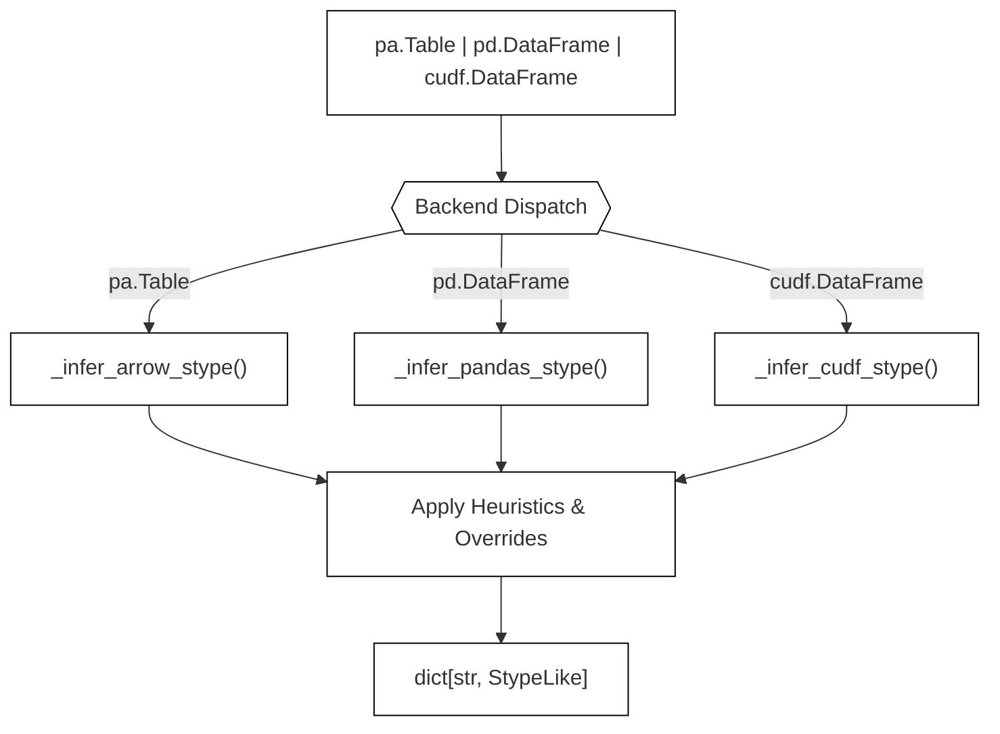
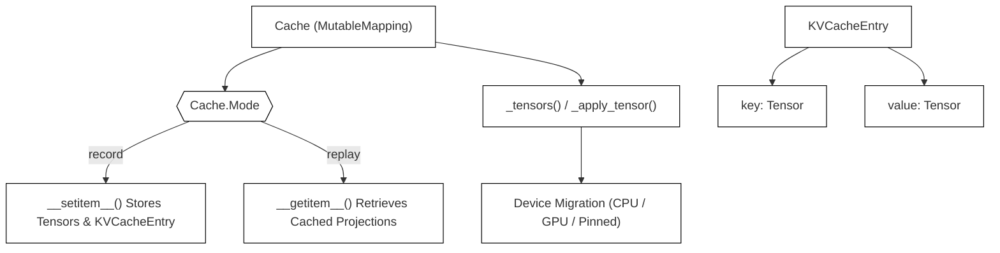

<!-- source: DeepWiki mcp.deepwiki.com · repo NVIDIA/structured-data-models · page 1.2 Core Concepts: Semantic Types and Tasks · fetched 2026-10-26 -->

# Core Concepts: Semantic Types and Tasks

Relevant source files

The following files were used as context for generating this wiki page:

- [sdm/cache.py](sdm/cache.py)
- [sdm/ensemble.py](sdm/ensemble.py)
- [sdm/stype.py](sdm/stype.py)
- [sdm/task.py](sdm/task.py)
- [test/conftest.py](test/conftest.py)
- [test/test_cache.py](test/test_cache.py)
- [test/test_ensemble.py](test/test_ensemble.py)
- [test/test_stype.py](test/test_stype.py)

## Purpose and Scope

This page covers the foundational core abstractions shared across the `structured-data-models` (`sdm`) library. Specifically, it details semantic types (`Stype`), automated type inference (`infer_stypes`), prediction task definitions (`Task`), ensemble grouping mechanisms (`EnsembleTable`), and execution caching primitives (`Cache`, `KVCacheEntry`). 

---

## Semantic Types (`Stype` and `infer_stypes`)

The `Stype` enum defines the semantic meaning of tabular columns, governing how raw data values map into structured feature spaces [sdm/stype.py:21-42](). 

### `Stype` Enumeration

| Semantic Type | Code Entity | Description |
| :--- | :--- | :--- |
| **Numerical** | `Stype.numerical` | Integer, floating-point, and decimal columns treated as continuous or discrete numeric vectors [sdm/stype.py:29](). |
| **Categorical** | `Stype.categorical` | String, boolean, and dictionary-encoded columns mapped to discrete categorical embedding indices [sdm/stype.py:30](). |
| **Datetime** | `Stype.datetime` | Date or timestamp values mapped to calendar components or temporal representations [sdm/stype.py:31](). |
| **Text** | `Stype.text` | Unstructured natural language text columns processed via text encoders [sdm/stype.py:32](). |
| **Identifier** | `Stype.id` | Unique entity identifiers used for relational linking; excluded from model features by default [sdm/stype.py:33-34](). |

Source citations: [sdm/stype.py:21-45]().

### Semantic Type Inference (`infer_stypes`)

The `infer_stypes()` function inspects raw dataframes or tables across multiple backend engines (`pandas.DataFrame`, `pyarrow.Table`, or `cudf.DataFrame`) and maps each column to an `Stype` [sdm/stype.py:55-168]().

*Figure 1: `infer_stypes` Execution Flow across Backends.*

* **Overrides**: Columns specified in `overrides` bypass automatic inference [sdm/stype.py:141-143]().
* **ID Detection**: Integer and string columns whose names contain `"id"` as a whole word are designated as `Stype.id` when `id="infer"` [sdm/stype.py:80-83]().
* **Text Detection**: String columns meeting distinct value thresholds and word-count ratios are categorized as `Stype.text` under the `text="infer"` policy [sdm/stype.py:77-79]().

Sources: [sdm/stype.py:55-168](), [test/test_stype.py:35-100]()

---

## Prediction Tasks (`Task`)

The `Task` enum defines the prediction objective associated with model targets [sdm/task.py:12-25]().

### `Task` Enumeration and Mapping

* **`Task.classification`**: Binary, multi-class, or multi-label classification tasks [sdm/task.py:19](). Automatically maps to `Stype.categorical` [sdm/task.py:45]().
* **`Task.regression`**: Continuous numerical prediction tasks [sdm/task.py:20](). Automatically maps to `Stype.numerical` [sdm/task.py:46]().

Key helper methods:
* `Task.from_stype(stype)`: Determines the required prediction task for a given target `Stype` [sdm/task.py:27-40]().
* `Task.stype`: Property returning the corresponding target `Stype` [sdm/task.py:41-48]().

Sources: [sdm/task.py:12-51]().

---

## Ensemble and Estimator Concepts (`EnsembleTable`)

To support ensemble training and evaluation across multiple model members, `sdm` provides `EnsembleData` and `EnsembleTable` [sdm/ensemble.py:21-70]().

### Memory Layout and Grouping

* **`EnsembleTable`**: Manages collections of `TableTensor` instances [sdm/ensemble.py:70-82](). Identical or compatible tables are stacked along a leading dimension into shared `groups`, avoiding redundant memory allocations [sdm/ensemble.py:75-76]().
* **`_pack_tables()`**: Automatically inspects table shapes, schemas, block layouts, devices, and categorical vocabularies to cluster compatible member tables [sdm/ensemble.py:145-192]().

Sources: [sdm/ensemble.py:21-192](), [test/test_ensemble.py:12-45]()

---

## Cache Abstractions (`Cache`, `KVCacheEntry`)

To accelerate transformer-based inference and in-context learning (ICL) passes, the library provides tensor caching primitives [sdm/cache.py:20-163]().

*Figure 2: `Cache` and `KVCacheEntry` Lifecycle and Device Management.*

### Key Classes

* **`KVCacheEntry`**: A named tuple extending `DeviceMixin` that stores cached key and value projection tensors for individual transformer blocks [sdm/cache.py:20-39]().
* **`Cache`**: A mutable mapping that operates in two distinct phases [sdm/cache.py:41-64]().
  * **`record` mode**: Permitted during model fitting to record key/value projections [sdm/cache.py:53]().
  * **`replay` mode**: Enabled via `freeze()` during subsequent prediction passes to reuse cached states [sdm/cache.py:85-101]().
  * **`_apply_tensor()` / `_tensors()`**: Recursively traverses nested dictionaries, lists, and tuples to migrate cached tensors across devices or calculate total memory consumption in bytes via `size()` [sdm/cache.py:78-83, 129-163]().

Sources: [sdm/cache.py:20-163](), [test/test_cache.py:12-47]()

---

