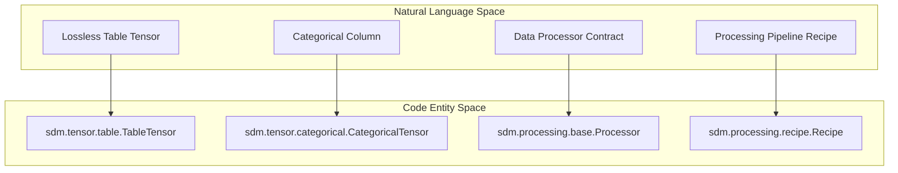
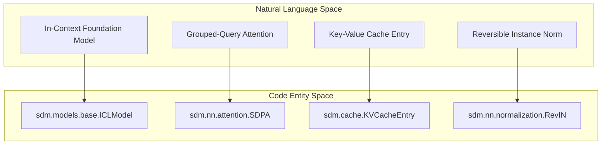

<!-- source: DeepWiki mcp.deepwiki.com · repo NVIDIA/structured-data-models · page 10 Glossary · fetched 2026-10-26 -->

# Glossary

Relevant source files

The following files were used as context for generating this wiki page:

- [sdm/models/base.py](sdm/models/base.py)
- [sdm/models/tabfm/model.py](sdm/models/tabfm/model.py)
- [sdm/models/tabiclv2/model.py](sdm/models/tabiclv2/model.py)
- [sdm/nn/attention.py](sdm/nn/attention.py)
- [sdm/nn/rope.py](sdm/nn/rope.py)
- [sdm/nn/set_transformer.py](sdm/nn/set_transformer.py)
- [sdm/processing/__init__.py](sdm/processing/__init__.py)
- [sdm/processing/numerical/__init__.py](sdm/processing/numerical/__init__.py)
- [sdm/processing/numerical/clip.py](sdm/processing/numerical/clip.py)
- [sdm/stype.py](sdm/stype.py)
- [sdm/tensor/categorical.py](sdm/tensor/categorical.py)
- [sdm/tensor/columnar.py](sdm/tensor/columnar.py)
- [sdm/tensor/table.py](sdm/tensor/table.py)
- [test/conftest.py](test/conftest.py)
- [test/models/tabfm/test_model.py](test/models/tabfm/test_model.py)
- [test/models/test_base.py](test/models/test_base.py)
- [test/nn/test_attention.py](test/nn/test_attention.py)
- [test/nn/test_compile.py](test/nn/test_compile.py)
- [test/nn/test_rope.py](test/nn/test_rope.py)
- [test/nn/test_set_transformer.py](test/nn/test_set_transformer.py)
- [test/processing/test_contract.py](test/processing/test_contract.py)
- [test/tensor/test_table.py](test/tensor/test_table.py)
- [test/test_stype.py](test/test_stype.py)

## Purpose and Scope
This page provides precise technical definitions for core terminology, specialized data structures, processing contracts, and neural network building blocks specific to the `structured-data-models` (sdm) library. Each term includes references to its implementation files, architectural role, and operational mechanics.

---

## 1. Tensor and Semantic Type Definitions

*   **`stype`**: The semantic type of a table column, represented by the `Stype` enum in `sdm/stype.py` [sdm/stype.py:21-41](). Supported semantic types include numerical, categorical, datetime, text, and identifier (`id`) columns [sdm/stype.py:29-35](). Semantic types dictate how raw columnar data is grouped and encoded into GPU-native tensor representations.
*   **`TableTensor`**: A specialized `torch.Tensor` subclass defined in `sdm/tensor/table.py` [sdm/tensor/table.py:128-134]() that represents lossless table data on GPU. A `TableTensor` maintains separate column blocks per semantic type (`numerical`, `categorical`, `datetime`, `text`, `id`) while exposing a unified tensor-shaped interface where the last dimension represents named columns [sdm/tensor/table.py:131-134]().
*   **`VarLenTensor`**: A tensor subclass designed for variable-length nested or sequence data, structured with data, offset, and validity masks (`data`, `offset`, `valid`) to support irregular sequence lengths within tensor operations.
*   **`CategoricalTensor`**: A `torch.Tensor` subclass defined in `sdm/tensor/categorical.py` [sdm/tensor/categorical.py:42-49]() for categorical columns. It stores categorical indices in `code` (with integer dtypes `torch.int32` or `torch.int64`) and category vectors per column in `categories`, where negative index values represent missing data [sdm/tensor/categorical.py:45-48,68]().

Sources: `sdm/stype.py:21-41`, `sdm/tensor/table.py:128-134`, `sdm/tensor/categorical.py:42-68`

---

## 2. Processing and Execution Abstractions

*   **`recipe`**: An ordered collection of feature, target, and output processors defined in `sdm/processing/recipe.py` that dictates the end-to-end preprocessing, feature extraction, and post-processing pipeline applied to input tables before feeding them into foundation models.
*   **`processor contract`**: The lifecycle interface defined by the base `Processor` class in `sdm/processing/base.py`, establishing standard methods such as `fit`, `transform`, state serialization/deserialization, device and dtype migration, and invertibility guarantees via `InvertibleMixin`.

Sources: `sdm/processing/__init__.py:6-10`, `sdm/processing/base.py:1-50`

---

## 3. In-Context Learning and Model Mechanics

*   **`ICL` (In-Context Learning)**: A paradigm implemented across foundation models in `sdm/models/base.py` where a model takes a set of labeled training examples as context (`x_context`, `y_context`) and performs inference or prediction on held-out query examples (`x_query`) from the same relational or tabular distribution without updating weights [sdm/models/base.py:35-46,100-113]().
*   **`estimator batching`**: A mechanism in `ICLModel.forward()` controlled by `estimator_batch_size` that batches multiple ensemble estimators (`E`) through the model execution pipeline in chunks to control device memory usage [sdm/models/base.py:109-137]().
*   **`context-only columns`**: Columns present in `x_context` via `TableTensor` inputs that are absent from `x_query`, supported by models where `supports_context_only_columns` is `True` [sdm/models/base.py:61,151-163]().
*   **`KVCacheEntry`**: A caching structure defined in `sdm/cache.py` that stores key and value tensors across inference steps to avoid redundant computations during autoregressive or multi-step in-context evaluations.
*   **`ECOC` (Error-Correcting Output Codes)**: An algorithmic strategy used for multi-class classification tasks, decomposing multi-class problems into multiple binary classification sub-tasks using error-correcting matrix codes.
*   **`quantile heads`**: Specialized output projection layers found in regression models (such as `TabICLv2` and `TimesFM3`) that output a distribution of quantile predictions rather than a single point estimate [sdm/models/tabiclv2/model.py:143]().

Sources: `sdm/models/base.py:35-163`, `sdm/models/tabiclv2/model.py:141-146`, `sdm/cache.py:1-20`

---

## 4. Neural Network Building Blocks and Kernels

*   **`GQA/MQA` (Grouped-Query / Multi-Query Attention)**: Attention mechanisms implemented in `SDPA` (`sdm/nn/attention.py`) [sdm/nn/attention.py:19-32]() where key-value heads (`num_key_value_heads`) are shared across multiple query heads (`num_query_heads`), reducing memory bandwidth overhead during attention computations [sdm/nn/attention.py:27-32]().
*   **`ISAB` (Induced Set Attention Block)**: A set transformer building block defined in `sdm/nn/set_transformer.py` that utilizes inducing points to reduce the computational complexity of self-attention over sets from quadratic to linear with respect to set size.
*   **`RevIN` (Reversible Instance Normalization)**: A normalization technique implemented in `sdm/nn/normalization.py` that normalizes inputs by instance mean and variance prior to model processing and reverses the transformation on outputs to preserve distribution shifts in time-series and tabular data.

Sources: `sdm/nn/attention.py:19-38`, `sdm/nn/set_transformer.py:1-20`, `sdm/nn/normalization.py:1-30`

---

## 5. Relational Data Subsystem

*   **`TaskGraph`**: A graph construction abstraction defined in `sdm/relational/task.py` that structures multi-table relational databases into task-specific graphs for neighbor sampling and message passing.
*   **`InvariantGNN`**: A permutation-invariant Graph Neural Network implemented in `sdm/relational/gnn.py` that aggregates neighbor information across relational table joins while maintaining structural invariance.

Sources: `sdm/relational/task.py:1-30`, `sdm/relational/gnn.py:1-30`

---

## Subsystem Architecture Mappings

### Diagram: Natural Language Space to Code Entity Space (Tensors and Processing)
The following diagram maps high-level data concepts and processing abstractions to their concrete Python classes and modules in the codebase.

Sources: `sdm/tensor/table.py:128-134`, `sdm/tensor/categorical.py:42-49`, `sdm/processing/base.py:1-50`, `sdm/processing/recipe.py:1-30`

### Diagram: Natural Language Space to Code Entity Space (Models and Attention)
The following diagram associates model-level concepts, attention variants, and caching mechanisms with their respective classes in `sdm`.

Sources: `sdm/models/base.py:35-46`, `sdm/nn/attention.py:19-38`, `sdm/cache.py:1-25`, `sdm/nn/normalization.py:1-30`