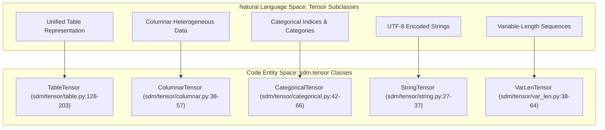
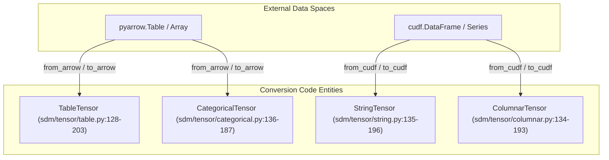

<!-- source: DeepWiki mcp.deepwiki.com · repo NVIDIA/structured-data-models · page 2 Tensor Layer · fetched 2026-10-26 -->

# Tensor Layer

Relevant source files

The following files were used as context for generating this wiki page:

- [docs/source/conf.py](docs/source/conf.py)
- [sdm/tensor/categorical.py](sdm/tensor/categorical.py)
- [sdm/tensor/columnar.py](sdm/tensor/columnar.py)
- [sdm/tensor/string.py](sdm/tensor/string.py)
- [sdm/tensor/table.py](sdm/tensor/table.py)
- [sdm/tensor/var_len.py](sdm/tensor/var_len.py)
- [test/tensor/test_categorical.py](test/tensor/test_categorical.py)
- [test/tensor/test_columnar.py](test/tensor/test_columnar.py)
- [test/tensor/test_string.py](test/tensor/test_string.py)
- [test/tensor/test_table.py](test/tensor/test_table.py)
- [test/tensor/test_var_len.py](test/tensor/test_var_len.py)

The `sdm.tensor` subsystem provides GPU-native, lossless tensor representations for tabular, relational, and variable-length structured data. By subclassing `torch.Tensor` and implementing custom `__torch_dispatch__` semantics, the tensor layer bridges standard dataframe operations with PyTorch deep learning pipelines, supporting zero-copy interoperability with PyArrow and cuDF.

For a detailed view of individual tensor structures and conversion paths, refer to the child pages:
- [TableTensor and Columnar Representation](#2.1)
- [Variable-Length, String and Categorical Tensors](#2.2)
- [Arrow / cuDF / Pandas Interoperability](#2.3)

Sources: `sdm/tensor/table.py:128-203`, `sdm/tensor/columnar.py:38-57`, `sdm/tensor/categorical.py:42-66`, `sdm/tensor/string.py:27-37`, `sdm/tensor/var_len.py:38-64`

---

## 2.1. TableTensor and Columnar Representation

`TableTensor` (`sdm/tensor/table.py:128-203`) stores column blocks separately partitioned by semantic types (`Stype`), such as numerical, categorical, datetime, text, and identifier blocks defined in `TableSchema` (`sdm/tensor/table.py:115-125`). Despite holding disparate underlying tensor types per block, it exposes a cohesive `[..., C]` tensor interface supporting column indexing and standard tensor transformations. `ColumnarTensor` (`sdm/tensor/columnar.py:38-57`) provides a lighter wrapper for generic column-wise heterogeneous data without enforcing schema semantic blocks.

For technical specifications, column selection rules, and `torch_dispatch` execution semantics, see [TableTensor and Columnar Representation](#2.1).

Sources: `sdm/tensor/table.py:115-203`, `sdm/tensor/columnar.py:38-57`, `test/tensor/test_table.py:25-70`

---

## 2.2. Variable-Length, String and Categorical Tensors

To represent irregular nested arrays and strings efficiently on GPUs, the tensor layer implements specialized container subclasses. `VarLenTensor` (`sdm/tensor/var_len.py:38-64`) stores rectangular variable-length elements via a flat contiguous `data` tensor paired with a 1D `offset` tensor and optional `valid` boolean mask. `StringTensor` (`sdm/tensor/string.py:27-37`) specializes `VarLenTensor` for UTF-8 byte streams. `CategoricalTensor` (`sdm/tensor/categorical.py:42-66`) maintains integer category `code` indices alongside distinct category vectors per column.

For detailed internal memory layouts, nullability handling, and element-wise indexing mechanics, see [Variable-Length, String and Categorical Tensors](#2.2).

Sources: `sdm/tensor/var_len.py:38-64`, `sdm/tensor/string.py:27-37`, `sdm/tensor/categorical.py:42-66`, `test/tensor/test_var_len.py:16-50`

---

## 2.3. Arrow / cuDF / Pandas Interoperability

The tensor layer integrates natively with the broader data engineering ecosystem through zero-copy conversion routines defined in `sdm/tensor/io.py`. Methods such as `from_arrow`, `to_arrow`, `from_cudf`, and `to_cudf` leverage PyArrow memory buffers, DLPack protocols, and `pylibcudf` (`sdm/tensor/string.py:135-196`, `sdm/tensor/categorical.py:136-187`) to import and export GPU-resident table tensors without host-device memory roundtrips.

For zero-copy data paths, device memory handling, and type promotion specifications, see [Arrow / cuDF / Pandas Interoperability](#2.3).

Sources: `sdm/tensor/table.py:23`, `sdm/tensor/categorical.py:136-187`, `sdm/tensor/string.py:135-196`, `sdm/tensor/columnar.py:134-193`

---

