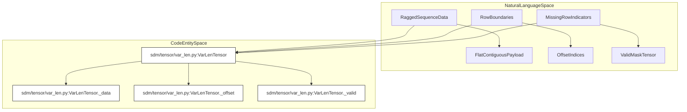
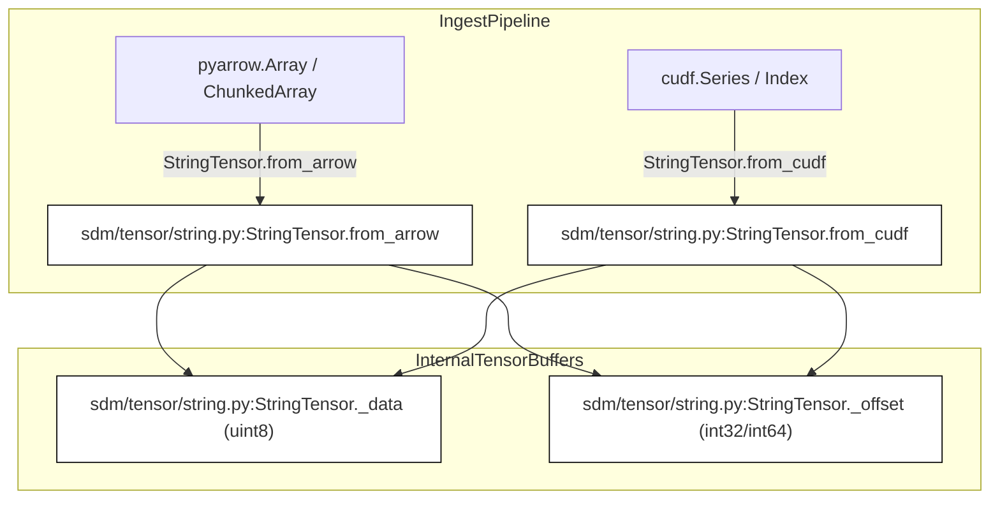

<!-- source: DeepWiki mcp.deepwiki.com · repo NVIDIA/structured-data-models · page 2.2 Variable-Length, String and Categorical Tensors · fetched 2026-10-26 -->

# Variable-Length, String and Categorical Tensors

Relevant source files

The following files were used as context for generating this wiki page:

- [docs/source/conf.py](docs/source/conf.py)
- [sdm/tensor/io/__init__.py](sdm/tensor/io/__init__.py)
- [sdm/tensor/io/arrow.py](sdm/tensor/io/arrow.py)
- [sdm/tensor/io/cudf.py](sdm/tensor/io/cudf.py)
- [sdm/tensor/nullable.py](sdm/tensor/nullable.py)
- [sdm/tensor/string.py](sdm/tensor/string.py)
- [sdm/tensor/var_len.py](sdm/tensor/var_len.py)
- [test/tensor/test_categorical.py](test/tensor/test_categorical.py)
- [test/tensor/test_columnar.py](test/tensor/test_columnar.py)
- [test/tensor/test_io.py](test/tensor/test_io.py)
- [test/tensor/test_nullable.py](test/tensor/test_nullable.py)
- [test/tensor/test_string.py](test/tensor/test_string.py)
- [test/tensor/test_var_len.py](test/tensor/test_var_len.py)

## Purpose and Scope
This page details the implementation of lossless GPU tensor representations for variable-length collections, UTF-8 strings, categorical codes, and nullable primitives within `sdm.tensor`. These tensor subclasses extend PyTorch's `Tensor` dispatch mechanisms to represent complex tabular data structures without leaving device memory.

---

## VarLenTensor Layout and Representation
Rectangular variable-length sequences and ragged tensors are represented via `VarLenTensor` [sdm/tensor/var_len.py:38()]. Rather than padding sequences to a uniform length, `VarLenTensor` packs all variable-length element payloads into a single flat contiguous `data` tensor, indexing them using a 1D `offset` tensor and an optional `valid` boolean mask [sdm/tensor/var_len.py:38-63()].

The internal layout consists of three primary attributes:
- `_data`: A flat 1-dimensional contiguous `torch.Tensor` storing the raw elements [sdm/tensor/var_len.py:70()].
- `_offset`: A 1-dimensional integer tensor (`torch.int32` or `torch.int64`) of shape `(num_rows + 1,)` where the $i$-th element range is defined by `[_offset[i], _offset[i+1])` [sdm/tensor/var_len.py:71()].
- `_valid`: An optional 1-dimensional boolean mask tensor indicating non-null rows or items [sdm/tensor/var_len.py:72()].

*Figure 1: Mapping conceptual ragged tensors to `VarLenTensor` internal code components.*

Sources: `sdm/tensor/var_len.py:38-84`, `test/tensor/test_var_len.py:16-52`

---

## StringTensor and UTF-8 Handling
`StringTensor` inherits from `VarLenTensor` to manage UTF-8 encoded text columns on GPUs [sdm/tensor/string.py:27()]. The `ALLOWED_DTYPES` class attribute restricts underlying data representation to `torch.uint8` bytes [sdm/tensor/string.py:40()]. 

String conversion handles zero-copy interactions with Apache Arrow and cuDF:
- **Arrow Ingestion**: `StringTensor.from_arrow()` parses `pyarrow.Array` or `pyarrow.ChunkedArray` structures, mapping string and `large_string` string buffer offsets and validity bitmaps directly to PyTorch tensors [sdm/tensor/string.py:43-111()]. Chunked arrays are automatically consolidated via `combine_arrow_chunks()` to prevent offset overflows [sdm/tensor/string.py:68-69()].
- **cuDF Ingestion**: `StringTensor.from_cudf()` invokes pylibcudf bindings (`ser.to_pylibcudf()`) to construct zero-copy character and offset views on CUDA devices without host roundtrips [sdm/tensor/string.py:135-198()].

*Figure 2: Data flow for `StringTensor` creation from external Arrow and cuDF sources.*

Sources: `sdm/tensor/string.py:27-198`, `test/tensor/test_string.py:45-133`

---

## CategoricalTensor Codes and Categories
`CategoricalTensor` manages discrete categorical values by decoupling integer category indices (`code`) from category value mappings (`categories`) [test/tensor/test_categorical.py:15-22()].
- **Code Tensor**: A integer-typed tensor (`torch.int32` or `torch.int64`) where negative values (such as `-1`) represent missing or null assignments [test/tensor/test_categorical.py:35-40()].
- **Categories Sequence**: A tuple of tensors (or `StringTensor` instances) representing the unique domain of categories per column dimension [test/tensor/test_categorical.py:17-20()].
- **Null Constraint**: `CategoricalTensor` explicitly disallows null values inside the category domain itself, raising a `ValueError` if categories contain null items [test/tensor/test_categorical.py:35-40()].

Sources: `test/tensor/test_categorical.py:15-167`

---

## NullableTensor Implementation
`NullableTensor` subclasses PyTorch's `Tensor` to wrap primitive columns that contain missing or null entries [sdm/tensor/nullable.py:41()]. 

The implementation stores two backing references:
- `_data`: The underlying primitive values tensor, restricted to boolean and integer dtypes (`ALLOWED_DTYPES`) [sdm/tensor/nullable.py:49-65()].
- `_valid`: A boolean mask tensor of identical shape to `_data` indicating element validity [sdm/tensor/nullable.py:65()].

`NullableTensor` hooks into PyTorch dispatch mechanisms to support operations like `torch.nan_to_num`, `torch.isnan()`, and `.isfinite()` directly over nullable data without unpacking into host memory [test/tensor/test_nullable.py:83-106()].

Sources: `sdm/tensor/nullable.py:41-119`, `test/tensor/test_nullable.py:26-106`

---

