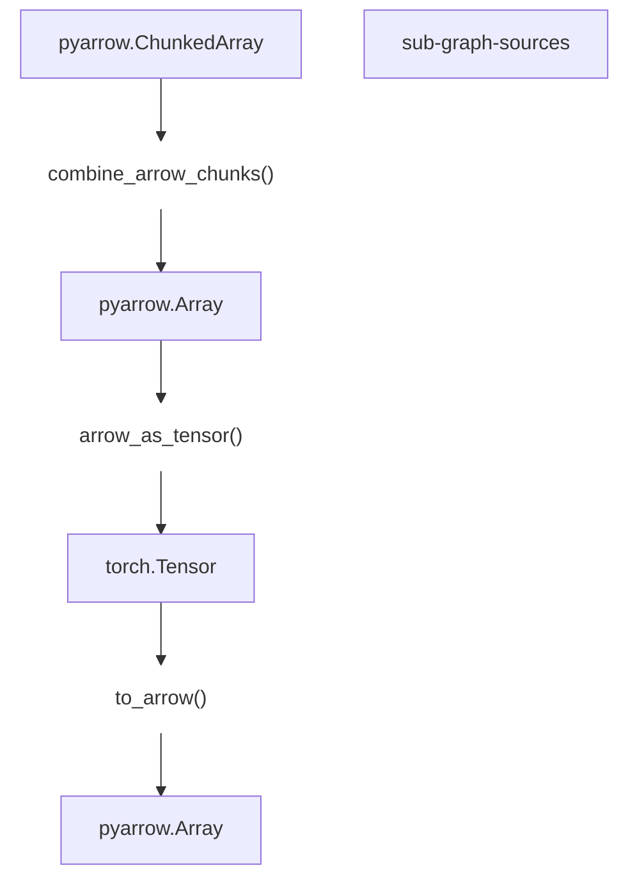
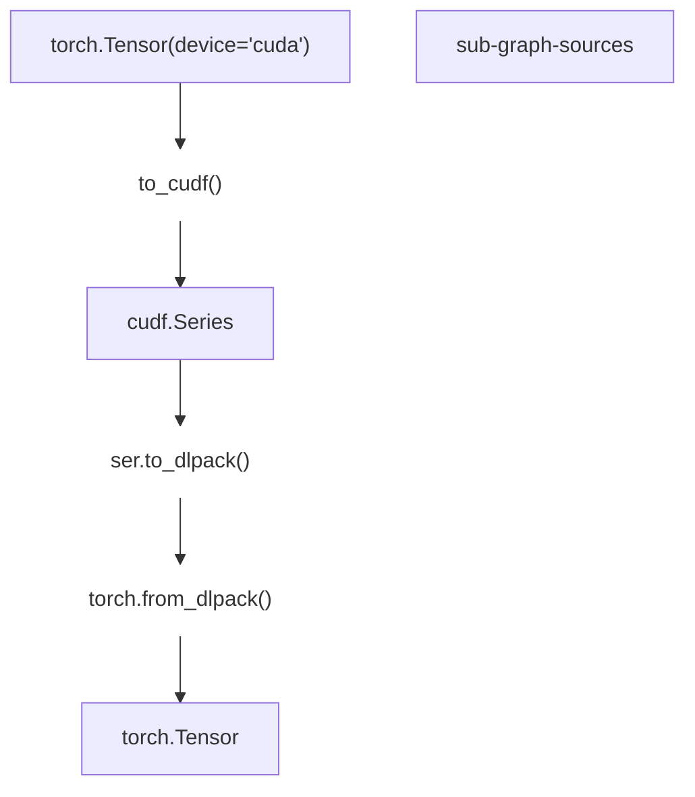

<!-- source: DeepWiki mcp.deepwiki.com · repo NVIDIA/structured-data-models · page 2.3 Arrow / cuDF / Pandas Interoperability · fetched 2026-10-26 -->

# Arrow / cuDF / Pandas Interoperability

Relevant source files

The following files were used as context for generating this wiki page:

- [sdm/tensor/categorical.py](sdm/tensor/categorical.py)
- [sdm/tensor/columnar.py](sdm/tensor/columnar.py)
- [sdm/tensor/io/__init__.py](sdm/tensor/io/__init__.py)
- [sdm/tensor/io/arrow.py](sdm/tensor/io/arrow.py)
- [sdm/tensor/io/cudf.py](sdm/tensor/io/cudf.py)
- [sdm/tensor/nullable.py](sdm/tensor/nullable.py)
- [sdm/tensor/table.py](sdm/tensor/table.py)
- [test/tensor/test_io.py](test/tensor/test_io.py)
- [test/tensor/test_nullable.py](test/tensor/test_nullable.py)
- [test/tensor/test_table.py](test/tensor/test_table.py)

## Purpose and Scope

The `sdm.tensor.io` submodule and tensor serialization methods provide high-performance, zero-copy or minimal-copy data exchange bridges between PyTorch-native GPU-accelerated structured data models (`TableTensor`, `ColumnarTensor`, `NullableTensor`, `CategoricalTensor`) and external columnar ecosystem libraries including Apache Arrow (`pyarrow`), cuDF (`cudf`), and Pandas. 

This page details the implementation of Arrow chunk combining, tensor-to-arrow conversions, DLPack-based zero-copy GPU memory sharing, `pylibcudf` usage, and device memory routing.

Sources: [sdm/tensor/io/__init__.py:1-22](), [sdm/tensor/io/arrow.py:1-120](), [sdm/tensor/io/cudf.py:1-47]()

---

## Apache Arrow Integration and Zero-Copy Paths

Apache Arrow serves as the primary CPU-side interchange format for structured datasets. The library implements robust translation functions to convert `pyarrow.Array` and `pyarrow.ChunkedArray` instances into PyTorch tensor subclasses while minimizing memory duplication.

### Key Functions and Data Flow

- **`combine_arrow_chunks`**: Normalizes `pyarrow.ChunkedArray` instances into a single contiguous `pyarrow.Array`. For string and string-dictionary types, chunks are promoted to `large-string` storage prior to combination to prevent integer offset overflows [sdm/tensor/io/arrow.py:27-54]().
- **`arrow_as_tensor`**: Converts Arrow arrays into PyTorch `Tensor` objects. It unwwraps buffers using NumPy zero-copy views where possible (`pa.Array.to_numpy(zero_copy_only=False)`) and wraps them via `torch.as_tensor` [sdm/tensor/io/arrow.py:57-88](). Boolean arrays containing null values are cast or filled according to default floating-point or boolean configurations.
- **`to_arrow`**: Serializes PyTorch tensors and optional boolean `valid_mask` tensors back into flat `pyarrow.Array` structures by directly exporting underlying memory buffers via `pa.py_buffer` or NumPy arrays [sdm/tensor/io/arrow.py:90-120]().

*Figure 1: Apache Arrow conversion flow mapping chunked arrays to PyTorch tensors and back.*

Sources: [sdm/tensor/io/arrow.py:1-120](), [test/tensor/test_io.py:19-43]()

---

## cuDF and pylibcudf Interoperability

For GPU-native workflows, data is interchanged directly with `cudf.Series`, `cudf.DataFrame`, or `cudf.Index` without moving through host (CPU) memory.

### Zero-Copy Paths and DLPack

- **`to_cudf`**: Converts a CUDA-resident PyTorch `Tensor` into a flat `cudf.Series` with zero-copy semantics (`copy=False`), optionally attaching a boolean validity mask (`valid_mask`) through `cudf.Series._from_column` and column mask APIs [sdm/tensor/io/cudf.py:15-47]().
- **DLPack Integration**: Columnar containers such as `ColumnarTensor.from_cudf` leverage PyTorch's native `torch.from_dlpack()` interfaced with `ser.to_dlpack()` to achieve zero-copy GPU tensor sharing across frameworks [sdm/tensor/columnar.py:164-193]().
- **`pylibcudf` Usage**: Lower-level column operations and validity Extractions utilize `pylibcudf` (`plc`), interacting directly with device buffers inside classes like `NullableTensor.from_cudf` [sdm/tensor/nullable.py:188-215]().

*Figure 2: GPU Zero-Copy interchange between PyTorch tensors, cuDF series, and DLPack descriptors.*

Sources: [sdm/tensor/io/cudf.py:15-47](), [sdm/tensor/columnar.py:164-193](), [sdm/tensor/nullable.py:188-215]()

---

## Device Handling and Dtype Mappings

Type consistency between external dataframe columns and PyTorch dtypes is maintained via explicit mapping dictionaries:

- **`ARROW_TORCH_DTYPES` / `TORCH_ARROW_DTYPES`**: Bidirectional dictionaries mapping `pyarrow` data types (boolean, unsigned/signed integers from 8-bit to 64-bit, and floating-point types) to their `torch.dtype` equivalents [sdm/tensor/io/arrow.py:10-24]().
- **Device Resolution**: Helper utilities such as `_resolve_device` ensure that tensors created from Arrow, cuDF, or Pandas inputs respect requested target devices (`cpu` or `cuda:X`) [sdm/tensor/mixin.py] (referenced in [sdm/tensor/columnar.py:19](), [sdm/tensor/table.py:24]()).
- **Category Tensor Migration**: Category vectors across multi-column categorical blocks are migrated in batches via `_move_categories` to optimize CUDA memory transfer overhead [sdm/tensor/table.py:77-111]().

Sources: [sdm/tensor/io/arrow.py:10-24](), [sdm/tensor/table.py:77-111](), [sdm/tensor/columnar.py:134-193]()

---

