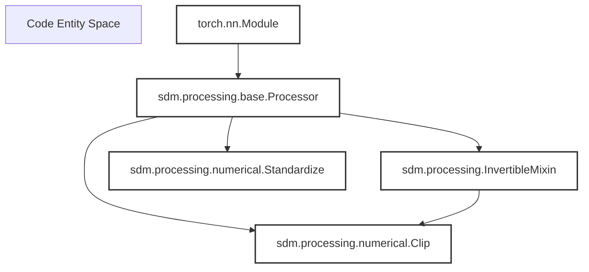
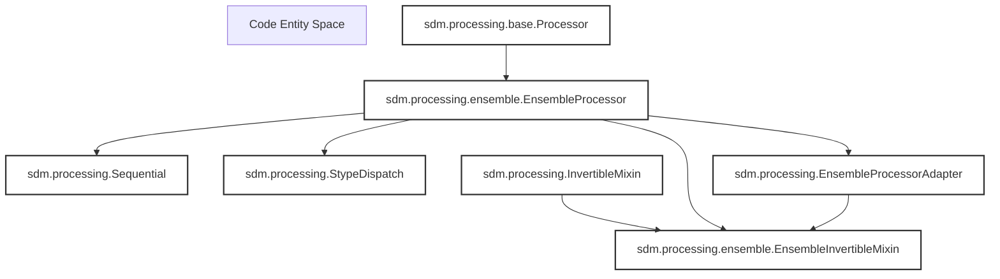

<!-- source: DeepWiki mcp.deepwiki.com · repo NVIDIA/structured-data-models · page 3.1 Processor Base Classes and Contracts · fetched 2026-10-26 -->

# Processor Base Classes and Contracts

Relevant source files

The following files were used as context for generating this wiki page:

- [sdm/processing/__init__.py](sdm/processing/__init__.py)
- [sdm/processing/base.py](sdm/processing/base.py)
- [sdm/processing/common/ensemble.py](sdm/processing/common/ensemble.py)
- [sdm/processing/common/sequential.py](sdm/processing/common/sequential.py)
- [sdm/processing/common/stype.py](sdm/processing/common/stype.py)
- [sdm/processing/ensemble.py](sdm/processing/ensemble.py)
- [sdm/processing/numerical/__init__.py](sdm/processing/numerical/__init__.py)
- [sdm/processing/numerical/clip.py](sdm/processing/numerical/clip.py)
- [test/processing/common/test_choice.py](test/processing/common/test_choice.py)
- [test/processing/common/test_stype.py](test/processing/common/test_stype.py)
- [test/processing/test_contract.py](test/processing/test_contract.py)
- [test/processing/test_ensemble.py](test/processing/test_ensemble.py)
- [test/processing/test_fitted_guard.py](test/processing/test_fitted_guard.py)

This page details the processor architecture in `sdm.processing`, covering the `Processor` base class, `InvertibleMixin`, `EnsembleProcessor`, the fit/transform lifecycle, state saving and loading, device and dtype migration via PyTorch module integration, and the contract test suites that guarantee consistent behavior across all tabular processors.

---

## 1. The Core Processor Abstraction: `Processor` and `InvertibleMixin`

All tensor-aware table transformations in `sdm` derive from `Processor`, which inherits from `torch.nn.Module` [sdm/processing/base.py:19-32](). A `Processor` operates on `TableTensor` instances for feature, target, and output preprocessing.

- **`handles_stypes`**: A class attribute defining which semantic types (`Stype.numerical`, `Stype.categorical`, `Stype.datetime`, `Stype.text`, `Stype.id`) the processor handles [sdm/processing/base.py:34-35](). Stypes outside this list are left untouched.
- **`requires_fit`**: A boolean attribute indicating whether the processor learns state from data during `fit()` [sdm/processing/base.py:37-38]().
- **`InvertibleMixin`**: A mixin class that provides an `inverse_transform()` method to reverse the transformation [sdm/processing/numerical/clip.py:14-85]().

*Figure 1: Class hierarchy of base processors and mixins.*

Sources: `sdm/processing/base.py:19-38`, `sdm/processing/numerical/clip.py:14-85` [sdm/processing/base.py:19-38](), [sdm/processing/numerical/clip.py:14-85]()

---

## 2. Ensemble-Aware Processors: `EnsembleProcessor`

To support ensembled tabular models across multiple table groups and members, `EnsembleProcessor` extends `Processor` to work with `EnsembleTable` containers [sdm/processing/ensemble.py:16-32]().

- **`fit_ensemble()` / `transform_ensemble()`**: Analogous to `fit()` and `transform()`, but accept and return `EnsembleTable` [sdm/processing/ensemble.py:117-157]().
- **`EnsembleProcessorAdapter`**: Automatically wraps ordinary `Processor` instances so they can be fitted and applied across multiple ensemble table groups independently [sdm/processing/common/ensemble.py:20-42]().
- **`EnsembleInvertibleMixin`**: Provides `inverse_transform_ensemble()` for multi-member ensemble reversing [sdm/processing/ensemble.py:188-207]().

*Figure 2: Ensemble processor relationships and adapters.*

Sources: `sdm/processing/ensemble.py:16-207`, `sdm/processing/common/ensemble.py:20-42` [sdm/processing/ensemble.py:16-207](), [sdm/processing/common/ensemble.py:20-42]()

---

## 3. Fit/Transform Lifecycle & State Management

The lifecycle of a `Processor` governs how state is initialized, checked, and updated.

| Method / Property | Role | Implementation Details |
| :--- | :--- | :--- |
| `fit(table)` | Computes statistics / parameters from input `TableTensor` [sdm/processing/base.py:171-189]() | Checks if table has handled stypes [sdm/processing/base.py:183-184](); calls `_fit()` and sets `_fitted_state` [sdm/processing/base.py:185-187]() |
| `transform(table)` | Applies fitted transformation [sdm/processing/base.py:190-202]() | Verifies `is_fitted` [sdm/processing/base.py:201](); calls `_transform()` [sdm/processing/base.py:202]() |
| `fit_transform(table)` | Finesse combination | Conditionally fits and transforms [sdm/processing/base.py:159-161]() |
| `is_fitted` property | Validation guard | Returns `True` if `requires_fit` is false or `_fitted` is true [sdm/processing/base.py:57-60]() |

### State Save/Load and Buffer Resizing
Because `Processor` inherits from `torch.nn.Module`, fitted parameters are stored as registered buffers (e.g., `_fitted_state`) [sdm/processing/base.py:44](). During `load_state_dict()`, `_load_from_state_dict()` inspects incoming buffer shapes and resizes uninitialized buffers before copying tensor values [sdm/processing/base.py:84-117]().

Sources: `sdm/processing/base.py:42-205`, `test/processing/test_fitted_guard.py:29-54` [sdm/processing/base.py:42-205](), [test/processing/test_fitted_guard.py:29-54]()

---

## 4. Device and DType Migration

Since processors are PyTorch modules, device and precision migrations are handled natively through PyTorch's module API:
- **Device Migration**: Calling `.to(device)` on a `Processor` migrates all internal buffers (such as fitted mean, variance, or quantile thresholds) to the target CUDA or CPU device.
- **DType Migration**: Calling `.to(dtype)` casts internal floating-point buffers to `torch.float32`, `torch.float64`, etc.
- **Guard Enforcement**: If an unfitted stateful processor is invoked via `transform()`, a `RuntimeError` (`not fitted`) is raised [sdm/processing/base.py:134-140](), [test/processing/test_fitted_guard.py:29-39]().

Sources: `sdm/processing/base.py:42-140`, `test/processing/test_fitted_guard.py:29-169` [sdm/processing/base.py:42-140](), [test/processing/test_fitted_guard.py:29-168]()

---

## 5. Pipeline Composition and Dispatch

Processors can be composed into complex execution pipelines using specialized wrapper classes:

- **`Sequential`**: Chains multiple processors or callables, executing them in forward order [sdm/processing/common/sequential.py:16-89]() and reversing them in `inverse_transform` [sdm/processing/common/sequential.py:124-136]().
- **`StypeDispatch`**: Routes specific table columns to dedicated sub-processors based on their semantic type (`Stype`), concatenating results back together [sdm/processing/common/stype.py:17-146]().
- **`Choice`**: Randomly or round-robin selects among multiple processor options during fitting [test/processing/common/test_choice.py:67-156]().

Sources: `sdm/processing/common/sequential.py:16-157`, `sdm/processing/common/stype.py:17-187`, `test/processing/common/test_choice.py:67-222` [sdm/processing/common/sequential.py:16-156](), [sdm/processing/common/stype.py:17-187](), [test/processing/common/test_choice.py:67-222]()

---

## 6. Contract Tests and Verification

The library enforces rigorous contract guarantees via test suites in `test/processing/test_contract.py` and `test/processing/test_fitted_guard.py` [test/processing/test_contract.py:1-206](), [test/processing/test_fitted_guard.py:1-168](). Every public processor must satisfy:
1. **Unfitted Guard**: Calling `transform()` before `fit()` raises `RuntimeError` [test/processing/test_fitted_guard.py:29-39]().
2. **Unhandled Stype Passthrough**: Columns with unhandled stypes remain entirely unmodified [test/processing/test_fitted_guard.py:104-120]().
3. **Round-Trip Invertibility**: For invertible processors (e.g. `Standardize`, `QuantileTransform`), `inverse_transform(transform(table))` matches the original table within numerical tolerances [test/processing/common/test_choice.py:93-101]().
4. **State Dict Persistence**: Saving and reloading state via `state_dict()` preserves buffer dtypes and transformation output values [test/processing/test_fitted_guard.py:142-168]().

Sources: `test/processing/test_contract.py:1-206`, `test/processing/test_fitted_guard.py:1-169` [test/processing/test_contract.py:1-206](), [test/processing/test_fitted_guard.py:1-168]()

---

