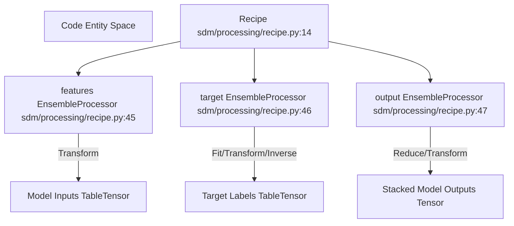
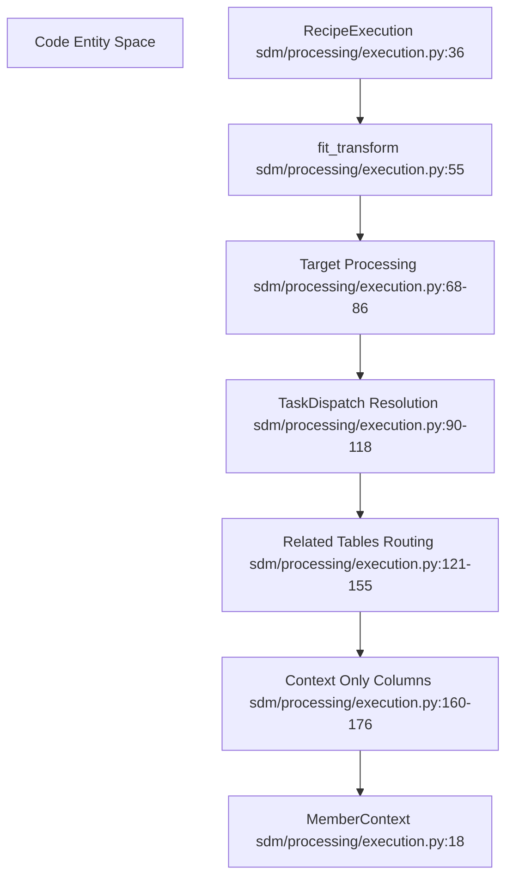
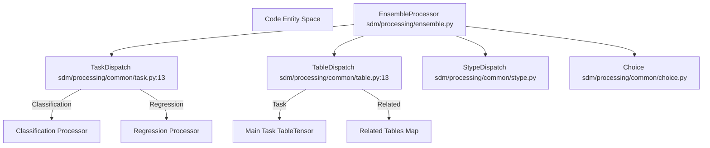

<!-- source: DeepWiki mcp.deepwiki.com · repo NVIDIA/structured-data-models · page 3.2 Recipes and Execution Pipeline · fetched 2026-10-26 -->

# Recipes and Execution Pipeline

Relevant source files

The following files were used as context for generating this wiki page:

- [docs/source/api/processing.rst](docs/source/api/processing.rst)
- [sdm/processing/common/__init__.py](sdm/processing/common/__init__.py)
- [sdm/processing/common/select.py](sdm/processing/common/select.py)
- [sdm/processing/common/table.py](sdm/processing/common/table.py)
- [sdm/processing/common/task.py](sdm/processing/common/task.py)
- [sdm/processing/execution.py](sdm/processing/execution.py)
- [sdm/processing/recipe.py](sdm/processing/recipe.py)
- [sdm/processing/series.py](sdm/processing/series.py)
- [test/processing/common/test_select.py](test/processing/common/test_select.py)
- [test/processing/common/test_sequential.py](test/processing/common/test_sequential.py)
- [test/processing/common/test_task.py](test/processing/common/test_task.py)
- [test/processing/numerical/test_detrend.py](test/processing/numerical/test_detrend.py)
- [test/processing/numerical/test_quantile.py](test/processing/numerical/test_quantile.py)
- [test/processing/test_execution.py](test/processing/test_execution.py)
- [test/processing/test_recipe.py](test/processing/test_recipe.py)

## Purpose and Scope

This page documents the recipe structure and execution pipeline architecture within `sdm.processing`. Recipes define the contracts around external model boundaries, bundling input features, target labels, and stacked model outputs into unified pipelines. The execution manager (`RecipeExecution`) orchestrates fitting, transforming, and multi-table/multi-ensemble routing during model training and inference. Additionally, conditional dispatchers (`TaskDispatch`, `TableDispatch`, `StypeDispatch`, `Choice`) and series ensembles (`SeriesEnsembleProcessor`) enable dynamic execution paths based on task types, table origins, and semantic types.

Sources: `sdm/processing/execution.py:36-482`, `sdm/processing/recipe.py:14-155`

---

## Recipe Structure (`features`, `target`, `output`)

The `Recipe` class acts as a container bundling three distinct processing pipelines, mapping raw data formats to the internal representations expected by foundation models [sdm/processing/recipe.py:16-43]():

- **`features`**: Transforms model inputs prior to model execution [sdm/processing/recipe.py:21](). It handles main task tables, context columns, and can integrate multi-table schemas.
- **`target`**: Transforms labels forward before model training [sdm/processing/recipe.py:22-24](). Regression targets are normalized/standardized and inverted post-prediction, while classification targets map to dense class index spaces. `TaskDispatch` and `TableDispatch` are explicitly forbidden within `Recipe.target` [sdm/processing/recipe.py:87-94]().
- **`output`**: Transforms stacked model outputs after mapping to a common class or target space (`[E, ..., R, O]`) [sdm/processing/recipe.py:25-31](). Reducers like `AverageEstimators` remove the estimator dimension (`E`). Steps preceding the reducer must support stacked outputs. `Recipe.output` must not require fitting [sdm/processing/recipe.py:114-115]().

Sources: `sdm/processing/recipe.py:14-155`

---

## Execution Pipeline and `RecipeExecution`

The `RecipeExecution` manager coordinates the execution lifecycle across ensemble estimators during `fit_transform` operations [sdm/processing/execution.py:36-64]. It manages transformer state for multiple estimators, handles target resolution, and processes related relational tables or context-only columns [sdm/processing/execution.py:55-176].

During `fit_transform`, `RecipeExecution` performs the following steps:
1. **Target Normalization & Task Resolution**: Converts target data into an `EnsembleTable` [sdm/processing/execution.py:68]. If any module in `features` or `output` is a `TaskDispatch`, it inspects the transformed target structure to resolve the task type as either `"regression"` or `"classification"` [sdm/processing/execution.py:90-118].
2. **Series Offset Injection**: Identifies any `SeriesEnsembleProcessor` modules and injects row offsets into their buffers for time-series and sequential batching [sdm/processing/execution.py:70-84].
3. **Related Tables Processing**: If relational `related_tables` are provided, it clones the feature processor, sets `TableDispatch` routes to `"related"`, and fits/transforms each table mapped to the ensemble members [sdm/processing/execution.py:121-155].
4. **Context-Only Columns**: Extracts and transforms auxiliary context-only features separately if requested [sdm/processing/execution.py:160-176].

Sources: `sdm/processing/execution.py:36-176`

---

## Dispatchers (`StypeDispatch`, `TaskDispatch`, `TableDispatch`, `Choice`)

Dispatchers allow conditional routing of processors based on semantic types, task specifications, table origins, or categorical conditions.

- **`TaskDispatch`**: Routes input tables to distinct sub-processors depending on whether the target task resolves to `"classification"` or `"regression"` [sdm/processing/common/task.py:13-44]. It stores sub-processors inside a `ModuleDict` and evaluates the active branch only after model execution resolves the task type [sdm/processing/common/task.py:54-60].
- **`TableDispatch`**: Dynamically routes ensemble tables to different feature processors based on whether the input originates from the primary task table (`"task"`) or auxiliary relational sources (`"related"`) [sdm/processing/common/table.py:13-40].
- **`StypeDispatch`**: Dispatches processing steps based on column semantic types (`Stype`) [sdm/processing/common/__init__.py:24].
- **`Choice`**: Selects between alternative processor pipelines based on configuration choices or data characteristics [sdm/processing/common/__init__.py:28].

Sources: `sdm/processing/common/task.py:13-132`, `sdm/processing/common/table.py:13-117`, `sdm/processing/common/__init__.py:10-28`

---

## Series Ensembles

The `SeriesEnsembleProcessor` class serves as the base processor for consecutive, equally spaced time-series data across ensemble members [sdm/processing/series.py:10-18]. It registers a non-persistent buffer named `_offset` to track member-specific sequence lengths and temporal boundaries during distributed execution [sdm/processing/series.py:13-17]. This offset buffer is dynamically populated during `RecipeExecution.fit_transform` when processing sequential or panel data blocks [sdm/processing/execution.py:70-84].

Sources: `sdm/processing/series.py:10-18`, `sdm/processing/execution.py:70-84`

---

