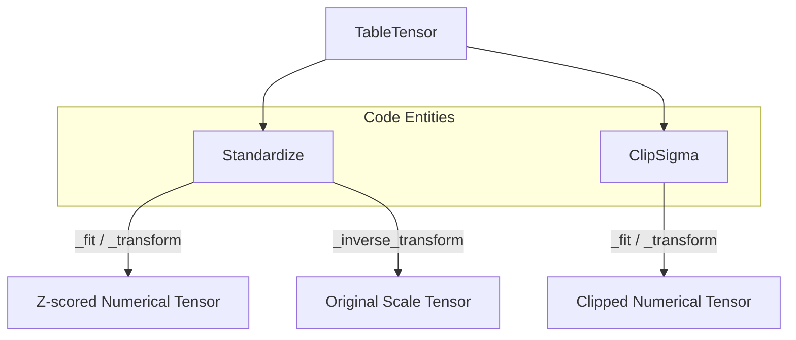
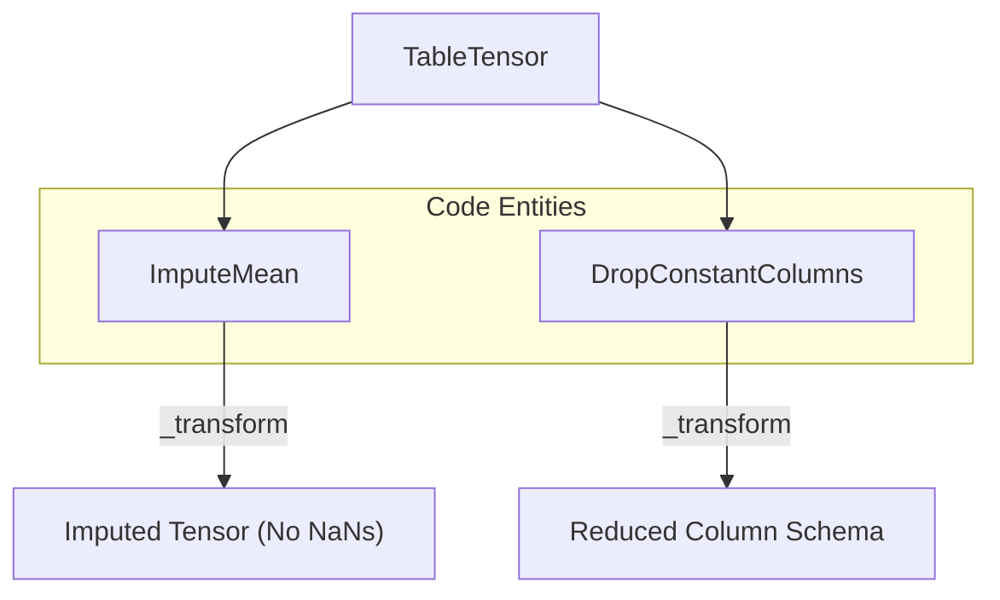
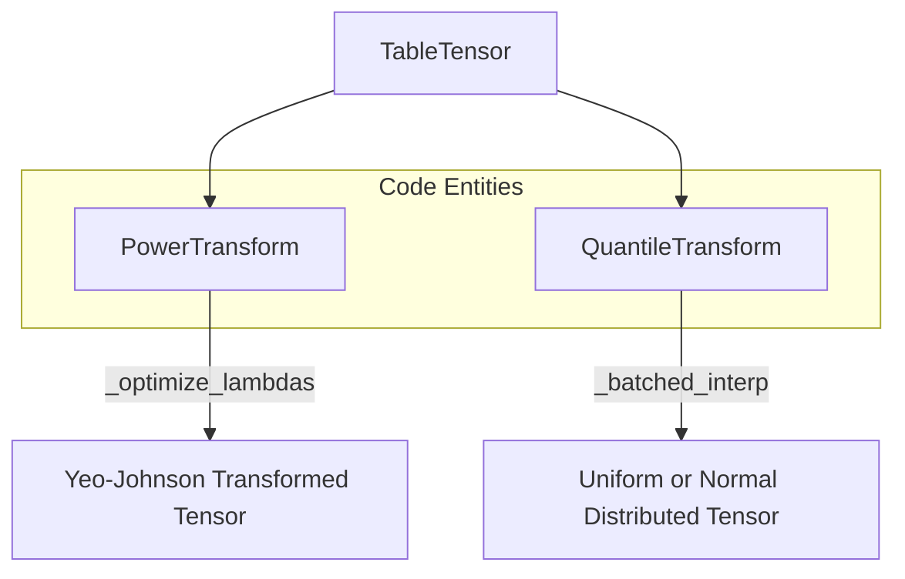
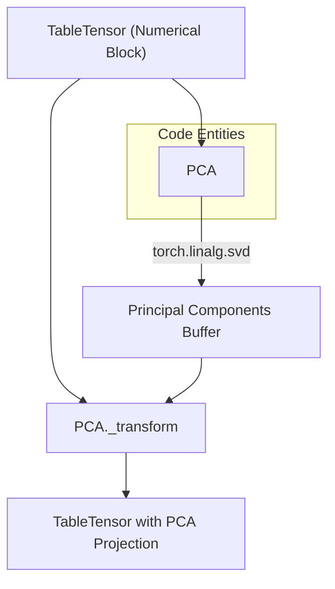

<!-- source: DeepWiki mcp.deepwiki.com · repo NVIDIA/structured-data-models · page 3.3 Numerical Processors · fetched 2026-10-26 -->

# Numerical Processors

Relevant source files

The following files were used as context for generating this wiki page:

- [sdm/processing/common/choice.py](sdm/processing/common/choice.py)
- [sdm/processing/numerical/_stats.py](sdm/processing/numerical/_stats.py)
- [sdm/processing/numerical/constant.py](sdm/processing/numerical/constant.py)
- [sdm/processing/numerical/detrend.py](sdm/processing/numerical/detrend.py)
- [sdm/processing/numerical/impute.py](sdm/processing/numerical/impute.py)
- [sdm/processing/numerical/interpolate.py](sdm/processing/numerical/interpolate.py)
- [sdm/processing/numerical/pca.py](sdm/processing/numerical/pca.py)
- [sdm/processing/numerical/power.py](sdm/processing/numerical/power.py)
- [sdm/processing/numerical/quantile.py](sdm/processing/numerical/quantile.py)
- [sdm/processing/numerical/quantile_clip.py](sdm/processing/numerical/quantile_clip.py)
- [sdm/processing/numerical/random_projection.py](sdm/processing/numerical/random_projection.py)
- [sdm/processing/numerical/sigma_clip.py](sdm/processing/numerical/sigma_clip.py)
- [sdm/processing/numerical/standardize.py](sdm/processing/numerical/standardize.py)
- [sdm/processing/text/tfidf.py](sdm/processing/text/tfidf.py)
- [test/processing/categorical/test_impute.py](test/processing/categorical/test_impute.py)
- [test/processing/numerical/test_impute.py](test/processing/numerical/test_impute.py)
- [test/processing/numerical/test_interpolate.py](test/processing/numerical/test_interpolate.py)
- [test/processing/numerical/test_pca.py](test/processing/numerical/test_pca.py)
- [test/processing/numerical/test_power.py](test/processing/numerical/test_power.py)
- [test/processing/numerical/test_quantile_clip.py](test/processing/numerical/test_quantile_clip.py)
- [test/processing/numerical/test_random_projection.py](test/processing/numerical/test_random_projection.py)
- [test/processing/numerical/test_sigma_clip.py](test/processing/numerical/test_sigma_clip.py)
- [test/processing/numerical/test_standardize.py](test/processing/numerical/test_standardize.py)
- [test/processing/output/test_softmax.py](test/processing/output/test_softmax.py)

## Purpose and Scope

The `sdm.processing.numerical` subsystem provides high-throughput, GPU-native processors designed to clean, normalize, transform, and reduce the dimensionality of numerical feature columns stored within `TableTensor` instances. These processors adhere to the core `Processor` and `InvertibleMixin` contracts [sdm/processing/numerical/standardize.py:17](), supporting lifecycle methods (`fit`, `transform`, `fit_transform`, and `inverse_transform`) with native batching across leading dimensions and full support for PyTorch `torch.compile`.

---

## 1. Standardization and Clipping

### Standardize
The `Standardize` processor centers and scales each numerical feature column independently [sdm/processing/numerical/standardize.py:17-18](). 
* **Implementation Details**: It computes finite mean and standard deviation while masking out `NaN` and infinite values [sdm/processing/numerical/standardize.py:21-22](). Constant or single-sample features are assigned a unit scale ($\text{scale} = 1.0$) to maintain numerical stability and invertibility [sdm/processing/numerical/standardize.py:20-22, 75-79].
* **Key Methods**:
  * `_fit(table)`: Computes and buffers `mean` and `scale` tensors [sdm/processing/numerical/standardize.py:54-80].
  * `with_state(mean, scale)`: Injects fixed normalization parameters and disables refitting [sdm/processing/numerical/standardize.py:42-52].
  * `_inverse_transform(table)`: Reverses scaling and centering to recover original units [sdm/processing/numerical/standardize.py:85-88].

### ClipSigma
The `ClipSigma` processor performs two-stage z-score outlier clipping [sdm/processing/numerical/sigma_clip.py:16-17]().
* **Implementation Details**: The first pass estimates preliminary mean and standard deviation to mask extreme values; the second pass refits bounds on the surviving filtered distribution [sdm/processing/numerical/sigma_clip.py:17-20].
* **Methods & Modes**: Supports `"hard"` clamping to fitted lower/upper bounds or a `"log"` expansion method that maps outliers outward via $\log(1 + |x|)$ prior to clamping [sdm/processing/numerical/sigma_clip.py:26-27, 97-129].

**Sources:** `sdm/processing/numerical/standardize.py:17-91`, `sdm/processing/numerical/sigma_clip.py:16-137`

---

## 2. Imputation and Constant Dropping

### ImputeMean
The `ImputeMean` processor replaces missing or undefined numerical entries with fitted per-column means [sdm/processing/numerical/impute.py:12-13]().
* **Implementation Details**: Uses `torch.nanmean` over finite values (ignoring `inf` during estimation) and falls back to `fill_value` for entirely non-finite columns [sdm/processing/numerical/impute.py:15-20, 37-52].

### DropConstantColumns
The `DropConstantColumns` processor [sdm/processing/numerical/constant.py:12]() inherits from `EnsembleProcessor` to prune non-informative numerical columns.
* **Implementation Details**: Evaluates unique value counts using sorted difference transitions (`threshold`) [sdm/processing/numerical/constant.py:15, 68-72]. It records kept column indices during `_fit` or `_fit_ensemble` and filters matching columns in subsequent `_transform` calls [sdm/processing/numerical/constant.py:45, 96-108].

**Sources:** `sdm/processing/numerical/impute.py:12-59`, `sdm/processing/numerical/constant.py:12-118`

---

## 3. Power and Quantile Transformations

### PowerTransform
The `PowerTransform` processor implements the **Yeo-Johnson** power transformation to stabilize variance and normalize skewed distributions.
* **Implementation Details**: Employs a vectorized golden-section search (`_optimize_lambdas`) to maximize log-likelihood over bounded $\lambda$ intervals without per-column Python loops [sdm/processing/numerical/power.py:18, 140-200]. 
* **Invertibility**: Implements exact closed-form `_yeojohnson_inverse_transform` paths for round-trip recovery [sdm/processing/numerical/power.py:46-70].

### QuantileTransform
The `QuantileTransform` processor maps numerical columns to uniform or standard normal distributions using empirical quantiles [sdm/processing/numerical/quantile.py:80-108].
* **Implementation Details**: Subsamples input rows, computes percentile grids via `torch.quantile`, and evaluates out-of-sample points using batched 1D linear interpolation (`_batched_interp`) [sdm/processing/numerical/quantile.py:35-78, 165-188].

**Sources:** `sdm/processing/numerical/power.py:21-200`, `sdm/processing/numerical/quantile.py:35-191`

---

## 4. Dimensionality Reduction

### PCA
The `PCA` processor projects numerical features onto principal orthogonal axes using singular value decomposition [sdm/processing/numerical/pca.py:13-17].
* **Implementation Details**: 
  1. Computes and removes feature-wise `mean` [sdm/processing/numerical/pca.py:45]().
  2. Invokes `torch.linalg.svd` to extract right singular vectors (`vh`) [sdm/processing/numerical/pca.py:46-49]().
  3. Projects input tensors via matrix multiplication against retained components, generating synthetic column names (`pca_0`, `pca_1`, ...) [sdm/processing/numerical/pca.py:61-65]().

**Sources:** `sdm/processing/numerical/pca.py:13-69`

---

