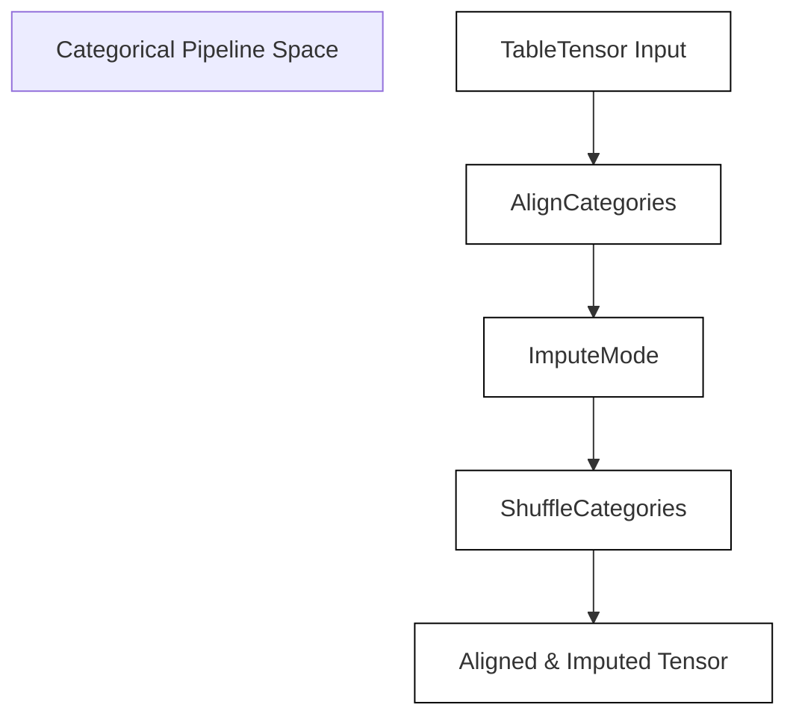
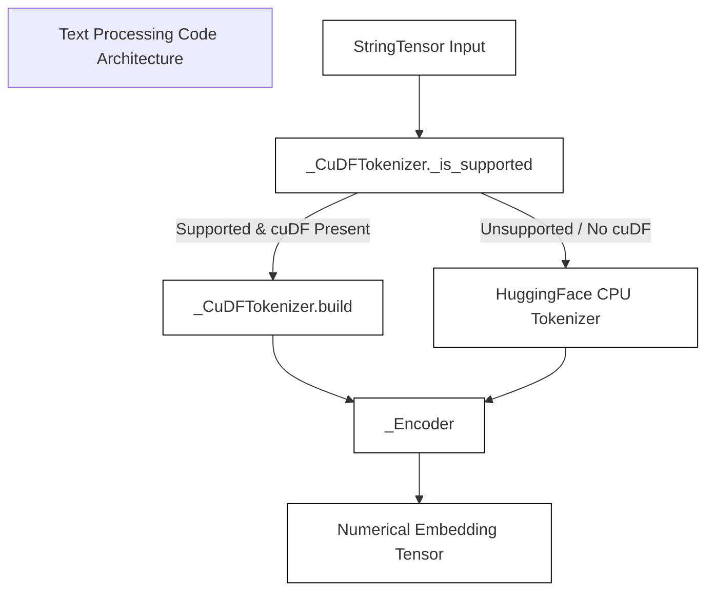
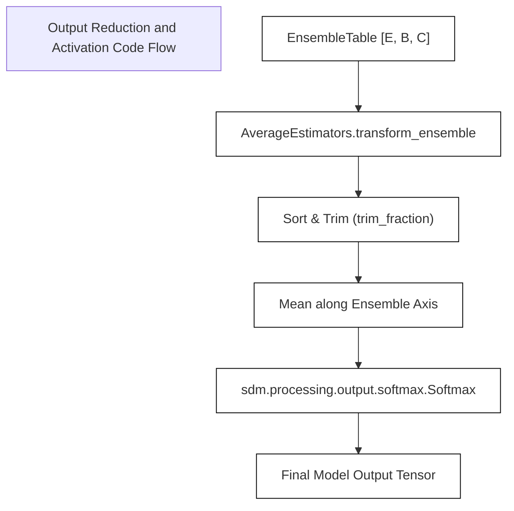

<!-- source: DeepWiki mcp.deepwiki.com · repo NVIDIA/structured-data-models · page 3.4 Categorical, Datetime, Text and Output Processors · fetched 2026-10-26 -->

# Categorical, Datetime, Text and Output Processors

Relevant source files

The following files were used as context for generating this wiki page:

- [docs/source/overview.md](docs/source/overview.md)
- [examples/relational/relbench/main.py](examples/relational/relbench/main.py)
- [sdm/_constants.py](sdm/_constants.py)
- [sdm/processing/categorical/align.py](sdm/processing/categorical/align.py)
- [sdm/processing/categorical/impute.py](sdm/processing/categorical/impute.py)
- [sdm/processing/categorical/shuffle.py](sdm/processing/categorical/shuffle.py)
- [sdm/processing/common/shuffle.py](sdm/processing/common/shuffle.py)
- [sdm/processing/datetime/calendar.py](sdm/processing/datetime/calendar.py)
- [sdm/processing/output/__init__.py](sdm/processing/output/__init__.py)
- [sdm/processing/output/reduce.py](sdm/processing/output/reduce.py)
- [sdm/processing/output/softmax.py](sdm/processing/output/softmax.py)
- [sdm/processing/text/sentence_transformer.py](sdm/processing/text/sentence_transformer.py)
- [test/processing/categorical/test_align.py](test/processing/categorical/test_align.py)
- [test/processing/categorical/test_shuffle.py](test/processing/categorical/test_shuffle.py)
- [test/processing/common/test_shuffle.py](test/processing/common/test_shuffle.py)
- [test/processing/datetime/test_calendar.py](test/processing/datetime/test_calendar.py)
- [test/processing/numerical/test_constant.py](test/processing/numerical/test_constant.py)
- [test/processing/output/test_reduce.py](test/processing/output/test_reduce.py)
- [test/processing/text/test_sentence_transformer.py](test/processing/text/test_sentence_transformer.py)
- [test/processing/text/test_tfidf.py](test/processing/text/test_tfidf.py)

## Purpose and Scope
This section covers specialized feature and output processors within `sdm.processing` that handle categorical variables, datetime fields, text data, and model output reduction. These processors conform to the `Processor` and `EnsembleProcessor` lifecycle contracts, supporting GPU-native tensor operations via `TableTensor`, `CategoricalTensor`, `StringTensor`, and `EnsembleTable`.

---

## 1. Categorical Processors

Categorical processors manage discrete string or integer categories represented via `CategoricalTensor`. They provide vocabulary alignment across separate data splits, shuffling for augmentation, and missing value imputation.

### AlignCategories
`AlignCategories` (`sdm/processing/categorical/align.py`) aligns categorical columns to fixed vocabularies observed during fitting. Unseen categories or missing values (represented by negative codes) are mapped to code `-1`.

- **Sorting Strategies**: Observed categories can be ordered by `"code"` (original order), `"frequency"` (descending frequency), or `"value"` (ascending category value) [sdm/processing/categorical/align.py:34-41].
- **Frequency Filtering**: The `min_frequency` parameter drops categories with fewer observations than the threshold, assigning them code `-1` [sdm/processing/categorical/align.py:39-41].
- **Implementation**: `_fit_column` accumulates category counts per batch using `counts.scatter_add_`, computes the permutation order, filters by `min_frequency`, and builds a lookup tensor for fast re-indexing [sdm/processing/categorical/align.py:87-159].

### ShuffleCategories
`ShuffleCategories` (`sdm/processing/categorical/shuffle.py`) permutes integer codes of categorical columns for ensemble data augmentation. 
- **Methods**: Supports `"random"` (independent permutations) and `"shift"` (cyclic offset cycling through every offset in random order) [sdm/processing/categorical/shuffle.py:33-36].
- **Invariance**: Missing values (`< 0`) are preserved unchanged, and category vectors are permuted alongside codes so decoded values remain consistent [sdm/processing/categorical/shuffle.py:18-20].

### ImputeMode
`ImputeMode` (`sdm/processing/categorical/impute.py`) replaces missing categorical values (negative codes) with the most frequent observed category code learned independently per column.
- Ties select the lowest category code [sdm/processing/categorical/impute.py:21].
- It computes frequencies using `counts.scatter_add_` and fills missing entries via `table.categorical.where` [sdm/processing/categorical/impute.py:64-110].

Sources:
- `sdm/processing/categorical/align.py` [sdm/processing/categorical/align.py:25-177]()
- `sdm/processing/categorical/shuffle.py` [sdm/processing/categorical/shuffle.py:14-121]()
- `sdm/processing/categorical/impute.py` [sdm/processing/categorical/impute.py:15-110]()

---

## 2. Datetime Processors

Datetime processors extract calendar components (such as year, month, day, day of the week, hour, minute, second) from timestamp or datetime columns. 
- **Calendar Fields**: Processors in `sdm/processing/datetime/calendar.py` map raw temporal tensors into numerical feature representations suitable for downstream neural network blocks.

Sources:
- `sdm/processing/datetime/calendar.py`

---

## 3. Text Processors

Text processors convert raw string representations (`StringTensor`) into dense numerical embeddings or sparse TF-IDF feature matrices.

### TFIDF Processor
The TF-IDF processor extracts bag-of-words term frequency-inverse document frequency features from text columns, mapping high-dimensional sparse text representations into numerical feature blocks.

### SentenceTransformer
`SentenceTransformer` (`sdm/processing/text/sentence_transformer.py`) wraps Hugging Face `sentence_transformers` models to generate dense text embeddings.
- **GPU Acceleration (`_CuDFTokenizer`)**: For canonical BERT models with fast tokenizers, `_CuDFTokenizer` uses `cudf` to perform on-device WordPiece tokenization, avoiding CPU-GPU synchronization overhead [sdm/processing/text/sentence_transformer.py:31-182].
- **Fallback**: If `cudf` is unavailable or the tokenizer configuration diverges from supported BERT structures, it safely falls back to CPU-based tokenization [sdm/processing/text/sentence_transformer.py:65-82, 173-182].

Sources:
- `sdm/processing/text/sentence_transformer.py` [sdm/processing/text/sentence_transformer.py:31-182]()

---

## 4. Output Processors

Output processors operate on model predictions, aggregating ensemble dimensions, applying activation functions, or sorting outputs for quantile regression.

### AverageEstimators
`AverageEstimators` (`sdm/processing/output/reduce.py`) reduces the leading ensemble dimension (`E`) of model output tables.
- **Trimmed Mean**: Supports `trim_fraction` in `[0, 0.5)` to discard outlier estimator predictions from each tail after sorting along the ensemble axis before computing the mean [sdm/processing/output/reduce.py:20-36, 54-58].
- **Aggregation**: Handles reduction across storage groups within an `EnsembleTable` and returns a single averaged member table [sdm/processing/output/reduce.py:38-66].

### Softmax and Quantile Sort
- **Softmax** (`sdm/processing/output/softmax.py`): Applies the softmax activation function across the feature dimension of numerical output tensors, commonly used in classification tasks.
- **Quantile Sorters**: Reorder or process multi-quantile head outputs for probabilistic forecasting models.

Sources:
- `sdm/processing/output/reduce.py` [sdm/processing/output/reduce.py:13-86]()
- `sdm/processing/output/softmax.py`

---

