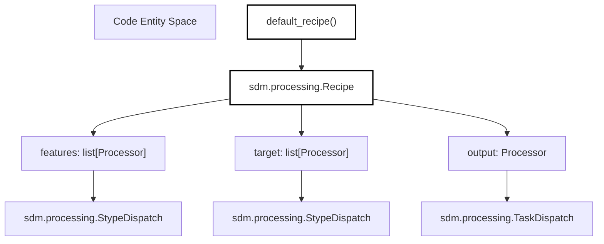
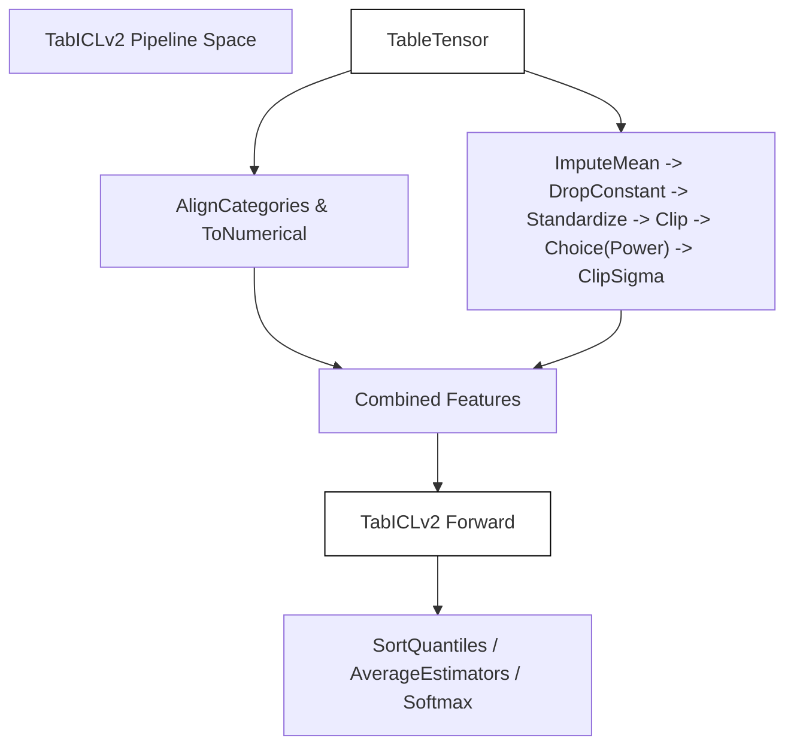
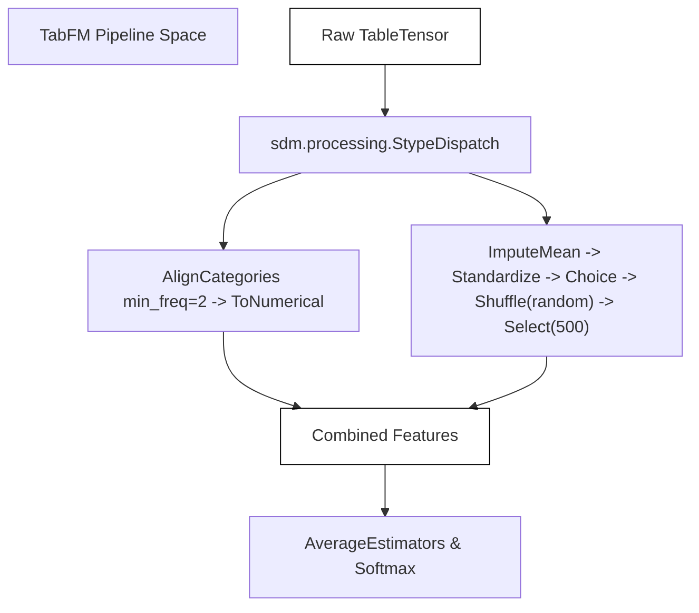
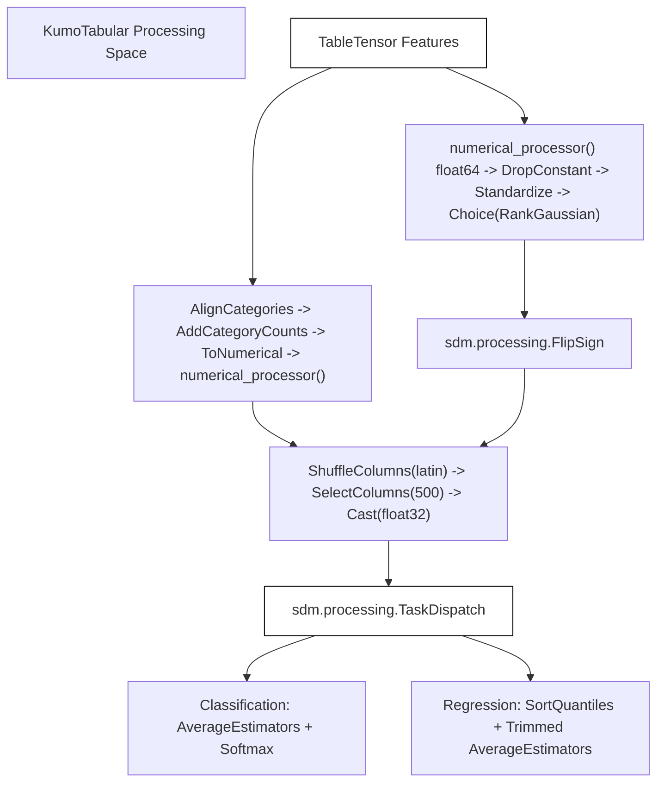
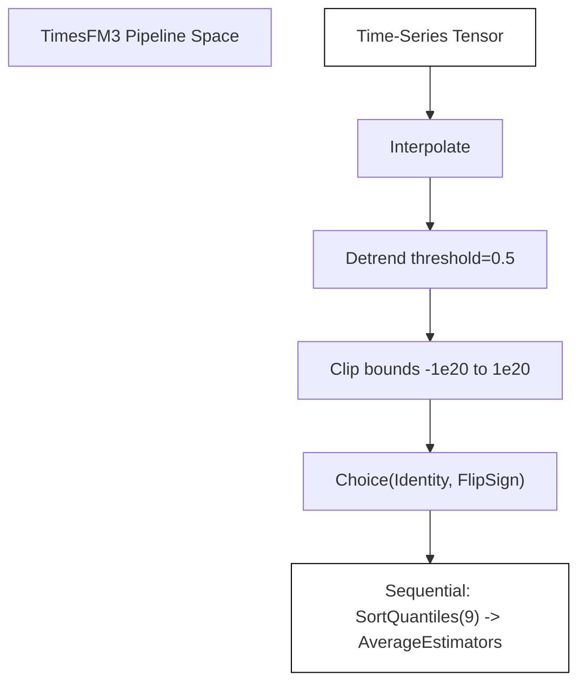

<!-- source: DeepWiki mcp.deepwiki.com · repo NVIDIA/structured-data-models · page 3.5 Model Default Recipes · fetched 2026-10-26 -->

# Model Default Recipes

Relevant source files

The following files were used as context for generating this wiki page:

- [.agents/skills/recipe-development/SKILL.md](.agents/skills/recipe-development/SKILL.md)
- [sdm/models/kumo/tabular/recipe.py](sdm/models/kumo/tabular/recipe.py)
- [sdm/models/tabfm/recipe.py](sdm/models/tabfm/recipe.py)
- [sdm/models/tabiclv2/recipe.py](sdm/models/tabiclv2/recipe.py)
- [sdm/models/timesfm3/recipe.py](sdm/models/timesfm3/recipe.py)
- [sdm/processing/categorical/__init__.py](sdm/processing/categorical/__init__.py)
- [sdm/processing/categorical/_categorical.py](sdm/processing/categorical/_categorical.py)
- [sdm/processing/categorical/count.py](sdm/processing/categorical/count.py)
- [sdm/processing/datetime/__init__.py](sdm/processing/datetime/__init__.py)
- [sdm/processing/numerical/flip_sign.py](sdm/processing/numerical/flip_sign.py)
- [sdm/processing/output/sort.py](sdm/processing/output/sort.py)
- [test/models/kumo/tabular/test_recipe.py](test/models/kumo/tabular/test_recipe.py)
- [test/processing/categorical/test_count.py](test/processing/categorical/test_count.py)
- [test/processing/numerical/test_clip.py](test/processing/numerical/test_clip.py)
- [test/processing/numerical/test_flip_sign.py](test/processing/numerical/test_flip_sign.py)
- [test/processing/output/test_sort.py](test/processing/output/test_sort.py)

This page details the per-model `default_recipe()` definitions for foundation models within structured-data-models (`sdm`), including TabICLv2, TabFM, KumoTabular, and TimesFM3. It describes how these recipes compose processors across features, targets, and outputs to standardize data ingestion and post-processing on GPUs.

---

## 1. Overview of Model Default Recipes

In `sdm`, a model's default recipe is encapsulated as an `sdm.processing.Recipe` instance [sdm/models/tabiclv2/recipe.py:7-46](), [sdm/models/kumo/tabular/recipe.py:31-71](), [sdm/models/tabfm/recipe.py:7-46](), [sdm/models/timesfm3/recipe.py:7-34](). Each recipe defines three primary pipelines:
1. **Features**: Preprocessing pipelines handling missing values, scaling, categorical alignment, transformations, and column selection/shuffling.
2. **Targets**: Target transformation pipelines (e.g., standardization or categorical shifting) applied during training and inverted during inference.
3. **Outputs**: Post-processing pipelines that reduce ensemble predictions, sort quantiles, apply softmax, or trim estimators.

*Sources: [sdm/models/tabiclv2/recipe.py:7-46](), [sdm/models/kumo/tabular/recipe.py:31-71]()*

---

## 2. TabICLv2 Recipe

The TabICLv2 architecture employs a standard tabular recipe optimized for context-based in-context learning [sdm/models/tabiclv2/recipe.py:7]().

### Implementation Details
* **Categorical Features**: Categories are sorted by value (`sdm.processing.AlignCategories`) and converted to numerical representations (`sdm.processing.ToNumerical`) [sdm/models/tabiclv2/recipe.py:10-14]().
* **Numerical Features**: Sequentially processed via mean imputation (`sdm.processing.ImputeMean`), constant column removal (`sdm.processing.DropConstantColumns`), standardization (`sdm.processing.Standardize`), hard clipping, round-robin power transformations, sigma clipping, and Latin hypercube column shuffling [sdm/models/tabiclv2/recipe.py:16-30]().
* **Target Processing**: Categorical targets are aligned and shifted; numerical targets are standardized [sdm/models/tabiclv2/recipe.py:32-40]().
* **Output Processing**: Regression tasks sort quantiles via `sdm.processing.SortQuantiles`, estimators are averaged, and classification logits pass through a temperature-scaled softmax [sdm/models/tabiclv2/recipe.py:41-45]().

*Sources: [sdm/models/tabiclv2/recipe.py:7-46]()*

---

## 3. TabFM Recipe

TabFM scales tabular in-context learning with specific frequency thresholds and column selection constraints [sdm/models/tabfm/recipe.py:7]().

### Implementation Details
* **Categorical Features**: Uses `AlignCategories(min_frequency=2)` to filter rare categories before converting to numerical codes [sdm/models/tabfm/recipe.py:11-14]().
* **Numerical Features**: Implements mean imputation, constant dropping, standardization, clipping, round-robin power transformations, sigma clipping, random column shuffling, and truncates features to a maximum of 500 columns via `sdm.processing.SelectColumns` [sdm/models/tabfm/recipe.py:16-30]().
* **Output Processing**: Averages estimators and applies temperature-scaled softmax for classification [sdm/models/tabfm/recipe.py:40-45]().

*Sources: [sdm/models/tabfm/recipe.py:7-46]()*

---

## 4. KumoTabular Recipe

KumoTabular provides a robust, heavily regularized preprocessing recipe utilizing double-precision intermediate calculations, category counts, and sign flipping [sdm/models/kumo/tabular/recipe.py:9]().

### Implementation Details
* **Numerical Subroutine (`numerical_processor`)**: Casts inputs to `torch.float64` to prevent overflow, drops constants, standardizes, clips, and applies a complex round-robin choice of `Identity`, `PowerTransform`, `RobustScale` with saturation, and `RankGaussian` [sdm/models/kumo/tabular/recipe.py:10-29]().
* **Categorical Features**: Aligns categories, adds log-counts for categories with cardinality $\ge 50$ (`sdm.processing.AddCategoryCounts`), converts to numerical, and routes through the numerical processor subroutine [sdm/models/kumo/tabular/recipe.py:38-43]().
* **Sign Flipping**: Incorporates `sdm.processing.FlipSign` to randomize numerical column signs across ensemble members [sdm/models/kumo/tabular/recipe.py:36](), [sdm/processing/numerical/flip_sign.py:12-25]().
* **Output Processing**: Branching via `sdm.processing.TaskDispatch` for classification (averaging estimators + softmax) and regression (sorting quantiles + trimmed average estimators with `trim_fraction=0.2`) [sdm/models/kumo/tabular/recipe.py:61-70]().

*Sources: [sdm/models/kumo/tabular/recipe.py:9-71](), [sdm/processing/numerical/flip_sign.py:12-25]()*

---

## 5. TimesFM3 Recipe

TimesFM3 targets time-series forecasting workflows [sdm/models/timesfm3/recipe.py:7]().

### Implementation Details
* **Feature & Target Pipelines**: Applies temporal interpolation (`sdm.processing.Interpolate`), detrending (`sdm.processing.Detrend`), clipping to large bounds (`[-1e20, 1e20]`), and a round-robin choice between identity and sign flipping (`sdm.processing.FlipSign`) [sdm/models/timesfm3/recipe.py:8-29]().
* **Output Processing**: A sequential pipeline executing `sdm.processing.SortQuantiles(num_quantiles=9)` followed by estimator averaging [sdm/models/timesfm3/recipe.py:30-33]().

*Sources: [sdm/models/timesfm3/recipe.py:7-34]()*

---

## 6. Processor Composition Patterns

Model recipes make extensive use of composable dispatcher and utility blocks from `sdm.processing`:
* `sdm.processing.StypeDispatch`: Routes columns based on semantic types (`Stype.numerical`, `Stype.categorical`) [sdm/models/tabiclv2/recipe.py:10-30]().
* `sdm.processing.TaskDispatch`: Switches post-processing behavior depending on whether the task is `regression` or `classification` [sdm/models/tabiclv2/recipe.py:41-44]().
* `sdm.processing.Choice`: Implements multi-branch stochastic or round-robin transformations during ensemble training [sdm/models/tabiclv2/recipe.py:22-26]().

Sources: [sdm/models/tabiclv2/recipe.py:1-46](), [sdm/models/kumo/tabular/recipe.py:1-71](), [sdm/models/tabfm/recipe.py:1-46](), [sdm/models/timesfm3/recipe.py:1-34]()

---

