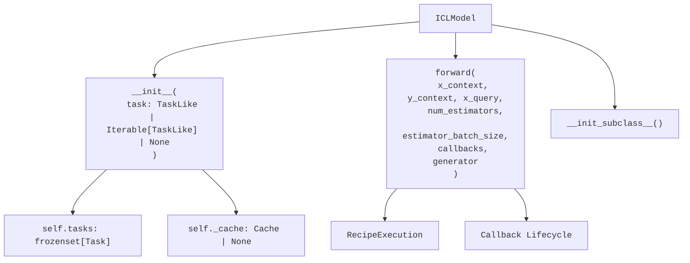
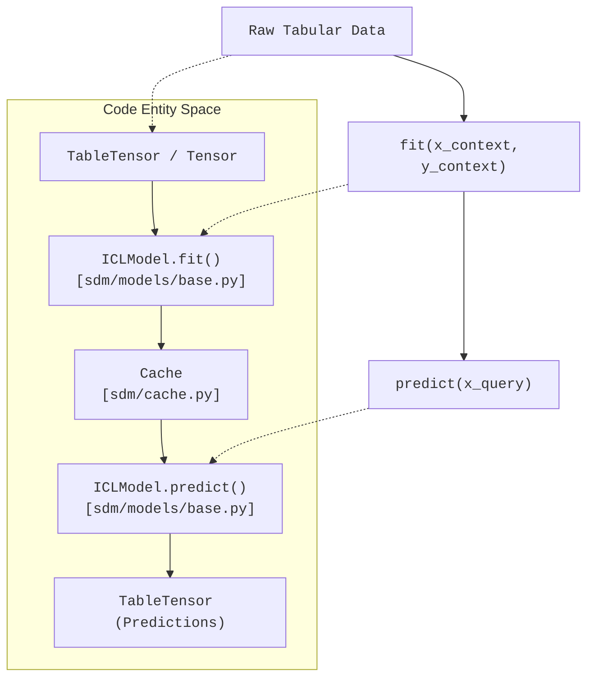
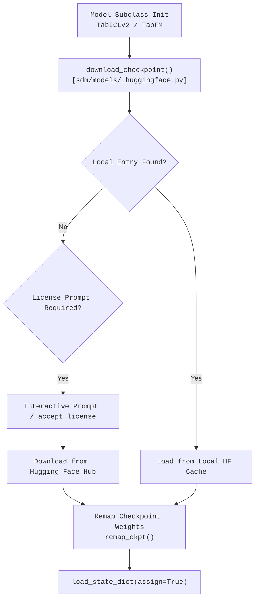

<!-- source: DeepWiki mcp.deepwiki.com · repo NVIDIA/structured-data-models · page 4.1 ICLModel Base Class and Inference Lifecycle · fetched 2026-10-26 -->

# ICLModel Base Class and Inference Lifecycle

Relevant source files

The following files were used as context for generating this wiki page:

- [THIRD_PARTY_LICENSES.md](THIRD_PARTY_LICENSES.md)
- [sdm/evaluation/__init__.py](sdm/evaluation/__init__.py)
- [sdm/models/_huggingface.py](sdm/models/_huggingface.py)
- [sdm/models/base.py](sdm/models/base.py)
- [sdm/models/ecoc.py](sdm/models/ecoc.py)
- [sdm/models/kumo/timeseries/anomaly/NOTICE](sdm/models/kumo/timeseries/anomaly/NOTICE)
- [sdm/models/tabfm/model.py](sdm/models/tabfm/model.py)
- [sdm/models/tabiclv2/model.py](sdm/models/tabiclv2/model.py)
- [test/evaluation/test_classification.py](test/evaluation/test_classification.py)
- [test/models/tabfm/test_model.py](test/models/tabfm/test_model.py)
- [test/models/test_base.py](test/models/test_base.py)
- [test/models/test_ecoc.py](test/models/test_ecoc.py)
- [third_party/dpm-solver/LICENSE](third_party/dpm-solver/LICENSE)
- [third_party/tabpfn-extensions/LICENSE](third_party/tabpfn-extensions/LICENSE)

## Purpose and Scope
This page documents the `ICLModel` abstract base class (`[sdm/models/base.py:35]`), which forms the architectural foundation for all in-context learning (ICL) foundation models within `structured-data-models` (`sdm`). It covers the end-to-end inference lifecycle (`forward`, `fit`, `predict`, `clear`), key-value and state caching abstractions (`[sdm/cache.py]()`), batching strategies for multi-estimator ensembling, context-only feature extraction, model callbacks, HuggingFace checkpoint loading utilities (`[sdm/models/_huggingface.py:12]()`), and error-correcting output code (`ECOC`) expansions for high-cardinality classification (`[sdm/models/ecoc.py:28]()`).

---

## 1. The `ICLModel` Architecture and Contract

`ICLModel` inherits from `torch.nn.Module` and `abc.ABC` (`[sdm/models/base.py:35]()`). It defines class-level attributes that establish what data types, task types, and structural capabilities each foundation model supports:

* `supported_feature_stypes`: Frozenset of input semantic types (`Stype`) accepted by the model (`[sdm/models/base.py:48-49]()`).
* `supported_target_stypes`: Frozenset of target semantic types (`[sdm/models/base.py:51-52]()`).
* `supported_tasks`: Automatically populated during subclass initialization via `__init_subclass__` (`[sdm/models/base.py:54-55, 66-72]()`).
* `supports_multi_target`: Boolean flag indicating multi-target regression/classification capability (`[sdm/models/base.py:57-58]()`).
* `supports_context_only_columns`: Boolean flag for columns present in context tables but omitted from query tables (`[sdm/models/base.py:60-61]()`).
* `supports_related_tables`: Boolean flag indicating support for relational/multi-table context (`[sdm/models/base.py:63-64]()`).

*Sources: [sdm/models/base.py:35-146]()*.

---

## 2. Inference Lifecycle: `fit`, `predict`, `forward`, and `clear`

Foundation models in `sdm` support two interaction paradigms:
1. **Direct `forward` Pass**: Providing `x_context`, `y_context`, and `x_query` in a single invocation.
2. **Stateful `fit` / `predict`**: Pre-computing and caching in-context representations using `fit(...)`, then generating predictions for multiple query batches via `predict(...)` using internal key/value caches.

*Sources: [sdm/models/base.py:35-146]()*, `[test/models/tabfm/test_model.py:91-101]()`.

When `fit(...)` is invoked, the model runs its pre-processing recipe and forward pass in *recording mode*, storing intermediate states, keys, and values inside `self._cache`. Subsequent calls to `predict(...)` operate in *replaying mode*, bypassing context re-encoding and directly attending to cached representations. Calling `clear()` resets `self._cache` to `None`.

---

## 3. Key/Value Caching and Estimator Batching

### Cache Abstraction
The `Cache` class (`[sdm/cache.py]()`) manages tensor persistence across inference steps. It tracks state via flags (`is_recording`, `is_replaying`, `is_frozen`). During estimator ensembling or multi-query streaming, cached representations avoid redundant computation of in-context embedding layers.

### Estimator Batching
The `forward` method accepts an optional `num_estimators` parameter `E` and an `estimator_batch_size` parameter (`[sdm/models/base.py:108-109]()`):
* `estimator_batch_size = 1`: Runs estimators sequentially (default, minimizes peak VRAM).
* `estimator_batch_size = None`: Batches all estimators in a single forward pass (maximizes throughput, bounded by VRAM capacity).
* Intermediate integers: Batches consecutive groups of estimators up to the specified size.

Estimators whose preprocessed table shapes, target classes, or related tables differ are automatically segregated into separate execution batches.

*Sources: [sdm/models/base.py:99-146](), [test/models/tabfm/test_model.py:18-101]()*.

---

## 4. Callbacks and Pre-processing Hooks

Callbacks allow injection of custom logic into the model execution lifecycle without modifying model code. The `Callback` base class exposes hooks across context processing, query processing, and model forward execution (`[test/models/test_base.py:131-182]()`).

| Callback Hook | Arguments | Description |
| :--- | :--- | :--- |
| `on_context_preprocessing_end` | `model, x, y, x_context_only, related_tables` | Triggered after context table recipe transformation. |
| `on_query_preprocessing_end` | `model, x, related_tables` | Triggered after query table recipe transformation. |
| `on_model_forward_end` | `model, out` | Triggered immediately after the neural network forward pass returns raw predictions. |

Callbacks can also signal gradient requirements (`callback.requires_grad`), dynamically forcing activation tracking during inference (`[sdm/models/base.py:148-149]()`).

*Sources: [sdm/models/base.py:147-150](), [test/models/test_base.py:131-182]()*.

---

## 5. HuggingFace Checkpoint Loading

Pretrained weights for models such as `TabICLv2` and `TabFM` are resolved via `download_checkpoint` (`[sdm/models/_huggingface.py:12-60]()`). 

*Sources: [sdm/models/_huggingface.py:12-60](), [sdm/models/tabiclv2/model.py:131-180](), [sdm/models/tabfm/model.py:86-147]()*.

The downloader checks local entries using `huggingface_hub`. If weights are missing and a `license_prompt` is defined (such as for non-commercial model weights like TabFM or TimesFM), it prompts the user for interactive acceptance before downloading (`[sdm/models/_huggingface.py:48-55]()`).

---

## 6. Error-Correcting Output Codes (`ECOC`)

When classification target cardinality `num_classes` exceeds a model's maximum output capacity `max_classes`, `sdm` uses Error-Correcting Output Codes (`ECOC`) implemented in `[sdm/models/ecoc.py:28]()` (derived from TabPFN Extensions).

### ECOC Mechanism
1. **Codebook Generation**: Draws binary or multi-class projection codebooks (`_draw_codebook`, `[sdm/models/ecoc.py:141-170]()`) dividing classes into binary or reduced-class subtasks of size `max_classes - 1`.
2. **Batched Subtask Execution**: Executes the underlying model across the generated tasks `T` (and ensemble members `E`).
3. **Log-Probability Aggregation**: Collects log probabilities from active subtasks and aggregates them across codebook mappings to form valid probability distributions over all `num_classes` target categories (`[sdm/models/ecoc.py:134-139]()`).
4. **Cache Replay**: Caches the generated `ecoc_codebook` and subtask model caches (`ecoc_model`) to accelerate subsequent query inference (`[sdm/models/ecoc.py:89-111]()`).

*Sources: [sdm/models/ecoc.py:28-170](), [test/models/test_ecoc.py:1-133]()*.

---

