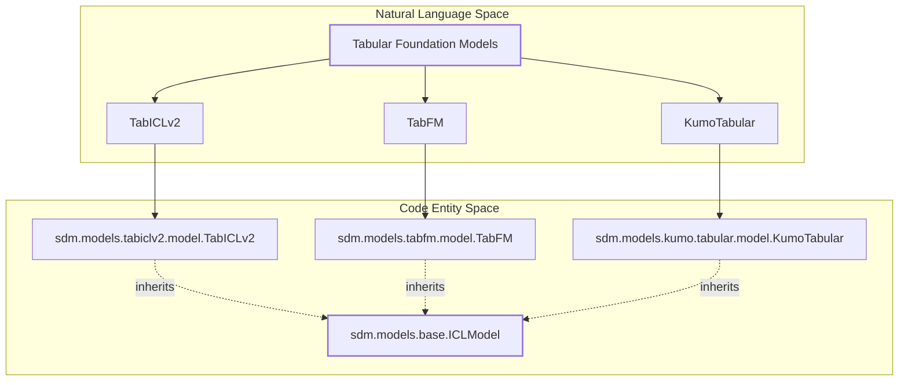
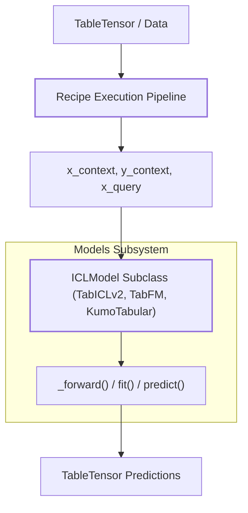

<!-- source: DeepWiki mcp.deepwiki.com · repo NVIDIA/structured-data-models · page 4.2 Tabular Models · fetched 2026-10-26 -->

# Tabular Models

Relevant source files

The following files were used as context for generating this wiki page:

- [sdm/models/base.py](sdm/models/base.py)
- [sdm/models/kumo/tabular/model.py](sdm/models/kumo/tabular/model.py)
- [sdm/models/tabfm/model.py](sdm/models/tabfm/model.py)
- [sdm/models/tabiclv2/model.py](sdm/models/tabiclv2/model.py)
- [test/models/kumo/tabular/test_model.py](test/models/kumo/tabular/test_model.py)
- [test/models/tabfm/test_model.py](test/models/tabfm/test_model.py)
- [test/models/test_base.py](test/models/test_base.py)

## Purpose and Scope
This page provides an overview of the tabular foundation models available in the structured-data-models (`sdm`) library, which implement in-context learning (ICL) paradigms for tabular prediction tasks (`sdm/models/base.py`) [sdm/models/base.py:35-46](). The library features three core tabular architectures: **TabICLv2**, **TabFM**, and **KumoTabular**. 

This is a parent page. For deep technical details, check the respective child pages:
- TabICLv2 architecture: row embedding, ICL blocks, and checkpoints ([TabICLv2](#4.2.1)).
- TabFM scaled model: cell embedding, RMSNorm/SwiGLU blocks, ICL stack, and checkpoints ([TabFM](#4.2.2)).
- KumoTabular sizes, embeddings, ICL blocks, batching, and tests ([KumoTabular](#4.2.3)).

---

## High-Level Overview of Tabular Foundation Models

Tabular foundation models in `sdm` treat tables as in-context learning problems. Instead of training a specific gradient-boosted tree or neural network from scratch for each dataset, these models take a set of labeled context rows and predict targets for held-out query rows within a single forward pass or via cached `fit`/`predict` cycles.

Sources: `sdm/models/base.py`, `sdm/models/tabiclv2/model.py`, `sdm/models/tabfm/model.py`, `sdm/models/kumo/tabular/model.py`

---

## Model Zoo Summary

| Model Class | Code Symbol | Description | Key Features |
| :--- | :--- | :--- | :--- |
| **TabICLv2** | `sdm.models.TabICLv2` | Scalable tabular ICL model [sdm/models/tabiclv2/model.py:28-119]() | Shifted feature grouping, target-aware embeddings, Query-Aware Scalable SoftMax (`QASSMax`). |
| **TabFM** | `sdm.models.TabFM` | Scaled-up zero-shot foundation model [sdm/models/tabfm/model.py:39-74]() | Fourier cell embeddings, RMSNorm blocks, SwiGLU activations. |
| **KumoTabular** | `sdm.models.KumoTabular` | Accuracy-efficiency frontier model [sdm/models/kumo/tabular/model.py:66-104]() | Small/medium/large sizes, 999 quantile regression heads, ECOC classification support. |

Sources: `sdm/models/tabiclv2/model.py`, `sdm/models/tabfm/model.py`, `sdm/models/kumo/tabular/model.py`

---

## Architectural Interaction

All tabular models inherit from `ICLModel` (`sdm/models/base.py`), utilizing unified caching mechanisms, estimator batching, and recipe-driven data ingestion.

Sources: `sdm/models/base.py`, `sdm/models/tabiclv2/model.py`, `sdm/models/tabfm/model.py`, `sdm/models/kumo/tabular/model.py`

---

## Sub-Topics and Detail Pages

### 4.2.1 TabICLv2
For information on row embeddings, ICL blocks, checkpoint remapping, and usage examples, see [TabICLv2](#4.2.1).

### 4.2.2 TabFM
For details on cell embeddings, RMSNorm, SwiGLU blocks, and safetensors checkpoint loading, see [TabFM](#4.2.2).

### 4.2.3 KumoTabular
For specifications on model scales (`small`, `medium`, `large`), quantile regression outputs, and batching tests, see [KumoTabular](#4.2.3).

Sources: `sdm/models/tabiclv2/model.py`, `sdm/models/tabfm/model.py`, `sdm/models/kumo/tabular/model.py`

---

