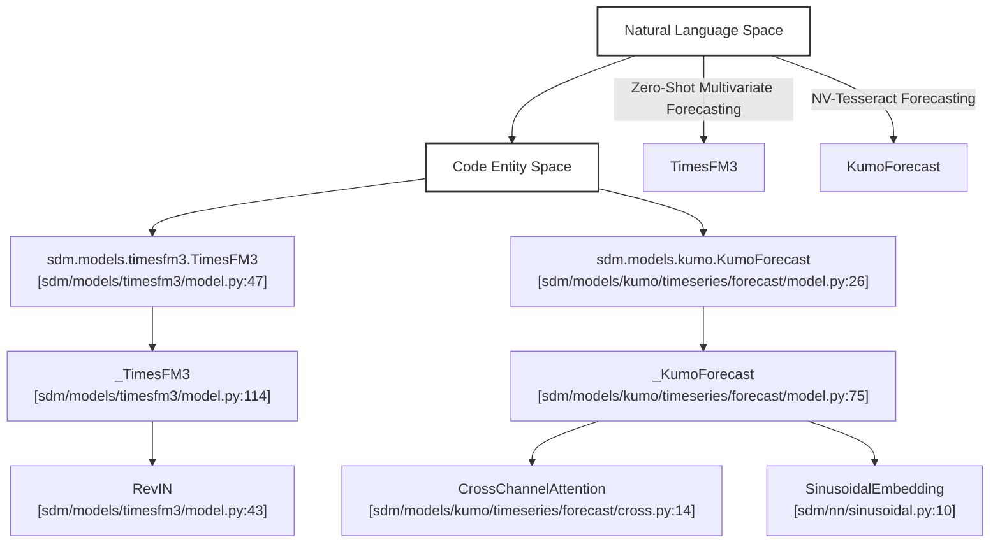

<!-- source: DeepWiki mcp.deepwiki.com · repo NVIDIA/structured-data-models · page 4.3 Time-Series Models · fetched 2026-10-26 -->

# Time-Series Models

Relevant source files

The following files were used as context for generating this wiki page:

- [docs/source/_templates/autosummary/model_class.rst](docs/source/_templates/autosummary/model_class.rst)
- [sdm/models/kumo/relational/model.py](sdm/models/kumo/relational/model.py)
- [sdm/models/kumo/timeseries/forecast/ckpt.py](sdm/models/kumo/timeseries/forecast/ckpt.py)
- [sdm/models/kumo/timeseries/forecast/cross.py](sdm/models/kumo/timeseries/forecast/cross.py)
- [sdm/models/kumo/timeseries/forecast/model.py](sdm/models/kumo/timeseries/forecast/model.py)
- [sdm/models/kumo/timeseries/forecast/recipe.py](sdm/models/kumo/timeseries/forecast/recipe.py)
- [sdm/models/timesfm3/model.py](sdm/models/timesfm3/model.py)
- [sdm/nn/sinusoidal.py](sdm/nn/sinusoidal.py)
- [test/models/kumo/timeseries/forecast/test_cross.py](test/models/kumo/timeseries/forecast/test_cross.py)
- [test/models/kumo/timeseries/forecast/test_model.py](test/models/kumo/timeseries/forecast/test_model.py)
- [test/models/timesfm3/test_model.py](test/models/timesfm3/test_model.py)
- [test/nn/test_sinusoidal.py](test/nn/test_sinusoidal.py)

## Purpose and Scope

The time-series subsystem within `structured-data-models` (`sdm`) provides GPU-native foundation models tailored for zero-shot multivariate forecasting and temporal sequence analysis. Built on top of the `ICLModel` framework, these models treat ordered rows as sequential time steps, processing context histories and future query horizons via patch tokenization, normalization layers, and attention mechanisms `[sdm/models/timesfm3/model.py:47-79](), [sdm/models/kumo/timeseries/forecast/model.py:26-50]()`.

This page serves as a parent overview for the library's time-series foundation models. For detailed technical specifications, internal block designs, tokenization strategies, and checkpoint management, refer to the child pages:
- [TimesFM3](#4.3.1)
- [KumoForecast and Anomaly Detection](#4.3.2)

*Sources: `sdm/models/timesfm3/model.py:43-114](), [sdm/models/kumo/timeseries/forecast/model.py:26-75](), [sdm/models/kumo/timeseries/forecast/cross.py:14-21](), [sdm/nn/sinusoidal.py:10-18]()`*

---

## High-Level Architecture

Time-series models in `sdm` integrate standard data transformations (such as RevIN normalization and recipe-based standardizers) with transformer backbones. The architecture handles multivariate data streams by separating past history (`x_context`, `y_context`) from future query horizons (`x_query`) `[sdm/models/timesfm3/model.py:154-165](), [sdm/models/kumo/timeseries/forecast/model.py:109-116]()`.

| Model Name | Primary Reference Class | Supported Tasks | Multi-Target | Key Architectural Feature |
| :--- | :--- | :--- | :--- | :--- |
| **TimesFM3** | `TimesFM3` `[sdm/models/timesfm3/model.py:47]()` | Regression / Forecasting | Yes | Patch tokenization, 9-quantile outputs, future-known covariate support `[sdm/models/timesfm3/model.py:61-72]()` |
| **KumoForecast** | `KumoForecast` `[sdm/models/kumo/timeseries/forecast/model.py:26]()` | Regression / Forecasting | Yes | MOMENT-based encoder, optional `CrossChannelAttention`, direct horizon projection `[sdm/models/kumo/timeseries/forecast/model.py:36-43]()` |

*Sources: `sdm/models/timesfm3/model.py:47-72](), [sdm/models/kumo/timeseries/forecast/model.py:26-43]()`*

---

## 4.3.1 TimesFM3

`TimesFM3` is a zero-shot multivariate forecasting foundation model that processes historical covariates and past target variates alongside future-known covariates (`x_query`) `[sdm/models/timesfm3/model.py:61-78]()`. It produces nine quantile forecasts (ranging from the 10th to the 90th percentile) across all target series in a single forward execution pass `[sdm/models/timesfm3/model.py:69-72]()`.

For in-depth coverage of patch tokenization, Reversible Instance Normalization (`RevIN`), attention blocks (`ICLBlock`), quantile head projections, and utility functions, see [TimesFM3](#4.3.1).

*Sources: `sdm/models/timesfm3/model.py:61-78]()`*

---

## 4.3.2 KumoForecast and Anomaly Detection

`KumoForecast` implements a transformer encoder backbone derived from MOMENT for robust time-series forecasting and dataset processing `[sdm/models/kumo/timeseries/forecast/model.py:26-40]()`. It supports optional cross-channel variate mixing via `CrossChannelAttention` to exploit dependencies across different time series channels `[sdm/models/kumo/timeseries/forecast/model.py:41-43](), [sdm/models/kumo/timeseries/forecast/cross.py:14-21]()`.

For details on recipes, sinusoidal positional embeddings (`SinusoidalEmbedding`), cross-attention mechanisms, checkpoint remapping (`remap_ckpt`), and anomaly diffusion blocks, see [KumoForecast and Anomaly Detection](#4.3.2).

*Sources: `sdm/models/kumo/timeseries/forecast/model.py:26-43](), [sdm/models/kumo/timeseries/forecast/cross.py:14-21](), [sdm/models/kumo/timeseries/forecast/ckpt.py:8-17]()`*

---

