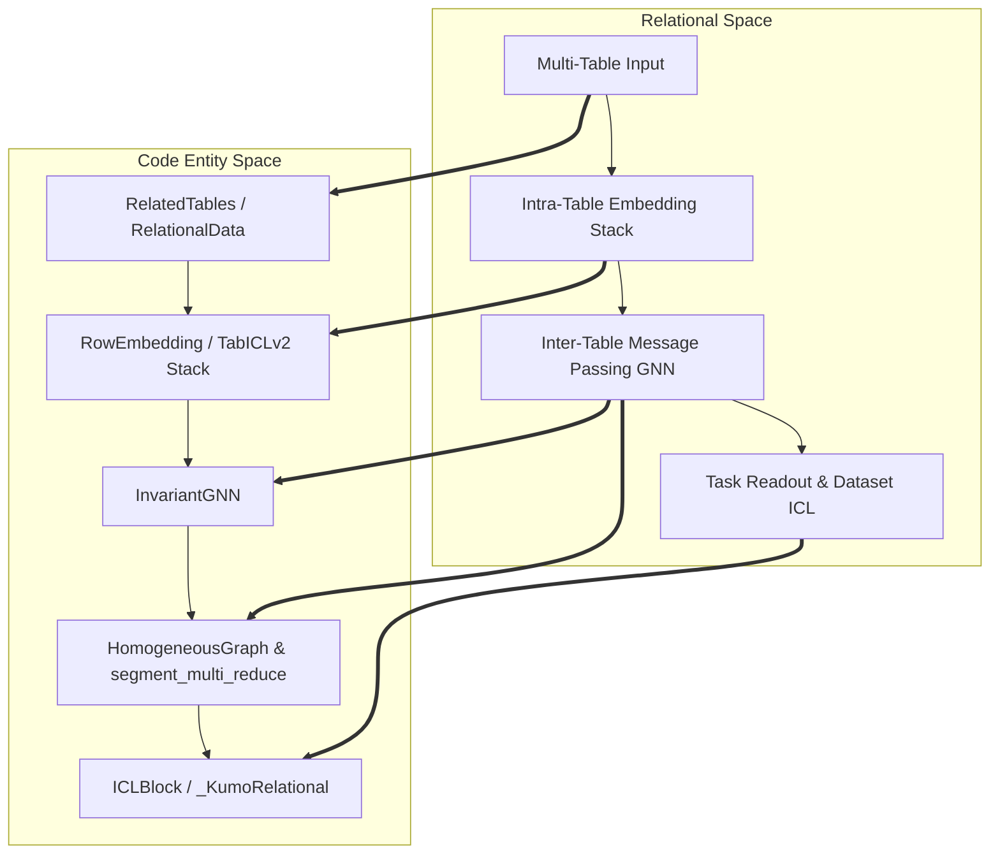
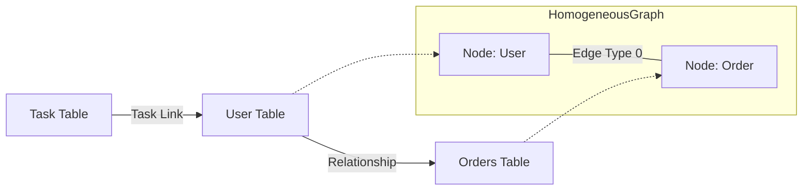
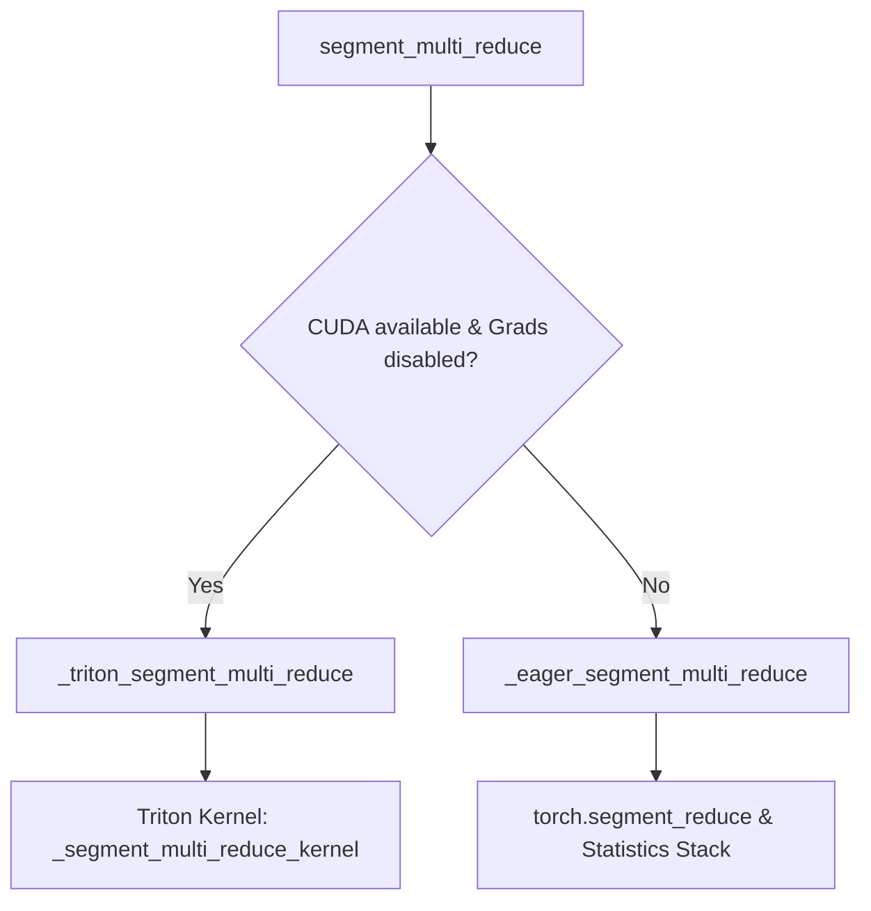

<!-- source: DeepWiki mcp.deepwiki.com · repo NVIDIA/structured-data-models · page 4.4 KumoRelational Model · fetched 2026-10-26 -->

# KumoRelational Model

<details>
<summary>Relevant source files</summary>

The following files were used as context for generating this wiki page:

- [docs/source/_templates/autosummary/model_class.rst](docs/source/_templates/autosummary/model_class.rst)
- [sdm/_kernels/__init__.py](sdm/_kernels/__init__.py)
- [sdm/_kernels/segment_multi_reduce.py](sdm/_kernels/segment_multi_reduce.py)
- [sdm/_kernels/triton/segment_multi_reduce.py](sdm/_kernels/triton/segment_multi_reduce.py)
- [sdm/models/kumo/relational/NOTICE](sdm/models/kumo/relational/NOTICE)
- [sdm/models/kumo/relational/invariant_gnn.py](sdm/models/kumo/relational/invariant_gnn.py)
- [sdm/models/kumo/relational/model.py](sdm/models/kumo/relational/model.py)
- [sdm/models/timesfm3/model.py](sdm/models/timesfm3/model.py)
- [test/_kernels/test_segment_multi_reduce.py](test/_kernels/test_segment_multi_reduce.py)
- [test/models/kumo/relational/test_model.py](test/models/kumo/relational/test_model.py)
- [test/models/timesfm3/test_model.py](test/models/timesfm3/test_model.py)

</details>


## Overview and Purpose

The `KumoRelational` class implements an adapted version of the relational foundation model from the "KumoRFM-2: Scaling Foundation Models for Relational Learning" paper `[sdm/models/kumo/relational/model.py:35-38]()`. It extends tabular in-context learning (ICL) architectures from single tables to multi-table relational inputs. Rather than requiring manual feature engineering, table flattening, or joins, `KumoRelational` directly consumes task tables alongside related context/query tables and structural relationships `[sdm/models/kumo/relational/model.py:48-52]()`.

The architecture executes in three distinct stages:
1. **Intra-table row embeddings**: Each related and task table is embedded independently using a `TabICLv2`-style row embedding stack `[sdm/models/kumo/relational/model.py:56-58]()`. Target information from context rows is distributed over the relational graph `[sdm/models/kumo/relational/model.py:58-60]()`.
2. **Inter-table message passing**: A schema-agnostic graph neural network (`InvariantGNN`) passes messages across row representations along predefined relationships for `num_hops` rounds before reading out rows linked to the task table `[sdm/models/kumo/relational/model.py:61-63]()`.
3. **In-context learning over samples**: Readout embeddings for context and query task rows are processed by a dataset-level `ICLBlock`. Context rows carry target labels, while query rows attend to context rows to produce regression quantiles or classification logits `[sdm/models/kumo/relational/model.py:64-68]()`.

Sources: `sdm/models/kumo/relational/model.py:35-155`

---

## System Architecture and Code Mapping

The following diagram bridges conceptual relational foundation model components to their exact code symbols and classes in the codebase.


*Figure 1: Mapping relational concepts to codebase classes.*

Sources: `sdm/models/kumo/relational/model.py:35-176`, `sdm/models/kumo/relational/invariant_gnn.py:18-122`, `sdm/_kernels/segment_multi_reduce.py:108-142`

---

## Relational Graph Construction and Schema Handling

`KumoRelational` interacts with multi-table schemas via `RelatedTables` and converts table relationships into homogeneous graph structures (`HomogeneousGraph`) suitable for message passing `[test/models/kumo/relational/test_model.py:40-43]`. 

During graph construction, entity tables and foreign-key relationships are mapped into a unified node/edge representation. Task tables link to entity tables via `task_links`, identifying which rows correspond to supervised prediction targets.


*Figure 2: Relational graph mapping from table links to `HomogeneousGraph`.*

Sources: `sdm/models/kumo/relational/invariant_gnn.py:15`, `test/models/kumo/relational/test_model.py:40-62`

---

## InvariantGNN Message Passing

The core inter-table message passing mechanism is implemented by `InvariantGNN` `[sdm/models/kumo/relational/invariant_gnn.py:18]`. It operates on schema-agnostic graphs by computing edge-type embeddings and performing multi-statistic neighborhood aggregation.

### Key Module Parameters & Initializations
- `edge_type_lin`: Linear projection applied to normalized edge type embeddings `[sdm/models/kumo/relational/invariant_gnn.py:36]`.
- `skip_lin` & `src_lin`: Linear transforms for skip connections and source node representations `[sdm/models/kumo/relational/invariant_gnn.py:38-39]`.
- `aggregation_lin`: Maps concatenated multi-statistic reduction outputs back to channel dimensions (`5 * channels -> channels`) `[sdm/models/kumo/relational/invariant_gnn.py:41-46]`.

### Message Passing Forward Pass
In each hop iteration, `InvariantGNN` calls `segment_multi_reduce` to gather neighborhood statistics (total, mean, standard deviation, minimum, and maximum) across relational edges `[sdm/models/kumo/relational/invariant_gnn.py:100-106]`:

```python
stats = segment_multi_reduce(
    src=self.src_lin(x),
    index=graph.row,
    edge_attr=edge_type_emb,
    offsets=graph.colptr,
    edge_type=graph.edge_type,
)
```
`[sdm/models/kumo/relational/invariant_gnn.py:100-106]()`

Sources: `sdm/models/kumo/relational/invariant_gnn.py:18-122`, `sdm/_kernels/segment_multi_reduce.py:108-142`

---

## Triton Kernel Optimization: `segment_multi_reduce`

To accelerate multi-table relational graph reduction on GPUs, `sdm` provides a Triton-accelerated custom kernel (`_segment_multi_reduce_kernel`) with an eager PyTorch fallback (`_eager_segment_multi_reduce`) `[sdm/_kernels/segment_multi_reduce.py:10-141]()`.


*Figure 3: Execution dispatch for `segment_multi_reduce`.*

The kernel computes five simultaneous reduction statistics per channel:
1. `total` (Sum) `[sdm/_kernels/triton/segment_multi_reduce.py:58]()`
2. `mean` (`total / divisor`) `[sdm/_kernels/triton/segment_multi_reduce.py:67]()`
3. `std` (Clamped standard deviation) `[sdm/_kernels/triton/segment_multi_reduce.py:70-74]()`
4. `minimum` (Infs clamped to `0.0`, NaNs preserved) `[sdm/_kernels/triton/segment_multi_reduce.py:77-80]()`
5. `maximum` (Infs clamped to `0.0`, NaNs preserved) `[sdm/_kernels/triton/segment_multi_reduce.py:77-80]()`

Sources: `sdm/_kernels/triton/segment_multi_reduce.py:14-106`, `sdm/_kernels/segment_multi_reduce.py:108-142`

---

## Multi-Table Row Embeddings and Inference Lifecycle

`KumoRelational` supports standard `fit` and `predict` workflows as well as end-to-end `forward` calls with optional caching `[sdm/models/kumo/relational/model.py:123-138]()`.

- **Caching (`Cache`)**: During inference, edge type embeddings and intermediate table graph structures can be recorded and replayed using `Cache` objects to avoid redundant computations across evaluation steps `[sdm/models/kumo/relational/invariant_gnn.py:85-98]()`.
- **Task Support**: Supports `Task.classification` (with 10-class outputs and norm bias) and `Task.regression` (with 999 quantile heads) `[sdm/models/kumo/relational/model.py:166-169]()`.

Sources: `sdm/models/kumo/relational/model.py:35-176`, `sdm/models/kumo/relational/invariant_gnn.py:85-98`

---

