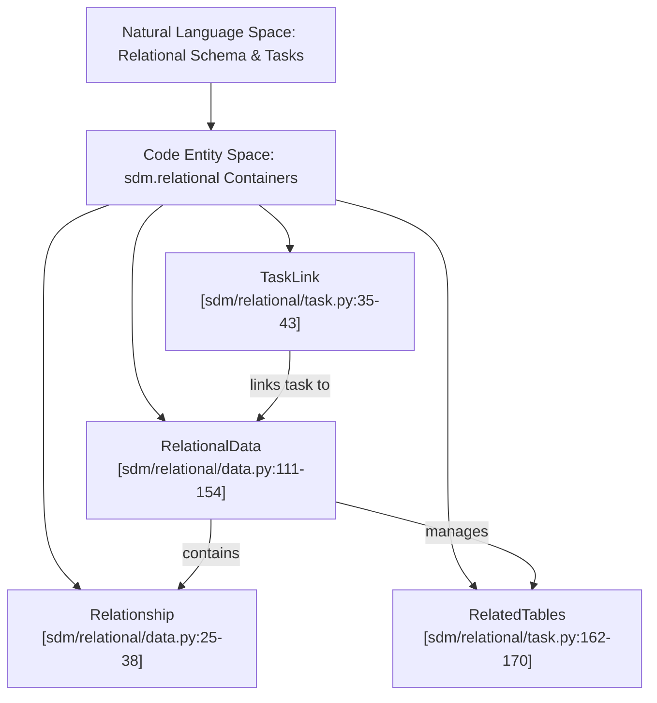
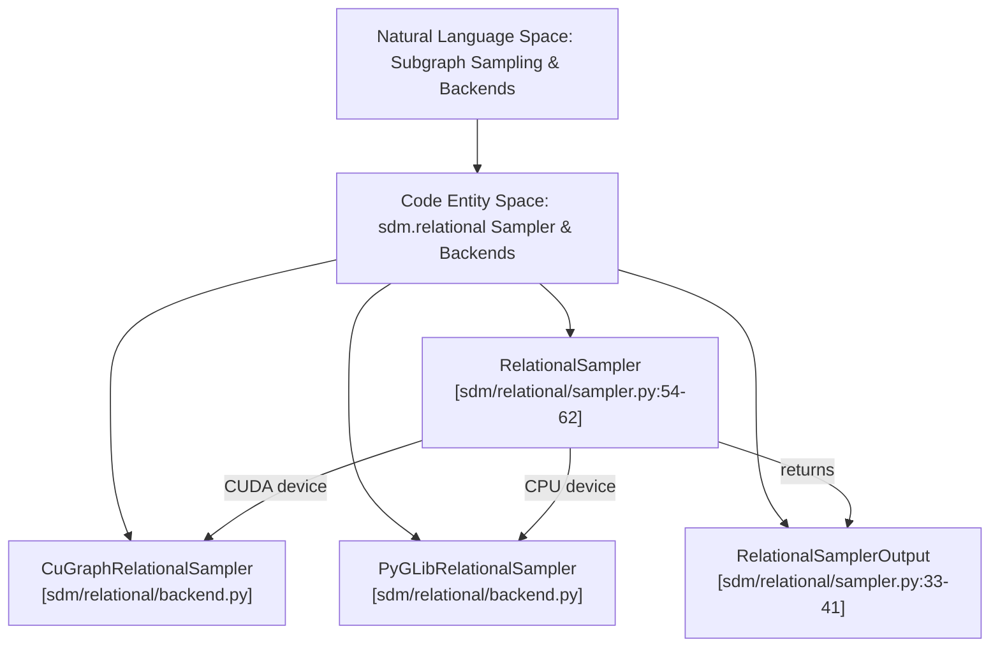

<!-- source: DeepWiki mcp.deepwiki.com · repo NVIDIA/structured-data-models · page 5 Relational Data Subsystem · fetched 2026-10-26 -->

# Relational Data Subsystem

Relevant source files

The following files were used as context for generating this wiki page:

- [sdm/relational/data.py](sdm/relational/data.py)
- [sdm/relational/sampler.py](sdm/relational/sampler.py)
- [sdm/relational/task.py](sdm/relational/task.py)
- [test/relational/test_data.py](test/relational/test_data.py)
- [test/relational/test_sampler.py](test/relational/test_sampler.py)

The relational data subsystem (`sdm.relational`) provides foundational abstractions for managing multi-table relational databases, foreign-key relationships, predictive task specifications, and GPU-accelerated subgraph sampling. It bridges traditional relational database schemas with tensor-based deep learning pipelines, allowing models like `KumoRelational` [sdm/relational/data.py:111-154] to operate natively on interconnected tables.

This is a parent page providing a high-level overview of the subsystem. For deeper technical details, refer to the child pages:
- [Relational Data and Tasks](#5.1)
- [Neighbor Sampling and Backends](#5.2)

---

## 5.1. Relational Data and Tasks

The data and task layer defines how multi-table relational schemas, foreign-key join relationships, and prediction task links are represented as structured metadata and tensors. 

Collections of named `TableTensor` instances and their join constraints are managed by `RelationalData` [sdm/relational/data.py:111-154]. Relationships between tables are declared using `Relationship` objects [sdm/relational/data.py:25-38], which specify directed foreign-key or primary-key join columns across table boundaries.

Prediction tasks are defined via `TaskLink` [sdm/relational/task.py:35-43], mapping rows in a task-specific query table to target rows in the broader relational database graph. Related context tables sampled for specific task rows are encapsulated in `RelatedTables` and their corresponding schema containers `RelatedTablesSchema` [sdm/relational/task.py:116-128].

For complete details on schema containers, constraint validations, join definitions, and task specifications, see [Relational Data and Tasks](#5.1).

*Sources: [sdm/relational/data.py:25-154](), [sdm/relational/task.py:35-170]()*

---

## 5.2. Neighbor Sampling and Backends

To extract localized relational context for mini-batches of prediction targets, the subsystem implements multi-hop subgraph neighbor sampling via `RelationalSampler` [sdm/relational/sampler.py:54-62]. 

The sampler supports temporal constraints (ensuring time-aware sampling where historical rows precede query timestamps) and multiple temporal strategies such as `"last"` or `"uniform"` [sdm/relational/sampler.py:118-123]. Depending on the compute device, `RelationalSampler` automatically dispatches execution to backend-specific samplers: `PyGLibRelationalSampler` on CPU or `CuGraphRelationalSampler` on CUDA [sdm/relational/sampler.py:81-84]. Join and index utilities support these operations across device boundaries [test/relational/test_data.py:47-67].

For detailed information on sampler implementations, backend parity tests, and join utilities, see [Neighbor Sampling and Backends](#5.2).

*Sources: [sdm/relational/sampler.py:33-85](), [test/relational/test_sampler.py:23-37]()*

---

