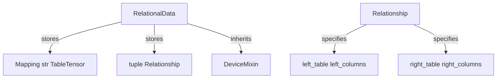
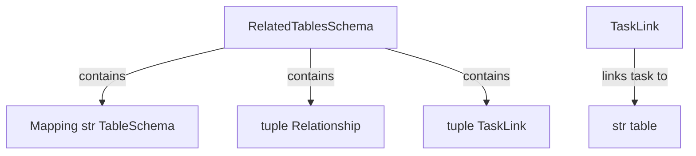
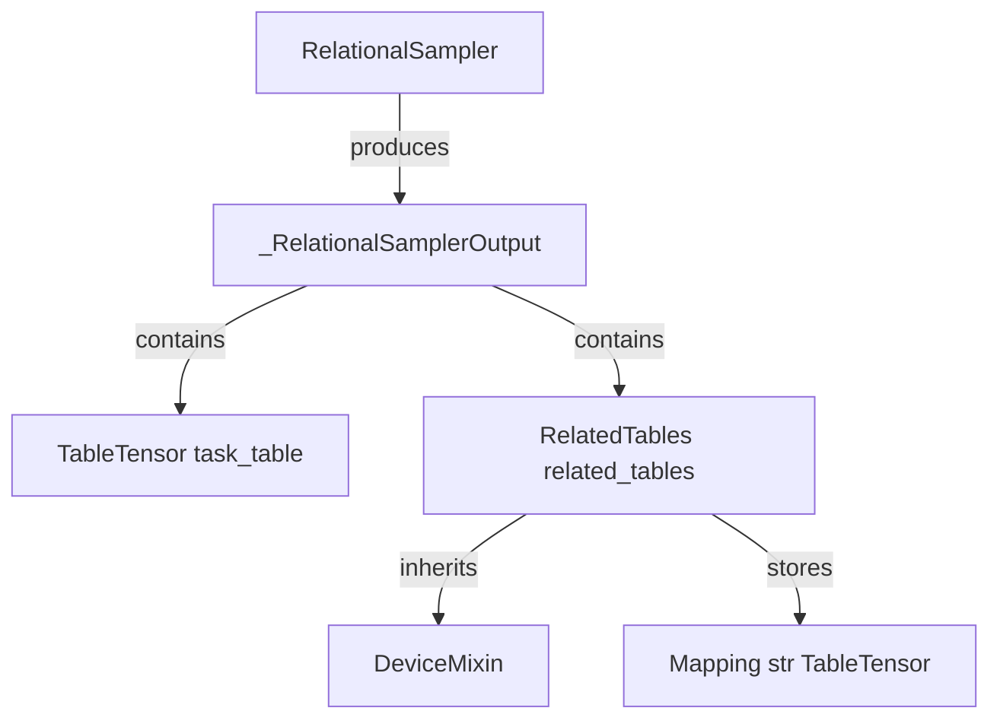

<!-- source: DeepWiki mcp.deepwiki.com · repo NVIDIA/structured-data-models · page 5.1 Relational Data and Tasks · fetched 2026-10-26 -->

# Relational Data and Tasks

Relevant source files

The following files were used as context for generating this wiki page:

- [sdm/relational/data.py](sdm/relational/data.py)
- [sdm/relational/sampler.py](sdm/relational/sampler.py)
- [sdm/relational/task.py](sdm/relational/task.py)
- [test/relational/test_data.py](test/relational/test_data.py)
- [test/relational/test_sampler.py](test/relational/test_sampler.py)

This page covers the data and schema containers, foreign key/relationship definitions, task links, and predictive task specifications implemented in `sdm/relational/data.py` and `sdm/relational/task.py`. These modules form the foundation for multi-table relational data management and subgraph/task querying within the `sdm` relational subsystem.

---

## 1. Relational Data Containers (`RelationalData` and `Relationship`)

Multi-table relational databases in `sdm` are represented using collections of named `TableTensor` instances tied together via explicit join relationships.

### `Relationship`
The `Relationship` dataclass defines a join condition or foreign key link between a left table and a right table [sdm/relational/data.py:25-39](). It enforces that join columns are non-empty, have matching lengths, and do not collide with internal reserved row indexing identifiers such as `LEFT_ROW_ID` or `RIGHT_ROW_ID` [sdm/relational/data.py:40-60]().

Constructors like `Relationship.from_mapping()` parse dictionary-based relationship specifications into strict tuples of column names [sdm/relational/data.py:62-95]().

### `RelationalData`
The `RelationalData` class inherits from `DeviceMixin` and acts as the central container for a relational database schema and its underlying data [sdm/relational/data.py:110-112](). It takes a mapping of table names to 2D `TableTensor` objects and a collection of `Relationship` constraints [sdm/relational/data.py:147-160]().

During initialization, `RelationalData.__post_init__()` validates that:
- Every table is strictly two-dimensional [sdm/relational/data.py:174-177]().
- All referenced tables in relationships exist within the data container [sdm/relational/data.py:179-187]().
- All columns participating in relationships carry the semantic type `Stype.id` [sdm/relational/data.py:188-193]().

Sources: [sdm/relational/data.py:25-193]()

---

## 2. Task Links and Schemas (`TaskLink` and `RelatedTablesSchema`)

To execute predictive tasks over relational data, models require explicit mappings between task prediction rows and entity tables in the database.

### `TaskLink`
The `TaskLink` dataclass specifies how rows in a task table map to columns in a target relational table [sdm/relational/task.py:35-48](). Similar to `Relationship`, it validates column lengths, non-emptiness, and exclusion of reserved internal index names [sdm/relational/task.py:49-69](). `TaskLink.from_mapping()` facilitates dictionary or configuration-based instantiation [sdm/relational/task.py:71-100]().

### `RelatedTablesSchema`
The `RelatedTablesSchema` dataclass captures the structural schema of a subgraph associated with a task [sdm/relational/task.py:115-128](). It holds:
- `tables`: A mapping of table names to `TableSchema` definitions [sdm/relational/task.py:125]().
- `relationships`: A tuple of internal `Relationship` definitions [sdm/relational/task.py:126]().
- `task_links`: A tuple of `TaskLink` specifications [sdm/relational/task.py:127]().

It provides helper methods such as `is_subset_of()` to verify structural inclusion and hash support for caching graph contexts [sdm/relational/task.py:129-158]().

Sources: [sdm/relational/task.py:35-160]()

---

## 3. Task Context and Related Tables (`RelatedTables`)

The `RelatedTables` class manages task-specific relational contexts attached directly to model inputs [sdm/relational/task.py:162-169]().

### Implementation Details
`RelatedTables` inherits from `DeviceMixin` and is generic over table container types (`TableTensor` or `EnsembleTable`) [sdm/relational/task.py:162](). It stores sampled subgraphs or neighbor neighborhoods retrieved via sampling pipelines (such as those in `sdm/relational/sampler.py`), bridging seed prediction instances to their broader relational database neighborhood.

Sources: [sdm/relational/sampler.py:28-53](), [sdm/relational/task.py:162-202]()

---

