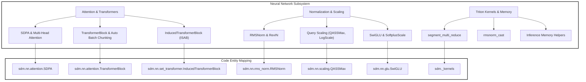
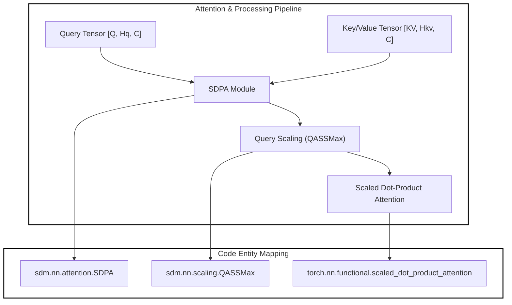

<!-- source: DeepWiki mcp.deepwiki.com · repo NVIDIA/structured-data-models · page 6 Neural Network Building Blocks · fetched 2026-10-26 -->

# Neural Network Building Blocks

Relevant source files

The following files were used as context for generating this wiki page:

- [sdm/nn/__init__.py](sdm/nn/__init__.py)
- [sdm/nn/attention.py](sdm/nn/attention.py)
- [sdm/nn/rope.py](sdm/nn/rope.py)
- [sdm/nn/scaling.py](sdm/nn/scaling.py)
- [sdm/nn/set_transformer.py](sdm/nn/set_transformer.py)
- [test/nn/test_attention.py](test/nn/test_attention.py)
- [test/nn/test_compile.py](test/nn/test_compile.py)
- [test/nn/test_rope.py](test/nn/test_rope.py)
- [test/nn/test_scaling.py](test/nn/test_scaling.py)
- [test/nn/test_set_transformer.py](test/nn/test_set_transformer.py)

## Purpose and Scope

The `sdm.nn` module provides specialized neural network building blocks designed specifically for GPU-native foundation models handling tabular, relational, and time-series data. This subsystem implements attention mechanisms, scalable transformers, set-transformer blocks, normalization layers, custom activation functions, query-scaling modules, and memory utilities backed by optimized PyTorch primitives and custom Triton kernels.

As a parent page, this document outlines the high-level architecture of `sdm.nn` and its integration with custom acceleration layers. For detailed specifications, refer to the child pages:
- [Attention, Transformers and Set Transformers](#6.1)
- [Normalization, Activations and Linear Layers](#6.2)
- [Triton Kernels and Memory Utilities](#6.3)

---

## Architecture Overview

The neural network subsystem bridges raw columnar tensor representations with deep sequence-modeling operations (such as in-context learning and graph message passing). The module exports core components through `sdm.nn`, which are assembled into foundation model architectures across tabular, time-series, and relational tasks [sdm/nn/__init__.py:1-32]().

Sources: [sdm/nn/__init__.py:1-32](), [sdm/nn/attention.py:19-63](), [sdm/nn/set_transformer.py:18-56]()

---

## 6.1 Attention, Transformers and Set Transformers

Attention mechanisms in `sdm` extend standard scaled dot-product attention to support grouped-query attention (GQA), multi-query attention (MQA), custom query scaling, dynamic sequence length masks, and automatic batch chunking for memory efficiency.

- **`SDPA`**: Wraps PyTorch's scaled dot-product attention with support for arbitrary batch dimensions, KV length masking (`seqused_key_value`), and query scaling [sdm/nn/attention.py:19-39]().
- **`TransformerBlock`**: Combines attention and feed-forward layers with normalization options and auto-batch chunking limits [test/nn/test_attention.py:13-19]().
- **`InducedTransformerBlock`**: Implements induced set attention blocks (ISAB) using learned inducing points to reduce attention complexity from $O(Q \cdot K)$ to $O((Q + K) \cdot M)$ [sdm/nn/set_transformer.py:18-36]().
- **`RotaryEmbedding`**: Implements Rotary Positional Embedding (RoPE) with support for both `"split_half"` and `"interleaved"` layouts [sdm/nn/rope.py:12-28]().

For detailed specifications, see [Attention, Transformers and Set Transformers](#6.1).

Sources: [sdm/nn/attention.py:19-94](), [sdm/nn/set_transformer.py:18-67](), [sdm/nn/rope.py:12-39]()

---

## 6.2 Normalization, Activations and Linear Layers

To stabilize training and scale effectively across wide tabular and time-series foundation models, `sdm.nn` implements robust normalization and activation primitives.

- **`RMSNorm`**: Root Mean Square Layer Normalization optimized for high-throughput GPU execution.
- **`SwiGLU`**: Swish-Gated Linear Unit activation block [sdm/nn/__init__.py:8]().
- **`RevIN`**: Reversible Instance Normalization for time-series forecasting and distribution shift mitigation [sdm/nn/__init__.py:11]().
- **`QASSMax` & `LogScale`**: Query-Aware Scalable SoftMax and logarithmic query scaling modules designed to counteract attention fading as context lengths grow [sdm/nn/scaling.py:53-154]().
- **`SinusoidalEmbedding`**: Generates sinusoidal positional and temporal encodings [sdm/nn/__init__.py:7]().

For detailed specifications, see [Normalization, Activations and Linear Layers](#6.2).

Sources: [sdm/nn/__init__.py:6-12](), [sdm/nn/scaling.py:53-154]()

---

## 6.3 Triton Kernels and Memory Utilities

Custom Triton kernels in `sdm/_kernels` accelerate specialized operations that lack direct, high-performance equivalents in standard PyTorch toolchains.

- **`segment_multi_reduce`**: Optimized Triton implementation for segmented reduction operations over variable-length tabular segments and relational graph neighborhoods.
- **`rmsnorm_cast`**: Fused RMSNorm and type-casting kernel to minimize memory bandwidth overhead during mixed-precision training.
- **Memory Helpers**: Inference-time utilities (`sdm/_memory`) managing chunk size limits and KV-cache allocations [sdm/nn/attention.py:14]().

For detailed specifications, see [Triton Kernels and Memory Utilities](#6.3).

Sources: [sdm/nn/attention.py:14]()

---

