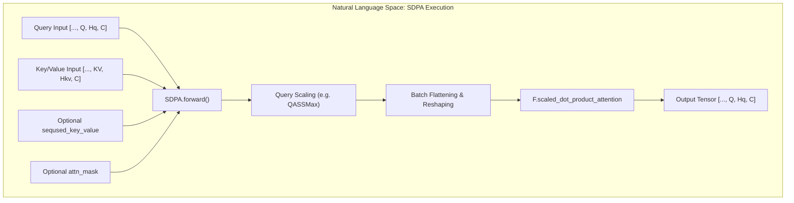
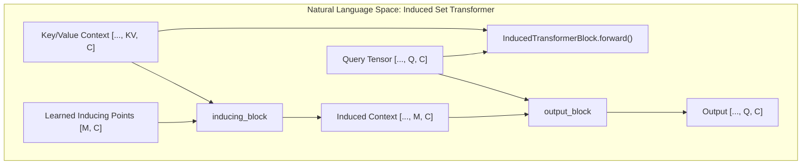
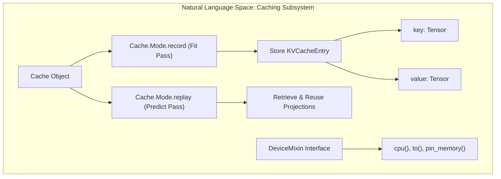

<!-- source: DeepWiki mcp.deepwiki.com · repo NVIDIA/structured-data-models · page 6.1 Attention, Transformers and Set Transformers · fetched 2026-10-26 -->

# Attention, Transformers and Set Transformers

Relevant source files

The following files were used as context for generating this wiki page:

- [sdm/cache.py](sdm/cache.py)
- [sdm/nn/attention.py](sdm/nn/attention.py)
- [sdm/nn/rope.py](sdm/nn/rope.py)
- [sdm/nn/set_transformer.py](sdm/nn/set_transformer.py)
- [test/nn/test_attention.py](test/nn/test_attention.py)
- [test/nn/test_compile.py](test/nn/test_compile.py)
- [test/nn/test_rope.py](test/nn/test_rope.py)
- [test/nn/test_set_transformer.py](test/nn/test_set_transformer.py)
- [test/test_cache.py](test/test_cache.py)

## Purpose and Scope

This page details the implementation of neural network attention mechanisms, Transformer building blocks, set transformers, positional embeddings, and key-value caching infrastructure located in `sdm.nn` and `sdm.cache`. These modules provide GPU-native primitives optimized for structured, relational, and time-series data foundation models.

---

## 1. Scaled Dot-Product Attention (`SDPA`)

The `SDPA` class in `sdm/nn/attention.py` wraps PyTorch's scaled dot-product attention and extends it to support arbitrary batch dimensions, grouped-query/multi-query attention, query scaling, and sequence length padding.

*Sources: [sdm/nn/attention.py:19-161](), [test/nn/test_attention.py:70-212]()*

### Key Parameters and Behavior
- **`num_query_heads`**: Number of query attention heads (`int`) [sdm/nn/attention.py:27-43]().
- **`num_key_value_heads`**: Number of key/value heads (`int | None`). When less than `num_query_heads`, enables Grouped-Query Attention (GQA); setting it to `1` enables Multi-Query Attention (MQA) [sdm/nn/attention.py:28-32](). Must divide `num_query_heads` [sdm/nn/attention.py:52-56]().
- **`query_scaling`**: Optional scaling module like `QASSMax` applied to queries prior to attention [sdm/nn/attention.py:33-34, 60]().
- **`seqused_key_value`**: Tensor of shape `[...]` with `torch.int32` dtype specifying valid key/value sequence lengths per batch element [sdm/nn/attention.py:69, 85-86]().

Sources: [sdm/nn/attention.py:19-161](), [test/nn/test_attention.py:70-212]()

---

## 2. Set Transformers and Induced Attention (`InducedTransformerBlock`)

The `InducedTransformerBlock` class in `sdm/nn/set_transformer.py` implements set transformers using learned inducing points. This reduces attention cost from $O(Q \cdot K)$ to $O((Q + K) \cdot M)$ over $M$ inducing points [sdm/nn/set_transformer.py:18-36]().

*Sources: [sdm/nn/set_transformer.py:18-162](), [test/nn/test_set_transformer.py:13-64]()*

### Execution Flow
1. **Inducing Block**: Updates learned `inducing_points` parameters using the key/value context or self-attention [sdm/nn/set_transformer.py:63-66, 149-155]().
2. **Output Block**: Computes cross-attention between input `query` and the updated inducing points [sdm/nn/set_transformer.py:156-162]().
3. **Caching**: Supports returning key-value projections via `KVCacheEntry` for fast inference replaying [sdm/nn/set_transformer.py:133-143, 159]().

Sources: [sdm/nn/set_transformer.py:18-162](), [test/nn/test_set_transformer.py:13-64]()

---

## 3. Rotary Positional Embeddings (`RotaryEmbedding`)

The `RotaryEmbedding` class in `sdm/nn/rope.py` implements Rotary Positional Embeddings (RoPE) [sdm/nn/rope.py:12-16]().

### Layouts and Parameters
- **`layout`**: Determines pairing strategy (`"split_half"` or `"interleaved"`) [sdm/nn/rope.py:33]().
- **`theta`**: Base frequency for inverse frequencies (default `100_000`) [sdm/nn/rope.py:34]().
- **`partial_rotary_factor`**: Fraction of leading channels to which RoPE is applied [sdm/nn/rope.py:36]().

Sources: [sdm/nn/rope.py:12-107](), [test/nn/test_rope.py:14-88]()

---

## 4. Key-Value Caching (`KVCacheEntry` and `Cache`)

The caching infrastructure in `sdm/cache.py` manages precomputed key-value projections and state across fit and predict cycles.

*Sources: [sdm/cache.py:25-163](), [test/test_cache.py:13-47]()*

### Core Classes
- **`KVCacheEntry`**: Inherits from `_KVCacheEntry` (named tuple) and `DeviceMixin`. Stores cached `key` and `value` tensors and supports recursive device movement and tensor transformations [sdm/cache.py:20-39]().
- **`Cache`**: A mutable mapping implementing recording and replaying modes for model inference acceleration [sdm/cache.py:41-163]().

Sources: [sdm/cache.py:25-163](), [test/test_cache.py:13-47]()

---

