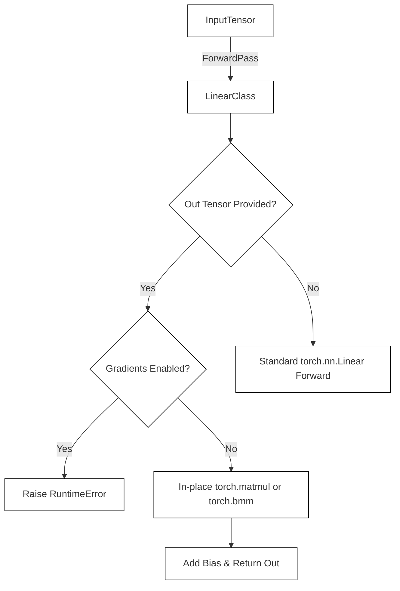
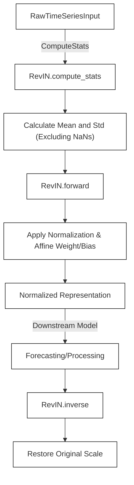
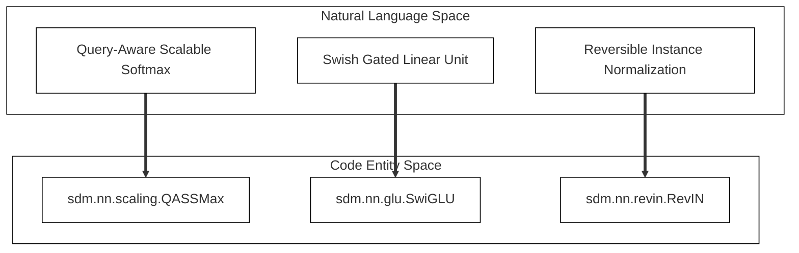

<!-- source: DeepWiki mcp.deepwiki.com · repo NVIDIA/structured-data-models · page 6.2 Normalization, Activations and Linear Layers · fetched 2026-10-26 -->

# Normalization, Activations and Linear Layers

Relevant source files

The following files were used as context for generating this wiki page:

- [sdm/models/timesfm3/util.py](sdm/models/timesfm3/util.py)
- [sdm/nn/__init__.py](sdm/nn/__init__.py)
- [sdm/nn/_buffer.py](sdm/nn/_buffer.py)
- [sdm/nn/glu.py](sdm/nn/glu.py)
- [sdm/nn/linear.py](sdm/nn/linear.py)
- [sdm/nn/revin.py](sdm/nn/revin.py)
- [sdm/nn/scaling.py](sdm/nn/scaling.py)
- [test/models/timesfm3/test_util.py](test/models/timesfm3/test_util.py)
- [test/nn/test_buffer.py](test/nn/test_buffer.py)
- [test/nn/test_glu.py](test/nn/test_glu.py)
- [test/nn/test_linear.py](test/nn/test_linear.py)
- [test/nn/test_revin.py](test/nn/test_revin.py)
- [test/nn/test_scaling.py](test/nn/test_scaling.py)

This section covers the specialized neural network building blocks implemented in `sdm.nn` and related model utilities for structured data, tabular, and time-series architectures. These components include custom linear layers with pre-allocated output buffers, stateful buffer lists (`BufferList`), reversible instance normalization (`RevIN`), feed-forward activation layers (`SwiGLU`), query scaling methods (`QASSMax`, `LogScale`, `GatedLogScale`), and time-series patch execution utilities.

---

## 1. Linear Layers and Stateful Buffers

The library extends standard PyTorch modules to support high-performance operations, including in-place output tensor routing for inference and ordered tracking of tensor subclasses in state dictionaries.

### `Linear` Module
The `Linear` class inherits from `torch.nn.Linear` and overrides `forward` to accept an optional pre-allocated `out` tensor [sdm/nn/linear.py:12-18](). When gradients are disabled (`torch.is_grad_enabled() == False`), it performs matrix multiplications directly into the provided `out` buffer using either `torch.matmul` for 2D inputs or `torch.bmm` for multi-dimensional batched inputs [sdm/nn/linear.py:22-42]().

### `BufferList` Module
`BufferList` manages an ordered collection of tensors or nested `BufferList` instances registered as PyTorch module buffers [sdm/nn/_buffer.py:15-32](). It customizes state dictionary loading (`_load_from_state_dict` and `get_extra_state`) to support tensor subclasses, dynamic shape materialization, and recursive device or dtype migration across nested topologies [sdm/nn/_buffer.py:33-91]().

*Figure 1: Execution flow of the customized `Linear` forward method with optional `out` tensor buffer routing.*

Sources: `sdm/nn/linear.py`, `sdm/nn/_buffer.py`

---

## 2. Normalization Layers: RMSNorm and RevIN

Normalization layers in `sdm.nn` stabilize deep architectures and handle distribution shifts, particularly in time-series and tabular sequence models.

### Reversible Instance Normalization (`RevIN`)
`RevIN` implements reversible instance normalization for time-series forecasting to mitigate distribution shifts [sdm/nn/revin.py:10-14](). 
- `compute_stats()` computes the mean and standard deviation over the final dimension, optionally masking out invalid or missing values (`NaN` entries) [sdm/nn/revin.py:44-68]().
- `forward()` normalizes input tensors `[..., C, R]` using the computed statistics and applies optional learned affine parameters (`weight` and `bias`) [sdm/nn/revin.py:70-81]().
- `inverse()` reverses the normalization transformation to map normalized predictions back to the original data distribution scale [sdm/nn/revin.py:83-94]().

*Figure 2: Natural language to code entity mapping for Reversible Instance Normalization (`RevIN`).*

Sources: `sdm/nn/revin.py`, `sdm/nn/__init__.py`

---

## 3. Activation and Query Scaling Layers

### `SwiGLU` Activation
`SwiGLU` implements the Swish-gated linear unit feed-forward network block [sdm/nn/glu.py:29-31](). It applies an up-projection (`up_lin`), a gate projection combined with a silu activation (`gate_lin` and `F.silu`), multiplies the results element-wise, and passes them through a down-projection (`down_lin`) [sdm/nn/glu.py:60-78]().

### Query Scaling Modules (`QASSMax`, `LogScale`, `GatedLogScale`)
Query scaling modules inherit from `QueryScaling` and adapt attention query projections based on key sequence lengths [sdm/nn/scaling.py:16-23]().
- `QASSMax` (Query-Aware Scalable SoftMax) computes temperature-scaling factors using an MLP over log key lengths and a query-dependent gating mechanism to prevent attention fading as keys grow [sdm/nn/scaling.py:53-131]().
- `LogScale` scales queries logarithmically using learned per-head coefficients [sdm/nn/scaling.py:133-181]().
- `GatedLogScale` combines logarithmic key scaling with a gating network.

*Figure 3: Bridging natural language concepts to `sdm.nn` classes for scaling, activations, and normalization.*

Sources: `sdm/nn/scaling.py`, `sdm/nn/glu.py`, `sdm/nn/revin.py`

---

## 4. Time-Series Patching and Statistics Utilities

Time-series architectures (such as TimesFM3) rely on tensor manipulation utilities located in `sdm.models.timesfm3.util` to manage patch rolling, running statistical updates, and overlapping patch blending [sdm/models/timesfm3/util.py:22-171]().

| Function Name | File Path and Line Range | Description |
| :--- | :--- | :--- |
| `update_running_stats` | `sdm/models/timesfm3/util.py:22-61` | Computes incremental count, mean, and standard deviation for new time-series patches while excluding masked invalid entries. |
| `get_running_stats` | `sdm/models/timesfm3/util.py:64-98` | Iterates across all patches to compute cumulative count, mean, and standard deviation tensors. |
| `gather_future_patches` | `sdm/models/timesfm3/util.py:101-128` | Gathers and rolls future patches across a sequence length with a broadcastable invalid-value mask. |
| `crossfade_patches` | `sdm/models/timesfm3/util.py:130-172` | Merges overlapping patches into a single continuous sequence by linearly interpolating overlapping regions. |

Sources: `sdm/models/timesfm3/util.py`

---

