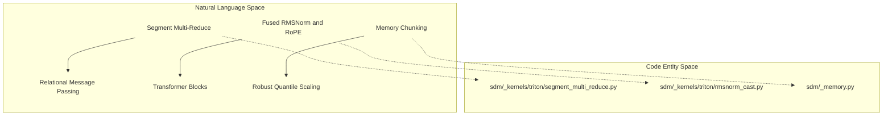
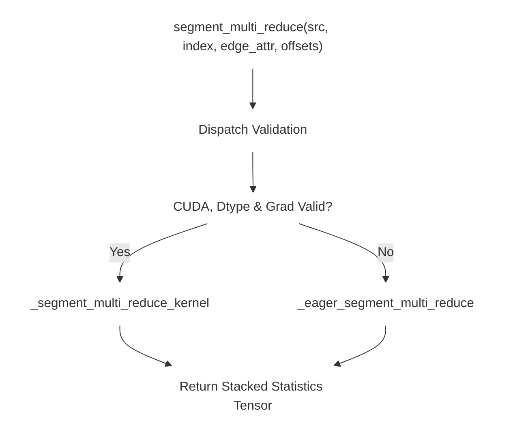

<!-- source: DeepWiki mcp.deepwiki.com · repo NVIDIA/structured-data-models · page 6.3 Triton Kernels and Memory Utilities · fetched 2026-10-26 -->

# Triton Kernels and Memory Utilities

Relevant source files

The following files were used as context for generating this wiki page:

- [sdm/_inference.py](sdm/_inference.py)
- [sdm/_kernels/__init__.py](sdm/_kernels/__init__.py)
- [sdm/_kernels/rmsnorm_cast.py](sdm/_kernels/rmsnorm_cast.py)
- [sdm/_kernels/segment_multi_reduce.py](sdm/_kernels/segment_multi_reduce.py)
- [sdm/_kernels/triton/__init__.py](sdm/_kernels/triton/__init__.py)
- [sdm/_kernels/triton/rmsnorm_cast.py](sdm/_kernels/triton/rmsnorm_cast.py)
- [sdm/_kernels/triton/segment_multi_reduce.py](sdm/_kernels/triton/segment_multi_reduce.py)
- [sdm/_memory.py](sdm/_memory.py)
- [sdm/models/kumo/relational/invariant_gnn.py](sdm/models/kumo/relational/invariant_gnn.py)
- [sdm/nn/rms_norm.py](sdm/nn/rms_norm.py)
- [sdm/processing/numerical/robust_scale.py](sdm/processing/numerical/robust_scale.py)
- [test/_kernels/test_rmsnorm_cast.py](test/_kernels/test_rmsnorm_cast.py)
- [test/_kernels/test_segment_multi_reduce.py](test/_kernels/test_segment_multi_reduce.py)
- [test/models/kumo/relational/test_model.py](test/models/kumo/relational/test_model.py)
- [test/nn/test_rms_norm.py](test/nn/test_rms_norm.py)
- [test/processing/numerical/test_robust_scale.py](test/processing/numerical/test_robust_scale.py)

## Purpose and Scope
This page documents the high-performance custom Triton kernels, dispatch wrappers, and memory/inference helper utilities located under `sdm/_kernels`, `sdm/_memory.py`, and `sdm/_inference.py`. These components provide accelerated CUDA execution for sparse segment operations, fused normalization/rotation layers, and tensor chunking controls designed for GPU-native tabular and relational workloads.

---

## 1. Triton Kernels Subsystem Overview
The `sdm/_kernels` package delivers specialized GPU primitives for operations that lack efficient native coverage or require fusion to prevent memory bandwidth bottlenecks. 

*Figure 1: Bridging Natural Language Concepts to Triton and Memory Code Entities.*

Sources: `sdm/_kernels/__init__.py:1-10`(), `sdm/_kernels/triton/segment_multi_reduce.py:1-174`(), `sdm/_kernels/triton/rmsnorm_cast.py:1-137`()

---

## 2. Segment Multi-Reduce (`segment_multi_reduce`)
The `segment_multi_reduce` operation computes five simultaneous statistical aggregations (`total`, `mean`, `std`, `minimum`, `maximum`) over ragged segments or graph neighborhoods. It is heavily utilized by message-passing layers like `InvariantGNN` [sdm/models/kumo/relational/invariant_gnn.py:100-106]().

### Triton Implementation
The kernel `_segment_multi_reduce_kernel` iterates over edges belonging to each segment/node offset, accumulating running sums, squared sums, minimums, maximums, and NaN flags [sdm/_kernels/triton/segment_multi_reduce.py:14-106]().

*Figure 2: Execution Flow for Segment Multi-Reduce.*

Sources: `sdm/_kernels/triton/segment_multi_reduce.py:14-174`(), `sdm/_kernels/segment_multi_reduce.py:26-142`()

---

## 3. RMSNorm with Fused Cast (`rmsnorm_cast`)
`rmsnorm_cast` performs Root Mean Square Normalization with optional Rotary Position Embedding (RoPE) and type casting in a single fused Triton kernel execution (`_rmsnorm_cast_kernel`) [sdm/_kernels/triton/rmsnorm_cast.py:44-99]().

### Implementation Details
- **Input Loading & RoPE**: `_load_input` fetches features and optionally applies split-half RoPE rotations on-the-fly using precomputed cosine and sine tables [sdm/_kernels/triton/rmsnorm_cast.py:12-41]().
- **Variance Accumulation**: Computes sum of squares across channel groups using `tl.fma` and warp reductions [sdm/_kernels/triton/rmsnorm_cast.py:63-82]().
- **Normalization & Scaling**: Scales inputs by inverse root mean square and applies optional affine weight vectors [sdm/_kernels/triton/rmsnorm_cast.py:84-98]().

Sources: `sdm/_kernels/triton/rmsnorm_cast.py:1-137`()

---

## 4. Dispatch Wrappers and Fallbacks
Both Triton kernels provide Python wrapper functions that validate tensor properties (such as device placement, contiguity, and supported dtypes like `torch.float16`, `torch.bfloat16`, and `torch.float32`) and fall back to pure PyTorch eager implementations (`_eager_segment_multi_reduce` or PyTorch functional equivalents) when gradients are enabled or Triton requirements are unmet [sdm/_kernels/segment_multi_reduce.py:89-141](), [sdm/_kernels/rmsnorm_cast.py:92]().

Sources: `sdm/_kernels/segment_multi_reduce.py:26-142`(), `sdm/_kernels/rmsnorm_cast.py:101-137`()

---

## 5. Memory and Inference Utilities
The library provides helper functions in `sdm/_memory.py` and `sdm/_inference.py` to manage accelerator allocations and autograd context.

### Key Functions
- `set_pinned_max_round_threshold(mb, force)`: Adjusts process-wide rounding thresholds for pinned host memory allocations in PyTorch [sdm/_memory.py:9-36]().
- `chunk_memory_limit(device)`: Calculates the byte capacity of a single processing chunk based on `SDM_CHUNK_MEMORY_FRACTION` (default `0.05`) and total device memory [sdm/_memory.py:38-48]().
- `split_size(num_items, item_bytes, device)`: Determines balanced partition sizes for independent column chunks to prevent Out-Of-Memory (OOM) errors during heavy operations like quantile computations [sdm/_memory.py:51-63](), [sdm/processing/numerical/robust_scale.py:61-68]().
- `inference_mode(mode)`: Context manager supporting `"inference"`, `"no_grad"`, `"grad"`, and `"none"` modes, handling fallback compatibility inside PyTorch compiled regions [sdm/_inference.py:11-42]().

Sources: `sdm/_memory.py:1-64`(), `sdm/_inference.py:1-42`()

---

