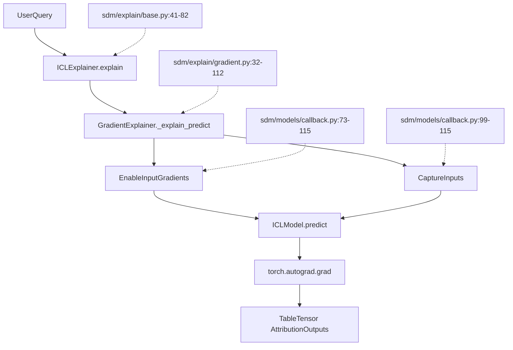
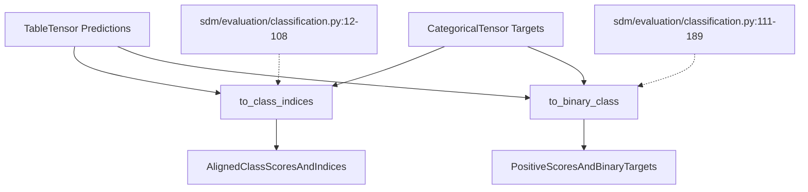

<!-- source: DeepWiki mcp.deepwiki.com · repo NVIDIA/structured-data-models · page 7 Explainability and Evaluation · fetched 2026-10-26 -->

# Explainability and Evaluation

Relevant source files

The following files were used as context for generating this wiki page:

- [sdm/evaluation/classification.py](sdm/evaluation/classification.py)
- [sdm/explain/__init__.py](sdm/explain/__init__.py)
- [sdm/explain/base.py](sdm/explain/base.py)
- [sdm/explain/gradient.py](sdm/explain/gradient.py)
- [sdm/models/callback.py](sdm/models/callback.py)
- [test/explain/test_gradient.py](test/explain/test_gradient.py)

The explainability and evaluation subsystems in `structured-data-models` (`sdm`) provide attribution tools for interpreting foundation model decisions and evaluation utilities for assessing predictive performance across classification and regression tasks. 

---

## 7.1. Explainers

The explainability subsystem (`sdm.explain`) offers attribution mechanisms for `ICLModel` instances [sdm/explain/base.py:11-123](). The base class `ICLExplainer` [sdm/explain/base.py:16-123]() defines a unified interface for both fitted models (using cached in-context examples) and unfitted models (passing context on the fly). 

Gradient-based attribution is implemented via `GradientExplainer` [sdm/explain/gradient.py:17-30](), which computes gradients of model outputs with respect to preprocessed numerical query inputs and related tables using PyTorch's autograd capabilities [sdm/explain/gradient.py:60-70](). This process integrates tightly with the model callback subsystem (`EnableInputGradients` and `CaptureInputs`) to intercept preprocessing steps and enable gradient tracking [sdm/explain/gradient.py:40-50](), [sdm/models/callback.py:73-114]().

For deep technical details, implementation specifics, and advanced usage patterns, see [Explainers](#7.1).

### Explainer Architecture

Sources: [sdm/explain/base.py:41-82](), [sdm/explain/gradient.py:32-112](), [sdm/models/callback.py:73-114]()

---

## 7.2. Evaluation Metrics

The evaluation subsystem (`sdm.evaluation`) provides helper functions and metrics designed to bridge tensor representations with standard benchmark scoring routines. Specifically, classification modules handle alignment between probability/score outputs and categorical targets [sdm/evaluation/classification.py:12-189]().

Key utilities include `to_class_indices` for multi-class score mapping [sdm/evaluation/classification.py:12-108]() and `to_binary_class` for binary probability extraction [sdm/evaluation/classification.py:111-189](). These routines validate row dimensions, handle missing classes, and align predicted column names with target string or numerical categories [sdm/evaluation/classification.py:56-108]().

For details on classification metrics, regression losses, and benchmark integrations, see [Evaluation Metrics](#7.2).

### Evaluation Subsystem Flow

Sources: [sdm/evaluation/classification.py:12-189]()

---

