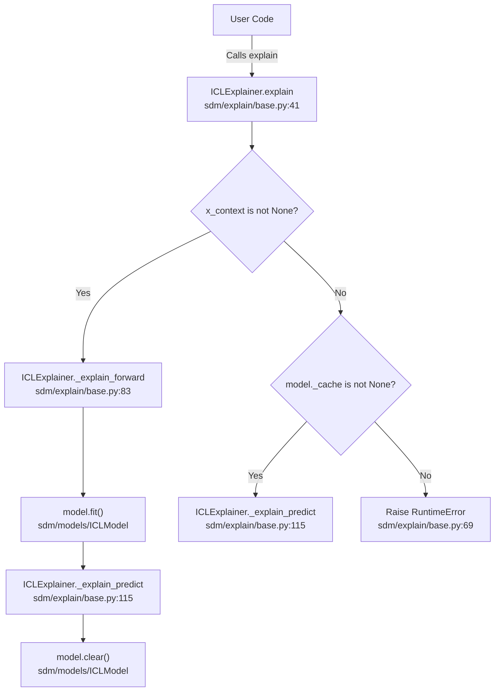
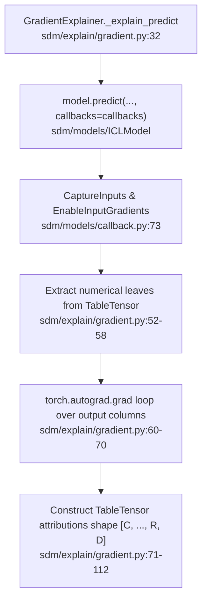
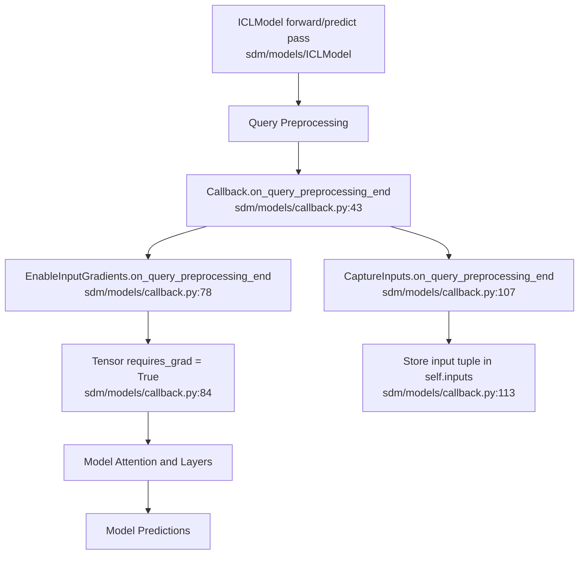

<!-- source: DeepWiki mcp.deepwiki.com · repo NVIDIA/structured-data-models · page 7.1 Explainers · fetched 2026-10-26 -->

# Explainers

Relevant source files

The following files were used as context for generating this wiki page:

- [.github/workflows/test-gpu.yml](.github/workflows/test-gpu.yml)
- [docs/source/icl.md](docs/source/icl.md)
- [examples/README.md](examples/README.md)
- [examples/timeseries/quickstart.py](examples/timeseries/quickstart.py)
- [sdm/explain/__init__.py](sdm/explain/__init__.py)
- [sdm/explain/base.py](sdm/explain/base.py)
- [sdm/explain/gradient.py](sdm/explain/gradient.py)
- [sdm/models/callback.py](sdm/models/callback.py)
- [test/explain/test_base.py](test/explain/test_base.py)
- [test/explain/test_gradient.py](test/explain/test_gradient.py)

The `sdm.explain` subsystem provides model explainability and attribution tools designed specifically for in-context learning foundation models [sdm/explain/__init__.py:1-12](). It attributes model predictions back to preprocessed query features and related relational tables, supporting both one-shot inference (`x_context` provided) and cached inference (`model.fit()` already called) [sdm/explain/base.py:41-82]().

---

## 1. Explainer Base API (`ICLExplainer`)

The abstract base class `ICLExplainer` defines the core contract for attribution engines in `structured-data-models` [sdm/explain/base.py:16-123](). It manages whether a model needs to be fitted on the fly or if it can use an existing cached state.

### Core Lifecycle Methods

- `explain(...)`: A final wrapper method that inspects whether `x_context` is supplied [sdm/explain/base.py:41-82](). If context is provided, it delegates to `_explain_forward`. If `x_context` is `None`, it checks if `model._cache` is populated, raising a `RuntimeError` if the model is unfitted, or delegating to `_explain_predict` if fitted.
- `_explain_forward(...)`: Fits the model using `model.fit()`, invokes `_explain_predict()`, and guarantees that `model.clear()` is called in a `finally` block [sdm/explain/base.py:83-114]().
- `_explain_predict(...)`: An abstract method implemented by subclasses to perform the actual attribution computation on a fitted model [sdm/explain/base.py:115-123]().

*Sources: [sdm/explain/base.py:41-123]()*

---

## 2. Gradient-Based Attribution (`GradientExplainer`)

`GradientExplainer` computes input attributions by differentiating model output predictions with respect to preprocessed numerical query inputs [sdm/explain/gradient.py:17-112]().

### Implementation Details

1. **Callback Injection**: It registers `EnableInputGradients` and `CaptureInputs` callbacks when calling `model.predict()` [sdm/explain/gradient.py:40-45]().
2. **Input Extraction**: It retrieves the captured preprocessed query table `x` and `related_tables` from `CaptureInputs` [sdm/explain/gradient.py:46-50]().
3. **Autograd Computation**: For each output score column, `torch.autograd.grad` computes the gradient of the sum of predictions over query rows with respect to the numerical feature leaves [sdm/explain/gradient.py:60-70]().
4. **Attribution Tensor Shape**: The resulting attribution tables have shape `[C, ..., R, D]`, where `C` is the output class/column count, `R` is the query row count, and `D` is the number of preprocessed input columns [sdm/explain/gradient.py:28-30]().

*Sources: [sdm/explain/gradient.py:17-112](), [sdm/models/callback.py:73-114]()*

---

## 3. Model Callbacks Integration

Explainers rely heavily on the model callback system defined in `sdm.models.callback` to safely hook into the internal forward pass without modifying model architecture classes [sdm/models/callback.py:11-114]().

### Key Callback Classes

- `Callback`: Base class defining interception hooks such as `on_context_preprocessing_end`, `on_query_preprocessing_end`, and `on_model_forward_end` [sdm/models/callback.py:11-70]().
- `EnableInputGradients`: Sets `requires_grad_(True)` on the numerical feature tensors of query and related tables right after query preprocessing [sdm/models/callback.py:73-97]().
- `CaptureInputs`: Appends the preprocessed query `TableTensor` and `RelatedTables` to an internal list for subsequent gradient extraction [sdm/models/callback.py:99-114]().

*Sources: [sdm/models/callback.py:11-114](), [test/explain/test_base.py:13-36]()*

---

