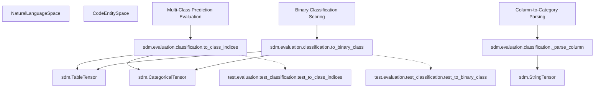
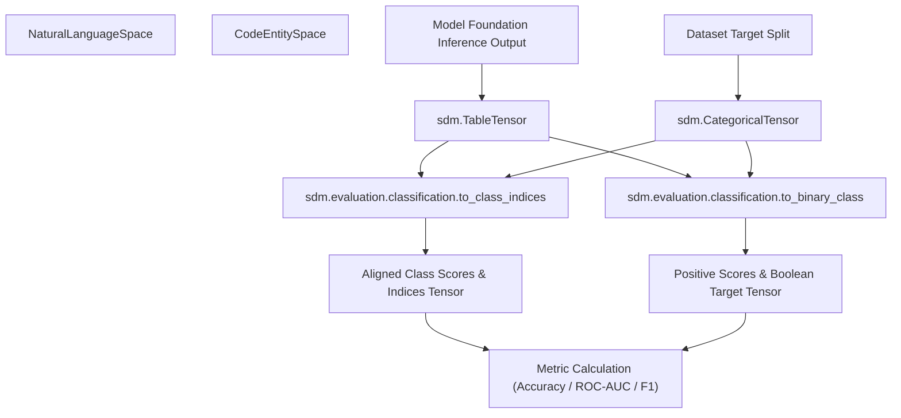

<!-- source: DeepWiki mcp.deepwiki.com · repo NVIDIA/structured-data-models · page 7.2 Evaluation Metrics · fetched 2026-10-26 -->

# Evaluation Metrics

Relevant source files

The following files were used as context for generating this wiki page:

- [sdm/evaluation/__init__.py](sdm/evaluation/__init__.py)
- [sdm/evaluation/classification.py](sdm/evaluation/classification.py)
- [sdm/models/_huggingface.py](sdm/models/_huggingface.py)
- [test/evaluation/test_classification.py](test/evaluation/test_classification.py)

## Purpose and Scope

Section 7.2 covers the evaluation utilities provided by the `sdm.evaluation` package within the `structured-data-models` (`sdm`) library. Foundation models for tabular and structured data produce predictions wrapped in GPU-native tensor classes like `TableTensor`, whereas benchmark tasks and evaluation harnesses require standardized target alignments (such as class indices or binary indicators). The `sdm.evaluation` module supplies critical data-alignment functions—specifically `to_class_indices` and `to_binary_class`—to bridge model prediction outputs with classification and regression metric evaluations.

Sources: [sdm/evaluation/__init__.py:1-11](), [sdm/evaluation/classification.py:1-12]()

---

## Classification Conversion Utilities

To evaluate classification performance across varying column orders, score representations, and target categorizations, `sdm.evaluation` provides robust tensor alignment functions.

### `to_class_indices`

The `to_class_indices` function converts multi-class prediction tables and categorical targets into aligned class-score matrices and integer class-index tensors. 

- **File & Line Range**: [sdm/evaluation/classification.py:12-109]()
- **Parameters**:
  - `pred`: A `TableTensor` whose numerical columns contain class prediction scores. Column names specify the class order.
  - `target`: A single-column `CategoricalTensor` or `TableTensor` containing ground truth classes.
  - `missing_score`: Optional float value assigned to target classes absent from the prediction columns.
- **Behavior**: Parses column names using `_parse_column`, aligns the prediction scores with the target category indices, and verifies dimensional consistency across rows.

### `to_binary_class`

The `to_binary_class` function specializes in binary classification tasks, reducing multi-class or binary score tables into a single positive-class score vector and boolean target mask.

- **File & Line Range**: [sdm/evaluation/classification.py:111-189]()
- **Parameters**:
  - `pred`: A `TableTensor` containing class scores with column names matching category labels.
  - `target`: A single-column categorical target.
  - `positive_class`: The specific class value (boolean, integer, float, or string) treated as the positive class.
- **Behavior**: Extracts the score column corresponding to the `positive_class`, validates that the positive class appears exactly once in target categories, and returns a boolean tensor indicating positive target matches.

Sources: [sdm/evaluation/classification.py:12-189](), [test/evaluation/test_classification.py:10-60]()

---

## Architecture and Data Flow

The following diagram illustrates the mapping from natural language concepts and benchmark evaluation requests down to the concrete code entities within `sdm.evaluation`.

Sources: [sdm/evaluation/classification.py:12-195](), [test/evaluation/test_classification.py:10-60]()

---

## Benchmark Integration Pipeline

Evaluation metrics integrate directly into benchmark execution harnesses (such as TabArena or RelArena) by consuming processed tensor predictions and comparing them against ground truth splits.

Sources: [sdm/evaluation/classification.py:12-189](), [sdm/evaluation/__init__.py:1-11]()

---

