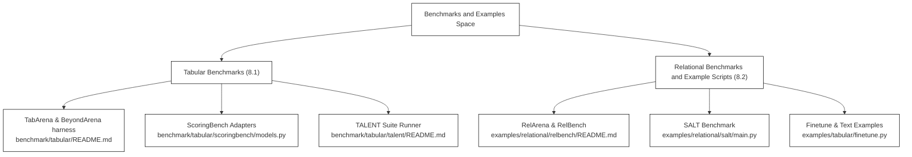
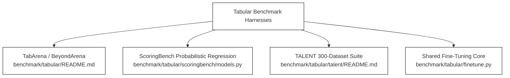
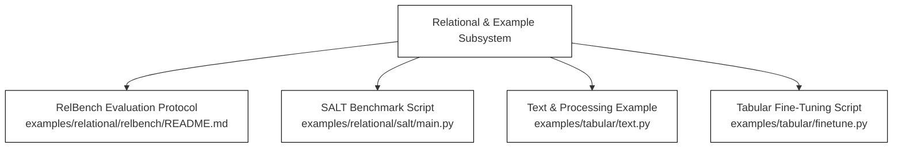

<!-- source: DeepWiki mcp.deepwiki.com · repo NVIDIA/structured-data-models · page 8 Benchmarks and Examples · fetched 2026-10-26 -->

# Benchmarks and Examples

Relevant source files

The following files were used as context for generating this wiki page:

- [.gitignore](.gitignore)
- [benchmark/tabular/README.md](benchmark/tabular/README.md)
- [benchmark/tabular/finetune.py](benchmark/tabular/finetune.py)
- [benchmark/tabular/scoringbench/README.md](benchmark/tabular/scoringbench/README.md)
- [benchmark/tabular/scoringbench/main.py](benchmark/tabular/scoringbench/main.py)
- [benchmark/tabular/scoringbench/models.py](benchmark/tabular/scoringbench/models.py)
- [benchmark/tabular/talent/README.md](benchmark/tabular/talent/README.md)
- [examples/relational/relbench/README.md](examples/relational/relbench/README.md)
- [examples/relational/salt/README.md](examples/relational/salt/README.md)
- [examples/relational/salt/main.py](examples/relational/salt/main.py)
- [examples/tabular/finetune.py](examples/tabular/finetune.py)
- [examples/tabular/quickstart.py](examples/tabular/quickstart.py)
- [examples/tabular/text.py](examples/tabular/text.py)

## Purpose and Scope

This parent page provides a high-level overview of the evaluation harnesses, benchmark suites, and example scripts included in `structured-data-models` (`sdm`). The codebase offers standardized benchmarking pipelines across tabular, relational, and probabilistic tasks, alongside end-to-end examples demonstrating foundation model usage, feature engineering recipes, and fine-tuning.

For deep technical details, implementations of metric wrappers, and comprehensive runner configurations, see the child pages:
- [Tabular Benchmarks](#8.1)
- [Relational Benchmarks and Example Scripts](#8.2)

Sources: `benchmark/tabular/README.md`, `benchmark/tabular/scoringbench/models.py`, `benchmark/tabular/talent/README.md`, `examples/relational/relbench/README.md`, `examples/relational/salt/main.py`, `examples/tabular/finetune.py`

---

## 8.1 Tabular Benchmarks

The tabular benchmarking subsystem provides robust evaluation harnesses for measuring foundation model performance across diverse tabular suites: **TabArena**, **BeyondArena**, **ScoringBench**, and **TALENT** [benchmark/tabular/README.md:1-4](). These suites evaluate architectures such as `TabICLv2`, `TabFM`, and `KumoTabular` under zero-shot in-context learning and full fine-tuning regimes [benchmark/tabular/README.md:25-55]().

The ScoringBench harness integrates probabilistic regression models via SDM quantile wrappers defined in `benchmark/tabular/scoringbench/models.py` [benchmark/tabular/scoringbench/models.py:4-87](), executed through the modular runner in `benchmark/tabular/scoringbench/main.py` [benchmark/tabular/scoringbench/main.py:106-185](). Similarly, full fine-tuning infrastructure is shared across benchmark suites via `benchmark/tabular/finetune.py` [benchmark/tabular/finetune.py:4-9](), enabling gradient-based optimization of all model parameters on training splits.

For detailed information on model wrappers, split strategies, metrics, and evaluation script usage, see [Tabular Benchmarks](#8.1).

Sources: `benchmark/tabular/README.md`, `benchmark/tabular/scoringbench/models.py`, `benchmark/tabular/scoringbench/main.py`, `benchmark/tabular/talent/README.md`, `benchmark/tabular/finetune.py`

---

## 8.2 Relational Benchmarks and Example Scripts

The relational benchmarking and example subsystem covers multi-table relational prediction and specialized tabular workflows. It includes evaluation protocols for **RelBench** (`examples/relational/relbench/README.md`) and **SALT** (`examples/relational/salt/README.md`), assessing `KumoRelational` across temporal join graphs and entity-linked schemas [examples/relational/salt/main.py:138-172]().

Additionally, the `examples/` directory provides quickstart scripts for tabular tasks incorporating text embeddings via SentenceTransformers and TF-IDF [examples/tabular/text.py:4-10](), full model fine-tuning [examples/tabular/finetune.py:4-10](), and relational pipeline setup [examples/relational/salt/main.py:15-23]().

For detailed instructions on running RelArena protocols, configuring neighbor sampling, and executing quickstart scripts, see [Relational Benchmarks and Example Scripts](#8.2).

Sources: `examples/relational/relbench/README.md`, `examples/relational/salt/README.md`, `examples/relational/salt/main.py`, `examples/tabular/text.py`, `examples/tabular/finetune.py`

---

