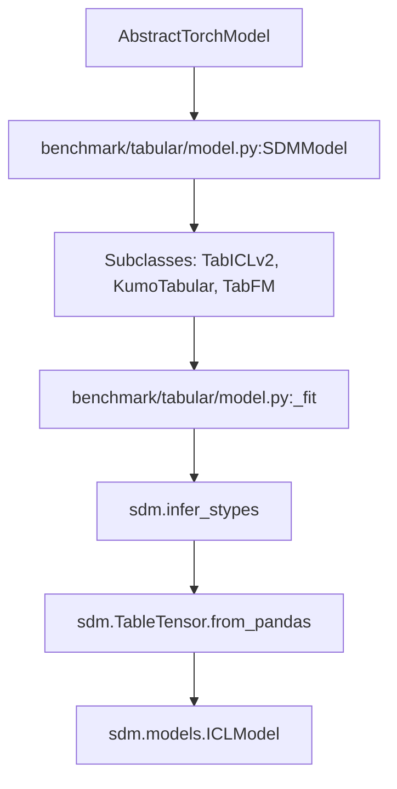
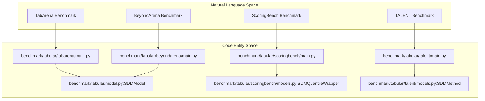
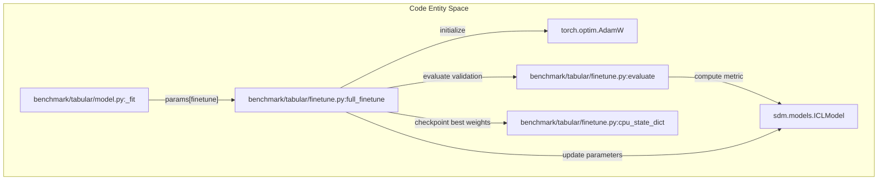

<!-- source: DeepWiki mcp.deepwiki.com · repo NVIDIA/structured-data-models · page 8.1 Tabular Benchmarks · fetched 2026-10-26 -->

# Tabular Benchmarks

Relevant source files

The following files were used as context for generating this wiki page:

- [benchmark/__init__.py](benchmark/__init__.py)
- [benchmark/tabular/README.md](benchmark/tabular/README.md)
- [benchmark/tabular/__init__.py](benchmark/tabular/__init__.py)
- [benchmark/tabular/beyondarena/__init__.py](benchmark/tabular/beyondarena/__init__.py)
- [benchmark/tabular/beyondarena/evaluate.py](benchmark/tabular/beyondarena/evaluate.py)
- [benchmark/tabular/beyondarena/main.py](benchmark/tabular/beyondarena/main.py)
- [benchmark/tabular/finetune.py](benchmark/tabular/finetune.py)
- [benchmark/tabular/model.py](benchmark/tabular/model.py)
- [benchmark/tabular/scoringbench/README.md](benchmark/tabular/scoringbench/README.md)
- [benchmark/tabular/scoringbench/main.py](benchmark/tabular/scoringbench/main.py)
- [benchmark/tabular/scoringbench/models.py](benchmark/tabular/scoringbench/models.py)
- [benchmark/tabular/tabarena/__init__.py](benchmark/tabular/tabarena/__init__.py)
- [benchmark/tabular/tabarena/evaluate.py](benchmark/tabular/tabarena/evaluate.py)
- [benchmark/tabular/tabarena/main.py](benchmark/tabular/tabarena/main.py)
- [benchmark/tabular/talent/README.md](benchmark/tabular/talent/README.md)
- [benchmark/tabular/talent/main.py](benchmark/tabular/talent/main.py)
- [benchmark/tabular/talent/models.py](benchmark/tabular/talent/models.py)

## Purpose and Scope

The `benchmark/tabular` harness provides a standardized evaluation framework for GPU-native tabular foundation models within `structured-data-models` (`sdm`). It adapts `sdm` models—such as `TabICLv2`, `KumoTabular`, and `TabFM`—to run seamlessly across major academic and industrial tabular benchmarking suites: **TabArena**, **BeyondArena**, **ScoringBench**, and **TALENT**. 

This wiki page covers the implementation details of the benchmark model wrappers, execution scripts, dataset loaders, full fine-tuning routines, and evaluation metrics integration.

---

## 1. Model Adapters and AutoGluon Integration

To participate in tabular benchmarking frameworks like TabArena and BeyondArena, SDM models are wrapped in AutoGluon-compatible PyTorch model abstractions defined in `benchmark/tabular/model.py`.

### The `SDMModel` Abstract Base Class
The core adapter is `SDMModel`, which inherits from AutoGluon's `AbstractTorchModel` [benchmark/tabular/model.py:67-68](). It targets binary classification, multiclass classification, and regression problem types (`BINARY`, `MULTICLASS`, `REGRESSION`) [benchmark/tabular/model.py:71-75]() requiring at least one GPU [benchmark/tabular/model.py:76-79]().

*Figure 1: SDM Model Adapter Hierarchy and Data Ingestion Flow.*
Sources: `benchmark/tabular/model.py:67-170]()`

The `_set_default_params` method configures standard hyperparameters including `num_estimators`, `max_context_size`, `max_columns`, `kv_cache`, and fine-tuning parameters [benchmark/tabular/model.py:93-115](). During the `_fit` lifecycle, pandas dataframes and target series are converted into GPU-native `TableTensor` instances using inferred semantic types (`sdm.infer_stypes`) [benchmark/tabular/model.py:151-170]().

Sources: `benchmark/tabular/model.py:67-193]()`

---

## 2. Benchmarking Suites and Runners

### TabArena and BeyondArena Harnesses
TabArena and BeyondArena benchmarks are driven by `benchmark/tabular/tabarena/main.py` and `benchmark/tabular/beyondarena/main.py`. These scripts parse CLI arguments for model selection, dataset filtering, subset restrictions, max context size, max columns, prediction batch sizes, and fine-tuning configurations [benchmark/tabular/tabarena/main.py:22-60](), [benchmark/tabular/beyondarena/main.py:21-59]().

The harness builds experiment bundles via `ConfigGenerator` and executes jobs through `TabArenaContext` or `BeyondArenaContext` [benchmark/tabular/tabarena/main.py:97-111](), [benchmark/tabular/beyondarena/main.py:94-108](). The evaluation script `benchmark/tabular/tabarena/evaluate.py` processes raw prediction artifacts, generates per-split CSV results, and aggregates leaderboard metrics using `EndToEnd` [benchmark/tabular/tabarena/evaluate.py:38-59]().

*Finding 2: Mapping Benchmark Suites to Code Execution Entities.*
Sources: `benchmark/tabular/tabarena/main.py:22-114]`, `benchmark/tabular/beyondarena/main.py:21-112]`, `benchmark/tabular/scoringbench/main.py:22-182]`, `benchmark/tabular/talent/main.py:40-144]`, `benchmark/tabular/model.py:67-91]`, `benchmark/tabular/scoringbench/models.py:87-118]`, `benchmark/tabular/talent/models.py:162-175]()`

Sources: `benchmark/tabular/tabarena/main.py:22-120]`, `benchmark/tabular/beyondarena/main.py:21-118]`, `benchmark/tabular/tabarena/evaluate.py:1-60]()`

### TALENT Integration
The TALENT benchmark harness (`benchmark/tabular/talent/`) integrates SDM models via `SDMMethod`, registered into TALENT's `METHOD_REGISTRY` [benchmark/tabular/talent/models.py:23-30](), [benchmark/tabular/talent/models.py:162-163](). 

`SDMMethod` handles missing values natively by routing `NaN` values directly to SDM tensors rather than applying train-mean imputation [benchmark/tabular/talent/models.py:208-219](). The execution runner `benchmark/tabular/talent/main.py` discovers dataset directories containing `info.json`, checks cached JSON outputs, and invokes `TALENT.run_from_dataset` [benchmark/tabular/talent/main.py:71-144]().

Sources: `benchmark/tabular/talent/models.py:162-219]`, `benchmark/tabular/talent/main.py:40-162]()`

### ScoringBench Probabilistic Regression
ScoringBench evaluates univariate probabilistic regression [benchmark/tabular/scoringbench/README.md:1-5](). SDM implements probabilistic wrappers via `SDMQuantileWrapper` in `benchmark/tabular/scoringbench/models.py` [benchmark/tabular/scoringbench/models.py:87]().

`SDMQuantileWrapper` constructs target distributions using `quantiles_to_distribution` over predicted quantile tensors [benchmark/tabular/scoringbench/models.py:184-188](). The main runner (`benchmark/tabular/scoringbench/main.py`) handles cross-validation folding, dataset selection, and invokes `scoringbench.univariate.runner.run_benchmark` [benchmark/tabular/scoringbench/main.py:86-182]().

Sources: `benchmark/tabular/scoringbench/models.py:87-189]`, `benchmark/tabular/scoringbench/main.py:22-182]()`

---

## 3. Full Fine-Tuning Engine

The module `benchmark/tabular/finetune.py` provides a shared gradient-based fine-tuning routine for `ICLModel` instances across all benchmark suites [benchmark/tabular/finetune.py:4-8]().

*Figure 3: Full Fine-Tuning Lifecycle and Data Flow.*
Sources: `benchmark/tabular/model.py:175-193]`, `benchmark/tabular/finetune.py:30-39]`, `benchmark/tabular/finetune.py:58-90]`, `benchmark/tabular/finetune.py:92-202]()`

### Key Functions in `finetune.py`
- `cpu_state_dict(model)`: Copies model weights to CPU while preserving metadata and tensor structures [benchmark/tabular/finetune.py:30-39]().
- `kumo_small_binary_epochs(...)`: Selects epoch counts dynamically, applying reduced epochs for small binary Kumo models to prevent overfitting [benchmark/tabular/finetune.py:42-55]().
- `evaluate(...)`: Performs zero-shot in-context evaluation, returning accuracy for classification or RMSE for regression [benchmark/tabular/finetune.py:58-90]().
- `full_finetune(...)`: Splits training pools into training and validation sets (`val_frac`), iteratively resamples context and query pools, optimizes parameters via `AdamW`, checkpoints weights upon validation improvement, and restores the best performing state [benchmark/tabular/finetune.py:92-202]().

Sources: `benchmark/tabular/finetune.py:1-238]()`

---

