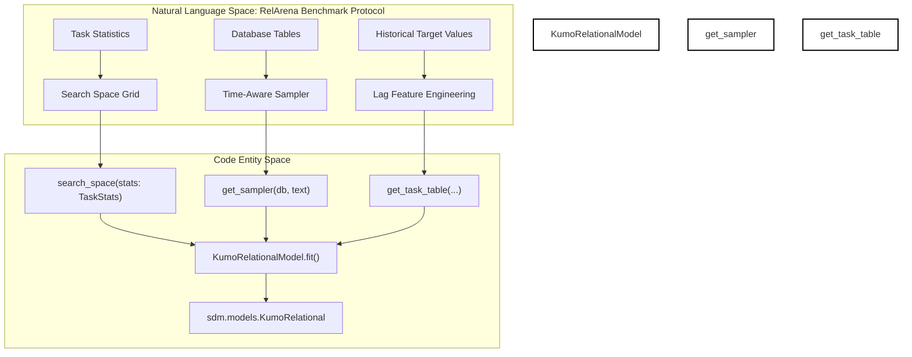
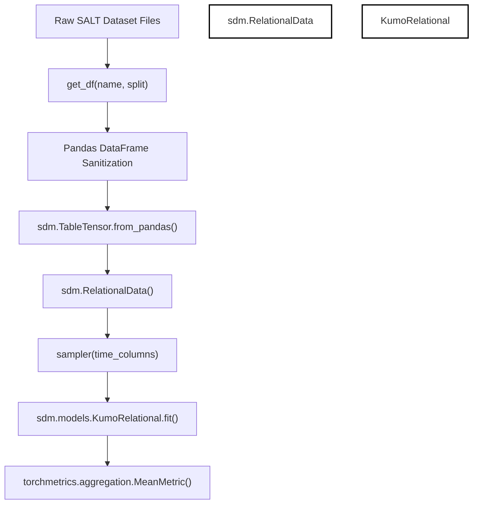
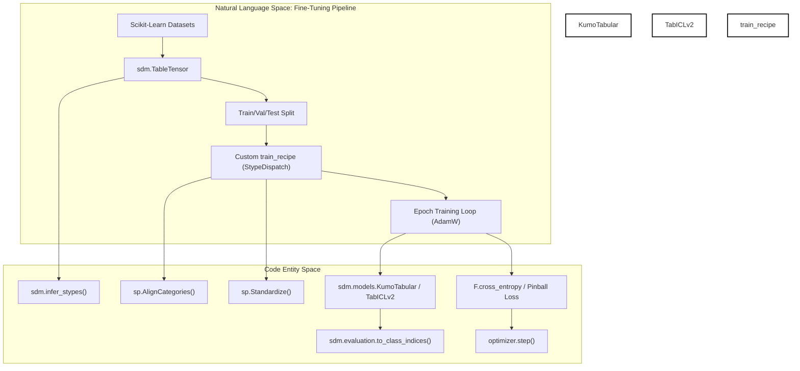

<!-- source: DeepWiki mcp.deepwiki.com · repo NVIDIA/structured-data-models · page 8.2 Relational Benchmarks and Example Scripts · fetched 2026-10-26 -->

# Relational Benchmarks and Example Scripts

Relevant source files

The following files were used as context for generating this wiki page:

- [.gitignore](.gitignore)
- [benchmark/README.md](benchmark/README.md)
- [benchmark/relational/relarena/README.md](benchmark/relational/relarena/README.md)
- [benchmark/relational/relarena/kumo_relational.py](benchmark/relational/relarena/kumo_relational.py)
- [benchmark/tabular/scoringbench/__init__.py](benchmark/tabular/scoringbench/__init__.py)
- [benchmark/tabular/scoringbench/evaluate.py](benchmark/tabular/scoringbench/evaluate.py)
- [examples/relational/relbench/README.md](examples/relational/relbench/README.md)
- [examples/relational/salt/README.md](examples/relational/salt/README.md)
- [examples/relational/salt/main.py](examples/relational/salt/main.py)
- [examples/tabular/finetune.py](examples/tabular/finetune.py)
- [examples/tabular/quickstart.py](examples/tabular/quickstart.py)
- [examples/tabular/text.py](examples/tabular/text.py)

## Purpose and Scope

This page documents the benchmark harnesses and example scripts provided in `structured-data-models` (`sdm`), focusing specifically on relational benchmarks ([RelArena](https://github.com/PriorLabs/relarena), [RelBench](https://relbench.stanford.edu), and [SALT](https://huggingface.co/datasets/SAP/SALT)), tabular quickstarts, feature engineering workflows (including text embeddings and TF-IDF), and full model fine-tuning pipelines.

---

## 1. RelArena and RelBench Integration

The RelArena benchmark evaluates relational foundation models on multi-table predictive tasks. The codebase integrates via `benchmark/relational/relarena/kumo_relational.py`, which defines the `KumoRelationalModel` wrapper around `sdm.models.KumoRelational`.

### Search Space and Task Configuration

The benchmark search space adapts hyperparameter grids based on dataset size and task type (classification versus regression):

* **Search Space Definition**: `search_space(stats: TaskStats)` builds grid search parameters over `subgraph_size` (`small`, `medium`, `large`) and `context_size` (`small` for $\le 20\text{k}$ nodes, `large` otherwise) [benchmark/relational/relarena/kumo_relational.py:21-34]().
* **Neighbor Grids**: Regression tasks leverage wider neighbor sets (e.g., up to 64 neighbors per hop), whereas classification tasks excel with sparser graphs (`[1, 4, 16]` or `[1, 8, 32]`) [benchmark/relational/relarena/kumo_relational.py:40-50]().

### Historical Target Feature Engineering

To provide temporal context and prevent data leakage, historical target values are merged as lag features using time-aware joins:

* `get_task_table(...)` constructs task tables augmented with historical target columns (`{target_col}_lag_{lag}`) using `pd.merge_asof` ordered by timestamp and entity ID [benchmark/relational/relarena/kumo_relational.py:60-124]().
* `get_sampler(...)` initializes an `sdm.RelationalData` instance across database tables, extracting primary/foreign key mappings and time columns to build an `sdm.RelationalSampler` [benchmark/relational/relarena/kumo_relational.py:127-166]().

*Sources: [benchmark/relational/relarena/kumo_relational.py:21-166](), [examples/relational/relbench/README.md:1-38]()*.

---

## 2. SALT Benchmark Workflows

The Sales Autocompletion Linked Business Tables Dataset (SALT) evaluation script (`examples/relational/salt/main.py`) executes multi-table relational classification over enterprise ERP data schemas.

### Schema Sanity and Task Table Construction

* **Data Loading & Merging**: Raw Hugging Face datasets (`sap-ai-research/SALT`) are loaded into Pandas DataFrames, concatenating train/test splits, joining customer addresses, and synthesizing composite timestamps (`CREATIONDATETIME`) [examples/relational/salt/main.py:43-96]().
* **Task Table Extraction**: Depending on whether the task targets sales documents or line items (`sale_tasks` vs `item_tasks`), tables are converted via `sdm.TableTensor.from_pandas()` and split into context and query tensors [examples/relational/salt/main.py:98-127]().
* **Relational Graph Construction**: `sdm.RelationalData` maps tables (`sales`, `items`, `customers`, `addresses`) and directional foreign-to-primary key relationships [examples/relational/salt/main.py:138-172]().

*Sources: [examples/relational/salt/main.py:43-198](), [examples/relational/salt/README.md:1-36]()*

---

## 3. Tabular Quickstarts and Feature Engineering

Tabular example scripts illustrate inference, caching, and multi-modal feature extraction.

### Quickstart Inference and Embedding Hooks

`examples/tabular/quickstart.py` demonstrates standard in-context learning (ICL) passes, fit/predict caching, and hook-based activation extraction from internal attention heads [examples/tabular/quickstart.py:1-56]().

### Text Processing Pipelines

`examples/tabular/text.py` evaluates `TabICLv2` on the STRABLE readability benchmark with high-dimensional text columns [examples/tabular/text.py:1-76](). Text features are transformed via:
* **TF-IDF**: `sp.TFIDF(ngram_range=(4, 6), max_features=256)` [examples/tabular/text.py:54-55]().
* **Sentence Transformers & PCA**: `sp.SentenceTransformer("sentence-transformers/all-MiniLM-L6-v2")` followed by `sp.PCA(64)` [examples/tabular/text.py:56-60]().
* Prefixed to feature recipes using `recipe.prepend_features(sp.StypeDispatch(text=text_processor))` [examples/tabular/text.py:61]().

*Sources: [examples/tabular/quickstart.py:1-56](), [examples/tabular/text.py:1-76]()*

---

## 4. Model Fine-Tuning Pipeline

Full fine-tuning of tabular foundation models (`KumoTabular` or `TabICLv2`) is implemented in `examples/tabular/finetune.py`.

### Execution Flow and Loss Formulation

1. **Dataset Ingestion**: Loads digits (classification) or California Housing (regression) datasets via `scikit-learn` and wraps them into `sdm.TableTensor` [examples/tabular/finetune.py:43-52]().
2. **Recipe Customization**: Overrides default target processing to prevent category flipping (`sp.AlignCategories`, `sp.ShuffleCategories`) and standardizes numerical targets [examples/tabular/finetune.py:78-86]().
3. **Training Loop**:
   * **Classification**: Computes cross-entropy loss over class logits converted via `sdm.evaluation.to_class_indices()` [examples/tabular/finetune.py:133-137]().
   * **Regression**: Computes Pinball (quantile) loss across 999 fixed quantile levels predicted by the model [examples/tabular/finetune.py:138-141]().

*Sources: [examples/tabular/finetune.py:1-159]()*

---

## 5. Benchmark Harnesses and Evaluation Scripts

Evaluation harnesses standardise downstream scoring against pinned official evaluation suites.

* **ScoringBench Evaluation (`benchmark/tabular/scoringbench/evaluate.py`)**: Executes official ScoringBench aggregation scripts (`aggregate_datasets.py`) and ranking leaderboards (`autorank_leaderboard.py`) comparing local SDM runs against official Parquet results [benchmark/tabular/scoringbench/evaluate.py:20-125]().
* **Benchmark Directory Layout (`benchmark/README.md`)**: Organizes evaluations into tabular suites (`tabarena`, `beyondarena`, `scoringbench`, `talent`) and relational suites (`relarena`) [benchmark/README.md:1-11]().

*Sources: [benchmark/README.md:1-11](), [benchmark/tabular/scoringbench/evaluate.py:20-125]()*

---

