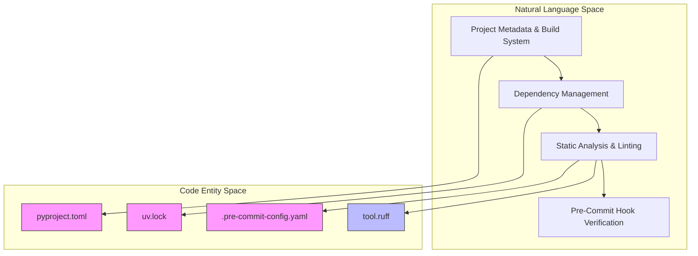
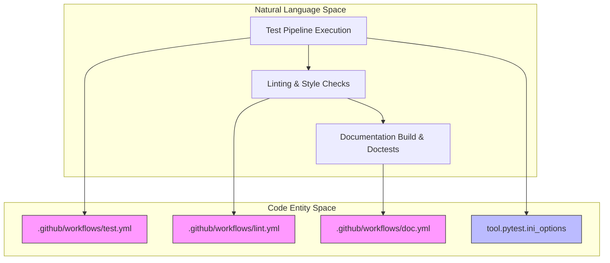

<!-- source: DeepWiki mcp.deepwiki.com · repo NVIDIA/structured-data-models · page 9 Development and Infrastructure · fetched 2026-10-26 -->

# Development and Infrastructure

Relevant source files

The following files were used as context for generating this wiki page:

- [.github/workflows/doc.yml](.github/workflows/doc.yml)
- [.github/workflows/lint.yml](.github/workflows/lint.yml)
- [.github/workflows/test.yml](.github/workflows/test.yml)
- [.pre-commit-config.yaml](.pre-commit-config.yaml)
- [CODE_OF_CONDUCT.md](CODE_OF_CONDUCT.md)
- [CONTRIBUTING.md](CONTRIBUTING.md)
- [SECURITY.md](SECURITY.md)
- [pyproject.toml](pyproject.toml)
- [third_party/contributor-covenant/LICENSE](third_party/contributor-covenant/LICENSE)
- [third_party/pytorch/LICENSE](third_party/pytorch/LICENSE)
- [uv.lock](uv.lock)

This page provides a high-level overview of the build tooling, dependency management, continuous integration (CI) workflows, documentation pipelines, and contributor workflows for `structured-data-models` (`sdm`). The project relies on modern Python packaging standards, robust linting pipelines, containerized/virtualized environment management via `uv`, and automated GitHub Actions workflows to maintain high code quality and zero-copy GPU performance.

For deep technical details on individual infrastructure domains, refer to the child pages:
- [Build, Dependencies and Linting](#9.1)
- [CI Workflows and Testing](#9.2)
- [Documentation and Agent Skills](#9.3)
- [Licensing and Third-Party Code](#9.4)

---

## 9.1. Build, Dependencies and Linting

The project uses `pyproject.toml` to define build-system requirements, project metadata, dependency groups (`test-cpu`, `test`, `doc`, `dev`), and tool configurations [pyproject.toml:1-87]. Dependency resolution and locking are managed using `uv` with `uv.lock`. Code style, linting, and type checking are enforced via `ruff` and `ty`, integrated directly into local git hooks through `.pre-commit-config.yaml`.

*Figure 1: Mapping build configuration concepts to underlying repository files.*

Sources: `pyproject.toml` [pyproject.toml:1-240], `.pre-commit-config.yaml` [.pre-commit-config.yaml:1-63], `uv.lock` [uv.lock:1-20].

For details, see [Build, Dependencies and Linting](#9.1).

---

## 9.2. CI Workflows and Testing

Continuous integration runs across multiple GitHub Actions workflows, validating code correctness, type consistency, and test coverage across CPU and GPU environments [`.github/workflows/test.yml`]() [`.github/workflows/lint.yml`]() [`.github/workflows/doc.yml`](). Pytest options, custom markers (`cuda`), and coverage behaviors are configured within `pyproject.toml`.

*Figure 2: Mapping CI workflow descriptions to GitHub action YAML files and pytest configurations.*

Sources: `.github/workflows/test.yml` [.github/workflows/test.yml:1-55], `.github/workflows/lint.yml` [.github/workflows/lint.yml:1-45], `pyproject.toml` [pyproject.toml:101-126].

For details, see [CI Workflows and Testing](#9.2).

---

## 9.3. Documentation and Agent Skills

Documentation is generated using Sphinx with the Shibuya theme and MyST parser. Automated builds and doctests run via GitHub Actions [`.github/workflows/doc.yml`](). Contributor guidelines, issue reporting, pull request standards, and Developer Certificate of Origin (DCO) sign-offs are detailed in `CONTRIBUTING.md`.

Sources: `.github/workflows/doc.yml` [.github/workflows/doc.yml:1-57], `CONTRIBUTING.md` [CONTRIBUTING.md:1-133].

For details, see [Documentation and Agent Skills](#9.3).

---

## 9.4. Licensing and Third-Party Code

The repository is distributed under the Apache-2.0 license [pyproject.toml:11] and requires contributors to sign off on commits to certify compliance with the Developer Certificate of Origin (DCO). Third-party code components, such as ported model implementations and dependencies, maintain their respective license headers and NOTICE files aggregated under `third_party/` and referenced in `pyproject.toml`.

Sources: `pyproject.toml` [pyproject.toml:11-24], `CONTRIBUTING.md` [CONTRIBUTING.md:44-100], `third_party/pytorch/LICENSE` [third_party/pytorch/LICENSE:1-85].

For details, see [Licensing and Third-Party Code](#9.4).

---

