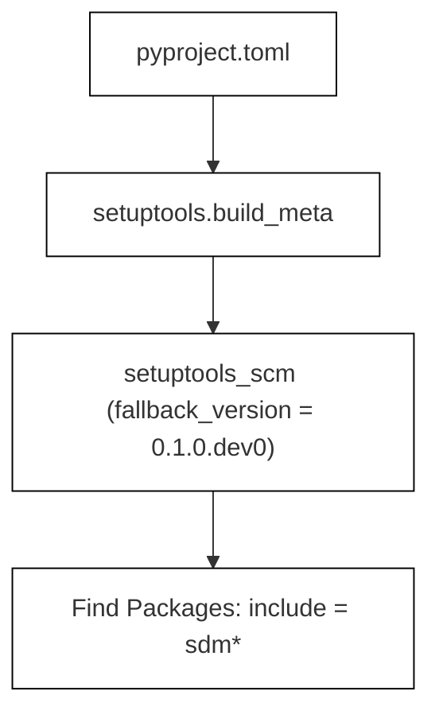
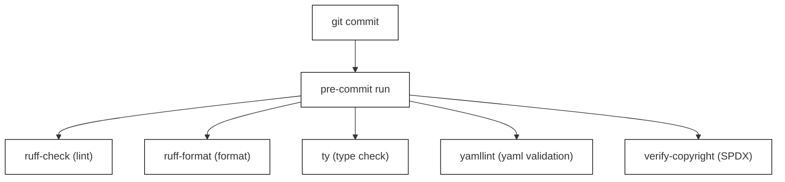

<!-- source: DeepWiki mcp.deepwiki.com · repo NVIDIA/structured-data-models · page 9.1 Build, Dependencies and Linting · fetched 2026-10-26 -->

# Build, Dependencies and Linting

Relevant source files

The following files were used as context for generating this wiki page:

- [.coderabbit.yaml](.coderabbit.yaml)
- [.github/workflows/doc.yml](.github/workflows/doc.yml)
- [.github/workflows/lint.yml](.github/workflows/lint.yml)
- [.github/workflows/test.yml](.github/workflows/test.yml)
- [.pre-commit-config.yaml](.pre-commit-config.yaml)
- [pyproject.toml](pyproject.toml)
- [uv.lock](uv.lock)

## Purpose and Scope
This page details the build configuration, dependency management, linting rules, type checking, copyright verification, and continuous integration (CI) infrastructure for the `structured-data-models` (`sdm`) library. It governs how packages are built via `setuptools`, locked and installed via `uv`, analyzed via `ruff` and `ty`, pre-commit validated, and tested via GitHub Actions.

Sources: [pyproject.toml:1-100](), [.pre-commit-config.yaml:1-63](), [.github/workflows/test.yml:1-54]()

---

## Build System and Metadata Configuration
The build system utilizes `setuptools` alongside dynamic versioning via `setuptools_scm`, configured in `pyproject.toml` [pyproject.toml:1-4](). The core project metadata defines Python requirement constraints (`>=3.11`), project classifiers, licensing (Apache-2.0 and third-party license inclusions), and package discovery rules targeting the `sdm` package tree [pyproject.toml:5-47](), [pyproject.toml:88-94]().

*Figure 1: Natural Language Space to Code Entity Space mapping the build configuration system.*

Sources: [pyproject.toml:1-47](), [pyproject.toml:88-94]()

---

## Dependencies and Lockfile Management
Dependencies are managed declaratively in `pyproject.toml` and pinned via the `uv.lock` file [pyproject.toml:48-86](), [uv.lock:1-20](). 

### Core Dependencies
The core runtime requires PyTorch (`torch>=2.7`), NumPy, PyArrow, Hugging Face Hub, Safetensors, and typing extensions [pyproject.toml:48-55]().

### Optional Dependency Groups
Optional dependencies are organized into dependency groups [pyproject.toml:63-86]():
* `test-cpu`: Includes `pytest`, `pytest-cov`, `pandas`, `pyg-lib` (Linux-specific), and `sentence-transformers>=5.4` [pyproject.toml:64-70]().
* `test`: Includes `test-cpu` plus GPU-native libraries `cudf-cu13>=26.8` and `pylibcugraph-cu13>=26.8` on Linux [pyproject.toml:71-75]().
* `doc`: Includes documentation engines and themes (`myst-parser`, `pandas`, `shibuya`, `sphinx`, `sphinx-copybutton`) [pyproject.toml:76-82]().
* `dev`: Combines `test` and `doc` dependency groups [pyproject.toml:83-86]().

Sources: [pyproject.toml:48-86](), [uv.lock:1-20]()

---

## Linting, Formatting, and Type Checking
Static analysis and code formatting are enforced through `ruff`, `ty`, and `pre-commit` hooks.

### Ruff Configuration
`ruff` is configured with a line length of 79, target version Python 3.11, and a comprehensive rule selection including flake8 extensions (`A`, `B`, `BLE`, `C4`, `D`, `E`, `F`, `G`, `I`, `LOG`, `NPY`, `PIE`, `PLE`, `PT`, `RET`, `RUF`, `SIM`, `T10`, `T20`, `TID252`, `TID253`, `UP`, `W`, `YTT`) [pyproject.toml:150-184](). Tidy imports bans module-level optional imports for heavy libraries (`cudf`, `pandas`, `torch` components, etc.) to keep import boundaries clean [pyproject.toml:203-217]().

### Type Checking with `ty`
Type checking is handled by `ty`, scanning `sdm`, `test`, `examples`, and `benchmark` source directories with specific override rules for kernel implementations and scripts [pyproject.toml:133-149]().

### Pre-commit Framework
Pre-commit hooks validate formatting, YAML syntax, lint rules, types, markdown structures, and copyright headers before commits are finalized [.pre-commit-config.yaml:1-63]().

*Figure 2: Natural Language Space to Code Entity Space mapping pre-commit verification hooks to execution units.*

Sources: [pyproject.toml:133-240](), [.pre-commit-config.yaml:1-63]()

---

## Copyright Verification
Compliance with open-source licensing is enforced automatically via the RAPIDS AI pre-commit hook (`verify-copyright`), which scans Python, shell, CSS, and makefile files to ensure correct SPDX license identifiers (`Apache-2.0`) are present [.pre-commit-config.yaml:56-63](). Specific vendor and third-party directories are explicitly excluded [.pre-commit-config.yaml:63]().

Sources: [.pre-commit-config.yaml:56-63]()

---

## Continuous Integration Workflows
GitHub Actions automate testing, linting, and documentation builds [.github/workflows/test.yml:1-54](), [.github/workflows/lint.yml:1-44](), [.github/workflows/doc.yml:1-56]().

* **Test Workflow (`test.yml`)**: Installs `uv`, sets up Python matrices (3.11, 3.15), installs test-cpu dependencies, and executes `pytest` with coverage collection [.github/workflows/test.yml:18-48]().
* **Lint Workflow (`lint.yml`)**: Caches and executes `pre-commit` across all files [.github/workflows/lint.yml:18-44]().
* **Documentation Workflow (`doc.yml`)**: Builds Sphinx HTML documentation, executes doctests, and publishes to GitHub Pages [.github/workflows/doc.yml:17-56]().

Sources: [.github/workflows/test.yml:1-54](), [.github/workflows/lint.yml:1-44](), [.github/workflows/doc.yml:1-56]()

---

