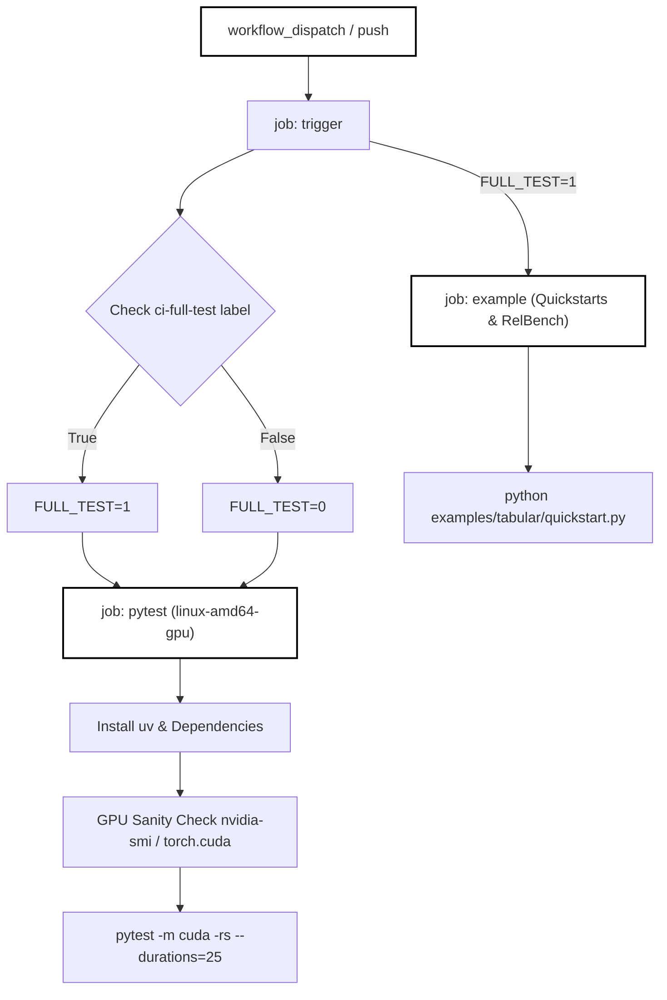
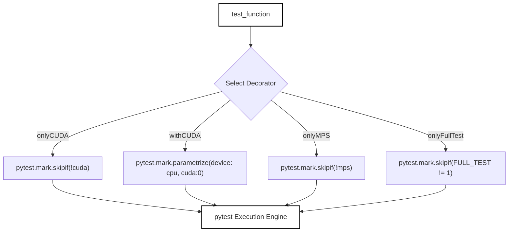
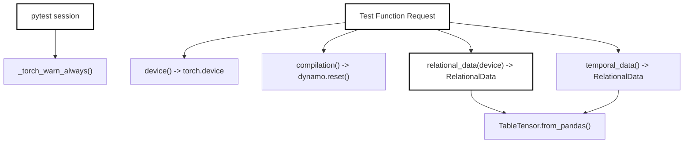
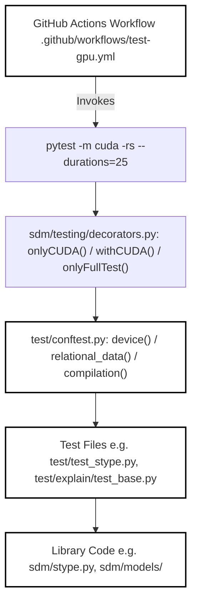

<!-- source: DeepWiki mcp.deepwiki.com · repo NVIDIA/structured-data-models · page 9.2 CI Workflows and Testing · fetched 2026-10-26 -->

# CI Workflows and Testing

Relevant source files

The following files were used as context for generating this wiki page:

- [.github/workflows/publish.yml](.github/workflows/publish.yml)
- [.github/workflows/test-gpu.yml](.github/workflows/test-gpu.yml)
- [docs/source/icl.md](docs/source/icl.md)
- [examples/README.md](examples/README.md)
- [examples/timeseries/quickstart.py](examples/timeseries/quickstart.py)
- [sdm/processing/numerical/cast.py](sdm/processing/numerical/cast.py)
- [sdm/processing/numerical/rank_gaussian.py](sdm/processing/numerical/rank_gaussian.py)
- [sdm/stype.py](sdm/stype.py)
- [sdm/tensor/mixin.py](sdm/tensor/mixin.py)
- [sdm/testing/__init__.py](sdm/testing/__init__.py)
- [sdm/testing/decorators.py](sdm/testing/decorators.py)
- [test/conftest.py](test/conftest.py)
- [test/explain/test_base.py](test/explain/test_base.py)
- [test/processing/numerical/test_cast.py](test/processing/numerical/test_cast.py)
- [test/test_stype.py](test/test_stype.py)

## Purpose and Scope

This page documents the continuous integration (CI) infrastructure, GitHub Actions workflows, test suite configuration, pytest markers, custom testing decorators, memory utilities, and `conftest` fixtures defined in the `structured-data-models` (`sdm`) codebase. It targets developers and contributors looking to understand how code is tested, validated, linted, and published across CPU and GPU environments.

---

## 1. GitHub Actions CI Workflows

The repository uses GitHub Actions to automate testing across multiple backends, linting, documentation building, and package publishing. The primary workflows include `test`, `test-gpu`, `lint`, `doc`, and `publish`.

The GPU test workflow (`test-gpu`) handles environment setup, optional full-test conditional triggers via PR labels (`ci-full-test`), GPU sanity checks, and running tests with CUDA support `.github/workflows/test-gpu.yml:1-111`. The `publish` workflow triggers on GitHub releases to build Python source and wheel distributions using `build` and upload them to PyPI using `twine` and `pypa/gh-action-pypi-publish` [.github/workflows/publish.yml:1-56]().

Sources: [.github/workflows/test-gpu.yml:1-211](), [.github/workflows/publish.yml:1-56]()

---

## 2. Pytest Markers and Testing Decorators

The `sdm.testing` package provides decorators to conditionalize test execution based on hardware availability (`cuda`, `mps`) and the test suite mode (`FULL_TEST`) [sdm/testing/decorators.py:1-61]().

### Key Decorator Functions

- `onlyCUDA(func)`: Applies the `cuda` pytest mark and skips the test if `torch.cuda.is_available()` is `False` [sdm/testing/decorators.py:10-18]().
- `withCUDA(func)`: Parametrizes a test over `cpu` and `cuda:0` devices, applying the `cuda` mark and skip guard specifically to the `cuda:0` parameter [sdm/testing/decorators.py:21-40]().
- `onlyMPS(func)`: Applies the `cuda` mark and skips the test if Apple Metal Performance Shaders (`torch.backends.mps.is_available()`) are unavailable [sdm/testing/decorators.py:43-51]().
- `onlyFullTest(func)`: Skips the test unless the environment variable `FULL_TEST` is set to `"1"` [sdm/testing/decorators.py:54-61]().

Sources: [sdm/testing/decorators.py:1-61]()

---

## 3. Conftest Fixtures and Test Configuration

Global pytest fixtures are defined in `test/conftest.py` to supply standard test data structures, mock devices, and configuration parameters across the test suite [test/conftest.py:1-156]().

### Core Fixtures

- `device()`: Returns a `torch.device("cpu")` instance by default [test/conftest.py:13-16]().
- `compilation()`: Checks if `torch._dynamo` is supported, resets compilation state before and after yielding, and skips tests if compilation is unsupported on the current Python/PyTorch build [test/conftest.py:19-32]().
- `_torch_warn_always()`: Session-scoped autouse fixture that enables `torch.set_warn_always(True)` [test/conftest.py:35-38]().
- `relational_data(device)`: Constructs a multi-table `RelationalData` instance containing `users`, `orders`, and `items` tables with inferred semantic types and foreign key relationships, moved to the requested `device` [test/conftest.py:41-102]().
- `temporal_data()`: Constructs a hierarchical temporal `RelationalData` instance with timestamp columns across `roots`, `first`, and `second` tables [test/conftest.py:105-156]().

Sources: [test/conftest.py:1-156]()

---

## 4. Testing Infrastructure Architecture

The testing architecture ties together GitHub Actions execution environments, pytest runner flags, decorator conditions, and `conftest` data providers. 

Sources: [.github/workflows/test-gpu.yml:1-111](), [sdm/testing/decorators.py:1-61](), [test/conftest.py:1-156](), [test/test_stype.py:1-194]()

---

