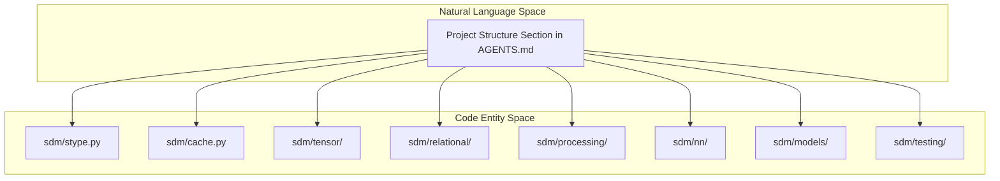

<!-- source: DeepWiki mcp.deepwiki.com · repo NVIDIA/structured-data-models · page 9.3 Documentation and Agent Skills · fetched 2026-10-26 -->

# Documentation and Agent Skills

<details>
<summary>Relevant source files</summary>

The following files were used as context for generating this wiki page:

- [.agents/skills/docstring/SKILL.md](.agents/skills/docstring/SKILL.md)
- [.agents/skills/port-external-models/SKILL.md](.agents/skills/port-external-models/SKILL.md)
- [.agents/skills/processor-development/SKILL.md](.agents/skills/processor-development/SKILL.md)
- [AGENTS.md](AGENTS.md)
- [docs/Makefile](docs/Makefile)
- [docs/source/_static/custom.css](docs/source/_static/custom.css)
- [docs/source/_templates/autosummary/class.rst](docs/source/_templates/autosummary/class.rst)
- [docs/source/_templates/autosummary/tensor_class.rst](docs/source/_templates/autosummary/tensor_class.rst)
- [docs/source/_templates/partials/site-foot.html](docs/source/_templates/partials/site-foot.html)
- [docs/source/api/evaluation.rst](docs/source/api/evaluation.rst)
- [docs/source/api/explain.rst](docs/source/api/explain.rst)
- [docs/source/api/nn.rst](docs/source/api/nn.rst)
- [docs/source/api/relational.rst](docs/source/api/relational.rst)
- [docs/source/api/sdm.rst](docs/source/api/sdm.rst)
- [docs/source/api/tensor.rst](docs/source/api/tensor.rst)
- [docs/source/images/nvidia.svg](docs/source/images/nvidia.svg)
- [docs/source/index.md](docs/source/index.md)
- [docs/source/nim.md](docs/source/nim.md)
- [docs/source/tensor.md](docs/source/tensor.md)
- [sdm/processing/numerical/warp.py](sdm/processing/numerical/warp.py)
- [test/processing/numerical/test_warp.py](test/processing/numerical/test_warp.py)

</details>


## Purpose and Scope

This page documents the technical architecture of the documentation subsystem, Sphinx layout, API generation structures, repository governance rules (`AGENTS.md`), and automated engineering guidelines (`.agents/skills/`) used across the `structured-data-models` (`sdm`) codebase. These mechanisms ensure consistent public APIs, robust docstrings, structured processor development, and deterministic model porting workflows.

Sources: [docs/source/index.md:1-49](), [AGENTS.md:1-89](), [.agents/skills/docstring/SKILL.md:1-103]()

---

## 1. Sphinx Documentation Layout and API Reference

The documentation source resides in `docs/source/` and utilizes Sphinx with a customized ReadTheDocs-like layout, custom CSS styling [docs/source/_static/custom.css:1-23](), and automated `autosummary` extensions for Python modules.

The main entry point `docs/source/index.md` organizes documentation into three primary toctrees: **Getting Started**, **Guides**, and **API** [docs/source/index.md:19-49]().

### API Generation and Autosummary

API documentation files (`docs/source/api/*.rst`) use Sphinx autosummary templates to dynamically render public symbols for modules such as `sdm`, `sdm.tensor`, `sdm.processing`, `sdm.nn`, `sdm.models`, `sdm.explain`, and `sdm.evaluation`. For instance, `docs/source/api/sdm.rst` references core semantic types and tasks [docs/source/api/sdm.rst:1-10](), while `docs/source/api/explain.rst` iterates over `sdm.explain` symbols via custom Jinja loops [docs/source/api/explain.rst:1-10]():

```rst
sdm.explain
===========

.. autosummary::
   :toctree: generated
   :nosignatures:

   {%% for name in api_names("sdm.explain") %%}
      ~sdm.explain.{{ name }}
   {%% endfor %%}
```

### Diagram: Sphinx Layout to Code Entities

```mermaid
graph TD
    subgraph Natural_Language_Space ["Natural Language Space"]
        IndexMD[""Documentation Root (index.md)""]
        APIRst[""API Reference (.rst Files)""]
        CustomCSS[""Theme Customization (custom.css)""]
    end

    subgraph Code_Entity_Space ["Code Entity Space"]
        DocsSource[""docs/source/""]
        AutoSummary[""sphinx.ext.autosummary""]
        StaticAssets[""docs/source/_static/""]
    end

    IndexMD --> DocsSource
    APIRst --> AutoSummary
    CustomCSS --> StaticAssets
```
*Diagram 1: Mapping documentation structures in Natural Language Space to Sphinx configuration and source assets in Code Entity Space.*

Sources: [docs/source/index.md:1-49](), [docs/source/_static/custom.css:1-23](), [docs/source/api/explain.rst:1-10](), [docs/source/api/sdm.rst:1-10]()

---

## 2. Repository Governance and AI Agent Policy (`AGENTS.md`)

The root `AGENTS.md` file establishes rigid operational and engineering rules for human contributors and automated agents interacting with the codebase.

### Core Policies

- **AI Policy**: Automated agents must never act autonomously on GitHub except to open draft pull requests, must wrap AI-generated text in code/quote blocks, and must not submit unread code [AGENTS.md:14-25].
- **Testing Standards**: Tests must be sensitive to behavior changes and insensitive to structure changes. Avoid setting random seeds in tests unless strictly required [AGENTS.md:31-35].
- **Project Structure**: Defines canonical module paths and responsibilities across the repository [AGENTS.md:46-56].

| Path | Module Responsibility |
| :--- | :--- |
| `sdm/stype.py` | Semantic column types and inference via `Stype` |
| `sdm/cache.py` | Model caching (e.g., key/value caching) |
| `sdm/tensor` | Custom PyTorch-native tensor subclasses for tabular data |
| `sdm/relational` | Relational data processing routines |
| `sdm/processing` | Tensorized preprocessing and postprocessing routines |
| `sdm/nn` | Neural network building blocks |
| `sdm/models` | Pretrained structured data models |
| `sdm/testing` | Testing utilities and fixtures |

### Diagram: AGENTS.md Layout to Core Modules


*Diagram 2: Mapping structural definitions in AGENTS.md to package directories and core python modules.*

Sources: [AGENTS.md:1-89]()

---

## 3. Agent Skills Guidelines (`.agents/skills/`)

Automated engineering workflows are governed by specialized skill guides located in `.agents/skills/`. Each skill prescribes strict formatting, architectural patterns, and validation rules.

### Docstring Writing and Reviewing (`.agents/skills/docstring/SKILL.md`)

The docstring skill mandates uniform documentation practices across all public modules, classes, and functions [.agents/skills/docstring/SKILL.md:1-4]:

- **Minimalism**: Avoid documenting internal implementation details [.agents/skills/docstring/SKILL.md:11-13].
- **Package Summaries**: No module-level docstrings on individual files; use a short summary in package `__init__.py` [.agents/skills/docstring/SKILL.md:13-15].
- **Citations**: Academic papers implemented by a class or function must be cited in the first sentence of its docstring [.agents/skills/docstring/SKILL.md:15-17].
- **Tensor Shape Notation**: Describe tensor parameters using double-backtick notation with leading `...` for batch dimensions (e.g., `[..., S, H, C]`) [.agents/skills/docstring/SKILL.md:17-21].
- **Sphinx Cross-Referencing**: Leverage intersphinx mappings for external projects (`torch`, `pandas`, `pyarrow`, `cudf`, `numpy`) using explicit roles like `:class:`, `:func:`, `:meth:`, and `:mod:` [.agents/skills/docstring/SKILL.md:56-97].

Sources: [.agents/skills/docstring/SKILL.md:1-103]()

### Processor Development (`.agents/skills/processor-development/SKILL.md`)

The processor development guide regulates the creation of reusable tensor preprocessing components within `sdm.processing` [.agents/skills/processor-development/SKILL.md:1-6]:

- **Generality**: Processors must describe generic table transformations rather than model-specific recipes [.agents/skills/processor-development/SKILL.md:11-15].
- **Processor Hierarchy**: Use regular `Processor` for per-table/batch operations, managed via `EnsembleProcessorAdapter`. Implement `EnsembleProcessor` directly only when state or behavior is scoped across ensemble members [.agents/skills/processor-development/SKILL.md:16-18].
- **State Management**: Fitted state must be private, PyTorch-native, and registered via `register_buffer` [.agents/skills/processor-development/SKILL.md:18-20].
- **Leading Dimensions**: Regular processors must support arbitrary leading batch dimensions transparently [.agents/skills/processor-development/SKILL.md:20-22].

Sources: [.agents/skills/processor-development/SKILL.md:1-46]()

### External Model Porting (`.agents/skills/port-external-models/SKILL.md`)

The model porting skill defines the lifecycle for integrating external models into `sdm.models` [.agents/skills/port-external-models/SKILL.md:1-6]:

- **Reference Pinning**: Pin upstream git SHAs, Hub revisions, model configurations, and licenses in PR descriptions and `THIRD_PARTY_LICENSES.md` [.agents/skills/port-external-models/SKILL.md:10-13].
- **Call Path Separation**: `ICLModel._forward` accepts `TableTensor`, unwrapping to PyTorch `Tensor` for numerical execution in `sdm.nn` [.agents/skills/port-external-models/SKILL.md:17-20].
- **PR Stack Strategy**: Ports must be split into sequential reviewable phases:
  1. **Skeleton**: Package and `ICLModel` subclass [.agents/skills/port-external-models/SKILL.md:30-31].
  2. **Blocks**: Individual numerical building blocks in `sdm.nn` with tensor tests [.agents/skills/port-external-models/SKILL.md:31-32].
  3. **Working Path**: Core assembly, checkpoint loading, and end-to-end forward/predict parity [.agents/skills/port-external-models/SKILL.md:32-34].
  4. **Capabilities**: Extra input types, missing values, and auxiliary data support [.agents/skills/port-external-models/SKILL.md:34-35].
  5. **Index**: Registration in `sdm.models` and documentation index [.agents/skills/port-external-models/SKILL.md:35-36].

Sources: [.agents/skills/port-external-models/SKILL.md:1-41]()

---

