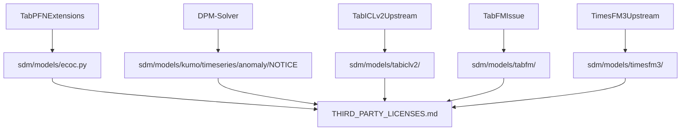
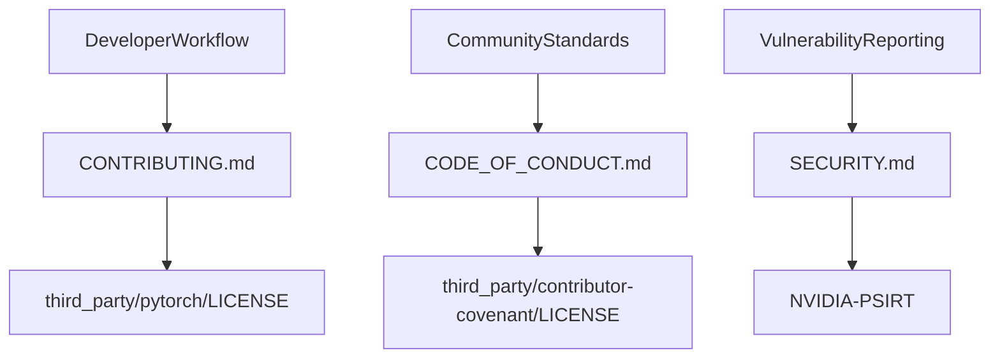

<!-- source: DeepWiki mcp.deepwiki.com · repo NVIDIA/structured-data-models · page 9.4 Licensing and Third-Party Code · fetched 2026-10-26 -->

# Licensing and Third-Party Code

Relevant source files

The following files were used as context for generating this wiki page:

- [CODE_OF_CONDUCT.md](CODE_OF_CONDUCT.md)
- [CONTRIBUTING.md](CONTRIBUTING.md)
- [LICENSE](LICENSE)
- [SECURITY.md](SECURITY.md)
- [THIRD_PARTY_LICENSES.md](THIRD_PARTY_LICENSES.md)
- [sdm/models/ecoc.py](sdm/models/ecoc.py)
- [sdm/models/kumo/timeseries/anomaly/NOTICE](sdm/models/kumo/timeseries/anomaly/NOTICE)
- [test/models/test_ecoc.py](test/models/test_ecoc.py)
- [third_party/contributor-covenant/LICENSE](third_party/contributor-covenant/LICENSE)
- [third_party/dpm-solver/LICENSE](third_party/dpm-solver/LICENSE)
- [third_party/pytorch/LICENSE](third_party/pytorch/LICENSE)
- [third_party/tabpfn-extensions/LICENSE](third_party/tabpfn-extensions/LICENSE)

## Purpose and Scope
This page details the licensing architecture, primary project licenses, third-party software components, ported model code attributions, and governance policies for `structured-data-models` (SDM). The core repository is distributed under the Apache License 2.0 by NVIDIA Corporation, while integrating specific components, architectural designs, and utility modules from external open-source projects under compatible terms (BSD 3-Clause, MIT, and Apache-2.0).

Sources: [`LICENSE:1-127]()`, [`THIRD_PARTY_LICENSES.md:1-60]()`

---

## Primary License: Apache-2.0
The `structured-data-models` repository is licensed under the terms of the Apache License, Version 2.0. Copyright is held by NVIDIA Corporation & Affiliates.

- **License Terms**: [`LICENSE:1-127]()`
- **Permissions**: Perpetual, worldwide, non-exclusive, no-charge, royalty-free, irrevocable copyright and patent licenses to reproduce, prepare derivative works, publicly display, perform, sublicense, and distribute the work.
- **Conditions**: Redistribution of source or object forms requires retaining copyright, patent, trademark, and attribution notices, including the project `NOTICE` file where present, and marking any modified files with prominent change notices.

Sources: [`LICENSE:1-127]()`

---

## Third-Party Component Registry and Ported Models
The repository incorporates architectural code, mathematical formulations, and porting logic from multiple third-party academic and industrial open-source repositories. These dependencies and derivatives are explicitly tracked in [`THIRD_PARTY_LICENSES.md`]() and accompanied by local license and notice files.

| Component Name | Upstream Source | Primary License | Repository Path |
| :--- | :--- | :--- | :--- |
| **TabICLv2** | `https://github.com/soda-inria/tabicl` | BSD 3-Clause | [`sdm/models/tabiclv2/`](../THIRD_PARTY_LICENSES.md:6-14)() |
| **TabFM** | `https://github.com/google-research/tabfm` | Apache-2.0 | [`sdm/models/tabfm/`](../THIRD_PARTY_LICENSES.md:15-24)() |
| **TimesFM 3.0** | `https://github.com/google-research/timesfm` | Apache-2.0 | [`sdm/models/timesfm3/`](../THIRD_PARTY_LICENSES.md:26-36)() |
| **DPM-Solver** | `https://github.com/LuChengTHU/dpm-solver` | MIT | [`third_party/dpm-solver/`](../THIRD_PARTY_LICENSES.md:37-44)() |
| **TabPFN Extensions** | `https://github.com/PriorLabs/tabpfn-extensions` | Apache-2.0 | [`sdm/models/ecoc.py`](../sdm/models/ecoc.py:1-14)() |

Sources: [`THIRD_PARTY_LICENSES.md:1-52]()`, [`sdm/models/ecoc.py:1-14]()`

---

## Architectural Mapping: Natural Language to Code Entities
The following diagram links human-readable subsystem and third-Party names to their concrete code entities, files, and licensing references within the codebase.

Sources: [`THIRD_PARTY_LICENSES.md:1-52](), [`sdm/models/ecoc.py:1-14]()`, [`sdm/models/kumo/timeseries/anomaly/NOTICE:1-6]()`

---

## Governance, Contributions, and Security Policies
In addition to runtime model software licenses, repository contribution protocols and security channels are governed by standardized open-source frameworks:

- **Developer Certificate of Origin (DCO)**: Contributions enforce sign-offs certifying compliance under Developer Certificate of Origin Version 1.1 (`[CONTRIBUTING.md:44-100]()`).
- **Code of Conduct**: Community guidelines follow the Contributor Covenant Version 1.4 under the MIT License (`[CODE_OF_CONDUCT.md:1-85]()`, [`THIRD_PARTY_LICENSES.md:57-60]()`).
- **Security Vulnerability Reporting**: Coordinated vulnerability disclosure procedures and contact directives are specified in [`SECURITY.md:1-26]()`.

Sources: [`CONTRIBUTING.md:1-100](), [`CODE_OF_CONDUCT.md:1-86](), [`SECURITY.md:1-26](), [`THIRD_PARTY_LICENSES.md:53-60]()`

---

