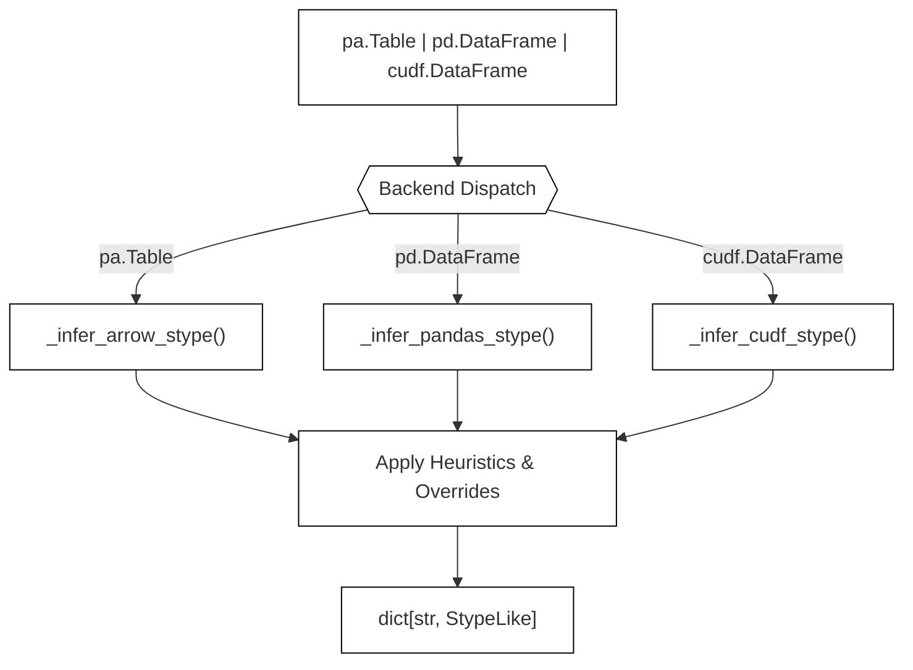
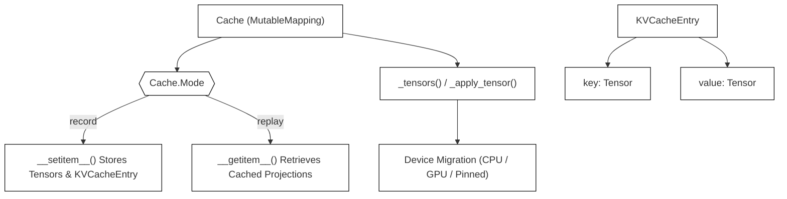
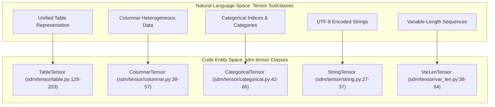
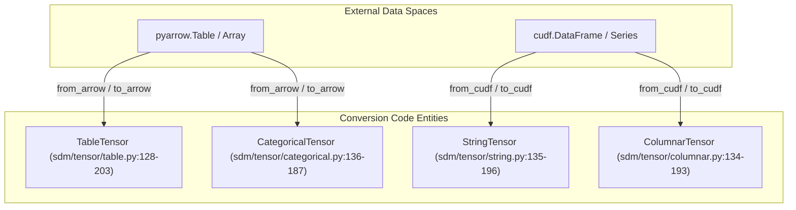
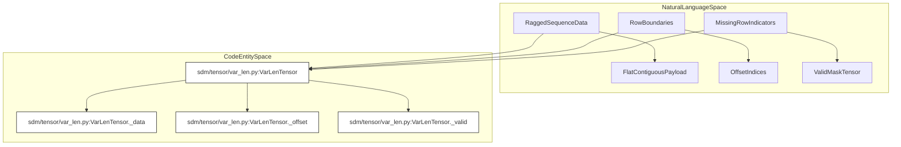
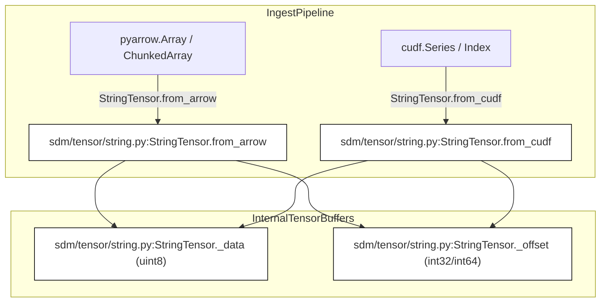
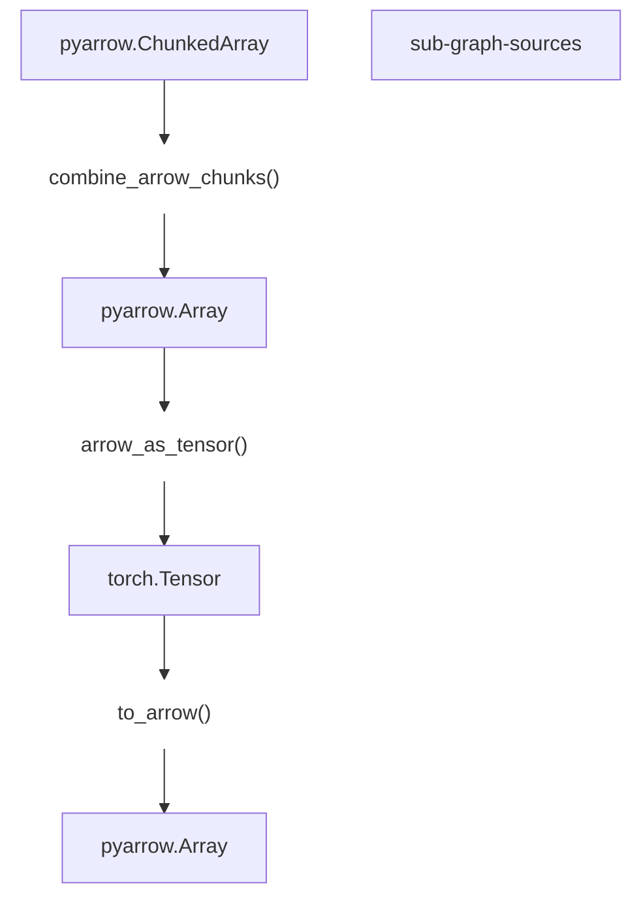
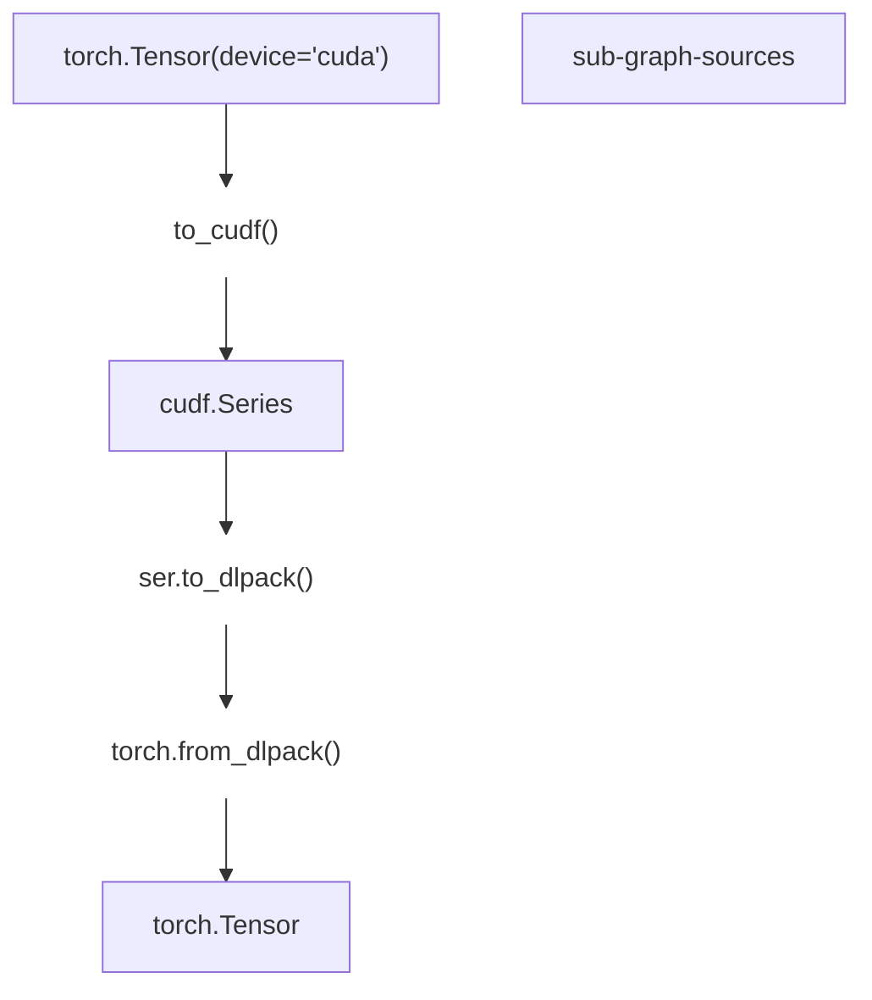
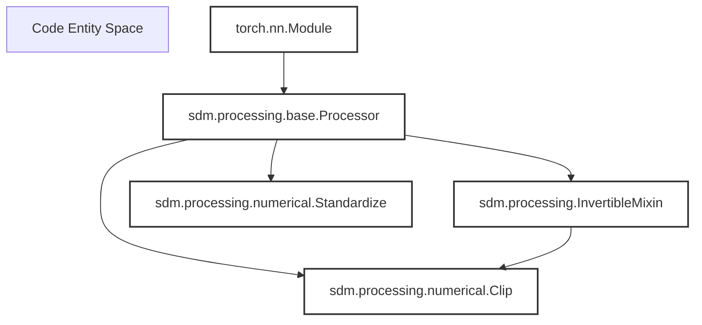
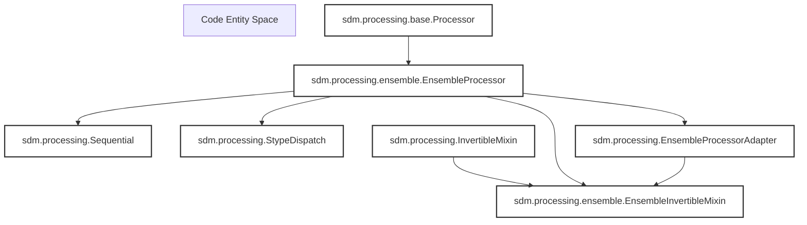

# Page: Overview

# Overview

<details>
<summary>Relevant source files</summary>

The following files were used as context for generating this wiki page:

- [README.md](README.md)
- [docs/source/_static/custom.css](docs/source/_static/custom.css)
- [docs/source/api/evaluation.rst](docs/source/api/evaluation.rst)
- [docs/source/api/explain.rst](docs/source/api/explain.rst)
- [docs/source/api/models.rst](docs/source/api/models.rst)
- [docs/source/images/nvidia.svg](docs/source/images/nvidia.svg)
- [docs/source/index.md](docs/source/index.md)
- [docs/source/nim.md](docs/source/nim.md)
- [docs/source/tensor.md](docs/source/tensor.md)
- [sdm/__init__.py](sdm/__init__.py)
- [sdm/models/__init__.py](sdm/models/__init__.py)
- [sdm/models/kumo/__init__.py](sdm/models/kumo/__init__.py)
- [sdm/models/kumo/relational/__init__.py](sdm/models/kumo/relational/__init__.py)
- [sdm/models/kumo/timeseries/__init__.py](sdm/models/kumo/timeseries/__init__.py)
- [sdm/models/kumo/timeseries/anomaly/__init__.py](sdm/models/kumo/timeseries/anomaly/__init__.py)
- [sdm/models/kumo/timeseries/forecast/__init__.py](sdm/models/kumo/timeseries/forecast/__init__.py)
- [sdm/relational/__init__.py](sdm/relational/__init__.py)
- [sdm/tensor/__init__.py](sdm/tensor/__init__.py)

</details>


The `structured-data-models` (`sdm`) library provides GPU-native foundation models, tensor subclasses, and composable data processors tailored for tabular, relational, and time-series data [README.md:18-22](). By combining PyTorch-native tensor ergonomics with GPU-accelerated dataframe interoperability (such as `cudf`), `sdm` enables end-to-end in-context learning (ICL) and zero-shot inference workflows directly on hardware accelerators without unnecessary host-device data movement [README.md:40]().

Sources: `README.md:18-22`, `sdm/__init__.py:1-4`

## High-Level Architecture

The core data flow in `sdm` progresses through three main abstraction layers: dataframe-backed or raw tensors are losslessly encapsulated into structured tensor types, prepared via declarative processing recipes, and consumed by transformer-based foundation models supporting in-context learning and fast caching.

```mermaid
graph TD
        Raw[""RawDataFrame""] --> Infer[""sdm.infer_stypes()""]
        Infer --> Tensor[""sdm.tensor.TableTensor""]
        Tensor --> Rec[""sdm.processing.Recipe""]
        Rec --> Mdl[""sdm.models.ICLModel""]
```
Sources: `README.md:68-94`, `docs/source/tensor.md:9-17`

- **Tensor Layer (`sdm.tensor`):** Implements lossless tensor subclasses (`TableTensor`, `CategoricalTensor`, `StringTensor`, `VarLenTensor`, `NullableTensor`) that maintain table semantics while exposing multi-dimensional PyTorch tensors [docs/source/tensor.md:9-29]().
- **Processing and Recipes (`sdm.processing`):** Provides composable data transformation pipelines (`Recipe`) and processor contracts that handle feature scaling, missing value imputation, and categorical alignment.
- **Model Framework (`sdm.models`):** Houses the `ICLModel` base class and a comprehensive model zoo comprising tabular models (`TabICLv2`, `TabFM`, `KumoTabular`), relational models (`KumoRelational`), and time-series forecasters (`TimesFM3`, `KumoForecast`) [README.md:20]().

Sources: `README.md:20-22`, `docs/source/tensor.md:9-29`, `sdm/__init__.py:23-32`

## Repository Layout

The codebase is modularly organized into distinct functional subsystems handling tensors, feature processing, model architectures, relational graphs, neural network building blocks, and benchmarks.

```mermaid
graph TD
        Root[""sdm (Root Package)""] --> TensorPkg[""sdm.tensor (tensor subclasses)""]
        Root --> ProcPkg[""sdm.processing (Recipe and Processors)""]
        Root --> ModelPkg[""sdm.models (ICLModel and model zoo)""]
        Root --> RelPkg[""sdm.relational (RelationalData, Sampler)""]
        Root --> NNPkg[""sdm.nn (Attention, TransformerBlock)""]
```
Sources: `sdm/__init__.py:6-35`, `sdm/relational/__init__.py:6-8`

- `sdm/tensor/`: Lossless table representations and device-aware data containers [`sdm/tensor/__init__.py:6-11`]().
- `sdm/processing/`: Processor contracts, feature encoders, and execution pipelines [`sdm/__init__.py:32`]().
- `sdm/models/`: Foundation model reference implementations and inference caching [`sdm/models/__init__.py:13-18`]().
- `sdm/relational/`: Relational dataset containers, task specifications, and graph samplers [`sdm/relational/__init__.py:6-8`]().
- `sdm/nn/`: Custom Triton kernels, normalization layers, and attention mechanisms.
- `benchmark/`: Evaluation harnesses for tabular and relational benchmarks [README.md:97]().
- `examples/`: Quickstart scripts illustrating core workflows [README.md:96]().

Sources: `README.md:96-97`, `sdm/__init__.py:6-35`, `sdm/tensor/__init__.py:6-11`, `sdm/models/__init__.py:13-18`, `sdm/relational/__init__.py:6-8`

## Child Pages

For detailed documentation on specific subsystems, consult the following child pages:

- [Installation and Getting Started](#1.1) — Covers installation procedures, optional GPU dependencies (`cudf`, `pyg-lib`), quickstart fit/predict patterns, and benchmark usage.
- [Core Concepts: Semantic Types and Tasks](#1.2) — Explains the `Stype` enum, automatic type inference via `infer_stypes`, task definitions, estimator wrappers, and shared caching abstractions.

Sources: `README.md:24-97`, `sdm/__init__.py:14-16`

---

# Page: Installation and Getting Started

# Installation and Getting Started

<details>
<summary>Relevant source files</summary>

The following files were used as context for generating this wiki page:

- [.gitignore](.gitignore)
- [docs/source/install.md](docs/source/install.md)
- [docs/source/overview.md](docs/source/overview.md)
- [examples/relational/relbench/README.md](examples/relational/relbench/README.md)
- [examples/relational/relbench/main.py](examples/relational/relbench/main.py)
- [examples/relational/salt/README.md](examples/relational/salt/README.md)
- [examples/relational/salt/main.py](examples/relational/salt/main.py)
- [examples/tabular/finetune.py](examples/tabular/finetune.py)
- [examples/tabular/quickstart.py](examples/tabular/quickstart.py)
- [examples/tabular/text.py](examples/tabular/text.py)
- [sdm/nn/softplus.py](sdm/nn/softplus.py)
- [sdm/processing/text/sentence_transformer.py](sdm/processing/text/sentence_transformer.py)
- [test/processing/text/test_sentence_transformer.py](test/processing/text/test_sentence_transformer.py)

</details>


## Purpose and Scope
This page details the installation procedures for the `structured-data-models` (`sdm`) package, its mandatory requirements, optional GPU-accelerated dependencies (`cudf`, `pyg-lib`), core quickstart workflows for fitting and predicting with in-context learning foundation models, and an overview of the example scripts provided under `examples/`.

---

## 1. Installation Options and Dependencies

The `structured-data-models` package supports Python 3.11 and PyTorch 2.7 onwards `[docs/source/install.md:1-3]()`. It can be installed directly from PyPI or from the source repository `[docs/source/install.md:4-14]()`.

### Standard Installation
To install the stable release from PyPI, execute `[docs/source/install.md:4-8]()`:
```bash
pip install structured-data-models
```

To install directly from the `main` branch of the repository `[docs/source/install.md:10-14]()`:
```bash
pip install git+https://github.com/NVIDIA/structured-data-models.git
```

### Optional GPU Dependencies
For high-performance CUDA workloads, it is recommended to install `cudf` from the RAPIDS ecosystem to keep dataframe-style operations resident on the GPU and avoid CPU-GPU synchronization bottlenecks `[docs/source/install.md:16-18]()`. Relational workloads also leverage `pyg-lib` for accelerated neighbor sampling primitives.

Sources:
- `docs/source/install.md:1-19`

---

## 2. Quickstart: Data Loading and Tensor Abstractions

The foundation of any `sdm` workflow is the conversion of raw tabular data into GPU-native tensor representations via `sdm.TableTensor` `[docs/source/overview.md:27-40]()`. Semantic types (`sdm.Stype`) categorize columns into numerical, categorical, datetime, or text roles so that models apply appropriate processing recipes `[docs/source/overview.md:27-40]()`.

```mermaid
graph TD
    subcode ["Code Entity Space"]
        DF["pd.DataFrame"] --> Inf["sdm.infer_stypes()"]
        Inf --> Stypes["sdm.Stype (numerical, categorical, datetime, text)"]
        Stypes --> TT["sdm.TableTensor.from_pandas(df, stypes=stypes, device='cuda')"]
    end

    style DF fill:none,stroke:#000,stroke-width:1px
    style Inf fill:none,stroke:#000,stroke-width:1px
    style Stypes fill:none,stroke:#000,stroke-width:1px
    style TT fill:none,stroke:#000,stroke-width:1px
```
*Figure 1: Data ingestion pipeline bridging raw dataframes to `TableTensor` containers through semantic inference.*

Dataframes are parsed using `sdm.infer_stypes()` and instantiated into a `TableTensor` as shown in the library quick tour `[docs/source/overview.md:33-40]()`:

```python
import sdm

table = sdm.TableTensor.from_pandas(
    df,
    stypes=sdm.infer_stypes(df),
    device="cuda",
)
```

Sources:
- `docs/source/overview.md:27-40`

---

## 3. In-Context Learning: Fit and Predict Usage

Models inherit from `sdm.models.ICLModel` (such as `sdm.models.TabICLv2` or `sdm.models.KumoTabular`) and support direct one-shot `forward` calls as well as cached `fit()` and `predict()` estimator execution `[docs/source/overview.md:41-64]()`.

```mermaid
graph TD
    subcode ["Code Entity Space"]
        Model["sdm.models.TabICLv2(device='cuda')"] --> Fit["ICLModel.fit(x, y, num_estimators)"]
        Model --> Forward["ICLModel.forward(x_context, y_context, x_query, num_estimators)"]
        Model --> Predict["ICLModel.predict(x_query)"]
        Fit --> Cache["sdm.models.Cache"]
        Predict --> Cache
        Forward --> Recipe["sdm.processing.recipe.Recipe"]
    end

    style Model fill:none,stroke:#000,stroke-width:1px
    style Fit fill:none,stroke:#000,stroke-width:1px
    style Forward fill:none,stroke:#000,stroke-width:1px
    style Predict fill:none,stroke:#000,stroke-width:1px
    style Cache fill:none,stroke:#000,stroke-width:1px
    style Recipe fill:none,stroke:#000,stroke-width:1px
```
*Figure 2: In-context learning inference lifecycle across `ICLModel` execution methods and caching layers.*

The following pattern illustrates caching context and querying test splits `[docs/source/overview.md:46-63]()`:

```python
model = sdm.models.TabICLv2(device="cuda")

out = model(
    x_context=table[:300].drop_columns("target"),
    y_context=table[:300, "target"],
    x_query=table[300:].drop_columns("target"),
    num_estimators=8,
)

model.fit(
    x=table[:300].drop_columns("target"),
    y=table[:300, "target"],
    num_estimators=8,
)
model.predict(table[300:].drop_columns("target"))
model.clear()
```

Sources:
- `docs/source/overview.md:41-64`

---

## 4. Example Scripts and Workflows

The `examples/` directory contains reference scripts demonstrating end-to-end model training, evaluation, and data integration across different domains.

### Tabular and Fine-Tuning Examples
- `examples/tabular/finetune.py`: Demonstrates full fine-tuning of `KumoTabular` (`kumo-small`) or `TabICLv2` on classification or regression tasks (such as `load_digits` and `fetch_california_housing`), utilizing pinball loss or cross-entropy objectives with custom recipes `[examples/tabular/finetune.py:18-144]()`.
- `examples/tabular/text.py`: Evaluates `TabICLv2` on text-heavy tabular benchmarks (e.g., CLEAR Corpus via STRABLE), incorporating `sp.SentenceTransformer` coupled with `sp.PCA` or `sp.TFIDF` text processing `[examples/tabular/text.py:20-62]()`.

### Relational Examples
- `examples/relational/relbench/main.py`: Evaluates `KumoRelational` on [RelBench](https://relbench.stanford.edu) tasks by loading multi-table relational databases into `sdm.RelationalData` containers and sampling temporal subgraphs `[examples/relational/relbench/main.py:126-158]()`.
- `examples/relational/salt/main.py`: Evaluates `KumoRelational` on the SALT benchmark (`sap-ai-research/SALT`), setting up task links, datetime extraction, neighbor sampling via `data.sampler()`, and AMP-accelerated training loops `[examples/relational/salt/main.py:15-200]()`.

Sources:
- `examples/tabular/finetune.py:14-144`
- `examples/tabular/text.py:17-62`
- `examples/relational/relbench/main.py:126-158`
- `examples/relational/salt/main.py:15-200`

---

# Page: Core Concepts: Semantic Types and Tasks

# Core Concepts: Semantic Types and Tasks

<details>
<summary>Relevant source files</summary>

The following files were used as context for generating this wiki page:

- [sdm/cache.py](sdm/cache.py)
- [sdm/ensemble.py](sdm/ensemble.py)
- [sdm/stype.py](sdm/stype.py)
- [sdm/task.py](sdm/task.py)
- [test/conftest.py](test/conftest.py)
- [test/test_cache.py](test/test_cache.py)
- [test/test_ensemble.py](test/test_ensemble.py)
- [test/test_stype.py](test/test_stype.py)

</details>


## Purpose and Scope

This page covers the foundational core abstractions shared across the `structured-data-models` (`sdm`) library. Specifically, it details semantic types (`Stype`), automated type inference (`infer_stypes`), prediction task definitions (`Task`), ensemble grouping mechanisms (`EnsembleTable`), and execution caching primitives (`Cache`, `KVCacheEntry`). 

---

## Semantic Types (`Stype` and `infer_stypes`)

The `Stype` enum defines the semantic meaning of tabular columns, governing how raw data values map into structured feature spaces [sdm/stype.py:21-42](). 

### `Stype` Enumeration

| Semantic Type | Code Entity | Description |
| :--- | :--- | :--- |
| **Numerical** | `Stype.numerical` | Integer, floating-point, and decimal columns treated as continuous or discrete numeric vectors [sdm/stype.py:29](). |
| **Categorical** | `Stype.categorical` | String, boolean, and dictionary-encoded columns mapped to discrete categorical embedding indices [sdm/stype.py:30](). |
| **Datetime** | `Stype.datetime` | Date or timestamp values mapped to calendar components or temporal representations [sdm/stype.py:31](). |
| **Text** | `Stype.text` | Unstructured natural language text columns processed via text encoders [sdm/stype.py:32](). |
| **Identifier** | `Stype.id` | Unique entity identifiers used for relational linking; excluded from model features by default [sdm/stype.py:33-34](). |

Source citations: [sdm/stype.py:21-45]().

### Semantic Type Inference (`infer_stypes`)

The `infer_stypes()` function inspects raw dataframes or tables across multiple backend engines (`pandas.DataFrame`, `pyarrow.Table`, or `cudf.DataFrame`) and maps each column to an `Stype` [sdm/stype.py:55-168]().


*Figure 1: `infer_stypes` Execution Flow across Backends.*

* **Overrides**: Columns specified in `overrides` bypass automatic inference [sdm/stype.py:141-143]().
* **ID Detection**: Integer and string columns whose names contain `"id"` as a whole word are designated as `Stype.id` when `id="infer"` [sdm/stype.py:80-83]().
* **Text Detection**: String columns meeting distinct value thresholds and word-count ratios are categorized as `Stype.text` under the `text="infer"` policy [sdm/stype.py:77-79]().

Sources: [sdm/stype.py:55-168](), [test/test_stype.py:35-100]()

---

## Prediction Tasks (`Task`)

The `Task` enum defines the prediction objective associated with model targets [sdm/task.py:12-25]().

### `Task` Enumeration and Mapping

* **`Task.classification`**: Binary, multi-class, or multi-label classification tasks [sdm/task.py:19](). Automatically maps to `Stype.categorical` [sdm/task.py:45]().
* **`Task.regression`**: Continuous numerical prediction tasks [sdm/task.py:20](). Automatically maps to `Stype.numerical` [sdm/task.py:46]().

Key helper methods:
* `Task.from_stype(stype)`: Determines the required prediction task for a given target `Stype` [sdm/task.py:27-40]().
* `Task.stype`: Property returning the corresponding target `Stype` [sdm/task.py:41-48]().

Sources: [sdm/task.py:12-51]().

---

## Ensemble and Estimator Concepts (`EnsembleTable`)

To support ensemble training and evaluation across multiple model members, `sdm` provides `EnsembleData` and `EnsembleTable` [sdm/ensemble.py:21-70]().

### Memory Layout and Grouping

* **`EnsembleTable`**: Manages collections of `TableTensor` instances [sdm/ensemble.py:70-82](). Identical or compatible tables are stacked along a leading dimension into shared `groups`, avoiding redundant memory allocations [sdm/ensemble.py:75-76]().
* **`_pack_tables()`**: Automatically inspects table shapes, schemas, block layouts, devices, and categorical vocabularies to cluster compatible member tables [sdm/ensemble.py:145-192]().

Sources: [sdm/ensemble.py:21-192](), [test/test_ensemble.py:12-45]()

---

## Cache Abstractions (`Cache`, `KVCacheEntry`)

To accelerate transformer-based inference and in-context learning (ICL) passes, the library provides tensor caching primitives [sdm/cache.py:20-163]().


*Figure 2: `Cache` and `KVCacheEntry` Lifecycle and Device Management.*

### Key Classes

* **`KVCacheEntry`**: A named tuple extending `DeviceMixin` that stores cached key and value projection tensors for individual transformer blocks [sdm/cache.py:20-39]().
* **`Cache`**: A mutable mapping that operates in two distinct phases [sdm/cache.py:41-64]().
  * **`record` mode**: Permitted during model fitting to record key/value projections [sdm/cache.py:53]().
  * **`replay` mode**: Enabled via `freeze()` during subsequent prediction passes to reuse cached states [sdm/cache.py:85-101]().
  * **`_apply_tensor()` / `_tensors()`**: Recursively traverses nested dictionaries, lists, and tuples to migrate cached tensors across devices or calculate total memory consumption in bytes via `size()` [sdm/cache.py:78-83, 129-163]().

Sources: [sdm/cache.py:20-163](), [test/test_cache.py:12-47]()

---

# Page: Tensor Layer

# Tensor Layer

<details>
<summary>Relevant source files</summary>

The following files were used as context for generating this wiki page:

- [docs/source/conf.py](docs/source/conf.py)
- [sdm/tensor/categorical.py](sdm/tensor/categorical.py)
- [sdm/tensor/columnar.py](sdm/tensor/columnar.py)
- [sdm/tensor/string.py](sdm/tensor/string.py)
- [sdm/tensor/table.py](sdm/tensor/table.py)
- [sdm/tensor/var_len.py](sdm/tensor/var_len.py)
- [test/tensor/test_categorical.py](test/tensor/test_categorical.py)
- [test/tensor/test_columnar.py](test/tensor/test_columnar.py)
- [test/tensor/test_string.py](test/tensor/test_string.py)
- [test/tensor/test_table.py](test/tensor/test_table.py)
- [test/tensor/test_var_len.py](test/tensor/test_var_len.py)

</details>


The `sdm.tensor` subsystem provides GPU-native, lossless tensor representations for tabular, relational, and variable-length structured data. By subclassing `torch.Tensor` and implementing custom `__torch_dispatch__` semantics, the tensor layer bridges standard dataframe operations with PyTorch deep learning pipelines, supporting zero-copy interoperability with PyArrow and cuDF.

For a detailed view of individual tensor structures and conversion paths, refer to the child pages:
- [TableTensor and Columnar Representation](#2.1)
- [Variable-Length, String and Categorical Tensors](#2.2)
- [Arrow / cuDF / Pandas Interoperability](#2.3)


Sources: `sdm/tensor/table.py:128-203`, `sdm/tensor/columnar.py:38-57`, `sdm/tensor/categorical.py:42-66`, `sdm/tensor/string.py:27-37`, `sdm/tensor/var_len.py:38-64`

---

## 2.1. TableTensor and Columnar Representation

`TableTensor` (`sdm/tensor/table.py:128-203`) stores column blocks separately partitioned by semantic types (`Stype`), such as numerical, categorical, datetime, text, and identifier blocks defined in `TableSchema` (`sdm/tensor/table.py:115-125`). Despite holding disparate underlying tensor types per block, it exposes a cohesive `[..., C]` tensor interface supporting column indexing and standard tensor transformations. `ColumnarTensor` (`sdm/tensor/columnar.py:38-57`) provides a lighter wrapper for generic column-wise heterogeneous data without enforcing schema semantic blocks.

For technical specifications, column selection rules, and `torch_dispatch` execution semantics, see [TableTensor and Columnar Representation](#2.1).

Sources: `sdm/tensor/table.py:115-203`, `sdm/tensor/columnar.py:38-57`, `test/tensor/test_table.py:25-70`

---

## 2.2. Variable-Length, String and Categorical Tensors

To represent irregular nested arrays and strings efficiently on GPUs, the tensor layer implements specialized container subclasses. `VarLenTensor` (`sdm/tensor/var_len.py:38-64`) stores rectangular variable-length elements via a flat contiguous `data` tensor paired with a 1D `offset` tensor and optional `valid` boolean mask. `StringTensor` (`sdm/tensor/string.py:27-37`) specializes `VarLenTensor` for UTF-8 byte streams. `CategoricalTensor` (`sdm/tensor/categorical.py:42-66`) maintains integer category `code` indices alongside distinct category vectors per column.

For detailed internal memory layouts, nullability handling, and element-wise indexing mechanics, see [Variable-Length, String and Categorical Tensors](#2.2).

Sources: `sdm/tensor/var_len.py:38-64`, `sdm/tensor/string.py:27-37`, `sdm/tensor/categorical.py:42-66`, `test/tensor/test_var_len.py:16-50`

---

## 2.3. Arrow / cuDF / Pandas Interoperability

The tensor layer integrates natively with the broader data engineering ecosystem through zero-copy conversion routines defined in `sdm/tensor/io.py`. Methods such as `from_arrow`, `to_arrow`, `from_cudf`, and `to_cudf` leverage PyArrow memory buffers, DLPack protocols, and `pylibcudf` (`sdm/tensor/string.py:135-196`, `sdm/tensor/categorical.py:136-187`) to import and export GPU-resident table tensors without host-device memory roundtrips.

For zero-copy data paths, device memory handling, and type promotion specifications, see [Arrow / cuDF / Pandas Interoperability](#2.3).


Sources: `sdm/tensor/table.py:23`, `sdm/tensor/categorical.py:136-187`, `sdm/tensor/string.py:135-196`, `sdm/tensor/columnar.py:134-193`

---

# Page: TableTensor and Columnar Representation

# TableTensor and Columnar Representation

<details>
<summary>Relevant source files</summary>

The following files were used as context for generating this wiki page:

- [sdm/tensor/categorical.py](sdm/tensor/categorical.py)
- [sdm/tensor/columnar.py](sdm/tensor/columnar.py)
- [sdm/tensor/table.py](sdm/tensor/table.py)
- [test/tensor/test_table.py](test/tensor/test_table.py)

</details>


## Purpose and Scope

This page covers the technical architecture and implementation details of `TableTensor`, `TableSchema`, and `ColumnarTensor` within `sdm.tensor`. These tensor subclasses losslessly represent tabular and heterogeneous columnar data on GPUs while seamlessly integrating with PyTorch's tensor operations, custom dispatch semantics, and semantic types (`Stype`).

---

## 1. TableSchema and Semantic Type Blocks

`TableTensor` extends PyTorch's `torch.Tensor` to store tabular data where columns are grouped and managed separately by their semantic type (`Stype`), while presenting a unified tensor interface of shape `[..., C]` where the last dimension corresponds to named columns `[sdm/tensor/table.py:128-133]`.

The schema of a table is formalized by the `TableSchema` dataclass, which maps each semantic type to a tuple of column names `[sdm/tensor/table.py:114-122]`:

```python
@dataclass(frozen=True)
class TableSchema:
    columns: Mapping[Stype, tuple[str, ...]]

    def __hash__(self) -> int:
        return hash(frozenset(self.columns.items()))
```

`TableTensor` accepts individual blocks per semantic type (`numerical`, `categorical`, `datetime`, `text`, `id`) and verifies that tensor dimensions align with the declared column counts and names `[sdm/tensor/table.py:189-198]`, `[test/tensor/test_table.py:25-70]()`.

Diagram: Natural Language Space to Code Entity Space for Table Schema and Blocks
```mermaid
graph TD
    NL_Table[""Tabular Dataset with Typed Columns""] --> Code_TableTensor[""TableTensor (sdm/tensor/table.py)""]
    NL_Schema[""Column Names & Semantic Types""] --> Code_TableSchema[""TableSchema (sdm/tensor/table.py)""]
    NL_NumBlock[""Numerical Columns Block""] --> Code_Numerical[""numerical Tensor Attribute""]
    NL_CatBlock[""Categorical Columns Block""] --> Code_Categorical[""CategoricalTensor (sdm/tensor/categorical.py)""]

    Code_TableTensor --> Code_TableSchema
    Code_TableTensor --> Code_Numerical
    Code_TableTensor --> Code_Categorical

    subclass Code_TableTensor node
    subclass Code_TableSchema node
```
*Sources: [sdm/tensor/table.py:114-198](), [test/tensor/test_table.py:25-70]()*

---

## 2. Heterogeneous Columnar Representation via ColumnarTensor

`ColumnarTensor` provides a tensor-centric wrapper for column-wise heterogeneous data with shape `[..., C]` `[sdm/tensor/columnar.py:38-42]`. Unlike standard dense tensors where all elements share a single dtype, `ColumnarTensor` stores each of the `C` columns independently, permitting distinct tensor subclasses or dtypes per column `[sdm/tensor/columnar.py:43-44]`.

During initialization, `ColumnarTensor` validates that all columns share consistent leading batch dimensions and reside on the same device `[sdm/tensor/columnar.py:99-114]`:

```python
        for i, column in enumerate(columns):
            size = tuple(column.size()) if size is None else size
            device = column.device if device is None else device

            if column.size() != size:
                raise ValueError(...)
            if column.device != device:
                raise ValueError(...)
```

It disables PyTorch's legacy `__torch_function__` mechanism in favor of routing operations strictly through `__torch_dispatch__` `[sdm/tensor/columnar.py:58-59]`.

Diagram: Natural Language Space to Code Entity Space for Columnar Tensors
```mermaid
graph TD
    NL_HeteroCols[""Heterogeneous Columns Collection""] --> Code_ColumnarTensor[""ColumnarTensor (sdm/tensor/columnar.py)""]
    NL_ArrowInput[""PyArrow Table/Array""] --> Code_ArrowMethod[""ColumnarTensor.from_arrow""]
    NL_CudfInput[""cuDF Series/Index""] --> Code_CudfMethod[""ColumnarTensor.from_cudf""]

    Code_ArrowMethod --> Code_ColumnarTensor
    Code_CudfMethod --> Code_ColumnarTensor
```
*Sources: [sdm/tensor/columnar.py:38-194]()*

---

## 3. Column Selection and Indexing

Both `TableTensor` and `ColumnarTensor` support DataFrame-like column selection alongside standard PyTorch tensor indexing. Users can index columns by string names or lists of strings, as well as slice batch dimensions `[sdm/tensor/table.py:164-171]()`.

Column selection returns a new tensor view or container preserving the underlying semantic groupings where applicable. Indexing operations resolve column names via internal mapping dictionaries such as `_column_to_loc` `[test/tensor/test_table.py:58-63]()`.

Sources: [sdm/tensor/table.py:128-182](), [test/tensor/test_table.py:25-70]()

---

## 4. PyTorch Dispatch Semantics and View Preservation

Because `TableTensor` and `ColumnarTensor` wrap disparate underlying tensors and semantic blocks, standard PyTorch operations must be intercepted via `__torch_dispatch__`. 

To prevent loss of inference mode or gradient configurations during redispatch, specialized decorator wrappers are applied to view and non-view operations `[sdm/tensor/table.py:43-74]`:

* `preserve_view_inference_mode`: Retains the input tensor's inference state across view transformations `[sdm/tensor/table.py:43-51]`.
* `preserve_autograd_state`: Explicitly restores caller `requires_grad` and autograd graph states during non-view operations where default redispatch might strip tracking `[sdm/tensor/table.py:54-74]`.

Diagram: Data Flow for Tensor Indexing and Dispatch Execution
```mermaid
graph TD
    UserOp[""User Operation or Indexing""] --> Dispatch[""__torch_dispatch__ Execution""]
    Dispatch --> CheckView{""Is View Operation?"}
    CheckView -->|""Yes""| ViewWrapper[""preserve_view_inference_mode (sdm/tensor/table.py)""]
    CheckView -->|""No""| NonViewWrapper[""preserve_autograd_state (sdm/tensor/table.py)""]
    ViewWrapper --> TargetTensor[""Target Tensor / Block""]
    NonViewWrapper --> TargetTensor
```
*Sources: [sdm/tensor/table.py:43-74](), [sdm/tensor/columnar.py:58-59]()*

---

# Page: Variable-Length, String and Categorical Tensors

# Variable-Length, String and Categorical Tensors

<details>
<summary>Relevant source files</summary>

The following files were used as context for generating this wiki page:

- [docs/source/conf.py](docs/source/conf.py)
- [sdm/tensor/io/__init__.py](sdm/tensor/io/__init__.py)
- [sdm/tensor/io/arrow.py](sdm/tensor/io/arrow.py)
- [sdm/tensor/io/cudf.py](sdm/tensor/io/cudf.py)
- [sdm/tensor/nullable.py](sdm/tensor/nullable.py)
- [sdm/tensor/string.py](sdm/tensor/string.py)
- [sdm/tensor/var_len.py](sdm/tensor/var_len.py)
- [test/tensor/test_categorical.py](test/tensor/test_categorical.py)
- [test/tensor/test_columnar.py](test/tensor/test_columnar.py)
- [test/tensor/test_io.py](test/tensor/test_io.py)
- [test/tensor/test_nullable.py](test/tensor/test_nullable.py)
- [test/tensor/test_string.py](test/tensor/test_string.py)
- [test/tensor/test_var_len.py](test/tensor/test_var_len.py)

</details>


## Purpose and Scope
This page details the implementation of lossless GPU tensor representations for variable-length collections, UTF-8 strings, categorical codes, and nullable primitives within `sdm.tensor`. These tensor subclasses extend PyTorch's `Tensor` dispatch mechanisms to represent complex tabular data structures without leaving device memory.

---

## VarLenTensor Layout and Representation
Rectangular variable-length sequences and ragged tensors are represented via `VarLenTensor` [sdm/tensor/var_len.py:38()]. Rather than padding sequences to a uniform length, `VarLenTensor` packs all variable-length element payloads into a single flat contiguous `data` tensor, indexing them using a 1D `offset` tensor and an optional `valid` boolean mask [sdm/tensor/var_len.py:38-63()].

The internal layout consists of three primary attributes:
- `_data`: A flat 1-dimensional contiguous `torch.Tensor` storing the raw elements [sdm/tensor/var_len.py:70()].
- `_offset`: A 1-dimensional integer tensor (`torch.int32` or `torch.int64`) of shape `(num_rows + 1,)` where the $i$-th element range is defined by `[_offset[i], _offset[i+1])` [sdm/tensor/var_len.py:71()].
- `_valid`: An optional 1-dimensional boolean mask tensor indicating non-null rows or items [sdm/tensor/var_len.py:72()].



*Figure 1: Mapping conceptual ragged tensors to `VarLenTensor` internal code components.*

Sources: `sdm/tensor/var_len.py:38-84`, `test/tensor/test_var_len.py:16-52`

---

## StringTensor and UTF-8 Handling
`StringTensor` inherits from `VarLenTensor` to manage UTF-8 encoded text columns on GPUs [sdm/tensor/string.py:27()]. The `ALLOWED_DTYPES` class attribute restricts underlying data representation to `torch.uint8` bytes [sdm/tensor/string.py:40()]. 

String conversion handles zero-copy interactions with Apache Arrow and cuDF:
- **Arrow Ingestion**: `StringTensor.from_arrow()` parses `pyarrow.Array` or `pyarrow.ChunkedArray` structures, mapping string and `large_string` string buffer offsets and validity bitmaps directly to PyTorch tensors [sdm/tensor/string.py:43-111()]. Chunked arrays are automatically consolidated via `combine_arrow_chunks()` to prevent offset overflows [sdm/tensor/string.py:68-69()].
- **cuDF Ingestion**: `StringTensor.from_cudf()` invokes pylibcudf bindings (`ser.to_pylibcudf()`) to construct zero-copy character and offset views on CUDA devices without host roundtrips [sdm/tensor/string.py:135-198()].



*Figure 2: Data flow for `StringTensor` creation from external Arrow and cuDF sources.*

Sources: `sdm/tensor/string.py:27-198`, `test/tensor/test_string.py:45-133`

---

## CategoricalTensor Codes and Categories
`CategoricalTensor` manages discrete categorical values by decoupling integer category indices (`code`) from category value mappings (`categories`) [test/tensor/test_categorical.py:15-22()].
- **Code Tensor**: A integer-typed tensor (`torch.int32` or `torch.int64`) where negative values (such as `-1`) represent missing or null assignments [test/tensor/test_categorical.py:35-40()].
- **Categories Sequence**: A tuple of tensors (or `StringTensor` instances) representing the unique domain of categories per column dimension [test/tensor/test_categorical.py:17-20()].
- **Null Constraint**: `CategoricalTensor` explicitly disallows null values inside the category domain itself, raising a `ValueError` if categories contain null items [test/tensor/test_categorical.py:35-40()].

Sources: `test/tensor/test_categorical.py:15-167`

---

## NullableTensor Implementation
`NullableTensor` subclasses PyTorch's `Tensor` to wrap primitive columns that contain missing or null entries [sdm/tensor/nullable.py:41()]. 

The implementation stores two backing references:
- `_data`: The underlying primitive values tensor, restricted to boolean and integer dtypes (`ALLOWED_DTYPES`) [sdm/tensor/nullable.py:49-65()].
- `_valid`: A boolean mask tensor of identical shape to `_data` indicating element validity [sdm/tensor/nullable.py:65()].

`NullableTensor` hooks into PyTorch dispatch mechanisms to support operations like `torch.nan_to_num`, `torch.isnan()`, and `.isfinite()` directly over nullable data without unpacking into host memory [test/tensor/test_nullable.py:83-106()].

Sources: `sdm/tensor/nullable.py:41-119`, `test/tensor/test_nullable.py:26-106`

---

# Page: Arrow / cuDF / Pandas Interoperability

# Arrow / cuDF / Pandas Interoperability

<details>
<summary>Relevant source files</summary>

The following files were used as context for generating this wiki page:

- [sdm/tensor/categorical.py](sdm/tensor/categorical.py)
- [sdm/tensor/columnar.py](sdm/tensor/columnar.py)
- [sdm/tensor/io/__init__.py](sdm/tensor/io/__init__.py)
- [sdm/tensor/io/arrow.py](sdm/tensor/io/arrow.py)
- [sdm/tensor/io/cudf.py](sdm/tensor/io/cudf.py)
- [sdm/tensor/nullable.py](sdm/tensor/nullable.py)
- [sdm/tensor/table.py](sdm/tensor/table.py)
- [test/tensor/test_io.py](test/tensor/test_io.py)
- [test/tensor/test_nullable.py](test/tensor/test_nullable.py)
- [test/tensor/test_table.py](test/tensor/test_table.py)

</details>


## Purpose and Scope

The `sdm.tensor.io` submodule and tensor serialization methods provide high-performance, zero-copy or minimal-copy data exchange bridges between PyTorch-native GPU-accelerated structured data models (`TableTensor`, `ColumnarTensor`, `NullableTensor`, `CategoricalTensor`) and external columnar ecosystem libraries including Apache Arrow (`pyarrow`), cuDF (`cudf`), and Pandas. 

This page details the implementation of Arrow chunk combining, tensor-to-arrow conversions, DLPack-based zero-copy GPU memory sharing, `pylibcudf` usage, and device memory routing.

Sources: [sdm/tensor/io/__init__.py:1-22](), [sdm/tensor/io/arrow.py:1-120](), [sdm/tensor/io/cudf.py:1-47]()

---

## Apache Arrow Integration and Zero-Copy Paths

Apache Arrow serves as the primary CPU-side interchange format for structured datasets. The library implements robust translation functions to convert `pyarrow.Array` and `pyarrow.ChunkedArray` instances into PyTorch tensor subclasses while minimizing memory duplication.

### Key Functions and Data Flow

- **`combine_arrow_chunks`**: Normalizes `pyarrow.ChunkedArray` instances into a single contiguous `pyarrow.Array`. For string and string-dictionary types, chunks are promoted to `large-string` storage prior to combination to prevent integer offset overflows [sdm/tensor/io/arrow.py:27-54]().
- **`arrow_as_tensor`**: Converts Arrow arrays into PyTorch `Tensor` objects. It unwwraps buffers using NumPy zero-copy views where possible (`pa.Array.to_numpy(zero_copy_only=False)`) and wraps them via `torch.as_tensor` [sdm/tensor/io/arrow.py:57-88](). Boolean arrays containing null values are cast or filled according to default floating-point or boolean configurations.
- **`to_arrow`**: Serializes PyTorch tensors and optional boolean `valid_mask` tensors back into flat `pyarrow.Array` structures by directly exporting underlying memory buffers via `pa.py_buffer` or NumPy arrays [sdm/tensor/io/arrow.py:90-120]().


*Figure 1: Apache Arrow conversion flow mapping chunked arrays to PyTorch tensors and back.*

Sources: [sdm/tensor/io/arrow.py:1-120](), [test/tensor/test_io.py:19-43]()

---

## cuDF and pylibcudf Interoperability

For GPU-native workflows, data is interchanged directly with `cudf.Series`, `cudf.DataFrame`, or `cudf.Index` without moving through host (CPU) memory.

### Zero-Copy Paths and DLPack

- **`to_cudf`**: Converts a CUDA-resident PyTorch `Tensor` into a flat `cudf.Series` with zero-copy semantics (`copy=False`), optionally attaching a boolean validity mask (`valid_mask`) through `cudf.Series._from_column` and column mask APIs [sdm/tensor/io/cudf.py:15-47]().
- **DLPack Integration**: Columnar containers such as `ColumnarTensor.from_cudf` leverage PyTorch's native `torch.from_dlpack()` interfaced with `ser.to_dlpack()` to achieve zero-copy GPU tensor sharing across frameworks [sdm/tensor/columnar.py:164-193]().
- **`pylibcudf` Usage**: Lower-level column operations and validity Extractions utilize `pylibcudf` (`plc`), interacting directly with device buffers inside classes like `NullableTensor.from_cudf` [sdm/tensor/nullable.py:188-215]().


*Figure 2: GPU Zero-Copy interchange between PyTorch tensors, cuDF series, and DLPack descriptors.*

Sources: [sdm/tensor/io/cudf.py:15-47](), [sdm/tensor/columnar.py:164-193](), [sdm/tensor/nullable.py:188-215]()

---

## Device Handling and Dtype Mappings

Type consistency between external dataframe columns and PyTorch dtypes is maintained via explicit mapping dictionaries:

- **`ARROW_TORCH_DTYPES` / `TORCH_ARROW_DTYPES`**: Bidirectional dictionaries mapping `pyarrow` data types (boolean, unsigned/signed integers from 8-bit to 64-bit, and floating-point types) to their `torch.dtype` equivalents [sdm/tensor/io/arrow.py:10-24]().
- **Device Resolution**: Helper utilities such as `_resolve_device` ensure that tensors created from Arrow, cuDF, or Pandas inputs respect requested target devices (`cpu` or `cuda:X`) [sdm/tensor/mixin.py] (referenced in [sdm/tensor/columnar.py:19](), [sdm/tensor/table.py:24]()).
- **Category Tensor Migration**: Category vectors across multi-column categorical blocks are migrated in batches via `_move_categories` to optimize CUDA memory transfer overhead [sdm/tensor/table.py:77-111]().

Sources: [sdm/tensor/io/arrow.py:10-24](), [sdm/tensor/table.py:77-111](), [sdm/tensor/columnar.py:134-193]()

---

# Page: Processing and Recipes

# Processing and Recipes

<details>
<summary>Relevant source files</summary>

The following files were used as context for generating this wiki page:

- [docs/source/images/ensemble_dark.svg](docs/source/images/ensemble_dark.svg)
- [docs/source/images/ensemble_light.svg](docs/source/images/ensemble_light.svg)
- [docs/source/images/pipeline_dark.svg](docs/source/images/pipeline_dark.svg)
- [docs/source/images/pipeline_light.svg](docs/source/images/pipeline_light.svg)
- [docs/source/processing.md](docs/source/processing.md)
- [sdm/processing/__init__.py](sdm/processing/__init__.py)
- [sdm/processing/numerical/__init__.py](sdm/processing/numerical/__init__.py)
- [sdm/processing/numerical/clip.py](sdm/processing/numerical/clip.py)
- [test/processing/test_contract.py](test/processing/test_contract.py)

</details>


The `sdm.processing` subsystem provides a composable, GPU-native pipeline framework for transforming structured data tables across model boundaries [docs/source/processing.md:3-3](). A {py:class}`~sdm.processing.recipe.Recipe` coordinates input feature preprocessing, target scaling and inverse transformation, and model output post-processing [docs/source/processing.md:22-24](). 

This page serves as a high-level parent overview of the processing and recipe architecture. For granular details, refer to the individual child sections linked below.

```mermaid
graph TD
    sub5 ["Natural Language Space"]
    sub6 ["Code Entity Space"]
    
    RawData["Raw Table Data"] --> RecipeFeatures["Feature Preprocessing"]
    RecipeFeatures --> ModelExec["Model Forward Pass"]
    ModelExec --> RecipeTarget["Target Inversion"]
    RecipeTarget --> RecipeOutput["Output Post-Processing"]
    
    sub5 -.-> sub6
    
    classDef default fill:#fff,stroke:#000,stroke-width:1px;
```
*Figure 1: High-level data flow through a processing recipe.*

**Sources:** `docs/source/processing.md:1-25`, `sdm/processing/__init__.py:1-55`

---

## 3.1. Processor Base Classes and Contracts

The foundational contract for all operations in `sdm.processing` is defined by the abstract base class `Processor` and its mixins [sdm/processing/__init__.py:6-10](). Processors manage state via `fit()`, transform tensors via `transform()`, and support device and dtype migration. State is serialized during checkpointing, and `InvertibleMixin` enables reversing transforms for tasks like target scaling.

For complete documentation on lifecycle methods, state save/load, and contract verification tests, see **[Processor Base Classes and Contracts](#3.1)**.

**Sources:** `sdm/processing/__init__.py:6-10`, `test/processing/test_contract.py:95-186`

---

## 3.2. Recipes and Execution Pipeline

A `Recipe` binds together `features`, `target`, and `output` processing pipelines [sdm/processing/__init__.py:54-54](). Execution is managed by dispatchers such as `StypeDispatch`, `TaskDispatch`, `TableDispatch`, and `Choice` [sdm/processing/__init__.py:17-21](). These route tensors to specific processors based on semantic types (`Stype`), machine learning tasks, or member tables within an ensemble.

```mermaid
graph TD
    "Recipe"["Recipe (sdm.processing.recipe.Recipe)"] --> "Features"["features: Processor"]
    "Recipe" --> "Target"["target: Processor"]
    "Recipe" --> "Output"["output: Processor"]
    
    "Features" --> "StypeDispatch"["StypeDispatch (sdm.processing.common.StypeDispatch)"]
    "Features" --> "TaskDispatch"["TaskDispatch (sdm.processing.common.TaskDispatch)"]
    
    classDef default fill:#fff,stroke:#000,stroke-width:1px;
```
*Figure 2: Structure of a Recipe and its dispatch mechanisms.*

For details on pipeline compilation, dispatcher logic, and series ensembles, see **[Recipes and Execution Pipeline](#3.2)**.

**Sources:** `sdm/processing/__init__.py:12-25`, `sdm/processing/recipe.py:1-50`, `docs/source/processing.md:53-74`

---

## 3.3. Numerical Processors

Numerical processors handle feature scaling, clipping, imputation, and dimensionality reduction on numerical tensor blocks (`Stype.numerical`). Available primitives include hard and saturated clamping (`Clip`, `ClipQuantiles`, `ClipSigma`), standardization (`Standardize`, `RobustScale`), mean and quantile imputation (`ImputeMean`), non-linear transformations (`PowerTransform`, `QuantileTransform`, `RankGaussian`), and linear projections (`PCA`, `RandomProjection`) [sdm/processing/numerical/__init__.py:6-22]().

For detailed mathematical formulations and implementation parameters, see **[Numerical Processors](#3.3)**.

**Sources:** `sdm/processing/numerical/__init__.py:6-22`, `sdm/processing/numerical/clip.py:14-35`

---

## 3.4. Categorical, Datetime, Text and Output Processors

Categorical and datetime processors handle discrete and temporal columns via alignment (`AlignCategories`), shuffling (`ShuffleCategories`), frequency encoding (`AddCategoryCounts`), mode imputation (`ImputeMode`), and calendar feature extraction (`AddCalendarFields`) [sdm/processing/__init__.py:46-52](). Text processors leverage `TFIDF` and `SentenceTransformer` [sdm/processing/__init__.py:26-26](). Output processors convert logits to probabilities (`Softmax`), sort quantile outputs (`SortQuantiles`), or aggregate ensemble estimates (`AverageEstimators`) [sdm/processing/__init__.py:53-53]().

For comprehensive usage guides on non-numerical processors, see **[Categorical, Datetime, Text and Output Processors](#3.4)**.

**Sources:** `sdm/processing/__init__.py:26-53`, `docs/source/processing.md:55-74`

---

## 3.5. Model Default Recipes

Foundation models such as `TabICLv2`, `TabFM`, `KumoTabular`, and `TimesFM3` define bespoke `default_recipe()` configurations [docs/source/processing.md:28-28](). These recipes compose specific chains of numerical, categorical, and output processors to match the expected input and output contracts of each model architecture.

```mermaid
graph TD
    "TabICLv2"["TabICLv2.default_recipe()"] --> "FeatProc"["Feature Pipeline"]
    "TabICLv2" --> "TargProc"["Target Pipeline"]
    "TabICLv2" --> "OutProc"["Output Pipeline"]
    
    "FeatProc" --> "ImputeMean"["ImputeMean"]
    "FeatProc" --> "Standardize"["Standardize"]
    
    classDef default fill:#fff,stroke:#000,stroke-width:1px;
```
*Figure 3: Default recipe composition for model boundaries.*

For per-model recipe implementations and customization patterns, see **[Model Default Recipes](#3.5)**.

**Sources:** `docs/source/processing.md:28-47`, `test/processing/test_contract.py:110-175`

---

# Page: Processor Base Classes and Contracts

# Processor Base Classes and Contracts

<details>
<summary>Relevant source files</summary>

The following files were used as context for generating this wiki page:

- [sdm/processing/__init__.py](sdm/processing/__init__.py)
- [sdm/processing/base.py](sdm/processing/base.py)
- [sdm/processing/common/ensemble.py](sdm/processing/common/ensemble.py)
- [sdm/processing/common/sequential.py](sdm/processing/common/sequential.py)
- [sdm/processing/common/stype.py](sdm/processing/common/stype.py)
- [sdm/processing/ensemble.py](sdm/processing/ensemble.py)
- [sdm/processing/numerical/__init__.py](sdm/processing/numerical/__init__.py)
- [sdm/processing/numerical/clip.py](sdm/processing/numerical/clip.py)
- [test/processing/common/test_choice.py](test/processing/common/test_choice.py)
- [test/processing/common/test_stype.py](test/processing/common/test_stype.py)
- [test/processing/test_contract.py](test/processing/test_contract.py)
- [test/processing/test_ensemble.py](test/processing/test_ensemble.py)
- [test/processing/test_fitted_guard.py](test/processing/test_fitted_guard.py)

</details>


This page details the processor architecture in `sdm.processing`, covering the `Processor` base class, `InvertibleMixin`, `EnsembleProcessor`, the fit/transform lifecycle, state saving and loading, device and dtype migration via PyTorch module integration, and the contract test suites that guarantee consistent behavior across all tabular processors.

---

## 1. The Core Processor Abstraction: `Processor` and `InvertibleMixin`

All tensor-aware table transformations in `sdm` derive from `Processor`, which inherits from `torch.nn.Module` [sdm/processing/base.py:19-32](). A `Processor` operates on `TableTensor` instances for feature, target, and output preprocessing.

- **`handles_stypes`**: A class attribute defining which semantic types (`Stype.numerical`, `Stype.categorical`, `Stype.datetime`, `Stype.text`, `Stype.id`) the processor handles [sdm/processing/base.py:34-35](). Stypes outside this list are left untouched.
- **`requires_fit`**: A boolean attribute indicating whether the processor learns state from data during `fit()` [sdm/processing/base.py:37-38]().
- **`InvertibleMixin`**: A mixin class that provides an `inverse_transform()` method to reverse the transformation [sdm/processing/numerical/clip.py:14-85]().


*Figure 1: Class hierarchy of base processors and mixins.*

Sources: `sdm/processing/base.py:19-38`, `sdm/processing/numerical/clip.py:14-85` [sdm/processing/base.py:19-38](), [sdm/processing/numerical/clip.py:14-85]()

---

## 2. Ensemble-Aware Processors: `EnsembleProcessor`

To support ensembled tabular models across multiple table groups and members, `EnsembleProcessor` extends `Processor` to work with `EnsembleTable` containers [sdm/processing/ensemble.py:16-32]().

- **`fit_ensemble()` / `transform_ensemble()`**: Analogous to `fit()` and `transform()`, but accept and return `EnsembleTable` [sdm/processing/ensemble.py:117-157]().
- **`EnsembleProcessorAdapter`**: Automatically wraps ordinary `Processor` instances so they can be fitted and applied across multiple ensemble table groups independently [sdm/processing/common/ensemble.py:20-42]().
- **`EnsembleInvertibleMixin`**: Provides `inverse_transform_ensemble()` for multi-member ensemble reversing [sdm/processing/ensemble.py:188-207]().


*Figure 2: Ensemble processor relationships and adapters.*

Sources: `sdm/processing/ensemble.py:16-207`, `sdm/processing/common/ensemble.py:20-42` [sdm/processing/ensemble.py:16-207](), [sdm/processing/common/ensemble.py:20-42]()

---

## 3. Fit/Transform Lifecycle & State Management

The lifecycle of a `Processor` governs how state is initialized, checked, and updated.

| Method / Property | Role | Implementation Details |
| :--- | :--- | :--- |
| `fit(table)` | Computes statistics / parameters from input `TableTensor` [sdm/processing/base.py:171-189]() | Checks if table has handled stypes [sdm/processing/base.py:183-184](); calls `_fit()` and sets `_fitted_state` [sdm/processing/base.py:185-187]() |
| `transform(table)` | Applies fitted transformation [sdm/processing/base.py:190-202]() | Verifies `is_fitted` [sdm/processing/base.py:201](); calls `_transform()` [sdm/processing/base.py:202]() |
| `fit_transform(table)` | Finesse combination | Conditionally fits and transforms [sdm/processing/base.py:159-161]() |
| `is_fitted` property | Validation guard | Returns `True` if `requires_fit` is false or `_fitted` is true [sdm/processing/base.py:57-60]() |

### State Save/Load and Buffer Resizing
Because `Processor` inherits from `torch.nn.Module`, fitted parameters are stored as registered buffers (e.g., `_fitted_state`) [sdm/processing/base.py:44](). During `load_state_dict()`, `_load_from_state_dict()` inspects incoming buffer shapes and resizes uninitialized buffers before copying tensor values [sdm/processing/base.py:84-117]().

Sources: `sdm/processing/base.py:42-205`, `test/processing/test_fitted_guard.py:29-54` [sdm/processing/base.py:42-205](), [test/processing/test_fitted_guard.py:29-54]()

---

## 4. Device and DType Migration

Since processors are PyTorch modules, device and precision migrations are handled natively through PyTorch's module API:
- **Device Migration**: Calling `.to(device)` on a `Processor` migrates all internal buffers (such as fitted mean, variance, or quantile thresholds) to the target CUDA or CPU device.
- **DType Migration**: Calling `.to(dtype)` casts internal floating-point buffers to `torch.float32`, `torch.float64`, etc.
- **Guard Enforcement**: If an unfitted stateful processor is invoked via `transform()`, a `RuntimeError` (`not fitted`) is raised [sdm/processing/base.py:134-140](), [test/processing/test_fitted_guard.py:29-39]().

Sources: `sdm/processing/base.py:42-140`, `test/processing/test_fitted_guard.py:29-169` [sdm/processing/base.py:42-140](), [test/processing/test_fitted_guard.py:29-168]()

---

## 5. Pipeline Composition and Dispatch

Processors can be composed into complex execution pipelines using specialized wrapper classes:

- **`Sequential`**: Chains multiple processors or callables, executing them in forward order [sdm/processing/common/sequential.py:16-89]() and reversing them in `inverse_transform` [sdm/processing/common/sequential.py:124-136]().
- **`StypeDispatch`**: Routes specific table columns to dedicated sub-processors based on their semantic type (`Stype`), concatenating results back together [sdm/processing/common/stype.py:17-146]().
- **`Choice`**: Randomly or round-robin selects among multiple processor options during fitting [test/processing/common/test_choice.py:67-156]().

Sources: `sdm/processing/common/sequential.py:16-157`, `sdm/processing/common/stype.py:17-187`, `test/processing/common/test_choice.py:67-222` [sdm/processing/common/sequential.py:16-156](), [sdm/processing/common/stype.py:17-187](), [test/processing/common/test_choice.py:67-222]()

---

## 6. Contract Tests and Verification

The library enforces rigorous contract guarantees via test suites in `test/processing/test_contract.py` and `test/processing/test_fitted_guard.py` [test/processing/test_contract.py:1-206](), [test/processing/test_fitted_guard.py:1-168](). Every public processor must satisfy:
1. **Unfitted Guard**: Calling `transform()` before `fit()` raises `RuntimeError` [test/processing/test_fitted_guard.py:29-39]().
2. **Unhandled Stype Passthrough**: Columns with unhandled stypes remain entirely unmodified [test/processing/test_fitted_guard.py:104-120]().
3. **Round-Trip Invertibility**: For invertible processors (e.g. `Standardize`, `QuantileTransform`), `inverse_transform(transform(table))` matches the original table within numerical tolerances [test/processing/common/test_choice.py:93-101]().
4. **State Dict Persistence**: Saving and reloading state via `state_dict()` preserves buffer dtypes and transformation output values [test/processing/test_fitted_guard.py:142-168]().

Sources: `test/processing/test_contract.py:1-206`, `test/processing/test_fitted_guard.py:1-169` [test/processing/test_contract.py:1-206](), [test/processing/test_fitted_guard.py:1-168]()

---

# Page: Recipes and Execution Pipeline

# Recipes and Execution Pipeline

<details>
<summary>Relevant source files</summary>

The following files were used as context for generating this wiki page:

- [docs/source/api/processing.rst](docs/source/api/processing.rst)
- [sdm/processing/common/__init__.py](sdm/processing/common/__init__.py)
- [sdm/processing/common/select.py](sdm/processing/common/select.py)
- [sdm/processing/common/table.py](sdm/processing/common/table.py)
- [sdm/processing/common/task.py](sdm/processing/common/task.py)
- [sdm/processing/execution.py](sdm/processing/execution.py)
- [sdm/processing/recipe.py](sdm/processing/recipe.py)
- [sdm/processing/series.py](sdm/processing/series.py)
- [test/processing/common/test_select.py](test/processing/common/test_select.py)
- [test/processing/common/test_sequential.py](test/processing/common/test_sequential.py)
- [test/processing/common/test_task.py](test/processing/common/test_task.py)
- [test/processing/numerical/test_detrend.py](test/processing/numerical/test_detrend.py)
- [test/processing/numerical/test_quantile.py](test/processing/numerical/test_quantile.py)
- [test/processing/test_execution.py](test/processing/test_execution.py)
- [test/processing/test_recipe.py](test/processing/test_recipe.py)

</details>


## Purpose and Scope

This page documents the recipe structure and execution pipeline architecture within `sdm.processing`. Recipes define the contracts around external model boundaries, bundling input features, target labels, and stacked model outputs into unified pipelines. The execution manager (`RecipeExecution`) orchestrates fitting, transforming, and multi-table/multi-ensemble routing during model training and inference. Additionally, conditional dispatchers (`TaskDispatch`, `TableDispatch`, `StypeDispatch`, `Choice`) and series ensembles (`SeriesEnsembleProcessor`) enable dynamic execution paths based on task types, table origins, and semantic types.

Sources: `sdm/processing/execution.py:36-482`, `sdm/processing/recipe.py:14-155`

---

## Recipe Structure (`features`, `target`, `output`)

The `Recipe` class acts as a container bundling three distinct processing pipelines, mapping raw data formats to the internal representations expected by foundation models [sdm/processing/recipe.py:16-43]():

- **`features`**: Transforms model inputs prior to model execution [sdm/processing/recipe.py:21](). It handles main task tables, context columns, and can integrate multi-table schemas.
- **`target`**: Transforms labels forward before model training [sdm/processing/recipe.py:22-24](). Regression targets are normalized/standardized and inverted post-prediction, while classification targets map to dense class index spaces. `TaskDispatch` and `TableDispatch` are explicitly forbidden within `Recipe.target` [sdm/processing/recipe.py:87-94]().
- **`output`**: Transforms stacked model outputs after mapping to a common class or target space (`[E, ..., R, O]`) [sdm/processing/recipe.py:25-31](). Reducers like `AverageEstimators` remove the estimator dimension (`E`). Steps preceding the reducer must support stacked outputs. `Recipe.output` must not require fitting [sdm/processing/recipe.py:114-115]().

```mermaid
graph TD
    subcode["Code Entity Space"]
    R["Recipe sdm/processing/recipe.py:14"] --> F["features EnsembleProcessor sdm/processing/recipe.py:45"]
    R --> T["target EnsembleProcessor sdm/processing/recipe.py:46"]
    R --> O["output EnsembleProcessor sdm/processing/recipe.py:47"]
    F --> |"Transform"| FT["Model Inputs TableTensor"]
    T --> |"Fit/Transform/Inverse"| TT["Target Labels TableTensor"]
    O --> |"Reduce/Transform"| OT["Stacked Model Outputs Tensor"]
```
Sources: `sdm/processing/recipe.py:14-155`

---

## Execution Pipeline and `RecipeExecution`

The `RecipeExecution` manager coordinates the execution lifecycle across ensemble estimators during `fit_transform` operations [sdm/processing/execution.py:36-64]. It manages transformer state for multiple estimators, handles target resolution, and processes related relational tables or context-only columns [sdm/processing/execution.py:55-176].

During `fit_transform`, `RecipeExecution` performs the following steps:
1. **Target Normalization & Task Resolution**: Converts target data into an `EnsembleTable` [sdm/processing/execution.py:68]. If any module in `features` or `output` is a `TaskDispatch`, it inspects the transformed target structure to resolve the task type as either `"regression"` or `"classification"` [sdm/processing/execution.py:90-118].
2. **Series Offset Injection**: Identifies any `SeriesEnsembleProcessor` modules and injects row offsets into their buffers for time-series and sequential batching [sdm/processing/execution.py:70-84].
3. **Related Tables Processing**: If relational `related_tables` are provided, it clones the feature processor, sets `TableDispatch` routes to `"related"`, and fits/transforms each table mapped to the ensemble members [sdm/processing/execution.py:121-155].
4. **Context-Only Columns**: Extracts and transforms auxiliary context-only features separately if requested [sdm/processing/execution.py:160-176].

```mermaid
graph TD
    subcode["Code Entity Space"]
    RE["RecipeExecution sdm/processing/execution.py:36"] --> FT["fit_transform sdm/processing/execution.py:55"]
    FT --> TT["Target Processing sdm/processing/execution.py:68-86"]
    TT --> TD["TaskDispatch Resolution sdm/processing/execution.py:90-118"]
    TD --> RT["Related Tables Routing sdm/processing/execution.py:121-155"]
    RT --> CT["Context Only Columns sdm/processing/execution.py:160-176"]
    CT --> MC["MemberContext sdm/processing/execution.py:18"]
```
Sources: `sdm/processing/execution.py:36-176`

---

## Dispatchers (`StypeDispatch`, `TaskDispatch`, `TableDispatch`, `Choice`)

Dispatchers allow conditional routing of processors based on semantic types, task specifications, table origins, or categorical conditions.

- **`TaskDispatch`**: Routes input tables to distinct sub-processors depending on whether the target task resolves to `"classification"` or `"regression"` [sdm/processing/common/task.py:13-44]. It stores sub-processors inside a `ModuleDict` and evaluates the active branch only after model execution resolves the task type [sdm/processing/common/task.py:54-60].
- **`TableDispatch`**: Dynamically routes ensemble tables to different feature processors based on whether the input originates from the primary task table (`"task"`) or auxiliary relational sources (`"related"`) [sdm/processing/common/table.py:13-40].
- **`StypeDispatch`**: Dispatches processing steps based on column semantic types (`Stype`) [sdm/processing/common/__init__.py:24].
- **`Choice`**: Selects between alternative processor pipelines based on configuration choices or data characteristics [sdm/processing/common/__init__.py:28].

```mermaid
graph TD
    subcode["Code Entity Space"]
    EP["EnsembleProcessor sdm/processing/ensemble.py"] --> TD["TaskDispatch sdm/processing/common/task.py:13"]
    EP --> TBD["TableDispatch sdm/processing/common/table.py:13"]
    EP --> SD["StypeDispatch sdm/processing/common/stype.py"]
    EP --> CH["Choice sdm/processing/common/choice.py"]
    TD --> |"Classification"| CP["Classification Processor"]
    TD --> |"Regression"| RP["Regression Processor"]
    TBD --> |"Task"| TBL["Main Task TableTensor"]
    TBD --> |"Related"| RTBL["Related Tables Map"]
```
Sources: `sdm/processing/common/task.py:13-132`, `sdm/processing/common/table.py:13-117`, `sdm/processing/common/__init__.py:10-28`

---

## Series Ensembles

The `SeriesEnsembleProcessor` class serves as the base processor for consecutive, equally spaced time-series data across ensemble members [sdm/processing/series.py:10-18]. It registers a non-persistent buffer named `_offset` to track member-specific sequence lengths and temporal boundaries during distributed execution [sdm/processing/series.py:13-17]. This offset buffer is dynamically populated during `RecipeExecution.fit_transform` when processing sequential or panel data blocks [sdm/processing/execution.py:70-84].

Sources: `sdm/processing/series.py:10-18`, `sdm/processing/execution.py:70-84`

---

# Page: Numerical Processors

# Numerical Processors

<details>
<summary>Relevant source files</summary>

The following files were used as context for generating this wiki page:

- [sdm/processing/common/choice.py](sdm/processing/common/choice.py)
- [sdm/processing/numerical/_stats.py](sdm/processing/numerical/_stats.py)
- [sdm/processing/numerical/constant.py](sdm/processing/numerical/constant.py)
- [sdm/processing/numerical/detrend.py](sdm/processing/numerical/detrend.py)
- [sdm/processing/numerical/impute.py](sdm/processing/numerical/impute.py)
- [sdm/processing/numerical/interpolate.py](sdm/processing/numerical/interpolate.py)
- [sdm/processing/numerical/pca.py](sdm/processing/numerical/pca.py)
- [sdm/processing/numerical/power.py](sdm/processing/numerical/power.py)
- [sdm/processing/numerical/quantile.py](sdm/processing/numerical/quantile.py)
- [sdm/processing/numerical/quantile_clip.py](sdm/processing/numerical/quantile_clip.py)
- [sdm/processing/numerical/random_projection.py](sdm/processing/numerical/random_projection.py)
- [sdm/processing/numerical/sigma_clip.py](sdm/processing/numerical/sigma_clip.py)
- [sdm/processing/numerical/standardize.py](sdm/processing/numerical/standardize.py)
- [sdm/processing/text/tfidf.py](sdm/processing/text/tfidf.py)
- [test/processing/categorical/test_impute.py](test/processing/categorical/test_impute.py)
- [test/processing/numerical/test_impute.py](test/processing/numerical/test_impute.py)
- [test/processing/numerical/test_interpolate.py](test/processing/numerical/test_interpolate.py)
- [test/processing/numerical/test_pca.py](test/processing/numerical/test_pca.py)
- [test/processing/numerical/test_power.py](test/processing/numerical/test_power.py)
- [test/processing/numerical/test_quantile_clip.py](test/processing/numerical/test_quantile_clip.py)
- [test/processing/numerical/test_random_projection.py](test/processing/numerical/test_random_projection.py)
- [test/processing/numerical/test_sigma_clip.py](test/processing/numerical/test_sigma_clip.py)
- [test/processing/numerical/test_standardize.py](test/processing/numerical/test_standardize.py)
- [test/processing/output/test_softmax.py](test/processing/output/test_softmax.py)

</details>


## Purpose and Scope

The `sdm.processing.numerical` subsystem provides high-throughput, GPU-native processors designed to clean, normalize, transform, and reduce the dimensionality of numerical feature columns stored within `TableTensor` instances. These processors adhere to the core `Processor` and `InvertibleMixin` contracts [sdm/processing/numerical/standardize.py:17](), supporting lifecycle methods (`fit`, `transform`, `fit_transform`, and `inverse_transform`) with native batching across leading dimensions and full support for PyTorch `torch.compile`.

---

## 1. Standardization and Clipping

### Standardize
The `Standardize` processor centers and scales each numerical feature column independently [sdm/processing/numerical/standardize.py:17-18](). 
* **Implementation Details**: It computes finite mean and standard deviation while masking out `NaN` and infinite values [sdm/processing/numerical/standardize.py:21-22](). Constant or single-sample features are assigned a unit scale ($\text{scale} = 1.0$) to maintain numerical stability and invertibility [sdm/processing/numerical/standardize.py:20-22, 75-79].
* **Key Methods**:
  * `_fit(table)`: Computes and buffers `mean` and `scale` tensors [sdm/processing/numerical/standardize.py:54-80].
  * `with_state(mean, scale)`: Injects fixed normalization parameters and disables refitting [sdm/processing/numerical/standardize.py:42-52].
  * `_inverse_transform(table)`: Reverses scaling and centering to recover original units [sdm/processing/numerical/standardize.py:85-88].

### ClipSigma
The `ClipSigma` processor performs two-stage z-score outlier clipping [sdm/processing/numerical/sigma_clip.py:16-17]().
* **Implementation Details**: The first pass estimates preliminary mean and standard deviation to mask extreme values; the second pass refits bounds on the surviving filtered distribution [sdm/processing/numerical/sigma_clip.py:17-20].
* **Methods & Modes**: Supports `"hard"` clamping to fitted lower/upper bounds or a `"log"` expansion method that maps outliers outward via $\log(1 + |x|)$ prior to clamping [sdm/processing/numerical/sigma_clip.py:26-27, 97-129].

```mermaid
graph TD
    A["TableTensor"] --> B["Standardize"]
    A --> C["ClipSigma"]
    B -->|"_fit / _transform"| D["Z-scored Numerical Tensor"]
    C -->|"_fit / _transform"| E["Clipped Numerical Tensor"]
    B -->|"_inverse_transform"| F["Original Scale Tensor"]

    subgraph "Code Entities"
    B
    C
    end
```
**Sources:** `sdm/processing/numerical/standardize.py:17-91`, `sdm/processing/numerical/sigma_clip.py:16-137`

---

## 2. Imputation and Constant Dropping

### ImputeMean
The `ImputeMean` processor replaces missing or undefined numerical entries with fitted per-column means [sdm/processing/numerical/impute.py:12-13]().
* **Implementation Details**: Uses `torch.nanmean` over finite values (ignoring `inf` during estimation) and falls back to `fill_value` for entirely non-finite columns [sdm/processing/numerical/impute.py:15-20, 37-52].

### DropConstantColumns
The `DropConstantColumns` processor [sdm/processing/numerical/constant.py:12]() inherits from `EnsembleProcessor` to prune non-informative numerical columns.
* **Implementation Details**: Evaluates unique value counts using sorted difference transitions (`threshold`) [sdm/processing/numerical/constant.py:15, 68-72]. It records kept column indices during `_fit` or `_fit_ensemble` and filters matching columns in subsequent `_transform` calls [sdm/processing/numerical/constant.py:45, 96-108].

```mermaid
graph TD
    I["TableTensor"] --> J["ImputeMean"]
    I --> K["DropConstantColumns"]
    J -->|"_transform"| L["Imputed Tensor (No NaNs)"]
    K -->|"_transform"| M["Reduced Column Schema"]

    subgraph "Code Entities"
    J["ImputeMean"]
    K["DropConstantColumns"]
    end
```
**Sources:** `sdm/processing/numerical/impute.py:12-59`, `sdm/processing/numerical/constant.py:12-118`

---

## 3. Power and Quantile Transformations

### PowerTransform
The `PowerTransform` processor implements the **Yeo-Johnson** power transformation to stabilize variance and normalize skewed distributions.
* **Implementation Details**: Employs a vectorized golden-section search (`_optimize_lambdas`) to maximize log-likelihood over bounded $\lambda$ intervals without per-column Python loops [sdm/processing/numerical/power.py:18, 140-200]. 
* **Invertibility**: Implements exact closed-form `_yeojohnson_inverse_transform` paths for round-trip recovery [sdm/processing/numerical/power.py:46-70].

### QuantileTransform
The `QuantileTransform` processor maps numerical columns to uniform or standard normal distributions using empirical quantiles [sdm/processing/numerical/quantile.py:80-108].
* **Implementation Details**: Subsamples input rows, computes percentile grids via `torch.quantile`, and evaluates out-of-sample points using batched 1D linear interpolation (`_batched_interp`) [sdm/processing/numerical/quantile.py:35-78, 165-188].

```mermaid
graph TD
    P["TableTensor"] --> Q["PowerTransform"]
    P --> R["QuantileTransform"]
    Q -->|"_optimize_lambdas"| S["Yeo-Johnson Transformed Tensor"]
    R -->|"_batched_interp"| T["Uniform or Normal Distributed Tensor"]

    subgraph "Code Entities"
    Q["PowerTransform"]
    R["QuantileTransform"]
    end
```
**Sources:** `sdm/processing/numerical/power.py:21-200`, `sdm/processing/numerical/quantile.py:35-191`

---

## 4. Dimensionality Reduction

### PCA
The `PCA` processor projects numerical features onto principal orthogonal axes using singular value decomposition [sdm/processing/numerical/pca.py:13-17].
* **Implementation Details**: 
  1. Computes and removes feature-wise `mean` [sdm/processing/numerical/pca.py:45]().
  2. Invokes `torch.linalg.svd` to extract right singular vectors (`vh`) [sdm/processing/numerical/pca.py:46-49]().
  3. Projects input tensors via matrix multiplication against retained components, generating synthetic column names (`pca_0`, `pca_1`, ...) [sdm/processing/numerical/pca.py:61-65]().

```mermaid
graph TD
    U["TableTensor (Numerical Block)"] --> V["PCA._fit"]
    V -->|"torch.linalg.svd"| W["Principal Components Buffer"]
    U --> X["PCA._transform"]
    W --> X
    X --> Y["TableTensor with PCA Projection"]

    subgraph "Code Entities"
    V["PCA"]
    end
```
**Sources:** `sdm/processing/numerical/pca.py:13-69`

---

# Page: Categorical, Datetime, Text and Output Processors

# Categorical, Datetime, Text and Output Processors

<details>
<summary>Relevant source files</summary>

The following files were used as context for generating this wiki page:

- [docs/source/overview.md](docs/source/overview.md)
- [examples/relational/relbench/main.py](examples/relational/relbench/main.py)
- [sdm/_constants.py](sdm/_constants.py)
- [sdm/processing/categorical/align.py](sdm/processing/categorical/align.py)
- [sdm/processing/categorical/impute.py](sdm/processing/categorical/impute.py)
- [sdm/processing/categorical/shuffle.py](sdm/processing/categorical/shuffle.py)
- [sdm/processing/common/shuffle.py](sdm/processing/common/shuffle.py)
- [sdm/processing/datetime/calendar.py](sdm/processing/datetime/calendar.py)
- [sdm/processing/output/__init__.py](sdm/processing/output/__init__.py)
- [sdm/processing/output/reduce.py](sdm/processing/output/reduce.py)
- [sdm/processing/output/softmax.py](sdm/processing/output/softmax.py)
- [sdm/processing/text/sentence_transformer.py](sdm/processing/text/sentence_transformer.py)
- [test/processing/categorical/test_align.py](test/processing/categorical/test_align.py)
- [test/processing/categorical/test_shuffle.py](test/processing/categorical/test_shuffle.py)
- [test/processing/common/test_shuffle.py](test/processing/common/test_shuffle.py)
- [test/processing/datetime/test_calendar.py](test/processing/datetime/test_calendar.py)
- [test/processing/numerical/test_constant.py](test/processing/numerical/test_constant.py)
- [test/processing/output/test_reduce.py](test/processing/output/test_reduce.py)
- [test/processing/text/test_sentence_transformer.py](test/processing/text/test_sentence_transformer.py)
- [test/processing/text/test_tfidf.py](test/processing/text/test_tfidf.py)

</details>


## Purpose and Scope
This section covers specialized feature and output processors within `sdm.processing` that handle categorical variables, datetime fields, text data, and model output reduction. These processors conform to the `Processor` and `EnsembleProcessor` lifecycle contracts, supporting GPU-native tensor operations via `TableTensor`, `CategoricalTensor`, `StringTensor`, and `EnsembleTable`.

---

## 1. Categorical Processors

Categorical processors manage discrete string or integer categories represented via `CategoricalTensor`. They provide vocabulary alignment across separate data splits, shuffling for augmentation, and missing value imputation.

### AlignCategories
`AlignCategories` (`sdm/processing/categorical/align.py`) aligns categorical columns to fixed vocabularies observed during fitting. Unseen categories or missing values (represented by negative codes) are mapped to code `-1`.

- **Sorting Strategies**: Observed categories can be ordered by `"code"` (original order), `"frequency"` (descending frequency), or `"value"` (ascending category value) [sdm/processing/categorical/align.py:34-41].
- **Frequency Filtering**: The `min_frequency` parameter drops categories with fewer observations than the threshold, assigning them code `-1` [sdm/processing/categorical/align.py:39-41].
- **Implementation**: `_fit_column` accumulates category counts per batch using `counts.scatter_add_`, computes the permutation order, filters by `min_frequency`, and builds a lookup tensor for fast re-indexing [sdm/processing/categorical/align.py:87-159].

### ShuffleCategories
`ShuffleCategories` (`sdm/processing/categorical/shuffle.py`) permutes integer codes of categorical columns for ensemble data augmentation. 
- **Methods**: Supports `"random"` (independent permutations) and `"shift"` (cyclic offset cycling through every offset in random order) [sdm/processing/categorical/shuffle.py:33-36].
- **Invariance**: Missing values (`< 0`) are preserved unchanged, and category vectors are permuted alongside codes so decoded values remain consistent [sdm/processing/categorical/shuffle.py:18-20].

### ImputeMode
`ImputeMode` (`sdm/processing/categorical/impute.py`) replaces missing categorical values (negative codes) with the most frequent observed category code learned independently per column.
- Ties select the lowest category code [sdm/processing/categorical/impute.py:21].
- It computes frequencies using `counts.scatter_add_` and fills missing entries via `table.categorical.where` [sdm/processing/categorical/impute.py:64-110].

```mermaid
graph TD
    subcode["Categorical Pipeline Space"]
    InputTable["TableTensor Input"] --> Align["AlignCategories"]
    Align --> Impute["ImputeMode"]
    Impute --> Shuffle["ShuffleCategories"]
    Shuffle --> OutputTensor["Aligned & Imputed Tensor"]

    style InputTable fill:#fff,stroke:#000,stroke-width:1px
    style Align fill:#fff,stroke:#000,stroke-width:1px
    style Impute fill:#fff,stroke:#000,stroke-width:1px
    style Shuffle fill:#fff,stroke:#000,stroke-width:1px
    style OutputTensor fill:#fff,stroke:#000,stroke-width:1px
```

Sources:
- `sdm/processing/categorical/align.py` [sdm/processing/categorical/align.py:25-177]()
- `sdm/processing/categorical/shuffle.py` [sdm/processing/categorical/shuffle.py:14-121]()
- `sdm/processing/categorical/impute.py` [sdm/processing/categorical/impute.py:15-110]()

---

## 2. Datetime Processors

Datetime processors extract calendar components (such as year, month, day, day of the week, hour, minute, second) from timestamp or datetime columns. 
- **Calendar Fields**: Processors in `sdm/processing/datetime/calendar.py` map raw temporal tensors into numerical feature representations suitable for downstream neural network blocks.

Sources:
- `sdm/processing/datetime/calendar.py`

---

## 3. Text Processors

Text processors convert raw string representations (`StringTensor`) into dense numerical embeddings or sparse TF-IDF feature matrices.

### TFIDF Processor
The TF-IDF processor extracts bag-of-words term frequency-inverse document frequency features from text columns, mapping high-dimensional sparse text representations into numerical feature blocks.

### SentenceTransformer
`SentenceTransformer` (`sdm/processing/text/sentence_transformer.py`) wraps Hugging Face `sentence_transformers` models to generate dense text embeddings.
- **GPU Acceleration (`_CuDFTokenizer`)**: For canonical BERT models with fast tokenizers, `_CuDFTokenizer` uses `cudf` to perform on-device WordPiece tokenization, avoiding CPU-GPU synchronization overhead [sdm/processing/text/sentence_transformer.py:31-182].
- **Fallback**: If `cudf` is unavailable or the tokenizer configuration diverges from supported BERT structures, it safely falls back to CPU-based tokenization [sdm/processing/text/sentence_transformer.py:65-82, 173-182].

```mermaid
graph TD
    subcode["Text Processing Code Architecture"]
    StringInput["StringTensor Input"] --> CheckSupport["_CuDFTokenizer._is_supported"]
    CheckSupport -->|Supported & cuDF Present| CuDFTok["_CuDFTokenizer.build"]
    CheckSupport -->|Unsupported / No cuDF| CPUFallback["HuggingFace CPU Tokenizer"]
    CuDFTok --> Encoder["_Encoder"]
    CPUFallback --> Encoder
    Encoder --> NumericalOutput["Numerical Embedding Tensor"]

    style StringInput fill:#fff,stroke:#000,stroke-width:1px
    style CheckSupport fill:#fff,stroke:#000,stroke-width:1px
    style CuDFTok fill:#fff,stroke:#000,stroke-width:1px
    style CPUFallback fill:#fff,stroke:#000,stroke-width:1px
    style Encoder fill:#fff,stroke:#000,stroke-width:1px
    style NumericalOutput fill:#fff,stroke:#000,stroke-width:1px
```

Sources:
- `sdm/processing/text/sentence_transformer.py` [sdm/processing/text/sentence_transformer.py:31-182]()

---

## 4. Output Processors

Output processors operate on model predictions, aggregating ensemble dimensions, applying activation functions, or sorting outputs for quantile regression.

### AverageEstimators
`AverageEstimators` (`sdm/processing/output/reduce.py`) reduces the leading ensemble dimension (`E`) of model output tables.
- **Trimmed Mean**: Supports `trim_fraction` in `[0, 0.5)` to discard outlier estimator predictions from each tail after sorting along the ensemble axis before computing the mean [sdm/processing/output/reduce.py:20-36, 54-58].
- **Aggregation**: Handles reduction across storage groups within an `EnsembleTable` and returns a single averaged member table [sdm/processing/output/reduce.py:38-66].

### Softmax and Quantile Sort
- **Softmax** (`sdm/processing/output/softmax.py`): Applies the softmax activation function across the feature dimension of numerical output tensors, commonly used in classification tasks.
- **Quantile Sorters**: Reorder or process multi-quantile head outputs for probabilistic forecasting models.

```mermaid
graph TD
    subcode["Output Reduction and Activation Code Flow"]
    EnsembleOutput["EnsembleTable [E, B, C]"] --> AverageEstimators["AverageEstimators.transform_ensemble"]
    AverageEstimators --> TrimCheck["Sort & Trim (trim_fraction)"]
    TrimCheck --> MeanReduce["Mean along Ensemble Axis"]
    MeanReduce --> Softmax["sdm.processing.output.softmax.Softmax"]
    Softmax --> FinalPrediction["Final Model Output Tensor"]

    style EnsembleOutput fill:#fff,stroke:#000,stroke-width:1px
    style AverageEstimators fill:#fff,stroke:#000,stroke-width:1px
    style TrimCheck fill:#fff,stroke:#000,stroke-width:1px
    style MeanReduce fill:#fff,stroke:#000,stroke-width:1px
    style Softmax fill:#fff,stroke:#000,stroke-width:1px
    style FinalPrediction fill:#fff,stroke:#000,stroke-width:1px
```

Sources:
- `sdm/processing/output/reduce.py` [sdm/processing/output/reduce.py:13-86]()
- `sdm/processing/output/softmax.py`

---

# Page: Model Default Recipes

# Model Default Recipes

<details>
<summary>Relevant source files</summary>

The following files were used as context for generating this wiki page:

- [.agents/skills/recipe-development/SKILL.md](.agents/skills/recipe-development/SKILL.md)
- [sdm/models/kumo/tabular/recipe.py](sdm/models/kumo/tabular/recipe.py)
- [sdm/models/tabfm/recipe.py](sdm/models/tabfm/recipe.py)
- [sdm/models/tabiclv2/recipe.py](sdm/models/tabiclv2/recipe.py)
- [sdm/models/timesfm3/recipe.py](sdm/models/timesfm3/recipe.py)
- [sdm/processing/categorical/__init__.py](sdm/processing/categorical/__init__.py)
- [sdm/processing/categorical/_categorical.py](sdm/processing/categorical/_categorical.py)
- [sdm/processing/categorical/count.py](sdm/processing/categorical/count.py)
- [sdm/processing/datetime/__init__.py](sdm/processing/datetime/__init__.py)
- [sdm/processing/numerical/flip_sign.py](sdm/processing/numerical/flip_sign.py)
- [sdm/processing/output/sort.py](sdm/processing/output/sort.py)
- [test/models/kumo/tabular/test_recipe.py](test/models/kumo/tabular/test_recipe.py)
- [test/processing/categorical/test_count.py](test/processing/categorical/test_count.py)
- [test/processing/numerical/test_clip.py](test/processing/numerical/test_clip.py)
- [test/processing/numerical/test_flip_sign.py](test/processing/numerical/test_flip_sign.py)
- [test/processing/output/test_sort.py](test/processing/output/test_sort.py)

</details>


This page details the per-model `default_recipe()` definitions for foundation models within structured-data-models (`sdm`), including TabICLv2, TabFM, KumoTabular, and TimesFM3. It describes how these recipes compose processors across features, targets, and outputs to standardize data ingestion and post-processing on GPUs.

---

## 1. Overview of Model Default Recipes

In `sdm`, a model's default recipe is encapsulated as an `sdm.processing.Recipe` instance [sdm/models/tabiclv2/recipe.py:7-46](), [sdm/models/kumo/tabular/recipe.py:31-71](), [sdm/models/tabfm/recipe.py:7-46](), [sdm/models/timesfm3/recipe.py:7-34](). Each recipe defines three primary pipelines:
1. **Features**: Preprocessing pipelines handling missing values, scaling, categorical alignment, transformations, and column selection/shuffling.
2. **Targets**: Target transformation pipelines (e.g., standardization or categorical shifting) applied during training and inverted during inference.
3. **Outputs**: Post-processing pipelines that reduce ensemble predictions, sort quantiles, apply softmax, or trim estimators.

```mermaid
graph TD
    subcode["Code Entity Space"]
    direction TB
    A["default_recipe()"] --> B["sdm.processing.Recipe"]
    B --> C["features: list[Processor]"]
    B --> D["target: list[Processor]"]
    B --> E["output: Processor"]
    C --> F["sdm.processing.StypeDispatch"]
    D --> G["sdm.processing.StypeDispatch"]
    E --> H["sdm.processing.TaskDispatch"]
    
    style A fill:none,stroke:#000,stroke-width:2px
    style B fill:none,stroke:#000,stroke-width:2px
```
*Sources: [sdm/models/tabiclv2/recipe.py:7-46](), [sdm/models/kumo/tabular/recipe.py:31-71]()*

---

## 2. TabICLv2 Recipe

The TabICLv2 architecture employs a standard tabular recipe optimized for context-based in-context learning [sdm/models/tabiclv2/recipe.py:7]().

### Implementation Details
* **Categorical Features**: Categories are sorted by value (`sdm.processing.AlignCategories`) and converted to numerical representations (`sdm.processing.ToNumerical`) [sdm/models/tabiclv2/recipe.py:10-14]().
* **Numerical Features**: Sequentially processed via mean imputation (`sdm.processing.ImputeMean`), constant column removal (`sdm.processing.DropConstantColumns`), standardization (`sdm.processing.Standardize`), hard clipping, round-robin power transformations, sigma clipping, and Latin hypercube column shuffling [sdm/models/tabiclv2/recipe.py:16-30]().
* **Target Processing**: Categorical targets are aligned and shifted; numerical targets are standardized [sdm/models/tabiclv2/recipe.py:32-40]().
* **Output Processing**: Regression tasks sort quantiles via `sdm.processing.SortQuantiles`, estimators are averaged, and classification logits pass through a temperature-scaled softmax [sdm/models/tabiclv2/recipe.py:41-45]().

```mermaid
graph TD
    subcode["TabICLv2 Pipeline Space"]
    direction LR
    In["TableTensor"] --> Cat["AlignCategories & ToNumerical"]
    In --> Num["ImputeMean -> DropConstant -> Standardize -> Clip -> Choice(Power) -> ClipSigma"]
    Cat --> Feats["Combined Features"]
    Num --> Feats
    Feats --> Model["TabICLv2 Forward"]
    Model --> Out["SortQuantiles / AverageEstimators / Softmax"]

    style In fill:none,stroke:#000,stroke-width:1px
    style Model fill:none,stroke:#000,stroke-width:1px
```
*Sources: [sdm/models/tabiclv2/recipe.py:7-46]()*

---

## 3. TabFM Recipe

TabFM scales tabular in-context learning with specific frequency thresholds and column selection constraints [sdm/models/tabfm/recipe.py:7]().

### Implementation Details
* **Categorical Features**: Uses `AlignCategories(min_frequency=2)` to filter rare categories before converting to numerical codes [sdm/models/tabfm/recipe.py:11-14]().
* **Numerical Features**: Implements mean imputation, constant dropping, standardization, clipping, round-robin power transformations, sigma clipping, random column shuffling, and truncates features to a maximum of 500 columns via `sdm.processing.SelectColumns` [sdm/models/tabfm/recipe.py:16-30]().
* **Output Processing**: Averages estimators and applies temperature-scaled softmax for classification [sdm/models/tabfm/recipe.py:40-45]().

```mermaid
graph TD
    subcode["TabFM Pipeline Space"]
    direction TB
    T["Raw TableTensor"] --> Stypes["sdm.processing.StypeDispatch"]
    Stypes --> Cat["AlignCategories min_freq=2 -> ToNumerical"]
    Stypes --> Num["ImputeMean -> Standardize -> Choice -> Shuffle(random) -> Select(500)"]
    Cat --> Comb["Combined Features"]
    Num --> Comb
    Comb --> Out["AverageEstimators & Softmax"]

    style T fill:none,stroke:#000,stroke-width:1px
    style Comb fill:none,stroke:#000,stroke-width:1px
```
*Sources: [sdm/models/tabfm/recipe.py:7-46]()*

---

## 4. KumoTabular Recipe

KumoTabular provides a robust, heavily regularized preprocessing recipe utilizing double-precision intermediate calculations, category counts, and sign flipping [sdm/models/kumo/tabular/recipe.py:9]().

### Implementation Details
* **Numerical Subroutine (`numerical_processor`)**: Casts inputs to `torch.float64` to prevent overflow, drops constants, standardizes, clips, and applies a complex round-robin choice of `Identity`, `PowerTransform`, `RobustScale` with saturation, and `RankGaussian` [sdm/models/kumo/tabular/recipe.py:10-29]().
* **Categorical Features**: Aligns categories, adds log-counts for categories with cardinality $\ge 50$ (`sdm.processing.AddCategoryCounts`), converts to numerical, and routes through the numerical processor subroutine [sdm/models/kumo/tabular/recipe.py:38-43]().
* **Sign Flipping**: Incorporates `sdm.processing.FlipSign` to randomize numerical column signs across ensemble members [sdm/models/kumo/tabular/recipe.py:36](), [sdm/processing/numerical/flip_sign.py:12-25]().
* **Output Processing**: Branching via `sdm.processing.TaskDispatch` for classification (averaging estimators + softmax) and regression (sorting quantiles + trimmed average estimators with `trim_fraction=0.2`) [sdm/models/kumo/tabular/recipe.py:61-70]().

```mermaid
graph TD
    subcode["KumoTabular Processing Space"]
    direction TB
    Inputs["TableTensor Features"] --> NumBranch["numerical_processor() float64 -> DropConstant -> Standardize -> Choice(RankGaussian)"]
    Inputs --> CatBranch["AlignCategories -> AddCategoryCounts -> ToNumerical -> numerical_processor()"]
    NumBranch --> Flip["sdm.processing.FlipSign"]
    CatBranch --> Shuffle["ShuffleColumns(latin) -> SelectColumns(500) -> Cast(float32)"]
    Flip --> Shuffle
    Shuffle --> Task["sdm.processing.TaskDispatch"]
    Task --> Class["Classification: AverageEstimators + Softmax"]
    Task --> Reg["Regression: SortQuantiles + Trimmed AverageEstimators"]

    style Inputs fill:none,stroke:#000,stroke-width:1px
    style Task fill:none,stroke:#000,stroke-width:1px
```
*Sources: [sdm/models/kumo/tabular/recipe.py:9-71](), [sdm/processing/numerical/flip_sign.py:12-25]()*

---

## 5. TimesFM3 Recipe

TimesFM3 targets time-series forecasting workflows [sdm/models/timesfm3/recipe.py:7]().

### Implementation Details
* **Feature & Target Pipelines**: Applies temporal interpolation (`sdm.processing.Interpolate`), detrending (`sdm.processing.Detrend`), clipping to large bounds (`[-1e20, 1e20]`), and a round-robin choice between identity and sign flipping (`sdm.processing.FlipSign`) [sdm/models/timesfm3/recipe.py:8-29]().
* **Output Processing**: A sequential pipeline executing `sdm.processing.SortQuantiles(num_quantiles=9)` followed by estimator averaging [sdm/models/timesfm3/recipe.py:30-33]().

```mermaid
graph TD
    subcode["TimesFM3 Pipeline Space"]
    direction LR
    TS["Time-Series Tensor"] --> Interp["Interpolate"]
    Interp --> Det["Detrend threshold=0.5"]
    Det --> Clip["Clip bounds -1e20 to 1e20"]
    Clip --> Choice["Choice(Identity, FlipSign)"]
    Choice --> Out["Sequential: SortQuantiles(9) -> AverageEstimators"]

    style TS fill:none,stroke:#000,stroke-width:1px
    style Out fill:none,stroke:#000,stroke-width:1px
```
*Sources: [sdm/models/timesfm3/recipe.py:7-34]()*

---

## 6. Processor Composition Patterns

Model recipes make extensive use of composable dispatcher and utility blocks from `sdm.processing`:
* `sdm.processing.StypeDispatch`: Routes columns based on semantic types (`Stype.numerical`, `Stype.categorical`) [sdm/models/tabiclv2/recipe.py:10-30]().
* `sdm.processing.TaskDispatch`: Switches post-processing behavior depending on whether the task is `regression` or `classification` [sdm/models/tabiclv2/recipe.py:41-44]().
* `sdm.processing.Choice`: Implements multi-branch stochastic or round-robin transformations during ensemble training [sdm/models/tabiclv2/recipe.py:22-26]().

Sources: [sdm/models/tabiclv2/recipe.py:1-46](), [sdm/models/kumo/tabular/recipe.py:1-71](), [sdm/models/tabfm/recipe.py:1-46](), [sdm/models/timesfm3/recipe.py:1-34]()

---

# Page: Model Framework

# Model Framework

<details>
<summary>Relevant source files</summary>

The following files were used as context for generating this wiki page:

- [README.md](README.md)
- [docs/source/api/models.rst](docs/source/api/models.rst)
- [sdm/models/__init__.py](sdm/models/__init__.py)
- [sdm/models/base.py](sdm/models/base.py)
- [sdm/models/kumo/__init__.py](sdm/models/kumo/__init__.py)
- [sdm/models/kumo/relational/__init__.py](sdm/models/kumo/relational/__init__.py)
- [sdm/models/kumo/timeseries/__init__.py](sdm/models/kumo/timeseries/__init__.py)
- [sdm/models/kumo/timeseries/anomaly/__init__.py](sdm/models/kumo/timeseries/anomaly/__init__.py)
- [sdm/models/kumo/timeseries/forecast/__init__.py](sdm/models/kumo/timeseries/forecast/__init__.py)
- [sdm/models/tabfm/model.py](sdm/models/tabfm/model.py)
- [sdm/models/tabiclv2/model.py](sdm/models/tabiclv2/model.py)
- [test/models/tabfm/test_model.py](test/models/tabfm/test_model.py)
- [test/models/test_base.py](test/models/test_base.py)

</details>


The purpose of this page is to provide a high-level overview of the `ICLModel` framework and the model zoo within `structured-data-models` (`sdm`). The framework unifies in-context learning (ICL) foundation models across tabular, time-series, and relational domains under a common interface featuring fit/predict caching, estimator ensembling, plug-in callback hooks, and automated recipe execution. 

For deep technical details, implementation specifics, and per-model architectures, refer to the dedicated child pages linked throughout this overview.

Sources: `sdm/models/base.py:35-46`, `README.md:18-23`

---

## Overview of the Model Architecture

All foundation models in the library inherit from the abstract base class `ICLModel`, which orchestrates data normalization, sequence preprocessing via `RecipeExecution`, caching of in-context representations, and execution batching.

Title: ICLModel Framework and Inference Lifecycle Execution

```mermaid
graph TD
    InputData["TableTensor Input Data (sdm/tensor/table.py)"] --> ICLModelClass["ICLModel Base Class (sdm/models/base.py:35)"]
    ICLModelClass --> RecipeExec["RecipeExecution Pipeline (sdm/processing/execution.py:29)"]
    ICLModelClass --> CacheStorage["Cache State Storage (sdm/cache.py)"]
    ICLModelClass --> CallbackSeq["Callback Hooks (sdm/models/callback.py:25)"]
    ICLModelClass --> EstimatorBatch["Estimator Batching Loop (sdm/models/base.py:109)"]
    RecipeExec --> ForwardPass["Subclass _forward Execution (sdm/models/tabiclv2/model.py:181)"]
    CacheStorage --> ForwardPass
    CallbackSeq --> ForwardPass
    EstimatorBatch --> ForwardPass
```

Sources: `sdm/models/base.py:35-146`, `sdm/cache.py`, `sdm/models/callback.py`

---

## 4.1. ICLModel Base Class and Inference Lifecycle

The `ICLModel` class provides the unified API for all in-context models, defining standard lifecycle methods including `forward()`, `fit()`, `predict()`, and `clear()` [sdm/models/base.py:35-113]. It supports key/value caching to avoid re-encoding in-context examples during iterative query evaluation, estimator batching via `estimator_batch_size` to control VRAM usage during ensembling [sdm/models/base.py:134-137], and modular execution of `Callback` sequences [sdm/models/callback.py]. 

For detailed information on state management, ECOC multi-class decomposition, context-only columns, and HuggingFace checkpoint loading utilities, see [ICLModel Base Class and Inference Lifecycle](#4.1).

Sources: `sdm/models/base.py:35-173`, `sdm/models/callback.py`

---

## 4.2. Tabular Models

The tabular model zoo encompasses foundation models designed to process mixed-type tabular datasets using in-context learning paradigms. These models leverage column-wise, row-wise, and dataset-wise attention mechanisms to perform zero-shot and in-context predictions.

Title: Tabular Model Hierarchy and Class Mapping

```mermaid
graph TD
    ParentTabular["Tabular Foundation Models (sdm/models/)"] --> TabICLModel["TabICLv2 Class (sdm/models/tabiclv2/model.py:28)"]
    ParentTabular --> TabFMModel["TabFM Class (sdm/models/tabfm/model.py:39)"]
    ParentTabular --> KumoTabularModel["KumoTabular Class (sdm/models/kumo/tabular/model.py)"]
    TabICLModel --> TabICLRecipe["TabICLv2 Default Recipe (sdm/models/tabiclv2/recipe.py:24)"]
    TabFMModel --> TabFMRecipe["TabFM Default Recipe (sdm/models/tabfm/recipe.py:35)"]
    KumoTabularModel --> KumoTabularRecipe["KumoTabular Recipe (sdm/models/kumo/tabular/recipe.py)"]
```

For comprehensive details on individual tabular foundation model architectures, checkpoint checkpoints, and embedding layers, see [Tabular Models](#4.2).

Sources: `README.md:42-49`, `sdm/models/tabiclv2/model.py:28-119`, `sdm/models/tabfm/model.py:39-74`, `sdm/models/kumo/__init__.py:12-21`

---

## 4.3. Time-Series Models

Time-series foundation models within `sdm` specialize in multivariate forecasting and anomaly detection. They combine patch-based tokenization, reversible instance normalization (`RevIN`), and specialized cross-attention or diffusion blocks.

For complete coverage of forecasting heads, anomaly scoring, and model weights, see [Time-Series Models](#4.3).

Sources: `README.md:54-58`, `sdm/models/kumo/timeseries/forecast/model.py:6`, `sdm/models/timesfm3/`

---

## 4.4. KumoRelational Model

`KumoRelational` extends in-context learning to multi-table relational databases. It constructs a `TaskGraph` across tables and applies `InvariantGNN` message passing to aggregate features and generate multi-table row embeddings before feeding them into the foundational ICL architecture.

For technical details on relational task graphs, neighbor sampling, and message-passing layers, see [KumoRelational Model](#4.4).

Sources: `README.md:50-53`, `sdm/models/kumo/relational/model.py:6`

---

# Page: ICLModel Base Class and Inference Lifecycle

# ICLModel Base Class and Inference Lifecycle

<details>
<summary>Relevant source files</summary>

The following files were used as context for generating this wiki page:

- [THIRD_PARTY_LICENSES.md](THIRD_PARTY_LICENSES.md)
- [sdm/evaluation/__init__.py](sdm/evaluation/__init__.py)
- [sdm/models/_huggingface.py](sdm/models/_huggingface.py)
- [sdm/models/base.py](sdm/models/base.py)
- [sdm/models/ecoc.py](sdm/models/ecoc.py)
- [sdm/models/kumo/timeseries/anomaly/NOTICE](sdm/models/kumo/timeseries/anomaly/NOTICE)
- [sdm/models/tabfm/model.py](sdm/models/tabfm/model.py)
- [sdm/models/tabiclv2/model.py](sdm/models/tabiclv2/model.py)
- [test/evaluation/test_classification.py](test/evaluation/test_classification.py)
- [test/models/tabfm/test_model.py](test/models/tabfm/test_model.py)
- [test/models/test_base.py](test/models/test_base.py)
- [test/models/test_ecoc.py](test/models/test_ecoc.py)
- [third_party/dpm-solver/LICENSE](third_party/dpm-solver/LICENSE)
- [third_party/tabpfn-extensions/LICENSE](third_party/tabpfn-extensions/LICENSE)

</details>


## Purpose and Scope
This page documents the `ICLModel` abstract base class (`[sdm/models/base.py:35]`), which forms the architectural foundation for all in-context learning (ICL) foundation models within `structured-data-models` (`sdm`). It covers the end-to-end inference lifecycle (`forward`, `fit`, `predict`, `clear`), key-value and state caching abstractions (`[sdm/cache.py]()`), batching strategies for multi-estimator ensembling, context-only feature extraction, model callbacks, HuggingFace checkpoint loading utilities (`[sdm/models/_huggingface.py:12]()`), and error-correcting output code (`ECOC`) expansions for high-cardinality classification (`[sdm/models/ecoc.py:28]()`).

---

## 1. The `ICLModel` Architecture and Contract

`ICLModel` inherits from `torch.nn.Module` and `abc.ABC` (`[sdm/models/base.py:35]()`). It defines class-level attributes that establish what data types, task types, and structural capabilities each foundation model supports:

* `supported_feature_stypes`: Frozenset of input semantic types (`Stype`) accepted by the model (`[sdm/models/base.py:48-49]()`).
* `supported_target_stypes`: Frozenset of target semantic types (`[sdm/models/base.py:51-52]()`).
* `supported_tasks`: Automatically populated during subclass initialization via `__init_subclass__` (`[sdm/models/base.py:54-55, 66-72]()`).
* `supports_multi_target`: Boolean flag indicating multi-target regression/classification capability (`[sdm/models/base.py:57-58]()`).
* `supports_context_only_columns`: Boolean flag for columns present in context tables but omitted from query tables (`[sdm/models/base.py:60-61]()`).
* `supports_related_tables`: Boolean flag indicating support for relational/multi-table context (`[sdm/models/base.py:63-64]()`).

```mermaid
graph TD
    classDef default font-family:monospace;
    A["ICLModel"] --> B["__init__(\n    task: TaskLike | Iterable[TaskLike] | None\n)"]
    A --> C["forward(\n    x_context, y_context, x_query,\n    num_estimators,\n    estimator_batch_size,\n    callbacks, generator\n)"]
    A --> D["__init_subclass__()"]
    B --> E["self.tasks: frozenset[Task]"]
    B --> F["self._cache: Cache | None"]
    C --> G["RecipeExecution"]
    C --> H["Callback Lifecycle"]
```
*Sources: [sdm/models/base.py:35-146]()*.

---

## 2. Inference Lifecycle: `fit`, `predict`, `forward`, and `clear`

Foundation models in `sdm` support two interaction paradigms:
1. **Direct `forward` Pass**: Providing `x_context`, `y_context`, and `x_query` in a single invocation.
2. **Stateful `fit` / `predict`**: Pre-computing and caching in-context representations using `fit(...)`, then generating predictions for multiple query batches via `predict(...)` using internal key/value caches.

```mermaid
graph TD
    classDef default font-family:monospace;
    NL1["Raw Tabular Data"] --> NL2["fit(x_context, y_context)"]
    NL2 --> NL3["predict(x_query)"]
    
    subgraph "Code Entity Space"
        CE1["TableTensor / Tensor"] --> CE2["ICLModel.fit()\n[sdm/models/base.py]"]
        CE2 --> CE3["Cache\n[sdm/cache.py]"]
        CE3 --> CE4["ICLModel.predict()\n[sdm/models/base.py]"]
        CE4 --> CE5["TableTensor (Predictions)"]
    end
    NL1 -.-> CE1
    NL2 -.-> CE2
    NL3 -.-> CE4
```
*Sources: [sdm/models/base.py:35-146]()*, `[test/models/tabfm/test_model.py:91-101]()`.

When `fit(...)` is invoked, the model runs its pre-processing recipe and forward pass in *recording mode*, storing intermediate states, keys, and values inside `self._cache`. Subsequent calls to `predict(...)` operate in *replaying mode*, bypassing context re-encoding and directly attending to cached representations. Calling `clear()` resets `self._cache` to `None`.

---

## 3. Key/Value Caching and Estimator Batching

### Cache Abstraction
The `Cache` class (`[sdm/cache.py]()`) manages tensor persistence across inference steps. It tracks state via flags (`is_recording`, `is_replaying`, `is_frozen`). During estimator ensembling or multi-query streaming, cached representations avoid redundant computation of in-context embedding layers.

### Estimator Batching
The `forward` method accepts an optional `num_estimators` parameter `E` and an `estimator_batch_size` parameter (`[sdm/models/base.py:108-109]()`):
* `estimator_batch_size = 1`: Runs estimators sequentially (default, minimizes peak VRAM).
* `estimator_batch_size = None`: Batches all estimators in a single forward pass (maximizes throughput, bounded by VRAM capacity).
* Intermediate integers: Batches consecutive groups of estimators up to the specified size.

Estimators whose preprocessed table shapes, target classes, or related tables differ are automatically segregated into separate execution batches.

*Sources: [sdm/models/base.py:99-146](), [test/models/tabfm/test_model.py:18-101]()*.

---

## 4. Callbacks and Pre-processing Hooks

Callbacks allow injection of custom logic into the model execution lifecycle without modifying model code. The `Callback` base class exposes hooks across context processing, query processing, and model forward execution (`[test/models/test_base.py:131-182]()`).

| Callback Hook | Arguments | Description |
| :--- | :--- | :--- |
| `on_context_preprocessing_end` | `model, x, y, x_context_only, related_tables` | Triggered after context table recipe transformation. |
| `on_query_preprocessing_end` | `model, x, related_tables` | Triggered after query table recipe transformation. |
| `on_model_forward_end` | `model, out` | Triggered immediately after the neural network forward pass returns raw predictions. |

Callbacks can also signal gradient requirements (`callback.requires_grad`), dynamically forcing activation tracking during inference (`[sdm/models/base.py:148-149]()`).

*Sources: [sdm/models/base.py:147-150](), [test/models/test_base.py:131-182]()*.

---

## 5. HuggingFace Checkpoint Loading

Pretrained weights for models such as `TabICLv2` and `TabFM` are resolved via `download_checkpoint` (`[sdm/models/_huggingface.py:12-60]()`). 

```mermaid
graph TD
    classDef default font-family:monospace;
    A["Model Subclass Init\nTabICLv2 / TabFM"] --> B["download_checkpoint()\n[sdm/models/_huggingface.py]"]
    B --> C{"Local Entry Found?"}
    C -- Yes --> D["Load from Local HF Cache"]
    C -- No --> E{"License Prompt Required?"}
    E -- Yes --> F["Interactive Prompt / accept_license"]
    F --> G["Download from Hugging Face Hub"]
    G --> H["Remap Checkpoint Weights\nremap_ckpt()"]
    D --> H
    H --> I["load_state_dict(assign=True)"]
```
*Sources: [sdm/models/_huggingface.py:12-60](), [sdm/models/tabiclv2/model.py:131-180](), [sdm/models/tabfm/model.py:86-147]()*.

The downloader checks local entries using `huggingface_hub`. If weights are missing and a `license_prompt` is defined (such as for non-commercial model weights like TabFM or TimesFM), it prompts the user for interactive acceptance before downloading (`[sdm/models/_huggingface.py:48-55]()`).

---

## 6. Error-Correcting Output Codes (`ECOC`)

When classification target cardinality `num_classes` exceeds a model's maximum output capacity `max_classes`, `sdm` uses Error-Correcting Output Codes (`ECOC`) implemented in `[sdm/models/ecoc.py:28]()` (derived from TabPFN Extensions).

### ECOC Mechanism
1. **Codebook Generation**: Draws binary or multi-class projection codebooks (`_draw_codebook`, `[sdm/models/ecoc.py:141-170]()`) dividing classes into binary or reduced-class subtasks of size `max_classes - 1`.
2. **Batched Subtask Execution**: Executes the underlying model across the generated tasks `T` (and ensemble members `E`).
3. **Log-Probability Aggregation**: Collects log probabilities from active subtasks and aggregates them across codebook mappings to form valid probability distributions over all `num_classes` target categories (`[sdm/models/ecoc.py:134-139]()`).
4. **Cache Replay**: Caches the generated `ecoc_codebook` and subtask model caches (`ecoc_model`) to accelerate subsequent query inference (`[sdm/models/ecoc.py:89-111]()`).

*Sources: [sdm/models/ecoc.py:28-170](), [test/models/test_ecoc.py:1-133]()*.

---

# Page: Tabular Models

# Tabular Models

<details>
<summary>Relevant source files</summary>

The following files were used as context for generating this wiki page:

- [sdm/models/base.py](sdm/models/base.py)
- [sdm/models/kumo/tabular/model.py](sdm/models/kumo/tabular/model.py)
- [sdm/models/tabfm/model.py](sdm/models/tabfm/model.py)
- [sdm/models/tabiclv2/model.py](sdm/models/tabiclv2/model.py)
- [test/models/kumo/tabular/test_model.py](test/models/kumo/tabular/test_model.py)
- [test/models/tabfm/test_model.py](test/models/tabfm/test_model.py)
- [test/models/test_base.py](test/models/test_base.py)

</details>


## Purpose and Scope
This page provides an overview of the tabular foundation models available in the structured-data-models (`sdm`) library, which implement in-context learning (ICL) paradigms for tabular prediction tasks (`sdm/models/base.py`) [sdm/models/base.py:35-46](). The library features three core tabular architectures: **TabICLv2**, **TabFM**, and **KumoTabular**. 

This is a parent page. For deep technical details, check the respective child pages:
- TabICLv2 architecture: row embedding, ICL blocks, and checkpoints ([TabICLv2](#4.2.1)).
- TabFM scaled model: cell embedding, RMSNorm/SwiGLU blocks, ICL stack, and checkpoints ([TabFM](#4.2.2)).
- KumoTabular sizes, embeddings, ICL blocks, batching, and tests ([KumoTabular](#4.2.3)).

---

## High-Level Overview of Tabular Foundation Models

Tabular foundation models in `sdm` treat tables as in-context learning problems. Instead of training a specific gradient-boosted tree or neural network from scratch for each dataset, these models take a set of labeled context rows and predict targets for held-out query rows within a single forward pass or via cached `fit`/`predict` cycles.

```mermaid
graph TD
    subgraph "Natural Language Space"
        A["Tabular Foundation Models"] --> B["TabICLv2"]
        A --> C["TabFM"]
        A --> D["KumoTabular"]
    end
    subgraph "Code Entity Space"
        B --> B_Entity["sdm.models.tabiclv2.model.TabICLv2"]
        C --> C_Entity["sdm.models.tabfm.model.TabFM"]
        D --> D_Entity["sdm.models.kumo.tabular.model.KumoTabular"]
        B_Entity -. inherits .-> Base["sdm.models.base.ICLModel"]
        C_Entity -. inherits .-> Base
        D_Entity -. inherits .-> Base
    end
    style A stroke-width:2px
    style Base stroke-width:2px
```
Sources: `sdm/models/base.py`, `sdm/models/tabiclv2/model.py`, `sdm/models/tabfm/model.py`, `sdm/models/kumo/tabular/model.py`

---

## Model Zoo Summary

| Model Class | Code Symbol | Description | Key Features |
| :--- | :--- | :--- | :--- |
| **TabICLv2** | `sdm.models.TabICLv2` | Scalable tabular ICL model [sdm/models/tabiclv2/model.py:28-119]() | Shifted feature grouping, target-aware embeddings, Query-Aware Scalable SoftMax (`QASSMax`). |
| **TabFM** | `sdm.models.TabFM` | Scaled-up zero-shot foundation model [sdm/models/tabfm/model.py:39-74]() | Fourier cell embeddings, RMSNorm blocks, SwiGLU activations. |
| **KumoTabular** | `sdm.models.KumoTabular` | Accuracy-efficiency frontier model [sdm/models/kumo/tabular/model.py:66-104]() | Small/medium/large sizes, 999 quantile regression heads, ECOC classification support. |

Sources: `sdm/models/tabiclv2/model.py`, `sdm/models/tabfm/model.py`, `sdm/models/kumo/tabular/model.py`

---

## Architectural Interaction

All tabular models inherit from `ICLModel` (`sdm/models/base.py`), utilizing unified caching mechanisms, estimator batching, and recipe-driven data ingestion.

```mermaid
graph TD
    Input["TableTensor / Data"] --> Recipe["Recipe Execution Pipeline"]
    Recipe --> Context["x_context, y_context, x_query"]
    Context --> Model["ICLModel Subclass (TabICLv2, TabFM, KumoTabular)"]
    Model --> Forward["_forward() / fit() / predict()"]
    Forward --> Output["TableTensor Predictions"]
    
    subgraph "Models Subsystem"
        Model
        Forward
    end
    style Recipe stroke-width:2px
    style Model stroke-width:2px
```
Sources: `sdm/models/base.py`, `sdm/models/tabiclv2/model.py`, `sdm/models/tabfm/model.py`, `sdm/models/kumo/tabular/model.py`

---

## Sub-Topics and Detail Pages

### 4.2.1 TabICLv2
For information on row embeddings, ICL blocks, checkpoint remapping, and usage examples, see [TabICLv2](#4.2.1).

### 4.2.2 TabFM
For details on cell embeddings, RMSNorm, SwiGLU blocks, and safetensors checkpoint loading, see [TabFM](#4.2.2).

### 4.2.3 KumoTabular
For specifications on model scales (`small`, `medium`, `large`), quantile regression outputs, and batching tests, see [KumoTabular](#4.2.3).

Sources: `sdm/models/tabiclv2/model.py`, `sdm/models/tabfm/model.py`, `sdm/models/kumo/tabular/model.py`

---

# Page: TabICLv2

# TabICLv2

<details>
<summary>Relevant source files</summary>

The following files were used as context for generating this wiki page:

- [sdm/models/tabfm/block.py](sdm/models/tabfm/block.py)
- [sdm/models/tabfm/ckpt.py](sdm/models/tabfm/ckpt.py)
- [sdm/models/tabfm/icl.py](sdm/models/tabfm/icl.py)
- [sdm/models/tabfm/row_embedding.py](sdm/models/tabfm/row_embedding.py)
- [sdm/models/tabiclv2/block.py](sdm/models/tabiclv2/block.py)
- [sdm/models/tabiclv2/ckpt.py](sdm/models/tabiclv2/ckpt.py)
- [sdm/models/tabiclv2/icl.py](sdm/models/tabiclv2/icl.py)
- [sdm/models/tabiclv2/row_embedding.py](sdm/models/tabiclv2/row_embedding.py)
- [sdm/testing/memory.py](sdm/testing/memory.py)
- [test/models/tabiclv2/test_icl.py](test/models/tabiclv2/test_icl.py)
- [test/models/tabiclv2/test_model.py](test/models/tabiclv2/test_model.py)

</details>


## Purpose and Scope

TabICLv2 is a GPU-native tabular foundation model within the `structured-data-models` (`sdm`) library, implementing in-context learning (ICL) for tabular classification and regression tasks. This page documents the core architectural components of TabICLv2: the row embedding module (`RowEmbedding`), transformer blocks (`TabICLv2TransformerBlock`), the in-context learning block (`ICLBlock`), and checkpoint remapping utilities (`remap_ckpt`).

Sources: `sdm/models/tabiclv2/row_embedding.py:22-255` [sdm/models/tabiclv2/row_embedding.py](), `sdm/models/tabiclv2/icl.py:22-194` [sdm/models/tabiclv2/icl.py](), `sdm/models/tabiclv2/block.py:17-57` [sdm/models/tabiclv2/block.py]()

---

## 1. Architectural Overview and Data Flow

TabICLv2 processes tabular data by transforming tables into sequences of row tokens and applying alternating column-wise and row-wise attention layers. The overall architecture coordinates two primary submodules: `RowEmbedding` [sdm/models/tabiclv2/row_embedding.py:22]() which embeds individual rows and features, and `ICLBlock` [sdm/models/tabiclv2/icl.py:22]() which performs in-context conditioning between context rows and query rows.

```mermaid
graph TD
    subgraph "Natural Language Space to Code Entity Space: Model Pipeline"
        A["InputTables(x_context,y_context,x_query)"] --> B["RowEmbedding(sdm.models.tabiclv2.row_embedding.RowEmbedding)"]
        B --> C["FeatureGrouping(lin:sdm.nn.linear.Linear)"]
        C --> D["ColumnAttention(InducedTransformerBlock)"]
        D --> E["RowAttention(TabICLv2TransformerBlock)"]
        E --> F["ICLBlock(sdm.models.tabiclv2.icl.ICLBlock)"]
        F --> G["TransformerLayers(TabICLv2TransformerBlock)"]
        G --> H["PredictionHead(Sequential)"]
    end
```
Sources: `sdm/models/tabiclv2/row_embedding.py:22-96` [sdm/models/tabiclv2/row_embedding.py](), `sdm/models/tabiclv2/icl.py:22-64` [sdm/models/tabiclv2/icl.py]()

---

## 2. Row Embedding and Feature Grouping

The `RowEmbedding` class [sdm/models/tabiclv2/row_embedding.py:22]() converts raw feature matrices into dense row representations. It handles feature grouping, target embedding injection, column-wise induced set attention, and row-wise rotary transformer blocks.

```mermaid
graph TD
    subgraph "Natural Language Space to Code Entity Space: RowEmbedding Flow"
        X["RawFeatures(x:[...,R,C])"] --> G["FeatureShift(index:Tensor)"]
        G --> L["LinearProjection(lin:sdm.nn.linear.Linear)"]
        Y["TargetLabels(y:[...,R_train])"] --> E["TargetEmbedding(y_emb:Embedding/y_lin:Linear)"]
        E --> M["TargetAddition(x += y_emb)"]
        L --> M
        M --> C["ColumnAttention(col_layers:InducedTransformerBlock)"]
        C --> R["RowAttention(row_layers:TabICLv2TransformerBlock)"]
        R --> N["LayerNormalization(norm:LayerNorm)"]
    end
```
Sources: `sdm/models/tabiclv2/row_embedding.py:22-165` [sdm/models/tabiclv2/row_embedding.py]()

### Key Implementation Details
- **Feature Grouping**: Groups columns into blocks of size `group_size` via index shifting `[sdm/models/tabiclv2/row_embedding.py:114-118]()`.
- **Target Injection**: Injects context labels `y` into training rows using either an embedding layer (`y_emb`) for discrete classes or a linear layer (`y_lin`) for regression `[sdm/models/tabiclv2/row_embedding.py:44-47, 155-162]()`.
- **Mixed-Radix Decomposition**: For classification with extremely large numbers of classes, categories are decomposed into mixed-radix digits to bound embedding dimension requirements `[sdm/models/tabiclv2/row_embedding.py:120-130]()`.
- **Induced Set Attention**: Column layers use `InducedTransformerBlock` with `TabICLv2TransformerBlock` instances to compress and route feature information `[sdm/models/tabiclv2/row_embedding.py:49-70]`.

Sources: `sdm/models/tabiclv2/row_embedding.py:22-165` [sdm/models/tabiclv2/row_embedding.py]()

---

## 3. TabICLv2 Transformer Block and QASSMax

The foundational transformer layer for TabICLv2 is `TabICLv2TransformerBlock` [sdm/models/tabiclv2/block.py:17](), which inherits from `TransformerBlock` (`sdm.nn`) [sdm/models/tabiclv2/block.py:14]().

### Configuration Parameters
| Parameter | Type | Role |
| :--- | :--- | :--- |
| `channels` | `int` | Hidden embedding dimension size |
| `num_heads` | `int` | Number of attention heads |
| `norm_bias` | `bool` | Whether `LayerNorm` includes a bias term |
| `qassmax` | `bool` | Enables query-adaptive softmax scaling (`QASSMax`) |
| `rope` | `RotaryEmbedding \| None` | Optional rotary position embedding |

Sources: `sdm/models/tabiclv2/block.py:17-56` [sdm/models/tabiclv2/block.py]()

---

## 4. In-Context Learning Block (`ICLBlock`)

The `ICLBlock` class [sdm/models/tabiclv2/icl.py:22]() manages the core in-context inference loop. It takes row embeddings from `RowEmbedding`, appends target embeddings for context rows, and processes them through stacked transformer layers before passing the result to a prediction head.

```python
# Conceptual signature of ICLBlock forward pass
def forward(
    self,
    x: Tensor,  # [..., R, D]
    y: Tensor,  # [..., R_train]
    *,
    num_classes: int | None = None,
    cache: Cache | None = None,
) -> Tensor: ...
```

- **Standard Forward**: Resolves standard classification or regression predictions in a single forward pass over context and query tokens `[sdm/models/tabiclv2/icl.py:74-80]()`.
- **Hierarchical Forward**: When `num_classes` exceeds the model's primary classification capacity, `_forward_hierarchical` executes a recursive tree-based partitioning strategy over classes `[sdm/models/tabiclv2/icl.py:88-93, 140-194]()`.

Sources: `sdm/models/tabiclv2/icl.py:22-194` [sdm/models/tabiclv2/icl.py]()

---

## 5. Checkpoint Loading and Weight Mapping

TabICLv2 supports importing pre-trained weights via `remap_ckpt` [sdm/models/tabiclv2/ckpt.py:41](). This function converts upstream or HuggingFace state dict key nomenclature into the internal module hierarchy (`row_embedding.lin`, `icl_block.layers`, etc.).

| Upstream Checkpoint Key Prefix | Internal SDM Module Path |
| :--- | :--- |
| `col_embedder.in_linear.*` | `row_embedding.lin.*` |
| `col_embedder.tf_col.blocks.*` | `row_embedding.col_layers.*` |
| `row_interactor.tf_row.blocks.*` | `row_embedding.row_layers.*` |
| `icl_predictor.tf_icl.blocks.*` | `icl_block.layers.*` |
| `icl_predictor.decoder.*` | `icl_block.head.*` |

Sources: `sdm/models/tabiclv2/ckpt.py:41-135` [sdm/models/tabiclv2/ckpt.py]()

---

# Page: TabFM

# TabFM

<details>
<summary>Relevant source files</summary>

The following files were used as context for generating this wiki page:

- [sdm/models/kumo/tabular/cell_embedding.py](sdm/models/kumo/tabular/cell_embedding.py)
- [sdm/models/kumo/tabular/row_embedding.py](sdm/models/kumo/tabular/row_embedding.py)
- [sdm/models/tabfm/LICENSE](sdm/models/tabfm/LICENSE)
- [sdm/models/tabfm/__init__.py](sdm/models/tabfm/__init__.py)
- [sdm/models/tabfm/block.py](sdm/models/tabfm/block.py)
- [sdm/models/tabfm/cell_embedding.py](sdm/models/tabfm/cell_embedding.py)
- [sdm/models/tabfm/ckpt.py](sdm/models/tabfm/ckpt.py)
- [sdm/models/tabfm/icl.py](sdm/models/tabfm/icl.py)
- [sdm/models/tabfm/row_embedding.py](sdm/models/tabfm/row_embedding.py)
- [sdm/models/tabiclv2/block.py](sdm/models/tabiclv2/block.py)
- [sdm/models/tabiclv2/ckpt.py](sdm/models/tabiclv2/ckpt.py)
- [sdm/models/timesfm3/LICENSE](sdm/models/timesfm3/LICENSE)
- [sdm/testing/memory.py](sdm/testing/memory.py)
- [test/models/kumo/tabular/test_cell_embedding.py](test/models/kumo/tabular/test_cell_embedding.py)
- [test/models/kumo/tabular/test_row_embedding.py](test/models/kumo/tabular/test_row_embedding.py)
- [test/models/tabfm/test_cell_embedding.py](test/models/tabfm/test_cell_embedding.py)

</details>


## Purpose and Scope

This page provides full technical documentation for the **TabFM** foundation model implementation within the `structured-data-models` (sdm) repository. TabFM is a scaled tabular foundation model designed for in-context learning (ICL) on GPU tensors. We examine its core architectural components: cell-level embedding with Fourier feature grouping [sdm/models/tabfm/cell_embedding.py:30-183](), RMSNorm and SwiGLU-equipped transformer blocks [sdm/models/tabfm/block.py:29-72](), row and column attention layers (`RowEmbedding` and `ICLBlock`) [sdm/models/tabfm/row_embedding.py:40-241](), [sdm/models/tabfm/icl.py:30-107](), and checkpoint loading pipelines.

---

## 1. Cell Embedding and Feature Grouping

The `CellEmbedding` class transforms raw tabular cells `[..., R, C]` into dense channel embeddings `[..., R, C, D]` by utilizing feature grouping, Fourier frequency projections, and separate weights for numerical and categorical attributes [sdm/models/tabfm/cell_embedding.py:30-63]().

### Implementation Details

During initialization, `CellEmbedding` constructs learnable parameters for numerical and categorical frequencies (`num_freq`, `cat_freq`) as well as linear projection weights (`num_lin`, `cat_lin`) [sdm/models/tabfm/cell_embedding.py:45-53](). 

In the `forward` pass, feature grouping cyclically shifts and indexes features to capture local feature interactions according to the configured `group_size` and `num_frequencies` [sdm/models/tabfm/cell_embedding.py:73-78](). It dynamically checks autocast states and manages chunked memory limits via `chunk_memory_limit` to prevent out-of-memory errors on large matrices during inference or evaluation [sdm/models/tabfm/cell_embedding.py:116-141]().

```mermaid
graph TD
    sub5["CellEmbedding Data Flow"]
    A["Raw Input Tensor x: [..., R, C]"] --> B["Feature Grouping & Shifting [sdm/models/tabfm/cell_embedding.py:73-78]()"]
    B --> C["Categorical Mask Selection [sdm/models/tabfm/cell_embedding.py:82-86]()"]
    C --> D["Fourier Feature Projection [sdm/models/tabfm/cell_embedding.py:80-111]()"]
    D --> E["Chunked Memory Limit Check [sdm/models/tabfm/cell_embedding.py:116-141]()"]
    E --> F["Dense Cell Embedding Output: [..., R, C, D] [sdm/models/tabfm/cell_embedding.py:63]()"]
```
*Diagram 1: Natural Language to Code Entity Space mapping for `CellEmbedding`.*

Sources: `sdm/models/tabfm/cell_embedding.py` [sdm/models/tabfm/cell_embedding.py:30-183]()

---

## 2. Transformer Blocks and RMSNorm/SwiGLU Architectures

TabFM replaces standard layer normalization and vanilla feed-forward networks with Root Mean Square Normalization (`RMSNorm`), Softplus scaling, and Gated Linear Unit variants (`SwiGLU`) inside `TabFMTransformerBlock` [sdm/models/tabfm/block.py:29-72]().

### Architectural Components

- **Query/Key Transforms**: Queries and keys pass through `RMSNorm` (with `eps=1e-6`) and `SoftplusScale` modules [sdm/models/tabfm/block.py:40-50](). If rotary embeddings (`RotaryEmbedding`) are provided, they are prepended to the transformation pipeline [sdm/models/tabfm/block.py:51-53]().
- **Normalization**: Post-attention and central blocks enforce strict `RMSNorm` regularization [sdm/models/tabfm/block.py:55-66]().
- **MLP Block**: The feed-forward network uses a `Sequential` container enclosing an initial `RMSNorm`, a `SwiGLU` activation expanding channel capacity to `4 * channels`, and a final `RMSNorm` [sdm/models/tabfm/block.py:59-63]().

```mermaid
graph TD
    sub1["Transformer Block Components"]
    A["Input Tensor"] --> B["RMSNorm [sdm/models/tabfm/block.py:55]()"]
    B --> C["Multi-Head Attention & Rotary Embedding [sdm/models/tabfm/block.py:51]()"]
    C --> D["Post-Attention RMSNorm [sdm/models/tabfm/block.py:66]()"]
    D --> E["Feed-Forward MLP Sequential [sdm/models/tabfm/block.py:59-63]()"]
    E --> F["RMSNorm Layer [sdm/models/tabfm/block.py:60]()"]
    F --> G["SwiGLU Expansion [sdm/models/tabfm/block.py:61]()"]
    G --> H["RMSNorm Layer [sdm/models/tabfm/block.py:62]()"]
    H --> I["Output Block Tensor"]
```
*Diagram 2: Execution flow and module composition of `TabFMTransformerBlock`.*

Sources: `sdm/models/tabfm/block.py` [sdm/models/tabfm/block.py:29-72]()

---

## 3. Row Embedding and ICL Stack

TabFM handles tabular layout processing through `RowEmbedding` and `ICLBlock` modules, coordinating both column-wise and row-wise attention operations [sdm/models/tabfm/row_embedding.py:40-241](), [sdm/models/tabfm/icl.py:30-107]().

### `RowEmbedding`
The `RowEmbedding` module integrates `CellEmbedding`, target label embeddings/MLPs (`y_emb` or `y_mlp`), readout tokens, column-wise `InducedTransformerBlock` layers, and row-wise `TabFMTransformerBlock` layers across multiple repetition blocks [sdm/models/tabfm/row_embedding.py:60-136](). It supports caching mechanisms (`Cache`, `KVCacheEntry`) to optimize inference performance during autoregressive or incremental scoring [sdm/models/tabfm/row_embedding.py:144-196]().

### `ICLBlock`
The `ICLBlock` executes the core in-context learning stack. It accepts model representations `[..., R, D]`, adds target embeddings for training rows (`y`), processes tokens through sequential `TabFMTransformerBlock` layers with key-value caching support, normalizes outputs via `RMSNorm`, and projects them to task predictions through a multi-layer perceptron head `[sdm/models/tabfm/icl.py:30-107]()`.

Sources: `sdm/models/tabfm/row_embedding.py` [sdm/models/tabfm/row_embedding.py:40-241](), `sdm/models/tabfm/icl.py` [sdm/models/tabfm/icl.py:30-107]()

---

## 4. Checkpoint Loading and Licensing

TabFM integrates with pre-trained weights through checkpoint ingestion handlers in `sdm/models/tabfm/ckpt.py`. 

### Licensing Note
As specified in package notices, code implementations are provided under the Apache-2.0 license, while pre-trained weights distributed by authors fall under separate restrictions (e.g., non-commercial use terms) [sdm/models/tabfm/LICENSE:1-126](). The codebase does not automatically download or bundle proprietary checkpoints [sdm/models/tabfm/LICENSE:1-7]().

Sources: `sdm/models/tabfm/ckpt.py`, `sdm/models/tabfm/LICENSE` [sdm/models/tabfm/LICENSE:1-126]()

---

# Page: KumoTabular

# KumoTabular

<details>
<summary>Relevant source files</summary>

The following files were used as context for generating this wiki page:

- [sdm/models/kumo/tabular/__init__.py](sdm/models/kumo/tabular/__init__.py)
- [sdm/models/kumo/tabular/batching.py](sdm/models/kumo/tabular/batching.py)
- [sdm/models/kumo/tabular/block.py](sdm/models/kumo/tabular/block.py)
- [sdm/models/kumo/tabular/icl.py](sdm/models/kumo/tabular/icl.py)
- [sdm/models/kumo/tabular/model.py](sdm/models/kumo/tabular/model.py)
- [test/models/kumo/tabular/test_batching.py](test/models/kumo/tabular/test_batching.py)
- [test/models/kumo/tabular/test_block.py](test/models/kumo/tabular/test_block.py)
- [test/models/kumo/tabular/test_icl.py](test/models/kumo/tabular/test_icl.py)
- [test/models/kumo/tabular/test_model.py](test/models/kumo/tabular/test_model.py)

</details>


## Purpose and Scope
This page documents the architecture, configuration variants, embedding mechanisms, in-context learning (ICL) blocks, memory-budget batching utilities, and verification tests for `KumoTabular` within `structured-data-models` (`sdm`). `KumoTabular` is NVIDIA's tabular foundation model designed for high-accuracy and efficient relational and tabular prediction tasks (classification and regression).

Sources: `sdm/models/kumo/tabular/model.py:67-104` [sdm/models/kumo/tabular/model.py:67-104]()

---

## 1. Model Sizes and Configuration Parameters
`KumoTabular` supports three standard architecture scales: `"small"`, `"medium"`, and `"large"`. These configurations dictate the channel widths, number of layers, attention heads, query/key-value head configurations, and feature embedding parameters managed by `MODEL_KWARGS`.

```python
MODEL_KWARGS: dict[str, dict[str, Any]] = {
    "small": { ... },
    "medium": { ... },
    "large": { ... }
}
```

The sizes differ across several hyper-parameters:
* **`cell_channels`**: Feature and cell representation width (128 for `"small"`, 256 for `"medium"` and `"large"`).
* **`icl_channels`**: In-context learning transformer hidden dimension (512 for `"small"` and `"medium"`, 1024 for `"large"`).
* **`num_icl_layers`**: Depth of the ICL sequence transformer (12 for `"small"`, 24 for `"medium"` and `"large"`).
* **`num_icl_heads`**: Number of attention heads in the ICL layers (8 for `"small"` and `"medium"`, 16 for `"large"`).
* **`num_icl_key_value_heads_for_query`**: Key-value head reduction factor for multi-query/group-query attention (e.g., `2` for medium/large, `None` for small MHA).

For classification tasks, multi-class targets are handled via Error-Correcting Output Codes (`ECOC`) up to 10 classes per sub-model block. For regression tasks, the model outputs 999 quantiles (`"q001"` through `"q999"`).

Sources: `sdm/models/kumo/tabular/model.py:23-63` [sdm/models/kumo/tabular/model.py:23-63](), `sdm/models/kumo/tabular/model.py:66-139` [sdm/models/kumo/tabular/model.py:66-139]()

---

## 2. Architecture: Natural Language to Code Entity Space

The mapping between conceptual tabular components and their concrete codebase implementations is structured as follows.

```mermaid
graph TD
    subgraph "NaturalLanguageSpace"
        A["Tabular Foundation Model"]
        B["Row/Cell Embedding Encoder"]
        C["In-Context Learning Transformer"]
        D["Transformer Block & Query Scaling"]
    end

    subgraph "CodeEntitySpace"
        E["sdm.models.KumoTabular"]
        F["sdm.models.kumo.tabular.model._KumoTabular"]
        G["sdm.models.kumo.tabular.icl.ICLBlock"]
        H["sdm.models.kumo.tabular.block.KumoTabularTransformerBlock"]
    end

    A --> E
    B --> F
    C --> G
    D --> H
```
*Figure 1: Conceptual mapping from natural language architectural descriptions to code symbols in `sdm.models.kumo`.*

Sources: `sdm/models/kumo/tabular/model.py:66-134` [sdm/models/kumo/tabular/model.py:66-134](), `sdm/models/kumo/tabular/icl.py:17-59` [sdm/models/kumo/tabular/icl.py:17-59](), `sdm/models/kumo/tabular/block.py:21-75` [sdm/models/kumo/tabular/block.py:21-75]()

---

## 3. ICL Blocks and Transformer Layers

The in-context learning transformer stack is implemented in `ICLBlock`. It handles target injections (`y_emb` for classification token embeddings or `y_lin` for linear regression targets), a sequence of `KumoTabularTransformerBlock` layers, layer normalization (`RMSNorm`), and an output projection head.

```mermaid
graph TD
    subgraph "ICLBlockExecution"
        I["Input Tensors x and y"] --> J["Target Injection y_emb / y_lin"]
        J --> K["ModuleList of KumoTabularTransformerBlock"]
        K --> L["RMSNorm Layer"]
        L --> M["Sequential Head (Linear -> GELU -> Linear)"]
        M --> N["Output Predictions"]
    end
```
*Figure 2: Data flow through `ICLBlock`.*

### `KumoTabularTransformerBlock` Details
Each transformer layer utilizes custom RMS normalization, rotary positional embeddings (RoPE) if configured, and `LogScale` query scaling (`sdm.nn.LogScale`). The feed-forward network (MLP) within the transformer block is zero-initialized on its final layer to maintain stable residual streams.

Sources: `sdm/models/kumo/tabular/icl.py:17-136` [sdm/models/kumo/tabular/icl.py:17-136](), `sdm/models/kumo/tabular/block.py:21-75` [sdm/models/kumo/tabular/block.py:21-75]()

---

## 4. KV Caching and Inference Acceleration

During inference, `ICLBlock` integrates with `sdm.cache.Cache` and `sdm.cache.KVCacheEntry` to cache key-value states for context rows, avoiding redundant re-computation when predicting multiple query rows.

```mermaid
graph TD
    subgraph "CacheExecutionSpace"
        P["sd.cache.Cache"] --> Q["Cache Recording (is_recording)"]
        P --> R["Cache Replaying (is_replaying)"]
        Q --> S["Store KVCacheEntry"]
        R --> T["Fetch cached layer activations"]
    end
```
*Figure 3: Mapping of cache mechanics to implementation classes.*

Sources: `sdm/models/kumo/tabular/icl.py:80-105` [sdm/models/kumo/tabular/icl.py:80-105](), `sdm/cache/__init__.py` [sdm/cache/__init__.py]()

---

## 5. Batching Utilities and Memory Estimation

To run large ensembles under strict memory boundaries, `sdm.models.kumo.tabular` provides helper functions to estimate safe batch sizes for training and inference.

* **`estimate_fit_batch_size`**: Computes how many ensemble members can be fitted concurrently within a given `memory_budget` (bytes).
* **`estimate_predict_batch_size`**: Computes how many query rows can be evaluated in a single forward pass given an active `estimator_batch_size`.
* **`_row_bytes`**: Internal helper calculating workspace memory, cache overhead, and inducing point requirements per row.

Sources: `sdm/models/kumo/tabular/batching.py:15-140` [sdm/models/kumo/tabular/batching.py:15-139]()

---

## 6. Testing and Verification Suite

The `KumoTabular` module includes a comprehensive test suite covering forward passes, categorical feature alignment, estimator batching, fit/predict lifecycles, and transformer block correctness.

| Test File | Key Test Cases / Focus |
| :--- | :--- |
| `test/models/kumo/tabular/test_model.py` | `test_forward`, `test_categorical_features_are_marked`, `test_estimator_batching`, `test_fit_predict` |
| `test/models/kumo/tabular/test_block.py` | `test_transformer_block`, `test_transformer_block_rope` |
| `test/models/kumo/tabular/test_icl.py` | `test_icl_block` (validates MHA, MQA, and KV cache replaying) |
| `test/models/kumo/tabular/test_batching.py` | `test_estimate_batch_sizes`, `test_estimate_batch_size_bounds` |

Sources: `test/models/kumo/tabular/test_model.py:94-216` [test/models/kumo/tabular/test_model.py:94-216](), `test/models/kumo/tabular/test_block.py:17-71` [test/models/kumo/tabular/test_block.py:17-71](), `test/models/kumo/tabular/test_icl.py:24-81` [test/models/kumo/tabular/test_icl.py:24-81](), `test/models/kumo/tabular/test_batching.py:44-96` [test/models/kumo/tabular/test_batching.py:44-95]()

---

# Page: Time-Series Models

# Time-Series Models

<details>
<summary>Relevant source files</summary>

The following files were used as context for generating this wiki page:

- [docs/source/_templates/autosummary/model_class.rst](docs/source/_templates/autosummary/model_class.rst)
- [sdm/models/kumo/relational/model.py](sdm/models/kumo/relational/model.py)
- [sdm/models/kumo/timeseries/forecast/ckpt.py](sdm/models/kumo/timeseries/forecast/ckpt.py)
- [sdm/models/kumo/timeseries/forecast/cross.py](sdm/models/kumo/timeseries/forecast/cross.py)
- [sdm/models/kumo/timeseries/forecast/model.py](sdm/models/kumo/timeseries/forecast/model.py)
- [sdm/models/kumo/timeseries/forecast/recipe.py](sdm/models/kumo/timeseries/forecast/recipe.py)
- [sdm/models/timesfm3/model.py](sdm/models/timesfm3/model.py)
- [sdm/nn/sinusoidal.py](sdm/nn/sinusoidal.py)
- [test/models/kumo/timeseries/forecast/test_cross.py](test/models/kumo/timeseries/forecast/test_cross.py)
- [test/models/kumo/timeseries/forecast/test_model.py](test/models/kumo/timeseries/forecast/test_model.py)
- [test/models/timesfm3/test_model.py](test/models/timesfm3/test_model.py)
- [test/nn/test_sinusoidal.py](test/nn/test_sinusoidal.py)

</details>


## Purpose and Scope

The time-series subsystem within `structured-data-models` (`sdm`) provides GPU-native foundation models tailored for zero-shot multivariate forecasting and temporal sequence analysis. Built on top of the `ICLModel` framework, these models treat ordered rows as sequential time steps, processing context histories and future query horizons via patch tokenization, normalization layers, and attention mechanisms `[sdm/models/timesfm3/model.py:47-79](), [sdm/models/kumo/timeseries/forecast/model.py:26-50]()`.

This page serves as a parent overview for the library's time-series foundation models. For detailed technical specifications, internal block designs, tokenization strategies, and checkpoint management, refer to the child pages:
- [TimesFM3](#4.3.1)
- [KumoForecast and Anomaly Detection](#4.3.2)

```mermaid
graph TD
    subclass["Natural Language Space"] --> CodeSpace["Code Entity Space"]

    subclass -->|"Zero-Shot Multivariate Forecasting"| TimesFM3Class["TimesFM3"]
    subclass -->|"NV-Tesseract Forecasting"| KumoForecastClass["KumoForecast"]

    CodeSpace --> TimesFM3Impl["sdm.models.timesfm3.TimesFM3\n[sdm/models/timesfm3/model.py:47]"]
    CodeSpace --> KumoForecastImpl["sdm.models.kumo.KumoForecast\n[sdm/models/kumo/timeseries/forecast/model.py:26]"]

    TimesFM3Impl --> InnerTimesFM["_TimesFM3\n[sdm/models/timesfm3/model.py:114]"]
    KumoForecastImpl --> InnerKumo["_KumoForecast\n[sdm/models/kumo/timeseries/forecast/model.py:75]"]

    InnerTimesFM --> RevIN1["RevIN\n[sdm/models/timesfm3/model.py:43]"]
    InnerKumo --> CrossAttn["CrossChannelAttention\n[sdm/models/kumo/timeseries/forecast/cross.py:14]"]
    InnerKumo --> Sinusoidal["SinusoidalEmbedding\n[sdm/nn/sinusoidal.py:10]"]

    style subclass fill:none,stroke:#333,stroke-width:2px
    style CodeSpace fill:none,stroke:#333,stroke-width:2px
```
*Sources: `sdm/models/timesfm3/model.py:43-114](), [sdm/models/kumo/timeseries/forecast/model.py:26-75](), [sdm/models/kumo/timeseries/forecast/cross.py:14-21](), [sdm/nn/sinusoidal.py:10-18]()`*

---

## High-Level Architecture

Time-series models in `sdm` integrate standard data transformations (such as RevIN normalization and recipe-based standardizers) with transformer backbones. The architecture handles multivariate data streams by separating past history (`x_context`, `y_context`) from future query horizons (`x_query`) `[sdm/models/timesfm3/model.py:154-165](), [sdm/models/kumo/timeseries/forecast/model.py:109-116]()`.

| Model Name | Primary Reference Class | Supported Tasks | Multi-Target | Key Architectural Feature |
| :--- | :--- | :--- | :--- | :--- |
| **TimesFM3** | `TimesFM3` `[sdm/models/timesfm3/model.py:47]()` | Regression / Forecasting | Yes | Patch tokenization, 9-quantile outputs, future-known covariate support `[sdm/models/timesfm3/model.py:61-72]()` |
| **KumoForecast** | `KumoForecast` `[sdm/models/kumo/timeseries/forecast/model.py:26]()` | Regression / Forecasting | Yes | MOMENT-based encoder, optional `CrossChannelAttention`, direct horizon projection `[sdm/models/kumo/timeseries/forecast/model.py:36-43]()` |

*Sources: `sdm/models/timesfm3/model.py:47-72](), [sdm/models/kumo/timeseries/forecast/model.py:26-43]()`*

---

## 4.3.1 TimesFM3

`TimesFM3` is a zero-shot multivariate forecasting foundation model that processes historical covariates and past target variates alongside future-known covariates (`x_query`) `[sdm/models/timesfm3/model.py:61-78]()`. It produces nine quantile forecasts (ranging from the 10th to the 90th percentile) across all target series in a single forward execution pass `[sdm/models/timesfm3/model.py:69-72]()`.

For in-depth coverage of patch tokenization, Reversible Instance Normalization (`RevIN`), attention blocks (`ICLBlock`), quantile head projections, and utility functions, see [TimesFM3](#4.3.1).

*Sources: `sdm/models/timesfm3/model.py:61-78]()`*

---

## 4.3.2 KumoForecast and Anomaly Detection

`KumoForecast` implements a transformer encoder backbone derived from MOMENT for robust time-series forecasting and dataset processing `[sdm/models/kumo/timeseries/forecast/model.py:26-40]()`. It supports optional cross-channel variate mixing via `CrossChannelAttention` to exploit dependencies across different time series channels `[sdm/models/kumo/timeseries/forecast/model.py:41-43](), [sdm/models/kumo/timeseries/forecast/cross.py:14-21]()`.

For details on recipes, sinusoidal positional embeddings (`SinusoidalEmbedding`), cross-attention mechanisms, checkpoint remapping (`remap_ckpt`), and anomaly diffusion blocks, see [KumoForecast and Anomaly Detection](#4.3.2).

*Sources: `sdm/models/kumo/timeseries/forecast/model.py:26-43](), [sdm/models/kumo/timeseries/forecast/cross.py:14-21](), [sdm/models/kumo/timeseries/forecast/ckpt.py:8-17]()`*

---

# Page: TimesFM3

# TimesFM3

<details>
<summary>Relevant source files</summary>

The following files were used as context for generating this wiki page:

- [docs/source/_templates/autosummary/model_class.rst](docs/source/_templates/autosummary/model_class.rst)
- [sdm/models/kumo/relational/model.py](sdm/models/kumo/relational/model.py)
- [sdm/models/timesfm3/block.py](sdm/models/timesfm3/block.py)
- [sdm/models/timesfm3/ckpt.py](sdm/models/timesfm3/ckpt.py)
- [sdm/models/timesfm3/icl.py](sdm/models/timesfm3/icl.py)
- [sdm/models/timesfm3/model.py](sdm/models/timesfm3/model.py)
- [sdm/models/timesfm3/util.py](sdm/models/timesfm3/util.py)
- [sdm/nn/revin.py](sdm/nn/revin.py)
- [test/models/timesfm3/test_block.py](test/models/timesfm3/test_block.py)
- [test/models/timesfm3/test_icl.py](test/models/timesfm3/test_icl.py)
- [test/models/timesfm3/test_model.py](test/models/timesfm3/test_model.py)
- [test/models/timesfm3/test_util.py](test/models/timesfm3/test_util.py)
- [test/nn/test_revin.py](test/nn/test_revin.py)

</details>


## Purpose and Scope
`TimesFM3` is a zero-shot multivariate time-series forecasting foundation model integrated into the `structured-data-models` (sdm) framework. It extends univariate TimesFM architectures to jointly forecast multiple coevolving target series, incorporate historical covariates, and process dynamic covariates known across both past context and future forecast horizons. The model decodes the full forecast horizon in a single forward pass and returns nine quantile forecasts (from the 10th to the 90th percentile) for each target series and query time step. 

Sources: `sdm/models/timesfm3/model.py:47-94`

---

## 1. Core Model Architecture and Initialization

The `TimesFM3` class inherits from `ICLModel` and supports numerical features and targets with multi-target capabilities and context-only columns [sdm/models/timesfm3/model.py:47-105]().

```mermaid
graph TD
    A["TimesFM3"] -->|initializes| B["_TimesFM3"]
    B -->|downloads / loads| C["safetensors.torch.load_file"]
    C -->|remaps weights| D["sdm.models.timesfm3.ckpt.remap_ckpt"]
    B -->|uses default recipe| E["sdm.models.timesfm3.recipe.default_recipe"]
    
    classDef default fill:#fff,stroke:#000,stroke-width:1px;
    class A,B,C,D,E default;
```
*Figure 1: Initialization and checkpoint loading pipeline for `TimesFM3`.*

Sources: `sdm/models/timesfm3/model.py:47-153`

During initialization (`__init__`), `TimesFM3` instantiates the underlying model on the `meta` device if pretrained weights are requested, downloads the HuggingFace checkpoint repository `google/timesfm-3.0-pytorch`, remaps checkpoint keys via `remap_ckpt`, and assigns the state dict [sdm/models/timesfm3/model.py:106-151]().

Sources: `sdm/models/timesfm3/model.py:106-151`

---

## 2. RevIN and Patch Tokenization Utilities

Time-series features are tokenized into patches and normalized via Reversible Instance Normalization (`RevIN`) [sdm/nn/revin.py:10-23](). Auxiliary processing utilities in `sdm/models/timesfm3/util.py` manage running statistics, future patch aggregation, and patch crossfading.

```mermaid
graph TD
    A["TensorInput"] -->|RevIN.compute_stats| B["RevIN"]
    B -->|normalize| C["x_normalized"]
    C -->|get_running_stats| D["CumulativeStats"]
    C -->|gather_future_patches| E["FuturePatches"]
    E -->|crossfade_patches| F["BlendedSequence"]
    
    classDef default fill:#fff,stroke:#000,stroke-width:1px;
    class A,B,C,D,E,F default;
```
*Figure 2: Data flow through normalization and patch utility functions.*

Key functions in `sdm/models/timesfm3/util.py`:
- `update_running_stats()`: Updates running count, mean, and standard deviation for incoming patches handling invalid masks [sdm/models/timesfm3/util.py:22-61]().
- `get_running_stats()`: Computes cumulative statistics patch by patch across columns `[..., C, N, P]` [sdm/models/timesfm3/util.py:64-98]().
- `gather_future_patches()`: Concatenates future patches at each patch position with invalid masks [sdm/models/timesfm3/util.py:101-128]().
- `crossfade_patches()`: Merges overlapping patches into a single continuous sequence via linear interpolation [sdm/models/timesfm3/util.py:130-171]().

Sources: `sdm/nn/revin.py:10-95`, `sdm/models/timesfm3/util.py:22-172`

---

## 3. ICL Block and Transformer Components

The core computational engine of `TimesFM3` is implemented via alternating temporal and variate self-attention layers encapsulated in `ICLBlock` [sdm/models/timesfm3/icl.py:30-111]() and `TimesFM3TransformerBlock` [sdm/models/timesfm3/block.py:52-105]().

```mermaid
graph TD
    A["ICLBlock.forward"] -->|splits into time and variate blocks| B["TimesFM3TransformerBlock"]
    B -->|RotaryEmbedding| C["RotaryEmbedding"]
    B -->|RMSNorm and SoftplusScale| D["QueryAndKeyTransforms"]
    B -->|Variate MLP stack| E["Sequential_MLP"]
    E -->|Linear Head| F["OutputQuantiles"]
    
    classDef default fill:#fff,stroke:#000,stroke-width:1px;
    class A,B,C,D,E,F default;
```
*Figure 3: Block-level hierarchy and attention pathways within `ICLBlock`.*

`ICLBlock` constructs a stack of `num_layers` alternating blocks:
1. **Time Attention Blocks (`time_blocks`)**: Operates across time steps for each series independently using `RotaryEmbedding` and causal/patch masks [sdm/models/timesfm3/icl.py:43-60]().
2. **Variate Attention Blocks (`var_blocks`)**: Operates across variates/columns with an intermediate MLP consisting of `RMSNorm`, `Linear`, `ReLU`, and `RMSNorm` layers [sdm/models/timesfm3/icl.py:61-75]().
3. **Prediction Head (`head`)**: Projects final hidden dimensions to output channels corresponding to quantile forecasts [sdm/models/timesfm3/icl.py:76-111]().

Sources: `sdm/models/timesfm3/icl.py:30-112`, `sdm/models/timesfm3/block.py:52-105`

---

## 4. Quantile Forecasts and Verification

`TimesFM3` outputs multi-target forecasts containing nine quantiles (e.g., `y1__q10`, `y2__q50`, `y3__q90`) [test/models/timesfm3/test_model.py:10-35](). 

Testing guarantees include checking finite bounds on numerical outputs, zero-shot forward consistency, and `fit`/`predict` cache parity:

```python
model = TimesFM3(pretrained=False)
out = model(x_context, y_context, x_query)
assert out.size() == (3, 3 * 9)
assert out.numerical.isfinite().all()
```
*Code snippet 1: Verification of output shapes and finiteness [test/models/timesfm3/test_model.py:30-31]().*

Sources: `test/models/timesfm3/test_model.py:1-42`, `sdm/models/timesfm3/model.py:154-175`

---

# Page: KumoForecast and Anomaly Detection

# KumoForecast and Anomaly Detection

<details>
<summary>Relevant source files</summary>

The following files were used as context for generating this wiki page:

- [sdm/models/kumo/timeseries/anomaly/block.py](sdm/models/kumo/timeseries/anomaly/block.py)
- [sdm/models/kumo/timeseries/anomaly/embedding.py](sdm/models/kumo/timeseries/anomaly/embedding.py)
- [sdm/models/kumo/timeseries/anomaly/noise_schedule.py](sdm/models/kumo/timeseries/anomaly/noise_schedule.py)
- [sdm/models/kumo/timeseries/forecast/block.py](sdm/models/kumo/timeseries/forecast/block.py)
- [sdm/models/kumo/timeseries/forecast/ckpt.py](sdm/models/kumo/timeseries/forecast/ckpt.py)
- [sdm/models/kumo/timeseries/forecast/cross.py](sdm/models/kumo/timeseries/forecast/cross.py)
- [sdm/models/kumo/timeseries/forecast/icl.py](sdm/models/kumo/timeseries/forecast/icl.py)
- [sdm/models/kumo/timeseries/forecast/model.py](sdm/models/kumo/timeseries/forecast/model.py)
- [sdm/models/kumo/timeseries/forecast/recipe.py](sdm/models/kumo/timeseries/forecast/recipe.py)
- [sdm/nn/sinusoidal.py](sdm/nn/sinusoidal.py)
- [test/models/kumo/timeseries/anomaly/test_block.py](test/models/kumo/timeseries/anomaly/test_block.py)
- [test/models/kumo/timeseries/anomaly/test_embedding.py](test/models/kumo/timeseries/anomaly/test_embedding.py)
- [test/models/kumo/timeseries/anomaly/test_noise_schedule.py](test/models/kumo/timeseries/anomaly/test_noise_schedule.py)
- [test/models/kumo/timeseries/anomaly/test_side_embedding.py](test/models/kumo/timeseries/anomaly/test_side_embedding.py)
- [test/models/kumo/timeseries/forecast/test_cross.py](test/models/kumo/timeseries/forecast/test_cross.py)
- [test/models/kumo/timeseries/forecast/test_icl.py](test/models/kumo/timeseries/forecast/test_icl.py)
- [test/models/kumo/timeseries/forecast/test_model.py](test/models/kumo/timeseries/forecast/test_model.py)
- [test/nn/test_sinusoidal.py](test/nn/test_sinusoidal.py)

</details>


## Purpose and Scope
This page details the implementation of time-series forecasting and anomaly detection models within the `sdm` library, focusing on `KumoForecast`, cross-channel attention mechanisms, recipes, sinusoidal embeddings, and the anomaly diffusion architecture (including residual blocks, noise schedules, and embedding modules).

---

## 1. KumoForecast Architecture and Data Flow

`KumoForecast` is a multivariate time-series forecasting foundation model that combines patch-based time-series embeddings with a transformer encoder and forecasting head [sdm/models/kumo/timeseries/forecast/model.py:36-43](). Operating under the `ICLModel` protocol, it treats rows as ordered time steps where past-only historical covariates (`x_context`) and target series (`y_context`) are provided, while future covariates (`x_query`) are ignored [sdm/models/kumo/timeseries/forecast/model.py:45-49]().

```mermaid
graph TD
    subcode["Code Entity Space"]
        KC[KumoForecast] --> MD[_KumoForecast]
        MD --> IC[ICLBlock]
        MD --> CC[CrossChannelAttention]
        MD --> SE[SinusoidalEmbedding]
        MD --> RI[RevIN]
    end
    subnlp["Natural Language Space"]
        TFS["Time-Series Forecasting Foundation"] --> KC
        CCA["Cross-Channel Mixing"] --> CC
        TST["Patch Tokenization & ICL"] --> IC
    end
    TFS -.-> KC
    CCA -.-> CC
    TST -.-> IC
```
*Sources: sdm/models/kumo/timeseries/forecast/model.py:26-79(), sdm/models/kumo/timeseries/forecast/cross.py:14-48(), sdm/nn/sinusoidal.py:10-36()*

During initialization, `KumoForecast` downloads or loads pretrained checkpoints from Hugging Face (`nvidia/Kumo-Forecast`), remapping weights via `remap_ckpt` [sdm/models/kumo/timeseries/forecast/model.py:90-106](). The `forward` method validates that context dimensions meet minimum size requirements (e.g., at least `context_size` rows) and strips future covariates with a warning [sdm/models/kumo/timeseries/forecast/model.py:109-189]().

Sources:
- `sdm/models/kumo/timeseries/forecast/model.py:26-189`
- `sdm/models/kumo/timeseries/forecast/ckpt.py:8-59`

---

## 2. Cross-Channel Attention and Recipes

To capture dependencies between variates after temporal encoding, `KumoForecast` provides optional cross-channel mixing via `CrossChannelAttention` [sdm/models/kumo/timeseries/forecast/model.py:41-42](). This module wraps a `TransformerBlock` operating across channel dimensions [sdm/models/kumo/timeseries/forecast/cross.py:14-48]().

```mermaid
graph TD
    Input[""x: Tensor [..., C, N, D]""] --> Transpose[""transpose(-3, -2)""]
    Transpose --> Block[""TransformerBlock""]
    Block --> TransposeBack[""transpose(-3, -2)""]
    TransposeBack --> Norm[""LayerNorm""]
    Norm --> Output[""Output Tensor""]
```
*Sources: sdm/models/kumo/timeseries/forecast/cross.py:36-48()*

The default processing recipe for `KumoForecast` is defined in `sdm/models/kumo/timeseries/forecast/recipe.py` [sdm/models/kumo/timeseries/forecast/recipe.py:7-16](). It utilizes frozen statistical state from standardizer checkpoints (`mean = -5.6712`, `scale = 8.6933`) applied via `sp.Standardize` for both features and targets, combined with an `sp.AverageEstimators` output reducer [sdm/models/kumo/timeseries/forecast/recipe.py:7-16]().

Sources:
- `sdm/models/kumo/timeseries/forecast/cross.py:14-48`
- `sdm/models/kumo/timeseries/forecast/recipe.py:7-16`

---

## 3. Sinusoidal and Positional Embeddings

Position and temporal encodings in the forecasting subsystem leverage standard sinusoidal embeddings [sdm/nn/sinusoidal.py:10-36](). The `SinusoidalEmbedding` module computes frequencies using a base `theta` (defaulting to $10,000$) over channel dimensions [sdm/nn/sinusoidal.py:18-36]().

For an input tensor of shape `[..., S, C]`, where `S` is sequence length and `C` is channels, position angles are computed as:

$$\text{angle} = \text{pos} \times \exp\left(-i \frac{\log(\theta)}{C}\right)$$

The module stacks sine and cosine components and flattens them to match the tensor dtype [sdm/nn/sinusoidal.py:30-36]().

Sources:
- `sdm/nn/sinusoidal.py:10-36`

---

## 4. Anomaly Detection: Diffusion Blocks and Residual Structures

Anomaly detection models within the Kumo suite use specialized temporal and feature attention blocks with gated residual connections (`ResidualBlock`) [sdm/models/kumo/timeseries/anomaly/block.py:12-161]().

```mermaid
graph TD
    subcode["Code Entity Space"]
        RB[ResidualBlock] --> TP[TransformerEncoderLayer: time_layer]
        RB --> FP[TransformerEncoderLayer: feature_layer]
        RB --> DP[Linear: diffusion_projection]
        RB --> SP[Linear: strategy_projection]
        RB --> CP[Conv1d: cond_projection]
    end
    subnlp["Natural Language Space"]
        TATT["Temporal Attention"] --> TP
        FATT["Feature Attention"] --> FP
        DIFF["Diffusion Step Embedding"] --> DP
        STRAT["Strategy Embedding"] --> SP
    end
    TATT -.-> TP
    FATT -.-> FP
    DIFF -.-> DP
    STRAT -.-> SP
```
*Sources: sdm/models/kumo/timeseries/anomaly/block.py:12-111()*

`ResidualBlock` accepts hidden feature tensors `[B, C, K, L]` (batch, channels, features, time length), side conditioning information, diffusion step embeddings, and masking-strategy embeddings [sdm/models/kumo/timeseries/anomaly/block.py:112-135](). If time or feature axes have length greater than 1, separate `TransformerEncoderLayer` instances process the sequence independently before normalization, gated chunking (`sigmoid` gating multiplied by `tanh` value), and output projections [sdm/models/kumo/timeseries/anomaly/block.py:136-161]().

Sources:
- `sdm/models/kumo/timeseries/anomaly/block.py:12-161`

---

## 5. Anomaly Detection: Embeddings and Noise Schedules

Conditioning and diffusion steps for anomaly detection are handled by dedicated embedding modules (`DiffusionEmbedding` and `SideEmbedding`) [sdm/models/kumo/timeseries/anomaly/embedding.py:11-168]().

`DiffusionEmbedding` maps discrete integer diffusion steps into continuous vector spaces via sinusoidal lookup tables and two linear projections activated by `SiLU` [sdm/models/kumo/timeseries/anomaly/embedding.py:11-79]().

`SideEmbedding` constructs multidimensional side information from continuous time coordinates and learned feature embeddings [sdm/models/kumo/timeseries/anomaly/embedding.py:81-168](). Time phases are computed using sinusoidal frequencies, normalized via layer norm, and concatenated with broadcasted feature embeddings and optional conditioning masks `[B, S, K, L]` [sdm/models/kumo/timeseries/anomaly/embedding.py:125-168]().

Sources:
- `sdm/models/kumo/timeseries/anomaly/embedding.py:11-168`

---

# Page: KumoRelational Model

# KumoRelational Model

<details>
<summary>Relevant source files</summary>

The following files were used as context for generating this wiki page:

- [docs/source/_templates/autosummary/model_class.rst](docs/source/_templates/autosummary/model_class.rst)
- [sdm/_kernels/__init__.py](sdm/_kernels/__init__.py)
- [sdm/_kernels/segment_multi_reduce.py](sdm/_kernels/segment_multi_reduce.py)
- [sdm/_kernels/triton/segment_multi_reduce.py](sdm/_kernels/triton/segment_multi_reduce.py)
- [sdm/models/kumo/relational/NOTICE](sdm/models/kumo/relational/NOTICE)
- [sdm/models/kumo/relational/invariant_gnn.py](sdm/models/kumo/relational/invariant_gnn.py)
- [sdm/models/kumo/relational/model.py](sdm/models/kumo/relational/model.py)
- [sdm/models/timesfm3/model.py](sdm/models/timesfm3/model.py)
- [test/_kernels/test_segment_multi_reduce.py](test/_kernels/test_segment_multi_reduce.py)
- [test/models/kumo/relational/test_model.py](test/models/kumo/relational/test_model.py)
- [test/models/timesfm3/test_model.py](test/models/timesfm3/test_model.py)

</details>


## Overview and Purpose

The `KumoRelational` class implements an adapted version of the relational foundation model from the "KumoRFM-2: Scaling Foundation Models for Relational Learning" paper `[sdm/models/kumo/relational/model.py:35-38]()`. It extends tabular in-context learning (ICL) architectures from single tables to multi-table relational inputs. Rather than requiring manual feature engineering, table flattening, or joins, `KumoRelational` directly consumes task tables alongside related context/query tables and structural relationships `[sdm/models/kumo/relational/model.py:48-52]()`.

The architecture executes in three distinct stages:
1. **Intra-table row embeddings**: Each related and task table is embedded independently using a `TabICLv2`-style row embedding stack `[sdm/models/kumo/relational/model.py:56-58]()`. Target information from context rows is distributed over the relational graph `[sdm/models/kumo/relational/model.py:58-60]()`.
2. **Inter-table message passing**: A schema-agnostic graph neural network (`InvariantGNN`) passes messages across row representations along predefined relationships for `num_hops` rounds before reading out rows linked to the task table `[sdm/models/kumo/relational/model.py:61-63]()`.
3. **In-context learning over samples**: Readout embeddings for context and query task rows are processed by a dataset-level `ICLBlock`. Context rows carry target labels, while query rows attend to context rows to produce regression quantiles or classification logits `[sdm/models/kumo/relational/model.py:64-68]()`.

Sources: `sdm/models/kumo/relational/model.py:35-155`

---

## System Architecture and Code Mapping

The following diagram bridges conceptual relational foundation model components to their exact code symbols and classes in the codebase.

```mermaid
graph TD
    subgraph "Relational Space"
        A["Multi-Table Input"] --> B["Intra-Table Embedding Stack"]
        B --> C["Inter-Table Message Passing GNN"]
        C --> D["Task Readout & Dataset ICL"]
    end

    subgraph "Code Entity Space"
        E["RelatedTables / RelationalData"] --> F["RowEmbedding / TabICLv2 Stack"]
        F --> G["InvariantGNN"]
        G --> H["HomogeneousGraph & segment_multi_reduce"]
        H --> I["ICLBlock / _KumoRelational"]
    end

    A ==> E
    B ==> F
    C ==> G
    C ==> H
    D ==> I
```
*Figure 1: Mapping relational concepts to codebase classes.*

Sources: `sdm/models/kumo/relational/model.py:35-176`, `sdm/models/kumo/relational/invariant_gnn.py:18-122`, `sdm/_kernels/segment_multi_reduce.py:108-142`

---

## Relational Graph Construction and Schema Handling

`KumoRelational` interacts with multi-table schemas via `RelatedTables` and converts table relationships into homogeneous graph structures (`HomogeneousGraph`) suitable for message passing `[test/models/kumo/relational/test_model.py:40-43]`. 

During graph construction, entity tables and foreign-key relationships are mapped into a unified node/edge representation. Task tables link to entity tables via `task_links`, identifying which rows correspond to supervised prediction targets.

```mermaid
graph LR
    U["Task Table"] -->|Task Link| T1["User Table"]
    T1 -->|Relationship| T2["Orders Table"]
    
    subgraph "HomogeneousGraph"
        N1["Node: User"] ---|"Edge Type 0"| N2["Node: Order"]
    end

    T1 -.-> N1
    T2 -.-> N2
```
*Figure 2: Relational graph mapping from table links to `HomogeneousGraph`.*

Sources: `sdm/models/kumo/relational/invariant_gnn.py:15`, `test/models/kumo/relational/test_model.py:40-62`

---

## InvariantGNN Message Passing

The core inter-table message passing mechanism is implemented by `InvariantGNN` `[sdm/models/kumo/relational/invariant_gnn.py:18]`. It operates on schema-agnostic graphs by computing edge-type embeddings and performing multi-statistic neighborhood aggregation.

### Key Module Parameters & Initializations
- `edge_type_lin`: Linear projection applied to normalized edge type embeddings `[sdm/models/kumo/relational/invariant_gnn.py:36]`.
- `skip_lin` & `src_lin`: Linear transforms for skip connections and source node representations `[sdm/models/kumo/relational/invariant_gnn.py:38-39]`.
- `aggregation_lin`: Maps concatenated multi-statistic reduction outputs back to channel dimensions (`5 * channels -> channels`) `[sdm/models/kumo/relational/invariant_gnn.py:41-46]`.

### Message Passing Forward Pass
In each hop iteration, `InvariantGNN` calls `segment_multi_reduce` to gather neighborhood statistics (total, mean, standard deviation, minimum, and maximum) across relational edges `[sdm/models/kumo/relational/invariant_gnn.py:100-106]`:

```python
stats = segment_multi_reduce(
    src=self.src_lin(x),
    index=graph.row,
    edge_attr=edge_type_emb,
    offsets=graph.colptr,
    edge_type=graph.edge_type,
)
```
`[sdm/models/kumo/relational/invariant_gnn.py:100-106]()`

Sources: `sdm/models/kumo/relational/invariant_gnn.py:18-122`, `sdm/_kernels/segment_multi_reduce.py:108-142`

---

## Triton Kernel Optimization: `segment_multi_reduce`

To accelerate multi-table relational graph reduction on GPUs, `sdm` provides a Triton-accelerated custom kernel (`_segment_multi_reduce_kernel`) with an eager PyTorch fallback (`_eager_segment_multi_reduce`) `[sdm/_kernels/segment_multi_reduce.py:10-141]()`.

```mermaid
graph TD
    A["segment_multi_reduce"] --> B{"CUDA available & Grads disabled?"}
    B -- Yes --> C["_triton_segment_multi_reduce"]
    B -- No --> D["_eager_segment_multi_reduce"]
    C --> E["Triton Kernel: _segment_multi_reduce_kernel"]
    D --> F["torch.segment_reduce & Statistics Stack"]
```
*Figure 3: Execution dispatch for `segment_multi_reduce`.*

The kernel computes five simultaneous reduction statistics per channel:
1. `total` (Sum) `[sdm/_kernels/triton/segment_multi_reduce.py:58]()`
2. `mean` (`total / divisor`) `[sdm/_kernels/triton/segment_multi_reduce.py:67]()`
3. `std` (Clamped standard deviation) `[sdm/_kernels/triton/segment_multi_reduce.py:70-74]()`
4. `minimum` (Infs clamped to `0.0`, NaNs preserved) `[sdm/_kernels/triton/segment_multi_reduce.py:77-80]()`
5. `maximum` (Infs clamped to `0.0`, NaNs preserved) `[sdm/_kernels/triton/segment_multi_reduce.py:77-80]()`

Sources: `sdm/_kernels/triton/segment_multi_reduce.py:14-106`, `sdm/_kernels/segment_multi_reduce.py:108-142`

---

## Multi-Table Row Embeddings and Inference Lifecycle

`KumoRelational` supports standard `fit` and `predict` workflows as well as end-to-end `forward` calls with optional caching `[sdm/models/kumo/relational/model.py:123-138]()`.

- **Caching (`Cache`)**: During inference, edge type embeddings and intermediate table graph structures can be recorded and replayed using `Cache` objects to avoid redundant computations across evaluation steps `[sdm/models/kumo/relational/invariant_gnn.py:85-98]()`.
- **Task Support**: Supports `Task.classification` (with 10-class outputs and norm bias) and `Task.regression` (with 999 quantile heads) `[sdm/models/kumo/relational/model.py:166-169]()`.

Sources: `sdm/models/kumo/relational/model.py:35-176`, `sdm/models/kumo/relational/invariant_gnn.py:85-98`

---

# Page: Relational Data Subsystem

# Relational Data Subsystem

<details>
<summary>Relevant source files</summary>

The following files were used as context for generating this wiki page:

- [sdm/relational/data.py](sdm/relational/data.py)
- [sdm/relational/sampler.py](sdm/relational/sampler.py)
- [sdm/relational/task.py](sdm/relational/task.py)
- [test/relational/test_data.py](test/relational/test_data.py)
- [test/relational/test_sampler.py](test/relational/test_sampler.py)

</details>


The relational data subsystem (`sdm.relational`) provides foundational abstractions for managing multi-table relational databases, foreign-key relationships, predictive task specifications, and GPU-accelerated subgraph sampling. It bridges traditional relational database schemas with tensor-based deep learning pipelines, allowing models like `KumoRelational` [sdm/relational/data.py:111-154] to operate natively on interconnected tables.

This is a parent page providing a high-level overview of the subsystem. For deeper technical details, refer to the child pages:
- [Relational Data and Tasks](#5.1)
- [Neighbor Sampling and Backends](#5.2)

---

## 5.1. Relational Data and Tasks

The data and task layer defines how multi-table relational schemas, foreign-key join relationships, and prediction task links are represented as structured metadata and tensors. 

Collections of named `TableTensor` instances and their join constraints are managed by `RelationalData` [sdm/relational/data.py:111-154]. Relationships between tables are declared using `Relationship` objects [sdm/relational/data.py:25-38], which specify directed foreign-key or primary-key join columns across table boundaries.

Prediction tasks are defined via `TaskLink` [sdm/relational/task.py:35-43], mapping rows in a task-specific query table to target rows in the broader relational database graph. Related context tables sampled for specific task rows are encapsulated in `RelatedTables` and their corresponding schema containers `RelatedTablesSchema` [sdm/relational/task.py:116-128].

For complete details on schema containers, constraint validations, join definitions, and task specifications, see [Relational Data and Tasks](#5.1).

```mermaid
graph TD
    sub0["Natural Language Space: Relational Schema & Tasks"] --> sub1["Code Entity Space: sdm.relational Containers"]
    
    sub1 --> A["RelationalData\n[sdm/relational/data.py:111-154]"]
    sub1 --> B["Relationship\n[sdm/relational/data.py:25-38]"]
    sub1 --> C["TaskLink\n[sdm/relational/task.py:35-43]"]
    sub1 --> D["RelatedTables\n[sdm/relational/task.py:162-170]"]
    
    A -->|"contains"| B
    A -->|"manages"| D
    C -->|"links task to"| A
```
*Sources: [sdm/relational/data.py:25-154](), [sdm/relational/task.py:35-170]()*

---

## 5.2. Neighbor Sampling and Backends

To extract localized relational context for mini-batches of prediction targets, the subsystem implements multi-hop subgraph neighbor sampling via `RelationalSampler` [sdm/relational/sampler.py:54-62]. 

The sampler supports temporal constraints (ensuring time-aware sampling where historical rows precede query timestamps) and multiple temporal strategies such as `"last"` or `"uniform"` [sdm/relational/sampler.py:118-123]. Depending on the compute device, `RelationalSampler` automatically dispatches execution to backend-specific samplers: `PyGLibRelationalSampler` on CPU or `CuGraphRelationalSampler` on CUDA [sdm/relational/sampler.py:81-84]. Join and index utilities support these operations across device boundaries [test/relational/test_data.py:47-67].

For detailed information on sampler implementations, backend parity tests, and join utilities, see [Neighbor Sampling and Backends](#5.2).

```mermaid
graph TD
    sub2["Natural Language Space: Subgraph Sampling & Backends"] --> sub3["Code Entity Space: sdm.relational Sampler & Backends"]
    
    sub3 --> E["RelationalSampler\n[sdm/relational/sampler.py:54-62]"]
    sub3 --> F["PyGLibRelationalSampler\n[sdm/relational/backend.py]"]
    sub3 --> G["CuGraphRelationalSampler\n[sdm/relational/backend.py]"]
    sub3 --> H["RelationalSamplerOutput\n[sdm/relational/sampler.py:33-41]"]
    
    E -->|"CUDA device"| G
    E -->|"CPU device"| F
    E -->|"returns"| H
```
*Sources: [sdm/relational/sampler.py:33-85](), [test/relational/test_sampler.py:23-37]()*

---

# Page: Relational Data and Tasks

# Relational Data and Tasks

<details>
<summary>Relevant source files</summary>

The following files were used as context for generating this wiki page:

- [sdm/relational/data.py](sdm/relational/data.py)
- [sdm/relational/sampler.py](sdm/relational/sampler.py)
- [sdm/relational/task.py](sdm/relational/task.py)
- [test/relational/test_data.py](test/relational/test_data.py)
- [test/relational/test_sampler.py](test/relational/test_sampler.py)

</details>


This page covers the data and schema containers, foreign key/relationship definitions, task links, and predictive task specifications implemented in `sdm/relational/data.py` and `sdm/relational/task.py`. These modules form the foundation for multi-table relational data management and subgraph/task querying within the `sdm` relational subsystem.

---

## 1. Relational Data Containers (`RelationalData` and `Relationship`)

Multi-table relational databases in `sdm` are represented using collections of named `TableTensor` instances tied together via explicit join relationships.

### `Relationship`
The `Relationship` dataclass defines a join condition or foreign key link between a left table and a right table [sdm/relational/data.py:25-39](). It enforces that join columns are non-empty, have matching lengths, and do not collide with internal reserved row indexing identifiers such as `LEFT_ROW_ID` or `RIGHT_ROW_ID` [sdm/relational/data.py:40-60]().

Constructors like `Relationship.from_mapping()` parse dictionary-based relationship specifications into strict tuples of column names [sdm/relational/data.py:62-95]().

### `RelationalData`
The `RelationalData` class inherits from `DeviceMixin` and acts as the central container for a relational database schema and its underlying data [sdm/relational/data.py:110-112](). It takes a mapping of table names to 2D `TableTensor` objects and a collection of `Relationship` constraints [sdm/relational/data.py:147-160]().

During initialization, `RelationalData.__post_init__()` validates that:
- Every table is strictly two-dimensional [sdm/relational/data.py:174-177]().
- All referenced tables in relationships exist within the data container [sdm/relational/data.py:179-187]().
- All columns participating in relationships carry the semantic type `Stype.id` [sdm/relational/data.py:188-193]().

```mermaid
graph TD
    RelationalData[RelationalData] -->|stores| Tables[Mapping str TableTensor]
    RelationalData -->|stores| Relationships[tuple Relationship]
    Relationship -->|specifies| Left[left_table left_columns]
    Relationship -->|specifies| Right[right_table right_columns]
    RelationalData -->|inherits| DeviceMixin[DeviceMixin]
```
Sources: [sdm/relational/data.py:25-193]()

---

## 2. Task Links and Schemas (`TaskLink` and `RelatedTablesSchema`)

To execute predictive tasks over relational data, models require explicit mappings between task prediction rows and entity tables in the database.

### `TaskLink`
The `TaskLink` dataclass specifies how rows in a task table map to columns in a target relational table [sdm/relational/task.py:35-48](). Similar to `Relationship`, it validates column lengths, non-emptiness, and exclusion of reserved internal index names [sdm/relational/task.py:49-69](). `TaskLink.from_mapping()` facilitates dictionary or configuration-based instantiation [sdm/relational/task.py:71-100]().

### `RelatedTablesSchema`
The `RelatedTablesSchema` dataclass captures the structural schema of a subgraph associated with a task [sdm/relational/task.py:115-128](). It holds:
- `tables`: A mapping of table names to `TableSchema` definitions [sdm/relational/task.py:125]().
- `relationships`: A tuple of internal `Relationship` definitions [sdm/relational/task.py:126]().
- `task_links`: A tuple of `TaskLink` specifications [sdm/relational/task.py:127]().

It provides helper methods such as `is_subset_of()` to verify structural inclusion and hash support for caching graph contexts [sdm/relational/task.py:129-158]().

```mermaid
graph TD
    RelatedTablesSchema[RelatedTablesSchema] -->|contains| TableSchemas[Mapping str TableSchema]
    RelatedTablesSchema -->|contains| Relationships[tuple Relationship]
    RelatedTablesSchema -->|contains| TaskLinks[tuple TaskLink]
    TaskLink -->|links task to| EntityTable[str table]
```
Sources: [sdm/relational/task.py:35-160]()

---

## 3. Task Context and Related Tables (`RelatedTables`)

The `RelatedTables` class manages task-specific relational contexts attached directly to model inputs [sdm/relational/task.py:162-169]().

### Implementation Details
`RelatedTables` inherits from `DeviceMixin` and is generic over table container types (`TableTensor` or `EnsembleTable`) [sdm/relational/task.py:162](). It stores sampled subgraphs or neighbor neighborhoods retrieved via sampling pipelines (such as those in `sdm/relational/sampler.py`), bridging seed prediction instances to their broader relational database neighborhood.

```mermaid
graph TD
    RelationalSampler[RelationalSampler] -->|produces| RelationalSamplerOutput[_RelationalSamplerOutput]
    RelationalSamplerOutput -->|contains| TaskTable[TableTensor task_table]
    RelationalSamplerOutput -->|contains| RelatedTables[RelatedTables related_tables]
    RelatedTables -->|inherits| DeviceMixin[DeviceMixin]
    RelatedTables -->|stores| TablesDict[Mapping str TableTensor]
```
Sources: [sdm/relational/sampler.py:28-53](), [sdm/relational/task.py:162-202]()

---

# Page: Neighbor Sampling and Backends

# Neighbor Sampling and Backends

<details>
<summary>Relevant source files</summary>

The following files were used as context for generating this wiki page:

- [sdm/_warnings.py](sdm/_warnings.py)
- [sdm/relational/backend/__init__.py](sdm/relational/backend/__init__.py)
- [sdm/relational/backend/_cugraph.py](sdm/relational/backend/_cugraph.py)
- [sdm/relational/backend/_pyg_lib.py](sdm/relational/backend/_pyg_lib.py)
- [sdm/relational/join.py](sdm/relational/join.py)
- [test/relational/backend/test_cugraph.py](test/relational/backend/test_cugraph.py)
- [test/relational/backend/test_sampler_parity.py](test/relational/backend/test_sampler_parity.py)
- [test/relational/test_join.py](test/relational/test_join.py)

</details>


## Purpose and Scope
This page details the relational neighbor sampling subsystem in `sdm.relational`. The subsystem provides scalable GPU-native and CPU-native graph sampling for multi-table relational databases. It bridges tabular data tensors with graph neural network (GNN) message-passing operators by constructing heterogeneous graphs from `RelationalData` definitions [sdm/relational/backend/_pyg_lib.py:15-76](), `[sdm/relational/backend/_cugraph.py:25-146]()`, and resolving relational table joins [sdm/relational/join.py:23-45]().

---

## Join Utilities and Row-Index Resolution
Relational joins are foundational for identifying seed nodes within target tables. The `join_index` function computes row-index pairs matching rows between two `TableTensor` instances based on specified join keys [sdm/relational/join.py:23-45]().

```
+-----------------------------------------------------------------------------------------+
|                                      join_index                                         |
|  - Input: left_table, right_table, left_keys, right_keys, how="inner", dtype, device    |
+-----------------------------------------------------------------------------------------+
                                             |
             +-------------------------------+-------------------------------+
             |                                                               |
             v                               v
+--------------------------+    +--------------------------+
|  Arrow Backend (CPU/Fallback) |    |   cuDF Backend (CUDA)    |
|  - Appends __sdm_internal_ |    |  - Converts to cuDF      |
|    left_row_id__         |    |  - Drops NaNs/nulls      |
|  - dropna() filtering    |    |  - cuDF merge (inner)    |
|  - pa.Table.join()       |    |  - Returns torch tensors |
+--------------------------+    +--------------------------+
```
*Diagram 1: Execution flow of `join_index` across Arrow and cuDF backends.*
Sources: `[sdm/relational/join.py:23-138]()`, `[test/relational/test_join.py:14-34]()`

### Key Join Functions
* `join_index`: Validates device parity between tables, computes row counts, guards against integer overflow for large indices, and delegates execution to Arrow or cuDF depending on device placement and availability [sdm/relational/join.py:23-81]().
* `dropna`: Filters out rows containing null values or NaNs in specified subsets of columns using PyArrow compute functions (`is_valid`, `is_nan`, `and_kleene`) [sdm/relational/join.py:141-173]().

Sources: `[sdm/relational/join.py:1-173](), [test/relational/test_join.py:1-92]()`

---

## CPU Backend: `PyGLibRelationalSampler`
The `PyGLibRelationalSampler` handles graph sampling when input data resides on the CPU [sdm/relational/backend/_pyg_lib.py:22-26](). It relies on `pyg-lib` operations [sdm/relational/backend/_pyg_lib.py:28-49]().

### Implementation Details
1. **CSC Conversion**: `_to_csc` converts sparse `edge_index` tensors into Compressed Sparse Column (CSC) format (`row` and `colptr`), sorting primarily by destination nodes or secondarily by source timestamps when temporal columns are present [sdm/relational/backend/_pyg_lib.py:156-175]().
2. **Seed Resolution**: Resolves entity table node indices via `join_index` and validates that each task row matches exactly one row in the target table [sdm/relational/backend/_pyg_lib.py:92-113]().
3. **Subgraph Sampling**: Invokes `torch.ops.pyg.hetero_neighbor_sample` to extract disjoint temporal or non-temporal subgraphs across heterogeneous tables [sdm/relational/backend/_pyg_lib.py:121-147]().

Sources: `[sdm/relational/backend/_pyg_lib.py:15-175]()`

---

## CUDA Backend: `CuGraphRelationalSampler`
The `CuGraphRelationalSampler` provides GPU-accelerated sampling using `pylibcugraph` and `cupy` when data resides on a CUDA device [sdm/relational/backend/_cugraph.py:25-46]().

```
+------------------------------------------------------------------------------------+
|                             CuGraphRelationalSampler                               |
|  - Initializes vertex offsets across tables: _vertex_offsets                       |
|  - Builds directed edge mappings and edge types: _build_graph()                    |
+------------------------------------------------------------------------------------+
           |
           v
+------------------------------------------------------------------------------------+
|                                    sample()                                        |
|  - Resolves seed nodes via _resolve_seed()                                         |
|  - Dispatches to _sample_non_temporal() or _sample_temporal()                      |
+------------------------------------------------------------------------------------+
           |
           v
+------------------------------------------------------------------------------------+
|                         pylibcugraph / cupy Operations                             |
|  - Executes GPU-native neighborhood expansion                                      |
+------------------------------------------------------------------------------------+
```
*Diagram 2: `CuGraphRelationalSampler` initialization and sampling execution architecture.*
Sources: `[sdm/relational/backend/_cugraph.py:25-145]()`, `[test/relational/backend/test_cugraph.py:83-118]()`

### Key Methods and Logic
* `__init__`: Calculates global vertex offsets across all relational tables, indexes edge types, and triggers `_build_graph` within a CUDA context [sdm/relational/backend/_cugraph.py:25-91]().
* `_build_graph`: Reverses PyG directed edges to match cuGraph's outgoing traversal semantics, packing edge attributes, timestamps, and table offsets [sdm/relational/backend/_cugraph.py:146-196]().
* `sample`: Validates device placement, resolves seed identifiers and seed timestamps, and routes execution to non-temporal or temporal samplers [sdm/relational/backend/_cugraph.py:92-145]().

Sources: `[sdm/relational/backend/_cugraph.py:25-196](), [test/relational/backend/test_cugraph.py:83-232]()`

---

## Sampler Parity and Testing
Parity tests ensure that `PyGLibRelationalSampler` (CPU) and `CuGraphRelationalSampler` (CUDA) produce identical sampling outputs for non-temporal, reverse, and composite seed configurations [test/relational/backend/test_sampler_parity.py:78-204]().

| Test Function | Target Behavior Verified | Source Citation |
| :--- | :--- | :--- |
| `test_pyg_and_cugraph_match_non_temporal_samples` | Parity on zero-hop, one-hop, and two-hop non-temporal neighbor sampling | `[test/relational/backend/test_sampler_parity.py:78-105]()` |
| `test_pyg_and_cugraph_match_reverse_samples` | Parity when traversing relationships in reverse direction | `[test/relational/backend/test_sampler_parity.py:108-128]()` |
| `test_pyg_and_cugraph_match_composite_seed_samples` | Correct handling of composite keys (multi-column foreign keys) | `[test/relational/backend/test_sampler_parity.py:131-204]()` |
| `test_pyg_and_cugraph_reject_invalid_composite_seed_matches` | Proper exception raising for missing or duplicate composite keys | `[test/relational/backend/test_sampler_parity.py:207-275]()` |

Sources: `[test/relational/backend/test_sampler_parity.py:1-275](), [test/relational/backend/test_cugraph.py:1-232]()`

---

# Page: Neural Network Building Blocks

# Neural Network Building Blocks

<details>
<summary>Relevant source files</summary>

The following files were used as context for generating this wiki page:

- [sdm/nn/__init__.py](sdm/nn/__init__.py)
- [sdm/nn/attention.py](sdm/nn/attention.py)
- [sdm/nn/rope.py](sdm/nn/rope.py)
- [sdm/nn/scaling.py](sdm/nn/scaling.py)
- [sdm/nn/set_transformer.py](sdm/nn/set_transformer.py)
- [test/nn/test_attention.py](test/nn/test_attention.py)
- [test/nn/test_compile.py](test/nn/test_compile.py)
- [test/nn/test_rope.py](test/nn/test_rope.py)
- [test/nn/test_scaling.py](test/nn/test_scaling.py)
- [test/nn/test_set_transformer.py](test/nn/test_set_transformer.py)

</details>


## Purpose and Scope

The `sdm.nn` module provides specialized neural network building blocks designed specifically for GPU-native foundation models handling tabular, relational, and time-series data. This subsystem implements attention mechanisms, scalable transformers, set-transformer blocks, normalization layers, custom activation functions, query-scaling modules, and memory utilities backed by optimized PyTorch primitives and custom Triton kernels.

As a parent page, this document outlines the high-level architecture of `sdm.nn` and its integration with custom acceleration layers. For detailed specifications, refer to the child pages:
- [Attention, Transformers and Set Transformers](#6.1)
- [Normalization, Activations and Linear Layers](#6.2)
- [Triton Kernels and Memory Utilities](#6.3)

---

## Architecture Overview

The neural network subsystem bridges raw columnar tensor representations with deep sequence-modeling operations (such as in-context learning and graph message passing). The module exports core components through `sdm.nn`, which are assembled into foundation model architectures across tabular, time-series, and relational tasks [sdm/nn/__init__.py:1-32]().

```mermaid
graph TD
    subgraph NaturalLanguageSpace ["Neural Network Subsystem"]
        A["Attention & Transformers"] --> B["SDPA & Multi-Head Attention"]
        A --> C["TransformerBlock & Auto Batch Chunking"]
        A --> D["InducedTransformerBlock (ISAB)"]
        
        E["Normalization & Scaling"] --> F["RMSNorm & RevIN"]
        E --> G["Query Scaling (QASSMax, LogScale)"]
        E --> H["SwiGLU & SoftplusScale"]
        
        I["Triton Kernels & Memory"] --> J["segment_multi_reduce"]
        I --> K["rmsnorm_cast"]
        I --> L["Inference Memory Helpers"]
    end

    subgraph CodeEntitySpace ["Code Entity Mapping"]
        B --> M["sdm.nn.attention.SDPA"]
        C --> N["sdm.nn.attention.TransformerBlock"]
        D --> O["sdm.nn.set_transformer.InducedTransformerBlock"]
        F --> P["sdm.nn.rms_norm.RMSNorm"]
        G --> Q["sdm.nn.scaling.QASSMax"]
        H --> R["sdm.nn.glu.SwiGLU"]
        J --> S["sdm._kernels"]
    end

    style NaturalLanguageSpace fill:none,stroke:#000,stroke-width:2px
    style CodeEntitySpace fill:none,stroke:#000,stroke-width:2px
```

Sources: [sdm/nn/__init__.py:1-32](), [sdm/nn/attention.py:19-63](), [sdm/nn/set_transformer.py:18-56]()

---

## 6.1 Attention, Transformers and Set Transformers

Attention mechanisms in `sdm` extend standard scaled dot-product attention to support grouped-query attention (GQA), multi-query attention (MQA), custom query scaling, dynamic sequence length masks, and automatic batch chunking for memory efficiency.

- **`SDPA`**: Wraps PyTorch's scaled dot-product attention with support for arbitrary batch dimensions, KV length masking (`seqused_key_value`), and query scaling [sdm/nn/attention.py:19-39]().
- **`TransformerBlock`**: Combines attention and feed-forward layers with normalization options and auto-batch chunking limits [test/nn/test_attention.py:13-19]().
- **`InducedTransformerBlock`**: Implements induced set attention blocks (ISAB) using learned inducing points to reduce attention complexity from $O(Q \cdot K)$ to $O((Q + K) \cdot M)$ [sdm/nn/set_transformer.py:18-36]().
- **`RotaryEmbedding`**: Implements Rotary Positional Embedding (RoPE) with support for both `"split_half"` and `"interleaved"` layouts [sdm/nn/rope.py:12-28]().

For detailed specifications, see [Attention, Transformers and Set Transformers](#6.1).

```mermaid
graph TD
    subgraph NaturalLanguageSpace ["Attention & Processing Pipeline"]
        T1["Query Tensor [Q, Hq, C]"] --> T3["SDPA Module"]
        T2["Key/Value Tensor [KV, Hkv, C]"] --> T3
        T3 --> T4["Query Scaling (QASSMax)"]
        T4 --> T5["Scaled Dot-Product Attention"]
    end

    subgraph CodeEntitySpace ["Code Entity Mapping"]
        T3 --> U1["sdm.nn.attention.SDPA"]
        T4 --> U2["sdm.nn.scaling.QASSMax"]
        T5 --> U3["torch.nn.functional.scaled_dot_product_attention"]
    end

    style NaturalLanguageSpace fill:none,stroke:#000,stroke-width:2px
    style CodeEntitySpace fill:none,stroke:#000,stroke-width:2px
```

Sources: [sdm/nn/attention.py:19-94](), [sdm/nn/set_transformer.py:18-67](), [sdm/nn/rope.py:12-39]()

---

## 6.2 Normalization, Activations and Linear Layers

To stabilize training and scale effectively across wide tabular and time-series foundation models, `sdm.nn` implements robust normalization and activation primitives.

- **`RMSNorm`**: Root Mean Square Layer Normalization optimized for high-throughput GPU execution.
- **`SwiGLU`**: Swish-Gated Linear Unit activation block [sdm/nn/__init__.py:8]().
- **`RevIN`**: Reversible Instance Normalization for time-series forecasting and distribution shift mitigation [sdm/nn/__init__.py:11]().
- **`QASSMax` & `LogScale`**: Query-Aware Scalable SoftMax and logarithmic query scaling modules designed to counteract attention fading as context lengths grow [sdm/nn/scaling.py:53-154]().
- **`SinusoidalEmbedding`**: Generates sinusoidal positional and temporal encodings [sdm/nn/__init__.py:7]().

For detailed specifications, see [Normalization, Activations and Linear Layers](#6.2).

Sources: [sdm/nn/__init__.py:6-12](), [sdm/nn/scaling.py:53-154]()

---

## 6.3 Triton Kernels and Memory Utilities

Custom Triton kernels in `sdm/_kernels` accelerate specialized operations that lack direct, high-performance equivalents in standard PyTorch toolchains.

- **`segment_multi_reduce`**: Optimized Triton implementation for segmented reduction operations over variable-length tabular segments and relational graph neighborhoods.
- **`rmsnorm_cast`**: Fused RMSNorm and type-casting kernel to minimize memory bandwidth overhead during mixed-precision training.
- **Memory Helpers**: Inference-time utilities (`sdm/_memory`) managing chunk size limits and KV-cache allocations [sdm/nn/attention.py:14]().

For detailed specifications, see [Triton Kernels and Memory Utilities](#6.3).

Sources: [sdm/nn/attention.py:14]()

---

# Page: Attention, Transformers and Set Transformers

# Attention, Transformers and Set Transformers

<details>
<summary>Relevant source files</summary>

The following files were used as context for generating this wiki page:

- [sdm/cache.py](sdm/cache.py)
- [sdm/nn/attention.py](sdm/nn/attention.py)
- [sdm/nn/rope.py](sdm/nn/rope.py)
- [sdm/nn/set_transformer.py](sdm/nn/set_transformer.py)
- [test/nn/test_attention.py](test/nn/test_attention.py)
- [test/nn/test_compile.py](test/nn/test_compile.py)
- [test/nn/test_rope.py](test/nn/test_rope.py)
- [test/nn/test_set_transformer.py](test/nn/test_set_transformer.py)
- [test/test_cache.py](test/test_cache.py)

</details>


## Purpose and Scope

This page details the implementation of neural network attention mechanisms, Transformer building blocks, set transformers, positional embeddings, and key-value caching infrastructure located in `sdm.nn` and `sdm.cache`. These modules provide GPU-native primitives optimized for structured, relational, and time-series data foundation models.

---

## 1. Scaled Dot-Product Attention (`SDPA`)

The `SDPA` class in `sdm/nn/attention.py` wraps PyTorch's scaled dot-product attention and extends it to support arbitrary batch dimensions, grouped-query/multi-query attention, query scaling, and sequence length padding.

```mermaid
graph TD
    subgraph "Natural Language Space: SDPA Execution"
        A["Query Input [..., Q, Hq, C]"] --> B["SDPA.forward()"]
        C["Key/Value Input [..., KV, Hkv, C]"] --> B
        D["Optional seqused_key_value"] --> B
        E["Optional attn_mask"] --> B
        B --> F["Query Scaling (e.g. QASSMax)"]
        F --> G["Batch Flattening & Reshaping"]
        G --> H["F.scaled_dot_product_attention"]
        H --> I["Output Tensor [..., Q, Hq, C]"]
    end
```
*Sources: [sdm/nn/attention.py:19-161](), [test/nn/test_attention.py:70-212]()*

### Key Parameters and Behavior
- **`num_query_heads`**: Number of query attention heads (`int`) [sdm/nn/attention.py:27-43]().
- **`num_key_value_heads`**: Number of key/value heads (`int | None`). When less than `num_query_heads`, enables Grouped-Query Attention (GQA); setting it to `1` enables Multi-Query Attention (MQA) [sdm/nn/attention.py:28-32](). Must divide `num_query_heads` [sdm/nn/attention.py:52-56]().
- **`query_scaling`**: Optional scaling module like `QASSMax` applied to queries prior to attention [sdm/nn/attention.py:33-34, 60]().
- **`seqused_key_value`**: Tensor of shape `[...]` with `torch.int32` dtype specifying valid key/value sequence lengths per batch element [sdm/nn/attention.py:69, 85-86]().

Sources: [sdm/nn/attention.py:19-161](), [test/nn/test_attention.py:70-212]()

---

## 2. Set Transformers and Induced Attention (`InducedTransformerBlock`)

The `InducedTransformerBlock` class in `sdm/nn/set_transformer.py` implements set transformers using learned inducing points. This reduces attention cost from $O(Q \cdot K)$ to $O((Q + K) \cdot M)$ over $M$ inducing points [sdm/nn/set_transformer.py:18-36]().

```mermaid
graph TD
    subgraph "Natural Language Space: Induced Set Transformer"
        J["Query Tensor [..., Q, C]"] --> L["InducedTransformerBlock.forward()"]
        K["Key/Value Context [..., KV, C]"] --> L
        M["Learned Inducing Points [M, C]"] --> N["inducing_block"]
        K --> N
        N --> O["Induced Context [..., M, C]"]
        O --> P["output_block"]
        J --> P
        P --> Q["Output [..., Q, C]"]
    end
```
*Sources: [sdm/nn/set_transformer.py:18-162](), [test/nn/test_set_transformer.py:13-64]()*

### Execution Flow
1. **Inducing Block**: Updates learned `inducing_points` parameters using the key/value context or self-attention [sdm/nn/set_transformer.py:63-66, 149-155]().
2. **Output Block**: Computes cross-attention between input `query` and the updated inducing points [sdm/nn/set_transformer.py:156-162]().
3. **Caching**: Supports returning key-value projections via `KVCacheEntry` for fast inference replaying [sdm/nn/set_transformer.py:133-143, 159]().

Sources: [sdm/nn/set_transformer.py:18-162](), [test/nn/test_set_transformer.py:13-64]()

---

## 3. Rotary Positional Embeddings (`RotaryEmbedding`)

The `RotaryEmbedding` class in `sdm/nn/rope.py` implements Rotary Positional Embeddings (RoPE) [sdm/nn/rope.py:12-16]().

### Layouts and Parameters
- **`layout`**: Determines pairing strategy (`"split_half"` or `"interleaved"`) [sdm/nn/rope.py:33]().
- **`theta`**: Base frequency for inverse frequencies (default `100_000`) [sdm/nn/rope.py:34]().
- **`partial_rotary_factor`**: Fraction of leading channels to which RoPE is applied [sdm/nn/rope.py:36]().

Sources: [sdm/nn/rope.py:12-107](), [test/nn/test_rope.py:14-88]()

---

## 4. Key-Value Caching (`KVCacheEntry` and `Cache`)

The caching infrastructure in `sdm/cache.py` manages precomputed key-value projections and state across fit and predict cycles.

```mermaid
graph TD
    subgraph "Natural Language Space: Caching Subsystem"
        R["Cache Object"] --> S["Cache.Mode.record (Fit Pass)"]
        R --> T["Cache.Mode.replay (Predict Pass)"]
        S --> U["Store KVCacheEntry"]
        U --> V["key: Tensor"]
        U --> W["value: Tensor"]
        T --> X["Retrieve & Reuse Projections"]
        Y["DeviceMixin Interface"] --> Z["cpu(), to(), pin_memory()"]
    end
```
*Sources: [sdm/cache.py:25-163](), [test/test_cache.py:13-47]()*

### Core Classes
- **`KVCacheEntry`**: Inherits from `_KVCacheEntry` (named tuple) and `DeviceMixin`. Stores cached `key` and `value` tensors and supports recursive device movement and tensor transformations [sdm/cache.py:20-39]().
- **`Cache`**: A mutable mapping implementing recording and replaying modes for model inference acceleration [sdm/cache.py:41-163]().

Sources: [sdm/cache.py:25-163](), [test/test_cache.py:13-47]()

---

# Page: Normalization, Activations and Linear Layers

# Normalization, Activations and Linear Layers

<details>
<summary>Relevant source files</summary>

The following files were used as context for generating this wiki page:

- [sdm/models/timesfm3/util.py](sdm/models/timesfm3/util.py)
- [sdm/nn/__init__.py](sdm/nn/__init__.py)
- [sdm/nn/_buffer.py](sdm/nn/_buffer.py)
- [sdm/nn/glu.py](sdm/nn/glu.py)
- [sdm/nn/linear.py](sdm/nn/linear.py)
- [sdm/nn/revin.py](sdm/nn/revin.py)
- [sdm/nn/scaling.py](sdm/nn/scaling.py)
- [test/models/timesfm3/test_util.py](test/models/timesfm3/test_util.py)
- [test/nn/test_buffer.py](test/nn/test_buffer.py)
- [test/nn/test_glu.py](test/nn/test_glu.py)
- [test/nn/test_linear.py](test/nn/test_linear.py)
- [test/nn/test_revin.py](test/nn/test_revin.py)
- [test/nn/test_scaling.py](test/nn/test_scaling.py)

</details>


This section covers the specialized neural network building blocks implemented in `sdm.nn` and related model utilities for structured data, tabular, and time-series architectures. These components include custom linear layers with pre-allocated output buffers, stateful buffer lists (`BufferList`), reversible instance normalization (`RevIN`), feed-forward activation layers (`SwiGLU`), query scaling methods (`QASSMax`, `LogScale`, `GatedLogScale`), and time-series patch execution utilities.

---

## 1. Linear Layers and Stateful Buffers

The library extends standard PyTorch modules to support high-performance operations, including in-place output tensor routing for inference and ordered tracking of tensor subclasses in state dictionaries.

### `Linear` Module
The `Linear` class inherits from `torch.nn.Linear` and overrides `forward` to accept an optional pre-allocated `out` tensor [sdm/nn/linear.py:12-18](). When gradients are disabled (`torch.is_grad_enabled() == False`), it performs matrix multiplications directly into the provided `out` buffer using either `torch.matmul` for 2D inputs or `torch.bmm` for multi-dimensional batched inputs [sdm/nn/linear.py:22-42]().

### `BufferList` Module
`BufferList` manages an ordered collection of tensors or nested `BufferList` instances registered as PyTorch module buffers [sdm/nn/_buffer.py:15-32](). It customizes state dictionary loading (`_load_from_state_dict` and `get_extra_state`) to support tensor subclasses, dynamic shape materialization, and recursive device or dtype migration across nested topologies [sdm/nn/_buffer.py:33-91]().

```mermaid
graph TD
    A["InputTensor"] -->|ForwardPass| B["LinearClass"]
    B --> C{"Out Tensor Provided?"}
    C -->|Yes| D{"Gradients Enabled?"}
    D -->|Yes| E["Raise RuntimeError"]
    D -->|No| F["In-place torch.matmul or torch.bmm"]
    F --> G["Add Bias & Return Out"]
    C -->|No| H["Standard torch.nn.Linear Forward"]

    style A fill:#fff,stroke:#000,stroke-width:1px
    style B fill:#fff,stroke:#000,stroke-width:1px
    style C fill:#fff,stroke:#000,stroke-width:1px
    style D fill:#fff,stroke:#000,stroke-width:1px
    style E fill:#fff,stroke:#000,stroke-width:1px
    style F fill:#fff,stroke:#000,stroke-width:1px
    style G fill:#fff,stroke:#000,stroke-width:1px
    style H fill:#fff,stroke:#000,stroke-width:1px
```
*Figure 1: Execution flow of the customized `Linear` forward method with optional `out` tensor buffer routing.*

Sources: `sdm/nn/linear.py`, `sdm/nn/_buffer.py`

---

## 2. Normalization Layers: RMSNorm and RevIN

Normalization layers in `sdm.nn` stabilize deep architectures and handle distribution shifts, particularly in time-series and tabular sequence models.

### Reversible Instance Normalization (`RevIN`)
`RevIN` implements reversible instance normalization for time-series forecasting to mitigate distribution shifts [sdm/nn/revin.py:10-14](). 
- `compute_stats()` computes the mean and standard deviation over the final dimension, optionally masking out invalid or missing values (`NaN` entries) [sdm/nn/revin.py:44-68]().
- `forward()` normalizes input tensors `[..., C, R]` using the computed statistics and applies optional learned affine parameters (`weight` and `bias`) [sdm/nn/revin.py:70-81]().
- `inverse()` reverses the normalization transformation to map normalized predictions back to the original data distribution scale [sdm/nn/revin.py:83-94]().

```mermaid
graph TD
    A["RawTimeSeriesInput"] -->|ComputeStats| B["RevIN.compute_stats"]
    B --> C["Calculate Mean and Std (Excluding NaNs)"]
    C --> D["RevIN.forward"]
    D --> E["Apply Normalization & Affine Weight/Bias"]
    E --> F["Normalized Representation"]
    F -->|Downstream Model| G["Forecasting/Processing"]
    G --> H["RevIN.inverse"]
    H --> I["Restore Original Scale"]

    style A fill:#fff,stroke:#000,stroke-width:1px
    style B fill:#fff,stroke:#000,stroke-width:1px
    style C fill:#fff,stroke:#000,stroke-width:1px
    style D fill:#fff,stroke:#000,stroke-width:1px
    style E fill:#fff,stroke:#000,stroke-width:1px
    style F fill:#fff,stroke:#000,stroke-width:1px
    style G fill:#fff,stroke:#000,stroke-width:1px
    style H fill:#fff,stroke:#000,stroke-width:1px
    style I fill:#fff,stroke:#000,stroke-width:1px
```
*Figure 2: Natural language to code entity mapping for Reversible Instance Normalization (`RevIN`).*

Sources: `sdm/nn/revin.py`, `sdm/nn/__init__.py`

---

## 3. Activation and Query Scaling Layers

### `SwiGLU` Activation
`SwiGLU` implements the Swish-gated linear unit feed-forward network block [sdm/nn/glu.py:29-31](). It applies an up-projection (`up_lin`), a gate projection combined with a silu activation (`gate_lin` and `F.silu`), multiplies the results element-wise, and passes them through a down-projection (`down_lin`) [sdm/nn/glu.py:60-78]().

### Query Scaling Modules (`QASSMax`, `LogScale`, `GatedLogScale`)
Query scaling modules inherit from `QueryScaling` and adapt attention query projections based on key sequence lengths [sdm/nn/scaling.py:16-23]().
- `QASSMax` (Query-Aware Scalable SoftMax) computes temperature-scaling factors using an MLP over log key lengths and a query-dependent gating mechanism to prevent attention fading as keys grow [sdm/nn/scaling.py:53-131]().
- `LogScale` scales queries logarithmically using learned per-head coefficients [sdm/nn/scaling.py:133-181]().
- `GatedLogScale` combines logarithmic key scaling with a gating network.

```mermaid
graph TD
    subgraph NaturalLanguage["Natural Language Space"]
        A1["Query-Aware Scalable Softmax"]
        A2["Swish Gated Linear Unit"]
        A3["Reversible Instance Normalization"]
    end

    subgraph CodeEntitySpace["Code Entity Space"]
        B1["sdm.nn.scaling.QASSMax"]
        B2["sdm.nn.glu.SwiGLU"]
        B3["sdm.nn.revin.RevIN"]
    end

    A1 ==> B1
    A2 ==> B2
    A3 ==> B3

    style NaturalLanguage fill:#fff,stroke:#000,stroke-width:1px
    style CodeEntitySpace fill:#fff,stroke:#000,stroke-width:1px
    style A1 fill:#fff,stroke:#000,stroke-width:1px
    style A2 fill:#fff,stroke:#000,stroke-width:1px
    style A3 fill:#fff,stroke:#000,stroke-width:1px
    style B1 fill:#fff,stroke:#000,stroke-width:1px
    style B2 fill:#fff,stroke:#000,stroke-width:1px
    style B3 fill:#fff,stroke:#000,stroke-width:1px
```
*Figure 3: Bridging natural language concepts to `sdm.nn` classes for scaling, activations, and normalization.*

Sources: `sdm/nn/scaling.py`, `sdm/nn/glu.py`, `sdm/nn/revin.py`

---

## 4. Time-Series Patching and Statistics Utilities

Time-series architectures (such as TimesFM3) rely on tensor manipulation utilities located in `sdm.models.timesfm3.util` to manage patch rolling, running statistical updates, and overlapping patch blending [sdm/models/timesfm3/util.py:22-171]().

| Function Name | File Path and Line Range | Description |
| :--- | :--- | :--- |
| `update_running_stats` | `sdm/models/timesfm3/util.py:22-61` | Computes incremental count, mean, and standard deviation for new time-series patches while excluding masked invalid entries. |
| `get_running_stats` | `sdm/models/timesfm3/util.py:64-98` | Iterates across all patches to compute cumulative count, mean, and standard deviation tensors. |
| `gather_future_patches` | `sdm/models/timesfm3/util.py:101-128` | Gathers and rolls future patches across a sequence length with a broadcastable invalid-value mask. |
| `crossfade_patches` | `sdm/models/timesfm3/util.py:130-172` | Merges overlapping patches into a single continuous sequence by linearly interpolating overlapping regions. |

Sources: `sdm/models/timesfm3/util.py`

---

# Page: Triton Kernels and Memory Utilities

# Triton Kernels and Memory Utilities

<details>
<summary>Relevant source files</summary>

The following files were used as context for generating this wiki page:

- [sdm/_inference.py](sdm/_inference.py)
- [sdm/_kernels/__init__.py](sdm/_kernels/__init__.py)
- [sdm/_kernels/rmsnorm_cast.py](sdm/_kernels/rmsnorm_cast.py)
- [sdm/_kernels/segment_multi_reduce.py](sdm/_kernels/segment_multi_reduce.py)
- [sdm/_kernels/triton/__init__.py](sdm/_kernels/triton/__init__.py)
- [sdm/_kernels/triton/rmsnorm_cast.py](sdm/_kernels/triton/rmsnorm_cast.py)
- [sdm/_kernels/triton/segment_multi_reduce.py](sdm/_kernels/triton/segment_multi_reduce.py)
- [sdm/_memory.py](sdm/_memory.py)
- [sdm/models/kumo/relational/invariant_gnn.py](sdm/models/kumo/relational/invariant_gnn.py)
- [sdm/nn/rms_norm.py](sdm/nn/rms_norm.py)
- [sdm/processing/numerical/robust_scale.py](sdm/processing/numerical/robust_scale.py)
- [test/_kernels/test_rmsnorm_cast.py](test/_kernels/test_rmsnorm_cast.py)
- [test/_kernels/test_segment_multi_reduce.py](test/_kernels/test_segment_multi_reduce.py)
- [test/models/kumo/relational/test_model.py](test/models/kumo/relational/test_model.py)
- [test/nn/test_rms_norm.py](test/nn/test_rms_norm.py)
- [test/processing/numerical/test_robust_scale.py](test/processing/numerical/test_robust_scale.py)

</details>


## Purpose and Scope
This page documents the high-performance custom Triton kernels, dispatch wrappers, and memory/inference helper utilities located under `sdm/_kernels`, `sdm/_memory.py`, and `sdm/_inference.py`. These components provide accelerated CUDA execution for sparse segment operations, fused normalization/rotation layers, and tensor chunking controls designed for GPU-native tabular and relational workloads.

---

## 1. Triton Kernels Subsystem Overview
The `sdm/_kernels` package delivers specialized GPU primitives for operations that lack efficient native coverage or require fusion to prevent memory bandwidth bottlenecks. 

```mermaid
graph TD
    subgraph NaturalLanguageSpace["Natural Language Space"]
        A["Segment Multi-Reduce"] --> B["Relational Message Passing"]
        C["Fused RMSNorm and RoPE"] --> D["Transformer Blocks"]
        E["Memory Chunking"] --> F["Robust Quantile Scaling"]
    end

    subgraph CodeEntitySpace["Code Entity Space"]
        G["sdm/_kernels/triton/segment_multi_reduce.py"]
        H["sdm/_kernels/triton/rmsnorm_cast.py"]
        I["sdm/_memory.py"]
    end

    A -.-> G
    C -.-> H
    E -.-> I

    classDef default fill:none,stroke:none;
```
*Figure 1: Bridging Natural Language Concepts to Triton and Memory Code Entities.*

Sources: `sdm/_kernels/__init__.py:1-10`(), `sdm/_kernels/triton/segment_multi_reduce.py:1-174`(), `sdm/_kernels/triton/rmsnorm_cast.py:1-137`()

---

## 2. Segment Multi-Reduce (`segment_multi_reduce`)
The `segment_multi_reduce` operation computes five simultaneous statistical aggregations (`total`, `mean`, `std`, `minimum`, `maximum`) over ragged segments or graph neighborhoods. It is heavily utilized by message-passing layers like `InvariantGNN` [sdm/models/kumo/relational/invariant_gnn.py:100-106]().

### Triton Implementation
The kernel `_segment_multi_reduce_kernel` iterates over edges belonging to each segment/node offset, accumulating running sums, squared sums, minimums, maximums, and NaN flags [sdm/_kernels/triton/segment_multi_reduce.py:14-106]().

```mermaid
graph TD
    Start["segment_multi_reduce(src, index, edge_attr, offsets)"] --> Check["Dispatch Validation"]
    Check --> TritonValid{{"CUDA, Dtype & Grad Valid?"}}
    TritonValid -- Yes --> RunTriton["_segment_multi_reduce_kernel"]
    TritonValid -- No --> RunEager["_eager_segment_multi_reduce"]
    RunTriton --> Output["Return Stacked Statistics Tensor"]
    RunEager --> Output

    classDef default fill:none,stroke:none;
```
*Figure 2: Execution Flow for Segment Multi-Reduce.*

Sources: `sdm/_kernels/triton/segment_multi_reduce.py:14-174`(), `sdm/_kernels/segment_multi_reduce.py:26-142`()

---

## 3. RMSNorm with Fused Cast (`rmsnorm_cast`)
`rmsnorm_cast` performs Root Mean Square Normalization with optional Rotary Position Embedding (RoPE) and type casting in a single fused Triton kernel execution (`_rmsnorm_cast_kernel`) [sdm/_kernels/triton/rmsnorm_cast.py:44-99]().

### Implementation Details
- **Input Loading & RoPE**: `_load_input` fetches features and optionally applies split-half RoPE rotations on-the-fly using precomputed cosine and sine tables [sdm/_kernels/triton/rmsnorm_cast.py:12-41]().
- **Variance Accumulation**: Computes sum of squares across channel groups using `tl.fma` and warp reductions [sdm/_kernels/triton/rmsnorm_cast.py:63-82]().
- **Normalization & Scaling**: Scales inputs by inverse root mean square and applies optional affine weight vectors [sdm/_kernels/triton/rmsnorm_cast.py:84-98]().

Sources: `sdm/_kernels/triton/rmsnorm_cast.py:1-137`()

---

## 4. Dispatch Wrappers and Fallbacks
Both Triton kernels provide Python wrapper functions that validate tensor properties (such as device placement, contiguity, and supported dtypes like `torch.float16`, `torch.bfloat16`, and `torch.float32`) and fall back to pure PyTorch eager implementations (`_eager_segment_multi_reduce` or PyTorch functional equivalents) when gradients are enabled or Triton requirements are unmet [sdm/_kernels/segment_multi_reduce.py:89-141](), [sdm/_kernels/rmsnorm_cast.py:92]().

Sources: `sdm/_kernels/segment_multi_reduce.py:26-142`(), `sdm/_kernels/rmsnorm_cast.py:101-137`()

---

## 5. Memory and Inference Utilities
The library provides helper functions in `sdm/_memory.py` and `sdm/_inference.py` to manage accelerator allocations and autograd context.

### Key Functions
- `set_pinned_max_round_threshold(mb, force)`: Adjusts process-wide rounding thresholds for pinned host memory allocations in PyTorch [sdm/_memory.py:9-36]().
- `chunk_memory_limit(device)`: Calculates the byte capacity of a single processing chunk based on `SDM_CHUNK_MEMORY_FRACTION` (default `0.05`) and total device memory [sdm/_memory.py:38-48]().
- `split_size(num_items, item_bytes, device)`: Determines balanced partition sizes for independent column chunks to prevent Out-Of-Memory (OOM) errors during heavy operations like quantile computations [sdm/_memory.py:51-63](), [sdm/processing/numerical/robust_scale.py:61-68]().
- `inference_mode(mode)`: Context manager supporting `"inference"`, `"no_grad"`, `"grad"`, and `"none"` modes, handling fallback compatibility inside PyTorch compiled regions [sdm/_inference.py:11-42]().

Sources: `sdm/_memory.py:1-64`(), `sdm/_inference.py:1-42`()

---

# Page: Explainability and Evaluation

# Explainability and Evaluation

<details>
<summary>Relevant source files</summary>

The following files were used as context for generating this wiki page:

- [sdm/evaluation/classification.py](sdm/evaluation/classification.py)
- [sdm/explain/__init__.py](sdm/explain/__init__.py)
- [sdm/explain/base.py](sdm/explain/base.py)
- [sdm/explain/gradient.py](sdm/explain/gradient.py)
- [sdm/models/callback.py](sdm/models/callback.py)
- [test/explain/test_gradient.py](test/explain/test_gradient.py)

</details>


The explainability and evaluation subsystems in `structured-data-models` (`sdm`) provide attribution tools for interpreting foundation model decisions and evaluation utilities for assessing predictive performance across classification and regression tasks. 

---

## 7.1. Explainers

The explainability subsystem (`sdm.explain`) offers attribution mechanisms for `ICLModel` instances [sdm/explain/base.py:11-123](). The base class `ICLExplainer` [sdm/explain/base.py:16-123]() defines a unified interface for both fitted models (using cached in-context examples) and unfitted models (passing context on the fly). 

Gradient-based attribution is implemented via `GradientExplainer` [sdm/explain/gradient.py:17-30](), which computes gradients of model outputs with respect to preprocessed numerical query inputs and related tables using PyTorch's autograd capabilities [sdm/explain/gradient.py:60-70](). This process integrates tightly with the model callback subsystem (`EnableInputGradients` and `CaptureInputs`) to intercept preprocessing steps and enable gradient tracking [sdm/explain/gradient.py:40-50](), [sdm/models/callback.py:73-114]().

For deep technical details, implementation specifics, and advanced usage patterns, see [Explainers](#7.1).

### Explainer Architecture

```mermaid
graph TD
    A["UserQuery"] --> B["ICLExplainer.explain"]
    B --> C["GradientExplainer._explain_predict"]
    C --> D["EnableInputGradients"]
    C --> E["CaptureInputs"]
    D --> F["ICLModel.predict"]
    E --> F
    F --> G["torch.autograd.grad"]
    G --> H["TableTensor AttributionOutputs"]

    sub5["sdm/explain/base.py:41-82"] -.-> B
    sub6["sdm/explain/gradient.py:32-112"] -.-> C
    sub7["sdm/models/callback.py:73-115"] -.-> D
    sub8["sdm/models/callback.py:99-115"] -.-> E
```
Sources: [sdm/explain/base.py:41-82](), [sdm/explain/gradient.py:32-112](), [sdm/models/callback.py:73-114]()

---

## 7.2. Evaluation Metrics

The evaluation subsystem (`sdm.evaluation`) provides helper functions and metrics designed to bridge tensor representations with standard benchmark scoring routines. Specifically, classification modules handle alignment between probability/score outputs and categorical targets [sdm/evaluation/classification.py:12-189]().

Key utilities include `to_class_indices` for multi-class score mapping [sdm/evaluation/classification.py:12-108]() and `to_binary_class` for binary probability extraction [sdm/evaluation/classification.py:111-189](). These routines validate row dimensions, handle missing classes, and align predicted column names with target string or numerical categories [sdm/evaluation/classification.py:56-108]().

For details on classification metrics, regression losses, and benchmark integrations, see [Evaluation Metrics](#7.2).

### Evaluation Subsystem Flow

```mermaid
graph TD
    A["TableTensor Predictions"] --> C["to_class_indices"]
    B["CategoricalTensor Targets"] --> C
    A --> D["to_binary_class"]
    B --> D
    C --> E["AlignedClassScoresAndIndices"]
    D --> F["PositiveScoresAndBinaryTargets"]

    sub9["sdm/evaluation/classification.py:12-108"] -.-> C
    sub10["sdm/evaluation/classification.py:111-189"] -.-> D
```
Sources: [sdm/evaluation/classification.py:12-189]()

---

# Page: Explainers

# Explainers

<details>
<summary>Relevant source files</summary>

The following files were used as context for generating this wiki page:

- [.github/workflows/test-gpu.yml](.github/workflows/test-gpu.yml)
- [docs/source/icl.md](docs/source/icl.md)
- [examples/README.md](examples/README.md)
- [examples/timeseries/quickstart.py](examples/timeseries/quickstart.py)
- [sdm/explain/__init__.py](sdm/explain/__init__.py)
- [sdm/explain/base.py](sdm/explain/base.py)
- [sdm/explain/gradient.py](sdm/explain/gradient.py)
- [sdm/models/callback.py](sdm/models/callback.py)
- [test/explain/test_base.py](test/explain/test_base.py)
- [test/explain/test_gradient.py](test/explain/test_gradient.py)

</details>


The `sdm.explain` subsystem provides model explainability and attribution tools designed specifically for in-context learning foundation models [sdm/explain/__init__.py:1-12](). It attributes model predictions back to preprocessed query features and related relational tables, supporting both one-shot inference (`x_context` provided) and cached inference (`model.fit()` already called) [sdm/explain/base.py:41-82]().

---

## 1. Explainer Base API (`ICLExplainer`)

The abstract base class `ICLExplainer` defines the core contract for attribution engines in `structured-data-models` [sdm/explain/base.py:16-123](). It manages whether a model needs to be fitted on the fly or if it can use an existing cached state.

### Core Lifecycle Methods

- `explain(...)`: A final wrapper method that inspects whether `x_context` is supplied [sdm/explain/base.py:41-82](). If context is provided, it delegates to `_explain_forward`. If `x_context` is `None`, it checks if `model._cache` is populated, raising a `RuntimeError` if the model is unfitted, or delegating to `_explain_predict` if fitted.
- `_explain_forward(...)`: Fits the model using `model.fit()`, invokes `_explain_predict()`, and guarantees that `model.clear()` is called in a `finally` block [sdm/explain/base.py:83-114]().
- `_explain_predict(...)`: An abstract method implemented by subclasses to perform the actual attribution computation on a fitted model [sdm/explain/base.py:115-123]().

```mermaid
graph TD
    User["User Code"] -->|Calls explain| ICLExplainer["ICLExplainer.explain\nsdm/explain/base.py:41"]
    ICLExplainer --> CheckCtx{"x_context is not None?"}
    CheckCtx -->|Yes| ExplainFwd["ICLExplainer._explain_forward\nsdm/explain/base.py:83"]
    CheckCtx -->|No| CheckCache{"model._cache is not None?"}
    
    ExplainFwd --> CallFit["model.fit()\nsdm/models/ICLModel"]
    CallFit --> CallPred["ICLExplainer._explain_predict\nsdm/explain/base.py:115"]
    CallPred --> Cleanup["model.clear()\nsdm/models/ICLModel"]
    
    CheckCache -->|Yes| CallPredDirect["ICLExplainer._explain_predict\nsdm/explain/base.py:115"]
    CheckCache -->|No| RaiseErr["Raise RuntimeError\nsdm/explain/base.py:69"]
```
*Sources: [sdm/explain/base.py:41-123]()*

---

## 2. Gradient-Based Attribution (`GradientExplainer`)

`GradientExplainer` computes input attributions by differentiating model output predictions with respect to preprocessed numerical query inputs [sdm/explain/gradient.py:17-112]().

### Implementation Details

1. **Callback Injection**: It registers `EnableInputGradients` and `CaptureInputs` callbacks when calling `model.predict()` [sdm/explain/gradient.py:40-45]().
2. **Input Extraction**: It retrieves the captured preprocessed query table `x` and `related_tables` from `CaptureInputs` [sdm/explain/gradient.py:46-50]().
3. **Autograd Computation**: For each output score column, `torch.autograd.grad` computes the gradient of the sum of predictions over query rows with respect to the numerical feature leaves [sdm/explain/gradient.py:60-70]().
4. **Attribution Tensor Shape**: The resulting attribution tables have shape `[C, ..., R, D]`, where `C` is the output class/column count, `R` is the query row count, and `D` is the number of preprocessed input columns [sdm/explain/gradient.py:28-30]().

```mermaid
graph TD
    GradientExplainer["GradientExplainer._explain_predict\nsdm/explain/gradient.py:32"] --> RunModel["model.predict(..., callbacks=callbacks)\nsdm/models/ICLModel"]
    RunModel --> CallbackTrigger["CaptureInputs & EnableInputGradients\nsdm/models/callback.py:73"]
    CallbackTrigger --> ExtractLeaves["Extract numerical leaves from TableTensor\nsdm/explain/gradient.py:52-58"]
    ExtractLeaves --> AutogradLoop["torch.autograd.grad loop over output columns\nsdm/explain/gradient.py:60-70"]
    AutogradLoop --> BuildAttributions["Construct TableTensor attributions shape [C, ..., R, D]\nsdm/explain/gradient.py:71-112"]
```
*Sources: [sdm/explain/gradient.py:17-112](), [sdm/models/callback.py:73-114]()*

---

## 3. Model Callbacks Integration

Explainers rely heavily on the model callback system defined in `sdm.models.callback` to safely hook into the internal forward pass without modifying model architecture classes [sdm/models/callback.py:11-114]().

### Key Callback Classes

- `Callback`: Base class defining interception hooks such as `on_context_preprocessing_end`, `on_query_preprocessing_end`, and `on_model_forward_end` [sdm/models/callback.py:11-70]().
- `EnableInputGradients`: Sets `requires_grad_(True)` on the numerical feature tensors of query and related tables right after query preprocessing [sdm/models/callback.py:73-97]().
- `CaptureInputs`: Appends the preprocessed query `TableTensor` and `RelatedTables` to an internal list for subsequent gradient extraction [sdm/models/callback.py:99-114]().

```mermaid
graph TD
    ModelForward["ICLModel forward/predict pass\nsdm/models/ICLModel"] --> Preprocess["Query Preprocessing"]
    Preprocess --> HookQuery["Callback.on_query_preprocessing_end\nsdm/models/callback.py:43"]
    
    HookQuery --> EnableGrad["EnableInputGradients.on_query_preprocessing_end\nsdm/models/callback.py:78"]
    HookQuery --> Capture["CaptureInputs.on_query_preprocessing_end\nsdm/models/callback.py:107"]
    
    EnableGrad --> AttachGrad["Tensor requires_grad = True\nsdm/models/callback.py:84"]
    Capture --> StoreRef["Store input tuple in self.inputs\nsdm/models/callback.py:113"]
    
    AttachGrad --> ModelCore["Model Attention and Layers"]
    ModelCore --> Output["Model Predictions"]
```
*Sources: [sdm/models/callback.py:11-114](), [test/explain/test_base.py:13-36]()*

---

# Page: Evaluation Metrics

# Evaluation Metrics

<details>
<summary>Relevant source files</summary>

The following files were used as context for generating this wiki page:

- [sdm/evaluation/__init__.py](sdm/evaluation/__init__.py)
- [sdm/evaluation/classification.py](sdm/evaluation/classification.py)
- [sdm/models/_huggingface.py](sdm/models/_huggingface.py)
- [test/evaluation/test_classification.py](test/evaluation/test_classification.py)

</details>


## Purpose and Scope

Section 7.2 covers the evaluation utilities provided by the `sdm.evaluation` package within the `structured-data-models` (`sdm`) library. Foundation models for tabular and structured data produce predictions wrapped in GPU-native tensor classes like `TableTensor`, whereas benchmark tasks and evaluation harnesses require standardized target alignments (such as class indices or binary indicators). The `sdm.evaluation` module supplies critical data-alignment functions—specifically `to_class_indices` and `to_binary_class`—to bridge model prediction outputs with classification and regression metric evaluations.

Sources: [sdm/evaluation/__init__.py:1-11](), [sdm/evaluation/classification.py:1-12]()

---

## Classification Conversion Utilities

To evaluate classification performance across varying column orders, score representations, and target categorizations, `sdm.evaluation` provides robust tensor alignment functions.

### `to_class_indices`

The `to_class_indices` function converts multi-class prediction tables and categorical targets into aligned class-score matrices and integer class-index tensors. 

- **File & Line Range**: [sdm/evaluation/classification.py:12-109]()
- **Parameters**:
  - `pred`: A `TableTensor` whose numerical columns contain class prediction scores. Column names specify the class order.
  - `target`: A single-column `CategoricalTensor` or `TableTensor` containing ground truth classes.
  - `missing_score`: Optional float value assigned to target classes absent from the prediction columns.
- **Behavior**: Parses column names using `_parse_column`, aligns the prediction scores with the target category indices, and verifies dimensional consistency across rows.

### `to_binary_class`

The `to_binary_class` function specializes in binary classification tasks, reducing multi-class or binary score tables into a single positive-class score vector and boolean target mask.

- **File & Line Range**: [sdm/evaluation/classification.py:111-189]()
- **Parameters**:
  - `pred`: A `TableTensor` containing class scores with column names matching category labels.
  - `target`: A single-column categorical target.
  - `positive_class`: The specific class value (boolean, integer, float, or string) treated as the positive class.
- **Behavior**: Extracts the score column corresponding to the `positive_class`, validates that the positive class appears exactly once in target categories, and returns a boolean tensor indicating positive target matches.

Sources: [sdm/evaluation/classification.py:12-189](), [test/evaluation/test_classification.py:10-60]()

---

## Architecture and Data Flow

The following diagram illustrates the mapping from natural language concepts and benchmark evaluation requests down to the concrete code entities within `sdm.evaluation`.

```mermaid
graph TD
    sub5["NaturalLanguageSpace"]
    sub6["CodeEntitySpace"]

    sub5_MultiClassEval["Multi-Class Prediction Evaluation"] --> sub6_toClassIndices["sdm.evaluation.classification.to_class_indices"]
    sub5_BinaryEval["Binary Classification Scoring"] --> sub6_toBinaryClass["sdm.evaluation.classification.to_binary_class"]
    sub5_CategoryParsing["Column-to-Category Parsing"] --> sub6_parseColumn["sdm.evaluation.classification._parse_column"]

    sub6_toClassIndices --> sub6_TableTensor["sdm.TableTensor"]
    sub6_toClassIndices --> sub6_CategoricalTensor["sdm.CategoricalTensor"]
    sub6_toBinaryClass --> sub6_TableTensor
    sub6_toBinaryClass --> sub6_CategoricalTensor
    sub6_parseColumn --> sub6_StringTensor["sdm.StringTensor"]

    sub6_toClassIndices -.-> sub6_testToClassIndices["test.evaluation.test_classification.test_to_class_indices"]
    sub6_toBinaryClass -.-> sub6_testToBinaryClass["test.evaluation.test_classification.test_to_binary_class"]
```

Sources: [sdm/evaluation/classification.py:12-195](), [test/evaluation/test_classification.py:10-60]()

---

## Benchmark Integration Pipeline

Evaluation metrics integrate directly into benchmark execution harnesses (such as TabArena or RelArena) by consuming processed tensor predictions and comparing them against ground truth splits.

```mermaid
graph TD
    sub1["NaturalLanguageSpace"]
    sub2["CodeEntitySpace"]

    sub1_ModelInference["Model Foundation Inference Output"] --> sub2_TableTensor["sdm.TableTensor"]
    sub1_GroundTruth["Dataset Target Split"] --> sub2_CategoricalTensor["sdm.CategoricalTensor"]

    sub2_TableTensor --> sub2_toClassIndices["sdm.evaluation.classification.to_class_indices"]
    sub2_CategoricalTensor --> sub2_toClassIndices

    sub2_TableTensor --> sub2_toBinaryClass["sdm.evaluation.classification.to_binary_class"]
    sub2_CategoricalTensor --> sub2_toBinaryClass

    sub2_toClassIndices --> sub2_AlignedScores["Aligned Class Scores & Indices Tensor"]
    sub2_toBinaryClass --> sub2_BinaryTarget["Positive Scores & Boolean Target Tensor"]

    sub2_AlignedScores --> sub2_MetricComputation["Metric Calculation (Accuracy / ROC-AUC / F1)"]
    sub2_BinaryTarget --> sub2_MetricComputation
```

Sources: [sdm/evaluation/classification.py:12-189](), [sdm/evaluation/__init__.py:1-11]()

---

# Page: Benchmarks and Examples

# Benchmarks and Examples

<details>
<summary>Relevant source files</summary>

The following files were used as context for generating this wiki page:

- [.gitignore](.gitignore)
- [benchmark/tabular/README.md](benchmark/tabular/README.md)
- [benchmark/tabular/finetune.py](benchmark/tabular/finetune.py)
- [benchmark/tabular/scoringbench/README.md](benchmark/tabular/scoringbench/README.md)
- [benchmark/tabular/scoringbench/main.py](benchmark/tabular/scoringbench/main.py)
- [benchmark/tabular/scoringbench/models.py](benchmark/tabular/scoringbench/models.py)
- [benchmark/tabular/talent/README.md](benchmark/tabular/talent/README.md)
- [examples/relational/relbench/README.md](examples/relational/relbench/README.md)
- [examples/relational/salt/README.md](examples/relational/salt/README.md)
- [examples/relational/salt/main.py](examples/relational/salt/main.py)
- [examples/tabular/finetune.py](examples/tabular/finetune.py)
- [examples/tabular/quickstart.py](examples/tabular/quickstart.py)
- [examples/tabular/text.py](examples/tabular/text.py)

</details>


## Purpose and Scope

This parent page provides a high-level overview of the evaluation harnesses, benchmark suites, and example scripts included in `structured-data-models` (`sdm`). The codebase offers standardized benchmarking pipelines across tabular, relational, and probabilistic tasks, alongside end-to-end examples demonstrating foundation model usage, feature engineering recipes, and fine-tuning.

For deep technical details, implementations of metric wrappers, and comprehensive runner configurations, see the child pages:
- [Tabular Benchmarks](#8.1)
- [Relational Benchmarks and Example Scripts](#8.2)

```mermaid
graph TD
    A["Benchmarks and Examples Space"] --> B["Tabular Benchmarks (8.1)"]
    A --> C["Relational Benchmarks and Example Scripts (8.2)"]
    
    B --> B1["TabArena & BeyondArena harness<br>benchmark/tabular/README.md"]
    B --> B2["ScoringBench Adapters<br>benchmark/tabular/scoringbench/models.py"]
    B --> B3["TALENT Suite Runner<br>benchmark/tabular/talent/README.md"]
    
    C --> C1["RelArena & RelBench<br>examples/relational/relbench/README.md"]
    C --> C2["SALT Benchmark<br>examples/relational/salt/main.py"]
    C --> C3["Finetune & Text Examples<br>examples/tabular/finetune.py"]

    classDef default fill:#fff,stroke:#000,stroke-width:1px;
```
Sources: `benchmark/tabular/README.md`, `benchmark/tabular/scoringbench/models.py`, `benchmark/tabular/talent/README.md`, `examples/relational/relbench/README.md`, `examples/relational/salt/main.py`, `examples/tabular/finetune.py`

---

## 8.1 Tabular Benchmarks

The tabular benchmarking subsystem provides robust evaluation harnesses for measuring foundation model performance across diverse tabular suites: **TabArena**, **BeyondArena**, **ScoringBench**, and **TALENT** [benchmark/tabular/README.md:1-4](). These suites evaluate architectures such as `TabICLv2`, `TabFM`, and `KumoTabular` under zero-shot in-context learning and full fine-tuning regimes [benchmark/tabular/README.md:25-55]().

The ScoringBench harness integrates probabilistic regression models via SDM quantile wrappers defined in `benchmark/tabular/scoringbench/models.py` [benchmark/tabular/scoringbench/models.py:4-87](), executed through the modular runner in `benchmark/tabular/scoringbench/main.py` [benchmark/tabular/scoringbench/main.py:106-185](). Similarly, full fine-tuning infrastructure is shared across benchmark suites via `benchmark/tabular/finetune.py` [benchmark/tabular/finetune.py:4-9](), enabling gradient-based optimization of all model parameters on training splits.

For detailed information on model wrappers, split strategies, metrics, and evaluation script usage, see [Tabular Benchmarks](#8.1).

```mermaid
graph TD
    SubTabular["Tabular Benchmark Harnesses"] --> TabArena["TabArena / BeyondArena<br>benchmark/tabular/README.md"]
    SubTabular --> ScoringBench["ScoringBench Probabilistic Regression<br>benchmark/tabular/scoringbench/models.py"]
    SubTabular --> Talent["TALENT 300-Dataset Suite<br>benchmark/tabular/talent/README.md"]
    SubTabular --> Finetune["Shared Fine-Tuning Core<br>benchmark/tabular/finetune.py"]

    classDef default fill:#fff,stroke:#000,stroke-width:1px;
```
Sources: `benchmark/tabular/README.md`, `benchmark/tabular/scoringbench/models.py`, `benchmark/tabular/scoringbench/main.py`, `benchmark/tabular/talent/README.md`, `benchmark/tabular/finetune.py`

---

## 8.2 Relational Benchmarks and Example Scripts

The relational benchmarking and example subsystem covers multi-table relational prediction and specialized tabular workflows. It includes evaluation protocols for **RelBench** (`examples/relational/relbench/README.md`) and **SALT** (`examples/relational/salt/README.md`), assessing `KumoRelational` across temporal join graphs and entity-linked schemas [examples/relational/salt/main.py:138-172]().

Additionally, the `examples/` directory provides quickstart scripts for tabular tasks incorporating text embeddings via SentenceTransformers and TF-IDF [examples/tabular/text.py:4-10](), full model fine-tuning [examples/tabular/finetune.py:4-10](), and relational pipeline setup [examples/relational/salt/main.py:15-23]().

For detailed instructions on running RelArena protocols, configuring neighbor sampling, and executing quickstart scripts, see [Relational Benchmarks and Example Scripts](#8.2).

```mermaid
graph TD
    SubRelational["Relational & Example Subsystem"] --> RelBench["RelBench Evaluation Protocol<br>examples/relational/relbench/README.md"]
    SubRelational --> Salt["SALT Benchmark Script<br>examples/relational/salt/main.py"]
    SubRelational --> TextExample["Text & Processing Example<br>examples/tabular/text.py"]
    SubRelational --> FinetuneExample["Tabular Fine-Tuning Script<br>examples/tabular/finetune.py"]

    classDef default fill:#fff,stroke:#000,stroke-width:1px;
```
Sources: `examples/relational/relbench/README.md`, `examples/relational/salt/README.md`, `examples/relational/salt/main.py`, `examples/tabular/text.py`, `examples/tabular/finetune.py`

---

# Page: Tabular Benchmarks

# Tabular Benchmarks

<details>
<summary>Relevant source files</summary>

The following files were used as context for generating this wiki page:

- [benchmark/__init__.py](benchmark/__init__.py)
- [benchmark/tabular/README.md](benchmark/tabular/README.md)
- [benchmark/tabular/__init__.py](benchmark/tabular/__init__.py)
- [benchmark/tabular/beyondarena/__init__.py](benchmark/tabular/beyondarena/__init__.py)
- [benchmark/tabular/beyondarena/evaluate.py](benchmark/tabular/beyondarena/evaluate.py)
- [benchmark/tabular/beyondarena/main.py](benchmark/tabular/beyondarena/main.py)
- [benchmark/tabular/finetune.py](benchmark/tabular/finetune.py)
- [benchmark/tabular/model.py](benchmark/tabular/model.py)
- [benchmark/tabular/scoringbench/README.md](benchmark/tabular/scoringbench/README.md)
- [benchmark/tabular/scoringbench/main.py](benchmark/tabular/scoringbench/main.py)
- [benchmark/tabular/scoringbench/models.py](benchmark/tabular/scoringbench/models.py)
- [benchmark/tabular/tabarena/__init__.py](benchmark/tabular/tabarena/__init__.py)
- [benchmark/tabular/tabarena/evaluate.py](benchmark/tabular/tabarena/evaluate.py)
- [benchmark/tabular/tabarena/main.py](benchmark/tabular/tabarena/main.py)
- [benchmark/tabular/talent/README.md](benchmark/tabular/talent/README.md)
- [benchmark/tabular/talent/main.py](benchmark/tabular/talent/main.py)
- [benchmark/tabular/talent/models.py](benchmark/tabular/talent/models.py)

</details>


## Purpose and Scope

The `benchmark/tabular` harness provides a standardized evaluation framework for GPU-native tabular foundation models within `structured-data-models` (`sdm`). It adapts `sdm` models—such as `TabICLv2`, `KumoTabular`, and `TabFM`—to run seamlessly across major academic and industrial tabular benchmarking suites: **TabArena**, **BeyondArena**, **ScoringBench**, and **TALENT**. 

This wiki page covers the implementation details of the benchmark model wrappers, execution scripts, dataset loaders, full fine-tuning routines, and evaluation metrics integration.

---

## 1. Model Adapters and AutoGluon Integration

To participate in tabular benchmarking frameworks like TabArena and BeyondArena, SDM models are wrapped in AutoGluon-compatible PyTorch model abstractions defined in `benchmark/tabular/model.py`.

### The `SDMModel` Abstract Base Class
The core adapter is `SDMModel`, which inherits from AutoGluon's `AbstractTorchModel` [benchmark/tabular/model.py:67-68](). It targets binary classification, multiclass classification, and regression problem types (`BINARY`, `MULTICLASS`, `REGRESSION`) [benchmark/tabular/model.py:71-75]() requiring at least one GPU [benchmark/tabular/model.py:76-79]().

```mermaid
graph TD
  AutoGluonModel["AbstractTorchModel"] --> SDMModel["benchmark/tabular/model.py:SDMModel"]
  SDMModel --> Subclasses["Subclasses: TabICLv2, KumoTabular, TabFM"]
  Subclasses --> FitMethod["benchmark/tabular/model.py:_fit"]
  FitMethod --> InferenceStypes["sdm.infer_stypes"]
  InferenceStypes --> TableTensorBuild["sdm.TableTensor.from_pandas"]
  TableTensorBuild --> ICLExecution["sdm.models.ICLModel"]
```
*Figure 1: SDM Model Adapter Hierarchy and Data Ingestion Flow.*
Sources: `benchmark/tabular/model.py:67-170]()`

The `_set_default_params` method configures standard hyperparameters including `num_estimators`, `max_context_size`, `max_columns`, `kv_cache`, and fine-tuning parameters [benchmark/tabular/model.py:93-115](). During the `_fit` lifecycle, pandas dataframes and target series are converted into GPU-native `TableTensor` instances using inferred semantic types (`sdm.infer_stypes`) [benchmark/tabular/model.py:151-170]().

Sources: `benchmark/tabular/model.py:67-193]()`

---

## 2. Benchmarking Suites and Runners

### TabArena and BeyondArena Harnesses
TabArena and BeyondArena benchmarks are driven by `benchmark/tabular/tabarena/main.py` and `benchmark/tabular/beyondarena/main.py`. These scripts parse CLI arguments for model selection, dataset filtering, subset restrictions, max context size, max columns, prediction batch sizes, and fine-tuning configurations [benchmark/tabular/tabarena/main.py:22-60](), [benchmark/tabular/beyondarena/main.py:21-59]().

The harness builds experiment bundles via `ConfigGenerator` and executes jobs through `TabArenaContext` or `BeyondArenaContext` [benchmark/tabular/tabarena/main.py:97-111](), [benchmark/tabular/beyondarena/main.py:94-108](). The evaluation script `benchmark/tabular/tabarena/evaluate.py` processes raw prediction artifacts, generates per-split CSV results, and aggregates leaderboard metrics using `EndToEnd` [benchmark/tabular/tabarena/evaluate.py:38-59]().

```mermaid
graph TD
subgraph "Natural Language Space"
  TabArena["TabArena Benchmark"]
  BeyondArena["BeyondArena Benchmark"]
  ScoringBench["ScoringBench Benchmark"]
  TALENT["TALENT Benchmark"]
end
subgraph "Code Entity Space"
  TabMain["benchmark/tabular/tabarena/main.py"]
  BeyondMain["benchmark/tabular/beyondarena/main.py"]
  ScoringMain["benchmark/tabular/scoringbench/main.py"]
  TalentMain["benchmark/tabular/talent/main.py"]
  SDMModelAdapter["benchmark/tabular/model.py:SDMModel"]
  QuantileWrapper["benchmark/tabular/scoringbench/models.py:SDMQuantileWrapper"]
  TalentMethod["benchmark/tabular/talent/models.py:SDMMethod"]
end
TabArena --> TabMain
BeyondArena --> BeyondMain
ScoringBench --> ScoringMain
TALENT --> TalentMain
TabMain --> SDMModelAdapter
BeyondMain --> SDMModelAdapter
ScoringMain --> QuantileWrapper
TalentMain --> TalentMethod
```
*Finding 2: Mapping Benchmark Suites to Code Execution Entities.*
Sources: `benchmark/tabular/tabarena/main.py:22-114]`, `benchmark/tabular/beyondarena/main.py:21-112]`, `benchmark/tabular/scoringbench/main.py:22-182]`, `benchmark/tabular/talent/main.py:40-144]`, `benchmark/tabular/model.py:67-91]`, `benchmark/tabular/scoringbench/models.py:87-118]`, `benchmark/tabular/talent/models.py:162-175]()`

Sources: `benchmark/tabular/tabarena/main.py:22-120]`, `benchmark/tabular/beyondarena/main.py:21-118]`, `benchmark/tabular/tabarena/evaluate.py:1-60]()`

### TALENT Integration
The TALENT benchmark harness (`benchmark/tabular/talent/`) integrates SDM models via `SDMMethod`, registered into TALENT's `METHOD_REGISTRY` [benchmark/tabular/talent/models.py:23-30](), [benchmark/tabular/talent/models.py:162-163](). 

`SDMMethod` handles missing values natively by routing `NaN` values directly to SDM tensors rather than applying train-mean imputation [benchmark/tabular/talent/models.py:208-219](). The execution runner `benchmark/tabular/talent/main.py` discovers dataset directories containing `info.json`, checks cached JSON outputs, and invokes `TALENT.run_from_dataset` [benchmark/tabular/talent/main.py:71-144]().

Sources: `benchmark/tabular/talent/models.py:162-219]`, `benchmark/tabular/talent/main.py:40-162]()`

### ScoringBench Probabilistic Regression
ScoringBench evaluates univariate probabilistic regression [benchmark/tabular/scoringbench/README.md:1-5](). SDM implements probabilistic wrappers via `SDMQuantileWrapper` in `benchmark/tabular/scoringbench/models.py` [benchmark/tabular/scoringbench/models.py:87]().

`SDMQuantileWrapper` constructs target distributions using `quantiles_to_distribution` over predicted quantile tensors [benchmark/tabular/scoringbench/models.py:184-188](). The main runner (`benchmark/tabular/scoringbench/main.py`) handles cross-validation folding, dataset selection, and invokes `scoringbench.univariate.runner.run_benchmark` [benchmark/tabular/scoringbench/main.py:86-182]().

Sources: `benchmark/tabular/scoringbench/models.py:87-189]`, `benchmark/tabular/scoringbench/main.py:22-182]()`

---

## 3. Full Fine-Tuning Engine

The module `benchmark/tabular/finetune.py` provides a shared gradient-based fine-tuning routine for `ICLModel` instances across all benchmark suites [benchmark/tabular/finetune.py:4-8]().

```mermaid
graph TD
subgraph "Code Entity Space"
  FitCall["benchmark/tabular/model.py:_fit"]
  FullFinetune["benchmark/tabular/finetune.py:full_finetune"]
  EvalFunc["benchmark/tabular/finetune.py:evaluate"]
  CpuState["benchmark/tabular/finetune.py:cpu_state_dict"]
  Optimizer["torch.optim.AdamW"]
  ModelInst["sdm.models.ICLModel"]
end
FitCall -->|"params[finetune]"| FullFinetune
FullFinetune -->|"initialize"| Optimizer
FullFinetune -->|"evaluate validation"| EvalFunc
EvalFunc -->|"compute metric"| ModelInst
FullFinetune -->|"checkpoint best weights"| CpuState
FullFinetune -->|"update parameters"| ModelInst
```
*Figure 3: Full Fine-Tuning Lifecycle and Data Flow.*
Sources: `benchmark/tabular/model.py:175-193]`, `benchmark/tabular/finetune.py:30-39]`, `benchmark/tabular/finetune.py:58-90]`, `benchmark/tabular/finetune.py:92-202]()`

### Key Functions in `finetune.py`
- `cpu_state_dict(model)`: Copies model weights to CPU while preserving metadata and tensor structures [benchmark/tabular/finetune.py:30-39]().
- `kumo_small_binary_epochs(...)`: Selects epoch counts dynamically, applying reduced epochs for small binary Kumo models to prevent overfitting [benchmark/tabular/finetune.py:42-55]().
- `evaluate(...)`: Performs zero-shot in-context evaluation, returning accuracy for classification or RMSE for regression [benchmark/tabular/finetune.py:58-90]().
- `full_finetune(...)`: Splits training pools into training and validation sets (`val_frac`), iteratively resamples context and query pools, optimizes parameters via `AdamW`, checkpoints weights upon validation improvement, and restores the best performing state [benchmark/tabular/finetune.py:92-202]().

Sources: `benchmark/tabular/finetune.py:1-238]()`

---

# Page: Relational Benchmarks and Example Scripts

# Relational Benchmarks and Example Scripts

<details>
<summary>Relevant source files</summary>

The following files were used as context for generating this wiki page:

- [.gitignore](.gitignore)
- [benchmark/README.md](benchmark/README.md)
- [benchmark/relational/relarena/README.md](benchmark/relational/relarena/README.md)
- [benchmark/relational/relarena/kumo_relational.py](benchmark/relational/relarena/kumo_relational.py)
- [benchmark/tabular/scoringbench/__init__.py](benchmark/tabular/scoringbench/__init__.py)
- [benchmark/tabular/scoringbench/evaluate.py](benchmark/tabular/scoringbench/evaluate.py)
- [examples/relational/relbench/README.md](examples/relational/relbench/README.md)
- [examples/relational/salt/README.md](examples/relational/salt/README.md)
- [examples/relational/salt/main.py](examples/relational/salt/main.py)
- [examples/tabular/finetune.py](examples/tabular/finetune.py)
- [examples/tabular/quickstart.py](examples/tabular/quickstart.py)
- [examples/tabular/text.py](examples/tabular/text.py)

</details>


## Purpose and Scope

This page documents the benchmark harnesses and example scripts provided in `structured-data-models` (`sdm`), focusing specifically on relational benchmarks ([RelArena](https://github.com/PriorLabs/relarena), [RelBench](https://relbench.stanford.edu), and [SALT](https://huggingface.co/datasets/SAP/SALT)), tabular quickstarts, feature engineering workflows (including text embeddings and TF-IDF), and full model fine-tuning pipelines.

---

## 1. RelArena and RelBench Integration

The RelArena benchmark evaluates relational foundation models on multi-table predictive tasks. The codebase integrates via `benchmark/relational/relarena/kumo_relational.py`, which defines the `KumoRelationalModel` wrapper around `sdm.models.KumoRelational`.

### Search Space and Task Configuration

The benchmark search space adapts hyperparameter grids based on dataset size and task type (classification versus regression):

* **Search Space Definition**: `search_space(stats: TaskStats)` builds grid search parameters over `subgraph_size` (`small`, `medium`, `large`) and `context_size` (`small` for $\le 20\text{k}$ nodes, `large` otherwise) [benchmark/relational/relarena/kumo_relational.py:21-34]().
* **Neighbor Grids**: Regression tasks leverage wider neighbor sets (e.g., up to 64 neighbors per hop), whereas classification tasks excel with sparser graphs (`[1, 4, 16]` or `[1, 8, 32]`) [benchmark/relational/relarena/kumo_relational.py:40-50]().

### Historical Target Feature Engineering

To provide temporal context and prevent data leakage, historical target values are merged as lag features using time-aware joins:

* `get_task_table(...)` constructs task tables augmented with historical target columns (`{target_col}_lag_{lag}`) using `pd.merge_asof` ordered by timestamp and entity ID [benchmark/relational/relarena/kumo_relational.py:60-124]().
* `get_sampler(...)` initializes an `sdm.RelationalData` instance across database tables, extracting primary/foreign key mappings and time columns to build an `sdm.RelationalSampler` [benchmark/relational/relarena/kumo_relational.py:127-166]().

```mermaid
graph TD
    subgraph "Natural Language Space: RelArena Benchmark Protocol"
        A["Task Statistics"] --> B["Search Space Grid"]
        C["Database Tables"] --> D["Time-Aware Sampler"]
        E["Historical Target Values"] --> F["Lag Feature Engineering"]
    end

    subgraph "Code Entity Space"
        B --> G["search_space(stats: TaskStats)"]
        D --> H["get_sampler(db, text)"]
        F --> I["get_task_table(...)"]
        G --> J["KumoRelationalModel.fit()"]
        H --> J
        I --> J
        J --> K["sdm.models.KumoRelational"]
    end

    style KumoRelationalModel fill:#fff,stroke:#000,stroke-width:2px
    style get_sampler fill:#fff,stroke:#000,stroke-width:2px
    style get_task_table fill:#fff,stroke:#000,stroke-width:2px
```

*Sources: [benchmark/relational/relarena/kumo_relational.py:21-166](), [examples/relational/relbench/README.md:1-38]()*.

---

## 2. SALT Benchmark Workflows

The Sales Autocompletion Linked Business Tables Dataset (SALT) evaluation script (`examples/relational/salt/main.py`) executes multi-table relational classification over enterprise ERP data schemas.

### Schema Sanity and Task Table Construction

* **Data Loading & Merging**: Raw Hugging Face datasets (`sap-ai-research/SALT`) are loaded into Pandas DataFrames, concatenating train/test splits, joining customer addresses, and synthesizing composite timestamps (`CREATIONDATETIME`) [examples/relational/salt/main.py:43-96]().
* **Task Table Extraction**: Depending on whether the task targets sales documents or line items (`sale_tasks` vs `item_tasks`), tables are converted via `sdm.TableTensor.from_pandas()` and split into context and query tensors [examples/relational/salt/main.py:98-127]().
* **Relational Graph Construction**: `sdm.RelationalData` maps tables (`sales`, `items`, `customers`, `addresses`) and directional foreign-to-primary key relationships [examples/relational/salt/main.py:138-172]().

```mermaid
graph TD
    A["Raw SALT Dataset Files"] --> B["get_df(name, split)"]
    B --> C["Pandas DataFrame Sanitization"]
    C --> D["sdm.TableTensor.from_pandas()"]
    D --> E["sdm.RelationalData()"]
    E --> F["sampler(time_columns)"]
    F --> G["sdm.models.KumoRelational.fit()"]
    G --> H["torchmetrics.aggregation.MeanMetric()"]

    style sdm.RelationalData fill:#fff,stroke:#000,stroke-width:2px
    style KumoRelational fill:#fff,stroke:#000,stroke-width:2px
```

*Sources: [examples/relational/salt/main.py:43-198](), [examples/relational/salt/README.md:1-36]()*

---

## 3. Tabular Quickstarts and Feature Engineering

Tabular example scripts illustrate inference, caching, and multi-modal feature extraction.

### Quickstart Inference and Embedding Hooks

`examples/tabular/quickstart.py` demonstrates standard in-context learning (ICL) passes, fit/predict caching, and hook-based activation extraction from internal attention heads [examples/tabular/quickstart.py:1-56]().

### Text Processing Pipelines

`examples/tabular/text.py` evaluates `TabICLv2` on the STRABLE readability benchmark with high-dimensional text columns [examples/tabular/text.py:1-76](). Text features are transformed via:
* **TF-IDF**: `sp.TFIDF(ngram_range=(4, 6), max_features=256)` [examples/tabular/text.py:54-55]().
* **Sentence Transformers & PCA**: `sp.SentenceTransformer("sentence-transformers/all-MiniLM-L6-v2")` followed by `sp.PCA(64)` [examples/tabular/text.py:56-60]().
* Prefixed to feature recipes using `recipe.prepend_features(sp.StypeDispatch(text=text_processor))` [examples/tabular/text.py:61]().

*Sources: [examples/tabular/quickstart.py:1-56](), [examples/tabular/text.py:1-76]()*

---

## 4. Model Fine-Tuning Pipeline

Full fine-tuning of tabular foundation models (`KumoTabular` or `TabICLv2`) is implemented in `examples/tabular/finetune.py`.

### Execution Flow and Loss Formulation

1. **Dataset Ingestion**: Loads digits (classification) or California Housing (regression) datasets via `scikit-learn` and wraps them into `sdm.TableTensor` [examples/tabular/finetune.py:43-52]().
2. **Recipe Customization**: Overrides default target processing to prevent category flipping (`sp.AlignCategories`, `sp.ShuffleCategories`) and standardizes numerical targets [examples/tabular/finetune.py:78-86]().
3. **Training Loop**:
   * **Classification**: Computes cross-entropy loss over class logits converted via `sdm.evaluation.to_class_indices()` [examples/tabular/finetune.py:133-137]().
   * **Regression**: Computes Pinball (quantile) loss across 999 fixed quantile levels predicted by the model [examples/tabular/finetune.py:138-141]().

```mermaid
graph TD
    subgraph "Natural Language Space: Fine-Tuning Pipeline"
        A["Scikit-Learn Datasets"] --> B["sdm.TableTensor"]
        B --> C["Train/Val/Test Split"]
        C --> D["Custom train_recipe (StypeDispatch)"]
        D --> E["Epoch Training Loop (AdamW)"]
    end

    subgraph "Code Entity Space"
        B --> F["sdm.infer_stypes()"]
        D --> G["sp.AlignCategories()"]
        D --> H["sp.Standardize()"]
        E --> I["sdm.models.KumoTabular / TabICLv2"]
        I --> J["sdm.evaluation.to_class_indices()"]
        E --> K["F.cross_entropy / Pinball Loss"]
        K --> L["optimizer.step()"]
    end

    style KumoTabular fill:#fff,stroke:#000,stroke-width:2px
    style TabICLv2 fill:#fff,stroke:#000,stroke-width:2px
    style train_recipe fill:#fff,stroke:#000,stroke-width:2px
```

*Sources: [examples/tabular/finetune.py:1-159]()*

---

## 5. Benchmark Harnesses and Evaluation Scripts

Evaluation harnesses standardise downstream scoring against pinned official evaluation suites.

* **ScoringBench Evaluation (`benchmark/tabular/scoringbench/evaluate.py`)**: Executes official ScoringBench aggregation scripts (`aggregate_datasets.py`) and ranking leaderboards (`autorank_leaderboard.py`) comparing local SDM runs against official Parquet results [benchmark/tabular/scoringbench/evaluate.py:20-125]().
* **Benchmark Directory Layout (`benchmark/README.md`)**: Organizes evaluations into tabular suites (`tabarena`, `beyondarena`, `scoringbench`, `talent`) and relational suites (`relarena`) [benchmark/README.md:1-11]().

*Sources: [benchmark/README.md:1-11](), [benchmark/tabular/scoringbench/evaluate.py:20-125]()*

---

# Page: Development and Infrastructure

# Development and Infrastructure

<details>
<summary>Relevant source files</summary>

The following files were used as context for generating this wiki page:

- [.github/workflows/doc.yml](.github/workflows/doc.yml)
- [.github/workflows/lint.yml](.github/workflows/lint.yml)
- [.github/workflows/test.yml](.github/workflows/test.yml)
- [.pre-commit-config.yaml](.pre-commit-config.yaml)
- [CODE_OF_CONDUCT.md](CODE_OF_CONDUCT.md)
- [CONTRIBUTING.md](CONTRIBUTING.md)
- [SECURITY.md](SECURITY.md)
- [pyproject.toml](pyproject.toml)
- [third_party/contributor-covenant/LICENSE](third_party/contributor-covenant/LICENSE)
- [third_party/pytorch/LICENSE](third_party/pytorch/LICENSE)
- [uv.lock](uv.lock)

</details>


This page provides a high-level overview of the build tooling, dependency management, continuous integration (CI) workflows, documentation pipelines, and contributor workflows for `structured-data-models` (`sdm`). The project relies on modern Python packaging standards, robust linting pipelines, containerized/virtualized environment management via `uv`, and automated GitHub Actions workflows to maintain high code quality and zero-copy GPU performance.

For deep technical details on individual infrastructure domains, refer to the child pages:
- [Build, Dependencies and Linting](#9.1)
- [CI Workflows and Testing](#9.2)
- [Documentation and Agent Skills](#9.3)
- [Licensing and Third-Party Code](#9.4)

---

## 9.1. Build, Dependencies and Linting

The project uses `pyproject.toml` to define build-system requirements, project metadata, dependency groups (`test-cpu`, `test`, `doc`, `dev`), and tool configurations [pyproject.toml:1-87]. Dependency resolution and locking are managed using `uv` with `uv.lock`. Code style, linting, and type checking are enforced via `ruff` and `ty`, integrated directly into local git hooks through `.pre-commit-config.yaml`.

```mermaid
graph TD
    subgraph "Natural Language Space"
        A["Project Metadata & Build System"] --> B["Dependency Management"]
        B --> C["Static Analysis & Linting"]
        C --> D["Pre-Commit Hook Verification"]
    end

    subgraph "Code Entity Space"
        E["pyproject.toml"]:::file
        F["uv.lock"]:::file
        G[".pre-commit-config.yaml"]:::file
        H["tool.ruff"]:::code
    end

    A --> E
    B --> F
    C --> G
    C --> H

    classDef file fill:#f9f,stroke:#333,stroke-width:1px;
    classDef code fill:#bbf,stroke:#333,stroke-width:1px;
```
*Figure 1: Mapping build configuration concepts to underlying repository files.*

Sources: `pyproject.toml` [pyproject.toml:1-240], `.pre-commit-config.yaml` [.pre-commit-config.yaml:1-63], `uv.lock` [uv.lock:1-20].

For details, see [Build, Dependencies and Linting](#9.1).

---

## 9.2. CI Workflows and Testing

Continuous integration runs across multiple GitHub Actions workflows, validating code correctness, type consistency, and test coverage across CPU and GPU environments [`.github/workflows/test.yml`]() [`.github/workflows/lint.yml`]() [`.github/workflows/doc.yml`](). Pytest options, custom markers (`cuda`), and coverage behaviors are configured within `pyproject.toml`.

```mermaid
graph TD
    subgraph "Natural Language Space"
        A["Test Pipeline Execution"] --> B["Linting & Style Checks"]
        B --> C["Documentation Build & Doctests"]
    end

    subgraph "Code Entity Space"
        D[".github/workflows/test.yml"]:::file
        E[".github/workflows/lint.yml"]:::file
        F[".github/workflows/doc.yml"]:::file
        G["tool.pytest.ini_options"]:::code
    end

    A --> D
    A --> G
    B --> E
    C --> F

    classDef file fill:#f9f,stroke:#333,stroke-width:1px;
    classDef code fill:#bbf,stroke:#333,stroke-width:1px;
```
*Figure 2: Mapping CI workflow descriptions to GitHub action YAML files and pytest configurations.*

Sources: `.github/workflows/test.yml` [.github/workflows/test.yml:1-55], `.github/workflows/lint.yml` [.github/workflows/lint.yml:1-45], `pyproject.toml` [pyproject.toml:101-126].

For details, see [CI Workflows and Testing](#9.2).

---

## 9.3. Documentation and Agent Skills

Documentation is generated using Sphinx with the Shibuya theme and MyST parser. Automated builds and doctests run via GitHub Actions [`.github/workflows/doc.yml`](). Contributor guidelines, issue reporting, pull request standards, and Developer Certificate of Origin (DCO) sign-offs are detailed in `CONTRIBUTING.md`.

Sources: `.github/workflows/doc.yml` [.github/workflows/doc.yml:1-57], `CONTRIBUTING.md` [CONTRIBUTING.md:1-133].

For details, see [Documentation and Agent Skills](#9.3).

---

## 9.4. Licensing and Third-Party Code

The repository is distributed under the Apache-2.0 license [pyproject.toml:11] and requires contributors to sign off on commits to certify compliance with the Developer Certificate of Origin (DCO). Third-party code components, such as ported model implementations and dependencies, maintain their respective license headers and NOTICE files aggregated under `third_party/` and referenced in `pyproject.toml`.

Sources: `pyproject.toml` [pyproject.toml:11-24], `CONTRIBUTING.md` [CONTRIBUTING.md:44-100], `third_party/pytorch/LICENSE` [third_party/pytorch/LICENSE:1-85].

For details, see [Licensing and Third-Party Code](#9.4).

---

# Page: Build, Dependencies and Linting

# Build, Dependencies and Linting

<details>
<summary>Relevant source files</summary>

The following files were used as context for generating this wiki page:

- [.coderabbit.yaml](.coderabbit.yaml)
- [.github/workflows/doc.yml](.github/workflows/doc.yml)
- [.github/workflows/lint.yml](.github/workflows/lint.yml)
- [.github/workflows/test.yml](.github/workflows/test.yml)
- [.pre-commit-config.yaml](.pre-commit-config.yaml)
- [pyproject.toml](pyproject.toml)
- [uv.lock](uv.lock)

</details>


## Purpose and Scope
This page details the build configuration, dependency management, linting rules, type checking, copyright verification, and continuous integration (CI) infrastructure for the `structured-data-models` (`sdm`) library. It governs how packages are built via `setuptools`, locked and installed via `uv`, analyzed via `ruff` and `ty`, pre-commit validated, and tested via GitHub Actions.

Sources: [pyproject.toml:1-100](), [.pre-commit-config.yaml:1-63](), [.github/workflows/test.yml:1-54]()

---

## Build System and Metadata Configuration
The build system utilizes `setuptools` alongside dynamic versioning via `setuptools_scm`, configured in `pyproject.toml` [pyproject.toml:1-4](). The core project metadata defines Python requirement constraints (`>=3.11`), project classifiers, licensing (Apache-2.0 and third-party license inclusions), and package discovery rules targeting the `sdm` package tree [pyproject.toml:5-47](), [pyproject.toml:88-94]().

```mermaid
graph TD
    sub5["pyproject.toml"] --> setuptools_build["setuptools.build_meta"]
    setuptools_build --> setuptools_scm["setuptools_scm (fallback_version = 0.1.0.dev0)"]
    setuptools_scm --> package_discovery["Find Packages: include = sdm*"]
    
    classDef default stroke:#000,fill:none;
```
*Figure 1: Natural Language Space to Code Entity Space mapping the build configuration system.*

Sources: [pyproject.toml:1-47](), [pyproject.toml:88-94]()

---

## Dependencies and Lockfile Management
Dependencies are managed declaratively in `pyproject.toml` and pinned via the `uv.lock` file [pyproject.toml:48-86](), [uv.lock:1-20](). 

### Core Dependencies
The core runtime requires PyTorch (`torch>=2.7`), NumPy, PyArrow, Hugging Face Hub, Safetensors, and typing extensions [pyproject.toml:48-55]().

### Optional Dependency Groups
Optional dependencies are organized into dependency groups [pyproject.toml:63-86]():
* `test-cpu`: Includes `pytest`, `pytest-cov`, `pandas`, `pyg-lib` (Linux-specific), and `sentence-transformers>=5.4` [pyproject.toml:64-70]().
* `test`: Includes `test-cpu` plus GPU-native libraries `cudf-cu13>=26.8` and `pylibcugraph-cu13>=26.8` on Linux [pyproject.toml:71-75]().
* `doc`: Includes documentation engines and themes (`myst-parser`, `pandas`, `shibuya`, `sphinx`, `sphinx-copybutton`) [pyproject.toml:76-82]().
* `dev`: Combines `test` and `doc` dependency groups [pyproject.toml:83-86]().

Sources: [pyproject.toml:48-86](), [uv.lock:1-20]()

---

## Linting, Formatting, and Type Checking
Static analysis and code formatting are enforced through `ruff`, `ty`, and `pre-commit` hooks.

### Ruff Configuration
`ruff` is configured with a line length of 79, target version Python 3.11, and a comprehensive rule selection including flake8 extensions (`A`, `B`, `BLE`, `C4`, `D`, `E`, `F`, `G`, `I`, `LOG`, `NPY`, `PIE`, `PLE`, `PT`, `RET`, `RUF`, `SIM`, `T10`, `T20`, `TID252`, `TID253`, `UP`, `W`, `YTT`) [pyproject.toml:150-184](). Tidy imports bans module-level optional imports for heavy libraries (`cudf`, `pandas`, `torch` components, etc.) to keep import boundaries clean [pyproject.toml:203-217]().

### Type Checking with `ty`
Type checking is handled by `ty`, scanning `sdm`, `test`, `examples`, and `benchmark` source directories with specific override rules for kernel implementations and scripts [pyproject.toml:133-149]().

### Pre-commit Framework
Pre-commit hooks validate formatting, YAML syntax, lint rules, types, markdown structures, and copyright headers before commits are finalized [.pre-commit-config.yaml:1-63]().

```mermaid
graph TD
    git_commit["git commit"] --> pre_commit_runner["pre-commit run"]
    pre_commit_runner --> ruff_check["ruff-check (lint)"]
    pre_commit_runner --> ruff_format["ruff-format (format)"]
    pre_commit_runner --> ty_check["ty (type check)"]
    pre_commit_runner --> yaml_lint["yamllint (yaml validation)"]
    pre_commit_runner --> copyright_check["verify-copyright (SPDX)"]

    classDef default stroke:#000,fill:none;
```
*Figure 2: Natural Language Space to Code Entity Space mapping pre-commit verification hooks to execution units.*

Sources: [pyproject.toml:133-240](), [.pre-commit-config.yaml:1-63]()

---

## Copyright Verification
Compliance with open-source licensing is enforced automatically via the RAPIDS AI pre-commit hook (`verify-copyright`), which scans Python, shell, CSS, and makefile files to ensure correct SPDX license identifiers (`Apache-2.0`) are present [.pre-commit-config.yaml:56-63](). Specific vendor and third-party directories are explicitly excluded [.pre-commit-config.yaml:63]().

Sources: [.pre-commit-config.yaml:56-63]()

---

## Continuous Integration Workflows
GitHub Actions automate testing, linting, and documentation builds [.github/workflows/test.yml:1-54](), [.github/workflows/lint.yml:1-44](), [.github/workflows/doc.yml:1-56]().

* **Test Workflow (`test.yml`)**: Installs `uv`, sets up Python matrices (3.11, 3.15), installs test-cpu dependencies, and executes `pytest` with coverage collection [.github/workflows/test.yml:18-48]().
* **Lint Workflow (`lint.yml`)**: Caches and executes `pre-commit` across all files [.github/workflows/lint.yml:18-44]().
* **Documentation Workflow (`doc.yml`)**: Builds Sphinx HTML documentation, executes doctests, and publishes to GitHub Pages [.github/workflows/doc.yml:17-56]().

Sources: [.github/workflows/test.yml:1-54](), [.github/workflows/lint.yml:1-44](), [.github/workflows/doc.yml:1-56]()

---

# Page: CI Workflows and Testing

# CI Workflows and Testing

<details>
<summary>Relevant source files</summary>

The following files were used as context for generating this wiki page:

- [.github/workflows/publish.yml](.github/workflows/publish.yml)
- [.github/workflows/test-gpu.yml](.github/workflows/test-gpu.yml)
- [docs/source/icl.md](docs/source/icl.md)
- [examples/README.md](examples/README.md)
- [examples/timeseries/quickstart.py](examples/timeseries/quickstart.py)
- [sdm/processing/numerical/cast.py](sdm/processing/numerical/cast.py)
- [sdm/processing/numerical/rank_gaussian.py](sdm/processing/numerical/rank_gaussian.py)
- [sdm/stype.py](sdm/stype.py)
- [sdm/tensor/mixin.py](sdm/tensor/mixin.py)
- [sdm/testing/__init__.py](sdm/testing/__init__.py)
- [sdm/testing/decorators.py](sdm/testing/decorators.py)
- [test/conftest.py](test/conftest.py)
- [test/explain/test_base.py](test/explain/test_base.py)
- [test/processing/numerical/test_cast.py](test/processing/numerical/test_cast.py)
- [test/test_stype.py](test/test_stype.py)

</details>


## Purpose and Scope

This page documents the continuous integration (CI) infrastructure, GitHub Actions workflows, test suite configuration, pytest markers, custom testing decorators, memory utilities, and `conftest` fixtures defined in the `structured-data-models` (`sdm`) codebase. It targets developers and contributors looking to understand how code is tested, validated, linted, and published across CPU and GPU environments.

---

## 1. GitHub Actions CI Workflows

The repository uses GitHub Actions to automate testing across multiple backends, linting, documentation building, and package publishing. The primary workflows include `test`, `test-gpu`, `lint`, `doc`, and `publish`.

The GPU test workflow (`test-gpu`) handles environment setup, optional full-test conditional triggers via PR labels (`ci-full-test`), GPU sanity checks, and running tests with CUDA support `.github/workflows/test-gpu.yml:1-111`. The `publish` workflow triggers on GitHub releases to build Python source and wheel distributions using `build` and upload them to PyPI using `twine` and `pypa/gh-action-pypi-publish` [.github/workflows/publish.yml:1-56]().

```mermaid
graph TD
    Trigger["workflow_dispatch / push"] --> JobTrigger["job: trigger"]
    JobTrigger --> CheckLabel{"Check ci-full-test label"}
    CheckLabel -->|True| SetFull["FULL_TEST=1"]
    CheckLabel -->|False| SetFast["FULL_TEST=0"]
    SetFull --> JobPytest["job: pytest (linux-amd64-gpu)"]
    SetFast --> JobPytest
    JobPytest --> InstallUV["Install uv & Dependencies"]
    InstallUV --> GPUSanity["GPU Sanity Check nvidia-smi / torch.cuda"]
    GPUSanity --> RunPytest["pytest -m cuda -rs --durations=25"]
    JobTrigger -->|FULL_TEST=1| JobExample["job: example (Quickstarts & RelBench)"]
    JobExample --> RunExamples["python examples/tabular/quickstart.py"]

    style Trigger fill:none,stroke:#000,stroke-width:2px
    style JobPytest fill:none,stroke:#000,stroke-width:2px
    style JobExample fill:none,stroke:#000,stroke-width:2px
```

Sources: [.github/workflows/test-gpu.yml:1-211](), [.github/workflows/publish.yml:1-56]()

---

## 2. Pytest Markers and Testing Decorators

The `sdm.testing` package provides decorators to conditionalize test execution based on hardware availability (`cuda`, `mps`) and the test suite mode (`FULL_TEST`) [sdm/testing/decorators.py:1-61]().

### Key Decorator Functions

- `onlyCUDA(func)`: Applies the `cuda` pytest mark and skips the test if `torch.cuda.is_available()` is `False` [sdm/testing/decorators.py:10-18]().
- `withCUDA(func)`: Parametrizes a test over `cpu` and `cuda:0` devices, applying the `cuda` mark and skip guard specifically to the `cuda:0` parameter [sdm/testing/decorators.py:21-40]().
- `onlyMPS(func)`: Applies the `cuda` mark and skips the test if Apple Metal Performance Shaders (`torch.backends.mps.is_available()`) are unavailable [sdm/testing/decorators.py:43-51]().
- `onlyFullTest(func)`: Skips the test unless the environment variable `FULL_TEST` is set to `"1"` [sdm/testing/decorators.py:54-61]().

```mermaid
graph TD
    TestFn["test_function"] --> DecoratorChoice{"Select Decorator"}
    DecoratorChoice -->|onlyCUDA| SkipCUDA["pytest.mark.skipif(!cuda)"]
    DecoratorChoice -->|withCUDA| ParamDevice["pytest.mark.parametrize(device: cpu, cuda:0)"]
    DecoratorChoice -->|onlyMPS| SkipMPS["pytest.mark.skipif(!mps)"]
    DecoratorChoice -->|onlyFullTest| SkipEnv["pytest.mark.skipif(FULL_TEST != 1)"]
    SkipCUDA --> PytestRunner["pytest Execution Engine"]
    ParamDevice --> PytestRunner
    SkipMPS --> PytestRunner
    SkipEnv --> PytestRunner

    style TestFn fill:none,stroke:#000,stroke-width:2px
    style PytestRunner fill:none,stroke:#000,stroke-width:2px
```

Sources: [sdm/testing/decorators.py:1-61]()

---

## 3. Conftest Fixtures and Test Configuration

Global pytest fixtures are defined in `test/conftest.py` to supply standard test data structures, mock devices, and configuration parameters across the test suite [test/conftest.py:1-156]().

### Core Fixtures

- `device()`: Returns a `torch.device("cpu")` instance by default [test/conftest.py:13-16]().
- `compilation()`: Checks if `torch._dynamo` is supported, resets compilation state before and after yielding, and skips tests if compilation is unsupported on the current Python/PyTorch build [test/conftest.py:19-32]().
- `_torch_warn_always()`: Session-scoped autouse fixture that enables `torch.set_warn_always(True)` [test/conftest.py:35-38]().
- `relational_data(device)`: Constructs a multi-table `RelationalData` instance containing `users`, `orders`, and `items` tables with inferred semantic types and foreign key relationships, moved to the requested `device` [test/conftest.py:41-102]().
- `temporal_data()`: Constructs a hierarchical temporal `RelationalData` instance with timestamp columns across `roots`, `first`, and `second` tables [test/conftest.py:105-156]().

```mermaid
graph TD
    PytestSession["pytest session"] --> Autouse["_torch_warn_always()"]
    PytestRequest["Test Function Request"] --> FixtureDevice["device() -> torch.device"]
    PytestRequest --> FixtureCompile["compilation() -> dynamo.reset()"]
    PytestRequest --> FixtureRelational["relational_data(device) -> RelationalData"]
    PytestRequest --> FixtureTemporal["temporal_data() -> RelationalData"]
    FixtureRelational --> TableTensorCreate["TableTensor.from_pandas()"]
    FixtureTemporal --> TableTensorCreate

    style PytestSession fill:none,stroke:#000,stroke-width:2px
    style PytestRequest fill:none,stroke:#000,stroke-width:2px
    style FixtureRelational fill:none,stroke:#000,stroke-width:2px
```

Sources: [test/conftest.py:1-156]()

---

## 4. Testing Infrastructure Architecture

The testing architecture ties together GitHub Actions execution environments, pytest runner flags, decorator conditions, and `conftest` data providers. 

```mermaid
graph TD
    GHA["GitHub Actions Workflow .github/workflows/test-gpu.yml"] -->|Invokes| PytestCmd["pytest -m cuda -rs --durations=25"]
    PytestCmd --> Decorators["sdm/testing/decorators.py: onlyCUDA() / withCUDA() / onlyFullTest()"]
    Decorators --> Conftest["test/conftest.py: device() / relational_data() / compilation()"]
    Conftest --> TestModules["Test Files e.g. test/test_stype.py, test/explain/test_base.py"]
    TestModules --> SDMModules["Library Code e.g. sdm/stype.py, sdm/models/"]

    style GHA fill:none,stroke:#000,stroke-width:2px
    style Conftest fill:none,stroke:#000,stroke-width:2px
    style TestModules fill:none,stroke:#000,stroke-width:2px
    style SDMModules fill:none,stroke:#000,stroke-width:2px
```

Sources: [.github/workflows/test-gpu.yml:1-111](), [sdm/testing/decorators.py:1-61](), [test/conftest.py:1-156](), [test/test_stype.py:1-194]()

---

# Page: Documentation and Agent Skills

# Documentation and Agent Skills

<details>
<summary>Relevant source files</summary>

The following files were used as context for generating this wiki page:

- [.agents/skills/docstring/SKILL.md](.agents/skills/docstring/SKILL.md)
- [.agents/skills/port-external-models/SKILL.md](.agents/skills/port-external-models/SKILL.md)
- [.agents/skills/processor-development/SKILL.md](.agents/skills/processor-development/SKILL.md)
- [AGENTS.md](AGENTS.md)
- [docs/Makefile](docs/Makefile)
- [docs/source/_static/custom.css](docs/source/_static/custom.css)
- [docs/source/_templates/autosummary/class.rst](docs/source/_templates/autosummary/class.rst)
- [docs/source/_templates/autosummary/tensor_class.rst](docs/source/_templates/autosummary/tensor_class.rst)
- [docs/source/_templates/partials/site-foot.html](docs/source/_templates/partials/site-foot.html)
- [docs/source/api/evaluation.rst](docs/source/api/evaluation.rst)
- [docs/source/api/explain.rst](docs/source/api/explain.rst)
- [docs/source/api/nn.rst](docs/source/api/nn.rst)
- [docs/source/api/relational.rst](docs/source/api/relational.rst)
- [docs/source/api/sdm.rst](docs/source/api/sdm.rst)
- [docs/source/api/tensor.rst](docs/source/api/tensor.rst)
- [docs/source/images/nvidia.svg](docs/source/images/nvidia.svg)
- [docs/source/index.md](docs/source/index.md)
- [docs/source/nim.md](docs/source/nim.md)
- [docs/source/tensor.md](docs/source/tensor.md)
- [sdm/processing/numerical/warp.py](sdm/processing/numerical/warp.py)
- [test/processing/numerical/test_warp.py](test/processing/numerical/test_warp.py)

</details>


## Purpose and Scope

This page documents the technical architecture of the documentation subsystem, Sphinx layout, API generation structures, repository governance rules (`AGENTS.md`), and automated engineering guidelines (`.agents/skills/`) used across the `structured-data-models` (`sdm`) codebase. These mechanisms ensure consistent public APIs, robust docstrings, structured processor development, and deterministic model porting workflows.

Sources: [docs/source/index.md:1-49](), [AGENTS.md:1-89](), [.agents/skills/docstring/SKILL.md:1-103]()

---

## 1. Sphinx Documentation Layout and API Reference

The documentation source resides in `docs/source/` and utilizes Sphinx with a customized ReadTheDocs-like layout, custom CSS styling [docs/source/_static/custom.css:1-23](), and automated `autosummary` extensions for Python modules.

The main entry point `docs/source/index.md` organizes documentation into three primary toctrees: **Getting Started**, **Guides**, and **API** [docs/source/index.md:19-49]().

### API Generation and Autosummary

API documentation files (`docs/source/api/*.rst`) use Sphinx autosummary templates to dynamically render public symbols for modules such as `sdm`, `sdm.tensor`, `sdm.processing`, `sdm.nn`, `sdm.models`, `sdm.explain`, and `sdm.evaluation`. For instance, `docs/source/api/sdm.rst` references core semantic types and tasks [docs/source/api/sdm.rst:1-10](), while `docs/source/api/explain.rst` iterates over `sdm.explain` symbols via custom Jinja loops [docs/source/api/explain.rst:1-10]():

```rst
sdm.explain
===========

.. autosummary::
   :toctree: generated
   :nosignatures:

   {%% for name in api_names("sdm.explain") %%}
      ~sdm.explain.{{ name }}
   {%% endfor %%}
```

### Diagram: Sphinx Layout to Code Entities

```mermaid
graph TD
    subgraph Natural_Language_Space ["Natural Language Space"]
        IndexMD[""Documentation Root (index.md)""]
        APIRst[""API Reference (.rst Files)""]
        CustomCSS[""Theme Customization (custom.css)""]
    end

    subgraph Code_Entity_Space ["Code Entity Space"]
        DocsSource[""docs/source/""]
        AutoSummary[""sphinx.ext.autosummary""]
        StaticAssets[""docs/source/_static/""]
    end

    IndexMD --> DocsSource
    APIRst --> AutoSummary
    CustomCSS --> StaticAssets
```
*Diagram 1: Mapping documentation structures in Natural Language Space to Sphinx configuration and source assets in Code Entity Space.*

Sources: [docs/source/index.md:1-49](), [docs/source/_static/custom.css:1-23](), [docs/source/api/explain.rst:1-10](), [docs/source/api/sdm.rst:1-10]()

---

## 2. Repository Governance and AI Agent Policy (`AGENTS.md`)

The root `AGENTS.md` file establishes rigid operational and engineering rules for human contributors and automated agents interacting with the codebase.

### Core Policies

- **AI Policy**: Automated agents must never act autonomously on GitHub except to open draft pull requests, must wrap AI-generated text in code/quote blocks, and must not submit unread code [AGENTS.md:14-25].
- **Testing Standards**: Tests must be sensitive to behavior changes and insensitive to structure changes. Avoid setting random seeds in tests unless strictly required [AGENTS.md:31-35].
- **Project Structure**: Defines canonical module paths and responsibilities across the repository [AGENTS.md:46-56].

| Path | Module Responsibility |
| :--- | :--- |
| `sdm/stype.py` | Semantic column types and inference via `Stype` |
| `sdm/cache.py` | Model caching (e.g., key/value caching) |
| `sdm/tensor` | Custom PyTorch-native tensor subclasses for tabular data |
| `sdm/relational` | Relational data processing routines |
| `sdm/processing` | Tensorized preprocessing and postprocessing routines |
| `sdm/nn` | Neural network building blocks |
| `sdm/models` | Pretrained structured data models |
| `sdm/testing` | Testing utilities and fixtures |

### Diagram: AGENTS.md Layout to Core Modules

```mermaid
graph TD
    subgraph Natural_Language_Space ["Natural Language Space"]
        ProjectStruct[""Project Structure Section in AGENTS.md""]
    end

    subgraph Code_Entity_Space ["Code Entity Space"]
        StypePy[""sdm/stype.py""]
        CachePy[""sdm/cache.py""]
        TensorPkg[""sdm/tensor/""]
        RelationalPkg[""sdm/relational/""]
        ProcessingPkg[""sdm/processing/""]
        NnPkg[""sdm/nn/""]
        ModelsPkg[""sdm/models/""]
        TestingPkg[""sdm/testing/""]
    end

    ProjectStruct --> StypePy
    ProjectStruct --> CachePy
    ProjectStruct --> TensorPkg
    ProjectStruct --> RelationalPkg
    ProjectStruct --> ProcessingPkg
    ProjectStruct --> NnPkg
    ProjectStruct --> ModelsPkg
    ProjectStruct --> TestingPkg
```
*Diagram 2: Mapping structural definitions in AGENTS.md to package directories and core python modules.*

Sources: [AGENTS.md:1-89]()

---

## 3. Agent Skills Guidelines (`.agents/skills/`)

Automated engineering workflows are governed by specialized skill guides located in `.agents/skills/`. Each skill prescribes strict formatting, architectural patterns, and validation rules.

### Docstring Writing and Reviewing (`.agents/skills/docstring/SKILL.md`)

The docstring skill mandates uniform documentation practices across all public modules, classes, and functions [.agents/skills/docstring/SKILL.md:1-4]:

- **Minimalism**: Avoid documenting internal implementation details [.agents/skills/docstring/SKILL.md:11-13].
- **Package Summaries**: No module-level docstrings on individual files; use a short summary in package `__init__.py` [.agents/skills/docstring/SKILL.md:13-15].
- **Citations**: Academic papers implemented by a class or function must be cited in the first sentence of its docstring [.agents/skills/docstring/SKILL.md:15-17].
- **Tensor Shape Notation**: Describe tensor parameters using double-backtick notation with leading `...` for batch dimensions (e.g., `[..., S, H, C]`) [.agents/skills/docstring/SKILL.md:17-21].
- **Sphinx Cross-Referencing**: Leverage intersphinx mappings for external projects (`torch`, `pandas`, `pyarrow`, `cudf`, `numpy`) using explicit roles like `:class:`, `:func:`, `:meth:`, and `:mod:` [.agents/skills/docstring/SKILL.md:56-97].

Sources: [.agents/skills/docstring/SKILL.md:1-103]()

### Processor Development (`.agents/skills/processor-development/SKILL.md`)

The processor development guide regulates the creation of reusable tensor preprocessing components within `sdm.processing` [.agents/skills/processor-development/SKILL.md:1-6]:

- **Generality**: Processors must describe generic table transformations rather than model-specific recipes [.agents/skills/processor-development/SKILL.md:11-15].
- **Processor Hierarchy**: Use regular `Processor` for per-table/batch operations, managed via `EnsembleProcessorAdapter`. Implement `EnsembleProcessor` directly only when state or behavior is scoped across ensemble members [.agents/skills/processor-development/SKILL.md:16-18].
- **State Management**: Fitted state must be private, PyTorch-native, and registered via `register_buffer` [.agents/skills/processor-development/SKILL.md:18-20].
- **Leading Dimensions**: Regular processors must support arbitrary leading batch dimensions transparently [.agents/skills/processor-development/SKILL.md:20-22].

Sources: [.agents/skills/processor-development/SKILL.md:1-46]()

### External Model Porting (`.agents/skills/port-external-models/SKILL.md`)

The model porting skill defines the lifecycle for integrating external models into `sdm.models` [.agents/skills/port-external-models/SKILL.md:1-6]:

- **Reference Pinning**: Pin upstream git SHAs, Hub revisions, model configurations, and licenses in PR descriptions and `THIRD_PARTY_LICENSES.md` [.agents/skills/port-external-models/SKILL.md:10-13].
- **Call Path Separation**: `ICLModel._forward` accepts `TableTensor`, unwrapping to PyTorch `Tensor` for numerical execution in `sdm.nn` [.agents/skills/port-external-models/SKILL.md:17-20].
- **PR Stack Strategy**: Ports must be split into sequential reviewable phases:
  1. **Skeleton**: Package and `ICLModel` subclass [.agents/skills/port-external-models/SKILL.md:30-31].
  2. **Blocks**: Individual numerical building blocks in `sdm.nn` with tensor tests [.agents/skills/port-external-models/SKILL.md:31-32].
  3. **Working Path**: Core assembly, checkpoint loading, and end-to-end forward/predict parity [.agents/skills/port-external-models/SKILL.md:32-34].
  4. **Capabilities**: Extra input types, missing values, and auxiliary data support [.agents/skills/port-external-models/SKILL.md:34-35].
  5. **Index**: Registration in `sdm.models` and documentation index [.agents/skills/port-external-models/SKILL.md:35-36].

Sources: [.agents/skills/port-external-models/SKILL.md:1-41]()

---

# Page: Licensing and Third-Party Code

# Licensing and Third-Party Code

<details>
<summary>Relevant source files</summary>

The following files were used as context for generating this wiki page:

- [CODE_OF_CONDUCT.md](CODE_OF_CONDUCT.md)
- [CONTRIBUTING.md](CONTRIBUTING.md)
- [LICENSE](LICENSE)
- [SECURITY.md](SECURITY.md)
- [THIRD_PARTY_LICENSES.md](THIRD_PARTY_LICENSES.md)
- [sdm/models/ecoc.py](sdm/models/ecoc.py)
- [sdm/models/kumo/timeseries/anomaly/NOTICE](sdm/models/kumo/timeseries/anomaly/NOTICE)
- [test/models/test_ecoc.py](test/models/test_ecoc.py)
- [third_party/contributor-covenant/LICENSE](third_party/contributor-covenant/LICENSE)
- [third_party/dpm-solver/LICENSE](third_party/dpm-solver/LICENSE)
- [third_party/pytorch/LICENSE](third_party/pytorch/LICENSE)
- [third_party/tabpfn-extensions/LICENSE](third_party/tabpfn-extensions/LICENSE)

</details>


## Purpose and Scope
This page details the licensing architecture, primary project licenses, third-party software components, ported model code attributions, and governance policies for `structured-data-models` (SDM). The core repository is distributed under the Apache License 2.0 by NVIDIA Corporation, while integrating specific components, architectural designs, and utility modules from external open-source projects under compatible terms (BSD 3-Clause, MIT, and Apache-2.0).

Sources: [`LICENSE:1-127]()`, [`THIRD_PARTY_LICENSES.md:1-60]()`

---

## Primary License: Apache-2.0
The `structured-data-models` repository is licensed under the terms of the Apache License, Version 2.0. Copyright is held by NVIDIA Corporation & Affiliates.

- **License Terms**: [`LICENSE:1-127]()`
- **Permissions**: Perpetual, worldwide, non-exclusive, no-charge, royalty-free, irrevocable copyright and patent licenses to reproduce, prepare derivative works, publicly display, perform, sublicense, and distribute the work.
- **Conditions**: Redistribution of source or object forms requires retaining copyright, patent, trademark, and attribution notices, including the project `NOTICE` file where present, and marking any modified files with prominent change notices.

Sources: [`LICENSE:1-127]()`

---

## Third-Party Component Registry and Ported Models
The repository incorporates architectural code, mathematical formulations, and porting logic from multiple third-party academic and industrial open-source repositories. These dependencies and derivatives are explicitly tracked in [`THIRD_PARTY_LICENSES.md`]() and accompanied by local license and notice files.

| Component Name | Upstream Source | Primary License | Repository Path |
| :--- | :--- | :--- | :--- |
| **TabICLv2** | `https://github.com/soda-inria/tabicl` | BSD 3-Clause | [`sdm/models/tabiclv2/`](../THIRD_PARTY_LICENSES.md:6-14)() |
| **TabFM** | `https://github.com/google-research/tabfm` | Apache-2.0 | [`sdm/models/tabfm/`](../THIRD_PARTY_LICENSES.md:15-24)() |
| **TimesFM 3.0** | `https://github.com/google-research/timesfm` | Apache-2.0 | [`sdm/models/timesfm3/`](../THIRD_PARTY_LICENSES.md:26-36)() |
| **DPM-Solver** | `https://github.com/LuChengTHU/dpm-solver` | MIT | [`third_party/dpm-solver/`](../THIRD_PARTY_LICENSES.md:37-44)() |
| **TabPFN Extensions** | `https://github.com/PriorLabs/tabpfn-extensions` | Apache-2.0 | [`sdm/models/ecoc.py`](../sdm/models/ecoc.py:1-14)() |

Sources: [`THIRD_PARTY_LICENSES.md:1-52]()`, [`sdm/models/ecoc.py:1-14]()`

---

## Architectural Mapping: Natural Language to Code Entities
The following diagram links human-readable subsystem and third-Party names to their concrete code entities, files, and licensing references within the codebase.

```mermaid
graph TD
    A["TabPFNExtensions"] --> B["sdm/models/ecoc.py"]
    C["DPM-Solver"] --> D["sdm/models/kumo/timeseries/anomaly/NOTICE"]
    E["TabICLv2Upstream"] --> F["sdm/models/tabiclv2/"]
    G["TabFMIssue"] --> H["sdm/models/tabfm/"]
    I["TimesFM3Upstream"] --> J["sdm/models/timesfm3/"]
    
    B --> K["THIRD_PARTY_LICENSES.md"]
    D --> K
    F --> K
    H --> K
    J --> K
```
Sources: [`THIRD_PARTY_LICENSES.md:1-52](), [`sdm/models/ecoc.py:1-14]()`, [`sdm/models/kumo/timeseries/anomaly/NOTICE:1-6]()`

---

## Governance, Contributions, and Security Policies
In addition to runtime model software licenses, repository contribution protocols and security channels are governed by standardized open-source frameworks:

- **Developer Certificate of Origin (DCO)**: Contributions enforce sign-offs certifying compliance under Developer Certificate of Origin Version 1.1 (`[CONTRIBUTING.md:44-100]()`).
- **Code of Conduct**: Community guidelines follow the Contributor Covenant Version 1.4 under the MIT License (`[CODE_OF_CONDUCT.md:1-85]()`, [`THIRD_PARTY_LICENSES.md:57-60]()`).
- **Security Vulnerability Reporting**: Coordinated vulnerability disclosure procedures and contact directives are specified in [`SECURITY.md:1-26]()`.

```mermaid
graph TD
    L["DeveloperWorkflow"] --> M["CONTRIBUTING.md"]
    N["CommunityStandards"] --> O["CODE_OF_CONDUCT.md"]
    P["VulnerabilityReporting"] --> Q["SECURITY.md"]
    
    M --> R["third_party/pytorch/LICENSE"]
    O --> S["third_party/contributor-covenant/LICENSE"]
    Q --> T["NVIDIA-PSIRT"]
```
Sources: [`CONTRIBUTING.md:1-100](), [`CODE_OF_CONDUCT.md:1-86](), [`SECURITY.md:1-26](), [`THIRD_PARTY_LICENSES.md:53-60]()`

---

# Page: Glossary

# Glossary

<details>
<summary>Relevant source files</summary>

The following files were used as context for generating this wiki page:

- [sdm/models/base.py](sdm/models/base.py)
- [sdm/models/tabfm/model.py](sdm/models/tabfm/model.py)
- [sdm/models/tabiclv2/model.py](sdm/models/tabiclv2/model.py)
- [sdm/nn/attention.py](sdm/nn/attention.py)
- [sdm/nn/rope.py](sdm/nn/rope.py)
- [sdm/nn/set_transformer.py](sdm/nn/set_transformer.py)
- [sdm/processing/__init__.py](sdm/processing/__init__.py)
- [sdm/processing/numerical/__init__.py](sdm/processing/numerical/__init__.py)
- [sdm/processing/numerical/clip.py](sdm/processing/numerical/clip.py)
- [sdm/stype.py](sdm/stype.py)
- [sdm/tensor/categorical.py](sdm/tensor/categorical.py)
- [sdm/tensor/columnar.py](sdm/tensor/columnar.py)
- [sdm/tensor/table.py](sdm/tensor/table.py)
- [test/conftest.py](test/conftest.py)
- [test/models/tabfm/test_model.py](test/models/tabfm/test_model.py)
- [test/models/test_base.py](test/models/test_base.py)
- [test/nn/test_attention.py](test/nn/test_attention.py)
- [test/nn/test_compile.py](test/nn/test_compile.py)
- [test/nn/test_rope.py](test/nn/test_rope.py)
- [test/nn/test_set_transformer.py](test/nn/test_set_transformer.py)
- [test/processing/test_contract.py](test/processing/test_contract.py)
- [test/tensor/test_table.py](test/tensor/test_table.py)
- [test/test_stype.py](test/test_stype.py)

</details>


## Purpose and Scope
This page provides precise technical definitions for core terminology, specialized data structures, processing contracts, and neural network building blocks specific to the `structured-data-models` (sdm) library. Each term includes references to its implementation files, architectural role, and operational mechanics.

---

## 1. Tensor and Semantic Type Definitions

*   **`stype`**: The semantic type of a table column, represented by the `Stype` enum in `sdm/stype.py` [sdm/stype.py:21-41](). Supported semantic types include numerical, categorical, datetime, text, and identifier (`id`) columns [sdm/stype.py:29-35](). Semantic types dictate how raw columnar data is grouped and encoded into GPU-native tensor representations.
*   **`TableTensor`**: A specialized `torch.Tensor` subclass defined in `sdm/tensor/table.py` [sdm/tensor/table.py:128-134]() that represents lossless table data on GPU. A `TableTensor` maintains separate column blocks per semantic type (`numerical`, `categorical`, `datetime`, `text`, `id`) while exposing a unified tensor-shaped interface where the last dimension represents named columns [sdm/tensor/table.py:131-134]().
*   **`VarLenTensor`**: A tensor subclass designed for variable-length nested or sequence data, structured with data, offset, and validity masks (`data`, `offset`, `valid`) to support irregular sequence lengths within tensor operations.
*   **`CategoricalTensor`**: A `torch.Tensor` subclass defined in `sdm/tensor/categorical.py` [sdm/tensor/categorical.py:42-49]() for categorical columns. It stores categorical indices in `code` (with integer dtypes `torch.int32` or `torch.int64`) and category vectors per column in `categories`, where negative index values represent missing data [sdm/tensor/categorical.py:45-48,68]().

Sources: `sdm/stype.py:21-41`, `sdm/tensor/table.py:128-134`, `sdm/tensor/categorical.py:42-68`

---

## 2. Processing and Execution Abstractions

*   **`recipe`**: An ordered collection of feature, target, and output processors defined in `sdm/processing/recipe.py` that dictates the end-to-end preprocessing, feature extraction, and post-processing pipeline applied to input tables before feeding them into foundation models.
*   **`processor contract`**: The lifecycle interface defined by the base `Processor` class in `sdm/processing/base.py`, establishing standard methods such as `fit`, `transform`, state serialization/deserialization, device and dtype migration, and invertibility guarantees via `InvertibleMixin`.

Sources: `sdm/processing/__init__.py:6-10`, `sdm/processing/base.py:1-50`

---

## 3. In-Context Learning and Model Mechanics

*   **`ICL` (In-Context Learning)**: A paradigm implemented across foundation models in `sdm/models/base.py` where a model takes a set of labeled training examples as context (`x_context`, `y_context`) and performs inference or prediction on held-out query examples (`x_query`) from the same relational or tabular distribution without updating weights [sdm/models/base.py:35-46,100-113]().
*   **`estimator batching`**: A mechanism in `ICLModel.forward()` controlled by `estimator_batch_size` that batches multiple ensemble estimators (`E`) through the model execution pipeline in chunks to control device memory usage [sdm/models/base.py:109-137]().
*   **`context-only columns`**: Columns present in `x_context` via `TableTensor` inputs that are absent from `x_query`, supported by models where `supports_context_only_columns` is `True` [sdm/models/base.py:61,151-163]().
*   **`KVCacheEntry`**: A caching structure defined in `sdm/cache.py` that stores key and value tensors across inference steps to avoid redundant computations during autoregressive or multi-step in-context evaluations.
*   **`ECOC` (Error-Correcting Output Codes)**: An algorithmic strategy used for multi-class classification tasks, decomposing multi-class problems into multiple binary classification sub-tasks using error-correcting matrix codes.
*   **`quantile heads`**: Specialized output projection layers found in regression models (such as `TabICLv2` and `TimesFM3`) that output a distribution of quantile predictions rather than a single point estimate [sdm/models/tabiclv2/model.py:143]().

Sources: `sdm/models/base.py:35-163`, `sdm/models/tabiclv2/model.py:141-146`, `sdm/cache.py:1-20`

---

## 4. Neural Network Building Blocks and Kernels

*   **`GQA/MQA` (Grouped-Query / Multi-Query Attention)**: Attention mechanisms implemented in `SDPA` (`sdm/nn/attention.py`) [sdm/nn/attention.py:19-32]() where key-value heads (`num_key_value_heads`) are shared across multiple query heads (`num_query_heads`), reducing memory bandwidth overhead during attention computations [sdm/nn/attention.py:27-32]().
*   **`ISAB` (Induced Set Attention Block)**: A set transformer building block defined in `sdm/nn/set_transformer.py` that utilizes inducing points to reduce the computational complexity of self-attention over sets from quadratic to linear with respect to set size.
*   **`RevIN` (Reversible Instance Normalization)**: A normalization technique implemented in `sdm/nn/normalization.py` that normalizes inputs by instance mean and variance prior to model processing and reverses the transformation on outputs to preserve distribution shifts in time-series and tabular data.

Sources: `sdm/nn/attention.py:19-38`, `sdm/nn/set_transformer.py:1-20`, `sdm/nn/normalization.py:1-30`

---

## 5. Relational Data Subsystem

*   **`TaskGraph`**: A graph construction abstraction defined in `sdm/relational/task.py` that structures multi-table relational databases into task-specific graphs for neighbor sampling and message passing.
*   **`InvariantGNN`**: A permutation-invariant Graph Neural Network implemented in `sdm/relational/gnn.py` that aggregates neighbor information across relational table joins while maintaining structural invariance.

Sources: `sdm/relational/task.py:1-30`, `sdm/relational/gnn.py:1-30`

---

## Subsystem Architecture Mappings

### Diagram: Natural Language Space to Code Entity Space (Tensors and Processing)
The following diagram maps high-level data concepts and processing abstractions to their concrete Python classes and modules in the codebase.

```mermaid
graph TD
    subgraph NaturalLanguage["Natural Language Space"]
        NL_Table["Lossless Table Tensor"]
        NL_Cat["Categorical Column"]
        NL_Proc["Data Processor Contract"]
        NL_Recipe["Processing Pipeline Recipe"]
    end

    subgraph CodeSpace["Code Entity Space"]
        CT_Table["sdm.tensor.table.TableTensor"]
        CT_Cat["sdm.tensor.categorical.CategoricalTensor"]
        CT_Proc["sdm.processing.base.Processor"]
        CT_Recipe["sdm.processing.recipe.Recipe"]
    end

    NL_Table --> CT_Table
    NL_Cat --> CT_Cat
    NL_Proc --> CT_Proc
    NL_Recipe --> CT_Recipe
```
Sources: `sdm/tensor/table.py:128-134`, `sdm/tensor/categorical.py:42-49`, `sdm/processing/base.py:1-50`, `sdm/processing/recipe.py:1-30`

### Diagram: Natural Language Space to Code Entity Space (Models and Attention)
The following diagram associates model-level concepts, attention variants, and caching mechanisms with their respective classes in `sdm`.

```mermaid
graph TD
    subgraph NL["Natural Language Space"]
        M_ICL["In-Context Foundation Model"]
        M_Attn["Grouped-Query Attention"]
        M_Cache["Key-Value Cache Entry"]
        M_Norm["Reversible Instance Norm"]
    end

    subgraph CE["Code Entity Space"]
        C_ICL["sdm.models.base.ICLModel"]
        C_Attn["sdm.nn.attention.SDPA"]
        C_Cache["sdm.cache.KVCacheEntry"]
        C_Norm["sdm.nn.normalization.RevIN"]
    end

    M_ICL --> C_ICL
    M_Attn --> C_Attn
    M_Cache --> C_Cache
    M_Norm --> C_Norm
```
Sources: `sdm/models/base.py:35-46`, `sdm/nn/attention.py:19-38`, `sdm/cache.py:1-25`, `sdm/nn/normalization.py:1-30`