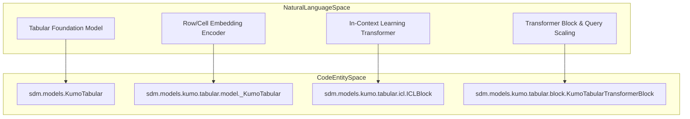
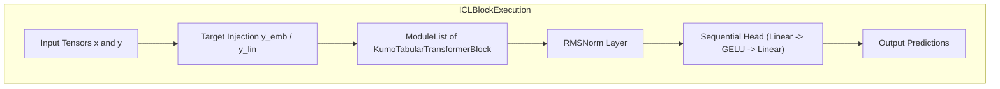
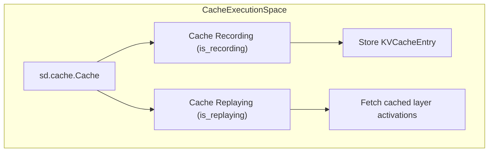

<!-- source: DeepWiki mcp.deepwiki.com · repo NVIDIA/structured-data-models · extra page KumoTabular · fetched 2026-10-26 -->

# KumoTabular

<details>
<summary>Relevant source files</summary>

The following files were used as context for generating this wiki page:

- [sdm/models/kumo/tabular/__init__.py](sdm/models/kumo/tabular/__init__.py)
- [sdm/models/kumo/tabular/batching.py](sdm/models/kumo/tabular/batching.py)
- [sdm/models/kumo/tabular/block.py](sdm/models/kumo/tabular/block.py)
- [sdm/models/kumo/tabular/icl.py](sdm/models/kumo/tabular/icl.py)
- [sdm/models/kumo/tabular/model.py](sdm/models/kumo/tabular/model.py)
- [test/models/kumo/tabular/test_batching.py](test/models/kumo/tabular/test_batching.py)
- [test/models/kumo/tabular/test_block.py](test/models/kumo/tabular/test_block.py)
- [test/models/kumo/tabular/test_icl.py](test/models/kumo/tabular/test_icl.py)
- [test/models/kumo/tabular/test_model.py](test/models/kumo/tabular/test_model.py)

</details>


## Purpose and Scope
This page documents the architecture, configuration variants, embedding mechanisms, in-context learning (ICL) blocks, memory-budget batching utilities, and verification tests for `KumoTabular` within `structured-data-models` (`sdm`). `KumoTabular` is NVIDIA's tabular foundation model designed for high-accuracy and efficient relational and tabular prediction tasks (classification and regression).

Sources: `sdm/models/kumo/tabular/model.py:67-104` [sdm/models/kumo/tabular/model.py:67-104]()

---

## 1. Model Sizes and Configuration Parameters
`KumoTabular` supports three standard architecture scales: `"small"`, `"medium"`, and `"large"`. These configurations dictate the channel widths, number of layers, attention heads, query/key-value head configurations, and feature embedding parameters managed by `MODEL_KWARGS`.

```python
MODEL_KWARGS: dict[str, dict[str, Any]] = {
    "small": { ... },
    "medium": { ... },
    "large": { ... }
}
```

The sizes differ across several hyper-parameters:
* **`cell_channels`**: Feature and cell representation width (128 for `"small"`, 256 for `"medium"` and `"large"`).
* **`icl_channels`**: In-context learning transformer hidden dimension (512 for `"small"` and `"medium"`, 1024 for `"large"`).
* **`num_icl_layers`**: Depth of the ICL sequence transformer (12 for `"small"`, 24 for `"medium"` and `"large"`).
* **`num_icl_heads`**: Number of attention heads in the ICL layers (8 for `"small"` and `"medium"`, 16 for `"large"`).
* **`num_icl_key_value_heads_for_query`**: Key-value head reduction factor for multi-query/group-query attention (e.g., `2` for medium/large, `None` for small MHA).

For classification tasks, multi-class targets are handled via Error-Correcting Output Codes (`ECOC`) up to 10 classes per sub-model block. For regression tasks, the model outputs 999 quantiles (`"q001"` through `"q999"`).

Sources: `sdm/models/kumo/tabular/model.py:23-63` [sdm/models/kumo/tabular/model.py:23-63](), `sdm/models/kumo/tabular/model.py:66-139` [sdm/models/kumo/tabular/model.py:66-139]()

---

## 2. Architecture: Natural Language to Code Entity Space

The mapping between conceptual tabular components and their concrete codebase implementations is structured as follows.


*Figure 1: Conceptual mapping from natural language architectural descriptions to code symbols in `sdm.models.kumo`.*

Sources: `sdm/models/kumo/tabular/model.py:66-134` [sdm/models/kumo/tabular/model.py:66-134](), `sdm/models/kumo/tabular/icl.py:17-59` [sdm/models/kumo/tabular/icl.py:17-59](), `sdm/models/kumo/tabular/block.py:21-75` [sdm/models/kumo/tabular/block.py:21-75]()

---

## 3. ICL Blocks and Transformer Layers

The in-context learning transformer stack is implemented in `ICLBlock`. It handles target injections (`y_emb` for classification token embeddings or `y_lin` for linear regression targets), a sequence of `KumoTabularTransformerBlock` layers, layer normalization (`RMSNorm`), and an output projection head.


*Figure 2: Data flow through `ICLBlock`.*

### `KumoTabularTransformerBlock` Details
Each transformer layer utilizes custom RMS normalization, rotary positional embeddings (RoPE) if configured, and `LogScale` query scaling (`sdm.nn.LogScale`). The feed-forward network (MLP) within the transformer block is zero-initialized on its final layer to maintain stable residual streams.

Sources: `sdm/models/kumo/tabular/icl.py:17-136` [sdm/models/kumo/tabular/icl.py:17-136](), `sdm/models/kumo/tabular/block.py:21-75` [sdm/models/kumo/tabular/block.py:21-75]()

---

## 4. KV Caching and Inference Acceleration

During inference, `ICLBlock` integrates with `sdm.cache.Cache` and `sdm.cache.KVCacheEntry` to cache key-value states for context rows, avoiding redundant re-computation when predicting multiple query rows.


*Figure 3: Mapping of cache mechanics to implementation classes.*

Sources: `sdm/models/kumo/tabular/icl.py:80-105` [sdm/models/kumo/tabular/icl.py:80-105](), `sdm/cache/__init__.py` [sdm/cache/__init__.py]()

---

## 5. Batching Utilities and Memory Estimation

To run large ensembles under strict memory boundaries, `sdm.models.kumo.tabular` provides helper functions to estimate safe batch sizes for training and inference.

* **`estimate_fit_batch_size`**: Computes how many ensemble members can be fitted concurrently within a given `memory_budget` (bytes).
* **`estimate_predict_batch_size`**: Computes how many query rows can be evaluated in a single forward pass given an active `estimator_batch_size`.
* **`_row_bytes`**: Internal helper calculating workspace memory, cache overhead, and inducing point requirements per row.

Sources: `sdm/models/kumo/tabular/batching.py:15-140` [sdm/models/kumo/tabular/batching.py:15-139]()

---

## 6. Testing and Verification Suite

The `KumoTabular` module includes a comprehensive test suite covering forward passes, categorical feature alignment, estimator batching, fit/predict lifecycles, and transformer block correctness.

| Test File | Key Test Cases / Focus |
| :--- | :--- |
| `test/models/kumo/tabular/test_model.py` | `test_forward`, `test_categorical_features_are_marked`, `test_estimator_batching`, `test_fit_predict` |
| `test/models/kumo/tabular/test_block.py` | `test_transformer_block`, `test_transformer_block_rope` |
| `test/models/kumo/tabular/test_icl.py` | `test_icl_block` (validates MHA, MQA, and KV cache replaying) |
| `test/models/kumo/tabular/test_batching.py` | `test_estimate_batch_sizes`, `test_estimate_batch_size_bounds` |

Sources: `test/models/kumo/tabular/test_model.py:94-216` [test/models/kumo/tabular/test_model.py:94-216](), `test/models/kumo/tabular/test_block.py:17-71` [test/models/kumo/tabular/test_block.py:17-71](), `test/models/kumo/tabular/test_icl.py:24-81` [test/models/kumo/tabular/test_icl.py:24-81](), `test/models/kumo/tabular/test_batching.py:44-96` [test/models/kumo/tabular/test_batching.py:44-95]()

---

