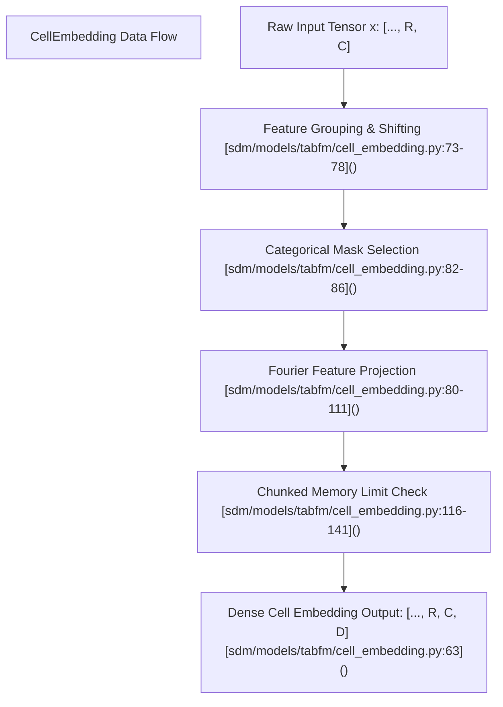
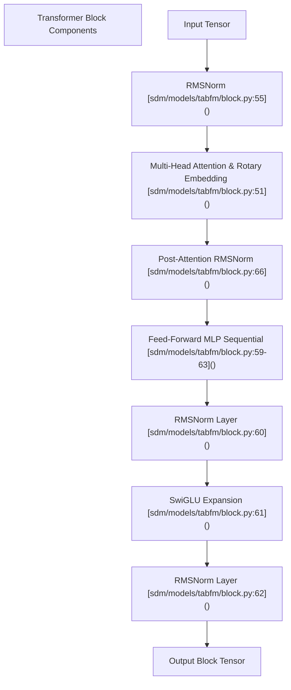

<!-- source: DeepWiki mcp.deepwiki.com · repo NVIDIA/structured-data-models · extra page TabFM · fetched 2026-10-26 -->

# TabFM

Relevant source files

The following files were used as context for generating this wiki page:

- [sdm/models/kumo/tabular/cell_embedding.py](sdm/models/kumo/tabular/cell_embedding.py)
- [sdm/models/kumo/tabular/row_embedding.py](sdm/models/kumo/tabular/row_embedding.py)
- [sdm/models/tabfm/LICENSE](sdm/models/tabfm/LICENSE)
- [sdm/models/tabfm/__init__.py](sdm/models/tabfm/__init__.py)
- [sdm/models/tabfm/block.py](sdm/models/tabfm/block.py)
- [sdm/models/tabfm/cell_embedding.py](sdm/models/tabfm/cell_embedding.py)
- [sdm/models/tabfm/ckpt.py](sdm/models/tabfm/ckpt.py)
- [sdm/models/tabfm/icl.py](sdm/models/tabfm/icl.py)
- [sdm/models/tabfm/row_embedding.py](sdm/models/tabfm/row_embedding.py)
- [sdm/models/tabiclv2/block.py](sdm/models/tabiclv2/block.py)
- [sdm/models/tabiclv2/ckpt.py](sdm/models/tabiclv2/ckpt.py)
- [sdm/models/timesfm3/LICENSE](sdm/models/timesfm3/LICENSE)
- [sdm/testing/memory.py](sdm/testing/memory.py)
- [test/models/kumo/tabular/test_cell_embedding.py](test/models/kumo/tabular/test_cell_embedding.py)
- [test/models/kumo/tabular/test_row_embedding.py](test/models/kumo/tabular/test_row_embedding.py)
- [test/models/tabfm/test_cell_embedding.py](test/models/tabfm/test_cell_embedding.py)

## Purpose and Scope

This page provides full technical documentation for the **TabFM** foundation model implementation within the `structured-data-models` (sdm) repository. TabFM is a scaled tabular foundation model designed for in-context learning (ICL) on GPU tensors. We examine its core architectural components: cell-level embedding with Fourier feature grouping [sdm/models/tabfm/cell_embedding.py:30-183](), RMSNorm and SwiGLU-equipped transformer blocks [sdm/models/tabfm/block.py:29-72](), row and column attention layers (`RowEmbedding` and `ICLBlock`) [sdm/models/tabfm/row_embedding.py:40-241](), [sdm/models/tabfm/icl.py:30-107](), and checkpoint loading pipelines.

---

## 1. Cell Embedding and Feature Grouping

The `CellEmbedding` class transforms raw tabular cells `[..., R, C]` into dense channel embeddings `[..., R, C, D]` by utilizing feature grouping, Fourier frequency projections, and separate weights for numerical and categorical attributes [sdm/models/tabfm/cell_embedding.py:30-63]().

### Implementation Details

During initialization, `CellEmbedding` constructs learnable parameters for numerical and categorical frequencies (`num_freq`, `cat_freq`) as well as linear projection weights (`num_lin`, `cat_lin`) [sdm/models/tabfm/cell_embedding.py:45-53](). 

In the `forward` pass, feature grouping cyclically shifts and indexes features to capture local feature interactions according to the configured `group_size` and `num_frequencies` [sdm/models/tabfm/cell_embedding.py:73-78](). It dynamically checks autocast states and manages chunked memory limits via `chunk_memory_limit` to prevent out-of-memory errors on large matrices during inference or evaluation [sdm/models/tabfm/cell_embedding.py:116-141]().

*Diagram 1: Natural Language to Code Entity Space mapping for `CellEmbedding`.*

Sources: `sdm/models/tabfm/cell_embedding.py` [sdm/models/tabfm/cell_embedding.py:30-183]()

---

## 2. Transformer Blocks and RMSNorm/SwiGLU Architectures

TabFM replaces standard layer normalization and vanilla feed-forward networks with Root Mean Square Normalization (`RMSNorm`), Softplus scaling, and Gated Linear Unit variants (`SwiGLU`) inside `TabFMTransformerBlock` [sdm/models/tabfm/block.py:29-72]().

### Architectural Components

- **Query/Key Transforms**: Queries and keys pass through `RMSNorm` (with `eps=1e-6`) and `SoftplusScale` modules [sdm/models/tabfm/block.py:40-50](). If rotary embeddings (`RotaryEmbedding`) are provided, they are prepended to the transformation pipeline [sdm/models/tabfm/block.py:51-53]().
- **Normalization**: Post-attention and central blocks enforce strict `RMSNorm` regularization [sdm/models/tabfm/block.py:55-66]().
- **MLP Block**: The feed-forward network uses a `Sequential` container enclosing an initial `RMSNorm`, a `SwiGLU` activation expanding channel capacity to `4 * channels`, and a final `RMSNorm` [sdm/models/tabfm/block.py:59-63]().

*Diagram 2: Execution flow and module composition of `TabFMTransformerBlock`.*

Sources: `sdm/models/tabfm/block.py` [sdm/models/tabfm/block.py:29-72]()

---

## 3. Row Embedding and ICL Stack

TabFM handles tabular layout processing through `RowEmbedding` and `ICLBlock` modules, coordinating both column-wise and row-wise attention operations [sdm/models/tabfm/row_embedding.py:40-241](), [sdm/models/tabfm/icl.py:30-107]().

### `RowEmbedding`
The `RowEmbedding` module integrates `CellEmbedding`, target label embeddings/MLPs (`y_emb` or `y_mlp`), readout tokens, column-wise `InducedTransformerBlock` layers, and row-wise `TabFMTransformerBlock` layers across multiple repetition blocks [sdm/models/tabfm/row_embedding.py:60-136](). It supports caching mechanisms (`Cache`, `KVCacheEntry`) to optimize inference performance during autoregressive or incremental scoring [sdm/models/tabfm/row_embedding.py:144-196]().

### `ICLBlock`
The `ICLBlock` executes the core in-context learning stack. It accepts model representations `[..., R, D]`, adds target embeddings for training rows (`y`), processes tokens through sequential `TabFMTransformerBlock` layers with key-value caching support, normalizes outputs via `RMSNorm`, and projects them to task predictions through a multi-layer perceptron head `[sdm/models/tabfm/icl.py:30-107]()`.

Sources: `sdm/models/tabfm/row_embedding.py` [sdm/models/tabfm/row_embedding.py:40-241](), `sdm/models/tabfm/icl.py` [sdm/models/tabfm/icl.py:30-107]()

---

## 4. Checkpoint Loading and Licensing

TabFM integrates with pre-trained weights through checkpoint ingestion handlers in `sdm/models/tabfm/ckpt.py`. 

### Licensing Note
As specified in package notices, code implementations are provided under the Apache-2.0 license, while pre-trained weights distributed by authors fall under separate restrictions (e.g., non-commercial use terms) [sdm/models/tabfm/LICENSE:1-126](). The codebase does not automatically download or bundle proprietary checkpoints [sdm/models/tabfm/LICENSE:1-7]().

Sources: `sdm/models/tabfm/ckpt.py`, `sdm/models/tabfm/LICENSE` [sdm/models/tabfm/LICENSE:1-126]()

---

