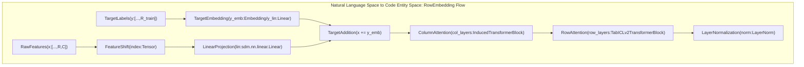

<!-- source: DeepWiki mcp.deepwiki.com · repo NVIDIA/structured-data-models · extra page TabICLv2 · fetched 2026-10-26 -->

# TabICLv2

<details>
<summary>Relevant source files</summary>

The following files were used as context for generating this wiki page:

- [sdm/models/tabfm/block.py](sdm/models/tabfm/block.py)
- [sdm/models/tabfm/ckpt.py](sdm/models/tabfm/ckpt.py)
- [sdm/models/tabfm/icl.py](sdm/models/tabfm/icl.py)
- [sdm/models/tabfm/row_embedding.py](sdm/models/tabfm/row_embedding.py)
- [sdm/models/tabiclv2/block.py](sdm/models/tabiclv2/block.py)
- [sdm/models/tabiclv2/ckpt.py](sdm/models/tabiclv2/ckpt.py)
- [sdm/models/tabiclv2/icl.py](sdm/models/tabiclv2/icl.py)
- [sdm/models/tabiclv2/row_embedding.py](sdm/models/tabiclv2/row_embedding.py)
- [sdm/testing/memory.py](sdm/testing/memory.py)
- [test/models/tabiclv2/test_icl.py](test/models/tabiclv2/test_icl.py)
- [test/models/tabiclv2/test_model.py](test/models/tabiclv2/test_model.py)

</details>


## Purpose and Scope

TabICLv2 is a GPU-native tabular foundation model within the `structured-data-models` (`sdm`) library, implementing in-context learning (ICL) for tabular classification and regression tasks. This page documents the core architectural components of TabICLv2: the row embedding module (`RowEmbedding`), transformer blocks (`TabICLv2TransformerBlock`), the in-context learning block (`ICLBlock`), and checkpoint remapping utilities (`remap_ckpt`).

Sources: `sdm/models/tabiclv2/row_embedding.py:22-255` [sdm/models/tabiclv2/row_embedding.py](), `sdm/models/tabiclv2/icl.py:22-194` [sdm/models/tabiclv2/icl.py](), `sdm/models/tabiclv2/block.py:17-57` [sdm/models/tabiclv2/block.py]()

---

## 1. Architectural Overview and Data Flow

TabICLv2 processes tabular data by transforming tables into sequences of row tokens and applying alternating column-wise and row-wise attention layers. The overall architecture coordinates two primary submodules: `RowEmbedding` [sdm/models/tabiclv2/row_embedding.py:22]() which embeds individual rows and features, and `ICLBlock` [sdm/models/tabiclv2/icl.py:22]() which performs in-context conditioning between context rows and query rows.

```mermaid
graph TD
    subgraph "Natural Language Space to Code Entity Space: Model Pipeline"
        A["InputTables(x_context,y_context,x_query)"] --> B["RowEmbedding(sdm.models.tabiclv2.row_embedding.RowEmbedding)"]
        B --> C["FeatureGrouping(lin:sdm.nn.linear.Linear)"]
        C --> D["ColumnAttention(InducedTransformerBlock)"]
        D --> E["RowAttention(TabICLv2TransformerBlock)"]
        E --> F["ICLBlock(sdm.models.tabiclv2.icl.ICLBlock)"]
        F --> G["TransformerLayers(TabICLv2TransformerBlock)"]
        G --> H["PredictionHead(Sequential)"]
    end
```


Sources: `sdm/models/tabiclv2/row_embedding.py:22-96` [sdm/models/tabiclv2/row_embedding.py](), `sdm/models/tabiclv2/icl.py:22-64` [sdm/models/tabiclv2/icl.py]()

---

## 2. Row Embedding and Feature Grouping

The `RowEmbedding` class [sdm/models/tabiclv2/row_embedding.py:22]() converts raw feature matrices into dense row representations. It handles feature grouping, target embedding injection, column-wise induced set attention, and row-wise rotary transformer blocks.


Sources: `sdm/models/tabiclv2/row_embedding.py:22-165` [sdm/models/tabiclv2/row_embedding.py]()

### Key Implementation Details
- **Feature Grouping**: Groups columns into blocks of size `group_size` via index shifting `[sdm/models/tabiclv2/row_embedding.py:114-118]()`.
- **Target Injection**: Injects context labels `y` into training rows using either an embedding layer (`y_emb`) for discrete classes or a linear layer (`y_lin`) for regression `[sdm/models/tabiclv2/row_embedding.py:44-47, 155-162]()`.
- **Mixed-Radix Decomposition**: For classification with extremely large numbers of classes, categories are decomposed into mixed-radix digits to bound embedding dimension requirements `[sdm/models/tabiclv2/row_embedding.py:120-130]()`.
- **Induced Set Attention**: Column layers use `InducedTransformerBlock` with `TabICLv2TransformerBlock` instances to compress and route feature information `[sdm/models/tabiclv2/row_embedding.py:49-70]`.

Sources: `sdm/models/tabiclv2/row_embedding.py:22-165` [sdm/models/tabiclv2/row_embedding.py]()

---

## 3. TabICLv2 Transformer Block and QASSMax

The foundational transformer layer for TabICLv2 is `TabICLv2TransformerBlock` [sdm/models/tabiclv2/block.py:17](), which inherits from `TransformerBlock` (`sdm.nn`) [sdm/models/tabiclv2/block.py:14]().

### Configuration Parameters
| Parameter | Type | Role |
| :--- | :--- | :--- |
| `channels` | `int` | Hidden embedding dimension size |
| `num_heads` | `int` | Number of attention heads |
| `norm_bias` | `bool` | Whether `LayerNorm` includes a bias term |
| `qassmax` | `bool` | Enables query-adaptive softmax scaling (`QASSMax`) |
| `rope` | `RotaryEmbedding \| None` | Optional rotary position embedding |

Sources: `sdm/models/tabiclv2/block.py:17-56` [sdm/models/tabiclv2/block.py]()

---

## 4. In-Context Learning Block (`ICLBlock`)

The `ICLBlock` class [sdm/models/tabiclv2/icl.py:22]() manages the core in-context inference loop. It takes row embeddings from `RowEmbedding`, appends target embeddings for context rows, and processes them through stacked transformer layers before passing the result to a prediction head.

```python
# Conceptual signature of ICLBlock forward pass
def forward(
    self,
    x: Tensor,  # [..., R, D]
    y: Tensor,  # [..., R_train]
    *,
    num_classes: int | None = None,
    cache: Cache | None = None,
) -> Tensor: ...
```

- **Standard Forward**: Resolves standard classification or regression predictions in a single forward pass over context and query tokens `[sdm/models/tabiclv2/icl.py:74-80]()`.
- **Hierarchical Forward**: When `num_classes` exceeds the model's primary classification capacity, `_forward_hierarchical` executes a recursive tree-based partitioning strategy over classes `[sdm/models/tabiclv2/icl.py:88-93, 140-194]()`.

Sources: `sdm/models/tabiclv2/icl.py:22-194` [sdm/models/tabiclv2/icl.py]()

---

## 5. Checkpoint Loading and Weight Mapping

TabICLv2 supports importing pre-trained weights via `remap_ckpt` [sdm/models/tabiclv2/ckpt.py:41](). This function converts upstream or HuggingFace state dict key nomenclature into the internal module hierarchy (`row_embedding.lin`, `icl_block.layers`, etc.).

| Upstream Checkpoint Key Prefix | Internal SDM Module Path |
| :--- | :--- |
| `col_embedder.in_linear.*` | `row_embedding.lin.*` |
| `col_embedder.tf_col.blocks.*` | `row_embedding.col_layers.*` |
| `row_interactor.tf_row.blocks.*` | `row_embedding.row_layers.*` |
| `icl_predictor.tf_icl.blocks.*` | `icl_block.layers.*` |
| `icl_predictor.decoder.*` | `icl_block.head.*` |

Sources: `sdm/models/tabiclv2/ckpt.py:41-135` [sdm/models/tabiclv2/ckpt.py]()

---

