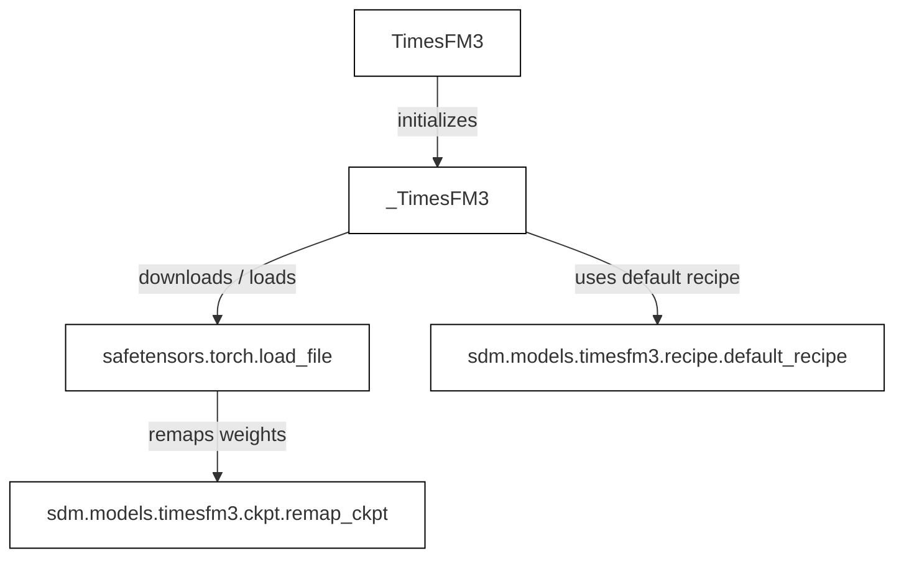
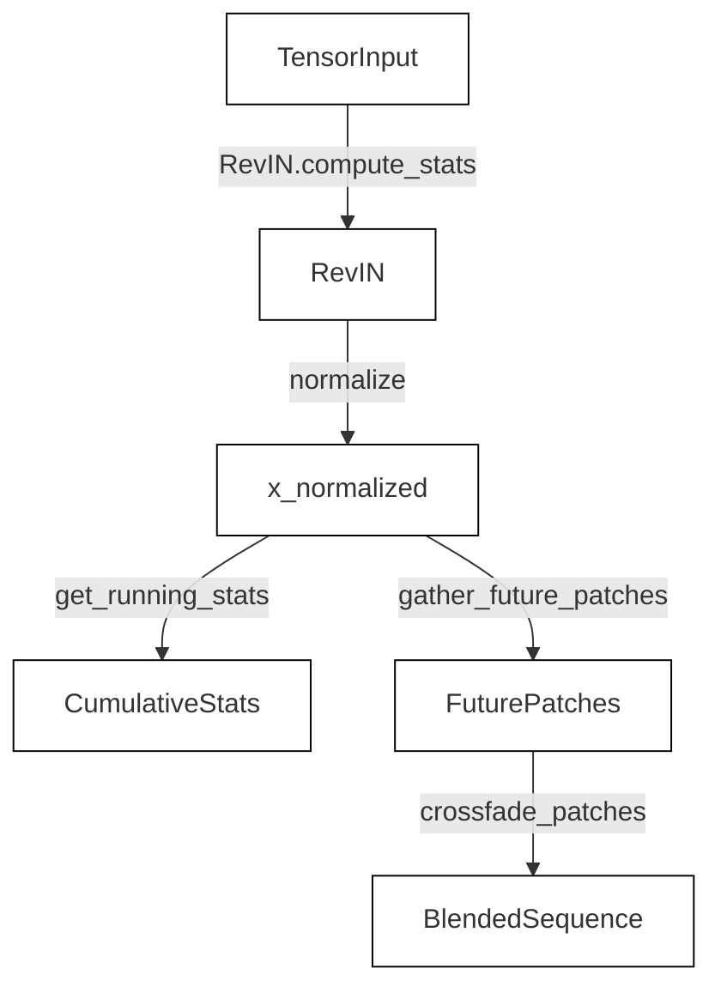
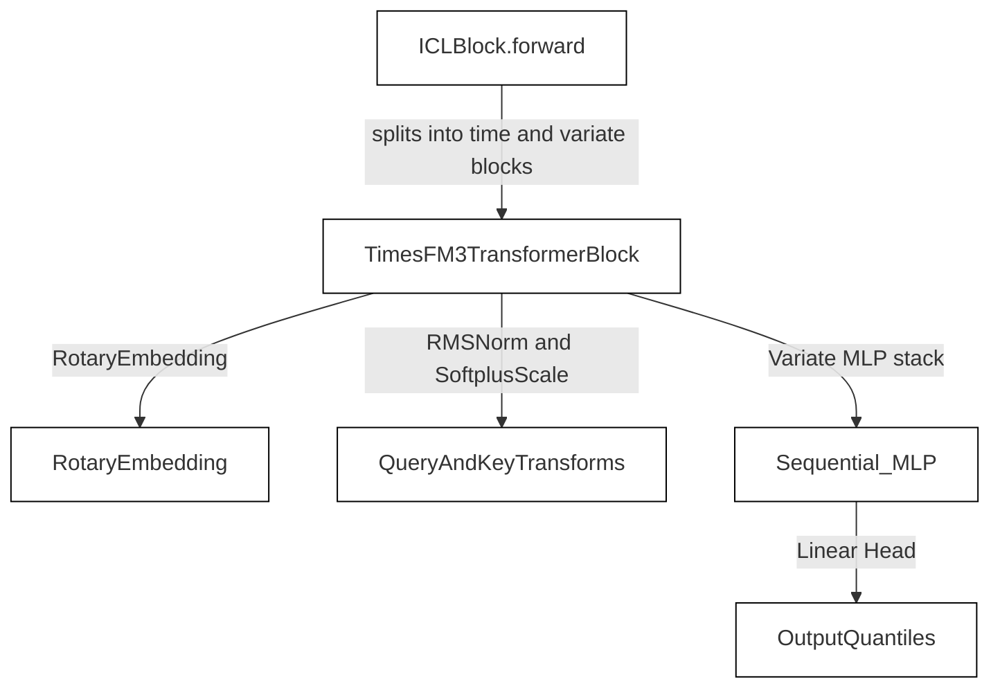

<!-- source: DeepWiki mcp.deepwiki.com · repo NVIDIA/structured-data-models · extra page TimesFM3 · fetched 2026-10-26 -->

# TimesFM3

<details>
<summary>Relevant source files</summary>

The following files were used as context for generating this wiki page:

- [docs/source/_templates/autosummary/model_class.rst](docs/source/_templates/autosummary/model_class.rst)
- [sdm/models/kumo/relational/model.py](sdm/models/kumo/relational/model.py)
- [sdm/models/timesfm3/block.py](sdm/models/timesfm3/block.py)
- [sdm/models/timesfm3/ckpt.py](sdm/models/timesfm3/ckpt.py)
- [sdm/models/timesfm3/icl.py](sdm/models/timesfm3/icl.py)
- [sdm/models/timesfm3/model.py](sdm/models/timesfm3/model.py)
- [sdm/models/timesfm3/util.py](sdm/models/timesfm3/util.py)
- [sdm/nn/revin.py](sdm/nn/revin.py)
- [test/models/timesfm3/test_block.py](test/models/timesfm3/test_block.py)
- [test/models/timesfm3/test_icl.py](test/models/timesfm3/test_icl.py)
- [test/models/timesfm3/test_model.py](test/models/timesfm3/test_model.py)
- [test/models/timesfm3/test_util.py](test/models/timesfm3/test_util.py)
- [test/nn/test_revin.py](test/nn/test_revin.py)

</details>


## Purpose and Scope
`TimesFM3` is a zero-shot multivariate time-series forecasting foundation model integrated into the `structured-data-models` (sdm) framework. It extends univariate TimesFM architectures to jointly forecast multiple coevolving target series, incorporate historical covariates, and process dynamic covariates known across both past context and future forecast horizons. The model decodes the full forecast horizon in a single forward pass and returns nine quantile forecasts (from the 10th to the 90th percentile) for each target series and query time step. 

Sources: `sdm/models/timesfm3/model.py:47-94`

---

## 1. Core Model Architecture and Initialization

The `TimesFM3` class inherits from `ICLModel` and supports numerical features and targets with multi-target capabilities and context-only columns [sdm/models/timesfm3/model.py:47-105]().


*Figure 1: Initialization and checkpoint loading pipeline for `TimesFM3`.*

Sources: `sdm/models/timesfm3/model.py:47-153`

During initialization (`__init__`), `TimesFM3` instantiates the underlying model on the `meta` device if pretrained weights are requested, downloads the HuggingFace checkpoint repository `google/timesfm-3.0-pytorch`, remaps checkpoint keys via `remap_ckpt`, and assigns the state dict [sdm/models/timesfm3/model.py:106-151]().

Sources: `sdm/models/timesfm3/model.py:106-151`

---

## 2. RevIN and Patch Tokenization Utilities

Time-series features are tokenized into patches and normalized via Reversible Instance Normalization (`RevIN`) [sdm/nn/revin.py:10-23](). Auxiliary processing utilities in `sdm/models/timesfm3/util.py` manage running statistics, future patch aggregation, and patch crossfading.


*Figure 2: Data flow through normalization and patch utility functions.*

Key functions in `sdm/models/timesfm3/util.py`:
- `update_running_stats()`: Updates running count, mean, and standard deviation for incoming patches handling invalid masks [sdm/models/timesfm3/util.py:22-61]().
- `get_running_stats()`: Computes cumulative statistics patch by patch across columns `[..., C, N, P]` [sdm/models/timesfm3/util.py:64-98]().
- `gather_future_patches()`: Concatenates future patches at each patch position with invalid masks [sdm/models/timesfm3/util.py:101-128]().
- `crossfade_patches()`: Merges overlapping patches into a single continuous sequence via linear interpolation [sdm/models/timesfm3/util.py:130-171]().

Sources: `sdm/nn/revin.py:10-95`, `sdm/models/timesfm3/util.py:22-172`

---

## 3. ICL Block and Transformer Components

The core computational engine of `TimesFM3` is implemented via alternating temporal and variate self-attention layers encapsulated in `ICLBlock` [sdm/models/timesfm3/icl.py:30-111]() and `TimesFM3TransformerBlock` [sdm/models/timesfm3/block.py:52-105]().


*Figure 3: Block-level hierarchy and attention pathways within `ICLBlock`.*

`ICLBlock` constructs a stack of `num_layers` alternating blocks:
1. **Time Attention Blocks (`time_blocks`)**: Operates across time steps for each series independently using `RotaryEmbedding` and causal/patch masks [sdm/models/timesfm3/icl.py:43-60]().
2. **Variate Attention Blocks (`var_blocks`)**: Operates across variates/columns with an intermediate MLP consisting of `RMSNorm`, `Linear`, `ReLU`, and `RMSNorm` layers [sdm/models/timesfm3/icl.py:61-75]().
3. **Prediction Head (`head`)**: Projects final hidden dimensions to output channels corresponding to quantile forecasts [sdm/models/timesfm3/icl.py:76-111]().

Sources: `sdm/models/timesfm3/icl.py:30-112`, `sdm/models/timesfm3/block.py:52-105`

---

## 4. Quantile Forecasts and Verification

`TimesFM3` outputs multi-target forecasts containing nine quantiles (e.g., `y1__q10`, `y2__q50`, `y3__q90`) [test/models/timesfm3/test_model.py:10-35](). 

Testing guarantees include checking finite bounds on numerical outputs, zero-shot forward consistency, and `fit`/`predict` cache parity:

```python
model = TimesFM3(pretrained=False)
out = model(x_context, y_context, x_query)
assert out.size() == (3, 3 * 9)
assert out.numerical.isfinite().all()
```
*Code snippet 1: Verification of output shapes and finiteness [test/models/timesfm3/test_model.py:30-31]().*

Sources: `test/models/timesfm3/test_model.py:1-42`, `sdm/models/timesfm3/model.py:154-175`

---

