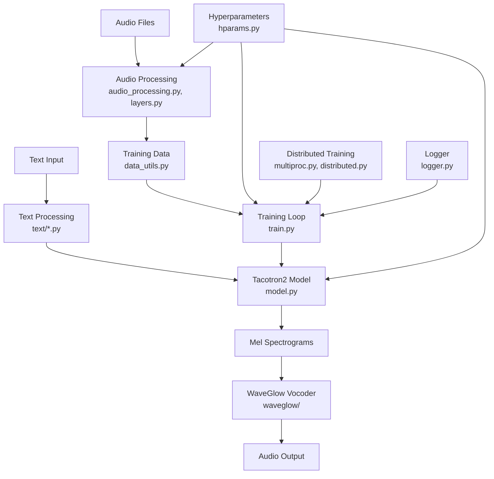
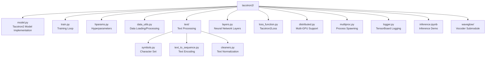
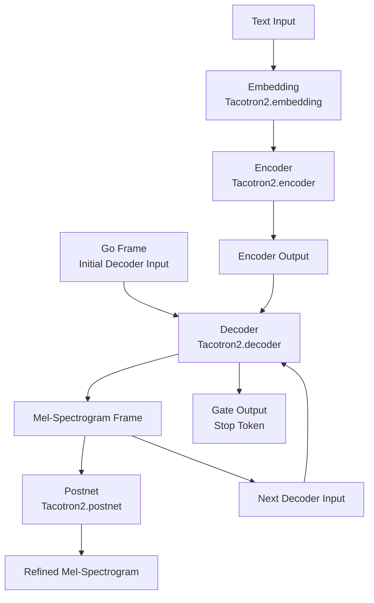
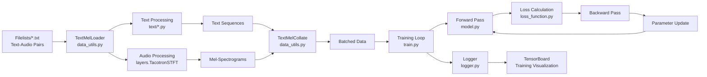
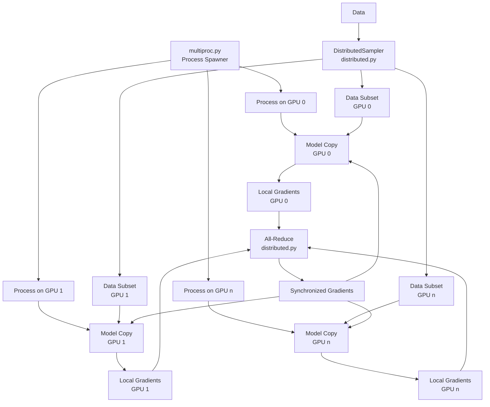
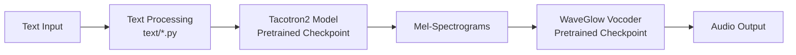

<!-- source: DeepWiki mcp.deepwiki.com · repo NVIDIA/tacotron2 · page 1 Overview · fetched 2026-10-26 -->

# Overview

Relevant source files

The following files were used as context for generating this wiki page:

- [LICENSE](LICENSE)
- [README.md](README.md)

This document provides an introduction to NVIDIA's PyTorch implementation of Tacotron 2, a state-of-the-art neural text-to-speech (TTS) system. This implementation follows the architecture described in the paper ["Natural TTS Synthesis By Conditioning Wavenet On Mel Spectrogram Predictions"](https://arxiv.org/pdf/1712.05884.pdf), with modifications for improved performance and scalability.

## Purpose and Scope

The NVIDIA Tacotron 2 repository provides a complete framework for training and using neural text-to-speech models. This implementation focuses on the Tacotron 2 architecture for converting text to mel-spectrograms, while integrating with WaveGlow (instead of WaveNet) as a vocoder for transforming mel-spectrograms into audible waveforms.

Key features of this implementation include:
- Complete PyTorch implementation of the Tacotron 2 architecture
- Distributed training support for multi-GPU environments
- Automatic mixed precision (AMP) support for faster training
- Integration with the LJSpeech dataset
- TensorBoard logging for training visualization

For detailed installation instructions, refer to [Installation & Requirements](#2). For in-depth exploration of system components, see [System Architecture](#3). For training procedures, see [Training](#4), and for inference details, see [Inference](#5).

Sources: [README.md:1-14]()

## High-Level Architecture

The NVIDIA Tacotron 2 implementation consists of several interconnected components that together form a complete text-to-speech pipeline:

The system comprises three main subsystems:

1. **Text-to-Mel Generation**: Converts text to mel-spectrograms using the Tacotron 2 neural network
2. **Vocoder**: Transforms mel-spectrograms into audio waveforms using WaveGlow
3. **Training Infrastructure**: Handles data preparation, model training, and performance monitoring

Sources: [model.py](), [train.py](), [hparams.py](), [data_utils.py](), [audio_processing.py](), [layers.py](), [text/](), [waveglow/](), [multiproc.py](), [distributed.py](), [logger.py]()

## Code Structure and Components

The repository is organized into several key components, each handling specific aspects of the text-to-speech pipeline:

Each component serves a specific purpose:

| Component | File(s) | Purpose |
|-----------|---------|---------|
| Tacotron 2 Model | model.py | Core neural network architecture for text-to-mel conversion |
| Training Loop | train.py | Manages the training process |
| Hyperparameters | hparams.py | Configurable settings for model and training |
| Data Processing | data_utils.py | Loads and processes text and audio data |
| Text Processing | text/*.py | Converts text to numerical representations |
| Audio Processing | layers.py, audio_processing.py | Handles audio feature extraction |
| Loss Function | loss_function.py | Defines the optimization objective |
| Distributed Training | distributed.py, multiproc.py | Enables multi-GPU training |
| Logging | logger.py | Visualizes training progress |
| Inference | inference.ipynb | Demonstrates model usage |
| Vocoder | waveglow/ | Converts mel-spectrograms to audio |

Sources: [README.md:17-54]()

## Tacotron 2 Model Architecture

The Tacotron 2 model implemented in `model.py` is an encoder-decoder architecture with attention, designed to convert text sequences into mel-spectrograms:

The key components of the model architecture include:

1. **Encoder**: Processes input text through an embedding layer, convolutional layers, and a bidirectional LSTM to create a text encoding
2. **Decoder**: Generates mel-spectrogram frames using an attention mechanism to focus on relevant parts of the encoded text
3. **Attention**: Location-sensitive attention that aligns decoder steps with encoder outputs
4. **Postnet**: Refines the generated mel-spectrogram with a series of convolutional layers
5. **Gate Layer**: Predicts when to stop generating frames

Sources: [model.py]()

## Training Pipeline

The training pipeline orchestrates the flow of data from raw text and audio files to model training:

During training:

1. `TextMelLoader` loads filelists containing paths to audio files and their transcriptions
2. Text is processed through text cleaners and converted to numerical sequences
3. Audio files are processed to extract mel-spectrograms
4. `TextMelCollate` batches the data for efficient processing
5. The model generates predicted mel-spectrograms that are compared to the targets
6. The loss is calculated and the model parameters are updated
7. Training progress is monitored through TensorBoard

Sources: [data_utils.py](), [train.py](), [model.py](), [loss_function.py](), [logger.py]()

## Distributed Training

The implementation supports distributed training across multiple GPUs for faster model development:

The distributed training system:

1. Uses `multiproc.py` to spawn a separate process for each available GPU
2. Distributes data across GPUs using `DistributedSampler`
3. Computes forward and backward passes locally on each GPU
4. Synchronizes gradients across all GPUs using all-reduce operations
5. Updates model parameters consistently across all processes

Sources: [multiproc.py](), [distributed.py](), [train.py:33-34]()

## Inference

For inference (generating speech from text), the repository provides a Jupyter notebook (`inference.ipynb`) that demonstrates the complete pipeline:

The inference process:

1. Input text is processed using the same text processing pipeline as during training
2. The trained Tacotron 2 model generates mel-spectrograms
3. The WaveGlow vocoder converts the mel-spectrograms to audio waveforms
4. The resulting audio can be played or saved to a file

Sources: [inference.ipynb](), [README.md:46-54]()

## Additional Features

The NVIDIA Tacotron 2 implementation includes several advanced features that enhance its functionality and performance:

1. **Automatic Mixed Precision**: Speeds up training by using lower precision (FP16) where possible while maintaining model accuracy
2. **TensorBoard Integration**: Visualizes training metrics, mel-spectrograms, attention alignments, and audio samples
3. **Warm Start Training**: Supports training from pre-trained models for faster convergence
4. **Checkpoint Saving/Loading**: Saves and loads model states for training continuation and inference

Sources: [README.md:36-42](), [train.py](), [logger.py]()

## License and Acknowledgements

This implementation is released under the BSD 3-Clause License and acknowledges contributions from various sources:

- Keith Ito's Tacotron implementation
- Prem Seetharaman's PyTorch STFT implementation
- Ryuchi Yamamoto's PyTorch Tacotron implementation
- The original Tacotron 2 paper authors

Sources: [LICENSE](), [README.md:63-72]()

---

