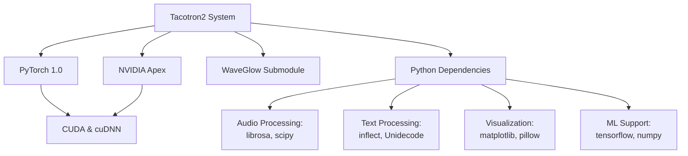
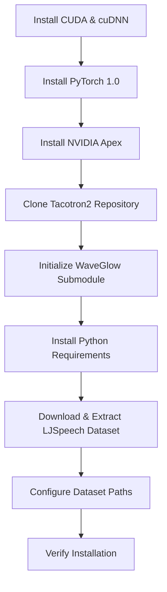
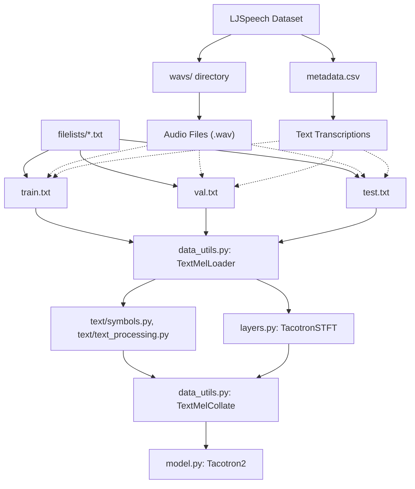
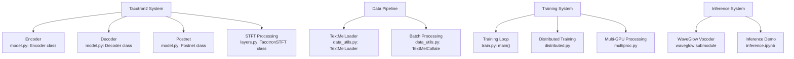

<!-- source: DeepWiki mcp.deepwiki.com · repo NVIDIA/tacotron2 · page 2 Installation & Requirements · fetched 2026-10-26 -->

# Installation & Requirements

<details>
<summary>Relevant source files</summary>

The following files were used as context for generating this wiki page:

- [LICENSE](LICENSE)
- [README.md](README.md)
- [requirements.txt](requirements.txt)

</details>


This document provides detailed instructions for installing and setting up the NVIDIA Tacotron2 system, including hardware requirements, software dependencies, and dataset preparation. For information about the overall system architecture, see [System Architecture](#3), and for training instructions after installation, see [Training](#4).

## Hardware Requirements

To run NVIDIA Tacotron2, you will need the following hardware:

- NVIDIA GPU with CUDA support
- CUDA and cuDNN drivers properly installed
- Sufficient GPU memory (8GB or more recommended for training)
- Adequate system RAM (16GB or more recommended)

Sources: [README.md:17-18]()

## Software Dependencies

### Core Components

The Tacotron2 system relies on several key software components:



Title: Tacotron2 Software Dependency Architecture

### Python Package Requirements

The following Python packages are required as specified in requirements.txt:

| Package | Version | Purpose |
|---------|---------|---------|
| matplotlib | 2.1.0 | Visualization and plotting |
| tensorflow | 1.15.2 | TensorBoard logging support |
| numpy | 1.13.3 | Numerical processing |
| inflect | 0.2.5 | Text normalization |
| librosa | 0.6.0 | Audio processing |
| scipy | 1.0.0 | Scientific computing |
| Unidecode | 1.0.22 | Unicode text conversion |
| pillow | latest | Image processing |

Sources: [requirements.txt:1-8]()

## Installation Process

The following diagram outlines the installation process for Tacotron2:



Title: Tacotron2 Installation Workflow

### 1. Setting Up CUDA and cuDNN

Ensure CUDA and cuDNN are properly installed on your system. Tacotron2 is compatible with CUDA 9.0+ and corresponding cuDNN versions.

Sources: [README.md:17-18]()

### 2. Installing PyTorch

Install PyTorch 1.0 following the official instructions:

```bash
pip install torch==1.0.0
```

Sources: [README.md:27](), [README.md:77]()

### 3. Installing NVIDIA Apex

Apex is required for distributed training and automatic mixed precision support:

```bash
git clone https://github.com/nvidia/apex
cd apex
pip install -v --no-cache-dir --global-option="--cpp_ext" --global-option="--cuda_ext" ./
```

Sources: [README.md:28](), [README.md:80-81]()

### 4. Cloning the Tacotron2 Repository

Clone the repository to your local machine:

```bash
git clone https://github.com/NVIDIA/tacotron2.git
cd tacotron2
```

Sources: [README.md:22-23]()

### 5. Initializing the WaveGlow Submodule

The repository uses WaveGlow as a submodule for vocoding:

```bash
git submodule init
git submodule update
```

Sources: [README.md:24]()

### 6. Installing Python Requirements

Install all required Python packages:

```bash
pip install -r requirements.txt
```

Sources: [README.md:30](), [requirements.txt:1-8]()

## Dataset Preparation

Tacotron2 is designed to work with the LJSpeech dataset. The following diagram shows how the dataset integrates with the codebase:



Title: Tacotron2 Dataset Integration with Codebase

### 1. Downloading the LJSpeech Dataset

Download and extract the LJSpeech dataset from the official source: [LJ Speech Dataset](https://keithito.com/LJ-Speech-Dataset/).

Sources: [README.md:21]()

### 2. Configuring Dataset Paths

Update the paths in the filelists to point to your dataset's location:

```bash
sed -i -- 's,DUMMY,/path/to/ljs_dataset_folder/wavs,g' filelists/*.txt
```

Alternatively, if you prefer to use pre-computed mel-spectrograms:

1. Set `load_mel_from_disk=True` in `hparams.py`
2. Update the mel-spectrogram paths in the filelists

Sources: [README.md:25-26]()

## Code Architecture

The following diagram maps the high-level components of Tacotron2 to their specific code implementations:



Title: Tacotron2 Code Component Architecture

Sources: [README.md:33-34](), [README.md:43-44](), [README.md:46-50]()

## Verification and Next Steps

To verify your installation, run an inference test using pre-trained models:

1. Download the pre-trained models:
   - [Tacotron 2 Model](https://drive.google.com/file/d/1c5ZTuT7J08wLUoVZ2KkUs_VdZuJ86ZqA/view?usp=sharing)
   - [WaveGlow Model](https://drive.google.com/open?id=1rpK8CzAAirq9sWZhe9nlfvxMF1dRgFbF)

2. Start the Jupyter notebook:
   ```bash
   jupyter notebook --ip=127.0.0.1 --port=31337
   ```

3. Open `inference.ipynb` and follow the instructions to synthesize speech

Sources: [README.md:46-50]()

After successful installation, you can proceed to:

- Training a model from scratch: See [Training](#4)
- Running inference with pre-trained models: See [Inference](#5)
- Understanding distributed training: See [Distributed Training](#4.3)

## Troubleshooting Common Issues

### CUDA Version Compatibility

Ensure that your PyTorch installation matches your CUDA version. You may need to install a specific PyTorch version compatible with your CUDA installation.

### WaveGlow Submodule Issues

If you encounter issues with the WaveGlow submodule, try reinitializing it:

```bash
git submodule deinit --all
git submodule init
git submodule update
```

### Dataset Path Configuration

If the system cannot find audio files during training, double-check the paths in the filelist files to ensure they correctly point to your dataset location.

Sources: [README.md:25-26]()

### Mixed Precision Training Issues

If you encounter issues with mixed precision training (fp16_run=True), ensure that Apex is correctly installed with CUDA extensions.

Sources: [README.md:44](), [README.md:80-81]()

---

